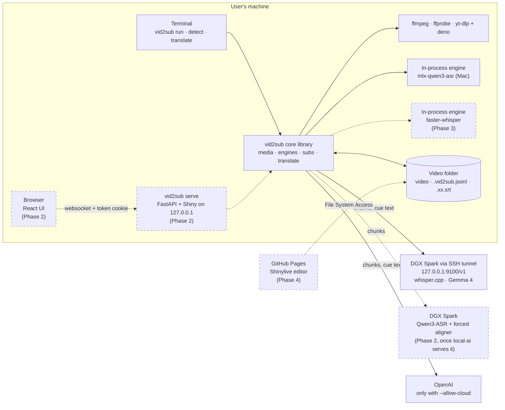

# vid2sub: architecture

Every diagram of vid2sub lives on this page; the spec
(`docs/superpowers/specs/2026-10-14-vid2sub-design.md`) and the other docs link here rather than
drawing their own copy. Built parts are solid; planned parts are dashed and labelled with the
phase that brings them.

## Three ways to run it

The CLI and the local web app call the same core; the Pages editor runs the pure subtitle code in
the browser and can't generate subtitles (spec §3.1).

