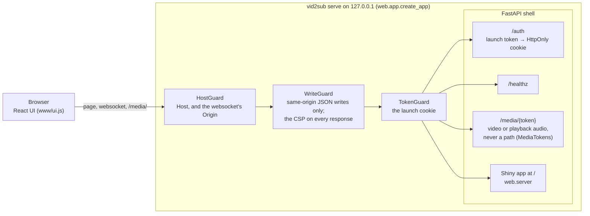
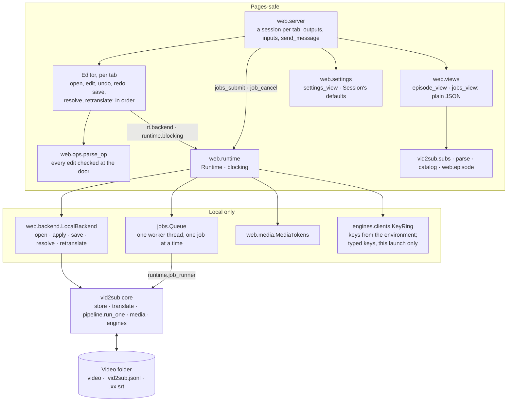

# vid2sub Phase 2 (M2): the editor — Implementation Plan

> **For agentic workers:** REQUIRED SUB-SKILL: Use superpowers:subagent-driven-development
> (recommended) or superpowers:executing-plans to implement this plan task-by-task. Steps use
> checkbox (`- [ ]`) syntax for tracking. Every rule for running a task (the loop, the reviews,
> the stops, the commit formats) is in `AGENTS.md`; this plan never restates them.
>
> **Resuming mid-task** (after a crash or compaction with no wip commit): never run Step 0 again.
> The task's base is the parent of its first commit whose trailer names it
> (`git log --reverse --format=%H --grep='phase-2.md Task N$' | head -1`, then `^`), and the
> newest commit's subject, matched against the task's commit steps, says which step is next (the
> kickoff council's reliability finding 9).

**Goal:** `vid2sub serve`, a local web app on `127.0.0.1` behind a launch token, whose editor
opens an episode M1 made, plays it (through the playback audio when the browser can't play its
audio), and lets Dan fix, retranslate and save its subtitles; an SRT edited elsewhere comes back
as an external version.

**Architecture:** the editor's behaviour lives in the core and the backend (`vid2sub.subs.edit`
for edit rules, `vid2sub.web.backend` for opening, saving and retranslating through `vid2sub.store`
and `vid2sub.translate`), so the CLI and the web app share it (spec §18.3). A FastAPI shell
(`vid2sub.web.app`) serves `/auth`, `/healthz` and `/media/{token}` and mounts a shinyreact app
(`vid2sub.web.server`) at `/`, wrapped as `HostGuard(WriteGuard(TokenGuard(api)))`. The React
frontend (`frontend/`, built into `src/vid2sub/web/www/`) renders JSON outputs from pure view
functions (`vid2sub.web.views`) and sends edits as typed inputs.

**Tech Stack:** Python ≥3.12, uv, FastAPI 0.142.3 and uvicorn 0.54.0, shiny 1.8.0 and shinyreact
0.1.0 (pinned exactly, as `recordings` does), pydantic 2; React 19.2.8 kept external as
`window.shinyreact.React`, Vite 5.4.21 library build, TypeScript 5.9.3, Tailwind 4.3.3, shadcn
`radix-nova`, Vitest 3.2.7; Node 22; pytest, hypothesis, pytest-playwright 0.10.0 (Chromium);
ffmpeg ≥6 for the playback audio.

**Spec:** `docs/superpowers/specs/2026-10-14-vid2sub-design.md`

**Now:** Task 1: The M1 exit test (with Dan), open.

## Decisions made while planning (review these)

1. **Media tokens are bound to the launch,** not to a Shiny session: a `/media/` request carries
   only the launch cookie, so "bound to the session" (spec §6.5) means the engine's launch. Tokens
   are unguessable, die when the engine exits, and are revoked when their episode is closed.
2. **An audio track the browser can't play makes the video unplayable** (spec §8.2), so Phase 2's
   editor then plays the playback audio with no picture; the preview copy (picture) is Phase 3.
3. **Edits keep `w` (the word range) only where the words are unchanged:** text and time edits keep
   it; split and insert drop it; merge joins two ranges. A text edit drops the `halluc` flag and a
   time edit drops `est`, since a person has now checked them.
4. **The editor marks a translation cue it changes `edited`,** as `store.align_ids` does for
   outside edits, so M1's pipeline keeps it (spec §13.4). A Save's head is `by: "editor"`, which
   keeps the whole track from automatic replacement.
5. **The glossary is written at Save,** never on each keystroke (spec §16).
6. **The demo folder holds no video:** `vid2sub serve --demo` muxes the public-domain
   `tests/fixtures/speech/jfk-14s.wav` into a short MP4 (VP9 and Opus, which every Chromium
   build plays, with or without H.264 and AAC; Playwright 1.64's Chromium on macOS has both)
   in its temporary copy at start-up, beside a committed canned sidecar. Phase 4 replaces it
   with the non-English clip spec §21 asks for.
7. **Cancel stops between chunks and between translation batches;** a running ffmpeg finishes its
   (short) step first. M1's pipeline has no cancellation, so Task 4 adds a check to `RunContext`.
8. **Retranslating cues a person names replaces them even where a translation was edited:** the
   person asked, so it isn't "replaced automatically" (spec §13.4). **Retranslate stale** never
   replaces an edited cue (S30).
9. **Stale follows spec §13.4 in full, as M1 does:** a cue is stale when its source changed, and
   every unedited cue of a track is stale when the glossary or the translation model changed. So a
   term added at Save makes the whole track stale on the next open. An outside edit keeps the
   glossary hash and model of the version its file was written from, so fixing a typo in an SRT
   marks nothing stale (Task 5, Task 6 round 6f, Task 7).
10. **An outside edit to a file written from an older version diverges** rather than replacing the
    head (spec §14.4), and a Save whose file write fails records the version the file still holds.
    M1's `store` did neither; Task 6 round 6f fixes both (escaped from M1 Task 28).
11. **HostGuard allows only `127.0.0.1`** for the app (`app.HOSTS`), not `localhost` or `::1`:
    the browser is sent to `http://127.0.0.1:<port>/auth`, so the cookie exists only there, and
    a narrower list leaves DNS rebinding less to work with (Task 11).
12. **`vid2sub serve` prints the sign-in link only to a terminal;** when its output goes
    anywhere else it prints the path of the 0600 redirect file instead, so the token never
    reaches a log (spec §6.1, S23; Task 11).
13. **Modal parts are the browser's own `<dialog>` with `showModal()`,** not Radix's modal
    Dialog, Sheet or Select, which inject a `<style>` the CSP blocks: the page behind is inert,
    Esc closes and focus returns (spec §6.3, §19.3). Menus are Radix with `modal={false}`;
    choices are a native `<select>` (Tasks 12, 16, 18).
14. **Shiny's busy-indicator script is served as a file,** so `script-src 'self'` stays as spec
    §6.3 has it and no `style-src` is needed (Task 12, recorded in §29 at its close).
15. **The browser's own `canPlayType` has a say in playability** (spec §8.2). The player asks
    it about the container, the picture and the sound before loading the video. It falls back
    to the playback audio when an answer is empty or a codec is unknown, when the `<video>`
    reports a decode or source error, or when the picture has no size once its metadata loads.
    Chromium plays an MP4's sound while dropping a picture it can't decode, and reports no
    error (Task 14, round 14d).
16. **Keys beyond spec §20's list:** ←/→ choose the source or translation cell; Ctrl/⌘+Z,
    Ctrl/⌘+Shift+Z and Ctrl+Y undo and redo. For J/K/L, J jumps back 2 s, since Chromium can't
    play backwards; K pauses, L plays. No ⌘S: Save is a button (Task 15).
17. **Insert makes a cue reading "…" and opens it for editing,** since `subs.edit.insert`
    refuses empty text (Task 15).
18. **The crash draft is a replay of the tab's edits, undos and redos,** keyed by the heads it
    started from. A pick that leaves unsaved edits carries the draft forward; editing without
    restoring an offered draft discards it (Task 16).
19. **"ASS too" at Save writes ASS for every track,** as the backend's `save` does (Task 16).
20. **The conflict picker numbers the versions and shows the cues where they differ,** side by
    side as plain text: at most 50, then how many more. While the source track itself is in
    conflict, the cue list stays empty until a version is picked (Task 16, round 16c).
21. **The settings drawer shows the cue rules read-only;** its per-session defaults are targets
    and formats only (Task 18). Spec §19.2 lists cue rules among the drawer's defaults, and
    §12.2's heading calls them "user-adjustable". But `vid2sub.toml` has no key for them (§5.1),
    and M1 built no flag or key, so Copy settings (§5.4) couldn't give TOML that loads. The
    alternative is a `[rules.<lang>]` table (line width, lines, reading speed, durations), used
    by `vid2sub run`, jobs, the editor's lint and translation limits, each with §5.2's test that
    the value reaches the code. That is a new config interface touching M1's pipeline, and a
    task of its own. **This changes the spec** (§19.2, and §12.2's "user-adjustable" moves to
    Later or to a phase Dan names), so it waits for Dan's yes at approval.
22. **Per session means the engine's launch:** the drawer's defaults and typed keys are shared by
    every tab on one launch, held in memory, never written, and dropped on exit (spec §5.3,
    §5.4). A job reads the targets and formats when it starts (Tasks 18, 19).
23. **One capability gate:** `capabilities.generate` hides Retranslate, the settings drawer and
    the Jobs page, so the Pages editor, where it is false, offers none of them. No new
    capabilities field (Tasks 17–19).
24. **The drawer's Test lists models on any configured endpoint, cloud ones included,** when the
    person clicks it: one GET for `/v1/models`, carrying only that endpoint's key, to that
    endpoint's own origin, so no subtitle text leaves and the Allow cloud models box doesn't
    apply (spec §19.2) (Task 18).
25. **A typed key is 8 to 1,024 characters of `A–Z a–z 0–9 . _ ~ + / = : -`;** anything else is
    refused with a fixed message. This keeps the key redactable in every error text (spec §5.3,
    §6.8), but would refuse a real key that uses another character (Task 18, round 18c).
26. **Retranslate always uses the route's translation model;** Phase 2 has no model picker for it
    (spec §20 says which cues, not which model) (Task 17).
27. **The crash draft keeps a retranslation as a marker, never its result:** restoring skips it,
    and also skips any undo or redo that took back or brought back a retranslation, so restoring
    a draft never asks a model again (Task 17, with Decision 18).
28. **The Jobs page takes full local paths only;** a link is refused, since adding a YouTube link
    is Phase 3's Add (spec §19.2, S36). Every tab on a launch sees the same jobs, with the paths
    typed (Task 19). Phase 3 removes the box once Add exists (Phase 3 Decision 28).
29. **The demo session's targets are `("ja",)`,** matching its canned translation (Tasks 17–19).
30. **One write lock per sidecar inside the app, and the re-check just before the rename** (Task
    6; the kickoff council's reliability finding 1, a Critical; Dan, Q&A item 18). Every
    `store.append` and projection takes a process-wide lock keyed by the sidecar's real path, so
    an editor Save and a job's write never overlap, and the compare-and-swap's re-read moves to
    just before `os.replace`, as §14.6 says. Between the app and a CLI run only that moment is
    unguarded; §18.3 says so now. The backend's per-video lock, keyed by the path as typed, goes.
31. **A new cue takes the id the page proposes** (Tasks 2, 15 and 16; reliability finding 2, a
    Critical; Dan, Q&A item 19). Every edit that makes a cue (split, merge, insert, join) carries
    its new ids, `c` + 8 hex, drawn by the page; the server refuses one that is malformed or
    taken. A crash draft therefore replays exactly, and it is cleared only after a replay with
    no refused step. Each tab keeps its own draft, keyed by the heads and a tab id held in
    `sessionStorage`, and a reopened episode offers every draft for its heads with its time
    (reliability finding 3). The server answers each edit, undo and redo with
    `applied {episode, n, ok, changed}`, so a Restore knows which steps were refused, and a step
    accepted that changes nothing counts as not replayed, so the draft is kept (Tasks 16 and 17,
    the latter's Tier 1 review).
32. **Save never replaces someone else's subtitle file from the UI** (Task 16; goal fit finding 5;
    Dan, Q&A item 22): its notice names each file it left and says
    `vid2sub write <video> --overwrite-foreign` replaces it, with the literal `<video>`; the
    video's name is plain text outside the command, never inside one a person might paste (a
    security review of the build). §6.6 says so now, and asking per
    file is the spec's Later row S64.
33. **The editor's Retranslate has its own Allow cloud models box,** unticked at first and after
    each request (Task 17; security finding 6): a third place to consent, beside §7.2's flag and
    Review's checkbox. **This adds to the spec** (§7.2), so it waits for Dan's yes at approval;
    Task 17's close amends §7.2.
34. **The launch cookie reaches any server on 127.0.0.1,** since cookies ignore ports (Task 9;
    security finding 8): a local server the browser visits could replay it with no Origin
    header and get in. HostGuard and WriteGuard keep other pages out, not other servers. **This
    adds to the spec** (§6.1 names the risk), so it waits for Dan's yes at approval; Task 9's
    close writes it into §6.1.
35. **Dependabot watches the frontend's npm lock on Fridays** too (Task 21; security finding 7),
    as §23.1 asks; whether `npm ci --ignore-scripts` still builds is a Phase-end row.
36. **Discard clears only this tab's draft** and hides the others in this tab; other tabs'
    drafts stay until restored, or until a Save moves the heads (Task 16).
37. **The sidecar lock folds a name's case and Unicode form everywhere** (Task 6): on a
    case-sensitive volume, two files that differ only in case take turns rather than write at
    once, which costs nothing but a wait.

## Global Constraints

- Python `>=3.12`; CI runs 3.12 and 3.14. Everything runs through `uv`; never `pip install`.
- Pure packages (`vid2sub.subs`, `vid2sub.parse`, `vid2sub.catalog`) import only the standard
  library (no subprocess, socket, http, urllib, asyncio, threading, multiprocessing, ssl),
  pydantic, pysubs2, opencc_purepy, charset_normalizer and each other (`tests/test_purity.py`).
- Only `src/vid2sub/engines/clients.py` imports `openai`, `httpx` or `chatlas`.
- Times are integer milliseconds; cues sorted, `0 ≤ start < end`, no overlaps, `\n` line breaks,
  never a blank line (spec §12.1).
- Never overwrite an artifact: the sidecar is append-only; a subtitle file is rewritten only when
  the sidecar has a projection record for it (spec §14, §15.3).
- No titles, paths, tokens or keys in logs or `--json` output (spec §6.8).
- The engine binds `127.0.0.1` only (spec §6.1).
- CSP on every page, verbatim (spec §6.3): `default-src 'self'; script-src 'self'; connect-src
  'self'; object-src 'none'; base-uri 'none'; frame-ancestors 'none'; img-src 'self' data: blob:;
  media-src 'self' blob:`; never `unsafe-eval`. `/media/` responses: `Content-Security-Policy:
  sandbox`, `X-Content-Type-Options: nosniff`, `Cache-Control: no-store`.
- Untrusted text is rendered as plain text; the caption overlay renders `<i>` only, through a
  whitelist; never `dangerouslySetInnerHTML` (spec §6.3).
- Fonts are served locally; the app makes no third-party requests.
- React stays external (`react` → `window.shinyreact.React`, `react-dom/client` →
  `window.shinyreact.ReactDOM`); the `react-dom` index is bundled (shinyreact's global lacks
  `createPortal` and `flushSync`). `src/vid2sub/web/www/ui.js` and `ui.css` are build output.
  `ReactApp(server)` is called in `src/vid2sub/web/server.py`. Every output is subscribed and every
  message handler and input lives in `App` (shinyreact 0.1.0).
- The Shiny server runs in Pages too (spec §3.3, §21), so `vid2sub.web.server` and
  `vid2sub.web.views` import, at module level, only the pure packages, shiny, shinyreact,
  htmltools, pydantic and `vid2sub.web.{episode, ops, views, runtime, settings}` (`settings` from
  Task 18). Local-only code is
  reached through the configured `Runtime`, and every blocking call goes through
  `runtime.blocking`, never a thread or executor directly (Pyodide has none; `blocking` runs
  inline there). `tests/test_pages_imports.py` pins both (Task 14, round 14a).
- Colours: NYC blue `#236192` (`#6CA6D9` dark) is the working colour; NYC orange `#F26522` marks
  bars and backgrounds, never text. Atkinson Hyperlegible and Atkinson Hyperlegible Mono.
- British spelling; module docstrings give one sentence of purpose, then why, citing spec sections
  and who decided; test names are sentences; guard tests fail without their fix.
- A hook blocks shell commands that name `src/vid2sub/media/`: read and edit files there with the
  file tools; `make test` and `uv run pytest` are unaffected.

## Review Focus

1. **A video whose path has non-ASCII, bidi or emoji characters, or that sits on a network
   share:** it opens, plays through `/media/`, and saves next to itself. (Task 10's and Task 6's
   tests.)
2. **The sidecar changed by a CLI run while the editor has the episode open** (`vid2sub translate`
   runs, then Save): the editor's version and the CLI's both survive; a diverged track shows as a
   conflict. (Task 6's tests.)
3. **A long episode** (two hours, about 2,000 cues): opening it and every edit stay under a
   second, and the cue list renders only what's on screen. (Task 5's and Task 14's tests.)
4. **Two tabs on one launch editing one episode:** each Save is compare-and-swap; the second sees
   the conflict. (Task 6's and Task 16's tests.)
5. **The engine restarted while a tab is open:** the old cookie is refused, and the page says to
   open the new URL instead of retrying forever. (Task 9's and Task 12's tests.)

***

### Task 1: The M1 exit test (with Dan)

**Tier:** 3 · **Scenarios:** S01, S02, S03, S04, S05 · **[Dan]**, on Dan's Mac with the Spark,
Plex and Jellyfin

The M1 plan's Task 36, Steps 2 and 3, moved here (Dan, 2026-10-23, Q&A item 7). The implementer
prepares the list and records the results; Dan runs every step that touches his media, his
servers and his machine. Each [Dan] step is asked one at a time, by *Asking Dan*.

**Files:**
- Modify: `docs/superpowers/specs/2026-10-14-vid2sub-design.md` (§29's M1 results, the Scenarios
  rows S01–S05, Open items)

**Interfaces:** none (no code).

- [ ] **Step 0: Record the base:** `git rev-parse HEAD > .git/TASK_BASE`.
- [ ] **Step 1: List the [Dan] steps** (2 to 8 below) for Dan, one line each, with the count,
  then present Step 2. Set **Now** to `waiting on Dan: Task 1, Step 2` and commit it as a wip
  (`chore(plan): 🤖 wip Task 1: waiting on Dan for the M1 exit test`, its body `Done so far:`
  the list, `Stopped at:` Step 2, `Tests:` not run, no code).
- [ ] **Step 2: [Dan] Install and check,** on the Mac, in this repo's folder:

```bash
brew install deno                       # yt-dlp needs it for YouTube (spec §4.2)
uv tool install --editable '.[mac]'
vid2sub config path                     # where vid2sub reads vid2sub.toml
vid2sub config init                     # a starter: save it at that path, then edit it
vid2sub doctor                          # every line green; keys by presence only
```

  In local-ai's folder, `make tunnel` running. Expected: `doctor` reports ffmpeg, ffprobe and
  deno with versions, the Spark reachable, and `SPARK_API_KEY` present.
- [ ] **Step 3: [Dan] A Cantonese episode (S01):**

```bash
time vid2sub run "<a Cantonese episode>" --from yue --to none
vid2sub translate "<the same episode>" --to en
```

  Watch the `.en.srt` in Plex. Check the `.zh-HK.srt` shows as Chinese (Hong Kong) or similar,
  in Traditional characters. Note the first command's time: transcription alone, Qwen3-ASR's
  speed on an idle Mac (§29); the second translates the transcript the first made.
- [ ] **Step 4: [Dan] A Japanese episode (S02),** detection on:

```bash
vid2sub run "<a Japanese episode>" --to en
```

  Watch the `.en.srt` in Plex; note whether Gemma's English reads well at 4 characters per second
  (Open items: Japanese reading speed). Then, for the Japanese routing (Open items) and for Task
  23's timing check, which needs an episode whisper.cpp transcribed, copy the episode into two
  empty folders and run each with `--model spark-turbo` and with `--model mac-qwen`, both
  `--from ja --to en`; note which reads better, and keep the `spark-turbo` copy's path for Task
  23.
- [ ] **Step 5: [Dan] The naming codes (S05):** next to a test video, copy one `.srt` to
  `<stem>.zh-CN.srt`, `<stem>.zh-TW.srt`, `<stem>.zh-HK.srt`, `<stem>.ja.srt` and
  `<stem>.en.srt`; note what Plex and Jellyfin each display for each.
- [ ] **Step 6: [Dan] YouTube (S03):**

```bash
vid2sub run "<an English YouTube video's link>" --to none
```

  Expected: the download and its `.en.srt` land in the YouTube folder (`defaults.youtube_dir`)
  under a safe name.
- [ ] **Step 7: [Dan] A season (S04):**

```bash
vid2sub run "<a Japanese season folder>" --from ja --to en
vid2sub run "<the same folder>" --from ja --to en --skip-existing; echo "exit $?"
```

  Expected: every episode done unattended; the second command does nothing and prints `exit 0`.
- [ ] **Step 8: [Dan] Hand back the notes** from Steps 2–7: what worked, what didn't, the times,
  what Plex and Jellyfin showed for each code, and the `spark-turbo` copy's path.
- [ ] **Step 9: Record the results in the spec.** In §29's "M1 results so far", replace each
  *pending* with the result, dated 2026-MM-DD (the day Dan ran it): the Plex and Jellyfin codes,
  Qwen3-ASR's time on an idle Mac, the real YouTube download, the season run. Set S01–S05 to
  `verified` where they passed. In Open items, update the Japanese reading-speed and routing
  lines with Dan's notes. Whisper.cpp's cue timing against a hand-corrected episode stays
  *pending*: it needs an episode corrected in the editor, so it moves to Task 23 (say so in
  §29). If a result contradicts a default (a file code Plex or Jellyfin shows wrongly), changing
  it would change the spec: that is the fifth stop (`AGENTS.md`, *Stops*), asked as a scenario
  before anything else changes. A step that failed for a bug is a new task, proposed to Dan.
- [ ] **Step 10: Commit.** Write the message to `.git/COMMIT_MSG`:

```text
docs(spec): 🤖 M1's exit test results: <what passed, in one line>

<each result in a line: Plex and Jellyfin's codes, Qwen3-ASR's time, YouTube, the season run;
the scenario rows set to verified; what stays pending and why>

Plan: docs/superpowers/plans/2026-10-23-vid2sub-phase-2.md Task 1
Co-Authored-By: <the model's own line>
```

  `git add docs/superpowers/specs/2026-10-14-vid2sub-design.md`, `git commit -F .git/COMMIT_MSG`,
  then `git log -1 --format='%(trailers)'` shows `Plan:`.
- [ ] **Step 11: Review, look forward, close.** The Tier 3 self-review from
  `$(cat .git/TASK_BASE)` under the two headings (*Standards*, *Spec*), plus `make check`; the
  forward review over Tasks 2–23 (a changed default, such as a file code, rewrites every later
  listing that names it); the docs this task made untrue (the README's naming table, if a code
  changed). Then the close, its own commit, holding this plan with this task's boxes ticked and
  **Now** set to `Task 2: Edit operations, open.`, and the spec's rows S01–S05 as Step 9 left
  them, with the message in `.git/CLOSE_MSG`:

```text
docs(plan): 🤖 close Task 1: The M1 exit test (with Dan)

Drift: none
Rulings: none
Phase-end: none
Forward: none
Tier: 3
Rounds: self-review (Standards, Spec); make check
Findings: none

Plan: docs/superpowers/plans/2026-10-23-vid2sub-phase-2.md Task 1
Co-Authored-By: <the model's own line>
```

  `git add docs/superpowers/plans/2026-10-23-vid2sub-phase-2.md
  docs/superpowers/specs/2026-10-14-vid2sub-design.md`, `git commit -F .git/CLOSE_MSG`.

***

### Task 2: Edit operations

**Tier:** 2 · **Scenarios:** S28

**Files:**
- Create: `src/vid2sub/subs/edit.py`
- Test: `tests/test_edit.py`

**Interfaces:**
- Consumes: `vid2sub.subs.model.Cue`, `TrackError`, `check_track(cues)` (and `new_cue_id(taken)`
  in the tests, to draw ids as the page does); `vid2sub.subs.text.canonical(text)`.
- Produces (pure; every function returns a new `Tracks` and never mutates its input; the ones
  that make cues take the new cues' ids from the caller, who draws them (the page, Decision 31),
  so the same edits replayed make the same cues, and add them to `taken`; an id not of
  `new_cue_id`'s shape (`c` and 8 lowercase hex digits), given twice, or already in `taken` is
  refused with `EditError` and `taken` is left as it was):
  - `class EditError(ValueError)` (its message is fit to show)
  - `SOURCE = "source"` (the name `replace_all` gives the source track)
  - `@dataclass(frozen=True) class Tracks: source: tuple[Cue, ...]; translations:
    Mapping[str, tuple[Cue, ...]]` (target track key → cues)
  - `follow(source: Sequence[Cue], translation: Sequence[Cue]) -> tuple[Cue, ...]`: each cue
    that isn't `detached` takes the span of its `src` cues (a cue none of whose `src` is in the
    source keeps its times); the result is sorted by time.
  - `set_text(t, cue_id: str, text: str) -> Tracks` (drops `halluc`, keeps `w`)
  - `set_translation_text(t, track: str, cue_id: str, text: str) -> Tracks` (adds `edited`)
  - `set_times(t, cue_id: str, *, start_ms: int | None = None, end_ms: int | None = None)
    -> Tracks` (clamped to the neighbours; drops `est`, keeps `w`; `EditError` if nothing is
    left)
  - `nudge(t, cue_id: str, delta_ms: int, *, edge: Literal["start", "end", "both"] = "both")
    -> Tracks` (`"both"` moves the cue as a block that stops at its neighbours)
  - `split(t, cue_id: str, *, at_char: int, at_ms: int, ids: tuple[str, str], taken: set[str])
    -> tuple[Tracks, tuple[str, str]]` (the halves take `ids` in order, both `from` the old id,
    no `w`)
  - `merge_next(t, cue_id: str, *, new_id: str, joined_ids: Mapping[str, str], taken: set[str])
    -> tuple[Tracks, str]` (the merged cue takes `new_id`; `w` joined when both parts have one;
    two or more translations covering the parts become one new cue with no `src_sha`, whose id
    is `joined_ids[track]`; a track that needs one and has none is refused)
  - `insert(t, *, start_ms: int, end_ms: int, text: str, new_id: str, taken: set[str])
    -> tuple[Tracks, str]` (start must be in a gap; the end is clamped to the next cue)
  - `delete(t, cue_id: str) -> Tracks`
  - `detach(t, track: str, cue_id: str, detached: bool) -> Tracks`
  - `replace_all(t, find: str, replace: str, *, tracks: Sequence[str]) -> tuple[Tracks, int]`
    (plain, case-sensitive; `"source"` names the source track; returns the count replaced)
  - Every result passes `check_track` for every track; an edit that would break one (a
    translation track overlapping a detached cue, say) raises `EditError` naming the track.

- [ ] **Step 0: Record the base:** `git rev-parse HEAD > .git/TASK_BASE`.
- [ ] **Step 1: Write the failing test,** `tests/test_edit.py`:

```python
import time

import pytest
from hypothesis import given, settings
from hypothesis import strategies as st

from vid2sub.subs import edit
from vid2sub.subs.edit import EditError, Tracks
from vid2sub.subs.model import Cue, check_track, new_cue_id
from vid2sub.subs.translate_shape import src_sha, stale_ids, untranslated

# New cues' ids, as the page draws them: c + 8 lowercase hex (Decision 31)
A, B, M, J, USED = "c0000000a", "c0000000b", "c000000a1", "c000000b1", "c0ffee000"


def cue(id, start, end, text, **kw):
    return Cue(id=id, start_ms=start, end_ms=end, text=text, **kw)


def tracks() -> Tracks:
    a = cue("a", 0, 1000, "おはよう", w=(0, 2))
    b = cue("b", 1000, 2000, "元気ですか", w=(2, 5), flags=("halluc",))
    c = cue("c", 3000, 4000, "はい、元気です", w=(5, 9), flags=("est",))
    en = (cue("ta", 0, 1000, "Good morning", src=("a",), src_sha=src_sha([a.text])),
          cue("tb", 1000, 4000, "How are you? Fine.", src=("b", "c"),
              src_sha=src_sha([b.text, c.text])))
    return Tracks((a, b, c), {"en": en})


def by_id(cues):
    return {c.id: c for c in cues}


def stale(t: Tracks, track: str = "en") -> set[str]:
    return stale_ids(t.translations[track], by_id(t.source))


def test_the_example_episode_starts_with_nothing_stale():
    assert stale(tracks()) == set()


def test_editing_a_cue_canonicalises_its_text_keeps_its_words_and_drops_halluc():
    t = tracks()
    out = edit.set_text(t, "b", "  元気  \n\n ですか ")
    b = by_id(out.source)["b"]
    assert b.text == "元気\nですか"
    assert b.w == (2, 5) and "halluc" not in b.flags
    assert t == tracks()


def test_a_cue_cannot_be_edited_down_to_nothing():
    with pytest.raises(EditError, match="delete it instead"):
        edit.set_text(tracks(), "a", " \n ")


def test_editing_a_source_cue_makes_its_translation_stale():
    assert stale(edit.set_text(tracks(), "c", "いいえ")) == {"tb"}


def test_editing_a_translation_marks_it_edited_and_keeps_its_source_hash():
    t = tracks()
    out = edit.set_translation_text(t, "en", "ta", "Morning!")
    ta = by_id(out.translations["en"])["ta"]
    assert ta.text == "Morning!" and "edited" in ta.flags
    assert ta.src_sha == by_id(t.translations["en"])["ta"].src_sha


def test_setting_times_is_clamped_to_the_neighbours_and_drops_est():
    out = edit.set_times(tracks(), "c", start_ms=500)
    c = by_id(out.source)["c"]
    assert (c.start_ms, c.end_ms) == (2000, 4000)
    assert "est" not in c.flags and c.w == (5, 9)


def test_times_that_leave_a_cue_nothing_are_refused():
    with pytest.raises(EditError, match="start before it ends"):
        edit.set_times(tracks(), "b", start_ms=2500)
    with pytest.raises(EditError, match="start before it ends"):
        edit.set_times(tracks(), "a", end_ms=-5)


def test_a_nudge_moves_a_cue_as_a_block_without_entering_its_neighbours():
    t = tracks()
    c = by_id(edit.nudge(t, "c", -1500).source)["c"]
    assert (c.start_ms, c.end_ms) == (2000, 3000)
    c = by_id(edit.nudge(t, "c", 400, edge="end").source)["c"]
    assert (c.start_ms, c.end_ms) == (3000, 4400)
    b = by_id(edit.nudge(t, "b", -300, edge="start").source)["b"]
    assert (b.start_ms, b.end_ms) == (1000, 2000)


def test_translations_follow_their_source_cues_unless_detached():
    t = edit.nudge(tracks(), "c", 500)
    assert by_id(t.translations["en"])["tb"].end_ms == 4500
    t = edit.detach(t, "en", "tb", True)
    t = edit.nudge(t, "c", 500)
    assert by_id(t.translations["en"])["tb"].end_ms == 4500
    t = edit.detach(t, "en", "tb", False)
    assert by_id(t.translations["en"])["tb"].end_ms == 5000


def test_an_edit_that_would_overlap_a_detached_translation_is_refused():
    t = edit.detach(tracks(), "en", "ta", True)
    t = edit.set_times(t, "a", end_ms=500)
    with pytest.raises(EditError, match="the en track"):
        edit.set_times(t, "b", start_ms=600)


def test_follow_gives_each_attached_translation_the_span_of_its_source_cues():
    source = (cue("a", 0, 1000, "x"), cue("b", 1500, 2500, "y"))
    trans = (cue("t1", 100, 200, "X Y", src=("a", "b")),
             cue("t2", 5000, 6000, "Z", src=("gone",)),
             cue("t3", 7000, 8000, "W", src=("a",), detached=True))
    out = by_id(edit.follow(source, trans))
    assert (out["t1"].start_ms, out["t1"].end_ms) == (0, 2500)
    assert (out["t2"].start_ms, out["t2"].end_ms) == (5000, 6000)
    assert (out["t3"].start_ms, out["t3"].end_ms) == (7000, 8000)


def test_a_split_gives_both_halves_the_ids_it_is_given_and_repoints_the_translation():
    taken = {"a", "b", "c", "ta", "tb"}
    out, (h1, h2) = edit.split(tracks(), "c", at_char=3, at_ms=3400, ids=(A, B), taken=taken)
    assert (h1, h2) == (A, B)
    halves = [by_id(out.source)[h1], by_id(out.source)[h2]]
    assert [h.text for h in halves] == ["はい、", "元気です"]
    assert [(h.start_ms, h.end_ms) for h in halves] == [(3000, 3400), (3400, 4000)]
    assert all(h.from_ == ("c",) and h.w is None for h in halves)
    assert {h1, h2} <= taken and "c" not in by_id(out.source)
    assert by_id(out.translations["en"])["tb"].src == ("b", h1, h2)
    assert stale(out) == {"tb"}


@pytest.mark.parametrize("at_char, at_ms", [(0, 3400), (7, 3400), (3, 3000), (3, 4000)])
def test_a_split_needs_text_and_time_on_both_sides(at_char, at_ms):
    with pytest.raises(EditError, match="split"):
        edit.split(tracks(), "c", at_char=at_char, at_ms=at_ms, ids=(A, B), taken=set())


def test_a_merge_joins_the_text_the_times_the_word_ranges_and_the_flags():
    taken: set[str] = set()
    out, m = edit.merge_next(tracks(), "a", new_id=M, joined_ids={"en": J}, taken=taken)
    merged = by_id(out.source)[m]
    assert merged.text == "おはよう\n元気ですか"
    assert (merged.start_ms, merged.end_ms) == (0, 2000)
    assert merged.w == (0, 5) and merged.from_ == ("a", "b") and merged.flags == ("halluc",)
    assert m == M and m in taken and [c.id for c in out.source] == [m, "c"]


def test_a_merge_concatenates_the_translations_of_either_part_into_one_stale_cue():
    t = edit.set_translation_text(tracks(), "en", "ta", "Morning")
    taken: set[str] = set()
    out, m = edit.merge_next(t, "a", new_id=M, joined_ids={"en": J}, taken=taken)
    (joined,) = out.translations["en"]
    assert joined.id == J and J in taken
    assert joined.from_ == ("ta", "tb") and joined.src == (m, "c")
    assert joined.text == "Morning\nHow are you? Fine."
    assert (joined.start_ms, joined.end_ms) == (0, 4000)
    assert "edited" in joined.flags and stale(out) == {joined.id}


def test_merging_two_cues_one_translation_covers_keeps_that_translation():
    out, m = edit.merge_next(tracks(), "b", new_id=M, joined_ids={}, taken=set())
    tb = by_id(out.translations["en"])["tb"]
    assert tb.src == (m,) and stale(out) == {"tb"}


def test_a_merge_keeps_no_word_range_unless_both_parts_have_one():
    t, _ = edit.insert(tracks(), start_ms=2100, end_ms=2900, text="えっ", new_id=A, taken=set())
    out, m = edit.merge_next(t, "b", new_id=M, joined_ids={}, taken=set())
    assert by_id(out.source)[m].w is None


def test_the_last_cue_has_nothing_to_merge_with():
    with pytest.raises(EditError, match="last cue"):
        edit.merge_next(tracks(), "c", new_id=M, joined_ids={}, taken=set())


def test_a_delete_takes_the_id_out_of_every_src_and_drops_a_translation_left_with_none():
    out = edit.delete(tracks(), "a")
    assert [c.id for c in out.translations["en"]] == ["tb"]
    out = edit.delete(tracks(), "b")
    tb = by_id(out.translations["en"])["tb"]
    assert tb.src == ("c",) and (tb.start_ms, tb.end_ms) == (3000, 4000)
    assert stale(out) == {"tb"}


def test_an_inserted_cue_fills_the_gap_and_is_untranslated():
    taken: set[str] = set()
    out, new = edit.insert(tracks(), start_ms=2100, end_ms=3500, text=" えっ ", new_id=A,
                           taken=taken)
    c = by_id(out.source)[new]
    assert new == A and (c.start_ms, c.end_ms, c.text, c.w) == (2100, 3000, "えっ", None)
    assert [x.id for x in out.source] == ["a", "b", new, "c"] and new in taken
    assert untranslated([x.id for x in out.source], out.translations["en"]) == [new]


def test_a_cue_cannot_be_inserted_on_top_of_another():
    with pytest.raises(EditError, match="already a cue"):
        edit.insert(tracks(), start_ms=500, end_ms=800, text="x", new_id=A, taken=set())


def test_a_merge_that_joins_translations_needs_a_new_id_for_each_joined_track():
    t = edit.set_translation_text(tracks(), "en", "ta", "Morning")
    taken = {"a", "b", "c", "ta", "tb"}
    with pytest.raises(EditError, match="the en track's translations"):
        edit.merge_next(t, "a", new_id=M, joined_ids={}, taken=taken)
    assert taken == {"a", "b", "c", "ta", "tb"}


@pytest.mark.parametrize("call", [
    lambda t, taken: edit.split(t, "c", at_char=3, at_ms=3400, ids=(A, "C0000000B"),
                                taken=taken),
    lambda t, taken: edit.split(t, "c", at_char=3, at_ms=3400, ids=(A, A), taken=taken),
    lambda t, taken: edit.split(t, "c", at_char=3, at_ms=3400, ids=(A, USED), taken=taken),
    lambda t, taken: edit.merge_next(t, "b", new_id="c123", joined_ids={}, taken=taken),
    lambda t, taken: edit.merge_next(t, "a", new_id=M, joined_ids={"en": M}, taken=taken),
    lambda t, taken: edit.insert(t, start_ms=2100, end_ms=2900, text="x", new_id=USED,
                                 taken=taken),
])
def test_a_malformed_or_taken_new_id_is_refused_and_nothing_changes(call):
    taken = {"a", "b", "c", "ta", "tb", USED}
    with pytest.raises(EditError, match="new cue's id"):
        call(tracks(), taken)
    assert taken == {"a", "b", "c", "ta", "tb", USED}


def test_the_same_edits_with_the_same_ids_make_the_same_tracks():
    # what lets a crash draft replay exactly: a later edit names the cue an earlier one made
    def run() -> Tracks:
        taken = {"a", "b", "c", "ta", "tb"}
        t, _ = edit.insert(tracks(), start_ms=2100, end_ms=2900, text="…", new_id=A,
                           taken=taken)
        t = edit.set_text(t, A, "えっと")
        t, _ = edit.split(t, "c", at_char=3, at_ms=3400, ids=(B, M), taken=taken)
        t = edit.set_text(t, M, "元気だ")
        t = edit.set_translation_text(t, "en", "ta", "Morning")
        t, _ = edit.merge_next(t, "a", new_id=J, joined_ids={"en": USED}, taken=taken)
        return edit.set_translation_text(t, "en", USED, "Morning! How are you?")

    out = run()
    assert out == run()
    assert by_id(out.source)[A].text == "えっと" and by_id(out.source)[M].text == "元気だ"
    assert by_id(out.translations["en"])[USED].text == "Morning! How are you?"


def test_replace_all_replaces_plain_text_across_the_named_tracks_and_counts_it():
    out, n = edit.replace_all(tracks(), "元気", "げんき", tracks=["source", "en"])
    assert n == 2
    assert by_id(out.source)["c"].text == "はい、げんきです"
    assert "halluc" not in by_id(out.source)["b"].flags
    out, n = edit.replace_all(tracks(), ".", "!", tracks=["en"])
    assert n == 1 and by_id(out.translations["en"])["tb"].text == "How are you? Fine!"
    assert "edited" in by_id(out.translations["en"])["tb"].flags
    out, n = edit.replace_all(tracks(), "good", "Bad", tracks=["en"])
    assert n == 0 and out == tracks()


def test_replace_all_refuses_to_leave_a_cue_empty():
    with pytest.raises(EditError, match="delete it instead"):
        edit.replace_all(tracks(), "おはよう", "", tracks=["source"])


@pytest.mark.parametrize("call", [
    lambda t: edit.set_text(t, "zz", "x"),
    lambda t: edit.set_translation_text(t, "de", "ta", "x"),
    lambda t: edit.detach(t, "en", "zz", True),
    lambda t: edit.replace_all(t, "x", "y", tracks=["de"]),
    lambda t: edit.replace_all(t, "", "y", tracks=["source"]),
])
def test_an_unknown_cue_or_track_or_an_empty_find_is_refused(call):
    with pytest.raises(EditError):
        call(tracks())


def test_every_edit_on_a_two_hour_episode_takes_well_under_a_second():
    source = tuple(cue(f"s{i}", i * 3600, i * 3600 + 3000, f"line {i}", w=(i, i + 1))
                   for i in range(2000))
    en = tuple(cue(f"t{i}", i * 3600, i * 3600 + 3000, f"Line {i}", src=(f"s{i}",))
               for i in range(2000))
    t = Tracks(source, {"en": en})
    taken = {c.id for c in source + en}
    began = time.perf_counter()
    t = edit.set_text(t, "s1000", "changed")
    t = edit.nudge(t, "s1000", 100)
    t, _ = edit.split(t, "s10", at_char=2, at_ms=36_100, ids=(A, B), taken=taken)
    t, _ = edit.merge_next(t, "s20", new_id=M, joined_ids={"en": J}, taken=taken)
    t = edit.delete(t, "s30")
    t, _ = edit.replace_all(t, "line", "Line", tracks=["source"])
    assert time.perf_counter() - began < 1.0


OP_NAMES = ["set_text", "set_translation_text", "set_times", "nudge", "split", "merge_next",
            "insert", "delete", "detach", "replace_all"]
TEXTS = ["", "x", "a b", "\n", "  y  ", "元気", "w1"]


def _start(spec) -> Tracks:
    t, source = 0, []
    for i, (gap, dur) in enumerate(spec):
        t += gap
        source.append(cue(f"s{i}", t, t + dur, f"w{i}", w=(i, i + 1)))
        t += dur
    pairs = [source[k:k + 2] for k in range(0, len(source), 2)]
    en = tuple(cue(f"t{k}", p[0].start_ms, p[-1].end_ms, f"T{k}", src=tuple(c.id for c in p),
                   src_sha=src_sha([c.text for c in p])) for k, p in enumerate(pairs))
    return Tracks(tuple(source), {"en": en})


def _fresh(taken: set[str], n: int) -> list[str]:
    """n new ids, as the page draws them; the edit itself adds them to `taken`."""
    pool = set(taken)
    return [new_cue_id(pool) for _ in range(n)]


def _apply(t: Tracks, op, taken: set[str]) -> Tracks:
    name, k, ms, delta, text = op
    if name == "insert" or not t.source:
        return edit.insert(t, start_ms=ms, end_ms=ms + abs(delta), text=text,
                           new_id=_fresh(taken, 1)[0], taken=taken)[0]
    c = t.source[k % len(t.source)]
    en = t.translations["en"]
    if name == "set_text":
        return edit.set_text(t, c.id, text)
    if name == "set_translation_text":
        return edit.set_translation_text(t, "en", en[k % len(en)].id, text) if en else t
    if name == "set_times":
        return edit.set_times(t, c.id, start_ms=ms, end_ms=ms + delta)
    if name == "nudge":
        return edit.nudge(t, c.id, delta, edge=("start", "end", "both")[k % 3])
    if name == "split":
        at_ms = c.start_ms + ms % (c.end_ms - c.start_ms + 1)
        return edit.split(t, c.id, at_char=k % (len(c.text) + 1), at_ms=at_ms,
                          ids=tuple(_fresh(taken, 2)), taken=taken)[0]
    if name == "merge_next":
        new_id, joined = _fresh(taken, 2)
        return edit.merge_next(t, c.id, new_id=new_id, joined_ids={"en": joined}, taken=taken)[0]
    if name == "delete":
        return edit.delete(t, c.id)
    if name == "detach":
        return edit.detach(t, "en", en[k % len(en)].id, bool(delta % 2)) if en else t
    return edit.replace_all(t, text or "w", text, tracks=["source", "en"])[0]


def _assert_invariants(t: Tracks) -> None:
    check_track(t.source)
    source = by_id(t.source)
    for cues in t.translations.values():
        check_track(cues)
        covered = [i for c in cues for i in c.src or ()]
        assert len(covered) == len(set(covered)), "a source cue is in two translations"
        for c in cues:
            assert c.src and all(i in source for i in c.src)
            if not c.detached:
                assert c.start_ms == min(source[i].start_ms for i in c.src)
                assert c.end_ms == max(source[i].end_ms for i in c.src)


@settings(max_examples=150, deadline=None)
@given(st.lists(st.tuples(st.integers(0, 800), st.integers(1, 2000)), min_size=1, max_size=10),
       st.lists(st.tuples(st.sampled_from(OP_NAMES), st.integers(0, 50),
                          st.integers(-3000, 30_000), st.integers(-3000, 3000),
                          st.sampled_from(TEXTS)), max_size=25))
def test_any_sequence_of_edits_keeps_every_track_valid_and_never_mutates_its_input(spec, ops):
    t = _start(spec)
    taken = {c.id for c in t.source} | {c.id for c in t.translations["en"]}
    for op in ops:
        before = Tracks(t.source, dict(t.translations))
        try:
            out = _apply(t, op, taken)
        except EditError:
            out = t
        assert t == before
        _assert_invariants(out)
        t = out
```

- [ ] **Step 2: Run it; watch it fail.** `uv run pytest tests/test_edit.py -q`. Expected:
  `E   ImportError: cannot import name 'edit' from 'vid2sub.subs'` and `1 error`.
- [ ] **Step 3: Write the code,** `src/vid2sub/subs/edit.py`:

```python
"""Edit operations on an episode's source track and its translations (spec §13.5, §20).

Pure, so the editor's server (Phase 2) and the Pages editor in Pyodide (Phase 4) share one set of
edit rules (spec §20). Every operation returns new `Tracks` and leaves its input alone, so undo is
a stack of old values. Pairing follows spec §13.5: a split re-points translations to both halves,
a merge concatenates the translations of its parts, a delete takes the id out of every `src`, and
an insert is untranslated. A re-pointed or merged translation keeps its old `src_sha` (or none),
so `translate_shape.stale_ids` reads it as stale and no flag is stored. Times are clamped to the
neighbours, never pushed into them (§12.1), and translations follow their source cues unless
detached (§13.4); an edit that would make a translation track overlap is refused. Word ranges and
flags follow the Phase 2 plan's Decision 3: text and time edits keep `w`, split and insert drop
it, merge joins two; a text edit drops `halluc` and a time edit drops `est`, since a person has
now checked them; an edited translation is marked `edited` (Decision 4), as `store.align_ids`
marks one edited outside. A new cue's id comes from the caller, who draws it (the page, with
`crypto.getRandomValues`), so the same edits replayed make the same cues and a crash draft's later
edits to them still land (Decision 31, Dan's answer to the kickoff council); an id that isn't
`model.new_cue_id`'s shape, or is taken, is refused and nothing changes.
"""

from __future__ import annotations

import re
from collections.abc import Callable, Mapping, Sequence
from dataclasses import dataclass
from typing import Literal

from vid2sub.subs.model import Cue, TrackError, check_track
from vid2sub.subs.text import canonical

SOURCE = "source"  # the name `replace_all` gives the source track
_NEW_ID = re.compile(r"c[0-9a-f]{8}")  # the shape model.new_cue_id makes


class EditError(ValueError):
    """An edit that can't be made; the reason is fit to show."""


@dataclass(frozen=True)
class Tracks:
    source: tuple[Cue, ...]
    translations: Mapping[str, tuple[Cue, ...]]  # target track key → cues


def follow(source: Sequence[Cue], translation: Sequence[Cue]) -> tuple[Cue, ...]:
    """Each cue that isn't `detached` takes the span of its `src` cues (spec §13.4).

    A cue none of whose `src` cues is in the source keeps its times."""
    by_id = {c.id: c for c in source}
    out = []
    for c in translation:
        spans = [by_id[i] for i in c.src or () if i in by_id]
        if c.detached or not spans:
            out.append(c)
            continue
        start, end = min(s.start_ms for s in spans), max(s.end_ms for s in spans)
        out.append(c if (start, end) == (c.start_ms, c.end_ms)
                   else c.model_copy(update={"start_ms": start, "end_ms": end}))
    return tuple(sorted(out, key=lambda c: (c.start_ms, c.end_ms)))


def set_text(t: Tracks, cue_id: str, text: str) -> Tracks:
    i = _at(t.source, cue_id)
    c = t.source[i]
    new = c.model_copy(update={"text": _text(text), "flags": _without(c.flags, "halluc")})
    return _done(_splice(t.source, i, 1, new), t.translations)


def set_translation_text(t: Tracks, track: str, cue_id: str, text: str) -> Tracks:
    cues = _track(t, track)
    i = _at(cues, cue_id)
    c = cues[i]
    new = c.model_copy(update={"text": _text(text), "flags": _with(c.flags, "edited")})
    return _done(t.source, {**t.translations, track: _splice(cues, i, 1, new)})


def set_times(t: Tracks, cue_id: str, *, start_ms: int | None = None,
              end_ms: int | None = None) -> Tracks:
    """Clamped to the neighbours: no earlier than the previous cue's end, no later than the next
    cue's start."""
    i = _at(t.source, cue_id)
    c = t.source[i]
    lo, hi = _bounds(t.source, i)
    start = _clamp(c.start_ms if start_ms is None else start_ms, lo, hi)
    end = _clamp(c.end_ms if end_ms is None else end_ms, lo, hi)
    if start >= end:
        raise EditError("a cue must start before it ends, in the gap between its neighbours")
    new = c.model_copy(update={"start_ms": start, "end_ms": end,
                               "flags": _without(c.flags, "est")})
    return _done(_splice(t.source, i, 1, new), t.translations)


def nudge(t: Tracks, cue_id: str, delta_ms: int, *,
          edge: Literal["start", "end", "both"] = "both") -> Tracks:
    """Moves one edge, or the whole cue as a block that stops at its neighbours."""
    i = _at(t.source, cue_id)
    c = t.source[i]
    if edge == "start":
        return set_times(t, cue_id, start_ms=c.start_ms + delta_ms)
    if edge == "end":
        return set_times(t, cue_id, end_ms=c.end_ms + delta_ms)
    if edge != "both":
        raise EditError("a nudge moves the start, the end or both")
    lo, hi = _bounds(t.source, i)
    delta = max(delta_ms, lo - c.start_ms)
    if hi is not None:
        delta = min(delta, hi - c.end_ms)
    return set_times(t, cue_id, start_ms=c.start_ms + delta, end_ms=c.end_ms + delta)


def split(t: Tracks, cue_id: str, *, at_char: int, at_ms: int, ids: tuple[str, str],
          taken: set[str]) -> tuple[Tracks, tuple[str, str]]:
    """Two new cues from one, both `from` it; translations of it point at both halves.

    The halves take `ids`, in order, and `taken` gains them."""
    i = _at(t.source, cue_id)
    c = t.source[i]
    left = canonical(c.text[:at_char]) if 0 < at_char < len(c.text) else ""
    right = canonical(c.text[at_char:]) if left else ""
    if not left or not right:
        raise EditError("split inside the text, so both halves have some")
    if not c.start_ms < at_ms < c.end_ms:
        raise EditError("split at a time inside the cue")
    if len(ids) != 2:
        raise EditError("a split needs two new ids")
    _claim(taken, *ids)
    a = Cue(id=ids[0], start_ms=c.start_ms, end_ms=at_ms, text=left, from_=(c.id,),
            flags=c.flags)
    b = Cue(id=ids[1], start_ms=at_ms, end_ms=c.end_ms, text=right, from_=(c.id,),
            flags=c.flags)
    pairs = {c.id: (a.id, b.id)}
    translations = {k: tuple(_repoint(x, pairs) for x in v) for k, v in t.translations.items()}
    return _done(_splice(t.source, i, 1, a, b), translations), (a.id, b.id)


def merge_next(t: Tracks, cue_id: str, *, new_id: str, joined_ids: Mapping[str, str],
               taken: set[str]) -> tuple[Tracks, str]:
    """One new cue from a cue and the next; the translations of either part become one.

    The merged cue takes `new_id`; a translation track whose cues for the two parts are joined
    into one new cue takes that cue's id from `joined_ids` (track key → id), and a track that
    needs one and has none is refused. `taken` gains every id given."""
    i = _at(t.source, cue_id)
    if i + 1 >= len(t.source):
        raise EditError("the last cue has no next cue to merge with")
    a, b = t.source[i], t.source[i + 1]
    pairs = {a.id: (new_id,), b.id: (new_id,)}
    for k, v in t.translations.items():
        if k not in joined_ids and len(_parts(v, pairs)) > 1:
            raise EditError(f"merging joins the {k} track's translations, which needs a new id")
    _claim(taken, new_id, *joined_ids.values())
    m = Cue(id=new_id, start_ms=a.start_ms, end_ms=b.end_ms,
            text=canonical(a.text + "\n" + b.text),
            w=(a.w[0], b.w[1]) if a.w and b.w else None, from_=(a.id, b.id),
            flags=tuple(sorted(set(a.flags) | set(b.flags))))
    translations = {k: _merge_translations(v, pairs, joined_ids.get(k))
                    for k, v in t.translations.items()}
    return _done(_splice(t.source, i, 2, m), translations), m.id


def insert(t: Tracks, *, start_ms: int, end_ms: int, text: str, new_id: str,
           taken: set[str]) -> tuple[Tracks, str]:
    """A new, untranslated cue in a gap, with the id `new_id` (which `taken` gains); its end is
    clamped to the next cue's start."""
    body = _text(text)
    i = sum(1 for c in t.source if c.start_ms <= start_ms)
    if i and t.source[i - 1].end_ms > start_ms:
        raise EditError("there is already a cue at that time")
    start = max(start_ms, 0)
    end = end_ms if i == len(t.source) else min(end_ms, t.source[i].start_ms)
    if start >= end:
        raise EditError("a cue must start before it ends, in the gap between its neighbours")
    _claim(taken, new_id)
    new = Cue(id=new_id, start_ms=start, end_ms=end, text=body)
    return _done(_splice(t.source, i, 0, new), t.translations), new.id


def delete(t: Tracks, cue_id: str) -> Tracks:
    """The id leaves every `src`; a translation left with none is deleted (spec §13.5)."""
    i = _at(t.source, cue_id)
    gone = {cue_id: ()}
    translations = {}
    for k, v in t.translations.items():
        kept = []
        for x in v:
            y = _repoint(x, gone)
            if x.src and not y.src:
                continue
            kept.append(y)
        translations[k] = tuple(kept)
    return _done(_splice(t.source, i, 1), translations)


def detach(t: Tracks, track: str, cue_id: str, detached: bool) -> Tracks:
    """A detached translation keeps its own times; reattached, it follows its source again."""
    cues = _track(t, track)
    i = _at(cues, cue_id)
    new = cues[i].model_copy(update={"detached": detached})
    return _done(t.source, {**t.translations, track: _splice(cues, i, 1, new)})


def replace_all(t: Tracks, find: str, replace: str, *,
                tracks: Sequence[str]) -> tuple[Tracks, int]:
    """Plain, case-sensitive text across the named tracks (`"source"` is the source track);
    returns how many were replaced. A source cue changed drops `halluc`; a translation is
    marked `edited`."""
    if not find:
        raise EditError("find needs some text")
    source, translations, count = t.source, dict(t.translations), 0
    for name in dict.fromkeys(tracks):
        if name == SOURCE:
            source, n = _replace_in(source, find, replace, lambda f: _without(f, "halluc"))
        else:
            translations[name], n = _replace_in(_track(t, name), find, replace,
                                                lambda f: _with(f, "edited"))
        count += n
    return _done(source, translations), count


def _done(source: Sequence[Cue], translations: Mapping[str, Sequence[Cue]]) -> Tracks:
    """Translations follow the new source, and every track keeps the invariants (spec §12.1)."""
    out = Tracks(tuple(source), {k: follow(source, v) for k, v in translations.items()})
    for name, cues in ((SOURCE, out.source), *out.translations.items()):
        try:
            check_track(cues)
        except TrackError as e:
            raise EditError(f"the {name} track would break: {e}") from None
    return out


def _claim(taken: set[str], *ids: str) -> None:
    """New cues' ids come from the caller, so each is checked: `model.new_cue_id`'s shape, none
    twice, none taken. All of them join `taken`, or none does."""
    if not all(isinstance(i, str) and _NEW_ID.fullmatch(i) for i in ids):
        raise EditError("a new cue's id is c and 8 lowercase hex digits")
    if len(set(ids)) < len(ids) or any(i in taken for i in ids):
        raise EditError("a new cue's id is already in use; try again")
    taken.update(ids)


def _parts(cues: Sequence[Cue], pairs: Mapping[str, tuple[str, ...]]) -> list[Cue]:
    return [c for c in cues if c.src and any(i in pairs for i in c.src)]


def _merge_translations(cues: Sequence[Cue], pairs: Mapping[str, tuple[str, ...]],
                        joined_id: str | None) -> tuple[Cue, ...]:
    parts = _parts(cues, pairs)
    if len(parts) < 2:
        return tuple(_repoint(c, pairs) for c in cues)
    joined = Cue(id=joined_id, start_ms=min(p.start_ms for p in parts),
                 end_ms=max(p.end_ms for p in parts),
                 text=canonical("\n".join(p.text for p in parts)),
                 src=_mapped([i for p in parts for i in p.src or ()], pairs),
                 from_=tuple(p.id for p in parts),
                 flags=tuple(sorted({f for p in parts for f in p.flags})))
    first = cues.index(parts[0])
    rest = [c for c in cues if c not in parts]
    return tuple(rest[:first]) + (joined,) + tuple(rest[first:])


def _repoint(c: Cue, pairs: Mapping[str, tuple[str, ...]]) -> Cue:
    if not c.src or not any(i in pairs for i in c.src):
        return c
    return c.model_copy(update={"src": _mapped(c.src, pairs)})


def _mapped(src: Sequence[str], pairs: Mapping[str, tuple[str, ...]]) -> tuple[str, ...]:
    out: list[str] = []
    for i in src:
        for j in pairs.get(i, (i,)):
            if j not in out:
                out.append(j)
    return tuple(out)


def _replace_in(cues: Sequence[Cue], find: str, replace: str,
                flags: Callable[[tuple[str, ...]], tuple[str, ...]]) -> tuple[tuple[Cue, ...], int]:
    out, count = [], 0
    for c in cues:
        n = c.text.count(find)
        if not n:
            out.append(c)
            continue
        text = canonical(c.text.replace(find, replace))
        if not text:
            raise EditError(f"replacing would leave cue {c.id} empty: delete it instead")
        count += n
        out.append(c.model_copy(update={"text": text, "flags": flags(c.flags)}))
    return tuple(out), count


def _at(cues: Sequence[Cue], cue_id: str) -> int:
    for i, c in enumerate(cues):
        if c.id == cue_id:
            return i
    raise EditError(f"there is no cue {cue_id}")


def _track(t: Tracks, track: str) -> tuple[Cue, ...]:
    if track not in t.translations:
        raise EditError(f"there is no {track} track")
    return t.translations[track]


def _text(text: str) -> str:
    out = canonical(text)
    if not out:
        raise EditError("a cue needs text: delete it instead")
    return out


def _bounds(cues: Sequence[Cue], i: int) -> tuple[int, int | None]:
    lo = cues[i - 1].end_ms if i > 0 else 0
    hi = cues[i + 1].start_ms if i + 1 < len(cues) else None
    return lo, hi


def _clamp(ms: int, lo: int, hi: int | None) -> int:
    ms = max(ms, lo)
    return ms if hi is None else min(ms, hi)


def _splice(cues: Sequence[Cue], i: int, n: int, *new: Cue) -> tuple[Cue, ...]:
    return (*cues[:i], *new, *cues[i + n:])


def _without(flags: tuple[str, ...], flag: str) -> tuple[str, ...]:
    return tuple(f for f in flags if f != flag)


def _with(flags: tuple[str, ...], flag: str) -> tuple[str, ...]:
    return flags if flag in flags else (*flags, flag)
```

- [ ] **Step 4: Run the checks; they pass.** `uv run pytest tests/test_edit.py
  tests/test_purity.py -q` first (`42 passed`), then `make check`. Expected: `506 passed, 2
  skipped, 4 deselected` twice (the local zone, then UTC), `All checks passed!` and `no leaks
  found`.
- [ ] **Step 5: Commit.** Write the message to `.git/COMMIT_MSG`:

```text
feat(subs): 🤖 subs.edit splits, merges, nudges, inserts and deletes cues and re-points their translations

The editor's edit rules, pure so the server and (Phase 4) Pyodide share
them (spec §20): set_text, set_translation_text, set_times, nudge, split,
merge_next, insert, delete, detach and replace_all, each returning new
Tracks and never mutating its input. Pairing follows spec §13.5: a split
re-points translations to both halves, a merge concatenates the
translations of its parts into one new cue, a delete takes the id out of
every src and drops a translation left with none, an insert is
untranslated; each reads as stale through translate_shape.stale_ids, with
no stored flag. Times clamp to the neighbours; attached translations
follow their source (follow); an edit that would make a translation
track overlap a detached cue is refused. w, halluc and est follow the
plan's Decision 3; an edited translation is marked edited (Decision 4).

Split, merge_next and insert take their new cues' ids from the caller
(the page draws them), so the same edits replayed make the same cues and
a crash draft's later edits to them still land (Decision 31, Dan's
answer to the kickoff council, Q&A item 19). An id that isn't
new_cue_id's shape, is given twice or is taken is refused with
EditError, and taken is left as it was; a merge that joins a track's
translations needs an id for that track's joined cue.

The new test failed first with: ImportError: cannot import name 'edit'
from 'vid2sub.subs'. A hypothesis property test runs random edit
sequences and checks spec §12.1's invariants on every track, each
translation's span and src, and that no input is mutated; with delete's
"drop a translation left with no src" rule removed, it and the delete
test fail. tests/test_purity.py stays green.

Docs read: none beyond the code (hypothesis used as tests/test_build.py
uses it: given, settings, strategies).

Plan: docs/superpowers/plans/2026-10-23-vid2sub-phase-2.md Task 2
Co-Authored-By: <the model's own line>
```

  `git add src/vid2sub/subs/edit.py tests/test_edit.py`, `git commit -F .git/COMMIT_MSG`, then
  `git log -1 --format='%(trailers)'` shows `Plan:`.

- [ ] **Step 6: Review, look forward, close.** The Tier 2 review from `$(cat .git/TASK_BASE)`
  (`AGENTS.md`, *Reviews*); the forward review over Tasks 5, 6, 7, 14 and 15 (the `Episode`
  holds `Tracks`; `ops.EditOp` maps one op to each function here, a split, merge or insert op
  carrying the new ids the page drew; retranslate builds on `stale_ids` reading re-pointed and
  merged cues as stale); the docs this task made untrue
  (none expected: `subs.edit` is new). Then the close, its own commit, holding this plan with
  this task's boxes ticked and **Now** set to `Task 3: The cache and the playback audio,
  open.`; S28 stays `planned` (its proof's Playwright half is Task 15's). The message, in
  `.git/CLOSE_MSG`:

```text
docs(plan): 🤖 close Task 2: Edit operations

Drift: none
Rulings: none
Phase-end: none
Forward: none
Tier: 2
Rounds: none
Findings: none

Plan: docs/superpowers/plans/2026-10-23-vid2sub-phase-2.md Task 2
Co-Authored-By: <the model's own line>
```

  `git add docs/superpowers/plans/2026-10-23-vid2sub-phase-2.md`, `git commit -F
  .git/CLOSE_MSG`.

***

### Task 3: The cache and the playback audio

**Tier:** 1 · **Scenarios:** S43, S46

**Files:**
- Create: `src/vid2sub/cache.py`, `src/vid2sub/media/preview.py`,
  `src/vid2sub/commands/cache.py`
- Modify: `src/vid2sub/cli.py` (register `cache`), `src/vid2sub/commands/doctor.py` (cache size),
  `tests/helpers.py` (`make_clip` gains `audio_codec`, track titles and a chapter)
- Test: `tests/test_cache.py`, `tests/test_playback.py`

**Interfaces:**
- Consumes: `vid2sub.media.tools.Tools`, `run_tool`, `input_args`; `vid2sub.config.Config`
  (`defaults.cache_max_gb`); `platformdirs.user_cache_dir`.
- Produces:
  - `cache.default_root() -> Path` (`platformdirs.user_cache_dir("vid2sub", appauthor=False)`:
    `~/Library/Caches/vid2sub`, `%LOCALAPPDATA%\vid2sub\Cache`, `~/.cache/vid2sub`, spec §8.9;
    `$XDG_CACHE_HOME` wins where platformdirs 4.13 honours it, macOS included)
  - `cache.from_config(config: Config, root: Path | None = None) -> Cache` (capped at
    `defaults.cache_max_gb` × 10⁹ bytes; `root` defaults to `default_root()`)
  - `class Cache: __init__(self, root: Path, *, max_bytes: int)`; `root`, `max_bytes`
    attributes; `folder(self, key: str) -> Path` (`key` is a 64-hex `quick_sha256`, else
    `ValueError`; creates the root and the folder 0700 and marks it used by touching it);
    `size(self) -> int`; `evict(self, *, keep: str | None = None) -> int` (least recently used
    first, never `keep`, until `size() <= max_bytes`; returns bytes freed); `clear(self) -> int`
    (removes only 64-hex folders, never through a symlink; returns bytes freed)
  - `preview.playback_audio(video: Path, *, key: str, audio_index: int, tools: Tools,
    cache: Cache, timeout: float) -> Path` (`<cache>/<key>/playback-a<audio_index>.m4a`: AAC
    stereo 160k in MP4, `+faststart`, no video, subtitles, data, metadata or chapters; made once
    per key and track, then reused; `audio_index` counts audio tracks only, ffmpeg's `a:N`, as
    `probe.AudioTrack.index` and the transcript's `inputs.audio_track` do)
  - `vid2sub cache clear [--json]` (`{"event": "cache_cleared", "bytes": N}`, or
    `cleared N.N MB from the cache`; never the path)
  - `vid2sub doctor` gains a non-essential `cache` check, detail `<used> MB of <cap> GB`, in its
    human and `--json` output.

- [ ] **Step 0: Record the base:** `git rev-parse HEAD > .git/TASK_BASE`.
- [ ] **Step 1: Write the failing test,** `tests/test_cache.py`:

```python
import os
import stat
import sys
from pathlib import Path

import pytest

from vid2sub import cache as caching
from vid2sub.cache import Cache
from vid2sub.config import Config

OLD, MID, NEW = ("a" * 64, "b" * 64, "c" * 64)


def entry(cache: Cache, key: str, size: int, used: float) -> Path:
    folder = cache.folder(key)
    (folder / "playback-a0.m4a").write_bytes(b"x" * size)
    os.utime(folder, (used, used))
    return folder


@pytest.fixture
def cache(tmp_path) -> Cache:
    c = Cache(tmp_path / "cache", max_bytes=250)
    for key, used in ((OLD, 1_000), (MID, 2_000), (NEW, 3_000)):
        entry(c, key, 100, used)
    return c


def test_the_cache_is_the_platforms_cache_folder(monkeypatch, tmp_path):
    if sys.platform == "darwin":
        monkeypatch.delenv("XDG_CACHE_HOME", raising=False)
        assert caching.default_root() == Path.home() / "Library" / "Caches" / "vid2sub"
    elif sys.platform == "win32":
        assert caching.default_root().parts[-2:] == ("vid2sub", "Cache")
    else:
        monkeypatch.setenv("XDG_CACHE_HOME", str(tmp_path))
        assert caching.default_root() == tmp_path / "vid2sub"


def test_the_cap_comes_from_cache_max_gb():
    config = Config.model_validate({"defaults": {"cache_max_gb": 1.5}})
    c = caching.from_config(config, Path("/nowhere"))
    assert c.max_bytes == 1_500_000_000 and c.root == Path("/nowhere")


@pytest.mark.skipif(sys.platform == "win32", reason="POSIX file modes")
def test_an_entry_folder_is_private_to_the_user(tmp_path):
    folder = Cache(tmp_path / "cache", max_bytes=1).folder(OLD)
    assert stat.S_IMODE(folder.stat().st_mode) == 0o700
    assert stat.S_IMODE((tmp_path / "cache").stat().st_mode) == 0o700


@pytest.mark.parametrize("key", ["abc", "A" * 64, "../" + "a" * 61, ""])
def test_a_key_that_isnt_a_quick_hash_is_refused(tmp_path, key):
    with pytest.raises(ValueError, match="64-hex"):
        Cache(tmp_path / "cache", max_bytes=1).folder(key)


def test_the_size_counts_every_entry(cache):
    assert cache.size() == 300


def test_past_the_cap_the_least_recently_used_entry_goes_first(cache):
    assert cache.evict() == 100
    assert not (cache.root / OLD).exists()
    assert (cache.root / MID).exists() and (cache.root / NEW).exists()
    assert cache.evict() == 0


def test_using_an_entry_makes_it_the_most_recent(cache):
    cache.folder(OLD)
    cache.evict()
    assert (cache.root / OLD).exists() and not (cache.root / MID).exists()


def test_eviction_never_removes_the_entry_it_is_told_to_keep(cache):
    cache.max_bytes = 0
    assert cache.evict(keep=OLD) == 200
    assert [p.name for p in cache.root.iterdir()] == [OLD]


def test_clear_removes_every_entry_and_nothing_else(cache):
    (cache.root / "notes").mkdir()
    (cache.root / "notes" / "keep.txt").write_text("mine")
    (cache.root / "readme.txt").write_text("mine")
    assert cache.clear() == 300
    assert sorted(p.name for p in cache.root.iterdir()) == ["notes", "readme.txt"]
    assert cache.size() == 0 and cache.clear() == 0


@pytest.mark.skipif(sys.platform == "win32", reason="symlinks need privileges on Windows")
def test_clear_never_follows_a_symlink(cache, tmp_path):
    outside = tmp_path / "outside"
    outside.mkdir()
    (outside / "precious.mkv").write_bytes(b"v" * 1000)
    (cache.root / ("d" * 64)).symlink_to(outside, target_is_directory=True)
    (cache.root / NEW / "link").symlink_to(outside, target_is_directory=True)
    (cache.root / NEW / "file-link").symlink_to(outside / "precious.mkv")
    assert cache.size() == 300
    assert cache.clear() == 300
    assert (outside / "precious.mkv").read_bytes() == b"v" * 1000
    assert (cache.root / ("d" * 64)).is_symlink()


def test_a_missing_cache_is_empty(tmp_path):
    c = Cache(tmp_path / "never-made", max_bytes=1)
    assert (c.size(), c.evict(), c.clear()) == (0, 0, 0)
    assert not (tmp_path / "never-made").exists()
```

- [ ] **Step 2: Run it; watch it fail.** `uv run pytest tests/test_cache.py -q`. Expected:
  `E   ImportError: cannot import name 'cache' from 'vid2sub'` and `1 error`.
- [ ] **Step 3: Write the code,** `src/vid2sub/cache.py`:

```python
"""The cache of playback audio and preview copies, one folder per video (spec §8.9).

Everything in it can be made again from the video, so it is disposable: capped by
`defaults.cache_max_gb`, least recently used first, and emptied by `vid2sub cache clear` (S46).
An entry is a folder named by the video's 64-hex `quick_sha256` (§8.3), made 0700 like a job's
scratch folder because it holds the user's audio; using an entry touches its folder, so the
folder's mtime is its last use. Eviction and `clear()` remove only folders with such names and
never follow a symlink, so a cache folder that is shared with, or points into, anything else
loses nothing but vid2sub's own entries (the playback audio moved here from M3: Dan, Q&A item 13).
"""

from __future__ import annotations

import os
import re
import shutil
import stat
from pathlib import Path

import platformdirs

from vid2sub.config import Config

GB = 1_000_000_000
_KEY = re.compile(r"[0-9a-f]{64}")


def default_root() -> Path:
    """`~/Library/Caches/vid2sub`, `%LOCALAPPDATA%\\vid2sub\\Cache` or `~/.cache/vid2sub`
    (spec §8.9); `$XDG_CACHE_HOME` wins where platformdirs honours it."""
    return Path(platformdirs.user_cache_dir("vid2sub", appauthor=False))


def from_config(config: Config, root: Path | None = None) -> Cache:
    return Cache(root or default_root(), max_bytes=int(config.defaults.cache_max_gb * GB))


class Cache:
    def __init__(self, root: Path, *, max_bytes: int):
        self.root = root
        self.max_bytes = max_bytes

    def folder(self, key: str) -> Path:
        """The entry for one video, made 0700 if it's new, and marked used."""
        if not _KEY.fullmatch(key):
            raise ValueError("a cache key is a video's 64-hex quick_sha256")
        self.root.mkdir(mode=0o700, parents=True, exist_ok=True)
        path = self.root / key
        if path.is_symlink():
            path.unlink()
        path.mkdir(mode=0o700, exist_ok=True)
        os.utime(path)
        return path

    def size(self) -> int:
        return sum(_bytes(p) for p in self._entries())

    def evict(self, *, keep: str | None = None) -> int:
        """Removes the least recently used entries, never `keep`, until the cache fits its cap;
        returns the bytes freed."""
        entries = sorted(self._entries(), key=lambda p: (p.lstat().st_mtime_ns, p.name))
        total = sum(_bytes(p) for p in entries)
        freed = 0
        for p in entries:
            if total - freed <= self.max_bytes:
                break
            if p.name != keep:
                freed += _remove(p)
        return freed

    def clear(self) -> int:
        """Removes every entry and nothing else; returns the bytes freed."""
        return sum(_remove(p) for p in self._entries())

    def _entries(self) -> list[Path]:
        try:
            found = list(self.root.iterdir())
        except OSError:  # no cache yet, or one this user can't read
            return []
        return [p for p in found if _KEY.fullmatch(p.name) and _is_real_dir(p)]


def _is_real_dir(path: Path) -> bool:
    try:
        return stat.S_ISDIR(path.lstat().st_mode)
    except OSError:
        return False


def _bytes(folder: Path) -> int:
    """The regular files under `folder`, never following a symlink."""
    total = 0
    for dirpath, _, names in os.walk(folder):
        for name in names:
            try:
                st = os.lstat(os.path.join(dirpath, name))
            except OSError:
                continue
            if stat.S_ISREG(st.st_mode):
                total += st.st_size
    return total


def _remove(folder: Path) -> int:
    """Removes one entry folder; shutil.rmtree unlinks symlinks inside it, never their targets."""
    before = _bytes(folder)
    shutil.rmtree(folder, ignore_errors=True)
    return before - (_bytes(folder) if folder.exists() else 0)
```

- [ ] **Step 4: Run the checks; they pass.** `uv run pytest tests/test_cache.py -q` first
  (`14 passed` on macOS and Linux; Windows skips two), then the guard checks, then `make check`.
  **Guard checks** (data loss): in `Cache._entries`, change the return line to
  `return [p for p in found if _is_real_dir(p)]`; `uv run pytest tests/test_cache.py -q` gives
  `FAILED tests/test_cache.py::test_clear_removes_every_entry_and_nothing_else`; restore it.
  Then change it to `return [p for p in found if _KEY.fullmatch(p.name) and p.is_dir()]`, and in
  `_bytes` use `os.walk(folder, followlinks=True)` and `os.stat` for `os.lstat`; the run gives
  `FAILED tests/test_cache.py::test_clear_never_follows_a_symlink - assert 3300 ...`; restore
  all three. `make check`. Expected: `520 passed, 2 skipped, 4 deselected` twice (the local zone,
  then UTC), `All checks passed!` and `no leaks found`.
- [ ] **Step 5: Commit.** Write the message to `.git/COMMIT_MSG`:

```text
feat(cache): 🤖 the cache keeps one private folder per video and drops the least recently used past its cap

vid2sub.cache (spec §8.9, S46): default_root() is platformdirs'
user_cache_dir("vid2sub", appauthor=False), so ~/Library/Caches/vid2sub,
%LOCALAPPDATA%\vid2sub\Cache or ~/.cache/vid2sub; from_config() caps it at
defaults.cache_max_gb. An entry is a folder named by the video's 64-hex
quick_sha256, made 0700 and touched on every use; evict() removes the
least recently used entries until the cache fits, never `keep`; clear()
removes every entry and nothing else.

The new test failed first with: ImportError: cannot import name 'cache'
from 'vid2sub'. Guards checked by reverting each fix: without the 64-hex
name filter, test_clear_removes_every_entry_and_nothing_else fails; with
entries and their files found through symlinks (is_dir, os.stat,
followlinks=True), test_clear_never_follows_a_symlink fails (3300 bytes
counted, not 300).

Docs read: platformdirs 4.13.0's source (user_cache_dir's signature;
macos.py, windows.py and unix.py for the three folders; XDGMixin, so
XDG_CACHE_HOME also wins on macOS); Python 3.12's shutil.rmtree (it
refuses a symlinked top folder and is symlink-attack resistant where
fd-based functions exist).

Plan: docs/superpowers/plans/2026-10-23-vid2sub-phase-2.md Task 3
Co-Authored-By: <the model's own line>
```

  `git add src/vid2sub/cache.py tests/test_cache.py`, `git commit -F .git/COMMIT_MSG`, then
  `git log -1 --format='%(trailers)'` shows `Plan:`.

- [ ] **Step 6: Write the failing test,** in two parts. First, in `tests/helpers.py`, replace the
  whole `make_clip` function (from `def make_clip(` to its `return out`) with:

```python
def make_clip(directory: Path, name: str = "clip.mkv", *, seconds: float = 4.0,
              audio_delay: float = 0.0, audio_langs=("jpn",), default_audio: int = 0,
              title: str | None = None, speech: Path | None = None, audio_codec: str = "aac",
              chapter: str | None = None) -> Path:
    """A small video made with ffmpeg's lavfi sources: a test pattern, one sine-wave audio track
    per language (or `speech` for the first) in `audio_codec`, an optional audio delay, a title
    (on the file and each audio track) and one chapter with a title."""
    ffmpeg = shutil.which("ffmpeg")
    assert ffmpeg, "ffmpeg is needed for media tests"
    args = [ffmpeg, "-nostdin", "-v", "error", "-y",
            "-f", "lavfi", "-i", f"testsrc=size=160x120:rate=10:duration={seconds}"]
    for k, _ in enumerate(audio_langs):
        if audio_delay:
            args += ["-itsoffset", str(audio_delay)]
        if speech is not None and k == 0:
            args += ["-i", str(speech)]
        else:
            args += ["-f", "lavfi", "-i", f"sine=frequency={440 + 110 * k}:duration={seconds}"]
    if chapter:
        meta = directory / f"{name}.ffmetadata"
        meta.write_text(f";FFMETADATA1\n[CHAPTER]\nTIMEBASE=1/1000\nSTART=0\n"
                        f"END={int(seconds * 1000)}\ntitle={chapter}\n", encoding="utf-8")
        args += ["-f", "ffmetadata", "-i", str(meta)]
    args += ["-map", "0:v"]
    for k in range(len(audio_langs)):
        args += ["-map", f"{k + 1}:a"]
    if chapter:
        args += ["-map_chapters", str(len(audio_langs) + 1)]
    args += ["-c:v", "mpeg4", "-c:a", audio_codec]
    for k, lang in enumerate(audio_langs):
        args += [f"-metadata:s:a:{k}", f"language={lang}",
                 f"-disposition:a:{k}", "default" if k == default_audio else "0"]
        if title:
            args += [f"-metadata:s:a:{k}", f"title={title}"]
    if title:
        args += ["-metadata", f"title={title}"]
    out = directory / name
    subprocess.run(args + [str(out)], check=True)
    return out
```

  Then `tests/test_playback.py`:

```python
import json
import os
import subprocess

import numpy as np
import pytest
from helpers import make_clip

from vid2sub.cache import Cache
from vid2sub.media import preview
from vid2sub.media.tools import ToolFailed, Tools

pytestmark = pytest.mark.media
KEY = "a" * 64


def ffprobe(tools: Tools, path) -> dict:
    return json.loads(subprocess.run(
        [tools.ffprobe, "-v", "error", "-show_format", "-show_streams", "-show_chapters",
         "-of", "json", str(path)], capture_output=True, check=True).stdout)


def loudest_hz(tools: Tools, path) -> float:
    pcm = subprocess.run([tools.ffmpeg, "-v", "error", "-i", str(path), "-ac", "1", "-ar",
                          "16000", "-f", "s16le", "-"], capture_output=True, check=True).stdout
    samples = np.frombuffer(pcm, dtype="<i2").astype(np.float64)
    spectrum = np.abs(np.fft.rfft(samples))
    return float(np.fft.rfftfreq(len(samples), 1 / 16_000)[spectrum.argmax()])


@pytest.fixture
def clip(tmp_path):
    """Two AC-3 tracks (440 Hz, then 550 Hz), a title on the file and its tracks, a chapter."""
    return make_clip(tmp_path, "Show - S01E01.mkv", seconds=2.0, audio_langs=("jpn", "eng"),
                     audio_codec="ac3", title="Secret Show Title", chapter="Secret Chapter")


@pytest.fixture
def cache(tmp_path) -> Cache:
    return Cache(tmp_path / "cache", max_bytes=10**9)


def make(clip, cache, audio_index=0):
    return preview.playback_audio(clip, key=KEY, audio_index=audio_index, tools=Tools.find(),
                                  cache=cache, timeout=60)


def test_an_ac3_track_becomes_aac_stereo_in_mp4_with_no_title_or_chapters(clip, cache):
    tools = Tools.find()
    assert [s["codec_name"] for s in ffprobe(tools, clip)["streams"][1:]] == ["ac3", "ac3"]
    out = make(clip, cache)
    assert out == cache.root / KEY / "playback-a0.m4a"
    info = ffprobe(tools, out)
    assert "mp4" in info["format"]["format_name"].split(",")
    (stream,) = info["streams"]
    assert (stream["codec_type"], stream["codec_name"], stream["channels"]) == ("audio", "aac", 2)
    assert "Secret" not in json.dumps(info)
    assert "title" not in (info["format"].get("tags") or {})
    assert info["chapters"] == []
    assert [p.name for p in out.parent.iterdir()] == ["playback-a0.m4a"]


def test_the_chosen_audio_track_is_the_one_converted(clip, cache):
    tools = Tools.find()
    assert abs(loudest_hz(tools, make(clip, cache, 0)) - 440) < 5
    second = make(clip, cache, 1)
    assert second.name == "playback-a1.m4a"
    assert abs(loudest_hz(tools, second) - 550) < 5


def test_the_playback_audio_is_made_once_and_then_reused(clip, cache, monkeypatch):
    calls = []
    real = preview.run_tool
    monkeypatch.setattr(preview, "run_tool", lambda *a, **kw: calls.append(a) or real(*a, **kw))
    first = make(clip, cache)
    made = first.stat().st_mtime_ns
    os.utime(cache.root / KEY, (1_000, 1_000))
    second = make(clip, cache)
    assert second == first and len(calls) == 1
    assert second.stat().st_mtime_ns == made
    assert (cache.root / KEY).stat().st_mtime > 1_000  # reusing it marks the entry used


def test_making_one_evicts_older_entries_but_never_its_own(clip, tmp_path):
    cache = Cache(tmp_path / "cache", max_bytes=1)
    old = cache.folder("b" * 64)
    (old / "playback-a0.m4a").write_bytes(b"x" * 1000)
    os.utime(old, (1_000, 1_000))
    out = make(clip, cache)
    assert out.is_file() and not old.exists()


def test_a_file_ffmpeg_cannot_read_leaves_nothing_in_the_cache(tmp_path, cache):
    bad = tmp_path / "Show - S01E02.mkv"
    bad.write_bytes(b"not a video")
    with pytest.raises(ToolFailed):
        make(bad, cache)
    assert list((cache.root / KEY).iterdir()) == []


def test_a_negative_track_index_is_refused(clip, cache):
    with pytest.raises(ValueError, match="audio track"):
        make(clip, cache, -1)
```

- [ ] **Step 7: Run it; watch it fail.** `uv run pytest tests/test_playback.py -q`. Expected:
  `E   ImportError: cannot import name 'preview' from 'vid2sub.media'` and `1 error`.
- [ ] **Step 8: Write the code,** `src/vid2sub/media/preview.py`, with the file tools (a hook
  blocks shell commands that name `src/vid2sub/media/`):

```python
"""The playback audio: an episode's audio as AAC stereo, for a browser that can't play it (§8.8).

A browser plays neither AC-3, E-AC-3, DTS nor TrueHD, and silent playback is worse than none
(§8.2), so the editor plays this `.m4a` instead, made on demand into the cache (§8.9) the first
time an episode needs it and reused after that (Dan, 2026-10-14; Q&A item 13 brought it into
Phase 2, S43). Only the chosen audio track is kept, with no video, subtitles, data, metadata or
chapters, so the show's title never reaches the file, as with chunks (§7.3); `+faststart` puts
the index first so playback starts before the whole file is read. ffmpeg writes to a temporary
name in the entry's folder and the result is renamed into place, so a half-made file is never
served, and an entry being made is never evicted.
"""

from __future__ import annotations

import os
import secrets
from pathlib import Path

from vid2sub.cache import Cache
from vid2sub.media.tools import Tools, input_args, run_tool


def playback_audio(video: Path, *, key: str, audio_index: int, tools: Tools, cache: Cache,
                   timeout: float) -> Path:
    """`audio_index` counts audio tracks only (ffmpeg's `a:N`, `probe.AudioTrack.index`)."""
    if isinstance(audio_index, bool) or not isinstance(audio_index, int) or audio_index < 0:
        raise ValueError("an audio track is a number from 0")
    folder = cache.folder(key)
    out = folder / f"playback-a{audio_index}.m4a"
    if out.is_file():
        return out
    tmp = folder / f".playback-a{audio_index}-{secrets.token_hex(4)}.part"
    try:
        run_tool([tools.need("ffmpeg"), "-nostdin", "-hide_banner", "-loglevel", "error",
                  *input_args(video), "-map", f"0:a:{audio_index}", "-vn", "-sn", "-dn",
                  "-ac", "2", "-c:a", "aac", "-b:a", "160k", "-map_metadata", "-1",
                  "-map_chapters", "-1", "-fflags", "+bitexact", "-movflags", "+faststart",
                  "-f", "mp4", str(tmp)], cwd=folder, timeout=timeout)
        os.replace(tmp, out)
    finally:
        tmp.unlink(missing_ok=True)
    cache.evict(keep=key)
    return out
```

- [ ] **Step 9: Run the checks; they pass.** `uv run pytest tests/test_playback.py
  tests/test_decode.py tests/test_probe.py -q` first (`25 passed`: the old media tests still pass
  with the new `make_clip`), then the metadata check, then `make check`. **Metadata check:** with
  the file tools, delete `"-map_metadata", "-1",` and `"-map_chapters", "-1",` from the ffmpeg
  arguments; `uv run pytest tests/test_playback.py -q` gives `FAILED
  tests/test_playback.py::test_an_ac3_track_becomes_aac_stereo_in_mp4_with_no_title_or_chapters`;
  restore both. `make check`. Expected: `526 passed, 2 skipped, 4 deselected` twice, `All checks
  passed!` and `no leaks found`.
- [ ] **Step 10: Commit.** Write the message to `.git/COMMIT_MSG`:

```text
feat(media): 🤖 an episode's audio track becomes a metadata-free AAC stereo .m4a in the cache, made once

media.preview.playback_audio (spec §8.8, S43): ffmpeg, through run_tool
and input_args, maps the chosen audio track (ffmpeg's a:N, as
probe.AudioTrack.index and the transcript's inputs.audio_track count
them) to AAC stereo at 160k in MP4 with +faststart, with no video,
subtitles, data, metadata or chapters, into a temporary name in the
video's cache folder, then renames it to playback-a<N>.m4a. An existing
file is reused and its folder touched; after making one, the cache is
evicted down to its cap, never this entry. tests/helpers.make_clip gains
audio_codec, a title on each audio track as well as the file, and a
chapter, so the test clip is an MKV with two AC-3 tracks.

The new test failed first with: ImportError: cannot import name 'preview'
from 'vid2sub.media'. Without -map_metadata -1 the file's and the
track's titles reach the .m4a; without -map_chapters -1 an untitled
chapter does; with both removed,
test_an_ac3_track_becomes_aac_stereo_in_mp4_with_no_title_or_chapters
fails.

Docs read: ffmpeg's ffmpeg.html (-map with 0:a:N, -map_metadata and its
negative index, -map_chapters -1, -vn/-sn/-dn, -ac, -nostdin,
-hide_banner, -loglevel) and ffmpeg-formats.html (fflags bitexact: "Only
write platform-, build- and time-independent data"; movflags faststart);
checked against ffmpeg 9.0.2 locally (mp4 muxer, native aac and ac3
encoders).

Plan: docs/superpowers/plans/2026-10-23-vid2sub-phase-2.md Task 3
Co-Authored-By: <the model's own line>
```

  `git add src/vid2sub/media/preview.py tests/helpers.py tests/test_playback.py` (when this
  listing was built the hook let `git add` name the path; if it blocks it, say so and stop
  rather than rephrasing the command), `git commit -F .git/COMMIT_MSG`, then
  `git log -1 --format='%(trailers)'` shows `Plan:`.

- [ ] **Step 11: Write the failing test.** Replace `tests/test_cache.py` with this version:
  Step 1's file plus `import json`, `from vid2sub.cli import main`, and the tests from
  `def home_cache` down.

```python
import json
import os
import stat
import sys
from pathlib import Path

import pytest

from vid2sub import cache as caching
from vid2sub.cache import Cache
from vid2sub.cli import main
from vid2sub.config import Config

OLD, MID, NEW = ("a" * 64, "b" * 64, "c" * 64)


def entry(cache: Cache, key: str, size: int, used: float) -> Path:
    folder = cache.folder(key)
    (folder / "playback-a0.m4a").write_bytes(b"x" * size)
    os.utime(folder, (used, used))
    return folder


@pytest.fixture
def cache(tmp_path) -> Cache:
    c = Cache(tmp_path / "cache", max_bytes=250)
    for key, used in ((OLD, 1_000), (MID, 2_000), (NEW, 3_000)):
        entry(c, key, 100, used)
    return c


def test_the_cache_is_the_platforms_cache_folder(monkeypatch, tmp_path):
    if sys.platform == "darwin":
        monkeypatch.delenv("XDG_CACHE_HOME", raising=False)
        assert caching.default_root() == Path.home() / "Library" / "Caches" / "vid2sub"
    elif sys.platform == "win32":
        assert caching.default_root().parts[-2:] == ("vid2sub", "Cache")
    else:
        monkeypatch.setenv("XDG_CACHE_HOME", str(tmp_path))
        assert caching.default_root() == tmp_path / "vid2sub"


def test_the_cap_comes_from_cache_max_gb():
    config = Config.model_validate({"defaults": {"cache_max_gb": 1.5}})
    c = caching.from_config(config, Path("/nowhere"))
    assert c.max_bytes == 1_500_000_000 and c.root == Path("/nowhere")


@pytest.mark.skipif(sys.platform == "win32", reason="POSIX file modes")
def test_an_entry_folder_is_private_to_the_user(tmp_path):
    folder = Cache(tmp_path / "cache", max_bytes=1).folder(OLD)
    assert stat.S_IMODE(folder.stat().st_mode) == 0o700
    assert stat.S_IMODE((tmp_path / "cache").stat().st_mode) == 0o700


@pytest.mark.parametrize("key", ["abc", "A" * 64, "../" + "a" * 61, ""])
def test_a_key_that_isnt_a_quick_hash_is_refused(tmp_path, key):
    with pytest.raises(ValueError, match="64-hex"):
        Cache(tmp_path / "cache", max_bytes=1).folder(key)


def test_the_size_counts_every_entry(cache):
    assert cache.size() == 300


def test_past_the_cap_the_least_recently_used_entry_goes_first(cache):
    assert cache.evict() == 100
    assert not (cache.root / OLD).exists()
    assert (cache.root / MID).exists() and (cache.root / NEW).exists()
    assert cache.evict() == 0


def test_using_an_entry_makes_it_the_most_recent(cache):
    cache.folder(OLD)
    cache.evict()
    assert (cache.root / OLD).exists() and not (cache.root / MID).exists()


def test_eviction_never_removes_the_entry_it_is_told_to_keep(cache):
    cache.max_bytes = 0
    assert cache.evict(keep=OLD) == 200
    assert [p.name for p in cache.root.iterdir()] == [OLD]


def test_clear_removes_every_entry_and_nothing_else(cache):
    (cache.root / "notes").mkdir()
    (cache.root / "notes" / "keep.txt").write_text("mine")
    (cache.root / "readme.txt").write_text("mine")
    assert cache.clear() == 300
    assert sorted(p.name for p in cache.root.iterdir()) == ["notes", "readme.txt"]
    assert cache.size() == 0 and cache.clear() == 0


@pytest.mark.skipif(sys.platform == "win32", reason="symlinks need privileges on Windows")
def test_clear_never_follows_a_symlink(cache, tmp_path):
    outside = tmp_path / "outside"
    outside.mkdir()
    (outside / "precious.mkv").write_bytes(b"v" * 1000)
    (cache.root / ("d" * 64)).symlink_to(outside, target_is_directory=True)
    (cache.root / NEW / "link").symlink_to(outside, target_is_directory=True)
    (cache.root / NEW / "file-link").symlink_to(outside / "precious.mkv")
    assert cache.size() == 300
    assert cache.clear() == 300
    assert (outside / "precious.mkv").read_bytes() == b"v" * 1000
    assert (cache.root / ("d" * 64)).is_symlink()


def test_a_missing_cache_is_empty(tmp_path):
    c = Cache(tmp_path / "never-made", max_bytes=1)
    assert (c.size(), c.evict(), c.clear()) == (0, 0, 0)
    assert not (tmp_path / "never-made").exists()


@pytest.fixture
def home_cache(tmp_path, monkeypatch) -> Cache:
    monkeypatch.setattr(caching, "default_root", lambda: tmp_path / "cache")
    c = Cache(tmp_path / "cache", max_bytes=1)
    entry(c, OLD, 2_500_000, 1_000)
    return c


def test_cache_clear_reports_the_bytes_freed_as_one_json_line(home_cache, capsys):
    assert main(["cache", "clear", "--json"]) == 0
    out = capsys.readouterr().out
    assert [json.loads(line) for line in out.splitlines()] == [
        {"event": "cache_cleared", "bytes": 2_500_000}]
    assert str(home_cache.root) not in out
    assert not (home_cache.root / OLD).exists()


def test_cache_clear_tells_a_person_how_much_it_freed(home_cache, capsys):
    assert main(["cache", "clear"]) == 0
    assert capsys.readouterr().out == "cleared 2.5 MB from the cache\n"


def test_doctor_reports_the_cache_size_against_its_cap(home_cache, tmp_path, capsys):
    args = ["doctor", "--config", str(tmp_path / "none.toml"), "--offline"]
    main(args + ["--json"])
    out = capsys.readouterr().out
    rows = {e["check"]: e for e in map(json.loads, out.splitlines())}
    assert rows["cache"] == {"event": "check", "check": "cache", "ok": True,
                             "essential": False, "detail": "2.5 MB of 20 GB"}
    assert str(home_cache.root) not in out
    main(args)
    assert "✓ cache: 2.5 MB of 20 GB" in capsys.readouterr().out.splitlines()
```

- [ ] **Step 12: Run it; watch it fail.** `uv run pytest tests/test_cache.py -q`. Expected:
  `E           argparse.ArgumentError: argument COMMAND: invalid choice: 'cache' (choose from
  run, detect, translate, import, write, models, doctor, config)` (twice), `E       KeyError:
  'cache'`, and `3 failed, 14 passed`.
- [ ] **Step 13: Write the code.** `src/vid2sub/commands/cache.py`:

```python
"""`vid2sub cache clear`: empty the cache of playback audio and preview copies (spec §8.9, §18.1).

Everything in the cache can be made again, so clearing it asks nothing. Only vid2sub's own entry
folders are removed (`cache.Cache.clear`). The output gives the bytes freed and never the
cache's path, in `--json` or not (spec §6.8).
"""

from __future__ import annotations

import argparse

from vid2sub import cache as caching
from vid2sub import exitcodes
from vid2sub.commands._common import Output


def add_parser(sub) -> None:
    p = sub.add_parser("cache", help="manage the cache of playback audio and preview copies")
    actions = p.add_subparsers(dest="action", metavar="ACTION", required=True,
                               parser_class=type(p))
    clear = actions.add_parser("clear", help="remove everything in the cache")
    clear.add_argument("--json", action="store_true",
                       help="JSON Lines events for scripts (never paths)")
    clear.set_defaults(handler=_clear)


def _clear(args: argparse.Namespace) -> int:
    out = Output(args.json)
    freed = caching.Cache(caching.default_root(), max_bytes=0).clear()
    out.event("cache_cleared", bytes=freed)
    out.say(f"cleared {freed / 1_000_000:.1f} MB from the cache")
    return exitcodes.OK
```

  In `src/vid2sub/cli.py`, replace

```python
    "run", "detect", "translate", "import_", "write", "models", "doctor", "config",
```

  with

```python
    "run", "detect", "translate", "import_", "write", "models", "doctor", "config", "cache",
```

  In `src/vid2sub/commands/doctor.py`, replace the docstring's last line

```python
review: a passing Python printed "needs Python 3.12 or later").
```

  with

```python
review: a passing Python printed "needs Python 3.12 or later"). The cache's size is shown
against its cap, never its path (spec §18.1, §6.8).
```

  add `from vid2sub import cache as caching` below `from vid2sub import __version__, exitcodes`;
  in `checks`, insert `out.append(_cache(config))` between the `vid2sub.toml` check's
  `out.append(...)` and `out += _endpoints(config, environ, offline)`; and add this function
  directly above `def _endpoints(`:

```python
def _cache(config: Config) -> Check:
    used = caching.from_config(config).size()
    return Check("cache", True, f"{used / 1_000_000:.1f} MB of {config.defaults.cache_max_gb:g} GB",
                 essential=False)
```

- [ ] **Step 14: Run the checks; they pass.** `uv run pytest tests/test_cache.py
  tests/test_doctor_config.py tests/test_cli_scaffold.py -q` first (`27 passed`), then
  `make check`. Expected: `529 passed, 2 skipped, 4 deselected` twice, `All checks passed!` and
  `no leaks found`.
- [ ] **Step 15: Commit.** Write the message to `.git/COMMIT_MSG`:

```text
feat(cli): 🤖 vid2sub cache clear empties the cache, and vid2sub doctor shows the cache's size against its cap

`vid2sub cache clear [--json]` (spec §18.1, S46) removes every cache entry
through Cache.clear and reports the bytes freed: one JSON line,
{"event": "cache_cleared", "bytes": N}, or "cleared N MB from the cache";
never the cache's path (spec §6.8). Registered in cli.COMMAND_MODULES.
`vid2sub doctor` gains a non-essential "cache" check, "<used> MB of <cap>
GB", in its human and --json output (spec §18.1).

The new tests failed first with: argparse.ArgumentError: argument
COMMAND: invalid choice: 'cache', and KeyError: 'cache' for doctor's rows.

Docs read: none beyond the code (the commands follow config.py's
subcommand pattern and _common.Output).

Plan: docs/superpowers/plans/2026-10-23-vid2sub-phase-2.md Task 3
Co-Authored-By: <the model's own line>
```

  `git add src/vid2sub/commands/cache.py src/vid2sub/cli.py src/vid2sub/commands/doctor.py
  tests/test_cache.py`, `git commit -F .git/COMMIT_MSG`, then `git log -1 --format='%(trailers)'`
  shows `Plan:`.

- [ ] **Step 16: Review, look forward, close.** The Tier 1 review from `$(cat .git/TASK_BASE)`
  (`AGENTS.md`, *Reviews*, with the security checklist; at most one re-review; Tier 1 since the
  kickoff council, because it deletes cache folders with rmtree); the forward review over Tasks 5,
  10, 11 and 23 (Task 5's `LocalBackend` takes a `Cache` and its `Episode.audio_index` is the `a:N`
  index this task's `playback_audio` takes; Task 10 serves the `.m4a` through a media token; Task
  11's `serve` builds the cache with `cache.from_config(config)`); the docs this task made untrue
  (none expected; the README's *Use* block doesn't list `vid2sub cache clear` yet: a missing doc,
  for Task 22). Then the close, its own commit, holding this plan with this task's boxes ticked and
  **Now** set to `Task 4: The job queue, open.`, and the spec's scenario row S46 set to `built` (S43
  stays `planned`: its Playwright and exit-test proof are Tasks 10, 14 and 23). The message, in
  `.git/CLOSE_MSG`:

```text
docs(plan): 🤖 close Task 3: The cache and the playback audio

Drift: none
Rulings: none
Phase-end: none
Forward: none
Tier: 1
Rounds: <Matt's code-review, Standards and Spec in two subagents; any re-review>
  secrets: fine | a finding | n/a: why
  permissions: fine | a finding | n/a: why
  network exposure: fine | a finding | n/a: why
  failing closed: fine | a finding | n/a: why
  injection: fine | a finding | n/a: why
  logging: fine | a finding | n/a: why
Findings: none

Plan: docs/superpowers/plans/2026-10-23-vid2sub-phase-2.md Task 3
Co-Authored-By: <the model's own line>
```

  `git add docs/superpowers/plans/2026-10-23-vid2sub-phase-2.md
  docs/superpowers/specs/2026-10-14-vid2sub-design.md`, `git commit -F .git/CLOSE_MSG`.

***

### Task 4: The job queue

**Tier:** 2 · **Scenarios:** S36

**Files:**
- Create: `src/vid2sub/jobs.py`
- Modify: `src/vid2sub/pipeline.py` (`RunContext.cancelled`, `Cancelled`, the check before every
  model call)
- Test: `tests/test_jobs.py`, `tests/test_pipeline.py` (cancellation)

**Interfaces:**
- Consumes: `pipeline.run_one(source, ctx) -> InputResult`, `pipeline.Event`,
  `pipeline.InputResult`.
- Produces:
  - `pipeline.Cancelled(Exception)`; `RunContext.cancelled: Callable[[], bool]` (default: never;
    a field with a default, so every existing constructor still works). The check is at the top
    of `pipeline._retrying`, which every transcription, translation and detection call goes
    through, so a cancel stops before the next chunk, the next translation batch or the next
    retry of a dropped connection; `run_one`, `translate_one` and `detect_one` re-raise it, as
    they do `Paused` and `StopRun`.
  - `jobs.JobState = Literal["queued", "running", "done", "failed", "cancelled"]`
  - `@dataclass(frozen=True) class JobView: id: str; input: str; state: JobState;
    stage: str | None = None; progress: tuple[int, int] | None = None;
    result: InputResult | None = None; hint: str | None = None`
  - `Runner = Callable[[str, Event, Callable[[], bool]], InputResult]` (the source, the events
    callback, the cancelled check); Task 19 wraps `run_one` as
    `lambda source, events, cancelled: run_one(source, dataclasses.replace(ctx, events=events,
    cancelled=cancelled))`.
  - `class Queue: __init__(self, runner: Runner)`; `submit(self, inputs: Sequence[str])
    -> list[str]` (`RuntimeError` once closed); `cancel(self, job_id: str) -> bool` (True for a
    queued job, now cancelled, or the running one, now asked to stop); `jobs(self) ->
    list[JobView]` (in submission order); `on_change(self, fn: Callable[[], None]) -> None`;
    `close(self, timeout: float = 5.0) -> None`. One worker thread runs one job at a time (spec
    §17.1). Events: `"stage"` sets `stage` and clears `progress`; `"chunk"` and `"batch"` set
    `progress = (index, of)` and the stage `"transcribe"` or `"translate"`; others are ignored.
    A result with status `"failed"` makes the job `failed`; any other makes it `done`; `hint` is
    the result's hint (or None). A runner exception makes it `failed` with `hint=None`, its kind
    logged to `vid2sub.jobs`. Listeners run on the thread that made the change (the worker, or
    the caller of `submit`, `cancel` or `close`); one that raises is logged by kind and ignored.

- [ ] **Step 0: Record the base:** `git rev-parse HEAD > .git/TASK_BASE`.
- [ ] **Step 1: Write the failing test.** In `tests/test_pipeline.py`, add `import functools`
  above `import json`, then append at the end of the file, after two blank lines:

```python
# Phase 2, Task 4: Cancel stops between chunks and translation batches (plan Decision 7, S36)


class ShortChunks(FakeEngine):
    max_chunk_s = 5.0


def test_a_run_is_never_cancelled_unless_asked():
    assert make_ctx(FakeEngine()).cancelled() is False


def test_a_cancel_stops_before_the_next_chunk_and_records_nothing(clip):
    engine = ShortChunks()
    ctx = make_ctx(engine)
    ctx.cancelled = lambda: len(engine.calls) >= 1
    with pytest.raises(pipeline.Cancelled):
        pipeline.run_one(str(clip), ctx)
    assert [c[0] for c in engine.calls] == ["transcribe"]
    assert store.load(clip)[0] is None


def test_a_cancel_stops_translation_before_its_next_batch(clip, monkeypatch):
    asked: list[list[str]] = []
    monkeypatch.setattr(pipeline, "make_ask", recording_make_ask(asked))
    monkeypatch.setattr(pipeline, "translate_cues",
                        functools.partial(pipeline.translate_cues, batch_size=1))
    ctx = make_ctx(FakeEngine())
    ctx.cancelled = lambda: bool(asked)
    with pytest.raises(pipeline.Cancelled):
        pipeline.run_one(str(clip), ctx)
    assert len(asked) == 1
    side, _ = store.load(clip)
    assert isinstance(side.head("ja"), HeadRecord) and side.head("en") is None


def test_a_cancel_stops_a_run_that_is_waiting_for_its_server(clip):
    engine = FakeEngine(fail=[EngineError("connection", "down")] * 100)
    ctx = make_ctx(engine)
    ctx.cancelled = lambda: bool(ctx.sleeps)
    with pytest.raises(pipeline.Cancelled):
        pipeline.run_one(str(clip), ctx)
    assert len(ctx.sleeps) == 1 and len(engine.calls) == 1
```

- [ ] **Step 2: Run it; watch it fail.** `uv run pytest tests/test_pipeline.py -q -k cancel`.
  Expected: `E       AttributeError: 'RunContext' object has no attribute 'cancelled'`, then
  `E       AttributeError: module 'vid2sub.pipeline' has no attribute 'Cancelled'` three times,
  and `4 failed, 51 deselected`.
- [ ] **Step 3: Write the code,** in `src/vid2sub/pipeline.py`. In the module docstring, replace

```python
cached for the life of the process. Any other error fails only this input, with the fix; an
unexpected one is named only by its type, and VID2SUB_DEBUG=1 prints its traceback (spec §17.3).
```

  with

```python
cached for the life of the process. A cancelled job (`RunContext.cancelled`, which the web
app's queue sets) raises Cancelled before its next model call, so Cancel stops between chunks,
translation batches and retries (Phase 2 plan, Decision 7). Any other error fails only this
input, with the fix; an unexpected one is named only by its type, and VID2SUB_DEBUG=1 prints its
traceback (spec §17.3).
```

  Below `class StopRun(RuntimeError):` and its `pass`, add:

```python


class Cancelled(Exception):
    """The job was cancelled; raised before a model call, never mid-call (plan Decision 7)."""
```

  Below `def _no_event(...)` and its `return None`, add:

```python


def _never() -> bool:
    return False
```

  In `class RunContext`, below `candidates: list | None = None`, add:

```python
    cancelled: Callable[[], bool] = _never
```

  In `_guarded` and again in `detect_one`, replace `except (Paused, StopRun):` with
  `except (Paused, StopRun, Cancelled):` (both are followed by `raise`). In `_retrying`, replace

```python
    raised as it came. Transcription and translation both go through here, so a Spark drop in
    either pauses the run rather than failing the input (controller ruling 1).
    """
    waited, server_tries = 0.0, 0
    while True:
        try:
```

  with

```python
    raised as it came. Transcription and translation both go through here, so a Spark drop in
    either pauses the run rather than failing the input (controller ruling 1), and a cancelled
    job stops before each call: the next chunk, the next translation batch or the next retry.
    """
    waited, server_tries = 0.0, 0
    while True:
        if ctx.cancelled():
            raise Cancelled()
        try:
```

- [ ] **Step 4: Run the checks; they pass.** `uv run pytest tests/test_pipeline.py -q` first
  (`55 passed`), then the propagation check, then `make check`. **Propagation check:** take
  `Cancelled` out of `_guarded`'s `except (Paused, StopRun, Cancelled):`; `uv run pytest
  tests/test_pipeline.py -q -k cancel` gives `3 failed, 1 passed, 51 deselected` (the cancel
  became a failed result); restore it. `make check`. Expected: `533 passed, 2 skipped, 4
  deselected` twice, `All checks passed!` and `no leaks found`.
- [ ] **Step 5: Commit.** Write the message to `.git/COMMIT_MSG`:

```text
feat(pipeline): 🤖 a cancelled run stops before its next chunk, translation batch or retry

RunContext gains `cancelled: Callable[[], bool]`, never by default, so
every existing caller is unchanged; pipeline.Cancelled is raised before
each model call in _retrying, which every transcription, translation and
detection call goes through, so Cancel stops between chunks, translation
batches and retries while a running ffmpeg step finishes first (the plan's
Decision 7, spec §17.3, S36). run_one and translate_one (through _guarded)
and detect_one re-raise Cancelled as they do Paused and StopRun, so the
queue sees it instead of a failed result; the scratch folder still goes,
and nothing is appended for a transcript that didn't finish.

The new tests failed first with: AttributeError: module 'vid2sub.pipeline'
has no attribute 'Cancelled'. With Cancelled left out of _guarded's
re-raise, the three cancel tests fail (it became a failed result).

Docs read: none beyond the code (pipeline's Paused/StopRun handling,
commands/run.py's KeyboardInterrupt handling, translate.run's batch loop,
whose ValueError retry doesn't catch Cancelled).

Plan: docs/superpowers/plans/2026-10-23-vid2sub-phase-2.md Task 4
Co-Authored-By: <the model's own line>
```

  `git add src/vid2sub/pipeline.py tests/test_pipeline.py`, `git commit -F .git/COMMIT_MSG`,
  then `git log -1 --format='%(trailers)'` shows `Plan:`.

- [ ] **Step 6: Write the failing test,** `tests/test_jobs.py`:

```python
import dataclasses
import logging
import threading
import time

import pytest

from vid2sub import jobs
from vid2sub.pipeline import Cancelled, InputResult


def until(check, timeout=5.0):
    end = time.monotonic() + timeout
    while not check():
        if time.monotonic() > end:
            raise AssertionError("timed out waiting")
        time.sleep(0.005)


class Runner:
    """A fake runner: each job reports stages and progress, then waits for the test to let it
    finish, checking for a cancel while it waits."""

    def __init__(self, results=None):
        self.results = results or {}
        self.started: list[str] = []
        self.running = 0
        self.most_at_once = 0
        self.gates: dict[str, threading.Event] = {}
        self.lock = threading.Lock()

    def gate(self, source: str) -> threading.Event:
        with self.lock:
            return self.gates.setdefault(source, threading.Event())

    def __call__(self, source, event, cancelled):
        with self.lock:
            self.started.append(source)
            self.running += 1
            self.most_at_once = max(self.most_at_once, self.running)
        try:
            event("stage", {"stage": "decode"})
            event("chunk", {"index": 1, "of": 3})
            event("chunk", {"index": 2, "of": 3})
            event("waiting", {"kind": "connection", "seconds": 5})
            while not self.gate(source).wait(0.005):
                if cancelled():
                    raise Cancelled()
            outcome = self.results.get(source, InputResult(input=source, status="done"))
            if isinstance(outcome, BaseException):
                raise outcome
            return outcome
        finally:
            with self.lock:
                self.running -= 1


@pytest.fixture
def runner():
    return Runner()


@pytest.fixture
def queue(runner):
    q = jobs.Queue(runner)
    yield q
    for gate in list(runner.gates.values()):
        gate.set()
    q.close()


def view(queue, job_id) -> jobs.JobView:
    return next(j for j in queue.jobs() if j.id == job_id)


def state(queue, job_id) -> str:
    return view(queue, job_id).state


def test_jobs_run_one_at_a_time_in_the_order_they_were_submitted(queue, runner):
    ids = queue.submit(["a.mkv", "b.mkv", "c.mkv"])
    assert len(set(ids)) == 3
    assert [j.input for j in queue.jobs()] == ["a.mkv", "b.mkv", "c.mkv"]
    for source in ("a.mkv", "b.mkv", "c.mkv"):
        runner.gate(source).set()
    until(lambda: all(j.state == "done" for j in queue.jobs()))
    assert runner.started == ["a.mkv", "b.mkv", "c.mkv"] and runner.most_at_once == 1


def test_a_running_job_shows_its_stage_and_progress(queue, runner):
    (job,) = queue.submit(["a.mkv"])
    until(lambda: view(queue, job).progress == (2, 3))
    assert view(queue, job).state == "running"
    assert view(queue, job).stage == "transcribe"
    runner.gate("a.mkv").set()
    until(lambda: state(queue, job) == "done")
    assert view(queue, job).result == InputResult(input="a.mkv", status="done")


def test_a_new_stage_clears_the_progress_and_a_batch_means_translating():
    seen = []

    def run(source, event, cancelled):
        event("chunk", {"index": 3, "of": 3})
        event("stage", {"stage": "write"})
        seen.append(q.jobs()[0])
        event("batch", {"index": 1, "of": 2})
        seen.append(q.jobs()[0])
        return InputResult(input=source, status="done")

    q = jobs.Queue(run)
    q.submit(["a.mkv"])
    until(lambda: q.jobs()[0].state == "done")
    q.close()
    assert [(v.stage, v.progress) for v in seen] == [("write", None), ("translate", (1, 2))]


def test_cancelling_a_queued_job_takes_it_out_of_the_queue(queue, runner):
    first, second = queue.submit(["a.mkv", "b.mkv"])
    until(lambda: state(queue, first) == "running")
    assert queue.cancel(second) is True
    assert state(queue, second) == "cancelled"
    runner.gate("a.mkv").set()
    until(lambda: state(queue, first) == "done")
    assert runner.started == ["a.mkv"]


def test_cancelling_the_running_job_stops_it_and_the_next_one_starts(queue, runner):
    first, second = queue.submit(["a.mkv", "b.mkv"])
    until(lambda: state(queue, first) == "running")
    assert queue.cancel(first) is True
    until(lambda: state(queue, first) == "cancelled")
    until(lambda: state(queue, second) == "running")
    runner.gate("b.mkv").set()
    until(lambda: state(queue, second) == "done")


def test_a_finished_or_unknown_job_cannot_be_cancelled(queue, runner):
    (job,) = queue.submit(["a.mkv"])
    runner.gate("a.mkv").set()
    until(lambda: state(queue, job) == "done")
    assert queue.cancel(job) is False
    assert queue.cancel("nope") is False
    assert state(queue, job) == "done"


def test_a_failed_input_fails_its_job_with_the_hint_that_names_the_fix():
    failed = InputResult(input="a.mkv", status="failed", reason="refused",
                         hint="is `make tunnel` running?")
    runner = Runner({"a.mkv": failed})
    q = jobs.Queue(runner)
    (job,) = q.submit(["a.mkv"])
    runner.gate("a.mkv").set()
    until(lambda: state(q, job) == "failed")
    assert view(q, job).hint == "is `make tunnel` running?" and view(q, job).result is failed
    q.close()


def test_a_runner_that_raises_fails_only_its_job_and_logs_only_the_error_kind(caplog):
    runner = Runner({"/films/Secret Show.mkv": RuntimeError("/films/Secret Show.mkv")})
    q = jobs.Queue(runner)
    caplog.set_level(logging.DEBUG, logger="vid2sub.jobs")
    bad, good = q.submit(["/films/Secret Show.mkv", "b.mkv"])
    runner.gate("/films/Secret Show.mkv").set()
    runner.gate("b.mkv").set()
    until(lambda: state(q, good) == "done")
    assert state(q, bad) == "failed" and view(q, bad).hint is None
    assert "RuntimeError" in caplog.text and "Secret" not in caplog.text
    q.close()


def test_listeners_hear_every_change_and_one_that_raises_is_ignored(queue, runner, caplog):
    heard = []

    def broken():
        raise ValueError("a listener's bug")

    def listener():
        (j,) = queue.jobs()
        heard.append((threading.current_thread().name, (j.state, j.stage, j.progress)))

    queue.on_change(broken)
    queue.on_change(listener)
    queue.submit(["a.mkv"])
    runner.gate("a.mkv").set()
    until(lambda: len(heard) == 6)
    assert [t for t, _ in heard].count("vid2sub-jobs") == 5  # and one from submit, here
    assert [v for t, v in heard if t == "vid2sub-jobs"] == [
        ("running", None, None), ("running", "decode", None),
        ("running", "transcribe", (1, 3)), ("running", "transcribe", (2, 3)),
        ("done", "transcribe", (2, 3))]
    assert "ValueError" in caplog.text and "a listener's bug" not in caplog.text


def test_jobs_are_frozen_snapshots(queue, runner):
    (job,) = queue.submit(["a.mkv"])
    before = view(queue, job)
    with pytest.raises(dataclasses.FrozenInstanceError):
        before.state = "done"  # type: ignore[misc]
    runner.gate("a.mkv").set()
    until(lambda: state(queue, job) == "done")
    assert before.state in ("queued", "running")


def test_close_cancels_the_running_and_waiting_jobs_and_stops_the_worker(runner):
    q = jobs.Queue(runner)
    first, _ = q.submit(["a.mkv", "b.mkv"])
    until(lambda: state(q, first) == "running")
    q.close()
    assert [j.state for j in q.jobs()] == ["cancelled", "cancelled"]
    assert not q._worker.is_alive()
    with pytest.raises(RuntimeError, match="closed"):
        q.submit(["c.mkv"])
```

- [ ] **Step 7: Run it; watch it fail.** `uv run pytest tests/test_jobs.py -q`. Expected:
  `E   ImportError: cannot import name 'jobs' from 'vid2sub'` and `1 error`.
- [ ] **Step 8: Write the code,** `src/vid2sub/jobs.py`:

```python
"""The job queue: one worker thread runs submitted inputs one at a time (spec §17.1, S36).

Jobs live in the engine's memory, owned by the engine rather than a browser tab, so closing a tab
cancels nothing and reopening shows the progress; when the engine exits the list is gone, and
finished results are already on disk (Dan, 2026-10-14). One worker runs one job at a time,
because the Spark's whisper serves one request at a time anyway. Cancel takes a queued job out of
the queue, or asks the running one to stop at its next check, between chunks or translation
batches (`pipeline.Cancelled`; the Phase 2 plan's Decision 7). Listeners are called after every
change of state, stage or progress, on the thread that made it (the worker, or the caller of
`submit`, `cancel` or `close`); one that raises is logged and the queue carries on. The log names
jobs by id and errors by kind, never an input, a title or a path (spec §6.8).
"""

from __future__ import annotations

import dataclasses
import logging
import secrets
import threading
from collections import deque
from collections.abc import Callable, Sequence
from dataclasses import dataclass
from typing import Any, Literal

from vid2sub.pipeline import Cancelled, Event, InputResult

log = logging.getLogger(__name__)

JobState = Literal["queued", "running", "done", "failed", "cancelled"]
Runner = Callable[[str, Event, Callable[[], bool]], InputResult]
_IMPLIED_STAGE = {"chunk": "transcribe", "batch": "translate"}


@dataclass(frozen=True)
class JobView:
    id: str
    input: str
    state: JobState
    stage: str | None = None
    progress: tuple[int, int] | None = None  # (index, of): a chunk or a translation batch
    result: InputResult | None = None
    hint: str | None = None


class Queue:
    def __init__(self, runner: Runner):
        self._runner = runner
        self._lock = threading.Condition()
        self._jobs: dict[str, JobView] = {}  # in the order they were submitted
        self._waiting: deque[str] = deque()
        self._running: str | None = None
        self._stop = threading.Event()  # set: the running job should stop
        self._listeners: list[Callable[[], None]] = []
        self._closed = False
        self._worker = threading.Thread(target=self._work, name="vid2sub-jobs", daemon=True)
        self._worker.start()

    def submit(self, inputs: Sequence[str]) -> list[str]:
        with self._lock:
            if self._closed:
                raise RuntimeError("the job queue is closed")
            ids = []
            for source in inputs:
                job_id = self._new_id()
                self._jobs[job_id] = JobView(job_id, source, "queued")
                self._waiting.append(job_id)
                ids.append(job_id)
            self._lock.notify()
        self._changed()
        return ids

    def cancel(self, job_id: str) -> bool:
        """True if the job was queued (now cancelled) or running (now asked to stop)."""
        with self._lock:
            job = self._jobs.get(job_id)
            if job is None or job.state not in ("queued", "running"):
                return False
            if job.state == "running":
                self._stop.set()
                return True
            self._waiting.remove(job_id)
            self._set(job_id, state="cancelled")
        self._changed()
        return True

    def jobs(self) -> list[JobView]:
        with self._lock:
            return list(self._jobs.values())

    def on_change(self, fn: Callable[[], None]) -> None:
        with self._lock:
            self._listeners.append(fn)

    def close(self, timeout: float = 5.0) -> None:
        """Cancels every queued job and the running one, then waits up to `timeout` seconds
        for the worker to stop."""
        with self._lock:
            self._closed = True
            while self._waiting:
                self._set(self._waiting.popleft(), state="cancelled")
            if self._running is not None:
                self._stop.set()
            self._lock.notify()
        self._changed()
        self._worker.join(timeout)

    def _new_id(self) -> str:
        while True:
            job_id = "j" + secrets.token_hex(4)
            if job_id not in self._jobs:
                return job_id

    def _set(self, job_id: str, **changes: Any) -> None:
        """Called with the lock held."""
        self._jobs[job_id] = dataclasses.replace(self._jobs[job_id], **changes)

    def _changed(self) -> None:
        with self._lock:
            listeners = list(self._listeners)
        for fn in listeners:
            try:
                fn()
            except Exception as err:  # noqa: BLE001 - a listener's bug never stops the queue
                log.error("a job listener raised %s", type(err).__name__)

    def _work(self) -> None:
        while True:
            with self._lock:
                while not self._waiting and not self._closed:
                    self._lock.wait()
                if not self._waiting:
                    return
                job_id = self._waiting.popleft()
                self._running = job_id
                self._stop.clear()
                self._set(job_id, state="running")
                source = self._jobs[job_id].input
            self._changed()
            final = self._run(job_id, source)
            with self._lock:
                self._set(job_id, **final)
                self._running = None
            self._changed()

    def _run(self, job_id: str, source: str) -> dict[str, Any]:
        def event(kind: str, fields: dict[str, Any]) -> None:
            if kind == "stage":
                changes = {"stage": fields.get("stage"), "progress": None}
            elif kind in _IMPLIED_STAGE:
                changes = {"stage": _IMPLIED_STAGE[kind],
                           "progress": (fields.get("index"), fields.get("of"))}
            else:
                return
            with self._lock:
                self._set(job_id, **changes)
            self._changed()

        try:
            result = self._runner(source, event, self._stop.is_set)
        except Cancelled:
            log.info("job %s cancelled", job_id)
            return {"state": "cancelled"}
        except Exception as err:  # noqa: BLE001 - a bug fails one job, not the queue (§17.3)
            log.error("job %s failed: %s", job_id, type(err).__name__)
            return {"state": "failed", "hint": None}
        if result.status == "failed":
            log.info("job %s failed: %s", job_id, result.kind or "failed")
        state = "failed" if result.status == "failed" else "done"
        return {"state": state, "result": result, "hint": result.hint or None}
```

- [ ] **Step 9: Run the checks; they pass.** `uv run pytest tests/test_jobs.py -q` first
  (`11 passed`; run it ten times, `for i in 1 2 3 4 5 6 7 8 9 10; do uv run pytest
  tests/test_jobs.py -q | tail -1; done`, and each says `11 passed`: these tests use threads),
  then the log check, then `make check`. **Log check** (spec §6.8): in `Queue._run`, change
  `log.error("job %s failed: %s", job_id, type(err).__name__)` to log `err` instead of
  `type(err).__name__`; `uv run pytest tests/test_jobs.py -q` gives `FAILED
  tests/test_jobs.py::test_a_runner_that_raises_fails_only_its_job_and_logs_only_the_error_kind`;
  restore it. `make check`. Expected: `544 passed, 2 skipped, 4 deselected` twice, `All checks
  passed!` and `no leaks found`.
- [ ] **Step 10: Commit.** Write the message to `.git/COMMIT_MSG`:

```text
feat(jobs): 🤖 the job queue runs inputs one at a time on a worker thread, with progress and cancel

vid2sub.jobs (spec §17.1, S36): Queue(runner) starts one daemon worker
that runs submitted inputs first in, first out, through a Runner(source,
events, cancelled). Jobs go queued → running → done | failed | cancelled;
a "stage" event sets the stage and clears the progress, a "chunk" or
"batch" event sets the progress (index, of) and implies the transcribe
or translate stage. Cancel takes a queued job out of the queue, or sets
the flag the running job's cancelled() reads, so pipeline.Cancelled ends
it as cancelled. A failed InputResult fails the job with its hint; an
exception fails it with no hint, and only its kind is logged. jobs()
returns frozen JobView snapshots; on_change listeners hear every change,
and one that raises is logged by kind and ignored. close() cancels the
waiting and running jobs and joins the worker.

The new tests failed first with: ImportError: cannot import name 'jobs'
from 'vid2sub'. With the runner's exception logged as its text instead
of its kind, test_a_runner_that_raises_fails_only_its_job_and_logs_only_
the_error_kind fails (the path reached the log). The queue tests passed
ten runs in a row.

Docs read: none beyond the code (Python's threading.Condition and Event,
as the standard library documents them).

Plan: docs/superpowers/plans/2026-10-23-vid2sub-phase-2.md Task 4
Co-Authored-By: <the model's own line>
```

  `git add src/vid2sub/jobs.py tests/test_jobs.py`, `git commit -F .git/COMMIT_MSG`, then
  `git log -1 --format='%(trailers)'` shows `Plan:`.

- [ ] **Step 11: Review, look forward, close.** The Tier 2 review from `$(cat .git/TASK_BASE)`
  (`AGENTS.md`, *Reviews*); the forward review over Tasks 11 and 19 (Task 11's `Runtime` holds
  the `Queue` and closes it on shutdown; Task 19 wraps `run_one` as the `Runner`, turns
  `on_change` into the `jobs` output, and must hop to the Shiny session's loop itself, since
  listeners run on the worker thread); the docs this task made untrue (none expected). Then the
  close, its own commit, holding this plan with this task's boxes ticked and **Now** set to
  `Task 5: The editor backend: opening an episode, open.`; S36 stays `planned` (its proof is
  Task 19's Playwright test). The message, in `.git/CLOSE_MSG`:

```text
docs(plan): 🤖 close Task 4: The job queue

Drift: none
Rulings: none
Phase-end: none
Forward: none
Tier: 2
Rounds: none
Findings: none

Plan: docs/superpowers/plans/2026-10-23-vid2sub-phase-2.md Task 4
Co-Authored-By: <the model's own line>
```

  `git add docs/superpowers/plans/2026-10-23-vid2sub-phase-2.md`, `git commit -F
  .git/CLOSE_MSG`.

***

### Task 5: The editor backend: opening an episode

**Tier:** 2 · **Scenarios:** S27, S31

**Files:**
- Create: `src/vid2sub/web/__init__.py`, `src/vid2sub/web/backend.py`, `src/vid2sub/web/views.py`
- Create: `tests/episodes.py` (M1-shaped episodes for the editor's tests; Tasks 6 and 7 use it)
- Test: `tests/test_backend_open.py`, `tests/test_views.py`

**Interfaces:**
- Consumes: `store.load`, `store.check_external`, `store.source_track`, `store.header_for`;
  `subs.sidecar.Sidecar.head`, `Conflict`, `HeadRecord`; `subs.rendition.cues_from_body`,
  `transcript_from_body`; `subs.lint.lint`, `subs.rules.rules_for`;
  `subs.translate_shape.stale_ids`, `untranslated`; `subs.edit.Tracks`;
  `subs.glossary.parse_glossary`, `Glossary`, `EMPTY_GLOSSARY`, `GlossaryError`;
  `detect.candidates` (`probe_endpoints=False`), `catalog.suggest`; `media.probe.probe`,
  `pick_track`; `media.identity.identify`; `pipeline.video_change`, `pipeline.MEDIA_SUFFIXES`;
  `security.resolve_input`; `cache.Cache`.
- Produces (`vid2sub.web.backend`):
  - `UNPLAYABLE_AUDIO = frozenset({"ac3", "eac3", "dts", "truehd"})` (ffprobe's codec names);
    `NO_SUBTITLES` (the refusal for a video with no sidecar)
  - `@dataclass(frozen=True) class Capabilities: engine: Literal["local", "browser"];
    generate: bool; save: Literal["disk", "download"]; path_input: bool`
  - `class OpenError(Exception)` (a reason fit to show: no sidecar yet, not a full path, not a
    file, a twin with the same name, a sidecar vid2sub can't read, ffprobe's refusal)
  - `@dataclass(frozen=True) class Episode: id: str; video: Path; header: Header; source_key: str;
    tracks: Tracks; heads: dict[str, str]; conflicts: dict[str, tuple[str, ...]];
    words: tuple[Word, ...]; notes: list[str]; playable_audio: bool; audio_index: int;
    sidecar: Sidecar; base: Tracks; glossary: Glossary | None; translate_model: str | None;
    undo: list[tuple[Tracks, dict[str, str]]] = [];
    redo: list[tuple[Tracks, dict[str, str]]] = []; taken: set[str] = set();
    glossary_adds: dict[str, str] = {}`, and the property `dirty -> bool` (`tracks != base` or a
    glossary add waiting). Frozen: every backend call returns a new Episode, so a reactive value
    that holds one sees each change. `header` is the video as probed at open, so
    `header.video.quick_sha256` is the cache key `preview.playback_audio` takes; `heads` names, per
    loaded track, the rendition its cues came from; a track in `conflicts` (its diverged versions'
    rendition ids) isn't in `tracks` or `heads`; a source in conflict opens with
    `tracks.source == ()`; `sidecar` and `base` are as of the open (Task 6: or the last Save);
    `taken` is every cue id any version of any track has used; `audio_index` is the `a:N` index
    of the audio track the transcript was made from (`inputs.audio_track`), else §8.4's pick;
    `glossary` is `vid2sub.glossary.toml` beside the video as M1 reads it (`EMPTY_GLOSSARY` when
    there's none; None, with a note, when it can't be read); `translate_model` is the server's
    name (`ModelEntry.model`) of the model Retranslate would use with none named and no cloud:
    M1's catalog route over the configured models, each local server taken to answer, so open
    makes no request (None when no translation model is usable). Retranslate probes the servers
    and refuses a down one, so the two can differ only when a server answers without listing its
    model.
  - `class LocalBackend: __init__(self, config: Config, tools: Tools, keys: KeyRing, cache: Cache)`
    (`config`, `tools`, `keys`, `cache` attributes); `capabilities(self) -> Capabilities`;
    `open(self, path: str) -> Episode` (the path must be fully qualified, §6.5; it probes, hashes
    the ends and may append outside edits to the sidecar, so it blocks); `is_open(self,
    episode_id: str) -> bool`; `close(self, episode_id: str) -> None`
  - `load_tracks(side: Sidecar) -> tuple[str, Tracks, dict[str, str], dict[str, tuple[str, ...]]]`
    (source key, tracks, heads, conflicts); `cue_ids(side: Sidecar) -> set[str]`
  - Spec §13.4's other two legs, as M1 decides them (`pipeline._translate_targets`):
    `read_glossary(video: Path) -> Glossary` (`GlossaryError` when unreadable);
    `glossary_with(glossary, adds: dict[str, str]) -> Glossary` (as it will read once Save has
    added the terms); `track_setup(ep, track) -> tuple[str, str | None]` (the glossary hash, ""
    for none, and the model the head was made with); `setup_changed(setup, glossary_sha: str |
    None, model: str | None) -> bool` (a None leg is left out); `all_stale(ep, track) -> bool`
    (against the glossary with the terms waiting for Save, and `ep.translate_model`)
  - `vid2sub.web.views.episode_view(ep: Episode, *, video_url: str | None,
    audio_url: str | None) -> dict` (plain JSON, never a path): `id`; `video` (`name`, the bare
    file name; `duration_ms`; `url`; `audio_url`; `playable_audio`); `source`; `tracks` (each
    `key`, `label`, `role` "source" or "translation", `head_by`, `in_conflict`, `all_stale`
    (every cue stale: made with another glossary or model); the source first,
    then the sidecar's order, conflicted tracks included); `rows` (one per source cue: `id`, `n`,
    `start_ms`, `end_ms`, `text`, `w` (`[i, j]` or null), `flags`, and `tr`: per loaded
    translation track `{"cues": [{"id", "start_ms", "end_ms", "text", "src", "detached",
    "flags"}], "flags": [] or ["untranslated"]}`, each cue in the row of the first source cue it
    covers, else the row at its time); `words` (`start_ms`, `end_ms`, `text`, in transcript order:
    `w` indexes them); `dirty`; `can_undo`; `can_redo`; `notes`; `conflicts` (track → its
    versions, each `rendition`, `by`, `at`, `cue_count`); `glossary_adds` (term → translation).
    Flags are sorted: the stored ones (`est`, `halluc`, `edited`) with lint (`cps`, `width`,
    `duration`) by the track's own language rules, `stale` from `translate_shape.stale_ids`, or
    on every cue of a track `all_stale` names (spec §13.4; edited cues too, which keep `edited`).
- Produces (`tests/episodes.py`, for Tasks 5–7): `make_episode(folder, name="Show -
  S01E01.mkv", *, n=3, targets=("en",), audio_langs=("jpn",), audio_codec="aac",
  audio_track=0, project=("ja", "en")) -> Path`; `write_track(video, track, cues, *, role,
  parents=(), by="auto", replaces=None) -> RenditionRecord`; `sid(i)`, `tid(i)` (cue ids
  `ca…`, `cb…`); `LINES`, `ENGLISH`; `source_cues(n)`, `translation_cues(source)`,
  `header_of(video)`, `track_body(cues, track, *, role, engine="vid2sub", model=None)`.

- [ ] **Step 0: Record the base:** `git rev-parse HEAD > .git/TASK_BASE`.
- [ ] **Step 1: Write the failing test,** in two files. First `tests/episodes.py`, the episodes
  the editor's tests open (built with store's own functions in the shape M1 writes):

```python
"""M1-shaped episodes for the editor's tests: a short video, its sidecar and its subtitle files.

Built with store's own functions in the shape M1's pipeline writes (pipeline._transcribe and
_translate_targets): a transcript, a source track whose cues point into its words, a
translation per target whose cues record src and src_sha, auto heads, and each track's SRT
projected next to the video. Ids are fixed (`sid(i)`, `tid(i)`) so tests can name cues; they
have new_cue_id's shape, as the editor's edits require.
"""

from __future__ import annotations

import tempfile
from collections.abc import Sequence
from pathlib import Path

from helpers import make_clip

from vid2sub import store
from vid2sub.media.identity import identify
from vid2sub.media.probe import probe
from vid2sub.media.tools import Tools
from vid2sub.subs.model import Cue, Segment, Transcript, Word
from vid2sub.subs.rendition import cues_body, transcript_body
from vid2sub.subs.sidecar import Header, HeadRecord, RenditionRecord, Sidecar, make_rendition
from vid2sub.subs.translate_shape import src_sha

LINES = ("おはよう", "元気ですか", "はい、元気です")
ENGLISH = ("Good morning", "How are you?", "Yes, I'm fine")
STEP_MS, LENGTH_MS = 3600, 3000  # cue i runs from i × 3.6 s for 3 s


def sid(i: int) -> str:
    return f"ca{i:07x}"


def tid(i: int) -> str:
    return f"cb{i:07x}"


def source_cues(n: int) -> list[Cue]:
    texts = LINES if n == len(LINES) else [f"台詞{i}" for i in range(n)]
    return [Cue(id=sid(i), start_ms=i * STEP_MS, end_ms=i * STEP_MS + LENGTH_MS, text=texts[i],
                w=(2 * i, 2 * i + 2)) for i in range(n)]


def translation_cues(source: Sequence[Cue]) -> list[Cue]:
    texts = ENGLISH if len(source) == len(ENGLISH) else [f"Line {i}" for i in range(len(source))]
    return [Cue(id=tid(i), start_ms=c.start_ms, end_ms=c.end_ms, text=texts[i], src=(c.id,),
                src_sha=src_sha([c.text])) for i, c in enumerate(source)]


def transcript_for(source: Sequence[Cue], *, audio_track: int, quick: str) -> dict:
    """Two words per cue, so cue i's words are 2i and 2i+1 (its `w`)."""
    segments = []
    for c in source:
        mid = (c.start_ms + c.end_ms) // 2
        half = len(c.text) // 2 or 1
        words = (Word(text=c.text[:half], start_ms=c.start_ms, end_ms=mid),
                 Word(text=c.text[half:] or "。", start_ms=mid, end_ms=c.end_ms))
        segments.append(Segment(text=c.text, start_ms=c.start_ms, end_ms=c.end_ms, words=words))
    return transcript_body(
        Transcript(language="ja", segments=tuple(segments)), engine="whisper.cpp",
        model="fake", version="fake@test", created_at=store.now(),
        inputs={"audio_sha256": "0" * 64, "video_quick_sha256": quick,
                "audio_track": audio_track, "timeline_offset_ms": 0},
        meta={})


def header_of(video: Path) -> Header:
    with tempfile.TemporaryDirectory() as scratch:
        duration = probe(video, Tools.find(), scratch=Path(scratch)).duration_ms
    return store.header_for(video, identify(video), duration)


def track_body(cues: Sequence[Cue], track: str, *, role: str, engine: str = "vid2sub",
               model: str | None = None) -> dict:
    lang = "ja" if track == "ja" else track.split("-")[0]
    return cues_body(cues, language=lang, script=None, engine=engine, model=model,
                     version="test", created_at=store.now(), inputs={}, meta={"role": role})


def write_track(video: Path, track: str, cues: Sequence[Cue], *, role: str,
                parents: Sequence[str] = (), by: str = "auto",
                replaces: str | None = None) -> RenditionRecord:
    """Appends a rendition of `track`, and a head for it that replaces `replaces`, to the
    episode's existing sidecar, as another writer (a CLI run, another tab) would."""
    engine, model = ("vid2sub", None) if role == "source" else ("translate:gemma", "gemma")
    rec = make_rendition(list(parents), track, track_body(cues, track, role=role, engine=engine,
                                                          model=model))
    header = store.load(video)[0].header
    store.append(video, header, [rec, HeadRecord(track=track, rendition=rec.id,
                                                 replaces=replaces, by=by, at=store.now())])
    return rec


def make_episode(folder: Path, name: str = "Show - S01E01.mkv", *, n: int = len(LINES),
                 targets: Sequence[str] = ("en",), audio_langs: Sequence[str] = ("jpn",),
                 audio_codec: str = "aac", audio_track: int = 0,
                 project: Sequence[str] = ("ja", "en")) -> Path:
    folder.mkdir(parents=True, exist_ok=True)
    video = make_clip(folder, name, seconds=2.0, audio_langs=tuple(audio_langs),
                      audio_codec=audio_codec)
    header = header_of(video)
    source = source_cues(n)
    transcript = make_rendition([], None, transcript_for(
        source, audio_track=audio_track, quick=header.video.quick_sha256))
    src = make_rendition([transcript.id], "ja", track_body(source, "ja", role="source"))
    records: list = [transcript, src,
                     HeadRecord(track="ja", rendition=src.id, by="auto", at=store.now())]
    for target in targets:
        rec = make_rendition([src.id], target, track_body(
            translation_cues(source), target, role="translation", engine="translate:gemma",
            model="gemma"))
        records += [rec, HeadRecord(track=target, rendition=rec.id, by="auto", at=store.now())]
    side: Sidecar = store.append(video, header, records)
    for track in project:
        side, _, _ = store.project(video, header, side, track, "srt", overwrite_foreign=False)
    return video
```

  Then `tests/test_backend_open.py`:

```python
import pytest
from episodes import (
    ENGLISH,
    LINES,
    header_of,
    make_episode,
    sid,
    source_cues,
    tid,
    track_body,
    write_track,
)
from helpers import make_clip

from vid2sub import store
from vid2sub.cache import Cache
from vid2sub.config import Config
from vid2sub.engines.clients import KeyRing
from vid2sub.media.tools import Tools
from vid2sub.subs.edit import Tracks
from vid2sub.subs.model import Cue, Segment, Transcript, Word
from vid2sub.subs.rendition import transcript_body
from vid2sub.subs.sidecar import HeadRecord, make_rendition
from vid2sub.web import backend as web_backend
from vid2sub.web.backend import Capabilities, LocalBackend, OpenError

pytestmark = pytest.mark.media


@pytest.fixture
def backend(tmp_path) -> LocalBackend:
    return LocalBackend(Config(), Tools.find(), KeyRing(environ={}),
                        Cache(tmp_path / "cache", max_bytes=10**9))


@pytest.fixture
def video(tmp_path):
    return make_episode(tmp_path / "show")


def test_the_local_backend_has_every_control(backend):
    assert backend.capabilities() == Capabilities(engine="local", generate=True, save="disk",
                                                  path_input=True)


def test_an_m1_episode_opens_with_its_source_its_translation_and_their_heads(backend, video):
    ep = backend.open(str(video))
    side, _ = store.load(video)
    assert ep.video == video and ep.source_key == "ja"
    assert [c.text for c in ep.tracks.source] == list(LINES)
    assert [c.text for c in ep.tracks.translations["en"]] == list(ENGLISH)
    assert ep.heads == {"ja": side.head("ja").rendition, "en": side.head("en").rendition}
    assert ep.conflicts == {} and ep.notes == []
    assert ep.base == ep.tracks and not ep.dirty
    assert ep.undo == [] and ep.redo == [] and ep.glossary_adds == {}
    assert {sid(0), sid(2), tid(1)} <= ep.taken
    assert ep.header.video.quick_sha256 == side.header.video.quick_sha256
    assert backend.is_open(ep.id)


def test_each_open_is_its_own_episode_and_closing_one_forgets_only_it(backend, video):
    first, second = backend.open(str(video)), backend.open(str(video))
    assert first.id != second.id
    backend.close(first.id)
    assert not backend.is_open(first.id) and backend.is_open(second.id)
    backend.close("no-such-episode")


def test_the_spoken_words_come_from_the_transcript_the_source_was_built_from(backend, video):
    newer = make_rendition([], None, transcript_body(
        _one_word_transcript(), engine="whisper.cpp", model="other", version="other",
        created_at=store.now(), inputs={"audio_track": 0}, meta={}))
    store.append(video, store.load(video)[0].header, [newer])
    ep = backend.open(str(video))
    assert [w.text for w in ep.words] == ["おは", "よう", "元気", "ですか", "はい、", "元気です"]
    assert (ep.words[2].start_ms, ep.words[3].end_ms) == (3600, 6600)


def _one_word_transcript() -> Transcript:
    word = Word(text="x", start_ms=0, end_ms=10)
    return Transcript(language="ja", segments=(Segment(text="x", start_ms=0, end_ms=10,
                                                       words=(word,)),))


@pytest.mark.parametrize("codec, playable", [("aac", True), ("ac3", False), ("eac3", False)])
def test_a_browser_cant_play_ac3_or_e_ac3_audio(backend, tmp_path, codec, playable):
    ep = backend.open(str(make_episode(tmp_path / codec, audio_codec=codec)))
    assert ep.playable_audio is playable and ep.audio_index == 0


def test_dts_and_truehd_are_unplayable_too():
    assert web_backend.UNPLAYABLE_AUDIO == {"ac3", "eac3", "dts", "truehd"}


def test_the_audio_track_is_the_one_the_transcript_was_made_from(backend, tmp_path):
    video = make_episode(tmp_path / "two", audio_langs=("jpn", "eng"), audio_codec="ac3",
                         audio_track=1)
    ep = backend.open(str(video))
    assert ep.audio_index == 1 and ep.playable_audio is False


def test_with_no_transcript_the_audio_track_is_the_source_languages(backend, tmp_path):
    folder = tmp_path / "imported"
    folder.mkdir()
    video = make_clip(folder, "Show - S01E01.mkv", seconds=2.0, audio_langs=("eng", "jpn"),
                      default_audio=0)
    rec = make_rendition([], "ja", track_body(source_cues(3), "ja", role="source"))
    store.append(video, header_of(video), [rec, HeadRecord(track="ja", rendition=rec.id,
                                                           by="import", at=store.now())])
    ep = backend.open(str(video))
    assert ep.audio_index == 1 and ep.words == ()


def test_a_video_with_no_sidecar_says_how_to_make_its_subtitles(backend, tmp_path):
    video = make_clip(tmp_path, "Plain.mkv", seconds=1.0)
    with pytest.raises(OpenError, match="no subtitles yet: make them with vid2sub run"):
        backend.open(str(video))


@pytest.mark.parametrize("path", ["relative/Show.mkv", "{tmp}", "{tmp}/missing.mkv"])
def test_only_the_full_path_of_a_file_is_opened(backend, tmp_path, path):
    with pytest.raises(OpenError):
        backend.open(path.format(tmp=tmp_path))


def test_an_outside_edit_comes_back_as_the_head_and_the_editor_says_so(backend, video):
    srt = video.with_name("Show - S01E01.en.srt")
    srt.write_text(srt.read_text(encoding="utf-8").replace("How are you?", "How have you been?"),
                   encoding="utf-8")
    ep = backend.open(str(video))
    side, _ = store.load(video)
    assert ep.notes == ["kept your outside edit to en"]
    assert ep.tracks.translations["en"][1].text == "How have you been?"
    assert "edited" in ep.tracks.translations["en"][1].flags
    assert side.head("en").by == "external" and ep.heads["en"] == side.head("en").rendition


def test_an_unreadable_subtitle_file_is_left_alone_and_named_without_its_folder(backend, video,
                                                                               tmp_path):
    srt = video.with_name("Show - S01E01.en.srt")
    srt.write_bytes(b"\x00\x01 not subtitles")
    ep = backend.open(str(video))
    assert ep.notes == ["left Show - S01E01.en.srt alone: it isn't a readable subtitle file"]
    assert srt.read_bytes() == b"\x00\x01 not subtitles"
    assert not any(str(tmp_path) in note for note in ep.notes)


def test_a_track_in_conflict_lists_both_versions_and_isnt_loaded(backend, video):
    side, _ = store.load(video)
    head = side.head("en").rendition
    mine = write_track(video, "en", [Cue(id=tid(0), start_ms=0, end_ms=3000, text="Mine",
                                         src=(sid(0),))], role="translation", replaces=head,
                       by="editor")
    theirs = write_track(video, "en", [Cue(id=tid(0), start_ms=0, end_ms=3000, text="Theirs",
                                           src=(sid(0),))], role="translation", replaces=head)
    ep = backend.open(str(video))
    assert ep.conflicts == {"en": (mine.id, theirs.id)}
    assert "en" not in ep.tracks.translations and "en" not in ep.heads
    assert [c.text for c in ep.tracks.source] == list(LINES)


def test_a_source_in_conflict_opens_with_nothing_to_edit(backend, video):
    side, _ = store.load(video)
    head = side.head("ja").rendition
    one = write_track(video, "ja", source_cues(3)[:1], role="source", replaces=head, by="editor")
    two = write_track(video, "ja", source_cues(3)[1:], role="source", replaces=head)
    ep = backend.open(str(video))
    assert ep.source_key == "ja" and ep.tracks.source == ()
    assert ep.conflicts == {"ja": (one.id, two.id)} and "ja" not in ep.heads


def test_a_sidecar_vid2sub_cant_read_is_refused_and_left_alone(backend, video):
    path = store.sidecar_path(video)
    broken = path.read_bytes() + b"not json\n{}\n"
    path.write_bytes(broken)
    with pytest.raises(OpenError, match="can't read"):
        backend.open(str(video))
    assert path.read_bytes() == broken


def test_another_video_with_the_same_name_is_refused(backend, video):
    video.with_suffix(".mp4").write_bytes(b"x")
    with pytest.raises(OpenError, match="same name"):
        backend.open(str(video))


def test_a_replaced_video_is_noted_with_the_difference(backend, video):
    make_clip(video.parent, video.name, seconds=3.0)
    ep = backend.open(str(video))
    assert len(ep.notes) == 1
    assert ep.notes[0].startswith("this video changed since its subtitles were made (size")


def test_an_episode_holds_tracks_the_edit_rules_take(backend, video):
    ep = backend.open(str(video))
    assert isinstance(ep.tracks, Tracks) and set(ep.tracks.translations) == {"en"}
```

- [ ] **Step 2: Run it; watch it fail.** `uv run pytest tests/test_backend_open.py -q`. Expected:
  `E   ModuleNotFoundError: No module named 'vid2sub.web'` and `1 error`.
- [ ] **Step 3: Write the code.** `src/vid2sub/web/__init__.py` (Tasks 8–11 add modules to this
  package):

```python
"""The local web app: the editor's backend, the app shell and its server (spec §19)."""
```

  Then `src/vid2sub/web/backend.py`:

```python
"""The editor's backend: opening an episode M1 made, from its sidecar (spec §19.1, §20, §15.3).

The web app's server calls this, never the store directly, so the CLI and the editor share one
core (spec §18.3); `capabilities()` tells the frontend which controls exist (`BrowserBackend`, in
Pages, is Phase 4's). Phase 2's editor opens only episodes that already have a sidecar: making
subtitles is `vid2sub run` or the Jobs page. Opening folds in edits made outside vid2sub, as
every M1 command does (§15.3, S31), and says so in notes that name files only by their bare name
(§6.8). A track whose heads diverged is in conflict (§14.4): it isn't loaded, and its versions
are listed for the person to pick; when that is the source, every edit waits for the pick, since
translations hang off source cues. The spoken words come from the transcript the source was
built from, following rendition parents, so word highlighting matches the cues' `w` ranges. Audio
in AC-3, E-AC-3, DTS or TrueHD can't be played by a browser (§8.2), so the editor then plays the
playback audio instead (the Phase 2 plan's Decision 2). An `Episode` is never changed in place:
every call returns a new one, so a reactive value that holds it sees each change.
"""

from __future__ import annotations

import os
import secrets
import tempfile
import threading
from dataclasses import dataclass, field
from pathlib import Path
from typing import Literal

from vid2sub import store
from vid2sub.cache import Cache
from vid2sub.config import Config
from vid2sub.engines.clients import KeyRing
from vid2sub.media.identity import identify
from vid2sub.media.probe import Probe, ProbeError, pick_track, probe
from vid2sub.media.tools import ToolFailed, ToolMissing, Tools
from vid2sub.pipeline import MEDIA_SUFFIXES, video_change
from vid2sub.security import InputRefused, WriteRefused, resolve_input
from vid2sub.subs import naming
from vid2sub.subs.edit import Tracks
from vid2sub.subs.model import Word
from vid2sub.subs.rendition import cues_from_body, transcript_from_body
from vid2sub.subs.sidecar import (
    Conflict,
    Header,
    HeadRecord,
    RenditionRecord,
    Sidecar,
    SidecarError,
)

UNPLAYABLE_AUDIO = frozenset({"ac3", "eac3", "dts", "truehd"})  # ffprobe's codec names (§8.2)
NO_SUBTITLES = "no subtitles yet: make them with vid2sub run or the Jobs page first"


class OpenError(Exception):
    """An episode that can't be opened; the reason is fit to show."""


@dataclass(frozen=True)
class Capabilities:
    engine: Literal["local", "browser"]
    generate: bool
    save: Literal["disk", "download"]
    path_input: bool


@dataclass(frozen=True)
class Episode:
    id: str
    video: Path
    header: Header  # the video as it is now, from the probe at open
    source_key: str
    tracks: Tracks
    heads: dict[str, str]  # track → the head rendition its cues came from
    conflicts: dict[str, tuple[str, ...]]  # track → its diverged versions (rendition ids)
    words: tuple[Word, ...]
    notes: list[str]
    playable_audio: bool
    audio_index: int  # among audio tracks: ffmpeg's a:N, as preview.playback_audio takes
    sidecar: Sidecar  # as of the open or the last Save
    base: Tracks  # the tracks as of the open or the last Save
    undo: list[tuple[Tracks, dict[str, str]]] = field(default_factory=list)
    redo: list[tuple[Tracks, dict[str, str]]] = field(default_factory=list)
    taken: set[str] = field(default_factory=set)
    glossary_adds: dict[str, str] = field(default_factory=dict)

    @property
    def dirty(self) -> bool:
        return self.tracks != self.base or bool(self.glossary_adds)


class LocalBackend:
    def __init__(self, config: Config, tools: Tools, keys: KeyRing, cache: Cache):
        self.config = config
        self.tools = tools
        self.keys = keys
        self.cache = cache
        self._open: dict[str, Path] = {}
        self._lock = threading.Lock()

    def capabilities(self) -> Capabilities:
        return Capabilities(engine="local", generate=True, save="disk", path_input=True)

    def open(self, path: str) -> Episode:
        """Probes the video and reads its sidecar, recording outside edits first (§15.3)."""
        video = _video(path)
        try:
            side, warnings = store.load(video)
        except SidecarError as err:
            raise OpenError(str(err)) from None
        if side is None:
            raise OpenError(NO_SUBTITLES)
        p = self._probe(video)
        header = store.header_for(video, identify(video), p.duration_ms)
        notes = list(warnings)
        change = video_change(side.header.video, header.video)
        if change:
            notes.append(f"this video changed since its subtitles were made ({change}); its "
                         "transcript may no longer line up")

        def unreadable(name: str) -> None:
            notes.append(f"left {name} alone: it isn't a readable subtitle file")

        try:
            side, changed = store.check_external(video, header, side, on_unreadable=unreadable)
        except (SidecarError, store.StoreError, WriteRefused) as err:
            raise OpenError(str(err)) from None
        except OSError as err:  # never err.filename: a full path
            raise OpenError("couldn't read or write the files next to the video"
                            + (f" ({err.strerror})" if err.strerror else "")) from None
        notes += [f"kept your outside edit to {t}" for t in changed]
        source_key, tracks, heads, conflicts = load_tracks(side)
        transcript = _transcript(side, heads.get(source_key))
        track = _audio_track(p, transcript, naming.TRACKS.get(source_key))
        ep = Episode(
            id="e" + secrets.token_hex(8), video=video, header=header, source_key=source_key,
            tracks=tracks, heads=heads, conflicts=conflicts,
            words=tuple(transcript_from_body(transcript.body).words()) if transcript else (),
            notes=notes, playable_audio=track.codec not in UNPLAYABLE_AUDIO,
            audio_index=track.index, sidecar=side, base=tracks, taken=cue_ids(side))
        with self._lock:
            self._open[ep.id] = video
        return ep

    def is_open(self, episode_id: str) -> bool:
        with self._lock:
            return episode_id in self._open

    def close(self, episode_id: str) -> None:
        """Forgets the episode; unsaved edits in it are dropped (the tab keeps a draft, §14.5)."""
        with self._lock:
            self._open.pop(episode_id, None)

    def _probe(self, video: Path) -> Probe:
        try:
            with tempfile.TemporaryDirectory(prefix="vid2sub-") as scratch:
                return probe(video, self.tools, scratch=Path(scratch))
        except (ProbeError, ToolMissing) as err:
            raise OpenError(str(err)) from None
        except ToolFailed:
            raise OpenError("ffprobe couldn't read this file: check that it plays in a media "
                            "player") from None


def _video(path: str) -> Path:
    """A typed path must be fully qualified (spec §6.5): the server's folder means nothing to
    the person typing."""
    try:
        if not os.path.isabs(os.path.expanduser(path)):
            raise OpenError("give the video's full path")
        video = resolve_input(path)
    except InputRefused as err:
        raise OpenError(str(err)) from None
    if not video.is_file():
        raise OpenError("there's no video at that path")
    twins = [p for p in video.parent.iterdir() if p != video
             and p.stem.casefold() == video.stem.casefold() and p.suffix.lower() in MEDIA_SUFFIXES]
    if twins:
        raise OpenError("another video in this folder has the same name, so their subtitles "
                        "would collide: rename one of them")
    return video


def load_tracks(side: Sidecar) -> tuple[str, Tracks, dict[str, str], dict[str, tuple[str, ...]]]:
    """The source track's key, every track's cues at its head, the heads, and the tracks in
    conflict (not loaded: a person picks a version first, §14.4)."""
    source_key = store.source_track(side) or _forked_source(side)
    if source_key is None:
        raise OpenError(NO_SUBTITLES)
    renditions = side.renditions()
    heads: dict[str, str] = {}
    conflicts: dict[str, tuple[str, ...]] = {}
    loaded: dict[str, tuple] = {}
    for track in side.tracks():
        head = side.head(track)
        if isinstance(head, Conflict):
            conflicts[track] = head.leaves
        elif isinstance(head, HeadRecord):
            heads[track] = head.rendition
            loaded[track] = tuple(cues_from_body(renditions[head.rendition].body))
    source = loaded.pop(source_key, ())
    return source_key, Tracks(source, loaded), heads, conflicts


def cue_ids(side: Sidecar) -> set[str]:
    """Every cue id any version of any track has used: ids are never reused (spec §14.3)."""
    return {c["id"] for r in side.renditions().values() if r.body.get("kind") == "cues"
            for c in r.body["payload"]["cues"]}


def _forked_source(side: Sidecar) -> str | None:
    """A source track in conflict: one of its versions says it is the source."""
    renditions = side.renditions()
    for track in side.tracks():
        head = side.head(track)
        if isinstance(head, Conflict) and any(
                renditions[i].body.get("meta", {}).get("role") == "source"
                for i in head.leaves if i in renditions):
            return track
    return None


def _transcript(side: Sidecar, source_head: str | None) -> RenditionRecord | None:
    """The transcript the source's head was built from, else the newest one."""
    renditions = side.renditions()
    seen: set[str] = set()
    todo = [source_head] if source_head else []
    while todo:
        rid = todo.pop(0)
        if rid in seen or rid not in renditions:
            continue
        seen.add(rid)
        rec = renditions[rid]
        if rec.body.get("kind") == "transcript":
            return rec
        todo += rec.parents
    found = side.transcripts()
    return found[-1] if found else None


def _audio_track(p: Probe, transcript: RenditionRecord | None, info: naming.TrackInfo | None):
    """The track the transcript was made from (its `inputs.audio_track`), else §8.4's pick."""
    if transcript is not None:
        value = str(transcript.body.get("inputs", {}).get("audio_track", ""))
        if value.isdigit() and int(value) < len(p.audio):
            return p.audio[int(value)]
    return pick_track(p, info.lang if info else None)
```

- [ ] **Step 4: Run the checks; they pass.** `uv run pytest tests/test_backend_open.py -q` first
  (`22 passed`), then `make check`. Expected: `566 passed, 2 skipped, 4 deselected` twice (the
  local zone, then UTC), `All checks passed!` and `no leaks found`.
- [ ] **Step 5: Commit.** Write the message to `.git/COMMIT_MSG`:

```text
feat(web): 🤖 the editor's backend opens an M1 episode from its sidecar and keeps outside edits

vid2sub.web.backend (spec §19.1, §20, §15.3; S27, S31):
LocalBackend(config, tools, keys, cache).open(path) takes the full path of
a video that already has a sidecar (else "no subtitles yet: make them with
vid2sub run or the Jobs page first"), probes it, records edits made
outside vid2sub through store.check_external, and says so in notes that
name a file by its bare name only ("kept your outside edit to en", "left
<name> alone: it isn't a readable subtitle file"); a replaced video is
noted with the difference, as M1 does. The Episode holds the source and
translation tracks at their heads as subs.edit.Tracks, the heads, the
tracks in conflict (listed, not loaded; a source in conflict opens with
nothing to edit), the words of the transcript the source was built from,
the audio track that transcript used (else §8.4's pick) and whether a
browser can play it (not AC-3, E-AC-3, DTS or TrueHD: the plan's Decision
2), and every cue id any version has used. Episodes are frozen: every call
returns a new one. tests/episodes.py builds M1-shaped episodes for this
task and the next two.

The new test failed first with: ModuleNotFoundError: No module named
'vid2sub.web'.

Docs read: none beyond the code (store.load, check_external and
source_track; pipeline._check_external, _resolve and video_change;
media.probe.pick_track; subs.sidecar.Sidecar.head).

Plan: docs/superpowers/plans/2026-10-23-vid2sub-phase-2.md Task 5
Co-Authored-By: <the model's own line>
```

  `git add src/vid2sub/web/__init__.py src/vid2sub/web/backend.py tests/episodes.py
  tests/test_backend_open.py`, `git commit -F .git/COMMIT_MSG`, then `git log -1
  --format='%(trailers)'` shows `Plan:`.

- [ ] **Step 6: Write the failing test,** `tests/test_views.py`:

```python
import dataclasses
import json
import time
from pathlib import Path

import pytest
from episodes import ENGLISH, LINES, make_episode, sid, source_cues, tid, translation_cues

from vid2sub.cache import Cache
from vid2sub.config import Config
from vid2sub.engines.clients import KeyRing
from vid2sub.media.tools import Tools
from vid2sub.subs.edit import Tracks
from vid2sub.subs.model import Cue, Word
from vid2sub.subs.rendition import cues_body
from vid2sub.subs.sidecar import Header, HeadRecord, Sidecar, VideoInfo, make_rendition
from vid2sub.web import views
from vid2sub.web.backend import Episode, LocalBackend

VIDEO = Path("/Users/someone/Secret Shows/Show - S01E01.mkv")
HEADER = Header(video=VideoInfo(name=VIDEO.name, size=1, quick_sha256="a" * 64,
                                duration_ms=20_000))
AT = "2026-10-23T10:00:00Z"


def body(cues, lang: str, role: str) -> dict:
    return cues_body(cues, language=lang, script=None, engine="vid2sub", model=None,
                     version="t", created_at=AT, inputs={}, meta={"role": role})


def episode(source=None, en=None, *, records=(), **changes) -> Episode:
    source = tuple(source_cues(3) if source is None else source)
    en = tuple(translation_cues(source) if en is None else en)
    ja_rec = make_rendition([], "ja", body(source, "ja", "source"))
    en_rec = make_rendition([ja_rec.id], "en", body(en, "en", "translation"))
    side = Sidecar(HEADER, (ja_rec, HeadRecord(track="ja", rendition=ja_rec.id, by="auto", at=AT),
                            en_rec, HeadRecord(track="en", rendition=en_rec.id, by="editor",
                                               at="2026-10-23T11:00:00Z"), *records))
    tracks = Tracks(source, {"en": en})
    words = tuple(Word(text=t, start_ms=k * 500, end_ms=k * 500 + 400)
                  for k, t in enumerate(["おは", "よう"]))
    ep = Episode(id="e1", video=VIDEO, header=HEADER, source_key="ja", tracks=tracks,
                 heads={"ja": ja_rec.id, "en": en_rec.id}, conflicts={}, words=words, notes=[],
                 playable_audio=True, audio_index=0, sidecar=side, base=tracks)
    return dataclasses.replace(ep, **changes)


def view(ep: Episode, **urls) -> dict:
    return views.episode_view(ep, video_url=urls.get("video_url"),
                              audio_url=urls.get("audio_url"))


def test_each_source_cue_is_a_row_with_its_number_times_text_and_word_range():
    rows = view(episode())["rows"]
    assert [(r["id"], r["n"], r["text"]) for r in rows] == [
        (sid(0), 1, LINES[0]), (sid(1), 2, LINES[1]), (sid(2), 3, LINES[2])]
    assert (rows[1]["start_ms"], rows[1]["end_ms"], rows[1]["w"]) == (3600, 6600, [2, 4])


def test_a_rows_flags_are_its_stored_flags_and_its_lint_flags():
    source = source_cues(3)
    source[2] = source[2].model_copy(update={"end_ms": 7200 + 1000, "flags": ("est",)})
    rows = view(episode(source))["rows"]
    assert rows[2]["flags"] == ["cps", "est"]  # 7 characters in a second, past Japanese's 4
    assert rows[0]["flags"] == []


def test_a_translation_shows_in_the_row_of_its_first_source_cue():
    source = source_cues(3)
    en = translation_cues(source)
    both = Cue(id=tid(9), start_ms=3600, end_ms=10_200, text="How are you? Fine.",
               src=(sid(1), sid(2)), src_sha=en[1].src_sha)
    rows = view(episode(source, [en[0], both]))["rows"]
    assert [c["id"] for c in rows[1]["tr"]["en"]["cues"]] == [tid(9)]
    assert rows[1]["tr"]["en"]["cues"][0]["src"] == [sid(1), sid(2)]
    assert rows[2]["tr"]["en"] == {"cues": [], "flags": []}


def test_a_translation_whose_source_changed_is_stale_and_an_edited_one_says_so():
    source = source_cues(3)
    en = translation_cues(source)
    en[1] = en[1].model_copy(update={"text": "How are things?", "flags": ("edited",)})
    source[0] = source[0].model_copy(update={"text": "こんばんは"})
    rows = view(episode(source, en))["rows"]
    assert rows[0]["tr"]["en"]["cues"][0]["flags"] == ["stale"]
    assert rows[1]["tr"]["en"]["cues"][0]["flags"] == ["edited"]
    assert rows[2]["tr"]["en"]["cues"][0]["flags"] == []


def test_a_source_cue_no_translation_covers_is_untranslated_in_that_track():
    source = source_cues(3)
    rows = view(episode(source, translation_cues(source)[:2]))["rows"]
    assert rows[2]["tr"]["en"] == {"cues": [], "flags": ["untranslated"]}
    assert rows[1]["tr"]["en"]["flags"] == []


def test_a_translation_whose_source_cues_are_gone_shows_at_its_time_and_is_stale():
    source = source_cues(3)
    lost = Cue(id=tid(5), start_ms=4000, end_ms=5000, text="Lost", src=("c00000000",))
    rows = view(episode(source, [*translation_cues(source)[:1], lost]))["rows"]
    (cue,) = rows[1]["tr"]["en"]["cues"]
    assert cue["id"] == tid(5) and cue["flags"] == ["stale"]


def test_translations_are_linted_by_their_own_languages_rules():
    source = source_cues(3)
    en = translation_cues(source)
    en[0] = en[0].model_copy(update={"text": "A single line that is far too wide for a screen"})
    cue = view(episode(source, en))["rows"][0]["tr"]["en"]["cues"][0]
    assert cue["flags"] == ["width"]


def test_the_tracks_say_their_role_who_set_their_head_and_whether_they_are_in_conflict():
    other = make_rendition([], "zh-Hant", body([], "zh", "translation"))
    ep = episode(records=(other,), conflicts={"zh-Hant": (other.id, "r_other")})
    ep = dataclasses.replace(ep, sidecar=Sidecar(HEADER, ep.sidecar.records + (
        HeadRecord(track="zh-Hant", rendition=other.id, by="auto", at=AT),
        HeadRecord(track="zh-Hant", rendition="r_other", by="editor", at=AT))))
    assert view(ep)["tracks"] == [
        {"key": "ja", "label": "Japanese", "role": "source", "head_by": "auto",
         "in_conflict": False},
        {"key": "en", "label": "English", "role": "translation", "head_by": "editor",
         "in_conflict": False},
        {"key": "zh-Hant", "label": "Mandarin (Traditional)", "role": "translation",
         "head_by": None, "in_conflict": True},
    ]


def test_each_version_of_a_track_in_conflict_says_who_made_it_when_and_how_many_cues():
    source = source_cues(3)
    mine = make_rendition([], "en", body(translation_cues(source)[:2], "en", "translation"))
    theirs = make_rendition([], "en", body(translation_cues(source), "en", "translation"))
    ep = episode(source, records=(
        mine, HeadRecord(track="en", rendition=mine.id, by="editor", at="2026-10-23T12:00:00Z"),
        theirs, HeadRecord(track="en", rendition=theirs.id, by="auto", at="2026-10-23T12:05:00Z")))
    ep = dataclasses.replace(ep, conflicts={"en": (mine.id, theirs.id)},
                             tracks=Tracks(ep.tracks.source, {}))
    v = view(ep)
    assert v["conflicts"] == {"en": [
        {"rendition": mine.id, "by": "editor", "at": "2026-10-23T12:00:00Z", "cue_count": 2},
        {"rendition": theirs.id, "by": "auto", "at": "2026-10-23T12:05:00Z", "cue_count": 3}]}
    assert "en" not in v["rows"][0]["tr"]


def test_dirty_undo_and_redo_follow_the_episode():
    ep = episode()
    assert (view(ep)["dirty"], view(ep)["can_undo"], view(ep)["can_redo"]) == (False, False, False)
    changed = Tracks(ep.tracks.source[:2], ep.tracks.translations)
    v = view(dataclasses.replace(ep, tracks=changed, undo=[(ep.tracks, {})]))
    assert (v["dirty"], v["can_undo"], v["can_redo"]) == (True, True, False)
    v = view(dataclasses.replace(ep, glossary_adds={"工藤": "Kudo"}))
    assert v["dirty"] is True and v["glossary_adds"] == {"工藤": "Kudo"}


def test_the_words_are_listed_in_transcript_order_with_their_times():
    assert view(episode())["words"] == [{"start_ms": 0, "end_ms": 400, "text": "おは"},
                                        {"start_ms": 500, "end_ms": 900, "text": "よう"}]


def test_the_video_has_the_urls_it_was_given_its_name_and_never_its_folder():
    ep = episode(notes=["kept your outside edit to en"])
    v = view(ep, audio_url="/media/abc")
    assert v["video"] == {"name": "Show - S01E01.mkv", "duration_ms": 20_000, "url": None,
                          "audio_url": "/media/abc", "playable_audio": True}
    assert (v["id"], v["source"], v["notes"]) == ("e1", "ja", ["kept your outside edit to en"])
    text = json.dumps(v, ensure_ascii=False)
    assert "Secret Shows" not in text and "/Users/" not in text


def test_a_view_is_plain_json():
    v = view(episode())
    assert json.loads(json.dumps(v, ensure_ascii=False)) == v
    assert v["rows"][0]["tr"]["en"]["cues"][0] == {
        "id": tid(0), "start_ms": 0, "end_ms": 3000, "text": ENGLISH[0], "src": [sid(0)],
        "detached": False, "flags": []}


@pytest.mark.media
def test_a_two_hour_episode_opens_and_becomes_a_view_in_under_a_second(tmp_path):
    video = make_episode(tmp_path / "long", n=2000)
    backend = LocalBackend(Config(), Tools.find(), KeyRing(environ={}),
                           Cache(tmp_path / "cache", max_bytes=10**9))
    began = time.perf_counter()
    ep = backend.open(str(video))
    v = views.episode_view(ep, video_url="/media/v", audio_url=None)
    elapsed = time.perf_counter() - began
    assert len(v["rows"]) == 2000 and len(v["words"]) == 4000
    # Review Focus 3 asks for under a second; this took about 0.1 s where it was built,
    # so the bound leaves room for a slow CI runner without hiding a real slowdown.
    assert elapsed < 1.0, f"{elapsed:.2f} s"
```

- [ ] **Step 7: Run it; watch it fail.** `uv run pytest tests/test_views.py -q`. Expected:
  `E   ImportError: cannot import name 'views' from 'vid2sub.web' (…/src/vid2sub/web/__init__.py)`
  and `1 error`.
- [ ] **Step 8: Write the code,** `src/vid2sub/web/views.py`:

```python
"""The editor's view of an episode: plain JSON for the React frontend (spec §19.1, §20, §12.5).

A pure function of the `Episode`, so the shinyreact server only sends what it returns, and every
flag the cue list shows is computed here once. One row per source cue, in order, with each
translation track's cues in the row of the first source cue they cover; a translation whose
source cues are all gone sits in the row at its time, so nothing is hidden. Flags are the stored
ones (`est`, `halluc`, `edited`) with the lint flags recomputed each time, never stored as truth
(§12.5): reading speed, width and duration by each track's own language rules; `stale` from the
source text a translation was made from (§13.4); `untranslated` for a source cue no translation
in a track covers. The view never holds a path, only the video's bare file name (§6.8).
"""

from __future__ import annotations

from bisect import bisect_right
from typing import Any

from vid2sub.subs import langs, naming
from vid2sub.subs.lint import lint
from vid2sub.subs.model import Cue
from vid2sub.subs.rules import rules_for
from vid2sub.subs.sidecar import HeadRecord
from vid2sub.subs.translate_shape import stale_ids, untranslated
from vid2sub.web.backend import Episode

_SCRIPTS = {"Hant": " (Traditional)", "Hans": " (Simplified)"}


def episode_view(ep: Episode, *, video_url: str | None, audio_url: str | None) -> dict[str, Any]:
    return {
        "id": ep.id,
        "video": {"name": ep.video.name, "duration_ms": ep.header.video.duration_ms,
                  "url": video_url, "audio_url": audio_url, "playable_audio": ep.playable_audio},
        "source": ep.source_key,
        "tracks": _tracks(ep),
        "rows": _rows(ep),
        "words": [{"start_ms": w.start_ms, "end_ms": w.end_ms, "text": w.text}
                  for w in ep.words],
        "dirty": ep.dirty,
        "can_undo": bool(ep.undo),
        "can_redo": bool(ep.redo),
        "notes": list(ep.notes),
        "conflicts": _conflicts(ep),
        "glossary_adds": dict(ep.glossary_adds),
    }


def _rows(ep: Episode) -> list[dict[str, Any]]:
    source = ep.tracks.source
    linted = lint(source, rules_for(_lang(ep.source_key)))
    rows = [{"id": c.id, "n": n, "start_ms": c.start_ms, "end_ms": c.end_ms, "text": c.text,
             "w": list(c.w) if c.w else None, "flags": _flags(c.flags, linted.get(c.id, ())),
             "tr": {}} for n, c in enumerate(source, 1)]
    if not rows:
        return rows
    by_id = {c.id: c for c in source}
    index = {c.id: k for k, c in enumerate(source)}
    starts = [c.start_ms for c in source]
    for track, cues in ep.tracks.translations.items():
        linted = lint(cues, rules_for(_lang(track)))
        stale = stale_ids(cues, by_id)
        cells: list[dict[str, list]] = [{"cues": [], "flags": []} for _ in rows]
        for c in cues:
            extra = ("stale",) if c.id in stale else ()
            cells[_row_of(c, index, starts)]["cues"].append({
                "id": c.id, "start_ms": c.start_ms, "end_ms": c.end_ms, "text": c.text,
                "src": list(c.src or ()), "detached": c.detached,
                "flags": _flags(c.flags, linted.get(c.id, ()) + extra)})
        for cid in untranslated(list(index), cues):
            cells[index[cid]]["flags"] = ["untranslated"]
        for row, cell in zip(rows, cells, strict=True):
            row["tr"][track] = cell
    return rows


def _row_of(c: Cue, index: dict[str, int], starts: list[int]) -> int:
    """The row of the first source cue it covers; else the row at its time."""
    covered = [index[i] for i in c.src or () if i in index]
    if covered:
        return min(covered)
    return max(bisect_right(starts, c.start_ms) - 1, 0)


def _tracks(ep: Episode) -> list[dict[str, Any]]:
    keys = [ep.source_key] + [t for t in ep.sidecar.tracks() if t != ep.source_key
                              and (t in ep.tracks.translations or t in ep.conflicts)]
    out = []
    for key in keys:
        head = ep.sidecar.head(key)
        out.append({"key": key, "label": _label(key),
                    "role": "source" if key == ep.source_key else "translation",
                    "head_by": head.by if isinstance(head, HeadRecord) else None,
                    "in_conflict": key in ep.conflicts})
    return out


def _conflicts(ep: Episode) -> dict[str, list[dict[str, Any]]]:
    renditions = ep.sidecar.renditions()
    out: dict[str, list[dict[str, Any]]] = {}
    for track, leaves in ep.conflicts.items():
        heads = {h.rendition: h for h in ep.sidecar.heads(track)}  # the latest for each
        out[track] = []
        for rid in leaves:
            head, rec = heads.get(rid), renditions.get(rid)
            out[track].append({
                "rendition": rid, "by": head.by if head else None, "at": head.at if head else None,
                "cue_count": len(rec.body.get("payload", {}).get("cues", [])) if rec else 0})
    return out


def _flags(stored: tuple[str, ...], computed: tuple[str, ...]) -> list[str]:
    return sorted(set(stored) | set(computed))


def _lang(track: str) -> str:
    info = naming.TRACKS.get(track)
    return info.lang if info else track.split("-")[0]


def _label(track: str) -> str:
    info = naming.TRACKS.get(track)
    if info is None:
        return track
    name = langs.LANGS[info.lang].name if info.lang in langs.LANGS else info.lang
    return name + _SCRIPTS.get(info.script or "", "")
```

- [ ] **Step 9: Run the checks; they pass.** `uv run pytest tests/test_views.py -q` first
  (`14 passed`; the two-hour test took about 0.08 s where this listing was built: 0.06 s to open,
  0.02 s for the view), then `make check`. Expected: `580 passed, 2 skipped, 4 deselected` twice,
  `All checks passed!` and `no leaks found`.
- [ ] **Step 10: Commit.** Write the message to `.git/COMMIT_MSG`:

```text
feat(web): 🤖 the editor's view lists one row per source cue with its translations, flags and words, as JSON

vid2sub.web.views.episode_view(ep, *, video_url, audio_url) (spec §19.1,
§20, §12.5; S27): a pure function of the Episode, so the server sends
only what it returns. One row per source cue, in order: its number, times,
text, word range and flags (stored est and halluc with the lint flags
recomputed by the source language's rules); per translation track, the
cues whose first source cue is this row, each with its stored flags,
lint by its own language's rules, and stale when its source text changed
(translate_shape.stale_ids); untranslated where no cue of that track
covers the row. A translation whose source cues are all gone sits in the
row at its time. Also the tracks (key, label, role, who set the head, in
conflict), the words, dirty, can_undo and can_redo, the notes, each
version of a track in conflict (who, when, how many cues) and the
pending glossary adds. Never a path: only the video's bare name.

The new test failed first with: ImportError: cannot import name 'views'
from 'vid2sub.web'. Review Focus 3: opening a 2,000-cue episode and
building its view took about 0.08 s here (0.06 s open, 0.02 s view);
the test bounds it at 1 s.

Docs read: none beyond the code (subs.lint.lint, rules.rules_for,
translate_shape.stale_ids and untranslated, naming.TRACKS, langs.LANGS).

Plan: docs/superpowers/plans/2026-10-23-vid2sub-phase-2.md Task 5
Co-Authored-By: <the model's own line>
```

  `git add src/vid2sub/web/views.py tests/test_views.py`, `git commit -F .git/COMMIT_MSG`, then
  `git log -1 --format='%(trailers)'` shows `Plan:`.

- [ ] **Step 11: Write the failing tests:** a translation made with another glossary or model is
  stale (spec §13.4). Replace `tests/test_views.py` with this version (the `episode` helper
  gains the glossary and model; each track says `all_stale`; six new tests above the two-hour
  test):

```python
import dataclasses
import json
import time
from pathlib import Path

import pytest
from episodes import ENGLISH, LINES, make_episode, sid, source_cues, tid, translation_cues

from vid2sub.cache import Cache
from vid2sub.config import Config
from vid2sub.engines.clients import KeyRing
from vid2sub.media.tools import Tools
from vid2sub.subs.edit import Tracks
from vid2sub.subs.glossary import EMPTY_GLOSSARY, parse_glossary
from vid2sub.subs.model import Cue, Word
from vid2sub.subs.rendition import cues_body
from vid2sub.subs.sidecar import Header, HeadRecord, Sidecar, VideoInfo, make_rendition
from vid2sub.web import views
from vid2sub.web.backend import Episode, LocalBackend

VIDEO = Path("/Users/someone/Secret Shows/Show - S01E01.mkv")
HEADER = Header(video=VideoInfo(name=VIDEO.name, size=1, quick_sha256="a" * 64,
                                duration_ms=20_000))
AT = "2026-10-23T10:00:00Z"
GLOSSARY = parse_glossary('[terms]\n"工藤新一" = "Shinichi Kudo"\n')


def body(cues, lang: str, role: str, *, model=None, glossary_sha=None) -> dict:
    return cues_body(cues, language=lang, script=None, engine="vid2sub", model=model,
                     version="t", created_at=AT, inputs={}, meta={"role": role},
                     glossary_sha=glossary_sha)


def episode(source=None, en=None, *, records=(), en_model=None, en_glossary_sha=None,
            **changes) -> Episode:
    source = tuple(source_cues(3) if source is None else source)
    en = tuple(translation_cues(source) if en is None else en)
    ja_rec = make_rendition([], "ja", body(source, "ja", "source"))
    en_rec = make_rendition([ja_rec.id], "en", body(en, "en", "translation", model=en_model,
                                                    glossary_sha=en_glossary_sha))
    side = Sidecar(HEADER, (ja_rec, HeadRecord(track="ja", rendition=ja_rec.id, by="auto", at=AT),
                            en_rec, HeadRecord(track="en", rendition=en_rec.id, by="editor",
                                               at="2026-10-23T11:00:00Z"), *records))
    tracks = Tracks(source, {"en": en})
    words = tuple(Word(text=t, start_ms=k * 500, end_ms=k * 500 + 400)
                  for k, t in enumerate(["おは", "よう"]))
    ep = Episode(id="e1", video=VIDEO, header=HEADER, source_key="ja", tracks=tracks,
                 heads={"ja": ja_rec.id, "en": en_rec.id}, conflicts={}, words=words, notes=[],
                 playable_audio=True, audio_index=0, sidecar=side, base=tracks,
                 glossary=EMPTY_GLOSSARY, translate_model=None)
    return dataclasses.replace(ep, **changes)


def view(ep: Episode, **urls) -> dict:
    return views.episode_view(ep, video_url=urls.get("video_url"),
                              audio_url=urls.get("audio_url"))


def test_each_source_cue_is_a_row_with_its_number_times_text_and_word_range():
    rows = view(episode())["rows"]
    assert [(r["id"], r["n"], r["text"]) for r in rows] == [
        (sid(0), 1, LINES[0]), (sid(1), 2, LINES[1]), (sid(2), 3, LINES[2])]
    assert (rows[1]["start_ms"], rows[1]["end_ms"], rows[1]["w"]) == (3600, 6600, [2, 4])


def test_a_rows_flags_are_its_stored_flags_and_its_lint_flags():
    source = source_cues(3)
    source[2] = source[2].model_copy(update={"end_ms": 7200 + 1000, "flags": ("est",)})
    rows = view(episode(source))["rows"]
    assert rows[2]["flags"] == ["cps", "est"]  # 7 characters in a second, past Japanese's 4
    assert rows[0]["flags"] == []


def test_a_translation_shows_in_the_row_of_its_first_source_cue():
    source = source_cues(3)
    en = translation_cues(source)
    both = Cue(id=tid(9), start_ms=3600, end_ms=10_200, text="How are you? Fine.",
               src=(sid(1), sid(2)), src_sha=en[1].src_sha)
    rows = view(episode(source, [en[0], both]))["rows"]
    assert [c["id"] for c in rows[1]["tr"]["en"]["cues"]] == [tid(9)]
    assert rows[1]["tr"]["en"]["cues"][0]["src"] == [sid(1), sid(2)]
    assert rows[2]["tr"]["en"] == {"cues": [], "flags": []}


def test_a_translation_whose_source_changed_is_stale_and_an_edited_one_says_so():
    source = source_cues(3)
    en = translation_cues(source)
    en[1] = en[1].model_copy(update={"text": "How are things?", "flags": ("edited",)})
    source[0] = source[0].model_copy(update={"text": "こんばんは"})
    rows = view(episode(source, en))["rows"]
    assert rows[0]["tr"]["en"]["cues"][0]["flags"] == ["stale"]
    assert rows[1]["tr"]["en"]["cues"][0]["flags"] == ["edited"]
    assert rows[2]["tr"]["en"]["cues"][0]["flags"] == []


def test_a_source_cue_no_translation_covers_is_untranslated_in_that_track():
    source = source_cues(3)
    rows = view(episode(source, translation_cues(source)[:2]))["rows"]
    assert rows[2]["tr"]["en"] == {"cues": [], "flags": ["untranslated"]}
    assert rows[1]["tr"]["en"]["flags"] == []


def test_a_translation_whose_source_cues_are_gone_shows_at_its_time_and_is_stale():
    source = source_cues(3)
    lost = Cue(id=tid(5), start_ms=4000, end_ms=5000, text="Lost", src=("c00000000",))
    rows = view(episode(source, [*translation_cues(source)[:1], lost]))["rows"]
    (cue,) = rows[1]["tr"]["en"]["cues"]
    assert cue["id"] == tid(5) and cue["flags"] == ["stale"]


def test_translations_are_linted_by_their_own_languages_rules():
    source = source_cues(3)
    en = translation_cues(source)
    en[0] = en[0].model_copy(update={"text": "A single line that is far too wide for a screen"})
    cue = view(episode(source, en))["rows"][0]["tr"]["en"]["cues"][0]
    assert cue["flags"] == ["width"]


def test_the_tracks_say_their_role_who_set_their_head_and_whether_they_are_in_conflict():
    other = make_rendition([], "zh-Hant", body([], "zh", "translation"))
    ep = episode(records=(other,), conflicts={"zh-Hant": (other.id, "r_other")})
    ep = dataclasses.replace(ep, sidecar=Sidecar(HEADER, ep.sidecar.records + (
        HeadRecord(track="zh-Hant", rendition=other.id, by="auto", at=AT),
        HeadRecord(track="zh-Hant", rendition="r_other", by="editor", at=AT))))
    assert view(ep)["tracks"] == [
        {"key": "ja", "label": "Japanese", "role": "source", "head_by": "auto",
         "in_conflict": False, "all_stale": False},
        {"key": "en", "label": "English", "role": "translation", "head_by": "editor",
         "in_conflict": False, "all_stale": False},
        {"key": "zh-Hant", "label": "Mandarin (Traditional)", "role": "translation",
         "head_by": None, "in_conflict": True, "all_stale": False},
    ]


def test_each_version_of_a_track_in_conflict_says_who_made_it_when_and_how_many_cues():
    source = source_cues(3)
    mine = make_rendition([], "en", body(translation_cues(source)[:2], "en", "translation"))
    theirs = make_rendition([], "en", body(translation_cues(source), "en", "translation"))
    ep = episode(source, records=(
        mine, HeadRecord(track="en", rendition=mine.id, by="editor", at="2026-10-23T12:00:00Z"),
        theirs, HeadRecord(track="en", rendition=theirs.id, by="auto", at="2026-10-23T12:05:00Z")))
    ep = dataclasses.replace(ep, conflicts={"en": (mine.id, theirs.id)},
                             tracks=Tracks(ep.tracks.source, {}))
    v = view(ep)
    assert v["conflicts"] == {"en": [
        {"rendition": mine.id, "by": "editor", "at": "2026-10-23T12:00:00Z", "cue_count": 2},
        {"rendition": theirs.id, "by": "auto", "at": "2026-10-23T12:05:00Z", "cue_count": 3}]}
    assert "en" not in v["rows"][0]["tr"]


def test_dirty_undo_and_redo_follow_the_episode():
    ep = episode()
    assert (view(ep)["dirty"], view(ep)["can_undo"], view(ep)["can_redo"]) == (False, False, False)
    changed = Tracks(ep.tracks.source[:2], ep.tracks.translations)
    v = view(dataclasses.replace(ep, tracks=changed, undo=[(ep.tracks, {})]))
    assert (v["dirty"], v["can_undo"], v["can_redo"]) == (True, True, False)
    v = view(dataclasses.replace(ep, glossary_adds={"工藤": "Kudo"}))
    assert v["dirty"] is True and v["glossary_adds"] == {"工藤": "Kudo"}


def test_the_words_are_listed_in_transcript_order_with_their_times():
    assert view(episode())["words"] == [{"start_ms": 0, "end_ms": 400, "text": "おは"},
                                        {"start_ms": 500, "end_ms": 900, "text": "よう"}]


def test_the_video_has_the_urls_it_was_given_its_name_and_never_its_folder():
    ep = episode(notes=["kept your outside edit to en"])
    v = view(ep, audio_url="/media/abc")
    assert v["video"] == {"name": "Show - S01E01.mkv", "duration_ms": 20_000, "url": None,
                          "audio_url": "/media/abc", "playable_audio": True}
    assert (v["id"], v["source"], v["notes"]) == ("e1", "ja", ["kept your outside edit to en"])
    text = json.dumps(v, ensure_ascii=False)
    assert "Secret Shows" not in text and "/Users/" not in text


def test_a_view_is_plain_json():
    v = view(episode())
    assert json.loads(json.dumps(v, ensure_ascii=False)) == v
    assert v["rows"][0]["tr"]["en"]["cues"][0] == {
        "id": tid(0), "start_ms": 0, "end_ms": 3000, "text": ENGLISH[0], "src": [sid(0)],
        "detached": False, "flags": []}


# Spec §13.4: a translation made with another glossary or model is stale, as M1 decides it


def en_flags(v: dict) -> list[list[str]]:
    return [c["flags"] for row in v["rows"] for c in row["tr"]["en"]["cues"]]


def test_a_translation_made_with_another_glossary_is_stale_in_every_cue():
    v = view(episode(glossary=GLOSSARY))
    assert en_flags(v) == [["stale"]] * 3
    assert [t["all_stale"] for t in v["tracks"]] == [False, True]


def test_a_translation_made_with_the_glossary_beside_the_video_is_not():
    assert en_flags(view(episode(glossary=GLOSSARY, en_glossary_sha=GLOSSARY.sha()))) == [[]] * 3


def test_a_glossary_term_waiting_for_save_makes_every_translation_stale():
    ep = episode()
    assert en_flags(view(ep)) == [[]] * 3
    waiting = dataclasses.replace(ep, glossary_adds={"工藤新一": "Shinichi Kudo"})
    assert en_flags(view(waiting)) == [["stale"]] * 3


def test_a_translation_made_with_another_model_is_stale_in_every_cue():
    assert en_flags(view(episode(en_model="gemma", translate_model="gemma-2"))) == [["stale"]] * 3
    assert en_flags(view(episode(en_model="gemma", translate_model="gemma"))) == [[]] * 3


def test_an_edited_translation_is_stale_too_and_keeps_its_edited_flag():
    source = source_cues(3)
    en = translation_cues(source)
    en[1] = en[1].model_copy(update={"flags": ("edited",)})
    assert en_flags(view(episode(source, en, glossary=GLOSSARY)))[1] == ["edited", "stale"]


def test_an_unreadable_glossary_or_no_usable_model_leaves_that_leg_out():
    ep = episode(en_model="old", en_glossary_sha="abcd1234", glossary=None, translate_model=None)
    assert en_flags(view(ep)) == [[]] * 3


@pytest.mark.media
def test_a_two_hour_episode_opens_and_becomes_a_view_in_under_a_second(tmp_path):
    video = make_episode(tmp_path / "long", n=2000)
    backend = LocalBackend(Config(), Tools.find(), KeyRing(environ={}),
                           Cache(tmp_path / "cache", max_bytes=10**9))
    began = time.perf_counter()
    ep = backend.open(str(video))
    v = views.episode_view(ep, video_url="/media/v", audio_url=None)
    elapsed = time.perf_counter() - began
    assert len(v["rows"]) == 2000 and len(v["words"]) == 4000
    # Review Focus 3 asks for under a second; this took about 0.1 s where it was built,
    # so the bound leaves room for a slow CI runner without hiding a real slowdown.
    assert elapsed < 1.0, f"{elapsed:.2f} s"
```

  and replace `tests/test_backend_open.py` with this version (the first test checks the two new
  fields; four new tests at the end):

```python
import pytest
from episodes import (
    ENGLISH,
    LINES,
    header_of,
    make_episode,
    sid,
    source_cues,
    tid,
    track_body,
    write_track,
)
from fakes import FakeServer
from helpers import make_clip

from vid2sub import store
from vid2sub.cache import Cache
from vid2sub.config import Config, Endpoint, ModelEntry
from vid2sub.engines.clients import KeyRing
from vid2sub.media.tools import Tools
from vid2sub.subs.edit import Tracks
from vid2sub.subs.glossary import EMPTY_GLOSSARY, parse_glossary
from vid2sub.subs.model import Cue, Segment, Transcript, Word
from vid2sub.subs.rendition import transcript_body
from vid2sub.subs.sidecar import HeadRecord, make_rendition
from vid2sub.web import backend as web_backend
from vid2sub.web import views
from vid2sub.web.backend import Capabilities, LocalBackend, OpenError

pytestmark = pytest.mark.media


@pytest.fixture
def backend(tmp_path) -> LocalBackend:
    return LocalBackend(Config(), Tools.find(), KeyRing(environ={}),
                        Cache(tmp_path / "cache", max_bytes=10**9))


@pytest.fixture
def video(tmp_path):
    return make_episode(tmp_path / "show")


def test_the_local_backend_has_every_control(backend):
    assert backend.capabilities() == Capabilities(engine="local", generate=True, save="disk",
                                                  path_input=True)


def test_an_m1_episode_opens_with_its_source_its_translation_and_their_heads(backend, video):
    ep = backend.open(str(video))
    side, _ = store.load(video)
    assert ep.video == video and ep.source_key == "ja"
    assert [c.text for c in ep.tracks.source] == list(LINES)
    assert [c.text for c in ep.tracks.translations["en"]] == list(ENGLISH)
    assert ep.heads == {"ja": side.head("ja").rendition, "en": side.head("en").rendition}
    assert ep.conflicts == {} and ep.notes == []
    assert ep.base == ep.tracks and not ep.dirty
    assert ep.undo == [] and ep.redo == [] and ep.glossary_adds == {}
    assert {sid(0), sid(2), tid(1)} <= ep.taken
    assert ep.header.video.quick_sha256 == side.header.video.quick_sha256
    assert ep.glossary == EMPTY_GLOSSARY and ep.translate_model is None
    assert backend.is_open(ep.id)


def test_each_open_is_its_own_episode_and_closing_one_forgets_only_it(backend, video):
    first, second = backend.open(str(video)), backend.open(str(video))
    assert first.id != second.id
    backend.close(first.id)
    assert not backend.is_open(first.id) and backend.is_open(second.id)
    backend.close("no-such-episode")


def test_the_spoken_words_come_from_the_transcript_the_source_was_built_from(backend, video):
    newer = make_rendition([], None, transcript_body(
        _one_word_transcript(), engine="whisper.cpp", model="other", version="other",
        created_at=store.now(), inputs={"audio_track": 0}, meta={}))
    store.append(video, store.load(video)[0].header, [newer])
    ep = backend.open(str(video))
    assert [w.text for w in ep.words] == ["おは", "よう", "元気", "ですか", "はい、", "元気です"]
    assert (ep.words[2].start_ms, ep.words[3].end_ms) == (3600, 6600)


def _one_word_transcript() -> Transcript:
    word = Word(text="x", start_ms=0, end_ms=10)
    return Transcript(language="ja", segments=(Segment(text="x", start_ms=0, end_ms=10,
                                                       words=(word,)),))


@pytest.mark.parametrize("codec, playable", [("aac", True), ("ac3", False), ("eac3", False)])
def test_a_browser_cant_play_ac3_or_e_ac3_audio(backend, tmp_path, codec, playable):
    ep = backend.open(str(make_episode(tmp_path / codec, audio_codec=codec)))
    assert ep.playable_audio is playable and ep.audio_index == 0


def test_dts_and_truehd_are_unplayable_too():
    assert web_backend.UNPLAYABLE_AUDIO == {"ac3", "eac3", "dts", "truehd"}


def test_the_audio_track_is_the_one_the_transcript_was_made_from(backend, tmp_path):
    video = make_episode(tmp_path / "two", audio_langs=("jpn", "eng"), audio_codec="ac3",
                         audio_track=1)
    ep = backend.open(str(video))
    assert ep.audio_index == 1 and ep.playable_audio is False


def test_with_no_transcript_the_audio_track_is_the_source_languages(backend, tmp_path):
    folder = tmp_path / "imported"
    folder.mkdir()
    video = make_clip(folder, "Show - S01E01.mkv", seconds=2.0, audio_langs=("eng", "jpn"),
                      default_audio=0)
    rec = make_rendition([], "ja", track_body(source_cues(3), "ja", role="source"))
    store.append(video, header_of(video), [rec, HeadRecord(track="ja", rendition=rec.id,
                                                           by="import", at=store.now())])
    ep = backend.open(str(video))
    assert ep.audio_index == 1 and ep.words == ()


def test_a_video_with_no_sidecar_says_how_to_make_its_subtitles(backend, tmp_path):
    video = make_clip(tmp_path, "Plain.mkv", seconds=1.0)
    with pytest.raises(OpenError, match="no subtitles yet: make them with vid2sub run"):
        backend.open(str(video))


@pytest.mark.parametrize("path", ["relative/Show.mkv", "{tmp}", "{tmp}/missing.mkv"])
def test_only_the_full_path_of_a_file_is_opened(backend, tmp_path, path):
    with pytest.raises(OpenError):
        backend.open(path.format(tmp=tmp_path))


def test_an_outside_edit_comes_back_as_the_head_and_the_editor_says_so(backend, video):
    srt = video.with_name("Show - S01E01.en.srt")
    srt.write_text(srt.read_text(encoding="utf-8").replace("How are you?", "How have you been?"),
                   encoding="utf-8")
    ep = backend.open(str(video))
    side, _ = store.load(video)
    assert ep.notes == ["kept your outside edit to en"]
    assert ep.tracks.translations["en"][1].text == "How have you been?"
    assert "edited" in ep.tracks.translations["en"][1].flags
    assert side.head("en").by == "external" and ep.heads["en"] == side.head("en").rendition


def test_an_unreadable_subtitle_file_is_left_alone_and_named_without_its_folder(backend, video,
                                                                               tmp_path):
    srt = video.with_name("Show - S01E01.en.srt")
    srt.write_bytes(b"\x00\x01 not subtitles")
    ep = backend.open(str(video))
    assert ep.notes == ["left Show - S01E01.en.srt alone: it isn't a readable subtitle file"]
    assert srt.read_bytes() == b"\x00\x01 not subtitles"
    assert not any(str(tmp_path) in note for note in ep.notes)


def test_a_track_in_conflict_lists_both_versions_and_isnt_loaded(backend, video):
    side, _ = store.load(video)
    head = side.head("en").rendition
    mine = write_track(video, "en", [Cue(id=tid(0), start_ms=0, end_ms=3000, text="Mine",
                                         src=(sid(0),))], role="translation", replaces=head,
                       by="editor")
    theirs = write_track(video, "en", [Cue(id=tid(0), start_ms=0, end_ms=3000, text="Theirs",
                                           src=(sid(0),))], role="translation", replaces=head)
    ep = backend.open(str(video))
    assert ep.conflicts == {"en": (mine.id, theirs.id)}
    assert "en" not in ep.tracks.translations and "en" not in ep.heads
    assert [c.text for c in ep.tracks.source] == list(LINES)


def test_a_source_in_conflict_opens_with_nothing_to_edit(backend, video):
    side, _ = store.load(video)
    head = side.head("ja").rendition
    one = write_track(video, "ja", source_cues(3)[:1], role="source", replaces=head, by="editor")
    two = write_track(video, "ja", source_cues(3)[1:], role="source", replaces=head)
    ep = backend.open(str(video))
    assert ep.source_key == "ja" and ep.tracks.source == ()
    assert ep.conflicts == {"ja": (one.id, two.id)} and "ja" not in ep.heads


def test_a_sidecar_vid2sub_cant_read_is_refused_and_left_alone(backend, video):
    path = store.sidecar_path(video)
    broken = path.read_bytes() + b"not json\n{}\n"
    path.write_bytes(broken)
    with pytest.raises(OpenError, match="can't read"):
        backend.open(str(video))
    assert path.read_bytes() == broken


def test_another_video_with_the_same_name_is_refused(backend, video):
    video.with_suffix(".mp4").write_bytes(b"x")
    with pytest.raises(OpenError, match="same name"):
        backend.open(str(video))


def test_a_replaced_video_is_noted_with_the_difference(backend, video):
    make_clip(video.parent, video.name, seconds=3.0)
    ep = backend.open(str(video))
    assert len(ep.notes) == 1
    assert ep.notes[0].startswith("this video changed since its subtitles were made (size")


def test_an_episode_holds_tracks_the_edit_rules_take(backend, video):
    ep = backend.open(str(video))
    assert isinstance(ep.tracks, Tracks) and set(ep.tracks.translations) == {"en"}


def test_the_glossary_beside_the_video_is_read_at_open(backend, video):
    text = '[terms]\n"工藤新一" = "Shinichi Kudo"\n'
    video.with_name("vid2sub.glossary.toml").write_text(text, encoding="utf-8")
    assert backend.open(str(video)).glossary == parse_glossary(text)


def test_a_glossary_vid2sub_cant_read_is_noted_and_left_out(backend, video):
    video.with_name("vid2sub.glossary.toml").write_text("nonsense = [", encoding="utf-8")
    ep = backend.open(str(video))
    assert ep.glossary is None and len(ep.notes) == 1
    assert ep.notes[0].startswith("couldn't read vid2sub.glossary.toml: the glossary isn't valid")


def test_the_model_retranslate_would_use_is_picked_without_asking_any_server(tmp_path, video):
    with FakeServer() as srv:
        config = Config(endpoints={"spark": Endpoint(base_url=srv.url),
                                   "openai": Endpoint(base_url=srv.url)},
                        models={"gpt": ModelEntry(catalog="openai-gpt", endpoint="openai",
                                                  model="gpt", task="translate"),
                                "gemma": ModelEntry(catalog="gemma-4-26b-a4b", endpoint="spark",
                                                    model="gemma-2", task="translate",
                                                    local=True)})
        ep = LocalBackend(config, Tools.find(), KeyRing(environ={}),
                          Cache(tmp_path / "cache", max_bytes=10**9)).open(str(video))
        assert srv.requests == []
    assert ep.translate_model == "gemma-2"
    flags = [c["flags"] for row in views.episode_view(ep, video_url=None, audio_url=None)["rows"]
             for c in row["tr"]["en"]["cues"]]
    assert flags == [["stale"]] * 3  # the episode's English was made by "gemma"


def test_a_cloud_model_is_never_the_one_retranslate_would_use_unasked(tmp_path, video):
    config = Config(endpoints={"openai": Endpoint(base_url="https://api.openai.com/v1")},
                    models={"gpt": ModelEntry(catalog="openai-gpt", endpoint="openai",
                                              model="gpt", task="translate")})
    ep = LocalBackend(config, Tools.find(), KeyRing(environ={}),
                      Cache(tmp_path / "cache", max_bytes=10**9)).open(str(video))
    assert ep.translate_model is None
```

- [ ] **Step 12: Run them; watch them fail.** `uv run pytest tests/test_views.py
  tests/test_backend_open.py -q`. Expected: `E       TypeError: Episode.__init__() got an
  unexpected keyword argument 'glossary'` (19 times), `E       AttributeError: 'Episode' object
  has no attribute 'glossary'` and `… 'translate_model'`, and `24 failed, 22 passed`.
- [ ] **Step 13: Write the code.**
  In `src/vid2sub/web/backend.py`, replace the module docstring

```python
"""The editor's backend: opening an episode M1 made, from its sidecar (spec §19.1, §20, §15.3).

The web app's server calls this, never the store directly, so the CLI and the editor share one
core (spec §18.3); `capabilities()` tells the frontend which controls exist (`BrowserBackend`, in
Pages, is Phase 4's). Phase 2's editor opens only episodes that already have a sidecar: making
subtitles is `vid2sub run` or the Jobs page. Opening folds in edits made outside vid2sub, as
every M1 command does (§15.3, S31), and says so in notes that name files only by their bare name
(§6.8). A track whose heads diverged is in conflict (§14.4): it isn't loaded, and its versions
are listed for the person to pick; when that is the source, every edit waits for the pick, since
translations hang off source cues. The spoken words come from the transcript the source was
built from, following rendition parents, so word highlighting matches the cues' `w` ranges. Audio
in AC-3, E-AC-3, DTS or TrueHD can't be played by a browser (§8.2), so the editor then plays the
playback audio instead (the Phase 2 plan's Decision 2). An `Episode` is never changed in place:
every call returns a new one, so a reactive value that holds it sees each change.
"""
```

  with

```python
"""The editor's backend: opening an episode M1 made, from its sidecar (spec §19.1, §20, §15.3).

The web app's server calls this, never the store directly, so the CLI and the editor share one
core (spec §18.3); `capabilities()` tells the frontend which controls exist (`BrowserBackend`, in
Pages, is Phase 4's). Phase 2's editor opens only episodes that already have a sidecar: making
subtitles is `vid2sub run` or the Jobs page. Opening folds in edits made outside vid2sub, as
every M1 command does (§15.3, S31), and says so in notes that name files only by their bare name
(§6.8). A track whose heads diverged is in conflict (§14.4): it isn't loaded, and its versions
are listed for the person to pick; when that is the source, every edit waits for the pick, since
translations hang off source cues. The spoken words come from the transcript the source was
built from, following rendition parents, so word highlighting matches the cues' `w` ranges. Audio
in AC-3, E-AC-3, DTS or TrueHD can't be played by a browser (§8.2), so the editor then plays the
playback audio instead (the Phase 2 plan's Decision 2). An `Episode` is never changed in place:
every call returns a new one, so a reactive value that holds it sees each change. A translation
is stale, as spec §13.4 says and M1 decides (pipeline._translate_targets), when its source text
changed, and every cue of it is when the glossary's hash or the translation model differs from
the ones its head was made with; so the episode holds the glossary beside the video and the model
Retranslate would use with none named, picked offline from the catalog route as M1 picks it but
taking every configured local server to answer (no request is made at open).
"""
```

  Replace

```python
from vid2sub import store
```

  with

```python
from vid2sub import detect as detecting
from vid2sub import store
```

  Replace

```python
from vid2sub.cache import Cache
```

  with

```python
from vid2sub.cache import Cache
from vid2sub.catalog import suggest
```

  Replace

```python
from vid2sub.subs.edit import Tracks
```

  with

```python
from vid2sub.subs.edit import Tracks
from vid2sub.subs.glossary import EMPTY_GLOSSARY, Glossary, GlossaryError, parse_glossary
```

  In `class Episode`, below `base: Tracks  # …`, add:

```python
    glossary: Glossary | None  # beside the video at open; None if it couldn't be read
    translate_model: str | None  # the model Retranslate would use with none named (offline)
```

  In `open`, below `track = _audio_track(p, transcript, naming.TRACKS.get(source_key))`, add:

```python
        try:
            glossary: Glossary | None = read_glossary(video)
        except GlossaryError as err:
            glossary = None
            notes.append(f"couldn't read {naming.GLOSSARY_NAME}: {err}")
```

  and replace the last line of the `Episode(…)` call

```python
            audio_index=track.index, sidecar=side, base=tracks, taken=cue_ids(side))
```

  with

```python
            audio_index=track.index, sidecar=side, base=tracks, taken=cue_ids(side),
            glossary=glossary, translate_model=self._route_model(_lang(source_key)))
```

  Directly above `    def _probe(self, video: Path) -> Probe:`, add (followed by one blank line):

```python
    def _route_model(self, lang: str) -> str | None:
        """The model Retranslate would use with none named and no cloud: M1's catalog route over
        the configured models, each local server taken to answer (`probe_endpoints=False`)."""
        cands = detecting.candidates(self.config, self.keys, probe_endpoints=False)
        name = suggest(lang, cands, "translate", allow_cloud=False).model
        return self.config.models[name].model if name else None
```

  At the end of the file, after two blank lines, add (each function followed by two blank lines but the last):

```python
def read_glossary(video: Path) -> Glossary:
    """The glossary beside the video, read as M1 reads it; EMPTY_GLOSSARY when there's none."""
    path = video.with_name(naming.GLOSSARY_NAME)
    if not path.is_file():
        return EMPTY_GLOSSARY
    try:
        return parse_glossary(path.read_text(encoding="utf-8-sig"))
    except UnicodeDecodeError:
        raise GlossaryError("the glossary isn't UTF-8; save it as UTF-8") from None


def glossary_with(glossary: Glossary, adds: dict[str, str]) -> Glossary:
    """The glossary as it will read once Save has added `adds`: a term it has keeps its own."""
    have = dict(glossary.terms)
    return Glossary(glossary.description, glossary.terms + tuple(
        (term, translation) for term, translation in adds.items() if term not in have))


def track_setup(ep: Episode, track: str) -> tuple[str, str | None]:
    """The glossary hash ("" for none) and the model the track's cues were made with."""
    body = ep.sidecar.renditions()[ep.heads[track]].body
    return body.get("payload", {}).get("glossary_sha") or "", body.get("model")


def setup_changed(setup: tuple[str, str | None], glossary_sha: str | None,
                  model: str | None) -> bool:
    """Spec §13.4's other two legs, as M1 decides them: the glossary's hash, or the model, isn't
    the one the cues were made with. A leg whose current value is unknown (None) is left out."""
    made_sha, made_model = setup
    return ((glossary_sha is not None and made_sha != glossary_sha)
            or (model is not None and made_model != model))


def all_stale(ep: Episode, track: str) -> bool:
    """Every cue of a loaded translation track is stale: against the glossary beside the video
    with the terms waiting for Save, and the model Retranslate would use with none named."""
    sha = None if ep.glossary is None else glossary_with(ep.glossary, ep.glossary_adds).sha()
    return setup_changed(track_setup(ep, track), sha, ep.translate_model)


def _lang(track: str) -> str:
    info = naming.TRACKS.get(track)
    return info.lang if info else track.split("-")[0]
```

  Replace `src/vid2sub/web/views.py` with:

```python
"""The editor's view of an episode: plain JSON for the React frontend (spec §19.1, §20, §12.5).

A pure function of the `Episode`, so the shinyreact server only sends what it returns, and every
flag the cue list shows is computed here once. One row per source cue, in order, with each
translation track's cues in the row of the first source cue they cover; a translation whose
source cues are all gone sits in the row at its time, so nothing is hidden. Flags are the stored
ones (`est`, `halluc`, `edited`) with the lint flags recomputed each time, never stored as truth
(§12.5): reading speed, width and duration by each track's own language rules; `stale` from the
source text a translation was made from, and on every cue of a track made with another glossary
or model (§13.4, `backend.all_stale`); `untranslated` for a source cue no translation in a track
covers. The view never holds a path, only the video's bare file name (§6.8).
"""

from __future__ import annotations

from bisect import bisect_right
from typing import Any

from vid2sub.subs import langs, naming
from vid2sub.subs.lint import lint
from vid2sub.subs.model import Cue
from vid2sub.subs.rules import rules_for
from vid2sub.subs.sidecar import HeadRecord
from vid2sub.subs.translate_shape import stale_ids, untranslated
from vid2sub.web.backend import Episode, all_stale

_SCRIPTS = {"Hant": " (Traditional)", "Hans": " (Simplified)"}


def episode_view(ep: Episode, *, video_url: str | None, audio_url: str | None) -> dict[str, Any]:
    return {
        "id": ep.id,
        "video": {"name": ep.video.name, "duration_ms": ep.header.video.duration_ms,
                  "url": video_url, "audio_url": audio_url, "playable_audio": ep.playable_audio},
        "source": ep.source_key,
        "tracks": _tracks(ep),
        "rows": _rows(ep),
        "words": [{"start_ms": w.start_ms, "end_ms": w.end_ms, "text": w.text}
                  for w in ep.words],
        "dirty": ep.dirty,
        "can_undo": bool(ep.undo),
        "can_redo": bool(ep.redo),
        "notes": list(ep.notes),
        "conflicts": _conflicts(ep),
        "glossary_adds": dict(ep.glossary_adds),
    }


def _rows(ep: Episode) -> list[dict[str, Any]]:
    source = ep.tracks.source
    linted = lint(source, rules_for(_lang(ep.source_key)))
    rows = [{"id": c.id, "n": n, "start_ms": c.start_ms, "end_ms": c.end_ms, "text": c.text,
             "w": list(c.w) if c.w else None, "flags": _flags(c.flags, linted.get(c.id, ())),
             "tr": {}} for n, c in enumerate(source, 1)]
    if not rows:
        return rows
    by_id = {c.id: c for c in source}
    index = {c.id: k for k, c in enumerate(source)}
    starts = [c.start_ms for c in source]
    for track, cues in ep.tracks.translations.items():
        linted = lint(cues, rules_for(_lang(track)))
        stale = {c.id for c in cues} if all_stale(ep, track) else stale_ids(cues, by_id)
        cells: list[dict[str, list]] = [{"cues": [], "flags": []} for _ in rows]
        for c in cues:
            extra = ("stale",) if c.id in stale else ()
            cells[_row_of(c, index, starts)]["cues"].append({
                "id": c.id, "start_ms": c.start_ms, "end_ms": c.end_ms, "text": c.text,
                "src": list(c.src or ()), "detached": c.detached,
                "flags": _flags(c.flags, linted.get(c.id, ()) + extra)})
        for cid in untranslated(list(index), cues):
            cells[index[cid]]["flags"] = ["untranslated"]
        for row, cell in zip(rows, cells, strict=True):
            row["tr"][track] = cell
    return rows


def _row_of(c: Cue, index: dict[str, int], starts: list[int]) -> int:
    """The row of the first source cue it covers; else the row at its time."""
    covered = [index[i] for i in c.src or () if i in index]
    if covered:
        return min(covered)
    return max(bisect_right(starts, c.start_ms) - 1, 0)


def _tracks(ep: Episode) -> list[dict[str, Any]]:
    keys = [ep.source_key] + [t for t in ep.sidecar.tracks() if t != ep.source_key
                              and (t in ep.tracks.translations or t in ep.conflicts)]
    out = []
    for key in keys:
        head = ep.sidecar.head(key)
        out.append({"key": key, "label": _label(key),
                    "role": "source" if key == ep.source_key else "translation",
                    "head_by": head.by if isinstance(head, HeadRecord) else None,
                    "in_conflict": key in ep.conflicts,
                    "all_stale": key in ep.tracks.translations and all_stale(ep, key)})
    return out


def _conflicts(ep: Episode) -> dict[str, list[dict[str, Any]]]:
    renditions = ep.sidecar.renditions()
    out: dict[str, list[dict[str, Any]]] = {}
    for track, leaves in ep.conflicts.items():
        heads = {h.rendition: h for h in ep.sidecar.heads(track)}  # the latest for each
        out[track] = []
        for rid in leaves:
            head, rec = heads.get(rid), renditions.get(rid)
            out[track].append({
                "rendition": rid, "by": head.by if head else None, "at": head.at if head else None,
                "cue_count": len(rec.body.get("payload", {}).get("cues", [])) if rec else 0})
    return out


def _flags(stored: tuple[str, ...], computed: tuple[str, ...]) -> list[str]:
    return sorted(set(stored) | set(computed))


def _lang(track: str) -> str:
    info = naming.TRACKS.get(track)
    return info.lang if info else track.split("-")[0]


def _label(track: str) -> str:
    info = naming.TRACKS.get(track)
    if info is None:
        return track
    name = langs.LANGS[info.lang].name if info.lang in langs.LANGS else info.lang
    return name + _SCRIPTS.get(info.script or "", "")
```

- [ ] **Step 14: Run the checks; they pass.** `uv run pytest tests/test_views.py
  tests/test_backend_open.py -q` first (`46 passed`), then `make check`. Expected: `590
  passed, 2 skipped, 4 deselected` twice, `All checks passed!` and `no leaks found`.
- [ ] **Step 15: Commit.** Write the message to `.git/COMMIT_MSG`:

```text
feat(web): 🤖 a translation made with another glossary or model shows every cue stale, as spec §13.4 says

The editor's stale follows spec §13.4 in full, as M1 decides it
(pipeline._translate_targets): besides a source cue gone or changed, every
cue of a translation track is stale when its head's payload.glossary_sha
(absent is "") differs from the glossary's hash, or its `model` differs
from the model a run would use. The Episode gains `glossary` (read at
open as M1 reads it; None, with a note, when it can't be read) and
`translate_model` (the model Retranslate would use with none named: M1's
catalog route over the configured models with no cloud, each local
server taken to answer, detect.candidates(probe_endpoints=False), so open
makes no request). backend.all_stale(ep, track) compares against the
glossary with the terms waiting for Save and that model; a leg whose
current value is unknown is left out. The view flags every cue of such a
track stale (edited cues too, which keep their flag) and each track says
`all_stale`. Helpers for Tasks 6 and 7: read_glossary, glossary_with,
track_setup, setup_changed.

The new tests failed first with: TypeError: Episode.__init__() got an
unexpected keyword argument 'glossary' (19 times) and AttributeError:
'Episode' object has no attribute 'glossary' / 'translate_model';
24 failed, 22 passed.

Docs read: none beyond the code (pipeline._translate_targets lines
645-647 and _translator, detect.candidates' probe_endpoints,
catalog.suggest).

Plan: docs/superpowers/plans/2026-10-23-vid2sub-phase-2.md Task 5
Co-Authored-By: <the model's own line>
```

  `git add src/vid2sub/web/backend.py src/vid2sub/web/views.py tests/test_views.py
  tests/test_backend_open.py`, `git commit -F .git/COMMIT_MSG`, then `git log -1
  --format='%(trailers)'` shows `Plan:`.

- [ ] **Step 16: Review, look forward, close.** The Tier 2 review from `$(cat .git/TASK_BASE)`
  (`AGENTS.md`, *Reviews*); the forward review over Tasks 6, 7, 10, 14, 16 and 17 (Task 6 adds
  `apply`, `undo`, `redo`, `save` and `resolve` on this `Episode`, reading `heads`, `base` and
  `sidecar`; Task 7's `retranslate` reads `stale_ids` and `untranslated` as this view does;
  Task 7's stale set takes the same two legs against the model it uses; Task 10's media tokens
  are owned by `ep.id`; Task 14 calls `open` off Shiny's event loop (it
  blocks on ffprobe and the disk), passes `video_url` only when `ep.playable_audio` and the
  browser can play the file, else `audio_url` from `preview.playback_audio(ep.video,
  key=ep.header.video.quick_sha256, audio_index=ep.audio_index, …)`, and renders `rows` and
  `words`, and says why every cue of a track is stale when its `all_stale` is set (the glossary
  or the model changed; a glossary term waiting for Save does it too); Task 16's conflict picker
  reads `conflicts`); the docs this task made untrue: the
  spec's S31 row names `tests/test_external.py`, a file that doesn't exist; its Proof becomes
  `tests/test_backend_open.py::test_an_outside_edit_comes_back_as_the_head_and_the_editor_says_so;
  the exit test`. Then the close, its own commit, holding this plan with this task's boxes ticked
  and **Now** set to `Task 6: The editor backend: edits and Save, open.`, and the spec with S31's
  Proof corrected; S27 and S31 stay `planned` (their Playwright and exit-test proofs are Tasks
  14 and 23). The message, in `.git/CLOSE_MSG`:

```text
docs(plan): 🤖 close Task 5: The editor backend: opening an episode

Drift: none
Rulings: none
Phase-end: none
Forward: none
Tier: 2
Rounds: none
Findings: none

Plan: docs/superpowers/plans/2026-10-23-vid2sub-phase-2.md Task 5
Co-Authored-By: <the model's own line>
```

  `git add docs/superpowers/plans/2026-10-23-vid2sub-phase-2.md
  docs/superpowers/specs/2026-10-14-vid2sub-design.md`, `git commit -F .git/CLOSE_MSG`.

***

### Task 6: The editor backend: edits and Save

**Tier:** 1 · **Scenarios:** S28, S29, S32

**Files:**
- Create: `src/vid2sub/web/ops.py`
- Modify: `src/vid2sub/web/backend.py`, `src/vid2sub/subs/glossary.py` (`add_terms`: the
  glossary had no writer), `src/vid2sub/store.py` (round 6e: `write_lock`, and `append`'s
  re-check moved to just before the rename, Decision 30; `check_external` and `project`: round
  6f, escaped from M1 Task 28; round 6h: the Tier 1 review's fixes), `src/vid2sub/security.py`
  (`safe_write`'s `check`, rounds 6e and 6h), `src/vid2sub/subs/edit.py` (round 6h: new ids
  join `taken` only once an edit is made, escaped from Task 2)
- Test: `tests/test_ops.py`, `tests/test_backend_edit.py`, `tests/test_backend_save.py`,
  `tests/test_glossary.py` (the writer's tests), `tests/test_store.py` (rounds 6e, 6f and 6h),
  `tests/test_security.py` (rounds 6e and 6h), `tests/test_edit.py` (round 6h)

**Interfaces:**
- Consumes: Task 2's `subs.edit` (every operation, `EditError`, `SOURCE`, `Tracks`); Task 5's
  `Episode`, `LocalBackend`, `OpenError`, `load_tracks`, `cue_ids`, `tests/episodes.py`;
  `store.append`, `store.project`, `store.load`, `store.sidecar_path`, `store.subtitle_path`,
  `ForeignFile`, `EditedOnDisk`, `StoreError`; `subs.sidecar.make_rendition`, `HeadRecord`,
  `Conflict`; `subs.rendition.cues_body`; `subs.glossary.parse_glossary`;
  `security.safe_write`, `WriteRefused`.
- Produces:
  - `vid2sub.web.ops`: `SetText{cue, text}`, `SetTranslationText{track, cue, text}`,
    `SetTimes{cue, start_ms?, end_ms?}` (one of them), `Nudge{cue, delta_ms, edge="both"}`,
    `Split{cue, at_char, at_ms, ids}` (`ids`: the two halves' new ids), `MergeNext{cue, id,
    joined}` (`id`: the merged cue's; `joined`: translation track → the id of the cue its two
    parts' translations may join into), `Insert{start_ms, end_ms, text, id}`,
    `Delete{cue}`, `Detach{track, cue, detached}`, `ReplaceAll{find, replace, tracks}`,
    `GlossaryAdd{term, translation}`: pydantic models with `extra="forbid"`, `strict`, frozen,
    each `op` a Literal with its own name as default; `EditOp` (their union, discriminated on
    `op`); `EDIT_KINDS`; bounds `MAX_MS` (48 h), `MAX_TEXT` (2,000), `MAX_TERM` (200); cue ids
    `^c[0-9a-f]{8}$`, new ones drawn by the page (Decision 31); tracks the keys of
    `naming.TRACKS` (and `"source"` in `replace_all`);
    `parse_op(data: object) -> EditOp`; `class BadOp(ValueError)` with `.field` (the field's
    name, or None for an unknown field or a non-object), message
    `this edit can't be made: <field> <reason>`, never the value, never chained.
  - `LocalBackend.apply(self, ep, op: ops.EditOp) -> Episode` (one undo step; `ep` itself when
    nothing changed; `EditError` when the rules refuse, when a new cue's id is one any version in
    the sidecar or the tab has used, when the track or the source is in conflict, and for a
    split, merge or delete while any translation is); `undo(self, ep) ->
    Episode`; `redo(self, ep) -> Episode` (`ep` itself with
    nothing to step to); `backend.UNDO_STEPS = 200`. The undo and redo stacks hold
    `(tracks, glossary_adds)`, so a glossary add is undone like an edit. A closed episode raises
    `OpenError`.
  - `class SaveError(Exception)` (nothing was saved; a reason fit to show);
    `@dataclass(frozen=True) class SaveResult: written: tuple[str, ...]; foreign: tuple[str, ...];
    conflicts: tuple[str, ...]; notes: tuple[str, ...]` (bare file names; `foreign` is left
    alone: someone else's, or changed outside since; `conflicts` is every track in conflict after
    the call, none of whose files were written)
  - `LocalBackend.save(self, ep, *, formats: Sequence[Literal["srt", "ass"]])
    -> tuple[Episode, SaveResult]` (SRT always; blocks on the disk). It records outside edits
    first (`store.check_external`; its notes come back in `notes`), skips a track whose head on
    disk already holds these cues, and once the versions are appended never raises. Afterwards
    the episode's tracks, heads and conflicts are read back from the sidecar, `dirty` is false
    unless glossary terms are still waiting, and undo and redo are empty.
  - `LocalBackend.resolve(self, ep, track: str, rendition: str) -> tuple[Episode, SaveResult]`
    (changed from the skeleton's `-> Episode`: a pick writes the track's files, and the server
    must say which it couldn't); `SaveError` for an unknown track, a track not in conflict in
    `ep`, or a rendition that isn't one of the track's versions. Saves and picks hold the
    sidecar's write lock throughout (`store.write_lock`), so they take turns with each other and
    with every other write to that sidecar in the engine (Decision 30).
  - `store.write_lock(video: Path) -> threading.RLock` (round 6e): this process's one lock for
    the video's sidecar, keyed by its folder's `(st_dev, st_ino)` and its name, NFC and
    casefolded, so two spellings of one file share it; held only while someone holds it.
    `store.append` holds it, and its compare-and-swap re-reads the sidecar just before the rename
    (spec §14.6) through `security.safe_write(path, data, *, overwrite, check=None)`, whose
    `check` runs once the data is on disk and before each try of the replace (round 6h); an
    exception from it leaves the target as it was. Round 6h: `store.project` and
    `store.check_external` hold the lock too and read the sidecar again inside it, and an
    append that found no sidecar merges one another writer made meanwhile.
  - After a Save the episode's `glossary` is read back from the file, so a term just added makes
    every translation made without it stale (`backend.all_stale`, spec §13.4), as M1 decides it:
    intended (round 6g).
  - `store.check_external`: an outside edit's head replaces the version its file was written
    from (`proj.rendition`), not the current head, so an edit to a file the head has moved on
    from diverges from it (spec §14.4); `store.project`: a write that fails with `OSError` or
    `WriteRefused` puts the file's previous projection record back; the external version copies
    the `model` and `payload.glossary_sha` of the version its file was written from; `align_ids`
    marks a line with no match (added, or reworded and retimed) `edited`, as it already marked a
    reworded one (round 6f).
  - `subs.glossary.add_terms(text: str, adds: Mapping[str, str]) -> tuple[str, list[str]]`
    (pure: the new text, and the terms kept with the file's other translation).

- [ ] **Step 0: Record the base:** `git rev-parse HEAD > .git/TASK_BASE`.
- [ ] **Step 1: Write the failing test,** `tests/test_ops.py`:

```python
import pytest
from pydantic import ValidationError

from vid2sub.subs.model import new_cue_id
from vid2sub.web import ops
from vid2sub.web.ops import BadOp

CUE = "ca0000001"
NEW, NEW2 = "cb0000002", "cb0000003"  # new cues' ids, as the page draws them
SECRET = "SECRET-7f3a"  # stands for anything a hostile page might send


@pytest.mark.parametrize("data, kind", [
    ({"op": "set_text", "cue": CUE, "text": "こんにちは"}, ops.SetText),
    ({"op": "set_translation_text", "track": "en", "cue": CUE, "text": "Hi"},
     ops.SetTranslationText),
    ({"op": "set_times", "cue": CUE, "start_ms": 100}, ops.SetTimes),
    ({"op": "nudge", "cue": CUE, "delta_ms": -100, "edge": "start"}, ops.Nudge),
    ({"op": "split", "cue": CUE, "at_char": 2, "at_ms": 1500, "ids": [NEW, NEW2]}, ops.Split),
    ({"op": "merge_next", "cue": CUE, "id": NEW, "joined": {"en": NEW2}}, ops.MergeNext),
    ({"op": "insert", "start_ms": 0, "end_ms": 900, "text": "えっ", "id": NEW}, ops.Insert),
    ({"op": "delete", "cue": CUE}, ops.Delete),
    ({"op": "detach", "track": "en", "cue": CUE, "detached": True}, ops.Detach),
    ({"op": "replace_all", "find": "元気", "replace": "", "tracks": ["source", "en"]},
     ops.ReplaceAll),
    ({"op": "glossary_add", "term": "工藤新一", "translation": "Shinichi Kudo"},
     ops.GlossaryAdd),
])
def test_each_edit_the_editor_sends_is_read_as_its_own_kind(data, kind):
    op = ops.parse_op(data)
    assert type(op) is kind and op.op == data["op"]
    assert op.model_dump(exclude_defaults=True) | {"op": data["op"]} == data


def test_a_nudge_moves_the_whole_cue_unless_told_otherwise():
    assert ops.parse_op({"op": "nudge", "cue": CUE, "delta_ms": 500}).edge == "both"


def test_cue_ids_have_the_shape_new_cue_id_makes():
    cid = new_cue_id(set())
    assert ops.parse_op({"op": "delete", "cue": cid}).cue == cid


def test_an_edit_is_frozen():
    op = ops.parse_op({"op": "delete", "cue": CUE})
    with pytest.raises(ValidationError):
        op.cue = "cb0000002"  # type: ignore[misc]


@pytest.mark.parametrize("data", ["set_text", None, 3, [{"op": "delete", "cue": CUE}]])
def test_an_edit_must_be_an_object(data):
    with pytest.raises(BadOp, match="an edit is a JSON object"):
        ops.parse_op(data)


def test_an_unknown_edit_is_refused_without_echoing_it():
    with pytest.raises(BadOp) as err:
        ops.parse_op({"op": f"<script>{SECRET}</script>", "cue": CUE})
    assert str(err.value) == "this edit can't be made: op isn't a known edit"
    assert err.value.field == "op"


def test_an_edit_with_no_kind_is_refused():
    with pytest.raises(BadOp, match="op is missing"):
        ops.parse_op({"cue": CUE})


def test_an_unknown_field_is_refused_without_naming_it():
    with pytest.raises(BadOp) as err:
        ops.parse_op({"op": "set_text", "cue": CUE, "text": "x", f"evil_{SECRET}": 1})
    assert str(err.value) == "this edit can't be made: it has a field no edit has"
    assert SECRET not in str(err.value) and err.value.field is None


@pytest.mark.parametrize("data, field, reason", [
    ({"op": "set_text", "cue": CUE}, "text", "is missing"),
    ({"op": "set_text", "cue": CUE, "text": "x" * 2000 + SECRET}, "text", "is too long"),
    ({"op": "set_text", "cue": f"../{SECRET}", "text": "x"}, "cue", "isn't valid"),
    ({"op": "set_text", "cue": "c1", "text": "x"}, "cue", "isn't valid"),
    ({"op": "set_times", "cue": CUE, "start_ms": -1}, "start_ms", "is out of range"),
    ({"op": "set_times", "cue": CUE, "end_ms": 48 * 3600 * 1000 + 1}, "end_ms",
     "is out of range"),
    ({"op": "nudge", "cue": CUE, "delta_ms": "100"}, "delta_ms", "has the wrong type"),
    ({"op": "nudge", "cue": CUE, "delta_ms": 100, "edge": SECRET}, "edge",
     "isn't one of the choices"),
    ({"op": "split", "cue": CUE, "at_char": 1.5, "at_ms": 10, "ids": [NEW, NEW2]}, "at_char",
     "has the wrong type"),
    ({"op": "split", "cue": CUE, "at_char": 1, "at_ms": 10}, "ids", "is missing"),
    ({"op": "split", "cue": CUE, "at_char": 1, "at_ms": 10, "ids": [NEW]}, "ids",
     "has the wrong number of items"),
    ({"op": "split", "cue": CUE, "at_char": 1, "at_ms": 10, "ids": [NEW, f"../{SECRET}"]},
     "ids", "isn't valid"),
    ({"op": "merge_next", "cue": CUE, "id": "C0000000A", "joined": {}}, "id", "isn't valid"),
    ({"op": "merge_next", "cue": CUE, "id": NEW, "joined": [NEW2]}, "joined",
     "has the wrong type"),
    ({"op": "merge_next", "cue": CUE, "id": NEW, "joined": {SECRET: NEW2}}, "joined",
     "isn't one of the choices"),
    ({"op": "insert", "start_ms": 0, "end_ms": 900, "text": "x"}, "id", "is missing"),
    ({"op": "detach", "track": "en", "cue": CUE, "detached": "yes"}, "detached",
     "has the wrong type"),
    ({"op": "detach", "track": SECRET, "cue": CUE, "detached": True}, "track",
     "isn't one of the choices"),
    ({"op": "replace_all", "find": "", "replace": "x", "tracks": ["en"]}, "find",
     "is too short"),
    ({"op": "replace_all", "find": "a", "replace": "x", "tracks": []}, "tracks",
     "has the wrong number of items"),
    ({"op": "replace_all", "find": "a", "replace": "x", "tracks": ["source", SECRET]},
     "tracks", "isn't one of the choices"),
    ({"op": "glossary_add", "term": "工藤\n新一", "translation": "Kudo"}, "term",
     "isn't valid"),
    ({"op": "glossary_add", "term": "工藤", "translation": "   "}, "translation",
     "isn't valid"),
])
def test_a_bad_value_names_its_field_and_never_echoes_the_value(data, field, reason):
    with pytest.raises(BadOp) as err:
        ops.parse_op(data)
    assert str(err.value) == f"this edit can't be made: {field} {reason}"
    assert err.value.field == field and SECRET not in str(err.value)
    assert err.value.__cause__ is None and err.value.__context__ is None  # it quotes them


def test_set_times_needs_a_start_or_an_end():
    with pytest.raises(BadOp, match="this edit can't be made: set_times isn't valid"):
        ops.parse_op({"op": "set_times", "cue": CUE})


@pytest.mark.parametrize("text", ["a\ud800b", "nul\x00", "\x1b[31mred"])
def test_text_with_characters_that_cant_be_saved_is_refused(text):
    with pytest.raises(BadOp, match="text isn't valid"):
        ops.parse_op({"op": "set_text", "cue": CUE, "text": text})


def test_text_may_hold_line_breaks_tabs_and_bidi_marks():
    op = ops.parse_op({"op": "set_text", "cue": CUE, "text": "שלום\u200f\nline\ttwo"})
    assert op.text == "שלום\u200f\nline\ttwo"


def test_every_kind_of_edit_is_in_the_union():
    kinds = {k.model_fields["op"].default for k in ops.EDIT_KINDS}
    assert kinds == {"set_text", "set_translation_text", "set_times", "nudge", "split",
                     "merge_next", "insert", "delete", "detach", "replace_all", "glossary_add"}
```

- [ ] **Step 2: Run it; watch it fail.** `uv run pytest tests/test_ops.py -q`. Expected:
  `E   ImportError: cannot import name 'ops' from 'vid2sub.web' (…/src/vid2sub/web/__init__.py)`
  and `1 error`.
- [ ] **Step 3: Write the code,** `src/vid2sub/web/ops.py`:

```python
"""The edits the editor sends, as typed values checked at the door (spec §20, §6.3).

Every edit arrives from the browser, so it is untrusted until `parse_op` has checked it: one
pydantic model per kind, discriminated on `op`, with unknown fields refused (`extra="forbid"`)
and nothing coerced (`strict`), so a string never becomes a number. Bounds keep a hostile page
from handing the server work or text it can't save: text up to 2,000 characters with no control
characters but line breaks and tabs and no lone surrogates (they can't be written as UTF-8),
times from 0 to 48 hours, cue ids in the shape `model.new_cue_id` makes, tracks only the keys
vid2sub knows. An edit that makes cues (split, merge, insert) carries their new ids, drawn by the
page, so a crash draft replays exactly (the Phase 2 plan's Decision 31); `subs.edit` refuses one
that is taken. `BadOp` names the field and why, never the value or an unknown field's name, so
nothing the page sent comes back in a message or a log (spec §6.8); pydantic's own error, which
quotes the input, is dropped. Each kind maps to one `subs.edit` operation; `glossary_add` is held
until Save writes the glossary (the Phase 2 plan's Decision 5).
"""

from __future__ import annotations

import unicodedata
from typing import Annotated, Literal

from pydantic import (
    AfterValidator,
    BaseModel,
    ConfigDict,
    Field,
    StringConstraints,
    TypeAdapter,
    ValidationError,
    model_validator,
)

from vid2sub.subs import naming
from vid2sub.subs.edit import SOURCE

MAX_MS = 48 * 60 * 60 * 1000
MAX_TEXT = 2000
MAX_TERM = 200
_ALLOWED_CONTROLS = frozenset("\n\r\t")


def _saveable(text: str) -> str:
    for ch in text:
        category = unicodedata.category(ch)
        if category == "Cs" or (category == "Cc" and ch not in _ALLOWED_CONTROLS):
            raise ValueError("a character that can't be saved")
    return text


def _one_line(text: str) -> str:
    if not text.strip() or "\n" in text or "\r" in text:
        raise ValueError("one line of text")
    return _saveable(text)


CueId = Annotated[str, StringConstraints(pattern=r"^c[0-9a-f]{8}$")]
Ms = Annotated[int, Field(ge=0, le=MAX_MS)]
Delta = Annotated[int, Field(ge=-MAX_MS, le=MAX_MS)]
Text = Annotated[str, Field(max_length=MAX_TEXT), AfterValidator(_saveable)]
Find = Annotated[str, Field(min_length=1, max_length=MAX_TEXT), AfterValidator(_saveable)]
Term = Annotated[str, Field(min_length=1, max_length=MAX_TERM), AfterValidator(_one_line)]
Track = Literal[tuple(naming.TRACKS)]  # type: ignore[valid-type]
TrackOrSource = Literal[(SOURCE, *naming.TRACKS)]  # type: ignore[valid-type]


class _Op(BaseModel):
    model_config = ConfigDict(extra="forbid", frozen=True, strict=True)


class SetText(_Op):
    op: Literal["set_text"] = "set_text"
    cue: CueId
    text: Text


class SetTranslationText(_Op):
    op: Literal["set_translation_text"] = "set_translation_text"
    track: Track
    cue: CueId
    text: Text


class SetTimes(_Op):
    op: Literal["set_times"] = "set_times"
    cue: CueId
    start_ms: Ms | None = None
    end_ms: Ms | None = None

    @model_validator(mode="after")
    def _an_edge(self) -> SetTimes:
        if self.start_ms is None and self.end_ms is None:
            raise ValueError("a start or an end")
        return self


class Nudge(_Op):
    op: Literal["nudge"] = "nudge"
    cue: CueId
    delta_ms: Delta
    edge: Literal["start", "end", "both"] = "both"


class Split(_Op):
    op: Literal["split"] = "split"
    cue: CueId
    at_char: Annotated[int, Field(ge=0, le=MAX_TEXT)]
    at_ms: Ms
    ids: Annotated[list[CueId], Field(min_length=2, max_length=2)]  # the two halves' new ids


class MergeNext(_Op):
    op: Literal["merge_next"] = "merge_next"
    cue: CueId
    id: CueId  # the merged cue's
    # per translation track, the id of the cue that joins its translations of the two parts
    joined: Annotated[dict[Track, CueId], Field(max_length=len(naming.TRACKS))]


class Insert(_Op):
    op: Literal["insert"] = "insert"
    start_ms: Ms
    end_ms: Ms
    text: Text
    id: CueId


class Delete(_Op):
    op: Literal["delete"] = "delete"
    cue: CueId


class Detach(_Op):
    op: Literal["detach"] = "detach"
    track: Track
    cue: CueId
    detached: bool


class ReplaceAll(_Op):
    op: Literal["replace_all"] = "replace_all"
    find: Find
    replace: Text
    tracks: Annotated[list[TrackOrSource], Field(min_length=1, max_length=len(naming.TRACKS) + 1)]


class GlossaryAdd(_Op):
    op: Literal["glossary_add"] = "glossary_add"
    term: Term
    translation: Term


EDIT_KINDS = (SetText, SetTranslationText, SetTimes, Nudge, Split, MergeNext, Insert, Delete,
              Detach, ReplaceAll, GlossaryAdd)
EditOp = Annotated[SetText | SetTranslationText | SetTimes | Nudge | Split | MergeNext | Insert
                   | Delete | Detach | ReplaceAll | GlossaryAdd, Field(discriminator="op")]
_ADAPTER: TypeAdapter[EditOp] = TypeAdapter(EditOp)

_REASONS = {
    "missing": "is missing",
    "union_tag_not_found": "is missing",
    "union_tag_invalid": "isn't a known edit",
    "string_too_long": "is too long",
    "string_too_short": "is too short",
    "greater_than_equal": "is out of range",
    "less_than_equal": "is out of range",
    "literal_error": "isn't one of the choices",
    "too_short": "has the wrong number of items",
    "too_long": "has the wrong number of items",
    "int_type": "has the wrong type",
    "string_type": "has the wrong type",
    "bool_type": "has the wrong type",
    "list_type": "has the wrong type",
    "dict_type": "has the wrong type",
}


class BadOp(ValueError):
    """An edit that doesn't pass; the message names the field, never what was sent."""

    def __init__(self, field: str | None, reason: str):
        self.field = field
        super().__init__(f"this edit can't be made: {reason}" if field is None
                         else f"this edit can't be made: {field} {reason}")


def parse_op(data: object) -> EditOp:
    if not isinstance(data, dict):
        raise BadOp(None, "an edit is a JSON object")
    try:
        return _ADAPTER.validate_python(data)
    except ValidationError as err:
        first = err.errors(include_url=False, include_context=False, include_input=False)[0]
    kind = first["type"]
    if kind == "extra_forbidden":
        raise BadOp(None, "it has a field no edit has")
    if kind in ("union_tag_invalid", "union_tag_not_found"):
        raise BadOp("op", _REASONS[kind])
    names = [part for part in first["loc"][1:] if isinstance(part, str)]
    raise BadOp(names[0] if names else str(first["loc"][0]), _REASONS.get(kind, "isn't valid"))
```

- [ ] **Step 4: Run the checks; they pass.** `uv run pytest tests/test_ops.py -q` first
  (`50 passed`), then the guard check, then `make check`. **Guard check** (an unknown field):
  in `class _Op`, change `ConfigDict(extra="forbid", frozen=True, strict=True)` to
  `ConfigDict(frozen=True, strict=True)`; `uv run pytest tests/test_ops.py -q` gives
  `FAILED tests/test_ops.py::test_an_unknown_field_is_refused_without_naming_it` and
  `1 failed, 49 passed`; restore it. `make check`. Expected: `640 passed, 2 skipped, 4
  deselected` twice (the local zone, then UTC), `All checks passed!` and `no leaks found`.
- [ ] **Step 5: Commit.** Write the message to `.git/COMMIT_MSG`:

```text
feat(web): 🤖 the editor's edits are typed and checked at the door, and a bad one is refused without echoing it

vid2sub.web.ops (spec §20, §6.3, §6.8): one pydantic model per edit kind
(set_text, set_translation_text, set_times, nudge, split, merge_next,
insert, delete, detach, replace_all, glossary_add), a union discriminated
on `op`, each with extra="forbid", strict and frozen. Text is at most
2,000 characters with no control characters but line breaks and tabs and
no lone surrogates (they can't be written as UTF-8); times are 0 to 48
hours; cue ids have new_cue_id's shape (c + 8 hex); tracks are the keys
naming.TRACKS knows ("source" too for replace_all); glossary terms are
one line of at most 200 characters. parse_op(data) raises BadOp naming
the field and why, never the value or an unknown field's name, and
without chaining pydantic's ValidationError, which quotes the input.
Split, merge_next and insert carry the ids of the cues they make (split
two, merge one plus one per translation track it joins, insert one),
drawn by the page, so a crash draft replays exactly (Decision 31, Dan's
answer to the kickoff council, Q&A item 19).

The new test failed first with: ImportError: cannot import name 'ops'
from 'vid2sub.web'. Guard checked by reverting it: without
extra="forbid", test_an_unknown_field_is_refused_without_naming_it
fails.

Docs read: pydantic 2.14.1's docs (concepts/unions.md: discriminated
unions with Field(discriminator); errors/validation_errors.md:
union_tag_invalid quotes the input tag, union_tag_not_found;
concepts/strict_mode.md: strict=True refuses "123" for an int).

Plan: docs/superpowers/plans/2026-10-23-vid2sub-phase-2.md Task 6
Co-Authored-By: <the model's own line>
```

  `git add src/vid2sub/web/ops.py tests/test_ops.py`, `git commit -F .git/COMMIT_MSG`, then
  `git log -1 --format='%(trailers)'` shows `Plan:`.

- [ ] **Step 6: Write the failing test,** `tests/test_backend_edit.py`:

```python
import time

import pytest
from episodes import LINES, make_episode, sid, source_cues, tid, write_track

from vid2sub import store
from vid2sub.cache import Cache
from vid2sub.config import Config
from vid2sub.engines.clients import KeyRing
from vid2sub.media.tools import Tools
from vid2sub.subs.edit import EditError
from vid2sub.subs.model import Cue
from vid2sub.web import backend as web_backend
from vid2sub.web import views
from vid2sub.web.backend import LocalBackend, OpenError
from vid2sub.web.ops import parse_op

pytestmark = pytest.mark.media
NEW = ("cc0000001", "cc0000002")  # new cues' ids, as the page draws them (Decision 31)


@pytest.fixture
def backend(tmp_path) -> LocalBackend:
    return LocalBackend(Config(), Tools.find(), KeyRing(environ={}),
                        Cache(tmp_path / "cache", max_bytes=10**9))


@pytest.fixture
def video(tmp_path):
    return make_episode(tmp_path / "show")


def op(**data):
    return parse_op(data)


def texts(cues) -> list[str]:
    return [c.text for c in cues]


def test_an_edit_returns_a_new_episode_and_leaves_the_old_one_as_it_was(backend, video):
    ep = backend.open(str(video))
    out = backend.apply(ep, op(op="set_text", cue=sid(0), text="こんばんは"))
    assert texts(out.tracks.source) == ["こんばんは", *LINES[1:]]
    assert texts(ep.tracks.source) == list(LINES) and ep.undo == []
    assert out.undo == [(ep.tracks, {})] and out.redo == [] and out.dirty
    assert out.base == ep.base and out.id == ep.id


@pytest.mark.parametrize("data, check", [
    ({"op": "set_translation_text", "track": "en", "cue": tid(1), "text": "How's it going?"},
     lambda t: "edited" in t.translations["en"][1].flags),
    ({"op": "set_times", "cue": sid(1), "end_ms": 6000},
     lambda t: t.source[1].end_ms == 6000 and t.translations["en"][1].end_ms == 6000),
    ({"op": "nudge", "cue": sid(2), "delta_ms": 500},
     lambda t: (t.source[2].start_ms, t.source[2].end_ms) == (7700, 10_700)),
    ({"op": "split", "cue": sid(2), "at_char": 3, "at_ms": 8000, "ids": list(NEW)},
     lambda t: texts(t.source)[2:] == ["はい、", "元気です"]),
    ({"op": "merge_next", "cue": sid(0), "id": NEW[0], "joined": {"en": NEW[1]}},
     lambda t: texts(t.source)[0] == "おはよう\n元気ですか" and len(t.translations["en"]) == 2),
    ({"op": "insert", "start_ms": 3100, "end_ms": 3500, "text": "えっ", "id": NEW[0]},
     lambda t: texts(t.source)[1] == "えっ"),
    ({"op": "delete", "cue": sid(1)},
     lambda t: texts(t.source) == [LINES[0], LINES[2]] and len(t.translations["en"]) == 2),
    ({"op": "detach", "track": "en", "cue": tid(0), "detached": True},
     lambda t: t.translations["en"][0].detached),
    ({"op": "replace_all", "find": "元気", "replace": "げんき", "tracks": ["source"]},
     lambda t: texts(t.source)[1:] == ["げんきですか", "はい、げんきです"]),
])
def test_every_kind_of_edit_runs_through_the_edit_rules(backend, video, data, check):
    ep = backend.open(str(video))
    out = backend.apply(ep, parse_op(data))
    assert check(out.tracks) and out.tracks != ep.tracks and len(out.undo) == 1


def test_a_new_cue_takes_the_id_the_page_proposes_and_one_already_used_is_refused(backend,
                                                                                  video):
    ep = backend.open(str(video))
    out = backend.apply(ep, op(op="split", cue=sid(0), at_char=2, at_ms=1500, ids=list(NEW)))
    halves = {c.id for c in out.tracks.source} - {c.id for c in ep.tracks.source}
    assert halves == set(NEW) and halves <= out.taken and not halves & ep.taken
    for used, on in ((NEW[0], out), (tid(0), ep)):  # one the tab made, one the sidecar has
        with pytest.raises(EditError, match="already in use"):
            backend.apply(on, op(op="insert", start_ms=3100, end_ms=3500, text="x", id=used))


def test_undo_and_redo_step_back_and_forward(backend, video):
    ep = backend.open(str(video))
    one = backend.apply(ep, op(op="set_text", cue=sid(0), text="一"))
    two = backend.apply(one, op(op="delete", cue=sid(2)))
    back = backend.undo(two)
    assert back.tracks == one.tracks and back.redo == [(two.tracks, {})]
    back = backend.undo(back)
    assert back.tracks == ep.tracks and not back.dirty and back.undo == []
    forward = backend.redo(backend.redo(back))
    assert forward.tracks == two.tracks and forward.redo == []


def test_a_new_edit_after_an_undo_drops_what_could_have_been_redone(backend, video):
    ep = backend.open(str(video))
    one = backend.undo(backend.apply(ep, op(op="set_text", cue=sid(0), text="一")))
    other = backend.apply(one, op(op="set_text", cue=sid(1), text="二"))
    assert other.redo == [] and len(other.undo) == 1


def test_undo_or_redo_with_nothing_to_step_to_changes_nothing(backend, video):
    ep = backend.open(str(video))
    assert backend.undo(ep) is ep and backend.redo(ep) is ep


def test_an_edit_that_changes_nothing_adds_no_undo_step(backend, video):
    ep = backend.open(str(video))
    assert backend.apply(ep, op(op="replace_all", find="zzz", replace="y",
                                tracks=["source", "en"])) is ep
    assert backend.apply(ep, op(op="set_text", cue=sid(0), text=f" {LINES[0]} ")) is ep


def test_undo_keeps_the_last_200_steps(backend, video):
    ep = backend.open(str(video))
    for k in range(web_backend.UNDO_STEPS + 5):
        ep = backend.apply(ep, op(op="set_text", cue=sid(0), text=f"台詞{k}"))
    assert len(ep.undo) == web_backend.UNDO_STEPS == 200
    assert ep.undo[0][0].source[0].text == "台詞4"


def test_an_edit_the_rules_refuse_says_why_and_changes_nothing(backend, video):
    ep = backend.open(str(video))
    with pytest.raises(EditError, match="delete it instead"):
        backend.apply(ep, op(op="set_text", cue=sid(0), text="  "))
    with pytest.raises(EditError, match="there is no zh-Hant track"):
        backend.apply(ep, op(op="detach", track="zh-Hant", cue=tid(0), detached=True))
    assert ep.undo == [] and ep.tracks == ep.base


def test_a_glossary_add_waits_for_save_and_can_be_undone(backend, video):
    ep = backend.open(str(video))
    out = backend.apply(ep, op(op="glossary_add", term=" 工藤新一 ", translation="Shinichi Kudo"))
    assert out.glossary_adds == {"工藤新一": "Shinichi Kudo"} and out.dirty
    assert out.tracks == ep.tracks
    assert backend.undo(out).glossary_adds == {} and not backend.undo(out).dirty


def test_a_track_in_conflict_cant_be_edited_until_a_version_is_picked(backend, video):
    head = store.load(video)[0].head("en").rendition
    for text in ("Mine", "Theirs"):
        write_track(video, "en", [Cue(id=tid(0), start_ms=0, end_ms=3000, text=text,
                                      src=(sid(0),))], role="translation", replaces=head)
    ep = backend.open(str(video))
    with pytest.raises(EditError, match="the en track has two versions: pick one"):
        backend.apply(ep, op(op="set_translation_text", track="en", cue=tid(0), text="x"))
    with pytest.raises(EditError, match="the en track has two versions: pick one"):
        backend.apply(ep, op(op="replace_all", find="M", replace="m", tracks=["source", "en"]))
    out = backend.apply(ep, op(op="set_text", cue=sid(0), text="こんばんは"))
    assert out.tracks.source[0].text == "こんばんは"


def test_nothing_but_a_glossary_add_can_be_made_while_the_source_is_in_conflict(backend, video):
    head = store.load(video)[0].head("ja").rendition
    write_track(video, "ja", source_cues(3)[:1], role="source", replaces=head)
    write_track(video, "ja", source_cues(3)[1:], role="source", replaces=head)
    ep = backend.open(str(video))
    for data in ({"op": "set_text", "cue": sid(0), "text": "x"},
                 {"op": "insert", "start_ms": 0, "end_ms": 900, "text": "x", "id": NEW[0]},
                 {"op": "detach", "track": "en", "cue": tid(0), "detached": True}):
        with pytest.raises(EditError, match="the ja track has two versions: pick one"):
            backend.apply(ep, parse_op(data))
    assert backend.apply(ep, op(op="glossary_add", term="工藤", translation="Kudo")).dirty


def test_a_closed_episode_cant_be_edited(backend, video):
    ep = backend.open(str(video))
    backend.close(ep.id)
    with pytest.raises(OpenError, match="closed"):
        backend.apply(ep, op(op="delete", cue=sid(0)))
    with pytest.raises(OpenError, match="closed"):
        backend.undo(ep)


def test_each_edit_on_a_two_hour_episode_and_its_new_view_take_well_under_a_second(backend,
                                                                                    tmp_path):
    ep = backend.open(str(make_episode(tmp_path / "long", n=2000)))
    edits = [{"op": "set_text", "cue": sid(1000), "text": "変更"},
             {"op": "nudge", "cue": sid(1000), "delta_ms": 100},
             {"op": "split", "cue": sid(10), "at_char": 2, "at_ms": 36_100, "ids": list(NEW)},
             {"op": "merge_next", "cue": sid(20), "id": "cc0000003",
              "joined": {"en": "cc0000004"}},
             {"op": "delete", "cue": sid(30)},
             {"op": "replace_all", "find": "台詞", "replace": "セリフ", "tracks": ["source"]},
             {"op": "set_translation_text", "track": "en", "cue": tid(5), "text": "x"}]
    for data in edits:
        began = time.perf_counter()
        ep = backend.apply(ep, parse_op(data))
        views.episode_view(ep, video_url=None, audio_url=None)
        elapsed = time.perf_counter() - began
        # Review Focus 3: about 0.02 s each where this was built; 1 s leaves CI room
        assert elapsed < 1.0, f"{data['op']}: {elapsed:.2f} s"
```

- [ ] **Step 7: Run it; watch it fail.** `uv run pytest tests/test_backend_edit.py -q`.
  Expected: `E       AttributeError: 'LocalBackend' object has no attribute 'apply'` (and
  `undo`, and `module 'vid2sub.web.backend' has no attribute 'UNDO_STEPS'`), `22 failed`.
- [ ] **Step 8: Write the code.**
  In `src/vid2sub/web/backend.py`, replace the module docstring

```python
"""The editor's backend: opening an episode M1 made, from its sidecar (spec §19.1, §20, §15.3).

The web app's server calls this, never the store directly, so the CLI and the editor share one
core (spec §18.3); `capabilities()` tells the frontend which controls exist (`BrowserBackend`, in
Pages, is Phase 4's). Phase 2's editor opens only episodes that already have a sidecar: making
subtitles is `vid2sub run` or the Jobs page. Opening folds in edits made outside vid2sub, as
every M1 command does (§15.3, S31), and says so in notes that name files only by their bare name
(§6.8). A track whose heads diverged is in conflict (§14.4): it isn't loaded, and its versions
are listed for the person to pick; when that is the source, every edit waits for the pick, since
translations hang off source cues. The spoken words come from the transcript the source was
built from, following rendition parents, so word highlighting matches the cues' `w` ranges. Audio
in AC-3, E-AC-3, DTS or TrueHD can't be played by a browser (§8.2), so the editor then plays the
playback audio instead (the Phase 2 plan's Decision 2). An `Episode` is never changed in place:
every call returns a new one, so a reactive value that holds it sees each change. A translation
is stale, as spec §13.4 says and M1 decides (pipeline._translate_targets), when its source text
changed, and every cue of it is when the glossary's hash or the translation model differs from
the ones its head was made with; so the episode holds the glossary beside the video and the model
Retranslate would use with none named, picked offline from the catalog route as M1 picks it but
taking every configured local server to answer (no request is made at open).
"""
```

  with

```python
"""The editor's backend: opening an episode M1 made, and editing it (spec §19.1, §20, §15.3).

The web app's server calls this, never the store directly, so the CLI and the editor share one
core (spec §18.3); `capabilities()` tells the frontend which controls exist (`BrowserBackend`, in
Pages, is Phase 4's). Phase 2's editor opens only episodes that already have a sidecar: making
subtitles is `vid2sub run` or the Jobs page. Opening folds in edits made outside vid2sub, as
every M1 command does (§15.3, S31), and says so in notes that name files only by their bare name
(§6.8). A track whose heads diverged is in conflict (§14.4): it isn't loaded, and its versions
are listed for the person to pick; when that is the source, every edit waits for the pick, since
translations hang off source cues. The spoken words come from the transcript the source was
built from, following rendition parents, so word highlighting matches the cues' `w` ranges. Audio
in AC-3, E-AC-3, DTS or TrueHD can't be played by a browser (§8.2), so the editor then plays the
playback audio instead (the Phase 2 plan's Decision 2). An `Episode` is never changed in place:
every call returns a new one, so a reactive value that holds it sees each change. A translation
is stale, as spec §13.4 says and M1 decides (pipeline._translate_targets), when its source text
changed, and every cue of it is when the glossary's hash or the translation model differs from
the ones its head was made with; so the episode holds the glossary beside the video and the model
Retranslate would use with none named, picked offline from the catalog route as M1 picks it but
taking every configured local server to answer (no request is made at open). Edits run
through the pure `subs.edit` rules, so they exist once (§20); each one that changes something
pushes the tracks and the pending glossary adds onto the undo stack (the last 200 steps) and
clears redo. A track in conflict can't be edited, and nothing but a glossary add can while the
source is, until a person picks a version.
"""
```

  Replace the imports and constants, from `from __future__ import annotations` down to `NO_SUBTITLES = …`,

```python
from __future__ import annotations

import os
import secrets
import tempfile
import threading
from dataclasses import dataclass, field
from pathlib import Path
from typing import Literal

from vid2sub import detect as detecting
from vid2sub import store
from vid2sub.cache import Cache
from vid2sub.catalog import suggest
from vid2sub.config import Config
from vid2sub.engines.clients import KeyRing
from vid2sub.media.identity import identify
from vid2sub.media.probe import Probe, ProbeError, pick_track, probe
from vid2sub.media.tools import ToolFailed, ToolMissing, Tools
from vid2sub.pipeline import MEDIA_SUFFIXES, video_change
from vid2sub.security import InputRefused, WriteRefused, resolve_input
from vid2sub.subs import naming
from vid2sub.subs.edit import Tracks
from vid2sub.subs.glossary import EMPTY_GLOSSARY, Glossary, GlossaryError, parse_glossary
from vid2sub.subs.model import Word
from vid2sub.subs.rendition import cues_from_body, transcript_from_body
from vid2sub.subs.sidecar import (
    Conflict,
    Header,
    HeadRecord,
    RenditionRecord,
    Sidecar,
    SidecarError,
)

UNPLAYABLE_AUDIO = frozenset({"ac3", "eac3", "dts", "truehd"})  # ffprobe's codec names (§8.2)
NO_SUBTITLES = 
```

  with

```python
from __future__ import annotations

import os
import secrets
import tempfile
import threading
from dataclasses import dataclass, field, replace
from pathlib import Path
from typing import Literal

from vid2sub import detect as detecting
from vid2sub import store
from vid2sub.cache import Cache
from vid2sub.catalog import suggest
from vid2sub.config import Config
from vid2sub.engines.clients import KeyRing
from vid2sub.media.identity import identify
from vid2sub.media.probe import Probe, ProbeError, pick_track, probe
from vid2sub.media.tools import ToolFailed, ToolMissing, Tools
from vid2sub.pipeline import MEDIA_SUFFIXES, video_change
from vid2sub.security import InputRefused, WriteRefused, resolve_input
from vid2sub.subs import edit, naming
from vid2sub.subs.edit import SOURCE, EditError, Tracks
from vid2sub.subs.glossary import EMPTY_GLOSSARY, Glossary, GlossaryError, parse_glossary
from vid2sub.subs.model import Word
from vid2sub.subs.rendition import cues_from_body, transcript_from_body
from vid2sub.subs.sidecar import (
    Conflict,
    Header,
    HeadRecord,
    RenditionRecord,
    Sidecar,
    SidecarError,
)
from vid2sub.web import ops

UNPLAYABLE_AUDIO = frozenset({"ac3", "eac3", "dts", "truehd"})  # ffprobe's codec names (§8.2)
NO_SUBTITLES = 
```

  Add the undo limit below `NO_SUBTITLES = …`:

```python
UNDO_STEPS = 200
```

  In `class LocalBackend`, directly above `def _route_model(self, lang: str)`, add (each method followed by one blank line):

```python
    def apply(self, ep: Episode, op: ops.EditOp) -> Episode:
        """One edit; EditError (fit to show) if the rules refuse it. An edit that changes
        nothing returns `ep` itself, with no undo step."""
        self._check_open(ep)
        taken = set(ep.taken)
        tracks, adds = _edit(ep, op, taken)
        if tracks == ep.tracks and adds == ep.glossary_adds:
            return ep
        return replace(ep, tracks=tracks, glossary_adds=adds, taken=taken, redo=[],
                       undo=[*ep.undo, (ep.tracks, ep.glossary_adds)][-UNDO_STEPS:])

    def undo(self, ep: Episode) -> Episode:
        self._check_open(ep)
        if not ep.undo:
            return ep
        tracks, adds = ep.undo[-1]
        return replace(ep, tracks=tracks, glossary_adds=adds, undo=ep.undo[:-1],
                       redo=[*ep.redo, (ep.tracks, ep.glossary_adds)])

    def redo(self, ep: Episode) -> Episode:
        self._check_open(ep)
        if not ep.redo:
            return ep
        tracks, adds = ep.redo[-1]
        return replace(ep, tracks=tracks, glossary_adds=adds, redo=ep.redo[:-1],
                       undo=[*ep.undo, (ep.tracks, ep.glossary_adds)][-UNDO_STEPS:])

    def _check_open(self, ep: Episode) -> None:
        if not self.is_open(ep.id):
            raise OpenError("this episode was closed: open it again")
```

  Directly above `def _video(path: str) -> Path:`, add (each function followed by two blank lines):

```python
def _edit(ep: Episode, op: ops.EditOp, taken: set[str]) -> tuple[Tracks, dict[str, str]]:
    """The tracks and glossary adds after `op`; new cue ids are added to `taken`."""
    if isinstance(op, ops.GlossaryAdd):
        return ep.tracks, {**ep.glossary_adds, op.term.strip(): op.translation.strip()}
    t = ep.tracks
    match op:
        case ops.SetText():
            _editable(ep, ep.source_key)
            return edit.set_text(t, op.cue, op.text), ep.glossary_adds
        case ops.SetTranslationText():
            _editable(ep, op.track)
            return edit.set_translation_text(t, op.track, op.cue, op.text), ep.glossary_adds
        case ops.SetTimes():
            _editable(ep, ep.source_key)
            return (edit.set_times(t, op.cue, start_ms=op.start_ms, end_ms=op.end_ms),
                    ep.glossary_adds)
        case ops.Nudge():
            _editable(ep, ep.source_key)
            return edit.nudge(t, op.cue, op.delta_ms, edge=op.edge), ep.glossary_adds
        case ops.Split():
            _editable(ep, ep.source_key)
            return (edit.split(t, op.cue, at_char=op.at_char, at_ms=op.at_ms,
                               ids=(op.ids[0], op.ids[1]), taken=taken)[0], ep.glossary_adds)
        case ops.MergeNext():
            _editable(ep, ep.source_key)
            return (edit.merge_next(t, op.cue, new_id=op.id, joined_ids=op.joined,
                                    taken=taken)[0], ep.glossary_adds)
        case ops.Insert():
            _editable(ep, ep.source_key)
            return (edit.insert(t, start_ms=op.start_ms, end_ms=op.end_ms, text=op.text,
                                new_id=op.id, taken=taken)[0], ep.glossary_adds)
        case ops.Delete():
            _editable(ep, ep.source_key)
            return edit.delete(t, op.cue), ep.glossary_adds
        case ops.Detach():
            _editable(ep, op.track)
            return edit.detach(t, op.track, op.cue, op.detached), ep.glossary_adds
        case ops.ReplaceAll():
            _editable(ep, *(ep.source_key if name == SOURCE else name for name in op.tracks))
            return edit.replace_all(t, op.find, op.replace, tracks=op.tracks)[0], ep.glossary_adds
    raise EditError("that isn't an edit the editor knows")


def _editable(ep: Episode, *tracks: str) -> None:
    """A track in conflict waits for a person to pick a version (spec §14.4); while the source
    is, so does every track, since translations hang off source cues."""
    for name in (ep.source_key, *tracks):
        if name in ep.conflicts:
            raise EditError(f"the {name} track has two versions: pick one before editing")
```

- [ ] **Step 9: Run the checks; they pass.** `uv run pytest tests/test_backend_edit.py -q` first
  (`22 passed`), then the guard check, then `make check`. **Guard check** (no edit on a
  conflicted track): in `_editable`, change `for name in (ep.source_key, *tracks):` to
  `for name in ():`; the run gives `FAILED
  tests/test_backend_edit.py::test_a_track_in_conflict_cant_be_edited_until_a_version_is_picked`,
  `FAILED tests/test_backend_edit.py::test_nothing_but_a_glossary_add_can_be_made_while_the_source_is_in_conflict`
  and `2 failed, 20 passed`; restore it. `make check`. Expected: `662 passed, 2 skipped, 4
  deselected` twice, `All checks passed!` and `no leaks found`.
- [ ] **Step 10: Commit.** Write the message to `.git/COMMIT_MSG`:

```text
feat(web): 🤖 the editor's backend applies, undoes and redoes edits, and refuses them on a track in conflict

LocalBackend.apply(ep, op) runs one ops.EditOp through its subs.edit
operation (spec §20: the edit rules exist once) and returns a new
Episode, the old one untouched; an edit that changes nothing returns ep
itself, with no undo step. Each step pushes the tracks and the pending
glossary adds onto the undo stack, the last 200 kept (UNDO_STEPS), and
clears redo; undo() and redo() step back and forward and return ep when
there's nothing to step to. glossary_add only records the term for Save
(the plan's Decision 5), and is undone like an edit. A track in conflict
can't be edited, and nothing but a glossary add can while the source is
(spec §14.4), each refused with EditError: "the en track has two
versions: pick one before editing". A closed episode is refused with
OpenError. A split, merge or insert gives its new cues the ids the page
sent, and one any version in the sidecar or the tab has used is refused
(Decision 31). Review Focus 3: each edit on a 2,000-cue episode, with its
new view, took about 0.02 s.

The new test failed first with: AttributeError: 'LocalBackend' object has
no attribute 'apply'. Guard checked by reverting it: with _editable
checking no track, the two conflict tests fail.

Docs read: none beyond the code (subs.edit, Task 2's listing).

Plan: docs/superpowers/plans/2026-10-23-vid2sub-phase-2.md Task 6
Co-Authored-By: <the model's own line>
```

  `git add src/vid2sub/web/backend.py tests/test_backend_edit.py`, `git commit -F
  .git/COMMIT_MSG`, then `git log -1 --format='%(trailers)'` shows `Plan:`.

- [ ] **Step 11: Write the failing test.** In `tests/test_glossary.py`, replace

```python
from vid2sub.subs.glossary import (
    EMPTY_GLOSSARY,
    GlossaryError,
    chunk_prompt,
```

  with

```python
from vid2sub.subs.glossary import (
    EMPTY_GLOSSARY,
    Glossary,
    GlossaryError,
    add_terms,
    chunk_prompt,
```

  and append at the end of the file, after two blank lines:

```python
# Phase 2, Task 6: the editor's Save adds terms (spec §16; the plan's Decision 5)


def test_adding_terms_keeps_the_description_the_terms_and_the_comments():
    text = "# names from the first season\n" + TOML + "# more to come\n"
    out, kept = add_terms(text, {"阿笠博士": "Professor Agasa"})
    assert out == text + '"阿笠博士" = "Professor Agasa"\n' and kept == []
    assert parse_glossary(out) == Glossary("Detective Conan, a Japanese anime", (
        ("工藤新一", "Shinichi Kudo"), ("毛利蘭", "Ran Mouri"), ("阿笠博士", "Professor Agasa")))


def test_adding_to_no_glossary_starts_one_with_a_terms_table():
    assert add_terms("", {" 工藤新一 ": "Shinichi Kudo"}) == (
        '[terms]\n"工藤新一" = "Shinichi Kudo"\n', [])


def test_adding_to_a_glossary_with_only_a_description_gives_it_a_terms_table():
    out, _ = add_terms('description = "A show"', {"a": "b"})
    assert out == 'description = "A show"\n\n[terms]\n"a" = "b"\n'
    assert parse_glossary(out) == Glossary("A show", (("a", "b"),))


def test_a_file_with_windows_line_ends_keeps_them():
    out, _ = add_terms('[terms]\r\n"a" = "b"\r\n', {"c": "d"})
    assert out == '[terms]\r\n"a" = "b"\r\n"c" = "d"\r\n'


def test_a_term_already_there_is_left_and_one_with_another_translation_is_reported():
    out, kept = add_terms(TOML, {"工藤新一": "Shinichi Kudo", "毛利蘭": "Rachel Moore"})
    assert out == TOML and kept == ["毛利蘭"]


def test_terms_with_quotes_backslashes_and_control_characters_round_trip():
    adds = {'say "hi"': "back\\slash", "tab\there": "bell\x07", "ü ✨": "ok"}
    out, _ = add_terms("", adds)
    assert dict(parse_glossary(out).terms) == adds


def test_a_term_or_translation_with_no_text_is_refused():
    with pytest.raises(GlossaryError, match="both need text"):
        add_terms(TOML, {"x": "  "})


def test_a_glossary_written_as_an_inline_table_is_refused_rather_than_rewritten():
    with pytest.raises(GlossaryError, match="add them by hand"):
        add_terms('terms = { "a" = "b" }\n', {"c": "d"})


def test_a_glossary_that_isnt_toml_is_refused():
    with pytest.raises(GlossaryError, match="isn't valid TOML"):
        add_terms("nonsense = [", {"c": "d"})
```

- [ ] **Step 12: Run it; watch it fail.** `uv run pytest tests/test_glossary.py -q`. Expected:
  `E   ImportError: cannot import name 'add_terms' from 'vid2sub.subs.glossary'
  (…/src/vid2sub/subs/glossary.py)` and `1 error`.
- [ ] **Step 13: Write the code,** in `src/vid2sub/subs/glossary.py`.
  In the module docstring, replace

```python
versions so a glossary edit marks translations stale.
```

  with

```python
versions so a glossary edit marks translations stale. The editor's Save adds terms to it by
appending lines to its `[terms]`, never by writing it out again, so the person's comments and
layout survive (it is their file, spec §16); the result must read back as the old glossary plus
the new terms, or nothing is written (Phase 2 plan, Task 6).
```

  Replace

```python
from collections.abc import Iterable
```

  with

```python
from collections.abc import Iterable, Mapping
```

  Directly above the comment `# vocabulary_prompt and prompt_sha are copied from audio-router,`, add (each function followed by two blank lines):

```python
def add_terms(text: str, adds: Mapping[str, str]) -> tuple[str, list[str]]:
    """`text` (a glossary file's, or "" for none) with `adds` appended to its `[terms]`, and the
    terms it already had with another translation: those keep the file's translation.

    A layout that appending can't extend (an inline `terms = {...}` table) raises GlossaryError
    rather than being rewritten."""
    current = parse_glossary(text) if text.strip() else EMPTY_GLOSSARY
    have = dict(current.terms)
    new: dict[str, str] = {}
    kept: list[str] = []
    for term, translation in adds.items():
        term, translation = term.strip(), translation.strip()
        if not term or not translation:
            raise GlossaryError("a glossary term and its translation both need text")
        if term in have:
            if have[term] != translation:
                kept.append(term)
            continue
        new[term] = translation
    if not new:
        return text, kept
    nl = "\r\n" if "\r\n" in text else "\n"
    lines = "".join(f"{_toml_string(k)} = {_toml_string(v)}{nl}" for k, v in new.items())
    base = text if not text or text.endswith("\n") else text + nl
    expected = Glossary(current.description, current.terms + tuple(new.items()))
    for candidate in (base + lines, base + (nl if base else "") + "[terms]" + nl + lines):
        try:
            if parse_glossary(candidate) == expected:
                return candidate, kept
        except GlossaryError:
            continue
    raise GlossaryError("the glossary's layout can't take new terms without being rewritten; "
                        "add them by hand")


def _toml_string(s: str) -> str:
    """A TOML basic string: quotes, backslashes and control characters escaped."""
    out = []
    for ch in s:
        if ch in '"\\':
            out.append("\\" + ch)
        elif ord(ch) < 0x20 or ord(ch) == 0x7F:
            out.append(f"\\u{ord(ch):04X}")
        else:
            out.append(ch)
    return '"' + "".join(out) + '"'
```

- [ ] **Step 14: Run the checks; they pass.** `uv run pytest tests/test_glossary.py
  tests/test_purity.py -q` first (`21 passed`: `subs` stays pure), then `make check`. Expected:
  `671 passed, 2 skipped, 4 deselected` twice, `All checks passed!` and `no leaks found`.
- [ ] **Step 15: Commit.** Write the message to `.git/COMMIT_MSG`:

```text
feat(subs): 🤖 a glossary takes new terms by appending to its [terms], keeping the person's comments and layout

subs.glossary.add_terms(text, adds) -> (text, kept) (spec §16; the plan's
Decision 5): the editor's Save adds glossary terms by appending
`"term" = "translation"` lines to the file's [terms] (adding the table
when there is none), in the file's own line ends, never by writing the
file out again, so the person's comments, order and layout survive. The
result is parsed again and must read as the old glossary plus the new
terms; a layout appending can't extend (an inline `terms = {...}`
table) raises GlossaryError ("add them by hand") rather than being
rewritten. A term already there is left as it is; one there with another
translation keeps the file's, and is returned in `kept` so the editor
can say so. Keys and values are TOML basic strings with quotes,
backslashes and control characters escaped. Pure, as subs must be
(tests/test_purity.py stays green).

The new tests failed first with: ImportError: cannot import name
'add_terms' from 'vid2sub.subs.glossary'.

Docs read: the TOML 1.0.0 spec (toml.io: basic strings must escape the
quotation mark, the backslash and the control characters other than tab,
U+007F included; \uXXXX escapes; dotted keys and inline tables can't be
extended by a later table header); Python 3.12's tomllib (loads).

Plan: docs/superpowers/plans/2026-10-23-vid2sub-phase-2.md Task 6
Co-Authored-By: <the model's own line>
```

  `git add src/vid2sub/subs/glossary.py tests/test_glossary.py`, `git commit -F
  .git/COMMIT_MSG`, then `git log -1 --format='%(trailers)'` shows `Plan:`.

- [ ] **Step 16: Write the failing test,** `tests/test_backend_save.py`:

```python
import sys

import pytest
from episodes import make_episode, sid, source_cues, tid, translation_cues, write_track
from fakes import fake_make_ask

from vid2sub import __version__, pipeline, store
from vid2sub.cache import Cache
from vid2sub.config import Config, Endpoint, ModelEntry
from vid2sub.engines.clients import KeyRing
from vid2sub.media.tools import Tools
from vid2sub.subs.formats import sha256_hex, to_srt
from vid2sub.subs.glossary import parse_glossary
from vid2sub.subs.model import Cue
from vid2sub.subs.rendition import cues_body, cues_from_body
from vid2sub.subs.sidecar import (
    Conflict,
    HeadRecord,
    ProjectionRecord,
    RenditionRecord,
    Sidecar,
    make_rendition,
)
from vid2sub.web.backend import LocalBackend, OpenError, SaveError, SaveResult
from vid2sub.web.ops import parse_op

pytestmark = pytest.mark.media
JA, EN = "Show - S01E01.ja.srt", "Show - S01E01.en.srt"
GLOSSARY = "vid2sub.glossary.toml"
BAZARR = b"1\n00:00:00,000 --> 00:00:01,000\nBazarr's line\n"


@pytest.fixture
def backend(tmp_path) -> LocalBackend:
    return LocalBackend(Config(), Tools.find(), KeyRing(environ={}),
                        Cache(tmp_path / "cache", max_bytes=10**9))


@pytest.fixture
def video(tmp_path):
    return make_episode(tmp_path / "show")


def edit(backend, ep, **data):
    return backend.apply(ep, parse_op(data))


def added_since(video, before: Sidecar) -> list:
    side, _ = store.load(video)
    return list(side.records[len(before.records):])


def leaf_texts(video, track: str) -> list[tuple[str, str]]:
    """Each diverged version of `track`: its engine and its first cue's text, sorted."""
    side, _ = store.load(video)
    head = side.head(track)
    assert isinstance(head, Conflict)
    bodies = [side.renditions()[r].body for r in head.leaves]
    return sorted((b["engine"], cues_from_body(b)[0].text) for b in bodies)


def cli_translate(video, monkeypatch) -> None:
    """`vid2sub translate` (not --stale-only) on the episode: M1's own pipeline, faked model."""
    monkeypatch.setattr(pipeline, "make_ask", fake_make_ask)
    config = Config(endpoints={"spark": Endpoint(base_url="http://127.0.0.1:9/v1")},
                    models={"gemma": ModelEntry(catalog="gemma-4-26b-a4b", endpoint="spark",
                                                model="gemma", task="translate", local=True)})
    ctx = pipeline.RunContext(config=config, tools=Tools.find(), keys=KeyRing(environ={}),
                              options=pipeline.RunOptions(targets=["en"], translate_model="gemma"))
    result = pipeline.translate_one(str(video), ctx, fresh=True)
    assert result.status == "done", (result.reason, result.hint)


def conflicted(video, track: str = "en") -> None:
    """Two writers each replace the track's head: it diverges."""
    head = store.load(video)[0].head(track).rendition
    for text in ("Mine", "Theirs"):
        write_track(video, track, [Cue(id=tid(0), start_ms=0, end_ms=3000, text=text,
                                       src=(sid(0),))], role="translation", replaces=head)


# S29: what a Save writes (spec §14.5)


def test_a_save_appends_a_version_and_a_head_per_changed_track_then_rewrites_its_files(backend,
                                                                                       video):
    ep = backend.open(str(video))
    before, _ = store.load(video)
    ep = edit(backend, ep, op="set_text", cue=sid(0), text="こんばんは")
    ep = edit(backend, ep, op="set_translation_text", track="en", cue=tid(1),
              text="How have you been?")
    saved, result = backend.save(ep, formats=["srt"])
    assert result == SaveResult(written=(JA, EN), foreign=(), conflicts=(), notes=())
    added = added_since(video, before)
    versions = [r for r in added if isinstance(r, RenditionRecord)]
    heads = [r for r in added if isinstance(r, HeadRecord)]
    projections = [r for r in added if isinstance(r, ProjectionRecord)]
    assert [(r.track, r.parents, r.body["engine"]) for r in versions] == [
        ("ja", (ep.heads["ja"],), "editor"), ("en", (ep.heads["en"],), "editor")]
    assert [(h.track, h.rendition, h.replaces, h.by) for h in heads] == [
        ("ja", versions[0].id, ep.heads["ja"], "editor"),
        ("en", versions[1].id, ep.heads["en"], "editor")]
    assert added.index(heads[-1]) < added.index(projections[0])
    assert [p.path for p in projections] == [JA, EN]
    for p in projections:
        assert p.sha256 == sha256_hex(video.with_name(p.path).read_bytes())
    assert video.with_name(JA).read_bytes() == to_srt(saved.tracks.source)
    assert "How have you been?" in video.with_name(EN).read_text(encoding="utf-8")


def test_an_editor_version_keeps_its_tracks_language_role_model_and_glossary_hash(backend, video):
    side, _ = store.load(video)
    head = side.head("en").rendition
    body = cues_body(translation_cues(source_cues(3)), language="en", script=None,
                     engine="translate:gemma", model="gemma", version="g", created_at=store.now(),
                     inputs={}, meta={"role": "translation"}, glossary_sha="abcd1234")
    rec = make_rendition([head], "en", body)
    store.append(video, side.header, [rec, HeadRecord(track="en", rendition=rec.id,
                                                      replaces=head, by="auto", at=store.now())])
    ep = edit(backend, backend.open(str(video)), op="set_text", cue=sid(0), text="こんばんは")
    ep = edit(backend, ep, op="set_translation_text", track="en", cue=tid(0), text="Evening")
    saved, _ = backend.save(ep, formats=["srt"])
    renditions = store.load(video)[0].renditions()
    ja, en = renditions[saved.heads["ja"]].body, renditions[saved.heads["en"]].body
    assert (ja["payload"]["language"], ja["meta"], ja["model"]) == ("ja", {"role": "source"}, None)
    assert (en["payload"]["language"], en["meta"], en["model"]) == (
        "en", {"role": "translation"}, "gemma")
    assert en["payload"]["glossary_sha"] == "abcd1234" and "glossary_sha" not in ja["payload"]
    assert en["inputs"] == {"source": saved.heads["ja"]} and ja["inputs"] == {}
    assert ja["version"] == en["version"] == f"editor@{__version__}"


def test_after_a_save_the_episode_is_clean_and_the_next_save_builds_on_it(backend, video):
    ep = edit(backend, backend.open(str(video)), op="set_text", cue=sid(0), text="一")
    saved, _ = backend.save(ep, formats=["srt"])
    side, _ = store.load(video)
    assert not saved.dirty and saved.undo == [] and saved.redo == []
    assert saved.heads["ja"] == side.head("ja").rendition != ep.heads["ja"]
    assert saved.base == saved.tracks == ep.tracks and saved.sidecar == side
    again, result = backend.save(edit(backend, saved, op="set_text", cue=sid(0), text="二"),
                                 formats=["srt"])
    head = store.load(video)[0].head("ja")
    assert isinstance(head, HeadRecord) and head.replaces == saved.heads["ja"]
    assert result.conflicts == () and again.tracks.source[0].text == "二"


def test_srt_is_always_written_and_ass_when_asked_for(backend, video):
    ep = edit(backend, backend.open(str(video)), op="set_text", cue=sid(0), text="一")
    _, result = backend.save(ep, formats=["ass"])
    assert result.written == (JA, "Show - S01E01.ja.ass", "Show - S01E01.en.ass")


def test_a_save_with_nothing_changed_writes_back_a_missing_file_and_no_version(backend, video):
    video.with_name(EN).unlink()
    ep = backend.open(str(video))
    before, _ = store.load(video)
    _, result = backend.save(ep, formats=["srt"])
    assert result.written == (EN,)
    assert all(isinstance(r, ProjectionRecord) for r in added_since(video, before))


# Never overwrite an artifact (spec §6.6, §15.3)


def test_someone_elses_subtitle_file_is_never_overwritten(backend, tmp_path):
    video = make_episode(tmp_path / "show", project=("en",))
    theirs = video.with_name(JA)
    theirs.write_bytes(BAZARR)
    ep = edit(backend, backend.open(str(video)), op="set_text", cue=sid(0), text="こんばんは")
    saved, result = backend.save(ep, formats=["srt"])
    assert result.foreign == (JA,) and result.written == ()
    assert theirs.read_bytes() == BAZARR
    assert store.load(video)[0].head("ja").rendition == saved.heads["ja"] != ep.heads["ja"]


def test_a_file_changed_outside_since_the_episode_opened_is_never_overwritten(backend, video):
    ep = backend.open(str(video))
    srt = video.with_name(EN)
    outside = srt.read_bytes().replace(b"How are you?", b"How do you do?")
    srt.write_bytes(outside)
    ep = edit(backend, ep, op="set_translation_text", track="en", cue=tid(0), text="Morning!")
    saved, result = backend.save(ep, formats=["srt"])
    assert result.foreign == (EN,) and srt.read_bytes() == outside
    assert store.load(video)[0].head("en").rendition == saved.heads["en"]


# Never lose a concurrent writer's records; a diverged track waits for a person (spec §14.4, §14.6)


def test_a_cli_translation_made_while_the_episode_was_open_survives_and_both_are_kept(
        backend, video, monkeypatch):
    ep = edit(backend, backend.open(str(video)), op="set_translation_text", track="en",
              cue=tid(0), text="Morning!")
    cli_translate(video, monkeypatch)
    cli_file = video.with_name(EN).read_bytes()
    saved, result = backend.save(ep, formats=["srt"])
    assert result.conflicts == ("en",) and result.written == ()
    assert leaf_texts(video, "en") == [("editor", "Morning!"), ("translate:gemma", f"EN {sid(0)}")]
    assert video.with_name(EN).read_bytes() == cli_file
    side, _ = store.load(video)
    assert saved.conflicts == {"en": side.head("en").leaves}
    assert "en" not in saved.tracks.translations and "en" not in saved.heads
    assert not [h for h in side.heads("en") if h.by == "user"]


def test_a_cli_change_to_another_track_and_the_editors_save_both_land(backend, video, monkeypatch):
    ep = edit(backend, backend.open(str(video)), op="set_text", cue=sid(0), text="こんばんは")
    cli_translate(video, monkeypatch)
    saved, result = backend.save(ep, formats=["srt"])
    side, _ = store.load(video)
    assert result.conflicts == () and result.written == (JA,)
    assert side.head("ja").by == "editor" and side.head("en").by == "auto"
    assert saved.tracks.source[0].text == "こんばんは"
    assert saved.tracks.translations["en"][0].text == f"EN {sid(0)}"


def test_two_tabs_saving_one_track_keep_both_versions_and_the_second_sees_the_conflict(backend,
                                                                                      video):
    a = edit(backend, backend.open(str(video)), op="set_translation_text", track="en",
             cue=tid(0), text="From tab A")
    b = edit(backend, backend.open(str(video)), op="set_translation_text", track="en",
             cue=tid(0), text="From tab B")
    _, first = backend.save(a, formats=["srt"])
    b_saved, second = backend.save(b, formats=["srt"])
    assert first.conflicts == () and first.written == (EN,)
    assert second.conflicts == ("en",) and "en" in b_saved.conflicts
    assert leaf_texts(video, "en") == [("editor", "From tab A"), ("editor", "From tab B")]
    assert "From tab A" in video.with_name(EN).read_text(encoding="utf-8")


def test_two_tabs_saving_different_tracks_both_land_without_a_conflict(backend, video):
    a = edit(backend, backend.open(str(video)), op="set_text", cue=sid(0), text="こんばんは")
    b = edit(backend, backend.open(str(video)), op="set_translation_text", track="en",
             cue=tid(1), text="From tab B")
    backend.save(a, formats=["srt"])
    b_saved, result = backend.save(b, formats=["srt"])
    side, _ = store.load(video)
    assert result.conflicts == () and isinstance(side.head("en"), HeadRecord)
    assert b_saved.tracks.source[0].text == "こんばんは"
    assert b_saved.tracks.translations["en"][1].text == "From tab B"


def test_a_save_never_moves_the_head_of_a_track_already_in_conflict(backend, video):
    conflicted(video)
    ep = backend.open(str(video))
    leaves = ep.conflicts["en"]
    en_file = video.with_name(EN).read_bytes()
    before, _ = store.load(video)
    _, result = backend.save(edit(backend, ep, op="set_text", cue=sid(0), text="こんばんは"),
                             formats=["srt"])
    assert store.load(video)[0].head("en") == Conflict("en", leaves)
    assert not [r for r in added_since(video, before) if getattr(r, "track", None) == "en"]
    assert result.written == (JA,) and result.conflicts == ("en",)
    assert video.with_name(EN).read_bytes() == en_file


# Picking a version (spec §14.4)


def test_picking_a_version_makes_it_the_head_writes_its_files_and_loads_it(backend, video,
                                                                          monkeypatch):
    ep = edit(backend, backend.open(str(video)), op="set_translation_text", track="en",
              cue=tid(0), text="Morning!")
    cli_translate(video, monkeypatch)
    saved, _ = backend.save(ep, formats=["srt"])
    renditions = store.load(video)[0].renditions()
    mine, theirs = sorted(saved.conflicts["en"],
                          key=lambda r: renditions[r].body["engine"] != "editor")
    picked, result = backend.resolve(saved, "en", mine)
    side, _ = store.load(video)
    assert side.head("en").rendition == mine and side.head("en").by == "user"
    assert [(h.rendition, h.replaces) for h in side.heads("en") if h.by == "user"] == [
        (mine, theirs)]
    assert result == SaveResult(written=(EN,), foreign=(), conflicts=(), notes=())
    assert "Morning!" in video.with_name(EN).read_text(encoding="utf-8")
    assert picked.conflicts == {} and picked.heads["en"] == mine and not picked.dirty
    assert picked.tracks.translations["en"][0].text == "Morning!"


def test_picking_a_version_keeps_the_unsaved_edits_on_other_tracks(backend, video):
    conflicted(video)
    ep = edit(backend, backend.open(str(video)), op="set_text", cue=sid(0), text="こんばんは")
    picked, _ = backend.resolve(ep, "en", ep.conflicts["en"][1])
    assert picked.tracks.source[0].text == "こんばんは" and picked.dirty
    assert picked.tracks.translations["en"][0].text == "Theirs"
    assert picked.base.translations["en"] == picked.tracks.translations["en"]
    saved, result = backend.save(picked, formats=["srt"])
    assert result.conflicts == () and saved.tracks.source[0].text == "こんばんは"


def test_picking_something_that_isnt_one_of_the_versions_is_refused(backend, video):
    conflicted(video)
    ep = backend.open(str(video))
    with pytest.raises(SaveError, match="that isn't one of the en track's versions"):
        backend.resolve(ep, "en", "r_0000000000000000")
    with pytest.raises(SaveError, match="^there's no such track$"):
        backend.resolve(ep, "<b>en</b>", ep.conflicts["en"][0])
    assert isinstance(store.load(video)[0].head("en"), Conflict)


def test_a_version_picked_in_another_tab_is_shown_rather_than_picked_again(backend, video):
    conflicted(video)
    a, b = backend.open(str(video)), backend.open(str(video))
    backend.resolve(a, "en", a.conflicts["en"][0])
    picked, result = backend.resolve(b, "en", b.conflicts["en"][1])
    assert result.notes == ("the en track's version was already picked elsewhere: showing it",)
    assert picked.tracks.translations["en"][0].text == "Mine"
    assert [h.by for h in store.load(video)[0].heads("en")].count("user") == 1


# A Save that goes wrong


def test_a_save_cut_short_after_the_sidecar_never_makes_the_next_save_conflict_with_itself(
        backend, video, monkeypatch):
    real = store.safe_write

    def full_disk(path, data, *, overwrite):
        if path.suffix == ".srt":
            raise OSError(28, "No space left on device")
        return real(path, data, overwrite=overwrite)

    monkeypatch.setattr(store, "safe_write", full_disk)
    ep = edit(backend, backend.open(str(video)), op="set_text", cue=sid(0), text="こんばんは")
    saved, result = backend.save(ep, formats=["srt"])
    assert result.written == () and result.notes == (
        f"couldn't write {JA} (No space left on device)",)
    assert not saved.dirty
    monkeypatch.setattr(store, "safe_write", real)
    _, result = backend.save(saved, formats=["srt"])
    assert result.written == (JA,) and result.conflicts == ()
    assert isinstance(store.load(video)[0].head("ja"), HeadRecord)


def test_a_sidecar_that_cant_be_read_any_more_stops_the_save_before_anything_is_written(backend,
                                                                                         video):
    ep = edit(backend, backend.open(str(video)), op="set_text", cue=sid(0), text="こんばんは")
    path = store.sidecar_path(video)
    broken = path.read_bytes() + b"not json\n{}\n"
    path.write_bytes(broken)
    ja = video.with_name(JA).read_bytes()
    with pytest.raises(SaveError, match="can't read"):
        backend.save(ep, formats=["srt"])
    assert path.read_bytes() == broken and video.with_name(JA).read_bytes() == ja


def test_a_sidecar_deleted_since_the_episode_opened_stops_the_save(backend, video):
    ep = edit(backend, backend.open(str(video)), op="set_text", cue=sid(0), text="こんばんは")
    store.sidecar_path(video).unlink()
    with pytest.raises(SaveError, match="open the episode again"):
        backend.save(ep, formats=["srt"])
    assert not store.sidecar_path(video).exists()


def test_a_closed_episode_cant_be_saved(backend, video):
    ep = backend.open(str(video))
    backend.close(ep.id)
    with pytest.raises(OpenError, match="closed"):
        backend.save(ep, formats=["srt"])


# The glossary is written at Save (the plan's Decision 5; spec §16)


def test_glossary_terms_are_added_beside_the_video_at_save_keeping_what_was_there(backend, video):
    glossary = video.with_name(GLOSSARY)
    glossary.write_text('# mine\ndescription = "A show"\n[terms]\n"毛利蘭" = "Ran Mouri"\n',
                        encoding="utf-8")
    ep = edit(backend, backend.open(str(video)), op="glossary_add", term="工藤新一",
              translation="Shinichi Kudo")
    ep = edit(backend, ep, op="glossary_add", term="毛利蘭", translation="Rachel Moore")
    saved, result = backend.save(ep, formats=["srt"])
    assert result.notes == (f"added 1 term to {GLOSSARY}",
                            f"{GLOSSARY} already has 毛利蘭 with another translation: kept that one")
    text = glossary.read_text(encoding="utf-8")
    assert text.startswith('# mine\ndescription = "A show"\n')
    assert parse_glossary(text).terms == (("毛利蘭", "Ran Mouri"), ("工藤新一", "Shinichi Kudo"))
    assert saved.glossary_adds == {} and not saved.dirty


def test_a_new_glossary_is_made_when_there_is_none(backend, video):
    ep = edit(backend, backend.open(str(video)), op="glossary_add", term="工藤新一",
              translation="Shinichi Kudo")
    backend.save(ep, formats=["srt"])
    assert parse_glossary(video.with_name(GLOSSARY).read_text(encoding="utf-8")).terms == (
        ("工藤新一", "Shinichi Kudo"),)


def test_a_glossary_that_cant_take_the_terms_is_left_alone_and_they_wait(backend, video):
    glossary = video.with_name(GLOSSARY)
    glossary.write_text('terms = { "毛利蘭" = "Ran Mouri" }\n', encoding="utf-8")
    ep = edit(backend, backend.open(str(video)), op="glossary_add", term="工藤新一",
              translation="Shinichi Kudo")
    saved, result = backend.save(ep, formats=["srt"])
    assert len(result.notes) == 1 and result.notes[0].startswith(f"couldn't add to {GLOSSARY}: ")
    assert "by hand" in result.notes[0]
    assert glossary.read_text(encoding="utf-8") == 'terms = { "毛利蘭" = "Ran Mouri" }\n'
    assert saved.glossary_adds == {"工藤新一": "Shinichi Kudo"} and saved.dirty


@pytest.mark.skipif(sys.platform == "win32", reason="symlinks need privileges on Windows")
def test_a_glossary_that_is_a_link_is_neither_read_nor_written(backend, video, tmp_path):
    target = tmp_path / "elsewhere.toml"
    target.write_text('[terms]\n"a" = "b"\n', encoding="utf-8")
    video.with_name(GLOSSARY).symlink_to(target)
    ep = edit(backend, backend.open(str(video)), op="glossary_add", term="工藤新一",
              translation="Shinichi Kudo")
    saved, result = backend.save(ep, formats=["srt"])
    assert result.notes == (f"couldn't add to {GLOSSARY}: it isn't a regular file",)
    assert target.read_text(encoding="utf-8") == '[terms]\n"a" = "b"\n' and saved.dirty


# Review Focus 1: a hostile path


def test_a_save_next_to_a_video_with_a_hostile_name_lands_next_to_it(backend, tmp_path):
    folder = tmp_path / "Ünïcödé 番組 🎬"
    name = f"Show {chr(0x202E)}evil S01E01 ✨.mkv"
    video = make_episode(folder, name)
    ep = edit(backend, backend.open(str(video)), op="set_text", cue=sid(0), text="こんばんは")
    _, result = backend.save(ep, formats=["srt"])
    stem = name.removesuffix(".mkv")
    assert result.written == (f"{stem}.ja.srt",)
    assert (folder / f"{stem}.ja.srt").read_text(encoding="utf-8").count("こんばんは") == 1
    assert str(folder) not in repr(result)
```

- [ ] **Step 17: Run it; watch it fail.** `uv run pytest tests/test_backend_save.py -q`.
  Expected: `E   ImportError: cannot import name 'SaveError' from 'vid2sub.web.backend'
  (…/src/vid2sub/web/backend.py)` and `1 error`.
- [ ] **Step 18: Write the code.**
  In `src/vid2sub/web/backend.py`, replace the module docstring

```python
"""The editor's backend: opening an episode M1 made, and editing it (spec §19.1, §20, §15.3).

The web app's server calls this, never the store directly, so the CLI and the editor share one
core (spec §18.3); `capabilities()` tells the frontend which controls exist (`BrowserBackend`, in
Pages, is Phase 4's). Phase 2's editor opens only episodes that already have a sidecar: making
subtitles is `vid2sub run` or the Jobs page. Opening folds in edits made outside vid2sub, as
every M1 command does (§15.3, S31), and says so in notes that name files only by their bare name
(§6.8). A track whose heads diverged is in conflict (§14.4): it isn't loaded, and its versions
are listed for the person to pick; when that is the source, every edit waits for the pick, since
translations hang off source cues. The spoken words come from the transcript the source was
built from, following rendition parents, so word highlighting matches the cues' `w` ranges. Audio
in AC-3, E-AC-3, DTS or TrueHD can't be played by a browser (§8.2), so the editor then plays the
playback audio instead (the Phase 2 plan's Decision 2). An `Episode` is never changed in place:
every call returns a new one, so a reactive value that holds it sees each change. A translation
is stale, as spec §13.4 says and M1 decides (pipeline._translate_targets), when its source text
changed, and every cue of it is when the glossary's hash or the translation model differs from
the ones its head was made with; so the episode holds the glossary beside the video and the model
Retranslate would use with none named, picked offline from the catalog route as M1 picks it but
taking every configured local server to answer (no request is made at open). Edits run
through the pure `subs.edit` rules, so they exist once (§20); each one that changes something
pushes the tracks and the pending glossary adds onto the undo stack (the last 200 steps) and
clears redo. A track in conflict can't be edited, and nothing but a glossary add can while the
source is, until a person picks a version.
"""
```

  with

```python
"""The editor's backend: opening an episode M1 made, editing it and saving it (spec §19.1, §20).

The web app's server calls this, never the store directly, so the CLI and the editor share one
core (spec §18.3); `capabilities()` tells the frontend which controls exist (`BrowserBackend`, in
Pages, is Phase 4's). Phase 2's editor opens only episodes that already have a sidecar: making
subtitles is `vid2sub run` or the Jobs page. Opening folds in edits made outside vid2sub, as
every M1 command does (§15.3, S31), and says so in notes that name files only by their bare name
(§6.8). A track whose heads diverged is in conflict (§14.4): it isn't loaded, and its versions
are listed for the person to pick; when that is the source, every edit waits for the pick, since
translations hang off source cues. The spoken words come from the transcript the source was
built from, following rendition parents, so word highlighting matches the cues' `w` ranges. Audio
in AC-3, E-AC-3, DTS or TrueHD can't be played by a browser (§8.2), so the editor then plays the
playback audio instead (the Phase 2 plan's Decision 2). An `Episode` is never changed in place:
every call returns a new one, so a reactive value that holds it sees each change. A translation
is stale, as spec §13.4 says and M1 decides (pipeline._translate_targets), when its source text
changed, and every cue of it is when the glossary's hash or the translation model differs from
the ones its head was made with; so the episode holds the glossary beside the video and the model
Retranslate would use with none named, picked offline from the catalog route as M1 picks it but
taking every configured local server to answer (no request is made at open). Edits run
through the pure `subs.edit` rules, so they exist once (§20); each one that changes something
pushes the tracks and the pending glossary adds onto the undo stack (the last 200 steps) and
clears redo. A track in conflict can't be edited, and nothing but a glossary add can while the
source is, until a person picks a version.

Save (spec §14.5, §14.6) appends one `editor` version per changed track, whose parent is the head
the editor's cues came from, and a head that replaces that same head: never the head on disk now,
so a CLI run or another tab that moved it meanwhile leaves two heads, a conflict both versions
survive, rather than one silently replacing the other (Review Focus 2 and 4). The records go in
one `store.append`, which is compare-and-swap with a union merge, so no other writer's records
are lost. Only then are the files written, through `store.project` with `overwrite_foreign` off:
someone else's file, or one changed outside since, is left alone and reported (§6.6, §15.3), and
a track in conflict isn't written until a person picks a version with `resolve`, the only thing
that moves a head on a conflicted track. Once the versions are in the sidecar nothing raises: a
file that can't be written is a note, and the episode moves to the new heads either way, so a
second Save never conflicts with the first. Glossary terms are written at Save (the plan's
Decision 5), appended to the file beside the video so its comments survive. A Save, like a pick,
starts the undo history again, because the tracks are read back from the sidecar.
"""
```

  Replace everything from `from __future__ import annotations` down to `class OpenError`'s docstring

```python
from __future__ import annotations

import os
import secrets
import tempfile
import threading
from dataclasses import dataclass, field, replace
from pathlib import Path
from typing import Literal

from vid2sub import detect as detecting
from vid2sub import store
from vid2sub.cache import Cache
from vid2sub.catalog import suggest
from vid2sub.config import Config
from vid2sub.engines.clients import KeyRing
from vid2sub.media.identity import identify
from vid2sub.media.probe import Probe, ProbeError, pick_track, probe
from vid2sub.media.tools import ToolFailed, ToolMissing, Tools
from vid2sub.pipeline import MEDIA_SUFFIXES, video_change
from vid2sub.security import InputRefused, WriteRefused, resolve_input
from vid2sub.subs import edit, naming
from vid2sub.subs.edit import SOURCE, EditError, Tracks
from vid2sub.subs.glossary import EMPTY_GLOSSARY, Glossary, GlossaryError, parse_glossary
from vid2sub.subs.model import Word
from vid2sub.subs.rendition import cues_from_body, transcript_from_body
from vid2sub.subs.sidecar import (
    Conflict,
    Header,
    HeadRecord,
    RenditionRecord,
    Sidecar,
    SidecarError,
)
from vid2sub.web import ops

UNPLAYABLE_AUDIO = frozenset({"ac3", "eac3", "dts", "truehd"})  # ffprobe's codec names (§8.2)
NO_SUBTITLES = "no subtitles yet: make them with vid2sub run or the Jobs page first"
UNDO_STEPS = 200


class OpenError(Exception):
    """An episode that can't be opened; the reason is fit to show."""
```

  with

```python
from __future__ import annotations

import codecs
import os
import secrets
import tempfile
import threading
from collections.abc import Sequence
from dataclasses import dataclass, field, replace
from pathlib import Path
from typing import Literal

from vid2sub import __version__, store
from vid2sub import detect as detecting
from vid2sub.cache import Cache
from vid2sub.catalog import suggest
from vid2sub.config import Config
from vid2sub.engines.clients import KeyRing
from vid2sub.media.identity import identify
from vid2sub.media.probe import Probe, ProbeError, pick_track, probe
from vid2sub.media.tools import ToolFailed, ToolMissing, Tools
from vid2sub.pipeline import MEDIA_SUFFIXES, video_change
from vid2sub.security import InputRefused, WriteRefused, resolve_input, safe_write
from vid2sub.subs import edit, naming
from vid2sub.subs.edit import SOURCE, EditError, Tracks
from vid2sub.subs.glossary import (
    EMPTY_GLOSSARY,
    Glossary,
    GlossaryError,
    add_terms,
    parse_glossary,
)
from vid2sub.subs.model import Cue, Word
from vid2sub.subs.rendition import cues_body, cues_from_body, transcript_from_body
from vid2sub.subs.sidecar import (
    Conflict,
    Header,
    HeadRecord,
    RenditionRecord,
    Sidecar,
    SidecarError,
    make_rendition,
)
from vid2sub.web import ops

UNPLAYABLE_AUDIO = frozenset({"ac3", "eac3", "dts", "truehd"})  # ffprobe's codec names (§8.2)
NO_SUBTITLES = "no subtitles yet: make them with vid2sub run or the Jobs page first"
UNDO_STEPS = 200
FORMATS = ("srt", "ass")
GONE = "the sidecar next to the video is gone, so nothing was saved: open the episode again"


class OpenError(Exception):
    """An episode that can't be opened; the reason is fit to show."""
```

  Below `class OpenError` and its docstring, add (with two blank lines before each class):

```python
class SaveError(Exception):
    """Nothing was saved; the reason is fit to show."""


@dataclass(frozen=True)
class SaveResult:
    written: tuple[str, ...]  # file names written
    foreign: tuple[str, ...]  # file names left alone: someone else's, or changed outside since
    conflicts: tuple[str, ...]  # tracks in conflict, so not written until a version is picked
    notes: tuple[str, ...]
```

  In `class LocalBackend`, directly above `def _check_open(self, ep: Episode)`, add (each method followed by one blank line):

```python
    def save(self, ep: Episode, *, formats: Sequence[Literal["srt", "ass"]]
             ) -> tuple[Episode, SaveResult]:
        """SRT is always written, ASS when asked for (spec §15.2). SaveError means nothing was
        saved; once the versions are in the sidecar, every later problem is a note."""
        self._check_open(ep)
        fmts = _formats(formats)
        records = _versions(ep)
        try:
            if not store.sidecar_path(ep.video).is_file():
                raise SaveError(GONE)
            side = store.append(ep.video, ep.header, records) if records else _reload(ep.video)
        except (SidecarError, store.StoreError, WriteRefused) as err:
            raise SaveError(str(err)) from None
        except OSError as err:  # never err.filename: a full path
            raise SaveError(_failed("couldn't save next to the video", err)) from None
        side, written, foreign, conflicts, notes = _project(ep.video, ep.header, side,
                                                             side.tracks(), fmts)
        adds, glossary_notes = _write_glossary(ep.video, ep.glossary_adds)
        source_key, tracks, heads, in_conflict = load_tracks(side)
        saved = replace(ep, sidecar=side, source_key=source_key, tracks=tracks, base=tracks,
                        heads=heads, conflicts=in_conflict, undo=[], redo=[],
                        taken=ep.taken | cue_ids(side), glossary_adds=adds)
        return saved, SaveResult(tuple(written), tuple(foreign), tuple(conflicts),
                                 tuple(notes + glossary_notes))

    def resolve(self, ep: Episode, track: str, rendition: str) -> tuple[Episode, SaveResult]:
        """A person's pick of one of a conflicted track's versions (spec §14.4): it replaces
        every other version, by "user", and the track is loaded and written. Unsaved edits on
        other tracks are kept."""
        self._check_open(ep)
        if track not in naming.TRACKS:  # it comes from the browser: never echoed unchecked
            raise SaveError("there's no such track")
        notes: list[str] = []
        try:
            side = _reload(ep.video)
            head = side.head(track)
            if isinstance(head, Conflict):
                if rendition not in head.leaves:
                    raise SaveError(f"that isn't one of the {track} track's versions")
                now = store.now()
                side = store.append(ep.video, ep.header, [
                    HeadRecord(track=track, rendition=rendition, replaces=other, by="user", at=now)
                    for other in head.leaves if other != rendition])
            elif track in ep.conflicts:
                notes.append(f"the {track} track's version was already picked elsewhere: "
                             "showing it")
        except (SidecarError, store.StoreError, WriteRefused) as err:
            raise SaveError(str(err)) from None
        except OSError as err:
            raise SaveError(_failed("couldn't save next to the video", err)) from None
        has_ass = any(p.track == track and p.format == "ass"
                      for p in side.projections().values())
        side, written, foreign, conflicts, more = _project(ep.video, ep.header, side, [track],
                                                           ["srt", "ass"] if has_ass else ["srt"])
        return _with_track(ep, side, track), SaveResult(tuple(written), tuple(foreign),
                                                        tuple(conflicts), tuple(notes + more))
```

  Directly above `def _edit(ep: Episode, …)`, add (each function followed by two blank lines):

```python
def _formats(formats: Sequence[str]) -> list[str]:
    if any(f not in FORMATS for f in formats):
        raise ValueError("the formats are srt and ass")
    return ["srt"] + (["ass"] if "ass" in formats else [])


def _reload(video: Path) -> Sidecar:
    side, _ = store.load(video)
    if side is None:
        raise SaveError(GONE)
    return side


def _failed(what: str, err: OSError) -> str:
    return what + (f" ({err.strerror})" if err.strerror else "")


def _cues(t: Tracks, track: str, source_key: str) -> tuple[Cue, ...] | None:
    return t.source if track == source_key else t.translations.get(track)


def _versions(ep: Episode) -> list:
    """An editor version and a head for each track whose cues differ from its head's; the head
    replaces the one the cues came from, never the head on disk now (spec §14.4)."""
    renditions = ep.sidecar.renditions()
    now = store.now()
    records: list = []
    source_rid = ep.heads.get(ep.source_key)
    for track in [ep.source_key, *ep.tracks.translations]:
        cues = _cues(ep.tracks, track, ep.source_key)
        if track not in ep.heads or cues is None or cues == _cues(ep.base, track, ep.source_key):
            continue
        parent = ep.heads[track]
        is_source = track == ep.source_key
        body = _editor_body(renditions[parent].body, cues, is_source=is_source, created_at=now,
                            inputs={} if is_source or not source_rid else {"source": source_rid})
        rec = make_rendition([parent], track, body)
        if is_source:
            source_rid = rec.id
        records += [rec, HeadRecord(track=track, rendition=rec.id, replaces=parent, by="editor",
                                    at=now)]
    return records


def _editor_body(head: dict, cues: Sequence[Cue], *, is_source: bool, created_at: str,
                 inputs: dict[str, str]) -> dict:
    """The head's language, script and glossary hash; its model too, since the cues the person
    didn't touch are still that model's, and M1 reads a changed model as every cue stale."""
    payload = head.get("payload", {})
    return cues_body(cues, language=payload["language"], script=payload.get("script"),
                     engine="editor", model=head.get("model"), version=f"editor@{__version__}",
                     created_at=created_at, inputs=inputs,
                     meta={"role": "source" if is_source else "translation"},
                     glossary_sha=payload.get("glossary_sha"))


def _project(video: Path, header: Header, side: Sidecar, tracks: Sequence[str],
             fmts: Sequence[str]) -> tuple[Sidecar, list[str], list[str], list[str], list[str]]:
    """Writes each track's files; never raises, since the versions are already saved."""
    written: list[str] = []
    foreign: list[str] = []
    conflicts: list[str] = []
    notes: list[str] = []
    for track in tracks:
        head = side.head(track)
        if isinstance(head, Conflict):
            conflicts.append(track)
            continue
        if not isinstance(head, HeadRecord):
            continue
        for fmt in fmts:
            try:
                name = store.subtitle_path(video, track, fmt).name
            except naming.UnknownTrack:
                notes.append(f"couldn't write the {track} track: vid2sub has no file name for it")
                break
            try:
                side, _, did = store.project(video, header, side, track, fmt,
                                             overwrite_foreign=False)
            except (store.ForeignFile, WriteRefused):
                foreign.append(name)
                continue
            except (SidecarError, store.StoreError) as err:
                notes.append(f"couldn't write {name}: {err}")
                continue
            except OSError as err:
                notes.append(_failed(f"couldn't write {name}", err))
                continue
            if did:
                written.append(name)
    return side, written, foreign, conflicts, notes


def _with_track(ep: Episode, side: Sidecar, track: str) -> Episode:
    """The episode with one track read again from the sidecar; the others as they were."""
    heads, conflicts = dict(ep.heads), dict(ep.conflicts)
    tracks, base = ep.tracks, ep.base
    head = side.head(track)
    if isinstance(head, HeadRecord):
        cues = tuple(cues_from_body(side.renditions()[head.rendition].body))
        heads[track] = head.rendition
        conflicts.pop(track, None)
        tracks, base = (_put(t, track, cues, ep.source_key) for t in (tracks, base))
    elif isinstance(head, Conflict):
        conflicts[track] = head.leaves
        heads.pop(track, None)
    return replace(ep, sidecar=side, heads=heads, conflicts=conflicts, tracks=tracks, base=base,
                   undo=[], redo=[], taken=ep.taken | cue_ids(side))


def _put(t: Tracks, track: str, cues: tuple[Cue, ...], source_key: str) -> Tracks:
    if track == source_key:
        return Tracks(cues, t.translations)
    return Tracks(t.source, {**t.translations, track: cues})


def _write_glossary(video: Path, adds: dict[str, str]) -> tuple[dict[str, str], list[str]]:
    """Appends the terms to the glossary beside the video, compare-and-swap like the sidecar;
    returns the terms still waiting (all of them if it couldn't) and the notes."""
    if not adds:
        return {}, []
    path = video.with_name(naming.GLOSSARY_NAME)
    name = path.name
    if path.is_symlink():  # never read or write through a link planted in the folder (§6.6)
        return dict(adds), [f"couldn't add to {name}: it isn't a regular file"]
    try:
        for _ in range(3):
            data = path.read_bytes() if path.is_file() else b""
            text = data.decode("utf-8-sig")
            out, kept = add_terms(text, adds)
            if out == text:
                break
            latest = path.read_bytes() if path.is_file() else b""
            if latest != data:
                continue
            bom = codecs.BOM_UTF8 if data.startswith(codecs.BOM_UTF8) else b""
            safe_write(path, bom + out.encode("utf-8"), overwrite=bool(data))
            break
        else:
            return dict(adds), [f"couldn't add to {name}: it kept changing; save again"]
    except UnicodeDecodeError:
        return dict(adds), [f"couldn't add to {name}: it isn't UTF-8"]
    except (GlossaryError, WriteRefused) as err:
        return dict(adds), [f"couldn't add to {name}: {err}"]
    except OSError as err:
        return dict(adds), [_failed(f"couldn't add to {name}", err)]
    had = dict(parse_glossary(text).terms) if text.strip() else {}
    new = sum(1 for term in adds if term not in had)
    notes = [f"added {new} term{'' if new == 1 else 's'} to {name}"] if new else []
    notes += [f"{name} already has {term} with another translation: kept that one"
              for term in kept]
    return {}, notes
```

- [ ] **Step 19: Run the checks; they pass.** `uv run pytest tests/test_backend_save.py -q` first
  (`25 passed`), then the guard checks, then `make check`. **Guard checks** (Tier 1: each must
  fail without its fix; revert one, run `uv run pytest tests/test_backend_save.py -q`, restore it,
  then the next):
  1. *Never overwrite someone else's file:* in `_project`, change `overwrite_foreign=False` to
     `overwrite_foreign=True`: `FAILED
     tests/test_backend_save.py::test_someone_elses_subtitle_file_is_never_overwritten`,
     `1 failed, 24 passed`.
  2. *Never lose a concurrent writer's records:* in `save`, replace
     `side = store.append(ep.video, ep.header, records) if records else _reload(ep.video)` with
     the three lines `from vid2sub.subs.sidecar import serialize`, `side =
     ep.sidecar.add(*records)` and `safe_write(store.sidecar_path(ep.video),
     serialize(side).encode(), overwrite=True)` (a write from the copy read at open): six fail,
     among them `test_a_cli_translation_made_while_the_episode_was_open_survives_and_both_are_kept`,
     `test_a_cli_change_to_another_track_and_the_editors_save_both_land` and both two-tabs tests,
     `6 failed, 19 passed`.
  3. *Never move a head on a conflicted track without the person:* in `_versions`, replace
     `records += [rec, HeadRecord(track=track, rendition=rec.id, replaces=parent, by="editor",`
     and its next line with `on_disk = store.load(ep.video)[0].head(track)` and `records +=
     [rec, HeadRecord(track=track, rendition=rec.id, replaces=on_disk.rendition, by="editor",
     at=now)]` (the head on disk now): five fail, among them the CLI-translation test,
     `test_two_tabs_saving_one_track_keep_both_versions_and_the_second_sees_the_conflict` and
     `test_picking_a_version_makes_it_the_head_writes_its_files_and_loads_it`, `5 failed, 20
     passed` (the CLI's version is silently displaced).
  4. *A Save cut short never conflicts with the next:* in `_project`, make the `except OSError`
     branch `raise SaveError(_failed(f"couldn't write {name}", err)) from None`: `FAILED
     tests/test_backend_save.py::test_a_save_cut_short_after_the_sidecar_never_makes_the_next_save_conflict_with_itself`,
     `1 failed, 24 passed`.
  5. *Never through a planted link:* in `_write_glossary`, change `if path.is_symlink():` to
     `if False:`: `FAILED
     tests/test_backend_save.py::test_a_glossary_that_is_a_link_is_neither_read_nor_written`,
     `1 failed, 24 passed`.

  `make check`. Expected: `696 passed, 2 skipped, 4 deselected` twice, `All checks passed!` and
  `no leaks found`.
- [ ] **Step 20: Commit.** Write the message to `.git/COMMIT_MSG`:

```text
feat(web): 🤖 Save appends an editor version per changed track and writes only vid2sub's files, and a diverged track waits for the person's pick

LocalBackend.save(ep, *, formats) -> (Episode, SaveResult) (spec §14.5,
§14.6, §15.2, §15.3; S29, S32): one `editor` version per changed track,
whose parent is the head its cues came from, with the head's language,
script, glossary hash and model and meta.role "source" or "translation",
and a head (by "editor") that replaces that same head, never the head on
disk now; all in one store.append, compare-and-swap with a union merge.
So a CLI run or another tab that moved the head meanwhile leaves two
heads, a conflict in which both versions survive (Review Focus 2 and 4),
and no other writer's record is lost. Then every track not in conflict is
projected, SRT always and ASS when asked, with overwrite_foreign off:
someone else's file, or one changed outside since, is left alone and
listed in `foreign`; a missing file is written back (§15.3). Once the
versions are in the sidecar nothing raises: a file that can't be written
is a note, and the episode moves to the new heads either way, so the next
Save never conflicts with the first. SaveError (nothing saved) when the
sidecar can't be read or is gone. Glossary adds are appended beside the
video with safe_write, compare-and-swap, keeping the file's comments; a
glossary that can't take them is left alone and they wait. A Save starts
the undo history again: the tracks are read back from the sidecar.

LocalBackend.resolve(ep, track, rendition) -> (Episode, SaveResult): the
person's pick appends one head by "user" replacing each other version,
then loads and writes that track only, keeping unsaved edits on the
others; a pick already made in another tab is shown, not made again.

A glossary beside the video that is a link is neither read nor written
(spec §6.6): the terms wait, with a note.

The new test failed first with: ImportError: cannot import name
'SaveError' from 'vid2sub.web.backend'. Guards checked by reverting each:
with overwrite_foreign=True, test_someone_elses_subtitle_file_is_never_
overwritten fails; with the sidecar written from the copy read at open
instead of store.append, six tests fail (the CLI's and the other tab's
records are lost); with the head replacing the head on disk now instead
of the one the edits came from, the CLI-translation, two-tabs and pick
tests fail (the CLI's version is silently displaced); with a file error
after the append raised as SaveError, test_a_save_cut_short_after_the_
sidecar_never_makes_the_next_save_conflict_with_itself fails. With the
link check removed, test_a_glossary_that_is_a_link_is_neither_read_nor_
written fails.

Docs read: none beyond the code (store.append, project, check_external,
ForeignFile and EditedOnDisk; subs.sidecar.Sidecar.head's leaves;
pipeline._translate_targets, which reads a changed `model` as every cue
stale, hence the copied model).

Plan: docs/superpowers/plans/2026-10-23-vid2sub-phase-2.md Task 6
Co-Authored-By: <the model's own line>
```

  `git add src/vid2sub/web/backend.py tests/test_backend_save.py`, `git commit -F
  .git/COMMIT_MSG`, then `git log -1 --format='%(trailers)'` shows `Plan:`.

- [ ] **Step 21: Write the failing tests:** Save and pick with other writers about (an outside
  edit since the open, the same Save sent twice, two picks at once, a stale pick, a Jobs-page
  job's append during a Save, another process replacing the sidecar while its temporary file is
  written), two spellings of one sidecar, the words of a picked source, an empty glossary file,
  and a source edit that would orphan a conflicted translation's cues. The sidecar's write lock
  and the re-check just before the rename are Decision 30 (Dan's answer to the kickoff council,
  Q&A item 18; reliability findings 1 and 12).
  In `tests/test_backend_save.py`, replace the imports from `import sys` to `from fakes import fake_make_ask`

```python
import sys

import pytest
from episodes import make_episode, sid, source_cues, tid, translation_cues, write_track
from fakes import fake_make_ask
```

  with

```python
import sys
import threading

import pytest
from episodes import (
    make_episode,
    sid,
    source_cues,
    tid,
    transcript_for,
    translation_cues,
    write_track,
)
from fakes import fake_make_ask
```

  and replace `from vid2sub import __version__, pipeline, store` with
  `from vid2sub import __version__, pipeline, security, store`.

  Replace the test `test_a_file_changed_outside_since_the_episode_opened_is_never_overwritten` (an outside edit is now kept, and diverges from the editor's) with two

```python
def test_a_file_changed_outside_since_the_episode_opened_is_never_overwritten(backend, video):
    ep = backend.open(str(video))
    srt = video.with_name(EN)
    outside = srt.read_bytes().replace(b"How are you?", b"How do you do?")
    srt.write_bytes(outside)
    ep = edit(backend, ep, op="set_translation_text", track="en", cue=tid(0), text="Morning!")
    saved, result = backend.save(ep, formats=["srt"])
    assert result.foreign == (EN,) and srt.read_bytes() == outside
    assert store.load(video)[0].head("en").rendition == saved.heads["en"]


# Never lose a concurrent writer's records
```

  with

```python
def test_a_file_changed_outside_since_the_episode_opened_is_kept_and_both_versions_wait(backend,
                                                                                       video):
    ep = backend.open(str(video))
    srt = video.with_name(EN)
    outside = srt.read_bytes().replace(b"How are you?", b"How do you do?")
    srt.write_bytes(outside)
    ep = edit(backend, ep, op="set_translation_text", track="en", cue=tid(0), text="Morning!")
    saved, result = backend.save(ep, formats=["srt"])
    assert result.conflicts == ("en",) and result.notes == ("kept your outside edit to en",)
    assert srt.read_bytes() == outside
    assert leaf_texts(video, "en") == [("editor", "Morning!"), ("external", "Good morning")]
    reopened = backend.open(str(video))
    assert reopened.conflicts == saved.conflicts and reopened.notes == []


def test_an_outside_edit_to_another_track_is_kept_at_save_and_the_save_says_so(backend, video):
    ep = backend.open(str(video))
    srt = video.with_name(JA)
    srt.write_bytes(srt.read_bytes().replace("おはよう".encode(), "おっす".encode()))
    ep = edit(backend, ep, op="set_translation_text", track="en", cue=tid(0), text="Morning!")
    saved, result = backend.save(ep, formats=["srt"])
    assert result.conflicts == () and result.notes == ("kept your outside edit to ja",)
    assert saved.tracks.source[0].text == "おっす"
    assert saved.tracks.translations["en"][0].text == "Morning!"


# Never lose a concurrent writer's records
```

  Directly above `def test_a_save_cut_short_after_the_sidecar_never_makes_the_next_save_conflict_with_itself(`, add (each test followed by two blank lines):

```python
def test_saving_one_episode_twice_writes_its_versions_once(backend, video, monkeypatch):
    ep = edit(backend, backend.open(str(video)), op="set_text", cue=sid(0), text="こんばんは")
    backend.save(ep, formats=["srt"])
    monkeypatch.setattr(store, "now", lambda: "2099-01-01T00:00:00Z")  # a later second
    before, _ = store.load(video)
    again, result = backend.save(ep, formats=["srt"])  # a retry, or a second click
    assert result.conflicts == () and isinstance(store.load(video)[0].head("ja"), HeadRecord)
    assert not [r for r in added_since(video, before) if isinstance(r, RenditionRecord)]
    assert again.tracks.source[0].text == "こんばんは" and not again.dirty


def test_two_picks_at_once_are_made_one_after_the_other(backend, video, monkeypatch):
    conflicted(video)
    a, b = backend.open(str(video)), backend.open(str(video))
    real, entered, release = store.append, threading.Event(), threading.Event()

    def slow_append(*args, **kwargs):
        if not entered.is_set():
            entered.set()
            release.wait(5)
        return real(*args, **kwargs)

    monkeypatch.setattr(store, "append", slow_append)
    results = {}
    first = threading.Thread(target=lambda: results.update(a=backend.resolve(
        a, "en", a.conflicts["en"][0])))
    second = threading.Thread(target=lambda: results.update(b=backend.resolve(
        b, "en", b.conflicts["en"][1])))
    first.start()
    assert entered.wait(5)
    second.start()
    second.join(0.2)
    assert second.is_alive()  # waiting for the first pick to finish
    release.set()
    first.join(5)
    second.join(5)
    head = store.load(video)[0].head("en")
    assert isinstance(head, HeadRecord) and head.rendition == a.conflicts["en"][0]
    assert results["b"][1].notes == (
        "the en track's version was already picked elsewhere: showing it",)


def test_a_jobs_write_during_a_save_waits_for_it_and_both_keep_their_records(backend, video,
                                                                              monkeypatch):
    ep = edit(backend, backend.open(str(video)), op="set_text", cue=sid(0), text="こんばんは")
    # what a Jobs-page job appends first, from its worker thread
    theirs = make_rendition([], None, transcript_for(source_cues(3), audio_track=0, quick="q"))
    real_replace, appended, job = security._replace, threading.Event(), []

    def mid_save(src, dst):  # the Save has re-read the sidecar and is about to rename its own
        if dst == store.sidecar_path(video) and not job:
            job.append(threading.Thread(target=lambda: (
                store.append(video, ep.header, [theirs]), appended.set())))
            job[0].start()
            appended.wait(0.5)  # done by now, unless the Save's lock holds it back (Decision 30)
        real_replace(src, dst)

    monkeypatch.setattr(security, "_replace", mid_save)
    saved, _ = backend.save(ep, formats=["srt"])
    job[0].join(5)
    side, _ = store.load(video)
    assert theirs.id in side.renditions() and saved.heads["ja"] in side.renditions()
```

  In `test_a_save_cut_short_after_the_sidecar_never_makes_the_next_save_conflict_with_itself`,
  `store.append` now passes `safe_write` a `check`, so its stand-in takes any keyword: replace

```python
    def full_disk(path, data, *, overwrite):
        if path.suffix == ".srt":
            raise OSError(28, "No space left on device")
        return real(path, data, overwrite=overwrite)
```

  with

```python
    def full_disk(path, data, **kwargs):
        if path.suffix == ".srt":
            raise OSError(28, "No space left on device")
        return real(path, data, **kwargs)
```

  Directly above `def test_a_version_picked_in_another_tab_is_shown_rather_than_picked_again(`, add:

```python
def test_a_pick_on_a_track_with_one_version_is_refused_and_keeps_unsaved_edits(backend, video):
    ep = edit(backend, backend.open(str(video)), op="set_translation_text", track="en",
              cue=tid(0), text="Unsaved!")
    with pytest.raises(SaveError, match="the en track has only one version"):
        backend.resolve(ep, "en", ep.heads["en"])
    assert ep.tracks.translations["en"][0].text == "Unsaved!" and ep.dirty


def test_picking_a_version_of_the_source_brings_the_words_it_was_built_from(backend, video):
    side, _ = store.load(video)
    head = side.head("ja").rendition
    ours = [c.model_copy(update={"text": c.text + "ね"}) for c in source_cues(3)]
    theirs = [c.model_copy(update={"text": c.text + "よ"}) for c in source_cues(3)]
    transcripts = [make_rendition([], None, transcript_for(cues, audio_track=0, quick="q"))
                   for cues in (ours, theirs)]
    store.append(video, side.header, transcripts)
    mine = write_track(video, "ja", ours, role="source", parents=(transcripts[0].id,),
                       replaces=head)
    write_track(video, "ja", theirs, role="source", parents=(transcripts[1].id,), replaces=head)
    ep = backend.open(str(video))
    assert ep.words[-1].text == "気ですよ"  # in conflict: the newest transcript's words
    picked, _ = backend.resolve(ep, "ja", mine.id)
    assert picked.words[-1].text == "気ですね" and picked.tracks.source[0].text == "おはようね"
```

  Directly above `def test_a_glossary_that_cant_take_the_terms_is_left_alone_and_they_wait(`, add:

```python
def test_an_empty_glossary_file_takes_terms(backend, video):
    video.with_name(GLOSSARY).write_bytes(b"")
    ep = edit(backend, backend.open(str(video)), op="glossary_add", term="工藤新一",
              translation="Shinichi Kudo")
    _, result = backend.save(ep, formats=["srt"])
    assert result.notes == (f"added 1 term to {GLOSSARY}",)
    assert parse_glossary(video.with_name(GLOSSARY).read_text(encoding="utf-8")).terms == (
        ("工藤新一", "Shinichi Kudo"),)
```

  In `tests/test_backend_edit.py`, directly above `def test_nothing_but_a_glossary_add_can_be_made_while_the_source_is_in_conflict(`, add:

```python
def test_no_cue_can_be_split_merged_or_deleted_while_a_translation_is_in_conflict(backend,
                                                                                    video):
    head = store.load(video)[0].head("en").rendition
    for text in ("Mine", "Theirs"):
        write_track(video, "en", [Cue(id=tid(0), start_ms=0, end_ms=3000, text=text,
                                      src=(sid(0),))], role="translation", replaces=head)
    ep = backend.open(str(video))
    for data in ({"op": "delete", "cue": sid(0)},
                 {"op": "merge_next", "cue": sid(0), "id": NEW[0], "joined": {}},
                 {"op": "split", "cue": sid(0), "at_char": 2, "at_ms": 1500, "ids": list(NEW)}):
        with pytest.raises(EditError, match="the en track has two versions: pick one"):
            backend.apply(ep, parse_op(data))
    assert backend.apply(ep, op(op="nudge", cue=sid(0), delta_ms=100)).dirty
```

  In `tests/test_store.py`, replace the imports from `import sys` to
  `from vid2sub.subs.sidecar import HeadRecord, SidecarError, make_rendition, parse_sidecar`

```python
import sys

import pytest

from vid2sub import store
from vid2sub.media.identity import VideoIdentity
from vid2sub.security import WriteRefused
from vid2sub.subs.formats import to_srt
from vid2sub.subs.model import Cue
from vid2sub.subs.rendition import cues_body
from vid2sub.subs.sidecar import HeadRecord, SidecarError, make_rendition, parse_sidecar
```

  with

```python
import os
import sys

import pytest

from vid2sub import security, store
from vid2sub.media.identity import VideoIdentity
from vid2sub.security import WriteRefused
from vid2sub.subs.formats import to_srt
from vid2sub.subs.model import Cue
from vid2sub.subs.rendition import cues_body
from vid2sub.subs.sidecar import (
    HeadRecord,
    SidecarError,
    make_rendition,
    parse_sidecar,
    serialize,
)
```

  and directly above `def test_an_auto_version_never_replaces_a_persons(video):`, add (each test
  followed by two blank lines):

```python
def test_a_writer_that_replaces_the_sidecar_while_the_temporary_file_is_written_loses_nothing(
        video, monkeypatch):
    with_track(video)
    other = make_rendition([], "ja", {"kind": "cues"})
    path, real_fsync, calls = store.sidecar_path(video), os.fsync, []

    def racing(fd):  # another process writes the sidecar after the re-read M1 did, before ours
        if not calls:  # is renamed into place
            calls.append(1)
            side, _ = store.load(video)
            path.write_text(serialize(side.add(other)), encoding="utf-8")
        real_fsync(fd)

    monkeypatch.setattr(security.os, "fsync", racing)
    mine = make_rendition([], "en", {"kind": "cues", "n": 2})
    side = store.append(video, header(video), [mine])
    assert other.id in side.renditions() and mine.id in side.renditions()
    assert side == store.load(video)[0]


@pytest.mark.skipif(sys.platform == "win32", reason="symlinks need privileges on Windows")
def test_two_spellings_of_one_sidecar_share_its_write_lock(tmp_path):
    folder = tmp_path / "Show"
    folder.mkdir()
    (tmp_path / "linked").symlink_to(folder, target_is_directory=True)
    lock = store.write_lock(folder / "Show - S01E01.mkv")
    assert store.write_lock(tmp_path / "linked" / "Show - S01E01.mkv") is lock
    assert store.write_lock(folder / "SHOW - s01e01.mkv") is lock  # a case-insensitive volume's
    assert store.write_lock(folder / "Show - S01E02.mkv") is not lock
```

  In `tests/test_security.py`, directly above `def test_redact_removes_every_secret_value():`,
  add (followed by two blank lines):

```python
def test_safe_write_checks_last_just_before_the_replace_and_a_failed_check_leaves_the_file(
        tmp_path, monkeypatch):
    target = tmp_path / "a.srt"
    target.write_bytes(b"old")
    order, real_fsync = [], os.fsync
    monkeypatch.setattr(s.os, "fsync", lambda fd: (order.append("fsync"), real_fsync(fd)))

    def changed():
        order.append("check")
        raise RuntimeError("changed meanwhile")

    with pytest.raises(RuntimeError, match="changed meanwhile"):
        s.safe_write(target, b"new", overwrite=True, check=changed)
    assert order == ["fsync", "check"]
    assert target.read_bytes() == b"old" and list(tmp_path.iterdir()) == [target]
    s.safe_write(target, b"new", overwrite=True, check=lambda: order.append("fine"))
    assert target.read_bytes() == b"new" and order[-1] == "fine"
```

- [ ] **Step 22: Run them; watch them fail.** `uv run pytest tests/test_backend_save.py
  tests/test_backend_edit.py tests/test_store.py tests/test_security.py -q`. Expected:
  `12 failed, 86 passed, 1 skipped`, the twelve being
  `test_a_file_changed_outside_since_the_episode_opened_is_kept_and_both_versions_wait`
  (`AssertionError: assert (() == ('en',)`), `test_an_outside_edit_to_another_track_is_kept_at_save_and_the_save_says_so`,
  `test_a_pick_on_a_track_with_one_version_is_refused_and_keeps_unsaved_edits` (`DID NOT RAISE
  SaveError`), `test_picking_a_version_of_the_source_brings_the_words_it_was_built_from`
  (`assert ('気ですよ' == '気ですね'`), `test_saving_one_episode_twice_writes_its_versions_once`
  (`assert (('ja',) == ()`), `test_two_picks_at_once_are_made_one_after_the_other` (`assert
  False`: the second pick isn't waiting),
  `test_a_jobs_write_during_a_save_waits_for_it_and_both_keep_their_records` (the job's
  rendition isn't in the sidecar: the Save wrote over it), `test_an_empty_glossary_file_takes_terms`
  (`couldn't ad...eady exists`), `test_no_cue_can_be_split_merged_or_deleted_while_a_translation_is_in_conflict`
  (`DID NOT RAISE EditError`),
  `test_a_writer_that_replaces_the_sidecar_while_the_temporary_file_is_written_loses_nothing`
  (the other writer's rendition is lost), `test_two_spellings_of_one_sidecar_share_its_write_lock`
  (`AttributeError: module 'vid2sub.store' has no attribute 'write_lock'`) and
  `test_safe_write_checks_last_just_before_the_replace_and_a_failed_check_leaves_the_file`
  (`TypeError: safe_write() got an unexpected keyword argument 'check'`).
- [ ] **Step 23: Write the code.**
  In `src/vid2sub/web/backend.py`, replace the module docstring

```python
"""The editor's backend: opening an episode M1 made, editing it and saving it (spec §19.1, §20).

The web app's server calls this, never the store directly, so the CLI and the editor share one
core (spec §18.3); `capabilities()` tells the frontend which controls exist (`BrowserBackend`, in
Pages, is Phase 4's). Phase 2's editor opens only episodes that already have a sidecar: making
subtitles is `vid2sub run` or the Jobs page. Opening folds in edits made outside vid2sub, as
every M1 command does (§15.3, S31), and says so in notes that name files only by their bare name
(§6.8). A track whose heads diverged is in conflict (§14.4): it isn't loaded, and its versions
are listed for the person to pick; when that is the source, every edit waits for the pick, since
translations hang off source cues. The spoken words come from the transcript the source was
built from, following rendition parents, so word highlighting matches the cues' `w` ranges. Audio
in AC-3, E-AC-3, DTS or TrueHD can't be played by a browser (§8.2), so the editor then plays the
playback audio instead (the Phase 2 plan's Decision 2). An `Episode` is never changed in place:
every call returns a new one, so a reactive value that holds it sees each change. A translation
is stale, as spec §13.4 says and M1 decides (pipeline._translate_targets), when its source text
changed, and every cue of it is when the glossary's hash or the translation model differs from
the ones its head was made with; so the episode holds the glossary beside the video and the model
Retranslate would use with none named, picked offline from the catalog route as M1 picks it but
taking every configured local server to answer (no request is made at open). Edits run
through the pure `subs.edit` rules, so they exist once (§20); each one that changes something
pushes the tracks and the pending glossary adds onto the undo stack (the last 200 steps) and
clears redo. A track in conflict can't be edited, and nothing but a glossary add can while the
source is, until a person picks a version.

Save (spec §14.5, §14.6) appends one `editor` version per changed track, whose parent is the head
the editor's cues came from, and a head that replaces that same head: never the head on disk now,
so a CLI run or another tab that moved it meanwhile leaves two heads, a conflict both versions
survive, rather than one silently replacing the other (Review Focus 2 and 4). The records go in
one `store.append`, which is compare-and-swap with a union merge, so no other writer's records
are lost. Only then are the files written, through `store.project` with `overwrite_foreign` off:
someone else's file, or one changed outside since, is left alone and reported (§6.6, §15.3), and
a track in conflict isn't written until a person picks a version with `resolve`, the only thing
that moves a head on a conflicted track. Once the versions are in the sidecar nothing raises: a
file that can't be written is a note, and the episode moves to the new heads either way, so a
second Save never conflicts with the first. Glossary terms are written at Save (the plan's
Decision 5), appended to the file beside the video so its comments survive. A Save, like a pick,
starts the undo history again, because the tracks are read back from the sidecar.
"""
```

  with

```python
"""The editor's backend: opening an episode M1 made, editing it and saving it (spec §19.1, §20).

The web app's server calls this, never the store directly, so the CLI and the editor share one
core (spec §18.3); `capabilities()` tells the frontend which controls exist (`BrowserBackend`, in
Pages, is Phase 4's). Phase 2's editor opens only episodes that already have a sidecar: making
subtitles is `vid2sub run` or the Jobs page. Opening folds in edits made outside vid2sub, as
every M1 command does (§15.3, S31), and says so in notes that name files only by their bare name
(§6.8). A track whose heads diverged is in conflict (§14.4): it isn't loaded, and its versions
are listed for the person to pick; when that is the source, every edit waits for the pick, since
translations hang off source cues. The spoken words come from the transcript the source was
built from, following rendition parents, so word highlighting matches the cues' `w` ranges. Audio
in AC-3, E-AC-3, DTS or TrueHD can't be played by a browser (§8.2), so the editor then plays the
playback audio instead (the Phase 2 plan's Decision 2). An `Episode` is never changed in place:
every call returns a new one, so a reactive value that holds it sees each change. A translation
is stale, as spec §13.4 says and M1 decides (pipeline._translate_targets), when its source text
changed, and every cue of it is when the glossary's hash or the translation model differs from
the ones its head was made with; so the episode holds the glossary beside the video and the model
Retranslate would use with none named, picked offline from the catalog route as M1 picks it but
taking every configured local server to answer (no request is made at open). Edits run
through the pure `subs.edit` rules, so they exist once (§20); each one that changes something
pushes the tracks and the pending glossary adds onto the undo stack (the last 200 steps) and
clears redo. A track in conflict can't be edited, and nothing but a glossary add can while the
source is, until a person picks a version.

Save (spec §14.5, §14.6) first records any outside edit to a subtitle file as M1 does, so an
edit made in another program since the open is a version too, never something a later open puts
over the editor's. Then it appends one `editor` version per changed track, whose parent is the
head the editor's cues came from, and a head that replaces that same head: never the head on disk
now, so a CLI run, another tab or that outside edit leaves two heads, a conflict both versions
survive, rather than one silently replacing the other (Review Focus 2 and 4). A track whose head
on disk already holds exactly these cues (the same Save sent twice) gets nothing. The records go
in one `store.append`, compare-and-swap with a union merge, so no other writer's records are
lost. Only then are the files written, through `store.project` with `overwrite_foreign` off:
someone else's file is left alone and reported (§6.6, §15.3), and a track in conflict isn't
written until a person picks a version with `resolve`, the only thing that moves a head on a
conflicted track. Once the versions are in the sidecar nothing raises: a file that can't be
written is a note, and the episode moves to the new heads either way. Saves and picks hold the
sidecar's write lock (`store.write_lock`, keyed by its real path), which every other append and
projection in this engine takes too, so two picks at once can't replace each other in a cycle and
a job's write never lands inside a Save (Decision 30).
Glossary terms are written at Save (the plan's Decision 5), appended to the file beside the video
so its comments survive. A Save, like a pick, starts the undo history again, because the tracks
are read back from the sidecar. While a translation is in conflict, no source cue can be split,
merged or deleted: the unloaded version's cues would keep pointing at ids that are gone.
"""
```

  Replace

```python
from collections.abc import Sequence
```

  with

```python
from collections.abc import Callable, Sequence
```

  In `open`, replace

```python
        ep = Episode(
            id="e" + secrets.token_hex(8), video=video, header=header, source_key=source_key,
            tracks=tracks, heads=heads, conflicts=conflicts,
            words=tuple(transcript_from_body(transcript.body).words()) if transcript else (),
            notes=notes, playable_audio=track.codec not in UNPLAYABLE_AUDIO,
            audio_index=
```

  with

```python
        ep = Episode(
            id="e" + secrets.token_hex(8), video=video, header=header, source_key=source_key,
            tracks=tracks, heads=heads, conflicts=conflicts, words=_words(transcript), notes=notes,
            playable_audio=track.codec not in UNPLAYABLE_AUDIO,
            audio_index=
```

  Replace the methods `save` and `resolve`, from `    def save(self` to the end of `resolve`,

```python
    def save(self, ep: Episode, *, formats: Sequence[Literal["srt", "ass"]]
             ) -> tuple[Episode, SaveResult]:
        """SRT is always written, ASS when asked for (spec §15.2). SaveError means nothing was
        saved; once the versions are in the sidecar, every later problem is a note."""
        self._check_open(ep)
        fmts = _formats(formats)
        records = _versions(ep)
        try:
            if not store.sidecar_path(ep.video).is_file():
                raise SaveError(GONE)
            side = store.append(ep.video, ep.header, records) if records else _reload(ep.video)
        except (SidecarError, store.StoreError, WriteRefused) as err:
            raise SaveError(str(err)) from None
        except OSError as err:  # never err.filename: a full path
            raise SaveError(_failed("couldn't save next to the video", err)) from None
        side, written, foreign, conflicts, notes = _project(ep.video, ep.header, side,
                                                             side.tracks(), fmts)
        adds, glossary_notes = _write_glossary(ep.video, ep.glossary_adds)
        source_key, tracks, heads, in_conflict = load_tracks(side)
        saved = replace(ep, sidecar=side, source_key=source_key, tracks=tracks, base=tracks,
                        heads=heads, conflicts=in_conflict, undo=[], redo=[],
                        taken=ep.taken | cue_ids(side), glossary_adds=adds)
        return saved, SaveResult(tuple(written), tuple(foreign), tuple(conflicts),
                                 tuple(notes + glossary_notes))

    def resolve(self, ep: Episode, track: str, rendition: str) -> tuple[Episode, SaveResult]:
        """A person's pick of one of a conflicted track's versions (spec §14.4): it replaces
        every other version, by "user", and the track is loaded and written. Unsaved edits on
        other tracks are kept."""
        self._check_open(ep)
        if track not in naming.TRACKS:  # it comes from the browser: never echoed unchecked
            raise SaveError("there's no such track")
        notes: list[str] = []
        try:
            side = _reload(ep.video)
            head = side.head(track)
            if isinstance(head, Conflict):
                if rendition not in head.leaves:
                    raise SaveError(f"that isn't one of the {track} track's versions")
                now = store.now()
                side = store.append(ep.video, ep.header, [
                    HeadRecord(track=track, rendition=rendition, replaces=other, by="user", at=now)
                    for other in head.leaves if other != rendition])
            elif track in ep.conflicts:
                notes.append(f"the {track} track's version was already picked elsewhere: "
                             "showing it")
        except (SidecarError, store.StoreError, WriteRefused) as err:
            raise SaveError(str(err)) from None
        except OSError as err:
            raise SaveError(_failed("couldn't save next to the video", err)) from None
        has_ass = any(p.track == track and p.format == "ass"
                      for p in side.projections().values())
        side, written, foreign, conflicts, more = _project(ep.video, ep.header, side, [track],
                                                           ["srt", "ass"] if has_ass else ["srt"])
        return _with_track(ep, side, track), SaveResult(tuple(written), tuple(foreign),
                                                        tuple(conflicts), tuple(notes + more))
```

  with

```python
    def save(self, ep: Episode, *, formats: Sequence[Literal["srt", "ass"]]
             ) -> tuple[Episode, SaveResult]:
        """SRT is always written, ASS when asked for (spec §15.2). SaveError means nothing was
        saved; once the versions are in the sidecar, every later problem is a note."""
        self._check_open(ep)
        fmts = _formats(formats)
        notes: list[str] = []
        with store.write_lock(ep.video):
            try:
                side, changed = store.check_external(ep.video, ep.header, _reload(ep.video),
                                                     on_unreadable=_unreadable(notes))
                notes += [f"kept your outside edit to {t}" for t in changed]
                records = _versions(ep, side)
                if records:
                    side = store.append(ep.video, ep.header, records)
            except (SidecarError, store.StoreError, WriteRefused) as err:
                raise SaveError(str(err)) from None
            except OSError as err:  # never err.filename: a full path
                raise SaveError(_failed("couldn't save next to the video", err)) from None
            side, written, foreign, conflicts, more = _project(ep.video, ep.header, side,
                                                               side.tracks(), fmts)
            notes += more
            adds, glossary_notes = _write_glossary(ep.video, ep.glossary_adds)
        source_key, tracks, heads, in_conflict = load_tracks(side)
        saved = replace(ep, sidecar=side, source_key=source_key, tracks=tracks, base=tracks,
                        heads=heads, conflicts=in_conflict, undo=[], redo=[],
                        taken=ep.taken | cue_ids(side), glossary_adds=adds)
        return saved, SaveResult(tuple(written), tuple(foreign), tuple(conflicts),
                                 tuple(notes + glossary_notes))

    def resolve(self, ep: Episode, track: str, rendition: str) -> tuple[Episode, SaveResult]:
        """A person's pick of one of a conflicted track's versions (spec §14.4): it replaces
        every other version, by "user", and the track is loaded and written. Unsaved edits on
        other tracks are kept."""
        self._check_open(ep)
        if track not in naming.TRACKS:  # it comes from the browser: never echoed unchecked
            raise SaveError("there's no such track")
        if track not in ep.conflicts:  # a stale request must never reload a track being edited
            raise SaveError(f"the {track} track has only one version: there's nothing to pick")
        notes: list[str] = []
        with store.write_lock(ep.video):
            try:
                side = _reload(ep.video)
                head = side.head(track)
                if isinstance(head, Conflict):
                    if rendition not in head.leaves:
                        raise SaveError(f"that isn't one of the {track} track's versions")
                    now = store.now()
                    side = store.append(ep.video, ep.header, [
                        HeadRecord(track=track, rendition=rendition, replaces=other, by="user",
                                   at=now)
                        for other in head.leaves if other != rendition])
                else:
                    notes.append(f"the {track} track's version was already picked elsewhere: "
                                 "showing it")
            except (SidecarError, store.StoreError, WriteRefused) as err:
                raise SaveError(str(err)) from None
            except OSError as err:
                raise SaveError(_failed("couldn't save next to the video", err)) from None
            has_ass = any(p.track == track and p.format == "ass"
                          for p in side.projections().values())
            side, written, foreign, conflicts, more = _project(
                ep.video, ep.header, side, [track], ["srt", "ass"] if has_ass else ["srt"])
        return _with_track(ep, side, track), SaveResult(tuple(written), tuple(foreign),
                                                        tuple(conflicts), tuple(notes + more))
```

  In `_edit`, under `case ops.Split():`, replace

```python
        case ops.Split():
            _editable(ep, ep.source_key)
```

  with

```python
        case ops.Split():
            _editable(ep, ep.source_key, *ep.conflicts)
```

  In `_edit`, under `case ops.MergeNext():`, replace

```python
        case ops.MergeNext():
            _editable(ep, ep.source_key)
```

  with

```python
        case ops.MergeNext():
            _editable(ep, ep.source_key, *ep.conflicts)
```

  In `_edit`, under `case ops.Delete():`, replace

```python
        case ops.Delete():
            _editable(ep, ep.source_key)
```

  with

```python
        case ops.Delete():
            _editable(ep, ep.source_key, *ep.conflicts)
```

  Replace the function `_versions`, from `def _versions(` to its `return records`,

```python
def _versions(ep: Episode) -> list:
    """An editor version and a head for each track whose cues differ from its head's; the head
    replaces the one the cues came from, never the head on disk now (spec §14.4)."""
    renditions = ep.sidecar.renditions()
    now = store.now()
    records: list = []
    source_rid = ep.heads.get(ep.source_key)
    for track in [ep.source_key, *ep.tracks.translations]:
        cues = _cues(ep.tracks, track, ep.source_key)
        if track not in ep.heads or cues is None or cues == _cues(ep.base, track, ep.source_key):
            continue
        parent = ep.heads[track]
        is_source = track == ep.source_key
        body = _editor_body(renditions[parent].body, cues, is_source=is_source, created_at=now,
                            inputs={} if is_source or not source_rid else {"source": source_rid})
        rec = make_rendition([parent], track, body)
        if is_source:
            source_rid = rec.id
        records += [rec, HeadRecord(track=track, rendition=rec.id, replaces=parent, by="editor",
                                    at=now)]
    return records
```

  with

```python
def _versions(ep: Episode, side: Sidecar) -> list:
    """An editor version and a head for each track whose cues differ from its head's; the head
    replaces the one the cues came from, never the head on disk now (spec §14.4). A track whose
    head on disk, or one of whose diverged versions, already holds these cues gets nothing."""
    renditions = side.renditions()
    now = store.now()
    records: list = []
    source_rid = ep.heads.get(ep.source_key)
    for track in [ep.source_key, *ep.tracks.translations]:
        cues = _cues(ep.tracks, track, ep.source_key)
        if track not in ep.heads or cues is None or cues == _cues(ep.base, track, ep.source_key):
            continue
        is_source = track == ep.source_key
        same = _holding(side, track, cues)
        if same is not None:
            if is_source:
                source_rid = same
            continue
        parent = ep.heads[track]
        body = _editor_body(renditions[parent].body, cues, is_source=is_source, created_at=now,
                            inputs={} if is_source or not source_rid else {"source": source_rid})
        rec = make_rendition([parent], track, body)
        if is_source:
            source_rid = rec.id
        records += [rec, HeadRecord(track=track, rendition=rec.id, replaces=parent, by="editor",
                                    at=now)]
    return records
```

  Directly above `def _editor_body(`, add (each function followed by two blank lines):

```python
def _holding(side: Sidecar, track: str, cues: tuple[Cue, ...]) -> str | None:
    """The rendition at the track's head on disk (or among its diverged versions) whose cues are
    exactly `cues`, if there is one."""
    head = side.head(track)
    current = (head.leaves if isinstance(head, Conflict)
               else (head.rendition,) if isinstance(head, HeadRecord) else ())
    renditions = side.renditions()
    for rid in current:
        if rid in renditions and tuple(cues_from_body(renditions[rid].body)) == cues:
            return rid
    return None


def _unreadable(notes: list[str]) -> Callable[[str], None]:
    def note(name: str) -> None:
        notes.append(f"left {name} alone: it isn't a readable subtitle file")
    return note


def _words(transcript: RenditionRecord | None) -> tuple[Word, ...]:
    return tuple(transcript_from_body(transcript.body).words()) if transcript else ()
```

  In `_project`, below the `except OSError as err:` branch (its `continue`), add:

```python
            except Exception as err:  # noqa: BLE001 - the versions are saved; this is one file
                notes.append(f"couldn't write {name} ({type(err).__name__})")
                continue
```

  Replace the function `_with_track`'s body, from its docstring to its `return`,

```python
    """The episode with one track read again from the sidecar; the others as they were."""
    heads, conflicts = dict(ep.heads), dict(ep.conflicts)
    tracks, base = ep.tracks, ep.base
    head = side.head(track)
    if isinstance(head, HeadRecord):
        cues = tuple(cues_from_body(side.renditions()[head.rendition].body))
        heads[track] = head.rendition
        conflicts.pop(track, None)
        tracks, base = (_put(t, track, cues, ep.source_key) for t in (tracks, base))
    elif isinstance(head, Conflict):
        conflicts[track] = head.leaves
        heads.pop(track, None)
    return replace(ep, sidecar=side, heads=heads, conflicts=conflicts, tracks=tracks, base=base,
                   undo=[], redo=[], taken=ep.taken | cue_ids(side))
```

  with

```python
    """The episode with one track read again from the sidecar; the others as they were."""
    heads, conflicts = dict(ep.heads), dict(ep.conflicts)
    tracks, base, words = ep.tracks, ep.base, ep.words
    head = side.head(track)
    if isinstance(head, HeadRecord):
        cues = tuple(cues_from_body(side.renditions()[head.rendition].body))
        heads[track] = head.rendition
        conflicts.pop(track, None)
        tracks, base = (_put(t, track, cues, ep.source_key) for t in (tracks, base))
        if track == ep.source_key:
            words = _words(_transcript(side, head.rendition))
    elif isinstance(head, Conflict):
        conflicts[track] = head.leaves
        heads.pop(track, None)
    return replace(ep, sidecar=side, heads=heads, conflicts=conflicts, tracks=tracks, base=base,
                   words=words, undo=[], redo=[], taken=ep.taken | cue_ids(side))
```

  In `_write_glossary`, replace

```python
            data = path.read_bytes() if path.is_file() else b""
```

  with

```python
            existed = path.is_file()
            data = path.read_bytes() if existed else b""
```

  and replace

```python
overwrite=bool(data))
```

  with

```python
overwrite=existed)
```

  In `src/vid2sub/store.py`, replace the module docstring's first paragraph's opening

```python
Appends use compare-and-swap: read the sidecar, add records, re-read just before replacing, and
start over if another writer got there first; records are immutable with ids, so the merge is a
union and nothing is lost. A sidecar vid2sub can't read is never overwritten. A subtitle file is
```

  with

```python
Appends use compare-and-swap: read the sidecar, add records, write them to a temporary file,
re-read the sidecar just before the rename, and start over if another writer got there first;
records are immutable with ids, so the merge is a union and nothing is lost. Within one process
every append and projection holds the sidecar's lock (`write_lock`), so the editor's Save and a
job's write never overlap; between processes only the moment between that re-read and the rename
is unguarded (spec §14.6, §18.3; the Phase 2 plan's Decision 30, Dan's answer to the kickoff
council). A sidecar vid2sub can't read is never overwritten. A subtitle file is
```

  below `from __future__ import annotations` (and its blank line), add

```python
import os
import threading
import unicodedata
import weakref
```

  below the class `StoreError` (and its two blank lines), add (followed by two blank lines)

```python
class _Raced(Exception):
    """Another writer replaced the sidecar after it was read: read it again and merge."""
```

  directly above `def load(video: Path) -> tuple[Sidecar | None, list[str]]:`, add (followed by
  two blank lines)

```python
_LOCKS: weakref.WeakValueDictionary[tuple, threading.RLock] = weakref.WeakValueDictionary()
_LOCKS_GUARD = threading.Lock()


def write_lock(video: Path) -> threading.RLock:
    """This process's one lock for `video`'s sidecar, held by every append and projection.

    Keyed by the sidecar's folder as the file system knows it (device and inode) and its name
    folded for case and Unicode form, so two spellings of one file (a linked folder, another case
    on a case-insensitive volume) share it; folding a name on a case-sensitive volume only makes
    two files take turns. Reentrant, so the editor's Save holds it around all its writes. Kept
    only while someone holds it, so the engine doesn't gather one per video it ever saw."""
    path = sidecar_path(video)
    try:
        folder = os.stat(path.parent)
        key: tuple = (folder.st_dev, folder.st_ino,
                      unicodedata.normalize("NFC", path.name).casefold())
    except OSError:  # the folder is gone, and the write will say so
        key = (os.path.normcase(os.path.realpath(path)),)
    with _LOCKS_GUARD:
        lock = _LOCKS.get(key)
        if lock is None:
            lock = _LOCKS[key] = threading.RLock()
        return lock
```

  replace the function `append` with

```python
def append(video: Path, header: Header, records: Sequence) -> Sidecar:
    path = sidecar_path(video)
    with write_lock(video):
        for _ in range(5):
            before = path.read_bytes() if path.exists() else None
            current = (parse_sidecar(_decode(before, path.name))[0] if before is not None
                       else Sidecar(header))
            data = serialize(current.add(*records)).encode("utf-8")

            def unchanged(before: bytes | None = before) -> None:  # just before the rename
                if (path.read_bytes() if path.exists() else None) != before:
                    raise _Raced

            try:
                safe_write(path, data, overwrite=before is not None, check=unchanged)
            except _Raced:
                continue
            return parse_sidecar(data.decode("utf-8"))[0]
    raise StoreError("the sidecar kept changing while vid2sub saved it; try again")
```

  and replace the start of `project`, from its `def` line to its first statement,

```python
def project(video: Path, header: Header, sidecar: Sidecar, track: str, fmt: str, *,
            overwrite_foreign: bool) -> tuple[Sidecar, Path, bool]:
    """EditedOnDisk assumes the caller ran `check_external` first; that makes the edit a version.

    A file holding an earlier projection's bytes (an interrupted write) is overwritten.
    """
    rec, cues = current_cues(sidecar, track)
```

  with

```python
def project(video: Path, header: Header, sidecar: Sidecar, track: str, fmt: str, *,
            overwrite_foreign: bool) -> tuple[Sidecar, Path, bool]:
    """EditedOnDisk assumes the caller ran `check_external` first; that makes the edit a version.

    A file holding an earlier projection's bytes (an interrupted write) is overwritten. The
    sidecar's write lock is held throughout, so a record and the file it describes go in together.
    """
    with write_lock(video):
        return _project(video, header, sidecar, track, fmt, overwrite_foreign=overwrite_foreign)


def _project(video: Path, header: Header, sidecar: Sidecar, track: str, fmt: str, *,
             overwrite_foreign: bool) -> tuple[Sidecar, Path, bool]:
    rec, cues = current_cues(sidecar, track)
```

  In `src/vid2sub/security.py`, replace the module docstring's

```python
Windows' sharing violations (Plex or antivirus holding the file) are retried. Child processes get
```

  with

```python
Windows' sharing violations (Plex or antivirus holding the file) are retried. A caller's check runs
just before the replace, which is where the sidecar's compare-and-swap re-reads it (spec §14.6;
the Phase 2 plan's Decision 30). Child processes get
```

  replace `from collections.abc import Iterable, Mapping` with
  `from collections.abc import Callable, Iterable, Mapping`, replace

```python
def safe_write(path: Path, data: bytes, *, overwrite: bool) -> None:
    path = Path(path)
```

  with

```python
def safe_write(path: Path, data: bytes, *, overwrite: bool,
               check: Callable[[], None] | None = None) -> None:
    """`check`, when given, runs once the data is on disk and just before the replace; if it
    raises, the target is left as it was."""
    path = Path(path)
```

  and replace

```python
            os.fsync(f.fileno())
        _replace(tmp, path)
```

  with

```python
            os.fsync(f.fileno())
        if check is not None:
            check()
        _replace(tmp, path)
```

- [ ] **Step 24: Run the checks; they pass.** `uv run pytest tests/test_backend_save.py
  tests/test_backend_edit.py tests/test_store.py tests/test_security.py -q` first (`98 passed, 1
  skipped`: a Windows-only test), then the guard checks, then `make check`. **Guard checks**
  (Tier 1, Decision 30: revert one, run the same command, restore it, then the next):
  1. *The re-check comes just before the rename:* in `append`, replace
     `                safe_write(path, data, overwrite=before is not None, check=unchanged)` with
     the two lines `                unchanged()` and
     `                safe_write(path, data, overwrite=before is not None)`: `FAILED
     tests/test_store.py::test_a_writer_that_replaces_the_sidecar_while_the_temporary_file_is_written_loses_nothing`,
     `1 failed, 97 passed, 1 skipped`.
  2. *One lock per sidecar:* in `write_lock`, replace its last five lines, from
     `    with _LOCKS_GUARD:` to `        return lock`, with `    return threading.RLock()`:
     `FAILED tests/test_backend_save.py::test_two_picks_at_once_are_made_one_after_the_other`,
     `FAILED tests/test_backend_save.py::test_a_jobs_write_during_a_save_waits_for_it_and_both_keep_their_records`,
     `FAILED tests/test_store.py::test_two_spellings_of_one_sidecar_share_its_write_lock`,
     `3 failed, 95 passed, 1 skipped`.

  `make check`. Expected: `707 passed, 2 skipped, 4 deselected` twice, `All checks passed!` and
  `no leaks found`.
- [ ] **Step 25: Commit.** Write the message to `.git/COMMIT_MSG`:

```text
feat(web): 🤖 Save keeps an outside edit made since the open as a version, saves each change once, and picks take turns

Save and pick when other writers are about (spec §14.4, §14.6, §15.3, §13.5):
- Save first runs store.check_external, as every M1 command does, so a
  subtitle file edited in another program since the open becomes an
  external version; when the editor changed that track too, the two
  diverge and the person picks. Before, the editor's head went on and the
  next open put the outside edit over it with only a note.
- A changed track whose head on disk (or one of whose diverged versions)
  already holds exactly these cues gets no new version, so the same Save
  sent twice never conflicts with itself.
- One write lock per sidecar in the engine (store.write_lock, keyed by
  its folder's device and inode and its name folded for case, so two
  spellings of one file share it): every store.append and projection
  takes it, and Saves and picks hold it throughout, so two picks at once
  can't append "A replaces B" and "B replaces A", a cycle that left the
  track with no head, and a Jobs-page job's append never lands inside a
  Save (Decision 30; Dan's answer to the kickoff council, Q&A item 18;
  reliability findings 1 and 12).
- The compare-and-swap re-reads the sidecar just before the rename, as
  spec §14.6 says, through safe_write's new check (run after the fsync,
  before os.replace), so another process's write while the temporary
  file is written is merged, not lost; between processes only the moment
  between that re-read and the rename is unguarded (§18.3).
- resolve refuses a track that isn't in conflict ("only one version"),
  so a stale pick never reloads a track being edited; a pick on the
  source brings the words of the transcript it was built from.
- No source cue can be split, merged or deleted while a translation is
  in conflict: that unloaded version's cues would point at ids that are
  gone.
- An empty glossary file takes terms (it was refused as "already
  exists"); a file that fails to project for any reason is a note, never
  an exception, once the versions are in the sidecar.

The twelve new tests failed first, each on the finding it covers (among
them: assert () == ('en',) for the outside edit; DID NOT RAISE SaveError
for the one-version pick; the second pick wasn't waiting; the other
writer's and the job's records missing from the sidecar). Guards checked
by reverting each: with the re-read back before safe_write, the other
writer's test fails; with write_lock handing out a new lock each call,
the two-spellings, two-picks and job tests fail.

Docs read: the Python 3.12 docs for threading.RLock (reentrant, owned by
the acquiring thread), weakref.WeakValueDictionary (an entry goes when
its value is no longer referenced) and os.stat (st_dev, st_ino follow
links); store.check_external, Sidecar.head's replacement-cycle rule.

Plan: docs/superpowers/plans/2026-10-23-vid2sub-phase-2.md Task 6
Co-Authored-By: <the model's own line>
```

  `git add src/vid2sub/web/backend.py src/vid2sub/store.py src/vid2sub/security.py
  tests/test_backend_save.py tests/test_backend_edit.py tests/test_store.py tests/test_security.py`,
  `git commit -F .git/COMMIT_MSG`, then `git log -1 --format='%(trailers)'` shows `Plan:`.

- [ ] **Step 26: Write the failing tests:** an outside edit to a file written from an older
  version than the head diverges from it (spec §14.4); a failed write leaves the file counted as
  the version it holds; an outside edit keeps the glossary hash and model its translation was
  made with (a text edit changes neither, §13.4), so fixing one typo doesn't make every cue
  stale; and a line the person added, or reworded and retimed, is `edited`, so Retranslate stale
  never replaces it. This round fixes M1's `store` (escaped from M1 Task 28). The `--stale-only`
  test is a check: M1 keeps a track whose head isn't `auto`, before and after.
  In `tests/test_store.py`, replace

```python
from vid2sub.subs.sidecar import (
    HeadRecord,
```

  with

```python
from vid2sub.subs.sidecar import (
    Conflict,
    HeadRecord,
```

  In `test_a_write_interrupted_after_its_record_is_not_taken_for_an_outside_edit`, replace (the record now names what the file holds)

```python
    assert side.projections()[path.name].sha256 != store.sha256_hex(old)
```

  with

```python
    assert side.projections()[path.name].sha256 == store.sha256_hex(old)  # what the file holds
```

  At the end of the file, after two blank lines, add:

```python
# Phase 2, Task 6: an outside edit to a file written from an older version diverges (spec §14.4)


def newer_head(video, side):
    """A newer version of en that becomes the head without being written to the file."""
    projected = side.head("en").rendition
    body = cues_body([CUES[0], CUES[1].model_copy(update={"text": "Planet"})], language="en",
                     script=None, engine="editor", model=None, version="e",
                     created_at=store.now(), inputs={}, meta={"role": "source"})
    rec = make_rendition([projected], "en", body)
    side = store.append(video, header(video), [rec, HeadRecord(
        track="en", rendition=rec.id, replaces=projected, by="editor", at=store.now())])
    return side, rec.id


def test_an_outside_edit_to_a_file_from_an_older_version_diverges_from_the_head(video):
    side = with_track(video)
    side, path, _ = store.project(video, header(video), side, "en", "srt",
                                  overwrite_foreign=False)
    side, newer = newer_head(video, side)
    path.write_bytes(path.read_bytes().replace(b"World", b"Earth"))
    side, changed = store.check_external(video, header(video), side)
    assert changed == ["en"]
    head = side.head("en")
    assert isinstance(head, Conflict)
    (external,) = [r for r in head.leaves if r != newer]
    assert newer in head.leaves and side.renditions()[external].body["engine"] == "external"


def test_a_failed_write_leaves_the_file_counted_as_the_version_it_still_holds(video,
                                                                             monkeypatch):
    side = with_track(video)
    side, path, _ = store.project(video, header(video), side, "en", "srt",
                                  overwrite_foreign=False)
    written = side.projections()[path.name]
    side, newer = newer_head(video, side)
    real = store.safe_write

    def full_disk(target, data, **kwargs):
        if target == path:
            raise OSError(28, "No space left on device")
        return real(target, data, **kwargs)

    monkeypatch.setattr(store, "safe_write", full_disk)
    with pytest.raises(OSError):
        store.project(video, header(video), side, "en", "srt", overwrite_foreign=False)
    monkeypatch.setattr(store, "safe_write", real)
    side, _ = store.load(video)
    latest = side.projections()[path.name]
    assert (latest.rendition, latest.sha256) == (written.rendition, written.sha256)
    path.write_bytes(path.read_bytes().replace(b"World", b"Earth"))
    side, _ = store.check_external(video, header(video), side)
    assert isinstance(side.head("en"), Conflict) and newer in side.head("en").leaves
```

  In `tests/test_backend_save.py`, replace

```python
from vid2sub.web.backend import LocalBackend, OpenError, SaveError, SaveResult
```

  with

```python
from vid2sub.web import views
from vid2sub.web.backend import LocalBackend, OpenError, SaveError, SaveResult
```

  and

```python
GLOSSARY = "vid2sub.glossary.toml"
```

  with

```python
GLOSSARY = "vid2sub.glossary.toml"
TERMS = '[terms]\n"工藤新一" = "Shinichi Kudo"\n'
```

  Replace `cli_translate` (it takes `fresh` and returns the result; the config is shared)

```python
def cli_translate(video, monkeypatch) -> None:
    """`vid2sub translate` (not --stale-only) on the episode: M1's own pipeline, faked model."""
    monkeypatch.setattr(pipeline, "make_ask", fake_make_ask)
    config = Config(endpoints={"spark": Endpoint(base_url="http://127.0.0.1:9/v1")},
                    models={"gemma": ModelEntry(catalog="gemma-4-26b-a4b", endpoint="spark",
                                                model="gemma", task="translate", local=True)})
    ctx = pipeline.RunContext(config=config, tools=Tools.find(), keys=KeyRing(environ={}),
                              options=pipeline.RunOptions(targets=["en"], translate_model="gemma"))
    result = pipeline.translate_one(str(video), ctx, fresh=True)
    assert result.status == "done", (result.reason, result.hint)
```

  with

```python
def gemma() -> Config:
    return Config(endpoints={"spark": Endpoint(base_url="http://127.0.0.1:9/v1")},
                  models={"gemma": ModelEntry(catalog="gemma-4-26b-a4b", endpoint="spark",
                                              model="gemma", task="translate", local=True)})


def cli_translate(video, monkeypatch, *, fresh: bool = True) -> pipeline.InputResult:
    """`vid2sub translate` on the episode (`--stale-only` when not `fresh`): M1's own pipeline,
    with the model faked."""
    monkeypatch.setattr(pipeline, "make_ask", fake_make_ask)
    ctx = pipeline.RunContext(config=gemma(), tools=Tools.find(), keys=KeyRing(environ={}),
                              options=pipeline.RunOptions(targets=["en"], translate_model="gemma"))
    result = pipeline.translate_one(str(video), ctx, fresh=fresh)
    assert result.status == "done", (result.reason, result.hint)
    return result
```

  Directly above `def test_a_sidecar_that_cant_be_read_any_more_stops_the_save_before_anything_is_written(`, add (each function followed by two blank lines):

```python
def test_an_outside_edit_to_a_file_a_save_couldnt_write_diverges_from_the_save(backend, video,
                                                                              monkeypatch):
    real = store.safe_write

    def full_disk(path, data, **kwargs):
        if path.suffix == ".srt":
            raise OSError(28, "No space left on device")
        return real(path, data, **kwargs)

    monkeypatch.setattr(store, "safe_write", full_disk)
    ep = edit(backend, backend.open(str(video)), op="set_text", cue=sid(0), text="こんばんは")
    backend.save(ep, formats=["srt"])  # the head moves on; the file still holds the old version
    monkeypatch.setattr(store, "safe_write", real)
    srt = video.with_name(JA)
    srt.write_bytes(srt.read_bytes().replace("元気ですか".encode(), "お元気ですか".encode()))
    reopened = backend.open(str(video))  # check_external, as every M1 command runs it
    assert set(reopened.conflicts) == {"ja"}
    assert leaf_texts(video, "ja") == [("editor", "こんばんは"), ("external", "おはよう")]


def en_stale(ep) -> list[bool]:
    return ["stale" in c["flags"]
            for row in views.episode_view(ep, video_url=None, audio_url=None)["rows"]
            for c in row["tr"]["en"]["cues"]]


def test_an_outside_edit_keeps_the_glossary_and_model_its_translation_was_made_with(tmp_path,
                                                                                  video):
    sha = parse_glossary(TERMS).sha()
    video.with_name(GLOSSARY).write_text(TERMS, encoding="utf-8")
    side, _ = store.load(video)
    head = side.head("en").rendition
    rec = make_rendition([head], "en", cues_body(
        translation_cues(source_cues(3)), language="en", script=None, engine="translate:gemma",
        model="gemma", version="g", created_at=store.now(), inputs={},
        meta={"role": "translation"}, glossary_sha=sha))
    side = store.append(video, side.header, [rec, HeadRecord(
        track="en", rendition=rec.id, replaces=head, by="auto", at=store.now())])
    store.project(video, side.header, side, "en", "srt", overwrite_foreign=False)
    srt = video.with_name(EN)
    srt.write_bytes(srt.read_bytes().replace(b"How are you?", b"How do you do?"))
    backend = LocalBackend(gemma(), Tools.find(), KeyRing(environ={}),
                           Cache(tmp_path / "cache", max_bytes=10**9))
    ep = backend.open(str(video))
    body = ep.sidecar.renditions()[ep.heads["en"]].body
    assert (body["engine"], body["model"], body["payload"].get("glossary_sha")) == (
        "external", "gemma", sha)
    assert en_stale(ep) == [False, False, False]
    assert en_stale(edit(backend, ep, op="set_text", cue=sid(2), text="はい")) == [
        False, False, True]


def test_vid2sub_translate_stale_only_still_keeps_a_track_edited_outside(video, monkeypatch):
    srt = video.with_name(EN)
    srt.write_bytes(srt.read_bytes().replace(b"How are you?", b"How do you do?"))
    result = cli_translate(video, monkeypatch, fresh=False)
    assert result.kept == ["en"] and store.load(video)[0].head("en").by == "external"
    assert "How do you do?" in srt.read_text(encoding="utf-8")


def test_a_line_reworded_and_retimed_outside_is_kept_as_a_persons_edit(backend, video):
    srt = video.with_name(EN)
    srt.write_text(srt.read_text(encoding="utf-8").replace(
        "00:00:03,600 --> 00:00:06,600\nHow are you?",
        "00:00:04,100 --> 00:00:06,600\nHow have you been?"), encoding="utf-8")
    ep = backend.open(str(video))
    (fixed,) = [c for c in ep.tracks.translations["en"] if c.text == "How have you been?"]
    assert fixed.flags == ("edited",)  # so Retranslate stale never replaces it (§13.4)
```

- [ ] **Step 27: Run them; watch them fail.** `uv run pytest tests/test_store.py
  tests/test_backend_save.py -q`. Expected: `6 failed, 53 passed`:
  `test_an_outside_edit_to_a_file_from_an_older_version_diverges_from_the_head`
  (`E       AssertionError: assert False`, at `isinstance(head, Conflict)`),
  `test_a_failed_write_leaves_the_file_counted_as_the_version_it_still_holds`
  (`E       AssertionError: assert ('r_…') == ('r_…')`),
  `test_an_outside_edit_to_a_file_a_save_couldnt_write_diverges_from_the_save`
  (`E       AssertionError: assert set() == {'ja'}`),
  `test_an_outside_edit_keeps_the_glossary_and_model_its_translation_was_made_with`
  (`E       AssertionError: assert ('external', None, None) == ('external', ...', '7537b9fd')`),
  `test_a_line_reworded_and_retimed_outside_is_kept_as_a_persons_edit`
  (`E       AssertionError: assert () == ('edited',)`), and M1's
  `test_a_write_interrupted_after_its_record_is_not_taken_for_an_outside_edit`, whose one changed
  line now asserts what the file holds (`E       AssertionError: assert '…' == '…'`).
- [ ] **Step 28: Write the code,** in `src/vid2sub/store.py`.
  Replace the module docstring's last sentence

```python
ours edited since vid2sub wrote it is never overwritten until the edit has been recorded as a
version (controller ruling, Task 28).
"""
```

  with

```python
ours edited since vid2sub wrote it is never overwritten until the edit has been recorded as a
version (controller ruling, Task 28). That version replaces the one its file was written from, not
whatever head is current, so an edit to a file the head has moved on from diverges from the head,
a conflict the person resolves (spec §14.4); and a write that fails puts back the file's previous
projection record, so the file still counts as the version it holds. The external version keeps
the glossary hash and model of the version its file was written from, since a text edit changes
neither (§13.4), and every line the person changed or added is `edited`, so it is never replaced
automatically (Phase 2, Task 6).
"""
```

  In `project`, replace

```python
    sidecar = append(video, header, [record])
    safe_write(path, data, overwrite=existing is not None)
    return sidecar, path, True
```

  with

```python
    sidecar = append(video, header, [record])
    try:
        safe_write(path, data, overwrite=existing is not None)
    except (OSError, WriteRefused):
        if previous is not None:  # the file still holds the version `previous` recorded
            # a finer time than now()'s seconds, so it never merges into the record it copies
            at = datetime.now(UTC).isoformat(timespec="microseconds").replace("+00:00", "Z")
            append(video, header, [previous.model_copy(update={"at": at})])
        raise
    return sidecar, path, True
```

  In `check_external`'s docstring, replace

```python
    An unreadable or emptied file is neither adopted nor touched, so `project` later refuses it
    as `EditedOnDisk`. Two edited files of one track chain their heads rather than diverge.
    """
```

  with

```python
    An unreadable or emptied file is neither adopted nor touched, so `project` later refuses it
    as `EditedOnDisk`. The new version's head replaces the version the file was written from, so
    if the head has moved on since, the two diverge (spec §14.4); two edited files of one track
    chain their heads rather than diverge.
    """
```

  In `align_ids`, replace

```python
        if match is None:
            out.append(Cue(id=new_cue_id(taken), start_ms=p.start_ms, end_ms=p.end_ms,
                           text=p.text))
```

  with

```python
        if match is None:  # a line the person added, or reworded and retimed: theirs
            out.append(Cue(id=new_cue_id(taken), start_ms=p.start_ms, end_ms=p.end_ms,
                           text=p.text, flags=("edited",)))
```

  In `check_external`, replace

```python
        body = cues_body(align_ids(parsed, projected), language=language, script=script,
                         engine="external", model=None, version=f"external@{digest[:12]}",
                         created_at=now(), inputs={"file_sha256": digest},
                         meta={"file": name, "role": projected_body.get("meta", {}).get("role")})
        rec = make_rendition(
```

  with

```python
        body = cues_body(align_ids(parsed, projected), language=language, script=script,
                         engine="external", model=projected_body.get("model"),
                         version=f"external@{digest[:12]}", created_at=now(),
                         inputs={"file_sha256": digest},
                         meta={"file": name, "role": projected_body.get("meta", {}).get("role")},
                         glossary_sha=projected_body.get("payload", {}).get("glossary_sha"))
        rec = make_rendition(
```

  and in its loop, replace

```python
        if proj.track not in latest:
            head = sidecar.head(proj.track)
            if isinstance(head, HeadRecord):
                latest[proj.track] = head.rendition
```

  with

```python
        latest.setdefault(proj.track, proj.rendition)
```

- [ ] **Step 29: Run the checks; they pass.** `uv run pytest tests/test_store.py
  tests/test_backend_save.py tests/test_pipeline.py tests/test_cli_more.py -q` first (every M1
  external-edit test passes unchanged but the one line above), then the guard checks, then
  `make check`. **Guard checks** (revert one, run `uv run pytest tests/test_store.py
  tests/test_backend_save.py -q`, restore it, then the next):
  1. *An outside edit never silently replaces a newer head:* replace
     `latest.setdefault(proj.track, proj.rendition)` with M1's `if proj.track not in latest:`,
     `head = sidecar.head(proj.track)`, `if isinstance(head, HeadRecord):`,
     `latest[proj.track] = head.rendition`: the two outside-edit tests and the failed-write test
     fail, `3 failed, 56 passed`.
  2. *A failed write leaves the file counted as what it holds:* replace
     `append(video, header, [previous.model_copy(update={"at": at})])` with `pass`: the
     failed-write test, the editor test and M1's interrupted-write test fail, `3 failed, 56
     passed`.
  3. *A text edit keeps the model:* in `check_external`, change `model=projected_body.get(
     "model"),` to `model=None,`: `FAILED tests/test_backend_save.py::test_an_outside_edit_keeps_the_glossary_and_model_its_translation_was_made_with`,
     `1 failed, 58 passed`.
  4. *A person's added line is theirs:* in `align_ids`, drop `, flags=("edited",)`: `FAILED
     tests/test_backend_save.py::test_a_line_reworded_and_retimed_outside_is_kept_as_a_persons_edit`,
     `1 failed, 58 passed`.

  `make check`. Expected: `713 passed, 2 skipped, 4 deselected` twice, `All checks passed!` and
  `no leaks found`.
- [ ] **Step 30: Commit.** Write the message to `.git/COMMIT_MSG`:

```text
fix(store): 🤖 an outside edit diverges from a newer head, keeps its glossary and model, and marks the person's lines edited

Escaped from M1 Task 28 (no tier: built before this workflow), found by
Task 6's Tier 1 review. Spec §14.4: two heads neither of which descends
from the other are a conflict the person resolves; §15.3: an outside edit
comes back as an external version; §13.4: a translation is stale when its
source, the glossary's hash or the model changed, and one the user edited
is never replaced automatically.

- store.check_external made the external version's head replace the
  track's current head, so an edit to a file the head had moved on from
  silently replaced the newer version. It now replaces the version the
  file was written from (proj.rendition); two edited files of one track
  still chain, starting from that version. When the file was written
  from the current head, which is the usual case, nothing changes.
- store.project appends a file's projection record before writing it
  (so an interrupted write is never taken for a person's edit), so after
  a failed write the latest record named a version the file never held,
  and the fix above alone wouldn't help: a Save whose file write failed,
  then an outside edit, then any M1 command still replaced the editor's
  version. A write that fails with OSError or WriteRefused now appends
  the previous record again (at a microsecond time, so it never merges
  into the record it copies), and the file counts as the version it
  holds.
- The external version had model None and no glossary_sha, so one typo
  fixed in en.srt made every English cue stale (§13.4's model and
  glossary legs) and Retranslate stale would redo every unedited one. It
  now copies the model and payload.glossary_sha of the version its file
  was written from, as editor versions copy their head's: a text edit
  changes neither.
- align_ids flagged a changed line `edited` only when it kept its times
  (within 100 ms); a line the person added, or reworded and retimed, got
  no flag and no src, so Retranslate stale could replace it through the
  time-overlap rule. Such lines are now `edited` too.

M1's test_a_write_interrupted_after_its_record_is_not_taken_for_an_
outside_edit asserted the old record (sha256 != the old bytes'); it now
asserts the record names what the file holds (==). Everything else in
that test, and every other M1 external-edit test, passes unchanged.
`vid2sub translate --stale-only` after an outside edit to a translation
track still keeps the whole track (its head isn't auto): checked by
test_vid2sub_translate_stale_only_still_keeps_a_track_edited_outside.

The new tests failed first with: assert False (isinstance(head,
Conflict)) for test_an_outside_edit_to_a_file_from_an_older_version_
diverges_from_the_head; assert ('r_…') == ('r_…') for test_a_failed_
write_leaves_the_file_counted_as_the_version_it_still_holds; assert set()
== {'ja'} for test_an_outside_edit_to_a_file_a_save_couldnt_write_
diverges_from_the_save; assert ('external', None, None) == ('external',
'gemma', '7537b9fd') for test_an_outside_edit_keeps_the_glossary_and_
model_its_translation_was_made_with; assert () == ('edited',) for test_a_
line_reworded_and_retimed_outside_is_kept_as_a_persons_edit. Guards
checked by reverting each: with the head replacing the current head, or
with no record restored, three fail; without the copy, or without the
flag, one fails.

Docs read: none beyond the code (store.project, check_external,
align_ids, projected_digests; subs.sidecar.Sidecar.add, which merges
records by content; pipeline._translate_targets).

Plan: docs/superpowers/plans/2026-10-23-vid2sub-phase-2.md Task 6
Co-Authored-By: <the model's own line>
```

  `git add src/vid2sub/store.py tests/test_store.py tests/test_backend_save.py`, `git commit -F
  .git/COMMIT_MSG`, then `git log -1 --format='%(trailers)'` shows `Plan:`.

- [ ] **Step 31: Write the failing test:** a term added at Save makes every translation stale
  straight away, as it does while it waits and on the next open (spec §13.4; M1 decides it the
  same way, and this is intended, not a side effect).
  In `tests/test_backend_save.py`, directly above `def test_a_new_glossary_is_made_when_there_is_none(`, add (each function followed by two blank lines):

```python
def every_translation_stale(ep) -> bool:
    flags = [c["flags"] for row in views.episode_view(ep, video_url=None, audio_url=None)["rows"]
             for c in row["tr"]["en"]["cues"]]
    return bool(flags) and all("stale" in f for f in flags)


def test_a_term_added_at_save_makes_every_translation_stale_as_intended(backend, video):
    """Spec §13.4: the glossary's hash is part of what a translation was made with, so once a
    term is added every translation made without it is stale, as M1 decides it too."""
    ep = backend.open(str(video))
    assert not every_translation_stale(ep)
    ep = edit(backend, ep, op="glossary_add", term="工藤新一", translation="Shinichi Kudo")
    assert every_translation_stale(ep)  # already, while the term waits for Save
    saved, _ = backend.save(ep, formats=["srt"])
    assert saved.glossary == parse_glossary(video.with_name(GLOSSARY).read_text(encoding="utf-8"))
    assert every_translation_stale(saved) and every_translation_stale(backend.open(str(video)))
```

- [ ] **Step 32: Run it; watch it fail.** `uv run pytest tests/test_backend_save.py -q`.
  Expected: `E       AssertionError: assert Glossary(desc...='', terms=()) == Glossary(desc...ichi
  Kudo'),))` (the saved episode still held the glossary as it was at open) and `1 failed, 36
  passed`.
- [ ] **Step 33: Write the code.**
  In `src/vid2sub/web/backend.py`'s module docstring, replace

```python
Glossary terms are written at Save (the plan's Decision 5), appended to the file beside the video
so its comments survive. A Save, like a pick, starts the undo history again, because the tracks
are read back from the sidecar. While a translation is in conflict, no source cue can be split,
merged or deleted: the unloaded version's cues would keep pointing at ids that are gone.
```

  with

```python
Glossary terms are written at Save (the plan's Decision 5), appended to the file beside the video
so its comments survive, and the file is read back: a term just added makes every translation
made without it stale (§13.4), as M1 decides it too, and that is intended. A Save, like a pick,
starts the undo history again, because the tracks are read back from the sidecar. While a
translation is in conflict, no source cue can be split, merged or deleted: the unloaded version's
cues would keep pointing at ids that are gone.
```

  In `save`, below `adds, glossary_notes = _write_glossary(ep.video, ep.glossary_adds)`, add:

```python
            try:  # read back, so a term just added makes translations stale (§13.4), as at open
                glossary: Glossary | None = read_glossary(ep.video)
            except (GlossaryError, OSError):
                glossary = None
```

  and replace

```python
                        taken=ep.taken | cue_ids(side), glossary_adds=adds)
```

  with

```python
                        taken=ep.taken | cue_ids(side), glossary_adds=adds, glossary=glossary)
```

- [ ] **Step 34: Run the checks; they pass.** `uv run pytest tests/test_backend_save.py -q` first
  (`37 passed`), then `make check`. Expected: `714 passed, 2 skipped, 4 deselected` twice,
  `All checks passed!` and `no leaks found`.
- [ ] **Step 35: Commit.** Write the message to `.git/COMMIT_MSG`:

```text
feat(web): 🤖 Save reads the glossary back, so a term just added makes every translation stale, as spec §13.4 intends

After writing the glossary terms, Save reads vid2sub.glossary.toml back
into the episode's `glossary` (None if it can't be read), as open does.
So once a term is added, every translation made without it shows stale
straight away, as it already did while the term waited for Save and as
it will on the next open: the glossary's hash is part of what a
translation was made with (spec §13.4), and M1's pipeline decides it the
same way. This is intended, not a side effect: Retranslate stale then
redoes those translations with the term, keeping edited ones.

The new test failed first with: AssertionError: assert Glossary(
description='', terms=()) == Glossary(… ('工藤新一', 'Shinichi Kudo'),))
(the saved episode still held the glossary as it was at open).

Docs read: none beyond the code (pipeline._translate_targets).

Plan: docs/superpowers/plans/2026-10-23-vid2sub-phase-2.md Task 6
Co-Authored-By: <the model's own line>
```

  `git add src/vid2sub/web/backend.py tests/test_backend_save.py`, `git commit -F
  .git/COMMIT_MSG`, then `git log -1 --format='%(trailers)'` shows `Plan:`.

#### Round 6h: what the Tier 1 review found

The Tier 1 review (Step 41's reviewer, run before the close) found two Important and five Minor
findings in Decisions 30 and 31's code; this round fixes six, test-first, and the seventh (the
glossary's own write, one file per folder, with no lock) goes on the Phase-end list. Its
re-review then found one new Minor (`pipeline._write` decides from the sidecar it holds while
`project` now projects the head on disk), also for the Phase-end list.

- [ ] **Step 36: Write the failing tests.** In `tests/test_store.py`, below `import sys` add
  `import threading`, and in the `vid2sub.subs.sidecar` import, below `    HeadRecord,` add
  `    Sidecar,`. Then directly above
  `@pytest.mark.skipif(sys.platform == "win32", reason="symlinks need privileges on Windows")` (the
  line before `def test_two_spellings_of_one_sidecar_share_its_write_lock(tmp_path):`), add (each
  function followed by two blank lines):

```python
def test_a_sidecar_another_writer_makes_after_vid2sub_found_none_is_merged(video, monkeypatch):
    other = make_rendition([], "ja", {"kind": "cues"})
    real, calls = store.serialize, []

    def racing(sidecar):  # another process makes the sidecar after vid2sub looked for it
        if not calls:
            calls.append(1)
            store.sidecar_path(video).write_text(real(Sidecar(header(video), (other,))),
                                                 encoding="utf-8")
        return real(sidecar)

    monkeypatch.setattr(store, "serialize", racing)
    mine = make_rendition([], "en", {"kind": "cues", "n": 2})
    side = store.append(video, header(video), [mine])
    assert other.id in side.renditions() and mine.id in side.renditions()


def test_a_sidecar_read_before_another_writers_save_is_read_again_and_nothing_is_adopted(video):
    side = with_track(video)
    stale, path, _ = store.project(video, header(video), side, "en", "srt",
                                   overwrite_foreign=False)
    # meanwhile another writer (the editor's Save) puts a newer version and writes its file
    side = with_track(video, cues=[CUES[0], CUES[1].model_copy(update={"text": "Planet"})])
    store.project(video, header(video), side, "en", "srt", overwrite_foreign=False)
    now, _ = store.load(video)
    side, changed = store.check_external(video, header(video), stale)
    assert changed == [] and side == now  # its file is no outside edit
    side, _, written = store.project(video, header(video), stale, "en", "srt",
                                     overwrite_foreign=False)
    assert not written and side == now and "Planet" in path.read_text(encoding="utf-8")


def locked_elsewhere(video) -> bool:
    """Whether another thread would have to wait for the video's sidecar lock just now."""
    got: list[bool] = []

    def try_it() -> None:
        lock = store.write_lock(video)
        got.append(lock.acquire(blocking=False))
        if got[0]:
            lock.release()

    other = threading.Thread(target=try_it)
    other.start()
    other.join()
    return not got[0]


def test_a_projection_holds_the_sidecars_write_lock_while_it_writes(video, monkeypatch):
    side = with_track(video)
    real, held = security._replace, []

    def watched(src, dst, **kwargs):
        held.append((dst.name, locked_elsewhere(video)))
        real(src, dst, **kwargs)

    monkeypatch.setattr(security, "_replace", watched)
    store.project(video, header(video), side, "en", "srt", overwrite_foreign=False)
    assert held == [(store.sidecar_path(video).name, True), ("Show - S01E02.en.srt", True)]
```

  In `tests/test_security.py`, directly above `def test_redact_removes_every_secret_value():`,
  add (followed by two blank lines):

```python
def test_on_windows_each_retry_of_a_refused_replace_checks_again_first(tmp_path, monkeypatch):
    # Plex or antivirus holding the file makes Windows refuse the replace, retried for seconds;
    # another writer may change things meanwhile, so the check runs before every try.
    monkeypatch.setattr(s, "_WINDOWS", True)
    monkeypatch.setattr(s.time, "sleep", lambda seconds: None)
    target, real, order = tmp_path / "a.srt", os.replace, []

    def held_once(src, dst):
        order.append("replace")
        if order.count("replace") == 1:
            raise PermissionError(13, "in use")
        real(src, dst)

    monkeypatch.setattr(s.os, "replace", held_once)
    s.safe_write(target, b"new", overwrite=False, check=lambda: order.append("check"))
    assert order == ["check", "replace", "check", "replace"] and target.read_bytes() == b"new"
```

  In `tests/test_edit.py`, directly above
  `def test_the_same_edits_with_the_same_ids_make_the_same_tracks():`, add (followed by two blank
  lines):

```python
def test_an_edit_the_tracks_refuse_leaves_taken_as_it_was():
    # merging joins ta and tb across a detached cue between them, which the en track can't hold
    a, b = cue("a", 0, 1000, "x"), cue("b", 2000, 3000, "y")
    en = (cue("ta", 0, 1000, "X", src=("a",)),
          cue("tx", 1200, 1800, "Z", src=("gone",), detached=True),
          cue("tb", 2000, 3000, "Y", src=("b",)))
    taken = {"a", "b", "ta", "tx", "tb"}
    with pytest.raises(EditError, match="the en track would break"):
        edit.merge_next(Tracks((a, b), {"en": en}), "a", new_id=M, joined_ids={"en": J},
                        taken=taken)
    assert taken == {"a", "b", "ta", "tx", "tb"}
```

  In `tests/test_backend_save.py`, replace `from vid2sub.web import views` with the two lines
  `from vid2sub.web import backend as web_backend` and `from vid2sub.web import views`, and replace
  the test `test_a_jobs_write_during_a_save_waits_for_it_and_both_keep_their_records`

```python
def test_a_jobs_write_during_a_save_waits_for_it_and_both_keep_their_records(backend, video,
                                                                              monkeypatch):
    ep = edit(backend, backend.open(str(video)), op="set_text", cue=sid(0), text="こんばんは")
    # what a Jobs-page job appends first, from its worker thread
    theirs = make_rendition([], None, transcript_for(source_cues(3), audio_track=0, quick="q"))
    real_replace, appended, job = security._replace, threading.Event(), []

    def mid_save(src, dst):  # the Save has re-read the sidecar and is about to rename its own
        if dst == store.sidecar_path(video) and not job:
            job.append(threading.Thread(target=lambda: (
                store.append(video, ep.header, [theirs]), appended.set())))
            job[0].start()
            appended.wait(0.5)  # done by now, unless the Save's lock holds it back (Decision 30)
        real_replace(src, dst)

    monkeypatch.setattr(security, "_replace", mid_save)
    saved, _ = backend.save(ep, formats=["srt"])
    job[0].join(5)
    side, _ = store.load(video)
    assert theirs.id in side.renditions() and saved.heads["ja"] in side.renditions()
```

  with (the lock is checked from another thread while the Save decides and at each of its
  writes, and a helper for it follows)

```python
def test_a_jobs_write_during_a_save_waits_for_it_and_both_keep_their_records(backend, video,
                                                                              monkeypatch):
    ep = edit(backend, backend.open(str(video)), op="set_text", cue=sid(0), text="こんばんは")
    # what a Jobs-page job appends first, from its worker thread
    theirs = make_rendition([], None, transcript_for(source_cues(3), audio_track=0, quick="q"))
    real_replace, appended, job, held = security._replace, threading.Event(), [], []

    def mid_save(src, dst, **kwargs):  # each file the Save writes, just before it is renamed
        held.append((dst.name, locked_elsewhere(video)))
        if dst == store.sidecar_path(video) and not job:
            job.append(threading.Thread(target=lambda: (
                store.append(video, ep.header, [theirs]), appended.set())))
            job[0].start()
            appended.wait(0.5)  # done by now, unless the Save's lock holds it back (Decision 30)
        real_replace(src, dst, **kwargs)

    def versions(ep, side):  # between reading the sidecar and writing to it
        held.append(("deciding", locked_elsewhere(video)))
        return real_versions(ep, side)

    real_versions = web_backend._versions
    monkeypatch.setattr(web_backend, "_versions", versions)
    monkeypatch.setattr(security, "_replace", mid_save)
    saved, _ = backend.save(ep, formats=["srt"])
    job[0].join(5)
    side, _ = store.load(video)
    assert theirs.id in side.renditions() and saved.heads["ja"] in side.renditions()
    # the lock was held throughout: deciding, then writing its versions, record and SRT
    assert {name for name, _ in held} == {"deciding", store.sidecar_path(video).name, JA}
    assert all(locked for _, locked in held)


def locked_elsewhere(video) -> bool:
    """Whether another thread would have to wait for the video's sidecar lock just now."""
    got: list[bool] = []

    def try_it() -> None:
        lock = store.write_lock(video)
        got.append(lock.acquire(blocking=False))
        if got[0]:
            lock.release()

    other = threading.Thread(target=try_it)
    other.start()
    other.join()
    return not got[0]
```

- [ ] **Step 37: Run them; watch them fail.** `uv run pytest tests/test_store.py
  tests/test_security.py tests/test_backend_save.py tests/test_edit.py -q`. Expected:
  `4 failed, 124 passed, 1 skipped`, the four being
  `test_a_sidecar_another_writer_makes_after_vid2sub_found_none_is_merged` (`WriteRefused: … already
  exists`), `test_a_sidecar_read_before_another_writers_save_is_read_again_and_nothing_is_adopted`
  (`AssertionError: assert (['en'] == []`: the other writer's file taken for an outside edit),
  `test_on_windows_each_retry_of_a_refused_replace_checks_again_first` (`AttributeError: … has no
  attribute '_WINDOWS'`) and `test_an_edit_the_tracks_refuse_leaves_taken_as_it_was`
  (`AssertionError: assert {'a', 'b', 'c...a', 'tb', ...} == {'a', 'b', 'ta', 'tb', 'tx'}`). The
  projection-lock test and the changed job test pass already: they pin what round 6e built, and
  Step 39's guard checks show them failing without it.
- [ ] **Step 38: Write the code.** In `src/vid2sub/subs/edit.py`, in `split`, replace

```python
    _claim(taken, *ids)
    a = Cue(id=ids[0], start_ms=c.start_ms, end_ms=at_ms, text=left, from_=(c.id,),
```

  with

```python
    _check_new_ids(taken, *ids)
    a = Cue(id=ids[0], start_ms=c.start_ms, end_ms=at_ms, text=left, from_=(c.id,),
```

  and

```python
    return _done(_splice(t.source, i, 1, a, b), translations), (a.id, b.id)
```

  with

```python
    out = _done(_splice(t.source, i, 1, a, b), translations)
    taken.update(ids)
    return out, (a.id, b.id)
```

  in `merge_next`, replace `    _claim(taken, new_id, *joined_ids.values())` with
  `    _check_new_ids(taken, new_id, *joined_ids.values())`, and

```python
    return _done(_splice(t.source, i, 2, m), translations), m.id
```

  with

```python
    out = _done(_splice(t.source, i, 2, m), translations)
    taken.update((new_id, *joined_ids.values()))
    return out, m.id
```

  in `insert`, replace

```python
    _claim(taken, new_id)
    new = Cue(id=new_id, start_ms=start, end_ms=end, text=body)
    return _done(_splice(t.source, i, 0, new), t.translations), new.id
```

  with

```python
    _check_new_ids(taken, new_id)
    new = Cue(id=new_id, start_ms=start, end_ms=end, text=body)
    out = _done(_splice(t.source, i, 0, new), t.translations)
    taken.add(new_id)
    return out, new.id
```

  and replace the function `_claim`

```python
def _claim(taken: set[str], *ids: str) -> None:
    """New cues' ids come from the caller, so each is checked: `model.new_cue_id`'s shape, none
    twice, none taken. All of them join `taken`, or none does."""
    if not all(isinstance(i, str) and _NEW_ID.fullmatch(i) for i in ids):
        raise EditError("a new cue's id is c and 8 lowercase hex digits")
    if len(set(ids)) < len(ids) or any(i in taken for i in ids):
        raise EditError("a new cue's id is already in use; try again")
    taken.update(ids)
```

  with

```python
def _check_new_ids(taken: set[str], *ids: str) -> None:
    """New cues' ids come from the caller, so each is checked: `model.new_cue_id`'s shape, none
    twice, none taken. They join `taken` only once the edit is made."""
    if not all(isinstance(i, str) and _NEW_ID.fullmatch(i) for i in ids):
        raise EditError("a new cue's id is c and 8 lowercase hex digits")
    if len(set(ids)) < len(ids) or any(i in taken for i in ids):
        raise EditError("a new cue's id is already in use; try again")
```

  In `src/vid2sub/security.py`, below `_TAILNET = ipaddress.ip_network("100.64.0.0/10")` add
  `_WINDOWS = os.name == "nt"`; replace

```python
def _replace(src: Path, dst: Path, attempts: int = 6) -> None:
    for i in range(attempts):
        try:
            os.replace(src, dst)
            return
        except PermissionError:
            if os.name != "nt" or i == attempts - 1:
```

  with

```python
def _replace(src: Path, dst: Path, attempts: int = 6,
             check: Callable[[], None] | None = None) -> None:
    for i in range(attempts):
        if check is not None:  # before every attempt: a retry may come seconds later
            check()
        try:
            os.replace(src, dst)
            return
        except PermissionError:
            if not _WINDOWS or i == attempts - 1:
```

  replace `safe_write`'s docstring

```python
    """`check`, when given, runs once the data is on disk and just before the replace; if it
    raises, the target is left as it was."""
```

  with

```python
    """`check`, when given, runs once the data is on disk and just before the replace (before
    each try of it, on Windows); if it raises, the target is left as it was."""
```

  and replace

```python
        if check is not None:
            check()
        _replace(tmp, path)
```

  with `        _replace(tmp, path, check=check)`.

  In `src/vid2sub/store.py`, in `append`, replace

```python
            def unchanged(before: bytes | None = before) -> None:  # just before the rename
                if (path.read_bytes() if path.exists() else None) != before:
                    raise _Raced

            try:
                safe_write(path, data, overwrite=before is not None, check=unchanged)
```

  with

```python
            def unchanged(before: bytes | None = before) -> None:  # just before the rename
                try:
                    latest = path.read_bytes()
                except FileNotFoundError:
                    latest = None
                if latest != before:
                    raise _Raced

            try:  # a sidecar made meanwhile is caught by `unchanged`, then merged
                safe_write(path, data, overwrite=True, check=unchanged)
```

  in `project`, replace

```python
    sidecar's write lock is held throughout, so a record and the file it describes go in together.
    """
    with write_lock(video):
        return _project(video, header, sidecar, track, fmt, overwrite_foreign=overwrite_foreign)
```

  with

```python
    sidecar's write lock is held throughout, so a record and the file it describes go in together,
    and the sidecar is read again inside it: the caller's may be from before another writer's
    Save, whose file would otherwise look like an outside edit.
    """
    with write_lock(video):
        return _project(video, header, load(video)[0] or sidecar, track, fmt,
                        overwrite_foreign=overwrite_foreign)
```

  and in `check_external`, replace

```python
    chain their heads rather than diverge.
    """
    renditions = sidecar.renditions()
```

  with

```python
    chain their heads rather than diverge. Like `project`, it holds the sidecar's write lock and
    reads the sidecar again inside it, so another writer's Save is never taken for an outside edit.
    """
    with write_lock(video):
        return _check_external(video, header, load(video)[0] or sidecar,
                               on_unreadable=on_unreadable)


def _check_external(video: Path, header: Header, sidecar: Sidecar, *,
                    on_unreadable: Callable[[str], None] | None,
                    ) -> tuple[Sidecar, list[str]]:
    renditions = sidecar.renditions()
```

- [ ] **Step 39: Run the checks; they pass.** The same `uv run pytest` command first (`128
  passed, 1 skipped`), then the guard checks, then `make check`. **Guard checks** (revert one,
  run the command, restore it, then the next; each fails alone):
  1. *Read again under the lock:* in `project` and `check_external`, change
     `load(video)[0] or sidecar` to `sidecar`: `FAILED
     tests/test_store.py::test_a_sidecar_read_before_another_writers_save_is_read_again_and_nothing_is_adopted`.
  2. *Check before every try:* in `_replace`, take out the two lines from
     `        if check is not None:  # before every attempt` and in `safe_write` put back
     `if check is not None:`, `check()` and `_replace(tmp, path)`: `FAILED
     tests/test_security.py::test_on_windows_each_retry_of_a_refused_replace_checks_again_first`.
  3. *A sidecar made meanwhile is merged:* in `append`, change `overwrite=True` back to
     `overwrite=before is not None`: `FAILED
     tests/test_store.py::test_a_sidecar_another_writer_makes_after_vid2sub_found_none_is_merged`.
  4. *A projection holds the lock:* in `project`, change `    with write_lock(video):` to
     `    if True:`: `FAILED tests/test_store.py::test_a_projection_holds_the_sidecars_write_lock_while_it_writes`.
  5. *Ids join `taken` once the edit is made:* in `merge_next`, add
     `    taken.update((new_id, *joined_ids.values()))` below its `_check_new_ids(…)` line:
     `FAILED tests/test_edit.py::test_an_edit_the_tracks_refuse_leaves_taken_as_it_was`.
  6. *The Save holds the lock throughout:* in `LocalBackend.save`, change
     `with store.write_lock(ep.video):` to `if True:`: `FAILED
     tests/test_backend_save.py::test_a_jobs_write_during_a_save_waits_for_it_and_both_keep_their_records`.

  Each run gives `1 failed, 127 passed, 1 skipped`. `make check`. Expected: `719 passed, 2
  skipped, 4 deselected` twice, `All checks passed!` and `no leaks found`.
- [ ] **Step 40: Commit.** Write the message to `.git/COMMIT_MSG`:

```text
fix(store): 🤖 a projection and an outside-edit check read the sidecar again under its lock, and a retried replace checks again first

The Tier 1 review of Decision 30's lock and Decision 31's ids found:
- store.project and store.check_external decided from the sidecar their
  caller read, perhaps before another writer's Save: its file then
  looked like an outside edit (a spurious external version and
  conflict) or was refused as EditedOnDisk. Both now hold the sidecar's
  write lock and read the sidecar again inside it (Important).
- On Windows, a replace refused by Plex or antivirus is retried for up
  to about 6 s; the compare-and-swap's check ran once, before the first
  try. It now runs before every try (Important).
- An append that found no sidecar refused with "already exists" when
  another process made one meanwhile; it now writes with
  overwrite=True and lets its check, which sees the new file, start
  over and merge. A sidecar deleted between the check's exists and
  read counts as gone (Minor).
- Nothing pinned that a projection, or the whole of a Save, holds the
  lock: the job test now checks from another thread that the lock is
  taken while the Save decides and at each of its writes, and a store
  test does the same for a projection (Minor).
- subs.edit claimed new ids into taken before the track checks, so an
  edit those refused still grew taken: escaped from Task 2 (Tier 2),
  found by Task 6's Tier 1 review. Ids join taken only once the edit is
  made (Minor).
The glossary's own write (one file per folder, no lock) is left as it
was and goes on the Phase-end list (Minor).

The five new tests failed first, each on its finding (among them:
check_external adopted the other writer's file as ['en']; the retry ran
the check once; WriteRefused: ... already exists). Guards checked by
reverting each fix: the stale-sidecar, Windows-retry, new-sidecar,
projection-lock and taken tests each fail alone; with the backend's
Save holding no lock, the job test fails.

Docs read: the Python 3.12 docs for threading.RLock (acquire with
blocking=False returns False while another thread owns it) and
os.replace ("replaced silently if the user has permission"; they say
nothing of a file another program holds open, so the retry stays M1's
own, security._replace, which catches PermissionError).

Plan: docs/superpowers/plans/2026-10-23-vid2sub-phase-2.md Task 6
Co-Authored-By: <the model's own line>
```

  `git add src/vid2sub/store.py src/vid2sub/security.py src/vid2sub/subs/edit.py
  tests/test_store.py tests/test_security.py tests/test_backend_save.py tests/test_edit.py`,
  `git commit -F .git/COMMIT_MSG`, then `git log -1 --format='%(trailers)'` shows `Plan:`.

- [ ] **Step 41: Review, look forward, close.** The Tier 1 review from `$(cat .git/TASK_BASE)`
  (`AGENTS.md`, *Reviews*, with the security checklist: secrets (none touched: no key or
  token is read here); permissions (the glossary and subtitle files go through `safe_write`,
  never through a link); network exposure (none: no network call in this task); failing closed
  (a sidecar vid2sub can't read, or one that's gone, stops the Save before anything is written;
  a conflicted track is never written or re-headed; every write to a sidecar holds its lock and
  decides from a re-read under it; the compare-and-swap's check runs before each try of the
  rename); injection (`parse_op` refuses unknown
  fields and kinds, coerces nothing, bounds every value, and never echoes one; `resolve` checks
  the track before naming it; a new cue's id is anchored `c` + 8 hex at the door and in
  `subs.edit`, and one taken is refused); logging (no logger here; every message names files by
  their bare name only); its findings are round 6h's, before this step's close, with one
  re-review over that round's diff); the forward review over Tasks 7, 15, 16 and 17 (Task 7's `retranslate` pushes
  one undo step as `apply` does and reads `_editable`; Task 15's `edit`, `undo` and `redo`
  inputs call `parse_op` (a split, merge or insert carrying the ids the page drew), show a `BadOp` or `EditError` as a notice, and may run `apply` on the
  event loop (about 0.02 s for a 2,000-cue episode); Task 16's `save` and `resolve` inputs run
  off the event loop, show `SaveResult` as the `save_result` message (written, foreign, conflicts,
  notes), offer the conflict picker from the view's `conflicts`, and now take `resolve`'s
  `(Episode, SaveResult)`; after a Save that added a glossary term, every translation shows
  stale, which is intended); the docs this task made untrue: the skeleton's `resolve -> Episode`
  (now `-> tuple[Episode, SaveResult]`, in Task 6's Interfaces and any later listing that names
  it), and the spec's S29 and S32 rows, which name `tests/test_save.py`: their Proof becomes
  `tests/test_backend_save.py` (S29: `tests/test_backend_save.py; the exit test`). Then the
  close, its own commit, holding this plan with this task's boxes ticked and **Now** set to
  `Task 7: The editor backend: retranslate, open.`, and the spec's S32 set to `built`; S28 and
  S29 stay `planned` (Task 15's Playwright and the exit test). The message, in
  `.git/CLOSE_MSG`:

```text
docs(plan): 🤖 close Task 6: The editor backend: edits and Save

Drift: none
Rulings: none
Phase-end: none
Forward: none
Tier: 1
Rounds: none
Findings: none

Plan: docs/superpowers/plans/2026-10-23-vid2sub-phase-2.md Task 6
Co-Authored-By: <the model's own line>
```

  `git add docs/superpowers/plans/2026-10-23-vid2sub-phase-2.md
  docs/superpowers/specs/2026-10-14-vid2sub-design.md`, `git commit -F .git/CLOSE_MSG`.

***

### Task 7: The editor backend: retranslate

**Tier:** 1 · **Scenarios:** S30

**Files:**
- Modify: `src/vid2sub/web/backend.py`
- Test: `tests/test_backend_retranslate.py`

**Interfaces:**
- Consumes: `translate.run.translate_cues`, `make_ask`; `detect.candidates`; `catalog.suggest`
  (M1's translate route); `engines.clients.RunPolicy`, `check_allowed`; `engines.base.EngineError`;
  `subs.translate_shape.stale_ids`, `untranslated`; `subs.model.check_track`; Task 5's
  `read_glossary`, `glossary_with`, `track_setup`, `setup_changed`, `_lang`; Task 6's undo stack,
  `_editable` and `_editor_body`; `tests/fakes.FakeServer`, `chat_responder`, `closed_port_url`.
- Produces:
  - `LocalBackend.retranslate(self, ep: Episode, track: str, *, ids: Sequence[str] | None,
    model: str | None = None, allow_cloud: bool = False,
    on_batch: Callable[[int, int], None] | None = None) -> Episode`: `ids=None` is every stale
    or untranslated source cue, never replacing a translation flagged `edited` (spec §13.4);
    named `ids` are source cue ids, translated whatever their translation (the person asked).
    One undo step; `ep` itself when there's nothing to translate (no model is asked). The model
    is `model` (a translation model in `vid2sub.toml`), else the catalog route's pick, as M1
    picks; a route whose model's server isn't answering raises rather than taking the next
    model or the cloud. Cloud only when this call's `allow_cloud` is set, checked before
    anything is sent. It blocks on the model's server, for minutes on a whole episode: the
    server runs it off Shiny's event loop, holds edits to that episode until it returns, and
    shows progress from `on_batch(n, of)`, which runs on the calling thread. Raises
    `EditError` (a track in conflict; an unknown track or cue, named without echoing it),
    `EngineError` (`.kind`, `.hint`: no usable model, a cloud model not allowed, the server down
    or refusing), `TranslationFailed` or `GlossaryError`; the episode is unchanged then. With
    `ids=None`, spec §13.4's other two legs apply as M1 applies them: when the track's glossary
    hash or model (`track_setup`) isn't the one this call uses (the glossary beside the video with
    the terms waiting for Save; `model`, else the route's pick), every unedited cue is stale. The
    model is chosen before the plan, so with none named the route's servers are asked which
    models they serve even when nothing turns out stale.
  - `Episode.made_with: dict[str, tuple[str, str | None]] = {}`: the glossary hash and model of
    a retranslation that redid every unedited cue of a track; `track_setup` returns it while none
    of the cues it replaced is back (an undo), so the view stops flagging the track and Save
    records that pair in the editor version (`_editor_body` takes `setup=track_setup(ep,
    track)`). Save and a pick clear it.
  - `backend.retranslation(source: Sequence[Cue], cues: Sequence[Cue],
    ids: Sequence[str] | None, *, everything: bool = False) -> tuple[list[str], set[str]]`
    (pure; `everything`: every cue stale, for the two legs above; returns the source ids to
    translate, in order, and the translation ids they replace, in whole groups so the result
    never overlaps; with `ids=None`, cues an edited translation would have to give up are left
    out)

- [ ] **Step 0: Record the base:** `git rev-parse HEAD > .git/TASK_BASE`.
- [ ] **Step 1: Write the failing test,** `tests/test_backend_retranslate.py`:

```python
import re

import pytest
from episodes import ENGLISH, LINES, make_episode, sid, tid, translation_cues, write_track
from fakes import FakeServer, chat_responder, closed_port_url
from hypothesis import given, settings
from hypothesis import strategies as st

from vid2sub import store
from vid2sub.cache import Cache
from vid2sub.catalog import Candidate
from vid2sub.config import Config, Endpoint, ModelEntry
from vid2sub.engines.base import EngineError
from vid2sub.engines.clients import KeyRing
from vid2sub.media.tools import Tools
from vid2sub.subs.edit import EditError
from vid2sub.subs.model import Cue, check_track
from vid2sub.subs.translate_shape import src_sha
from vid2sub.web import backend as web_backend
from vid2sub.web.backend import LocalBackend
from vid2sub.web.ops import parse_op

pytestmark = pytest.mark.media
GEMMA = ModelEntry(catalog="gemma-4-26b-a4b", endpoint="spark", model="gemma", task="translate",
                   local=True)


def config(spark: str = "http://127.0.0.1:9/v1", cloud: str | None = None) -> Config:
    endpoints = {"spark": Endpoint(base_url=spark)}
    models = {"gemma": GEMMA}
    if cloud:
        endpoints["openai"] = Endpoint(base_url=cloud)
        models["cloud"] = ModelEntry(catalog="openai-gpt", endpoint="openai", model="gpt",
                                     task="translate", api="completions")
    return Config(endpoints=endpoints, models=models)


def make_backend(tmp_path, cfg: Config) -> LocalBackend:
    return LocalBackend(cfg, Tools.find(), KeyRing(environ={}),
                        Cache(tmp_path / "cache", max_bytes=10**9))


@pytest.fixture
def asked(monkeypatch) -> list[list[str]]:
    """The source cue ids each batch asked the model to translate; it answers 'EN <id>'. The
    server is there and lists gemma, so the route picks it without a request."""
    batches: list[list[str]] = []

    def make_ask(*args, **kwargs):
        def ask(system, prompt, model):
            ids = re.findall(r"^\[(\S+)\] \(max", prompt, flags=re.MULTILINE)
            batches.append(ids)
            return model.model_validate({"items": [{"src": [i], "text": f"EN {i}"} for i in ids]})
        return ask

    monkeypatch.setattr(web_backend, "make_ask", make_ask)
    monkeypatch.setattr(web_backend.detecting, "candidates", lambda config, keys, **kw: [
        Candidate("gemma", "gemma-4-26b-a4b", "endpoint", True)])
    return batches


@pytest.fixture
def backend(tmp_path) -> LocalBackend:
    return make_backend(tmp_path, config())


@pytest.fixture
def video(tmp_path):
    return make_episode(tmp_path / "show")


def edit(backend, ep, **data):
    return backend.apply(ep, parse_op(data))


def en(ep) -> list[tuple[str, str]]:
    return [(c.id, c.text) for c in ep.tracks.translations["en"]]


def spanning(video, *, edited: bool = False) -> None:
    """The en track as one cue for sid(0) and one covering sid(1) and sid(2) together."""
    head = store.load(video)[0].head("en").rendition
    first = translation_cues(_source(video))[0]
    both = Cue(id=tid(9), start_ms=3600, end_ms=10_200, text="How are you? Fine.",
               src=(sid(1), sid(2)), src_sha=src_sha([LINES[1], LINES[2]]),
               flags=("edited",) if edited else ())
    write_track(video, "en", [first, both], role="translation", replaces=head)


def _source(video):
    return store.current_cues(store.load(video)[0], "ja")[1]


# S30: Retranslate stale (spec §13.4)


def test_retranslating_stale_redoes_only_the_cues_whose_source_changed(backend, video, asked):
    ep = edit(backend, backend.open(str(video)), op="set_text", cue=sid(1), text="お元気ですか")
    out = backend.retranslate(ep, "en", ids=None)
    assert asked == [[sid(1)]]
    (new,) = [c for c in out.tracks.translations["en"] if c.id not in (tid(0), tid(2))]
    assert en(out) == [(tid(0), ENGLISH[0]), (new.id, f"EN {sid(1)}"), (tid(2), ENGLISH[2])]
    assert new.src == (sid(1),) and new.src_sha == src_sha(["お元気ですか"])
    assert new.id in out.taken and new.id not in ep.taken


def test_an_edited_translation_is_kept_when_retranslating_stale(backend, video, asked):
    ep = edit(backend, backend.open(str(video)), op="set_translation_text", track="en",
              cue=tid(1), text="How have you been?")
    ep = edit(backend, ep, op="set_text", cue=sid(1), text="お元気ですか")
    ep = edit(backend, ep, op="set_text", cue=sid(2), text="はい")
    out = backend.retranslate(ep, "en", ids=None)
    assert asked == [[sid(2)]]
    assert en(out)[:2] == [(tid(0), ENGLISH[0]), (tid(1), "How have you been?")]
    assert en(out)[2][1] == f"EN {sid(2)}"


def test_an_inserted_cue_is_translated_as_untranslated(backend, video, asked):
    ep = edit(backend, backend.open(str(video)), op="insert", start_ms=3100, end_ms=3500,
              text="えっ", id="cc0000001")
    inserted = ep.tracks.source[1].id
    out = backend.retranslate(ep, "en", ids=None)
    assert asked == [[inserted]]
    assert [t for _, t in en(out)] == [ENGLISH[0], f"EN {inserted}", *ENGLISH[1:]]


def test_a_cue_inserted_inside_a_translation_spanning_two_cues_is_translated_with_them(
        backend, video, asked):
    spanning(video)
    ep = edit(backend, backend.open(str(video)), op="insert", start_ms=6700, end_ms=7100,
              text="えっ", id="cc0000001")
    inserted = ep.tracks.source[2].id
    out = backend.retranslate(ep, "en", ids=None)
    assert asked == [[sid(1), inserted, sid(2)]]
    track = out.tracks.translations["en"]
    check_track(track)
    assert [c.src for c in track] == [(sid(0),), (sid(1),), (inserted,), (sid(2),)]
    assert tid(9) not in {c.id for c in track}


def test_an_edited_translation_spanning_an_inserted_cue_keeps_it_untranslated(backend, video,
                                                                             asked):
    spanning(video, edited=True)
    ep = edit(backend, backend.open(str(video)), op="insert", start_ms=6700, end_ms=7100,
              text="えっ", id="cc0000001")
    assert backend.retranslate(ep, "en", ids=None) is ep and asked == []


def test_named_cues_are_retranslated_even_an_edited_one(backend, video, asked):
    ep = edit(backend, backend.open(str(video)), op="set_translation_text", track="en",
              cue=tid(0), text="Morning!")
    out = backend.retranslate(ep, "en", ids=[sid(0)])
    assert asked == [[sid(0)]] and en(out)[0][1] == f"EN {sid(0)}"
    assert backend.undo(out).tracks == ep.tracks


def test_a_named_cue_brings_the_other_cues_its_translation_covers(backend, video, asked):
    spanning(video, edited=True)
    out = backend.retranslate(backend.open(str(video)), "en", ids=[sid(1)])
    assert asked == [[sid(1), sid(2)]]
    assert [c.src for c in out.tracks.translations["en"]] == [(sid(0),), (sid(1),), (sid(2),)]


def test_with_nothing_stale_no_model_is_asked(backend, video, asked):
    ep = backend.open(str(video))
    assert backend.retranslate(ep, "en", ids=None) is ep and asked == []
    assert backend.retranslate(ep, "en", ids=[]) is ep


def test_a_retranslation_is_one_undo_step_and_reports_each_batch(backend, video, asked):
    ep = edit(backend, backend.open(str(video)), op="set_text", cue=sid(1), text="お元気ですか")
    progress = []
    out = backend.retranslate(ep, "en", ids=None, on_batch=lambda n, of: progress.append((n, of)))
    assert progress == [(1, 1)]
    assert len(out.undo) == len(ep.undo) + 1 and out.redo == []
    assert backend.undo(out).tracks == ep.tracks


def test_a_track_in_conflict_or_an_unknown_one_cant_be_retranslated(backend, video, asked):
    head = store.load(video)[0].head("en").rendition
    for text in ("Mine", "Theirs"):
        write_track(video, "en", [Cue(id=tid(0), start_ms=0, end_ms=3000, text=text,
                                      src=(sid(0),))], role="translation", replaces=head)
    ep = backend.open(str(video))
    with pytest.raises(EditError, match="the en track has two versions: pick one"):
        backend.retranslate(ep, "en", ids=None)
    with pytest.raises(EditError, match="^there's no such track$"):
        backend.retranslate(ep, "<b>en</b>", ids=None)
    with pytest.raises(EditError, match="^there is no zh-Hant track$"):
        backend.retranslate(ep, "zh-Hant", ids=None)
    assert asked == []


def test_a_named_cue_that_isnt_in_the_source_is_refused_without_echoing_it(backend, video, asked):
    with pytest.raises(EditError, match="^one of those cues isn't in the source track$"):
        backend.retranslate(backend.open(str(video)), "en", ids=["<script>"])


# The model: chosen as M1 chooses it, cloud only when this call allows it (spec §7.2, §11.2)


def test_a_named_model_must_be_a_translation_model(backend, video, asked):
    with pytest.raises(EngineError, match="isn't a translation model in vid2sub.toml"):
        backend.retranslate(backend.open(str(video)), "en", ids=[sid(0)], model="nope")


def test_the_route_picks_a_model_and_the_request_goes_through_the_client_factory(tmp_path,
                                                                                video):
    def responder(req):
        if req.path.endswith("/models"):
            return 200, {"object": "list", "data": [{"id": "gemma", "object": "model"}]}, {}
        return chat_responder(req)

    with FakeServer(responder=responder) as srv:
        backend = make_backend(tmp_path, config(spark=srv.url))
        out = backend.retranslate(backend.open(str(video)), "en", ids=[sid(1)])
        chats = [r for r in srv.requests if r.path.endswith("/chat/completions")]
    assert out.tracks.translations["en"][1].text == f"EN {sid(1)}"
    assert len(chats) == 1 and chats[0].json()["model"] == "gemma"
    assert "Show" not in chats[0].body.decode("utf-8")  # no file name or title (spec §7.1)


def test_a_cloud_model_is_used_only_when_this_retranslation_allows_it(tmp_path, video):
    with FakeServer(responder=chat_responder) as srv:
        backend = make_backend(tmp_path, config(cloud=srv.url))
        ep = backend.open(str(video))
        with pytest.raises(EngineError) as err:
            backend.retranslate(ep, "en", ids=[sid(0)], model="cloud")
        assert err.value.kind == "cloud_not_allowed" and srv.requests == []
        out = backend.retranslate(ep, "en", ids=[sid(0)], model="cloud", allow_cloud=True)
        assert len(srv.requests) == 1
    assert out.tracks.translations["en"][0].text == f"EN {sid(0)}"


def test_a_down_server_never_falls_back_to_another_model_or_the_cloud(tmp_path, video):
    with FakeServer(responder=chat_responder) as srv:
        backend = make_backend(tmp_path, config(spark=closed_port_url(), cloud=srv.url))
        ep = backend.open(str(video))
        with pytest.raises(EngineError) as err:
            backend.retranslate(ep, "en", ids=[sid(0)], allow_cloud=True)
        assert err.value.kind == "connection" and srv.requests == []


# The plan itself, on any track: whole groups, so the result never overlaps


@st.composite
def tracks(draw):
    """Source cues with gaps; translations as contiguous groups, some edited, some stale, some
    left out (untranslated), and some cues sitting inside a group's span without being in its
    src, as a cue inserted between two that one translation covers."""
    source, t = [], 0
    for i in range(draw(st.integers(1, 12))):
        t += draw(st.integers(0, 500))
        dur = draw(st.integers(100, 2000))
        source.append(Cue(id=f"s{i}", start_ms=t, end_ms=t + dur, text=f"w{i}"))
        t += dur
    cues, k = [], 0
    while k < len(source):
        size = draw(st.integers(1, 3))
        group = source[k:k + size]
        k += size
        if draw(st.booleans()) and len(group) == 3:
            src = (group[0].id, group[2].id)  # the middle one was inserted later
        elif draw(st.integers(0, 4)) == 0:
            continue  # untranslated
        else:
            src = tuple(c.id for c in group)
        texts = [c.text for c in source if c.id in src]
        cues.append(Cue(id=f"t{k}", start_ms=group[0].start_ms, end_ms=group[-1].end_ms,
                        text="T", src=src,
                        src_sha=src_sha(texts) if draw(st.booleans()) else "stale",
                        flags=("edited",) if draw(st.integers(0, 3)) == 0 else ()))
    ids = draw(st.none() | st.lists(st.sampled_from([c.id for c in source]), max_size=4))
    return source, cues, ids


@settings(max_examples=300, deadline=None)
@given(tracks(), st.randoms())
def test_a_retranslation_never_overlaps_never_covers_a_cue_twice_and_keeps_edits(case, rnd):
    source, cues, ids = case
    check_track(cues)
    wanted, replaced = web_backend.retranslation(source, cues, ids)
    by_id = {c.id: c for c in source}
    order = [c.id for c in source]
    assert wanted == sorted(set(wanted), key=order.index)
    new, run = [], []
    for cid in wanted + [None]:  # the model may group any adjacent cues of a run
        if run and (cid is None or order.index(cid) != order.index(run[-1]) + 1
                    or rnd.random() < 0.5):
            new.append(Cue(id=f"n{len(new)}", start_ms=by_id[run[0]].start_ms,
                           end_ms=by_id[run[-1]].end_ms, text="N", src=tuple(run)))
            run = []
        if cid is not None:
            run.append(cid)
    kept = [c for c in cues if c.id not in replaced]
    result = sorted(kept + new, key=lambda c: (c.start_ms, c.end_ms))
    check_track(result)
    covered = [i for c in result for i in c.src or ()]
    assert len(covered) == len(set(covered))
    if ids is None:
        assert not {c.id for c in cues if "edited" in c.flags} & replaced
    else:
        assert set(ids) <= set(wanted)  # a named cue is always translated
```

- [ ] **Step 2: Run it; watch it fail.** `uv run pytest tests/test_backend_retranslate.py -q`.
  Expected: `E       AttributeError: <module 'vid2sub.web.backend' from
  '…/src/vid2sub/web/backend.py'> has no attribute 'make_ask'` (twelve times, from the `asked`
  fixture), `E           AttributeError: 'LocalBackend' object has no attribute 'retranslate'`,
  `E       AttributeError: module 'vid2sub.web.backend' has no attribute 'retranslation'`, and
  `4 failed, 12 errors`.
- [ ] **Step 3: Write the code.**
  In `src/vid2sub/web/backend.py`, replace the module docstring

```python
"""The editor's backend: opening an episode M1 made, editing it and saving it (spec §19.1, §20).

The web app's server calls this, never the store directly, so the CLI and the editor share one
core (spec §18.3); `capabilities()` tells the frontend which controls exist (`BrowserBackend`, in
Pages, is Phase 4's). Phase 2's editor opens only episodes that already have a sidecar: making
subtitles is `vid2sub run` or the Jobs page. Opening folds in edits made outside vid2sub, as
every M1 command does (§15.3, S31), and says so in notes that name files only by their bare name
(§6.8). A track whose heads diverged is in conflict (§14.4): it isn't loaded, and its versions
are listed for the person to pick; when that is the source, every edit waits for the pick, since
translations hang off source cues. The spoken words come from the transcript the source was
built from, following rendition parents, so word highlighting matches the cues' `w` ranges. Audio
in AC-3, E-AC-3, DTS or TrueHD can't be played by a browser (§8.2), so the editor then plays the
playback audio instead (the Phase 2 plan's Decision 2). An `Episode` is never changed in place:
every call returns a new one, so a reactive value that holds it sees each change. A translation
is stale, as spec §13.4 says and M1 decides (pipeline._translate_targets), when its source text
changed, and every cue of it is when the glossary's hash or the translation model differs from
the ones its head was made with; so the episode holds the glossary beside the video and the model
Retranslate would use with none named, picked offline from the catalog route as M1 picks it but
taking every configured local server to answer (no request is made at open). Edits run
through the pure `subs.edit` rules, so they exist once (§20); each one that changes something
pushes the tracks and the pending glossary adds onto the undo stack (the last 200 steps) and
clears redo. A track in conflict can't be edited, and nothing but a glossary add can while the
source is, until a person picks a version.

Save (spec §14.5, §14.6) first records any outside edit to a subtitle file as M1 does, so an
edit made in another program since the open is a version too, never something a later open puts
over the editor's. Then it appends one `editor` version per changed track, whose parent is the
head the editor's cues came from, and a head that replaces that same head: never the head on disk
now, so a CLI run, another tab or that outside edit leaves two heads, a conflict both versions
survive, rather than one silently replacing the other (Review Focus 2 and 4). A track whose head
on disk already holds exactly these cues (the same Save sent twice) gets nothing. The records go
in one `store.append`, compare-and-swap with a union merge, so no other writer's records are
lost. Only then are the files written, through `store.project` with `overwrite_foreign` off:
someone else's file is left alone and reported (§6.6, §15.3), and a track in conflict isn't
written until a person picks a version with `resolve`, the only thing that moves a head on a
conflicted track. Once the versions are in the sidecar nothing raises: a file that can't be
written is a note, and the episode moves to the new heads either way. Saves and picks hold the
sidecar's write lock (`store.write_lock`, keyed by its real path), which every other append and
projection in this engine takes too, so two picks at once can't replace each other in a cycle and
a job's write never lands inside a Save (Decision 30).
Glossary terms are written at Save (the plan's Decision 5), appended to the file beside the video
so its comments survive, and the file is read back: a term just added makes every translation
made without it stale (§13.4), as M1 decides it too, and that is intended. A Save, like a pick,
starts the undo history again, because the tracks are read back from the sidecar. While a
translation is in conflict, no source cue can be split, merged or deleted: the unloaded version's
cues would keep pointing at ids that are gone.
"""
```

  with

```python
"""The editor's backend: opening, editing, retranslating and saving an episode (spec §19.1, §20).

The web app's server calls this, never the store directly, so the CLI and the editor share one
core (spec §18.3); `capabilities()` tells the frontend which controls exist (`BrowserBackend`, in
Pages, is Phase 4's). Phase 2's editor opens only episodes that already have a sidecar: making
subtitles is `vid2sub run` or the Jobs page. Opening folds in edits made outside vid2sub, as
every M1 command does (§15.3, S31), and says so in notes that name files only by their bare name
(§6.8). A track whose heads diverged is in conflict (§14.4): it isn't loaded, and its versions
are listed for the person to pick; when that is the source, every edit waits for the pick, since
translations hang off source cues. The spoken words come from the transcript the source was
built from, following rendition parents, so word highlighting matches the cues' `w` ranges. Audio
in AC-3, E-AC-3, DTS or TrueHD can't be played by a browser (§8.2), so the editor then plays the
playback audio instead (the Phase 2 plan's Decision 2). An `Episode` is never changed in place:
every call returns a new one, so a reactive value that holds it sees each change. A translation
is stale, as spec §13.4 says and M1 decides (pipeline._translate_targets), when its source text
changed, and every cue of it is when the glossary's hash or the translation model differs from
the ones its head was made with; so the episode holds the glossary beside the video and the model
Retranslate would use with none named, picked offline from the catalog route as M1 picks it but
taking every configured local server to answer (no request is made at open). Edits run
through the pure `subs.edit` rules, so they exist once (§20); each one that changes something
pushes the tracks and the pending glossary adds onto the undo stack (the last 200 steps) and
clears redo. A track in conflict can't be edited, and nothing but a glossary add can while the
source is, until a person picks a version.

Save (spec §14.5, §14.6) first records any outside edit to a subtitle file as M1 does, so an
edit made in another program since the open is a version too, never something a later open puts
over the editor's. Then it appends one `editor` version per changed track, whose parent is the
head the editor's cues came from, and a head that replaces that same head: never the head on disk
now, so a CLI run, another tab or that outside edit leaves two heads, a conflict both versions
survive, rather than one silently replacing the other (Review Focus 2 and 4). A track whose head
on disk already holds exactly these cues (the same Save sent twice) gets nothing. The records go
in one `store.append`, compare-and-swap with a union merge, so no other writer's records are
lost. Only then are the files written, through `store.project` with `overwrite_foreign` off:
someone else's file is left alone and reported (§6.6, §15.3), and a track in conflict isn't
written until a person picks a version with `resolve`, the only thing that moves a head on a
conflicted track. Once the versions are in the sidecar nothing raises: a file that can't be
written is a note, and the episode moves to the new heads either way. Saves and picks hold the
sidecar's write lock (`store.write_lock`, keyed by its real path), which every other append and
projection in this engine takes too, so two picks at once can't replace each other in a cycle and
a job's write never lands inside a Save (Decision 30).
Glossary terms are written at Save (the plan's Decision 5), appended to the file beside the video
so its comments survive, and the file is read back: a term just added makes every translation
made without it stale (§13.4), as M1 decides it too, and that is intended. A Save, like a pick,
starts the undo history again, because the tracks are read back from the sidecar. While a
translation is in conflict, no source cue can be split, merged or deleted: the unloaded version's
cues would keep pointing at ids that are gone.

Retranslate (spec §13.4, §20) redoes the stale and untranslated cues, or the cues a person names,
as one undoable edit. The model is the one named, else the one M1's catalog route picks; a cloud
model only when this call allows it (§7.2), checked before anything is sent, and a route whose
model's server is down is never passed over for the next one or the cloud (§17.4). Retranslating
stale never replaces a translation a person edited (§13.4); naming a cue does, since that is the
person asking. Translations are replaced in whole groups: every source cue a replaced translation
covers is translated with it, and a translation whose time overlaps the cues being translated is
replaced too (a cue inserted inside a translation that spans two cues), so the track never
overlaps; where that would replace an edited translation, those cues are left as they are.
"""
```

  Replace the imports, from `from __future__ import annotations` down to `from vid2sub.web import ops`,

```python
from __future__ import annotations

import codecs
import os
import secrets
import tempfile
import threading
from collections.abc import Callable, Sequence
from dataclasses import dataclass, field, replace
from pathlib import Path
from typing import Literal

from vid2sub import __version__, store
from vid2sub import detect as detecting
from vid2sub.cache import Cache
from vid2sub.catalog import suggest
from vid2sub.config import Config
from vid2sub.engines.clients import KeyRing
from vid2sub.media.identity import identify
from vid2sub.media.probe import Probe, ProbeError, pick_track, probe
from vid2sub.media.tools import ToolFailed, ToolMissing, Tools
from vid2sub.pipeline import MEDIA_SUFFIXES, video_change
from vid2sub.security import InputRefused, WriteRefused, resolve_input, safe_write
from vid2sub.subs import edit, naming
from vid2sub.subs.edit import SOURCE, EditError, Tracks
from vid2sub.subs.glossary import (
    EMPTY_GLOSSARY,
    Glossary,
    GlossaryError,
    add_terms,
    parse_glossary,
)
from vid2sub.subs.model import Cue, Word
from vid2sub.subs.rendition import cues_body, cues_from_body, transcript_from_body
from vid2sub.subs.sidecar import (
    Conflict,
    Header,
    HeadRecord,
    RenditionRecord,
    Sidecar,
    SidecarError,
    make_rendition,
)
from vid2sub.web import ops
```

  with

```python
from __future__ import annotations

import codecs
import os
import secrets
import tempfile
import threading
from collections.abc import Callable, Sequence
from dataclasses import dataclass, field, replace
from pathlib import Path
from typing import Literal

from vid2sub import __version__, store
from vid2sub import detect as detecting
from vid2sub.cache import Cache
from vid2sub.catalog import suggest
from vid2sub.config import Config
from vid2sub.engines.base import EngineError
from vid2sub.engines.clients import KeyRing, RunPolicy, check_allowed
from vid2sub.media.identity import identify
from vid2sub.media.probe import Probe, ProbeError, pick_track, probe
from vid2sub.media.tools import ToolFailed, ToolMissing, Tools
from vid2sub.pipeline import MEDIA_SUFFIXES, video_change
from vid2sub.security import InputRefused, WriteRefused, resolve_input, safe_write
from vid2sub.subs import edit, naming
from vid2sub.subs.edit import SOURCE, EditError, Tracks
from vid2sub.subs.glossary import (
    EMPTY_GLOSSARY,
    Glossary,
    GlossaryError,
    add_terms,
    parse_glossary,
)
from vid2sub.subs.model import Cue, TrackError, Word, check_track
from vid2sub.subs.rendition import cues_body, cues_from_body, transcript_from_body
from vid2sub.subs.sidecar import (
    Conflict,
    Header,
    HeadRecord,
    RenditionRecord,
    Sidecar,
    SidecarError,
    make_rendition,
)
from vid2sub.subs.translate_shape import stale_ids, untranslated
from vid2sub.translate.run import make_ask, translate_cues
from vid2sub.web import ops
```

  In `class LocalBackend`, directly above `    def _check_open(self, ep: Episode) -> None:`, add (each method followed by one blank line):

```python
    def retranslate(self, ep: Episode, track: str, *, ids: Sequence[str] | None,
                    model: str | None = None, allow_cloud: bool = False,
                    on_batch: Callable[[int, int], None] | None = None) -> Episode:
        """`ids=None`: every stale or untranslated source cue, never replacing an edited
        translation; else those source cues, whatever their translation. One undo step; `ep`
        itself when there's nothing to translate. Blocks on the model's server. Raises EditError
        (a track in conflict, an unknown track or cue), EngineError (no usable model, a cloud
        model this call doesn't allow, the server down or refusing: `.hint` names the fix),
        TranslationFailed, or GlossaryError (a glossary beside the video vid2sub can't read);
        nothing changes then."""
        self._check_open(ep)
        if track not in naming.TRACKS:  # it comes from the browser: never echoed unchecked
            raise EditError("there's no such track")
        _editable(ep, track)
        if track not in ep.tracks.translations:
            raise EditError(f"there is no {track} track")
        source, cues = ep.tracks.source, ep.tracks.translations[track]
        wanted, replaced = retranslation(source, cues, ids)
        if not wanted:
            return ep
        lang = _lang(ep.source_key)
        name = self._translator(lang, model, allow_cloud)
        entry = self.config.models[name]
        policy = RunPolicy(allow_cloud)
        check_allowed(name, entry, self.config, policy)
        ask = make_ask(name, entry, self.config, policy, self.keys)
        taken = set(ep.taken)
        new = translate_cues(source, source_lang=lang, target_track=track,
                             glossary=glossary_with(read_glossary(ep.video), ep.glossary_adds),
                             ask=ask, only=wanted, taken=taken, on_batch=on_batch)
        result = tuple(sorted([c for c in cues if c.id not in replaced] + new,
                              key=lambda c: (c.start_ms, c.end_ms)))
        try:
            check_track(result)
        except TrackError as err:
            raise EditError(f"the {track} track would break: {err}") from None
        tracks = Tracks(source, {**ep.tracks.translations, track: result})
        return replace(ep, tracks=tracks, taken=taken, redo=[],
                       undo=[*ep.undo, (ep.tracks, ep.glossary_adds)][-UNDO_STEPS:])

    def _translator(self, lang: str, model: str | None, allow_cloud: bool) -> str:
        """The named model, else the catalog route's pick, as M1's pipeline picks (§11.2). A route
        whose model's server isn't answering stops here rather than taking the next model."""
        if model is not None:
            entry = self.config.models.get(model)
            if entry is None or entry.task != "translate":
                raise EngineError("unavailable", "that isn't a translation model in vid2sub.toml",
                                  hint="`vid2sub models` lists them")
            return model
        cands = detecting.candidates(self.config, self.keys)

        def pick(c: list) -> str | None:
            return suggest(lang, c, "translate", allow_cloud=allow_cloud).model

        hoped = pick([replace(c, available=True, reason="") if c.unreachable else c
                      for c in cands])
        if any(c.name == hoped and c.unreachable for c in cands):
            raise EngineError("connection", "the translation model's server isn't reachable",
                              hint="is it running? For the Spark: is `make tunnel` running?")
        s = suggest(lang, cands, "translate", allow_cloud=allow_cloud)
        if s.model is None:
            raise EngineError("unavailable", "no usable translation model",
                              hint="; ".join(f"{n}: {r}" for n, r in s.considered)
                              or "add one to vid2sub.toml (`vid2sub config init`)")
        return s.model
```

  Directly above `def _formats(formats: Sequence[str]) -> list[str]:`, add (each function followed by two blank lines):

```python
def retranslation(source: Sequence[Cue], cues: Sequence[Cue], ids: Sequence[str] | None
                  ) -> tuple[list[str], set[str]]:
    """The source cue ids to translate, in order, and the translation cue ids they replace.

    Whole groups, so the new cues never overlap the kept ones: a replaced translation brings
    every source cue it covers, and a translation that covers a cue being translated, or whose
    time overlaps a run of them, is replaced too. With `ids=None` an edited translation is never
    replaced; the cues it would have brought in are left out instead."""
    order = {c.id: k for k, c in enumerate(source)}
    by_id = {c.id: c for c in source}
    if ids is None:
        stale = stale_ids(cues, by_id)
        wanted = {i for c in cues if c.id in stale and "edited" not in c.flags
                  for i in c.src or () if i in by_id}
        wanted |= set(untranslated(list(order), cues))
    else:
        if any(i not in by_id for i in ids):
            raise EditError("one of those cues isn't in the source track")
        wanted = set(ids)
    blocked: set[str] = set()
    while True:
        chosen = sorted(wanted - blocked, key=order.__getitem__)
        runs = _runs(chosen, order, by_id)
        replaced: set[str] = set()
        grow: set[str] = set()
        block: set[str] = set()
        for c in cues:
            covers = {i for i in c.src or () if i in by_id}
            hits = [ids_ for start, end, ids_ in runs
                    if covers & ids_ or (c.start_ms < end and start < c.end_ms)]
            if not hits:
                continue
            if (ids is not None or "edited" not in c.flags) and not covers & blocked:
                replaced.add(c.id)
                grow |= covers
            else:
                block |= covers.union(*hits)
        if block - blocked:
            blocked |= block
        elif grow - wanted:
            wanted |= grow
        else:
            return chosen, replaced


def _runs(chosen: Sequence[str], order: dict[str, int], by_id: dict[str, Cue]
          ) -> list[tuple[int, int, set[str]]]:
    """Each run of adjacent source cues: its start, its end and its ids."""
    runs: list[tuple[int, int, set[str]]] = []
    last = -2
    for cid in chosen:
        c = by_id[cid]
        if order[cid] == last + 1:
            start, _, members = runs[-1]
            runs[-1] = (start, c.end_ms, members | {cid})
        else:
            runs.append((c.start_ms, c.end_ms, {cid}))
        last = order[cid]
    return runs
```

- [ ] **Step 4: Run the checks; they pass.** `uv run pytest tests/test_backend_retranslate.py -q`
  first (`16 passed`), then the group check, then `make check`. **Group check** (Task 2's author
  found the hazard: a cue inserted inside a translation that spans two cues): in
  `retranslation`, change `if covers & ids_ or (c.start_ms < end and start < c.end_ms)]` to
  `if covers & ids_]`; the run gives `FAILED
  tests/test_backend_retranslate.py::test_a_cue_inserted_inside_a_translation_spanning_two_cues_is_translated_with_them`
  (`the en track would break: cue … overlaps cb0000009`), the edited variant, and the property
  test (`cue n0 overlaps t3`, or another), `3 failed, 13 passed`; restore it. `make check`.
  Expected: `735 passed, 2 skipped, 4 deselected` twice (the local zone, then UTC),
  `All checks passed!` and `no leaks found`.
- [ ] **Step 5: Commit.** Write the message to `.git/COMMIT_MSG`:

```text
feat(web): 🤖 the editor retranslates stale cues, or the cues a person names, in whole groups, as one undoable edit

LocalBackend.retranslate(ep, track, *, ids, model=None, allow_cloud=False,
on_batch=None) (spec §13.4, §20, §7.2; S30). ids=None takes every stale
source cue (translate_shape.stale_ids) and every untranslated one, never
replacing a translation flagged edited; named ids are translated whatever
their translation, since the person asked. backend.retranslation plans
it in whole groups: a replaced translation brings every source cue it
covers, and a translation that covers a cue being translated, or whose
time overlaps a run of them, is replaced too, so a cue inserted inside a
translation spanning two cues is translated with both and the track never
overlaps (subs.edit would refuse it); where that would replace an edited
translation, those cues are left out. The model is the one named (it must
be a translation model in vid2sub.toml), else the one M1's catalog route
picks from detect.candidates; a route whose model's server isn't
answering raises EngineError("connection") rather than taking the next
model or the cloud (§17.4); a cloud model is used only when this call sets
allow_cloud, checked with clients.check_allowed before anything is sent;
make_ask goes through the one client factory. The glossary is read as M1
reads it, with the terms waiting for Save. translate_cues gets
taken=ep.taken and on_batch; the result is checked with check_track and
pushed as one undo step. It blocks on the network: the server calls it
off Shiny's event loop.

The new test failed first with: AttributeError: <module
'vid2sub.web.backend'> has no attribute 'make_ask' (12 errors) and
AttributeError: 'LocalBackend' object has no attribute 'retranslate'.
With the time-overlap rule removed from retranslation, the two
inserted-cue tests fail ("the en track would break: cue … overlaps
cb0000009") and so does the hypothesis property test ("cue n0 overlaps
t3"), which checks over random tracks (groups, edited, stale, untranslated
and inserted cues) that the plan never overlaps, never covers a source
cue twice and, for stale, never replaces an edited cue.

Docs read: none beyond the code (translate.run.make_ask and
translate_cues, clients.check_allowed and chat, detect.candidates,
catalog.suggest, pipeline._translator and _candidates_that_work); chatlas
is reached only through the existing client factory, unchanged.

Plan: docs/superpowers/plans/2026-10-23-vid2sub-phase-2.md Task 7
Co-Authored-By: <the model's own line>
```

  `git add src/vid2sub/web/backend.py tests/test_backend_retranslate.py`, `git commit -F
  .git/COMMIT_MSG`, then `git log -1 --format='%(trailers)'` shows `Plan:`.

- [ ] **Step 6: Write the failing tests:** retranslating stale takes spec §13.4's other two legs,
  the glossary and the model, as M1 does. In `tests/test_backend_retranslate.py`:
  replace

```python
from vid2sub.subs.edit import EditError
```

  with

```python
from vid2sub.subs.edit import EditError
from vid2sub.subs.glossary import parse_glossary
```

  and

```python
from vid2sub.web import backend as web_backend
```

  with

```python
from vid2sub.web import backend as web_backend
from vid2sub.web import views
```

  Then directly above the comment `# The model: chosen as M1 chooses it, cloud only when this call allows it (spec §7.2, §11.2)`, add:

```python
# Spec §13.4's other two legs: a track made with another glossary or model is stale throughout

TERMS = '[terms]\n"工藤新一" = "Shinichi Kudo"\n'


def stale_flags(ep) -> list[bool]:
    return ["stale" in c["flags"]
            for row in views.episode_view(ep, video_url=None, audio_url=None)["rows"]
            for c in row["tr"]["en"]["cues"]]


def test_retranslating_stale_redoes_every_unedited_cue_when_the_glossary_changed(backend, video,
                                                                                asked):
    video.with_name("vid2sub.glossary.toml").write_text(TERMS, encoding="utf-8")
    ep = edit(backend, backend.open(str(video)), op="set_translation_text", track="en",
              cue=tid(1), text="How have you been?")
    out = backend.retranslate(ep, "en", ids=None)
    assert asked == [[sid(0)], [sid(2)]]
    assert en(out)[1] == (tid(1), "How have you been?")


def test_retranslating_stale_redoes_every_unedited_cue_when_the_model_changed(tmp_path, video,
                                                                             asked):
    newer = GEMMA.model_copy(update={"model": "gemma-2"})
    backend = make_backend(tmp_path, Config(endpoints={"spark": Endpoint(
        base_url="http://127.0.0.1:9/v1")}, models={"gemma": newer}))
    backend.retranslate(backend.open(str(video)), "en", ids=None)
    assert asked == [[sid(0), sid(1), sid(2)]]


def test_the_model_leg_compares_with_the_model_this_retranslation_uses(tmp_path, video, asked):
    other = GEMMA.model_copy(update={"model": "other-model"})
    backend = make_backend(tmp_path, Config(endpoints={"spark": Endpoint(
        base_url="http://127.0.0.1:9/v1")}, models={"gemma": GEMMA, "other": other}))
    ep = backend.open(str(video))
    assert backend.retranslate(ep, "en", ids=None) is ep and asked == []
    backend.retranslate(ep, "en", ids=None, model="other")
    assert asked == [[sid(0), sid(1), sid(2)]]


def test_after_retranslating_everything_and_saving_nothing_is_stale_any_more(backend, video,
                                                                            asked):
    video.with_name("vid2sub.glossary.toml").write_text(TERMS, encoding="utf-8")
    ep = backend.open(str(video))
    assert stale_flags(ep) == [True] * 3
    out = backend.retranslate(ep, "en", ids=None)
    assert stale_flags(out) == [False] * 3
    assert stale_flags(backend.undo(out)) == [True] * 3  # undone: the old glossary's again
    saved, _ = backend.save(out, formats=["srt"])
    body = store.load(video)[0].renditions()[saved.heads["en"]].body
    assert (body["payload"]["glossary_sha"], body["model"]) == (parse_glossary(TERMS).sha(),
                                                                "gemma")
    reopened = backend.open(str(video))
    assert stale_flags(saved) == stale_flags(reopened) == [False] * 3
    assert backend.retranslate(reopened, "en", ids=None) is reopened and len(asked) == 1
```

- [ ] **Step 7: Run them; watch them fail.** `uv run pytest tests/test_backend_retranslate.py
  -q`. Expected: `E       AssertionError: assert [] == [['ca0000000'], ['ca0000002']]` (the
  glossary), `E       AssertionError: assert [] == [['ca0000000'... 'ca0000002']]` (twice: the
  model, and the named model), `E       assert [True, True, True] == [False, False, False]` (after
  redoing everything), and `4 failed, 16 passed`.
- [ ] **Step 8: Write the code.**
  In `src/vid2sub/web/backend.py`, replace the module docstring

```python
"""The editor's backend: opening, editing, retranslating and saving an episode (spec §19.1, §20).

The web app's server calls this, never the store directly, so the CLI and the editor share one
core (spec §18.3); `capabilities()` tells the frontend which controls exist (`BrowserBackend`, in
Pages, is Phase 4's). Phase 2's editor opens only episodes that already have a sidecar: making
subtitles is `vid2sub run` or the Jobs page. Opening folds in edits made outside vid2sub, as
every M1 command does (§15.3, S31), and says so in notes that name files only by their bare name
(§6.8). A track whose heads diverged is in conflict (§14.4): it isn't loaded, and its versions
are listed for the person to pick; when that is the source, every edit waits for the pick, since
translations hang off source cues. The spoken words come from the transcript the source was
built from, following rendition parents, so word highlighting matches the cues' `w` ranges. Audio
in AC-3, E-AC-3, DTS or TrueHD can't be played by a browser (§8.2), so the editor then plays the
playback audio instead (the Phase 2 plan's Decision 2). An `Episode` is never changed in place:
every call returns a new one, so a reactive value that holds it sees each change. A translation
is stale, as spec §13.4 says and M1 decides (pipeline._translate_targets), when its source text
changed, and every cue of it is when the glossary's hash or the translation model differs from
the ones its head was made with; so the episode holds the glossary beside the video and the model
Retranslate would use with none named, picked offline from the catalog route as M1 picks it but
taking every configured local server to answer (no request is made at open). Edits run
through the pure `subs.edit` rules, so they exist once (§20); each one that changes something
pushes the tracks and the pending glossary adds onto the undo stack (the last 200 steps) and
clears redo. A track in conflict can't be edited, and nothing but a glossary add can while the
source is, until a person picks a version.

Save (spec §14.5, §14.6) first records any outside edit to a subtitle file as M1 does, so an
edit made in another program since the open is a version too, never something a later open puts
over the editor's. Then it appends one `editor` version per changed track, whose parent is the
head the editor's cues came from, and a head that replaces that same head: never the head on disk
now, so a CLI run, another tab or that outside edit leaves two heads, a conflict both versions
survive, rather than one silently replacing the other (Review Focus 2 and 4). A track whose head
on disk already holds exactly these cues (the same Save sent twice) gets nothing. The records go
in one `store.append`, compare-and-swap with a union merge, so no other writer's records are
lost. Only then are the files written, through `store.project` with `overwrite_foreign` off:
someone else's file is left alone and reported (§6.6, §15.3), and a track in conflict isn't
written until a person picks a version with `resolve`, the only thing that moves a head on a
conflicted track. Once the versions are in the sidecar nothing raises: a file that can't be
written is a note, and the episode moves to the new heads either way. Saves and picks hold the
sidecar's write lock (`store.write_lock`, keyed by its real path), which every other append and
projection in this engine takes too, so two picks at once can't replace each other in a cycle and
a job's write never lands inside a Save (Decision 30).
Glossary terms are written at Save (the plan's Decision 5), appended to the file beside the video
so its comments survive, and the file is read back: a term just added makes every translation
made without it stale (§13.4), as M1 decides it too, and that is intended. A Save, like a pick,
starts the undo history again, because the tracks are read back from the sidecar. While a
translation is in conflict, no source cue can be split, merged or deleted: the unloaded version's
cues would keep pointing at ids that are gone.

Retranslate (spec §13.4, §20) redoes the stale and untranslated cues, or the cues a person names,
as one undoable edit. The model is the one named, else the one M1's catalog route picks; a cloud
model only when this call allows it (§7.2), checked before anything is sent, and a route whose
model's server is down is never passed over for the next one or the cloud (§17.4). Retranslating
stale never replaces a translation a person edited (§13.4); naming a cue does, since that is the
person asking. Translations are replaced in whole groups: every source cue a replaced translation
covers is translated with it, and a translation whose time overlaps the cues being translated is
replaced too (a cue inserted inside a translation that spans two cues), so the track never
overlaps; where that would replace an edited translation, those cues are left as they are.
"""
```

  with

```python
"""The editor's backend: opening, editing, retranslating and saving an episode (spec §19.1, §20).

The web app's server calls this, never the store directly, so the CLI and the editor share one
core (spec §18.3); `capabilities()` tells the frontend which controls exist (`BrowserBackend`, in
Pages, is Phase 4's). Phase 2's editor opens only episodes that already have a sidecar: making
subtitles is `vid2sub run` or the Jobs page. Opening folds in edits made outside vid2sub, as
every M1 command does (§15.3, S31), and says so in notes that name files only by their bare name
(§6.8). A track whose heads diverged is in conflict (§14.4): it isn't loaded, and its versions
are listed for the person to pick; when that is the source, every edit waits for the pick, since
translations hang off source cues. The spoken words come from the transcript the source was
built from, following rendition parents, so word highlighting matches the cues' `w` ranges. Audio
in AC-3, E-AC-3, DTS or TrueHD can't be played by a browser (§8.2), so the editor then plays the
playback audio instead (the Phase 2 plan's Decision 2). An `Episode` is never changed in place:
every call returns a new one, so a reactive value that holds it sees each change. A translation
is stale, as spec §13.4 says and M1 decides (pipeline._translate_targets), when its source text
changed, and every cue of it is when the glossary's hash or the translation model differs from
the ones its head was made with; so the episode holds the glossary beside the video and the model
Retranslate would use with none named, picked offline from the catalog route as M1 picks it but
taking every configured local server to answer (no request is made at open). Edits run
through the pure `subs.edit` rules, so they exist once (§20); each one that changes something
pushes the tracks and the pending glossary adds onto the undo stack (the last 200 steps) and
clears redo. A track in conflict can't be edited, and nothing but a glossary add can while the
source is, until a person picks a version.

Save (spec §14.5, §14.6) first records any outside edit to a subtitle file as M1 does, so an
edit made in another program since the open is a version too, never something a later open puts
over the editor's. Then it appends one `editor` version per changed track, whose parent is the
head the editor's cues came from, and a head that replaces that same head: never the head on disk
now, so a CLI run, another tab or that outside edit leaves two heads, a conflict both versions
survive, rather than one silently replacing the other (Review Focus 2 and 4). A track whose head
on disk already holds exactly these cues (the same Save sent twice) gets nothing. The records go
in one `store.append`, compare-and-swap with a union merge, so no other writer's records are
lost. Only then are the files written, through `store.project` with `overwrite_foreign` off:
someone else's file is left alone and reported (§6.6, §15.3), and a track in conflict isn't
written until a person picks a version with `resolve`, the only thing that moves a head on a
conflicted track. Once the versions are in the sidecar nothing raises: a file that can't be
written is a note, and the episode moves to the new heads either way. Saves and picks hold the
sidecar's write lock (`store.write_lock`, keyed by its real path), which every other append and
projection in this engine takes too, so two picks at once can't replace each other in a cycle and
a job's write never lands inside a Save (Decision 30).
Glossary terms are written at Save (the plan's Decision 5), appended to the file beside the video
so its comments survive, and the file is read back: a term just added makes every translation
made without it stale (§13.4), as M1 decides it too, and that is intended. A Save, like a pick,
starts the undo history again, because the tracks are read back from the sidecar. While a
translation is in conflict, no source cue can be split, merged or deleted: the unloaded version's
cues would keep pointing at ids that are gone.

Retranslate (spec §13.4, §20) redoes the stale and untranslated cues, or the cues a person names,
as one undoable edit. The model is the one named, else the one M1's catalog route picks; a cloud
model only when this call allows it (§7.2), checked before anything is sent, and a route whose
model's server is down is never passed over for the next one or the cloud (§17.4). Retranslating
stale never replaces a translation a person edited (§13.4); naming a cue does, since that is the
person asking. Translations are replaced in whole groups: every source cue a replaced translation
covers is translated with it, and a translation whose time overlaps the cues being translated is
replaced too (a cue inserted inside a translation that spans two cues), so the track never
overlaps; where that would replace an edited translation, those cues are left as they are. When
the glossary or the model this call uses isn't the one the track was made with, every unedited
cue is stale (§13.4, as M1 decides it); once a retranslation has redone them all, the track counts
as made with the new pair, which Save records, for as long as none of the cues it replaced is back.
"""
```

  In `class Episode`, below `glossary_adds: …`, add:

```python
    made_with: dict[str, tuple[str, str | None]] = field(default_factory=dict)  # since a redo-all
```

  Replace the method `retranslate`, from `    def retranslate(self` to its `return`,

```python
    def retranslate(self, ep: Episode, track: str, *, ids: Sequence[str] | None,
                    model: str | None = None, allow_cloud: bool = False,
                    on_batch: Callable[[int, int], None] | None = None) -> Episode:
        """`ids=None`: every stale or untranslated source cue, never replacing an edited
        translation; else those source cues, whatever their translation. One undo step; `ep`
        itself when there's nothing to translate. Blocks on the model's server. Raises EditError
        (a track in conflict, an unknown track or cue), EngineError (no usable model, a cloud
        model this call doesn't allow, the server down or refusing: `.hint` names the fix),
        TranslationFailed, or GlossaryError (a glossary beside the video vid2sub can't read);
        nothing changes then."""
        self._check_open(ep)
        if track not in naming.TRACKS:  # it comes from the browser: never echoed unchecked
            raise EditError("there's no such track")
        _editable(ep, track)
        if track not in ep.tracks.translations:
            raise EditError(f"there is no {track} track")
        source, cues = ep.tracks.source, ep.tracks.translations[track]
        wanted, replaced = retranslation(source, cues, ids)
        if not wanted:
            return ep
        lang = _lang(ep.source_key)
        name = self._translator(lang, model, allow_cloud)
        entry = self.config.models[name]
        policy = RunPolicy(allow_cloud)
        check_allowed(name, entry, self.config, policy)
        ask = make_ask(name, entry, self.config, policy, self.keys)
        taken = set(ep.taken)
        new = translate_cues(source, source_lang=lang, target_track=track,
                             glossary=glossary_with(read_glossary(ep.video), ep.glossary_adds),
                             ask=ask, only=wanted, taken=taken, on_batch=on_batch)
        result = tuple(sorted([c for c in cues if c.id not in replaced] + new,
                              key=lambda c: (c.start_ms, c.end_ms)))
        try:
            check_track(result)
        except TrackError as err:
            raise EditError(f"the {track} track would break: {err}") from None
        tracks = Tracks(source, {**ep.tracks.translations, track: result})
        return replace(ep, tracks=tracks, taken=taken, redo=[],
                       undo=[*ep.undo, (ep.tracks, ep.glossary_adds)][-UNDO_STEPS:])
```

  with

```python
    def retranslate(self, ep: Episode, track: str, *, ids: Sequence[str] | None,
                    model: str | None = None, allow_cloud: bool = False,
                    on_batch: Callable[[int, int], None] | None = None) -> Episode:
        """`ids=None`: every stale or untranslated source cue, never replacing an edited
        translation; else those source cues, whatever their translation. One undo step; `ep`
        itself when there's nothing to translate (no model is asked to translate; with none
        named, the route's servers are asked which models they serve). Blocks on the network.
        Raises EditError (a track in conflict, an unknown track or cue), EngineError (no usable
        model, a cloud model this call doesn't allow, the server down or refusing: `.hint` names
        the fix), TranslationFailed, or GlossaryError (a glossary beside the video vid2sub can't
        read); nothing changes then."""
        self._check_open(ep)
        if track not in naming.TRACKS:  # it comes from the browser: never echoed unchecked
            raise EditError("there's no such track")
        _editable(ep, track)
        if track not in ep.tracks.translations:
            raise EditError(f"there is no {track} track")
        if ids is not None and not ids:
            return ep
        source, cues = ep.tracks.source, ep.tracks.translations[track]
        lang = _lang(ep.source_key)
        name = self._translator(lang, model, allow_cloud)
        entry = self.config.models[name]
        glossary = glossary_with(read_glossary(ep.video), ep.glossary_adds)
        everything = ids is None and setup_changed(track_setup(ep, track), glossary.sha(),
                                                   entry.model)
        wanted, replaced = retranslation(source, cues, ids, everything=everything)
        if not wanted:
            return ep
        policy = RunPolicy(allow_cloud)
        check_allowed(name, entry, self.config, policy)
        ask = make_ask(name, entry, self.config, policy, self.keys)
        taken = set(ep.taken)
        new = translate_cues(source, source_lang=lang, target_track=track,
                             glossary=glossary, ask=ask, only=wanted, taken=taken,
                             on_batch=on_batch)
        result = tuple(sorted([c for c in cues if c.id not in replaced] + new,
                              key=lambda c: (c.start_ms, c.end_ms)))
        try:
            check_track(result)
        except TrackError as err:
            raise EditError(f"the {track} track would break: {err}") from None
        tracks = Tracks(source, {**ep.tracks.translations, track: result})
        made_with = ({**ep.made_with, track: (glossary.sha(), entry.model)} if everything
                     else ep.made_with)
        return replace(ep, tracks=tracks, taken=taken, made_with=made_with, redo=[],
                       undo=[*ep.undo, (ep.tracks, ep.glossary_adds)][-UNDO_STEPS:])
```

  In `save`, replace

```python
                        taken=ep.taken | cue_ids(side), glossary_adds=adds, glossary=glossary)
```

  with

```python
                        taken=ep.taken | cue_ids(side), glossary_adds=adds, glossary=glossary,
                        made_with={})
```

  In `_versions`, in the `_editor_body(…)` call, add an argument after `inputs=…`:

```python
,
                            setup=track_setup(ep, track)
```

  Replace the function `_editor_body`

```python
def _editor_body(head: dict, cues: Sequence[Cue], *, is_source: bool, created_at: str,
                 inputs: dict[str, str]) -> dict:
    """The head's language, script and glossary hash; its model too, since the cues the person
    didn't touch are still that model's, and M1 reads a changed model as every cue stale."""
    payload = head.get("payload", {})
    return cues_body(cues, language=payload["language"], script=payload.get("script"),
                     engine="editor", model=head.get("model"), version=f"editor@{__version__}",
                     created_at=created_at, inputs=inputs,
                     meta={"role": "source" if is_source else "translation"},
                     glossary_sha=payload.get("glossary_sha"))


def _project(
```

  with

```python
def _editor_body(head: dict, cues: Sequence[Cue], *, is_source: bool, created_at: str,
                 inputs: dict[str, str], setup: tuple[str, str | None]) -> dict:
    """The head's language and script, and the glossary hash and model the cues were made with
    (`track_setup`): the head's, or a retranslation's that redid them all; M1 reads a changed
    glossary or model as every cue stale."""
    payload = head.get("payload", {})
    glossary_sha, model = setup
    return cues_body(cues, language=payload["language"], script=payload.get("script"),
                     engine="editor", model=model, version=f"editor@{__version__}",
                     created_at=created_at, inputs=inputs,
                     meta={"role": "source" if is_source else "translation"},
                     glossary_sha=glossary_sha or None)


def _project(
```

  In `_with_track`, replace

```python
                   words=words, undo=[], redo=[], taken=ep.taken | cue_ids(side))
```

  with

```python
                   words=words, undo=[], redo=[], taken=ep.taken | cue_ids(side),
                   made_with={k: v for k, v in ep.made_with.items() if k != track})
```

  Replace the start of `retranslation`, down to its `wanted = {…}` set

```python
def retranslation(source: Sequence[Cue], cues: Sequence[Cue], ids: Sequence[str] | None
                  ) -> tuple[list[str], set[str]]:
    """The source cue ids to translate, in order, and the translation cue ids they replace.

    Whole groups, so the new cues never overlap the kept ones: a replaced translation brings
    every source cue it covers, and a translation that covers a cue being translated, or whose
    time overlaps a run of them, is replaced too. With `ids=None` an edited translation is never
    replaced; the cues it would have brought in are left out instead."""
    order = {c.id: k for k, c in enumerate(source)}
    by_id = {c.id: c for c in source}
    if ids is None:
        stale = stale_ids(cues, by_id)
        wanted = {i for c in cues if c.id in stale and "edited" not in c.flags
                  for i in c.src or () if i in by_id}
```

  with

```python
def retranslation(source: Sequence[Cue], cues: Sequence[Cue], ids: Sequence[str] | None, *,
                  everything: bool = False) -> tuple[list[str], set[str]]:
    """The source cue ids to translate, in order, and the translation cue ids they replace.

    Whole groups, so the new cues never overlap the kept ones: a replaced translation brings
    every source cue it covers, and a translation that covers a cue being translated, or whose
    time overlaps a run of them, is replaced too. With `ids=None` an edited translation is never
    replaced; the cues it would have brought in are left out instead. `everything`: the track
    was made with another glossary or model, so with `ids=None` every cue of it is stale."""
    order = {c.id: k for k, c in enumerate(source)}
    by_id = {c.id: c for c in source}
    if ids is None:
        stale = {c.id for c in cues} if everything else stale_ids(cues, by_id)
        wanted = {i for c in cues if c.id in stale and "edited" not in c.flags
                  for i in c.src or () if i in by_id}
```

  Replace the start of `track_setup`, down to its `body = …` line

```python
def track_setup(ep: Episode, track: str) -> tuple[str, str | None]:
    """The glossary hash ("" for none) and the model the track's cues were made with."""
    body = ep.sidecar.renditions()[ep.heads[track]].body
```

  with

```python
def track_setup(ep: Episode, track: str) -> tuple[str, str | None]:
    """The glossary hash ("" for none) and the model the track's cues were made with: those of a
    retranslation that redid every unedited cue, while none of the cues it replaced is back (an
    undo), else its head's."""
    made = ep.made_with.get(track)
    if made is not None:
        before = {c.id for c in ep.base.translations.get(track, ())}
        if not any(c.id in before for c in ep.tracks.translations.get(track, ())
                   if "edited" not in c.flags):
            return made
    body = ep.sidecar.renditions()[ep.heads[track]].body
```

- [ ] **Step 9: Run the checks; they pass.** `uv run pytest tests/test_backend_retranslate.py -q`
  first (`20 passed`), then the leg checks, then `make check`. **Leg checks:** in
  `retranslate`, pass `None` for `glossary.sha()` in the `setup_changed(...)` call: the
  glossary test and the save test fail, `2 failed, 18 passed`; restore it; then pass `None` for
  `entry.model`: the two model tests fail, `2 failed, 18 passed`; restore it. `make check`.
  Expected: `739 passed, 2 skipped, 4 deselected` twice, `All checks passed!` and `no leaks
  found`.
- [ ] **Step 10: Commit.** Write the message to `.git/COMMIT_MSG`:

```text
feat(web): 🤖 Retranslate stale redoes every unedited cue when the glossary or the model changed, as spec §13.4 says

retranslate(ids=None) takes spec §13.4's other two legs, as M1 decides
them (pipeline._translate_targets): when the track's glossary hash or
model (backend.track_setup) isn't the one this call uses, the glossary
beside the video with the terms waiting for Save and the model named or
picked by the route, every cue is stale (retranslation(everything=True));
edited cues are still kept. So the model is chosen first; with none named
the route's servers are asked which models they serve even when nothing
turns out stale. Once a retranslation has redone every unedited cue, the
episode's made_with remembers the pair it used, and track_setup returns
it while none of the replaced cues is back (an undo brings them back):
the view stops flagging the track, and Save records that glossary hash
and model in the editor version, so reopening shows nothing stale. Save
and a pick clear made_with.

The new tests failed first with: assert [] == [['ca0000000'],
['ca0000002']] (glossary), assert [] == [['ca0000000', …]] (model, and the
named model), and assert [True, True, True] == [False, False, False]
(after redoing everything). With the glossary leg left out, the glossary
and save tests fail; with the model leg left out, the two model tests
fail (2 failed, 18 passed each).

Docs read: none beyond the code (pipeline._translate_targets lines
645-647).

Plan: docs/superpowers/plans/2026-10-23-vid2sub-phase-2.md Task 7
Co-Authored-By: <the model's own line>
```

  `git add src/vid2sub/web/backend.py tests/test_backend_retranslate.py`, `git commit -F
  .git/COMMIT_MSG`, then `git log -1 --format='%(trailers)'` shows `Plan:`.

- [ ] **Step 11: Review, look forward, close.** The Tier 1 review from `$(cat .git/TASK_BASE)`
  (`AGENTS.md`, *Reviews*, with the security checklist; at most one re-review; Tier 1 since the
  kickoff council, because it is retranslation's cloud opt-in gate (§7.2)); the forward review over
  Tasks 17 and 23 (Task 17's `retranslate` input runs `LocalBackend.retranslate` off the event loop
  for the current cue, the selection or `ids=None` ("Retranslate stale"), holds other edits to the
  episode until it returns, sends each `on_batch` as progress through the session's loop, takes
  `allow_cloud` from a control that starts unticked every time (spec §7.2), and shows `EditError`,
  `EngineError` (with its `hint`), `TranslationFailed` and `GlossaryError` as notices; with no model
  named it asks the route's servers which models they serve before planning, so even "nothing stale"
  takes a moment; after a glossary or model change "Retranslate stale" redoes every unedited cue,
  which the view's `all_stale` explains; Task 23's Step 5 runs it on a real episode); the docs this
  task made untrue (none expected). Then the close, its own commit, holding this plan with this
  task's boxes ticked and **Now** set to `Task 8: The web dependencies, the guards and the CSP,
  open.`; S30 stays `planned` (its proof is Task 17's Playwright test and the exit test). The
  message, in `.git/CLOSE_MSG`:

```text
docs(plan): 🤖 close Task 7: The editor backend: retranslate

Drift: none
Rulings: none
Phase-end: none
Forward: none
Tier: 1
Rounds: <Matt's code-review, Standards and Spec in two subagents; any re-review>
  secrets: fine | a finding | n/a: why
  permissions: fine | a finding | n/a: why
  network exposure: fine | a finding | n/a: why
  failing closed: fine | a finding | n/a: why
  injection: fine | a finding | n/a: why
  logging: fine | a finding | n/a: why
Findings: none

Plan: docs/superpowers/plans/2026-10-23-vid2sub-phase-2.md Task 7
Co-Authored-By: <the model's own line>
```

  `git add docs/superpowers/plans/2026-10-23-vid2sub-phase-2.md`, `git commit -F
  .git/CLOSE_MSG`.

***

### Task 8: The web dependencies, the guards and the CSP

**Tier:** 1 · **Scenarios:** S24, S25, S26

**Files:**
- Modify: `pyproject.toml`, `uv.lock` (fastapi, uvicorn, shiny, shinyreact; dev:
  pytest-playwright)
- Create: `src/vid2sub/web/guards.py` (HostGuard and WriteGuard copied from
  `recordings@8deb039:packages/ui/src/recordings_ui/hosts.py`, with its header)
- Test: `tests/test_web_guards.py` (copied from `recordings`' `test_hosts.py` and
  `test_writeguard.py`, plus the CSP and `/media/` headers)
- Uses: `src/vid2sub/web/__init__.py`, which Task 5 created (this task doesn't touch it)

**Interfaces:**
- Produces: `guards.LOCAL_HOSTS`; `class HostGuard: __init__(self, app: ASGIApp,
  allowed: frozenset[str])`; `class WriteGuard: __init__(self, app: ASGIApp,
  allowed: frozenset[str])`; `guards.CSP: str`; `guards.MEDIA_HEADERS: dict[str, str]` (lower-case
  names: `content-security-policy: sandbox`, `x-content-type-options: nosniff`,
  `cache-control: no-store`).
- Behaviour later tasks rely on: WriteGuard puts the security headers on every HTTP response,
  replacing any header of the same name the app set: `CSP`, `X-Frame-Options: DENY`,
  `Cross-Origin-Resource-Policy`, `Cross-Origin-Opener-Policy` and `Referrer-Policy` (all
  `same-origin`) everywhere, with `MEDIA_HEADERS` instead of `CSP` for a path starting `/media/`.
  HostGuard's own 400 carries them too. Task 12 may need a `style-src` once a real browser shows
  what Shiny and shinyreact need: spec §6.3 leaves style rules to that, verified in M2 (§29), so
  it would be a one-line change to `CSP` and to `SPEC_CSP` in the test, recorded in §29, not a
  spec change. Any change to `script-src`, or `'unsafe-eval'`, would be Dan's (the fifth stop).

- [ ] **Step 0: Record the base:** `git rev-parse HEAD > .git/TASK_BASE`, and check Task 5's
  package marker is there: `test -f src/vid2sub/web/__init__.py && echo ok` prints `ok`.

#### Round 8a: the packages

- [ ] **Step 1: Add the packages to `pyproject.toml`.** Replace the end of `dependencies`:

```toml
    "yt-dlp[default]>=2026.1.1",
]
```

  with:

```toml
    "yt-dlp[default]>=2026.1.1",
    # The local web app (spec §19.1). Pinned exactly, as recordings pins them, and upgraded
    # together on purpose (spec §4.3): shinyreact 0.1.0 needs shiny>=1.8.0.
    "fastapi==0.142.3",
    "uvicorn==0.54.0",
    "shiny==1.8.0",
    "shinyreact==0.1.0",
]
```

  and replace the dev group's line:

```toml
dev = ["pytest>=8.3", "hypothesis>=6.100", "jsonschema>=4.23", "ruff>=0.8"]
```

  with:

```toml
dev = [
    "pytest>=8.3",
    "hypothesis>=6.100",
    "jsonschema>=4.23",
    "ruff>=0.8",
    "pytest-playwright==0.10.0",  # the editor's browser tests (spec §22.7), as recordings pins it
]
```

  Then `uv lock`. Expected, among its lines: `Added fastapi v0.142.3`, `Added shiny v1.8.0`,
  `Added shinyreact v0.1.0`, `Added starlette v1.9.0`, `Added uvicorn v0.54.0`,
  `Added pytest-playwright v0.10.0`, `Added playwright v1.64.1`. (Starlette comes in through
  fastapi, unpinned: if it resolves to a version other than 1.9.0, read its release notes for
  `FileResponse`, `set_cookie` and routing before going on, and say so in the commit.) Then
  `make setup`, and `uv run python -c "from importlib.metadata import version as v; print(*(f'{p}
  {v(p)}' for p in ('fastapi', 'uvicorn', 'shiny', 'shinyreact', 'starlette',
  'pytest-playwright')))"`. Expected: `fastapi 0.142.3 uvicorn 0.54.0 shiny 1.8.0 shinyreact
  0.1.0 starlette 1.9.0 pytest-playwright 0.10.0`. All five pins declare requires-python `>=3.10`
  on PyPI, and `uv.lock` resolves both of its markers (`< 3.13` and `>= 3.13`), so Python 3.12
  is covered.

- [ ] **Step 2: Run the checks; they pass.** `make check`. Expected: the suite's line, twice,
  `739 passed, 2 skipped, 4 deselected`, as at Task 7's close (no test is new yet), then
  `All checks passed!` and `no leaks found`.

- [ ] **Step 3: Commit.** Write the message to `.git/COMMIT_MSG`:

```text
build(deps): 🤖 the web app's packages are pinned exactly, as recordings pins them, and resolve on Python 3.12

fastapi 0.142.3, uvicorn 0.54.0, shiny 1.8.0 and shinyreact 0.1.0 (spec §4.3, §19.1), and
pytest-playwright 0.10.0 in the dev group for the editor's browser tests (spec §22.7). recordings
needs Python 3.14, so its pins were checked for 3.12: PyPI's metadata gives requires-python >=3.10
for all five, shinyreact 0.1.0 needs shiny>=1.8.0, and uv.lock resolves both of its markers
(<3.13 and >=3.13). Starlette resolves to 1.9.0. The suite passes unchanged with them.

Plan: docs/superpowers/plans/2026-10-23-vid2sub-phase-2.md Task 8
Co-Authored-By: <the model's own line>
```

  `git add pyproject.toml uv.lock`, `git commit -F .git/COMMIT_MSG`, then
  `git log -1 --format='%(trailers)'` shows `Plan:`.

#### Round 8b: the guards

- [ ] **Step 4: Write the failing test,** `tests/test_web_guards.py`:

```python
"""The engine answers only to its own names, refuses websockets and writes from other sites, and
sends the security headers on every response (spec §6.2, §6.3; S24, S25).

The HostGuard and WriteGuard tests are copied from recordings (packages/ui/tests/test_hosts.py
and test_writeguard.py at 8deb039, spec §4.4); the CSP and /media/ header tests are new.
"""

from contextlib import asynccontextmanager

import pytest
from starlette.applications import Starlette
from starlette.responses import JSONResponse, PlainTextResponse, Response
from starlette.routing import Route, WebSocketRoute
from starlette.testclient import TestClient
from starlette.websockets import WebSocketDisconnect

from vid2sub.web.guards import CSP, LOCAL_HOSTS, MEDIA_HEADERS, HostGuard, WriteGuard

# Spec §6.3, verbatim, so loosening guards.CSP fails here too.
SPEC_CSP = (
    "default-src 'self'; script-src 'self'; connect-src 'self'; object-src 'none'; "
    "base-uri 'none'; frame-ancestors 'none'; img-src 'self' data: blob:; media-src 'self' blob:"
)
EVERY_RESPONSE = {
    "cross-origin-resource-policy": "same-origin",
    "cross-origin-opener-policy": "same-origin",
    "x-frame-options": "DENY",
    "referrer-policy": "same-origin",
}
PAGE = {**EVERY_RESPONSE, "content-security-policy": SPEC_CSP}
MEDIA = {
    **EVERY_RESPONSE,
    "content-security-policy": "sandbox",
    "x-content-type-options": "nosniff",
    "cache-control": "no-store",
}
JSON = {"Content-Type": "application/json"}


async def _hello(request):
    return PlainTextResponse("hi")


async def _echo(websocket):
    await websocket.accept()
    await websocket.send_text("hello")
    await websocket.close()


async def _thing(request):
    return JSONResponse({"ok": True})


async def _weak(request):
    # A route that sets weaker headers of its own: the guard's must win, and be sent once.
    return PlainTextResponse(
        "weak",
        headers={"Content-Security-Policy": "script-src *", "X-Frame-Options": "SAMEORIGIN"},
    )


async def _media(request):
    # As Task 10's route answers: its own nosniff, and a CSP that the sandbox must replace.
    return Response(
        b"\x00" * 16,
        media_type="audio/mpeg",
        headers={"Content-Security-Policy": "default-src *", "X-Content-Type-Options": "nosniff"},
    )


def _inner(lifespan=None) -> Starlette:
    return Starlette(
        routes=[
            Route("/", _hello),
            WebSocketRoute("/ws", _echo),
            Route("/api/thing", _thing, methods=["GET", "POST", "DELETE"]),
            Route("/weak", _weak),
            Route("/media/{token}", _media),
            Route("/mediafile", _hello),
        ],
        lifespan=lifespan,
    )


def guarded(allowed=LOCAL_HOSTS, lifespan=None) -> TestClient:
    return TestClient(HostGuard(_inner(lifespan), frozenset(allowed)), base_url="http://localhost")


@pytest.fixture
def client():
    with TestClient(WriteGuard(_inner(), LOCAL_HOSTS), base_url="http://localhost:8000") as c:
        yield c


def _policy(response, names) -> dict:
    return {k: response.headers.get(k) for k in names}


# ---- HostGuard ---------------------------------------------------------------------------


def test_the_unknown_host_answer_carries_the_security_headers_too():
    # "Every response" carries the policy (spec §6.2), the 400 included.
    r = guarded().get("/", headers={"Host": "attacker.example"})
    assert r.status_code == 400
    assert _policy(r, PAGE) == PAGE


@pytest.mark.parametrize(
    "host",
    [
        "attacker.example",
        "attacker.example:8000",
        "localhost.attacker.example",
        "evil-localhost",
        "[::2]:8000",
        "",
    ],
)
def test_an_unknown_host_is_400(host):
    # DNS rebinding: a website's own name pointed at 127.0.0.1 still arrives in Host.
    r = guarded().get("/", headers={"Host": host})
    assert r.status_code == 400 and r.text == "unknown host"


@pytest.mark.parametrize(
    "host",
    [
        "localhost",
        "localhost:8000",
        "127.0.0.1:8000",
        "[::1]:8000",
        "[::1]",
        "LOCALHOST:8000",
        "LocalHost",
    ],
)
def test_allowed_host_variants_pass(host):
    r = guarded().get("/", headers={"Host": host})
    assert r.status_code == 200 and r.text == "hi"


def test_allowed_names_are_compared_lowercased():
    client = guarded(allowed={"My-Laptop"})
    assert client.get("/", headers={"Host": "my-laptop:8000"}).status_code == 200
    assert client.get("/", headers={"Host": "localhost"}).status_code == 400  # only what it's given


def _refused(client, url, headers) -> int:
    with pytest.raises(WebSocketDisconnect) as exc, client.websocket_connect(url, headers=headers):
        pass
    return exc.value.code


@pytest.mark.parametrize(
    "origin", ["http://evil.example", "https://localhost.evil.example", "null", "http://[::1"]
)
def test_a_websocket_from_a_foreign_origin_is_refused(origin):
    assert _refused(guarded(), "ws://localhost/ws", {"Origin": origin}) == 1008


def test_a_websocket_to_an_unknown_host_is_refused():
    assert (
        _refused(guarded(), "ws://attacker.example/ws", {"Origin": "http://attacker.example"})
        == 1008
    )


@pytest.mark.parametrize(
    "url, origin",
    [
        ("ws://localhost:8000/ws", "http://localhost:8000"),
        ("ws://127.0.0.1:8000/ws", "http://127.0.0.1:8000"),
        ("ws://[::1]:8000/ws", "http://[::1]:8000"),
        ("ws://localhost/ws", "HTTP://LOCALHOST"),
    ],
)
def test_a_websocket_from_its_own_origin_is_accepted(url, origin):
    # The page's own origin: the scheme, host name and port of the Host it connects to.
    with guarded().websocket_connect(url, headers={"Origin": origin}) as ws:
        assert ws.receive_text() == "hello"


@pytest.mark.parametrize(
    "origin", ["http://localhost:9999", "https://localhost:8000", "http://127.0.0.1:8000"]
)
def test_a_websocket_from_another_port_scheme_or_name_of_this_host_is_refused(origin):
    # An origin is a scheme, a host name and a port (RFC 6454). A page at http://localhost:9999
    # is another program, though its host name is allowed (S24).
    assert _refused(guarded(), "ws://localhost:8000/ws", {"Origin": origin}) == 1008


@pytest.mark.parametrize("site", ["cross-site", "same-site"])
def test_a_websocket_the_browser_marks_as_another_sites_is_refused(site):
    assert (
        _refused(
            guarded(),
            "ws://localhost:8000/ws",
            {"Origin": "http://localhost:8000", "Sec-Fetch-Site": site},
        )
        == 1008
    )


def test_a_websocket_without_an_origin_is_accepted():
    # Browsers always send Origin on a websocket; a client without one is not a web page.
    with guarded().websocket_connect("ws://localhost/ws") as ws:
        assert ws.receive_text() == "hello"


def test_lifespan_passes_straight_through():
    started = []

    @asynccontextmanager
    async def lifespan(app):
        started.append(True)
        yield

    with guarded(lifespan=lifespan):
        assert started == [True]


# ---- WriteGuard --------------------------------------------------------------------------


def test_a_same_origin_json_write_passes(client):
    assert (
        client.post(
            "/api/thing",
            json={},
            headers={"Origin": "http://localhost:8000", "Sec-Fetch-Site": "same-origin"},
        ).status_code
        == 200
    )


def test_a_write_from_no_browser_passes(client):
    # No Origin and no Sec-Fetch-Site: curl or a script, not a web page. TokenGuard (Task 9)
    # still asks it for the launch cookie.
    assert client.post("/api/thing", content=b"{}", headers=JSON).status_code == 200


@pytest.mark.parametrize(
    "headers",
    [
        {"Sec-Fetch-Site": "cross-site"},
        {"Sec-Fetch-Site": "same-site"},  # another port of this host is the same site
        {"Origin": "https://evil.example"},
        {"Origin": "null"},
        {"Origin": "http://localhost:9999"},  # the same name at another port: another program
        {"Origin": "https://localhost:8000"},  # another scheme
        {"Origin": "http://127.0.0.1:8000"},  # an allowed name, but not the page's own origin
        {"Origin": "http://localhost:8000", "Sec-Fetch-Site": "cross-site"},
    ],
    ids=[
        "cross-site",
        "same-site",
        "foreign-origin",
        "null-origin",
        "other-port",
        "other-scheme",
        "other-allowed-name",
        "mixed",
    ],
)
def test_a_cross_site_write_is_refused(client, headers):
    # S25: a page on another site, or another port of this host, can post to the engine's name.
    response = client.post("/api/thing", content=b"{}", headers={**JSON, **headers})
    assert response.status_code == 403


def test_a_write_to_an_unknown_host_is_refused_even_from_that_origin(client):
    # DNS rebinding: Host and Origin both name the attacker's site, so they agree.
    response = client.post(
        "/api/thing",
        content=b"{}",
        headers={**JSON, "Host": "evil.example", "Origin": "http://evil.example"},
    )
    assert response.status_code == 403


@pytest.mark.parametrize(
    "ctype",
    [
        "text/plain",
        "application/x-www-form-urlencoded",
        "multipart/form-data; boundary=x",
        "application/json; charset=utf-8",
        "",
    ],
)
def test_anything_but_exactly_json_is_refused(client, ctype):
    # A browser sends text/plain or a form cross-site without a CORS preflight (S25).
    headers = {"Content-Type": ctype} if ctype else {}
    refused = client.post("/api/thing", content=b"{}", headers=headers)
    assert refused.status_code == 415
    assert "exactly application/json" in refused.text  # says why a charset is refused too
    assert client.delete("/api/thing", headers=headers).status_code == 415


def test_reads_are_not_affected(client):
    assert client.get("/api/thing", headers={"Sec-Fetch-Site": "cross-site"}).status_code == 200


# ---- the headers -------------------------------------------------------------------------


def test_the_csp_is_the_specs_verbatim_and_never_allows_eval():
    assert SPEC_CSP == CSP
    assert "unsafe-eval" not in CSP and "frame-ancestors 'none'" in CSP


def test_every_response_carries_the_security_headers_and_the_csp(client):
    # Spec §6.2, §6.3. Without CORP, another site could embed /media/ in an <audio> tag, or load
    # the engine's answers with a no-cors request. A framed engine is this origin, so its own
    # websocket passes every check: no page may frame it. The CSP stops any script but the
    # engine's own files. Refusals carry them too.
    forbidden = client.post(
        "/api/thing", content=b"{}", headers={**JSON, "Sec-Fetch-Site": "cross-site"}
    )
    unsupported = client.post("/api/thing", content=b"{}", headers={"Content-Type": "text/plain"})
    assert (forbidden.status_code, unsupported.status_code) == (403, 415)
    for response in (client.get("/api/thing"), client.get("/"), forbidden, unsupported):
        assert _policy(response, PAGE) == PAGE


def test_a_media_response_is_sandboxed_unsniffed_and_never_stored(client):
    # Spec §6.3: a user's file is never run as a page, never sniffed into another type, and
    # never left in the browser's disk cache.
    r = client.get("/media/abc")
    assert r.status_code == 200
    assert _policy(r, MEDIA) == MEDIA
    assert {k: r.headers[k] for k in MEDIA_HEADERS} == MEDIA_HEADERS


def test_only_media_is_kept_out_of_the_cache(client):
    for path in ("/", "/api/thing", "/mediafile"):
        assert "cache-control" not in client.get(path).headers


def test_a_path_that_only_starts_like_media_gets_the_page_csp(client):
    assert client.get("/mediafile").headers["content-security-policy"] == SPEC_CSP


def test_the_guards_headers_replace_weaker_ones_the_app_set(client):
    r = client.get("/weak")
    assert r.headers.get_list("content-security-policy") == [SPEC_CSP]
    assert r.headers.get_list("x-frame-options") == ["DENY"]


def test_on_media_the_sandbox_replaces_any_csp_the_route_set(client):
    r = client.get("/media/abc")
    assert r.headers.get_list("content-security-policy") == ["sandbox"]
    assert r.headers.get_list("x-content-type-options") == ["nosniff"]
```

- [ ] **Step 5: Run it; watch it fail.** `uv run pytest tests/test_web_guards.py -q`. Expected:
  `E   ModuleNotFoundError: No module named 'vid2sub.web.guards'`, then `1 error in 0.23s`.

- [ ] **Step 6: Write the code,** `src/vid2sub/web/guards.py`:

```python
# Copied from recordings, packages/ui/src/recordings_ui/hosts.py at 8deb039, and relicensed under
# this repo's MIT licence (Dan owns both; spec §4.4). Changed here: the headers every response
# carries (the spec's whole CSP, and /media/'s own set), which now replace any the app set; the
# docstrings; recordings' notes on TLS proxies and its upload exemption are left out.
"""The engine answers only to its own names, takes writes only from its own pages, and sends the
security headers on every response (spec §6.2, §6.3).

The engine is a local server that reads files and holds API keys, and every website open in the
browser can reach 127.0.0.1. Other ports on this machine count as the same site, so cookies alone
don't keep them out (the council's red team, spec §27). The guards are copied from `recordings`,
which has the same threat model:

- **DNS rebinding:** a website points its own name at 127.0.0.1, then reads the engine as "same
  origin". The request still carries the website's name in `Host`: HostGuard answers 400.
- **Cross-site websockets:** browsers let any page open a websocket to any address, and send that
  page's `Origin`. HostGuard closes the handshake (1008) before accepting it unless `Origin` is
  exactly the engine's own (scheme, name and port) and the browser doesn't mark it as sent by
  another site.
- **Cross-site writes:** WriteGuard refuses every method but GET, HEAD and OPTIONS unless it is
  from this origin (or from no browser) and carries exactly `Content-Type: application/json`,
  which no page can send to another origin without a CORS preflight the engine never answers.

Every response, refusals included, carries the CSP below, `X-Frame-Options: DENY`,
`Cross-Origin-Resource-Policy`, `Cross-Origin-Opener-Policy` and `Referrer-Policy`. A response
under `/media/` carries `MEDIA_HEADERS` instead of the page CSP. These replace any header of the
same name the app set, so no route can weaken them. The engine binds 127.0.0.1 only (§6.1), behind
no proxy.
"""

from __future__ import annotations

from starlette.responses import PlainTextResponse
from starlette.types import ASGIApp, Message, Receive, Scope, Send

LOCAL_HOSTS = frozenset({"localhost", "127.0.0.1", "::1"})
POLICY_VIOLATION = 1008  # RFC 6455 close code

# Spec §6.3, verbatim. One constant, so a style rule Shiny turns out to need (§6.3 leaves them to
# §29) is a one-line change; script-src never changes without Dan. Never 'unsafe-eval'.
CSP = (
    "default-src 'self'; script-src 'self'; connect-src 'self'; object-src 'none'; "
    "base-uri 'none'; frame-ancestors 'none'; img-src 'self' data: blob:; media-src 'self' blob:"
)
# Spec §6.3: what /media/ serves is a user's file, never a page. Sandboxed if a browser renders it
# anyway, never sniffed into another type, and never left in the disk cache (Range still seeks).
MEDIA_HEADERS = {
    "content-security-policy": "sandbox",
    "x-content-type-options": "nosniff",
    "cache-control": "no-store",
}
# Spec §6.2, on every response. CORP: another site can't embed /media/ in an <audio> tag, or load
# the engine's answers with a no-cors request. X-Frame-Options, as frame-ancestors does for newer
# browsers: a framed engine is this origin, so its own websocket would pass every check above, and
# a decoy page could steer the user's clicks. COOP: a page that opens the engine doesn't share its
# browsing context group. Referrer-Policy: a link out doesn't send the engine's address.
_EVERY_RESPONSE = {
    "cross-origin-resource-policy": "same-origin",
    "cross-origin-opener-policy": "same-origin",
    "x-frame-options": "DENY",
    "referrer-policy": "same-origin",
}


def host_name(host: str) -> str:
    """The name in a `Host` header, lowercased, without the port or IPv6 brackets."""
    host = host.strip().lower()
    if host.startswith("["):  # [::1]:8000
        end = host.find("]")
        return host[1:end] if end > 0 else ""
    return host.partition(":")[0]


def same_origin(scope: Scope, origin: str) -> bool:
    """Whether `origin` is exactly this request's own: its scheme, then its Host header as sent.

    An origin is a scheme, a host name and a port (RFC 6454). A page at http://localhost:9999 is
    another origin than the engine at http://localhost:8765, and may be another program, though
    its host name is allowed. Browsers leave a default port out of both headers, so those match.
    """
    host = (_header(scope, b"host") or "").strip().lower()
    scheme = scope.get("scheme", "http")
    scheme = {"ws": "http", "wss": "https"}.get(scheme, scheme)
    return bool(host) and origin.strip().lower() == f"{scheme}://{host}"


def sent_by_this_site(scope: Scope) -> bool:
    """False when the browser says another site sent the request: `Sec-Fetch-Site` is anything
    but `same-origin` or `none` (a typed address). `same-site` is refused too: another port of
    this host is the same site. With no header, Origin decides."""
    site = (_header(scope, b"sec-fetch-site") or "").strip().lower()
    return site in ("", "same-origin", "none")


def _header(scope: Scope, name: bytes) -> str | None:
    for key, value in scope["headers"]:
        if key == name:
            return value.decode("latin-1")
    return None


def _policy(path: str) -> list[tuple[bytes, bytes]]:
    """The security headers for a response to `path`: /media/'s set there, the page CSP
    elsewhere, and the others on both."""
    own = MEDIA_HEADERS if path.startswith("/media/") else {"content-security-policy": CSP}
    headers = {**_EVERY_RESPONSE, **own}
    return [(k.encode("latin-1"), v.encode("latin-1")) for k, v in headers.items()]


def _with_policy(scope: Scope, send: Send) -> Send:
    """`send`, with the security headers replacing any header of the same name the app set: a
    route can't weaken them, and none is sent twice."""
    extra = _policy(scope["path"])
    names = {k for k, _ in extra}

    async def wrapped(message: Message) -> None:
        if message["type"] == "http.response.start":
            kept = [(k, v) for k, v in message.get("headers", []) if bytes(k).lower() not in names]
            message = {**message, "headers": [*kept, *extra]}
        await send(message)

    return wrapped


class HostGuard:
    """Pure ASGI middleware: refuse requests addressed to a name not in `allowed`, and websockets
    from any origin but the engine's own."""

    def __init__(self, app: ASGIApp, allowed: frozenset[str]) -> None:
        self.app = app
        self.allowed = frozenset(h.lower() for h in allowed)

    async def __call__(self, scope: Scope, receive: Receive, send: Send) -> None:
        if scope["type"] not in ("http", "websocket"):  # lifespan
            await self.app(scope, receive, send)
            return
        host_ok = host_name(_header(scope, b"host") or "") in self.allowed
        if scope["type"] == "http":
            if not host_ok:
                await PlainTextResponse("unknown host", status_code=400)(
                    scope, receive, _with_policy(scope, send)
                )
                return
        else:
            # A browser always sends Origin on a websocket. It must be the engine's own, exactly,
            # and the handshake not marked as sent by another site. No Origin means no browser
            # sent it, so no website is behind it.
            origin = _header(scope, b"origin")
            origin_ok = (origin is None or same_origin(scope, origin)) and sent_by_this_site(scope)
            if not (host_ok and origin_ok):
                # Refuse the handshake without accepting (the server answers 403).
                if (await receive())["type"] == "websocket.connect":
                    await send({"type": "websocket.close", "code": POLICY_VIOLATION})
                return
        await self.app(scope, receive, send)


SAFE_METHODS = frozenset({"GET", "HEAD", "OPTIONS"})


class WriteGuard:
    """Every request that could change data comes from this engine's own page, or from no browser
    at all, and is exactly JSON (spec §6.2). Every response carries the security headers (above).

    - **Who sent it.** A browser names the sending page in `Origin`, and marks a request another
      site sent with `Sec-Fetch-Site: cross-site` or `same-site`. Either refuses it, and so does
      an `Origin` that isn't exactly the engine's own (same_origin). Without both headers, no
      browser sent it, so no website is behind it; TokenGuard still asks it for the cookie.
    - **What it carries.** `Content-Type: application/json` can't be sent to another origin
      without a CORS preflight, which the engine never answers. Exactly that: a charset parameter
      is refused too, so there is one spelling to check.
    """

    def __init__(self, app: ASGIApp, allowed: frozenset[str]) -> None:
        self.app = app
        self.allowed = frozenset(h.lower() for h in allowed)

    async def __call__(self, scope: Scope, receive: Receive, send: Send) -> None:
        if scope["type"] != "http":
            await self.app(scope, receive, send)
            return
        send = _with_policy(scope, send)
        if scope["method"] in SAFE_METHODS:
            await self.app(scope, receive, send)
            return
        origin = _header(scope, b"origin")
        own = origin is None or (
            same_origin(scope, origin) and host_name(_header(scope, b"host") or "") in self.allowed
        )
        if not (own and sent_by_this_site(scope)):
            await PlainTextResponse("cross-site request refused", status_code=403)(
                scope, receive, send
            )
            return
        if (_header(scope, b"content-type") or "").strip().lower() != "application/json":
            await PlainTextResponse("send Content-Type exactly application/json", status_code=415)(
                scope, receive, send
            )
            return
        await self.app(scope, receive, send)
```

- [ ] **Step 7: Run the checks; they pass.** `uv run pytest tests/test_web_guards.py -q`.
  Expected: `55 passed`. Then `make check`. Expected: `794 passed, 2 skipped, 4 deselected`
  twice, `All checks passed!`, `no leaks found`. Ruff's default rules leave out line length, so also
  check it: `uv run python -c "import sys; [print(f, i) for f in sys.argv[1:] for i, l in
  enumerate(open(f, encoding='utf-8'), 1) if len(l.rstrip()) > 100]"
  src/vid2sub/web/guards.py tests/test_web_guards.py` prints nothing.

- [ ] **Step 8: Each guard fails its tests without its fix.** `git add src/vid2sub/web/guards.py
  tests/test_web_guards.py`. Then, for each row, make the change in `guards.py`, run
  `uv run pytest tests/test_web_guards.py -q`, see it fail, and restore the file with
  `git checkout -- src/vid2sub/web/guards.py`. The last column is what this listing's build saw.

| Guard | Change | To | Failed |
|---|---|---|---|
| unknown Host | `host_ok = host_name(_header(scope, b"host") or "") in self.allowed` | `host_ok = True` | 9 |
| websocket Origin | `origin_ok = (origin is None or same_origin(scope, origin)) and sent_by_this_site(scope)` | `origin_ok = True` | 9 |
| websocket Sec-Fetch-Site | the same line | `origin_ok = origin is None or same_origin(scope, origin)` | 2 |
| write Origin | `if not (own and sent_by_this_site(scope)):` | `if False:` | 10 |
| write Sec-Fetch-Site | the same line | `if not own:` | 4 |
| exactly JSON | `if (_header(scope, b"content-type") or "").strip().lower() != "application/json":` | `if not (_header(scope, b"content-type") or "").strip().lower().startswith("application/json"):` | 1 |
| page CSP | `else {"content-security-policy": CSP}` | `else {}` | 4 |
| no eval | `script-src 'self'; connect-src` in `CSP` | `script-src 'self' 'unsafe-eval'; connect-src` | 5 |
| media headers | `own = MEDIA_HEADERS if path.startswith("/media/") else` | `own = {} if False else` | 2 |
| every response | `headers = {**_EVERY_RESPONSE, **own}` | `headers = {**own}` | 4 |
| replace, not append | `if bytes(k).lower() not in names]` | `if True]` | 3 |
| the 400 too | `scope, receive, _with_policy(scope, send)` | `scope, receive, send` | 1 |

- [ ] **Step 9: Commit.** Write the message to `.git/COMMIT_MSG`:

```text
feat(web): 🤖 the engine answers only to its own names, takes writes only from its own pages, and sends the spec's CSP on every response

src/vid2sub/web/guards.py copies HostGuard and WriteGuard from recordings
(packages/ui/src/recordings_ui/hosts.py at 8deb039, relicensed under MIT, spec §4.4), with its
tests in tests/test_web_guards.py. Changed from recordings: every response now carries the spec
§6.3 CSP (guards.CSP, one constant) with X-Frame-Options, CORP, COOP and Referrer-Policy; a
response under /media/ carries guards.MEDIA_HEADERS (CSP sandbox, nosniff, no-store) instead of
the page CSP; and the guard's headers replace any of the same name the app set, so a route can't
weaken them and none is sent twice. WriteGuard keeps the exactly-application/json rule.

The new test failed first with: ModuleNotFoundError: No module named 'vid2sub.web.guards'.
Each guard was then reverted in turn and its tests failed: <the rows of Step 8, with your
counts>.

Docs read: Starlette's middleware page (pure ASGI middleware, wrapping send on
http.response.start, scope types), and Starlette's TestClient source (a websocket.close before
accept raises WebSocketDisconnect with its code).

Plan: docs/superpowers/plans/2026-10-23-vid2sub-phase-2.md Task 8
Co-Authored-By: <the model's own line>
```

  `git commit -F .git/COMMIT_MSG` (both files are staged from Step 8), then
  `git log -1 --format='%(trailers)'` shows `Plan:`.

- [ ] **Step 10: Review, look forward, close.** The Tier 1 review from `$(cat .git/TASK_BASE)`
  (`AGENTS.md`, *Reviews*, with the security checklist). Worth the reviewers' time: that every
  refusal (400, 403, 415) carries the headers; that nothing an inner app sets can remove or
  duplicate them; that the copied checks match recordings' line for line (`git show
  8deb039:packages/ui/src/recordings_ui/hosts.py` in `~/git/hub/recordings`); that `/media/`
  is matched as a prefix with its slash, so `/mediafile` keeps the page CSP. The forward review
  over Tasks 9, 10, 11, 12 and 13 (Task 11 wraps the app as
  `HostGuard(WriteGuard(TokenGuard(api), LOCAL_HOSTS), LOCAL_HOSTS)`; Task 12 checks the CSP in
  a real browser). The docs this task made untrue: none expected (grep `docs/` and `README.md`
  for "planned" next to the guards). Then the close, its own commit, holding this plan with this
  task's boxes ticked and **Now** set to `Task 9: The launch token, open.`, and the spec's
  scenario row S25 set to `built` (S24 waits for Task 9's TokenGuard; S26 for Task 13's
  Playwright tests), with the message in `.git/CLOSE_MSG`:

```text
docs(plan): 🤖 close Task 8: The web dependencies, the guards and the CSP

Drift: none
Rulings: none
Phase-end: none
Forward: none
Tier: 1
Rounds: <Matt's code-review, Standards and Spec in two subagents; any re-review>
  secrets: fine | a finding | n/a: why
  permissions: fine | a finding | n/a: why
  network exposure: fine | a finding | n/a: why
  failing closed: fine | a finding | n/a: why
  injection: fine | a finding | n/a: why
  logging: fine | a finding | n/a: why
Findings: none

Plan: docs/superpowers/plans/2026-10-23-vid2sub-phase-2.md Task 8
Co-Authored-By: <the model's own line>
```

  `git add docs/superpowers/plans/2026-10-23-vid2sub-phase-2.md
  docs/superpowers/specs/2026-10-14-vid2sub-design.md`, `git commit -F .git/CLOSE_MSG`.

***

### Task 9: The launch token

**Tier:** 1 · **Scenarios:** S23, S24

**Files:**
- Create: `src/vid2sub/web/auth.py`, `src/vid2sub/web/static/auth.html`,
  `src/vid2sub/web/static/auth.js`
- Test: `tests/test_web_auth.py`

**Interfaces:**
- Consumes: Task 8's `guards.HostGuard`, `guards.WriteGuard`, `guards.LOCAL_HOSTS` (in the test
  of the whole stack).
- Produces: `auth.new_token() -> str` (`secrets.token_urlsafe(32)`); `auth.cookie_name(port: int)
  -> str` (`vid2sub-<port>`); `auth.auth_url(port: int, token: str) -> str`
  (`http://127.0.0.1:<port>/auth#t=<token>`, the token only in the fragment); `auth.write_redirect(url:
  str) -> Path` (`open.html`, mode 0600, in a new `tempfile.mkdtemp(prefix="vid2sub-")` folder,
  0700; no script; the caller removes `path.parent` when the engine exits); `class TokenGuard:
  __init__(self, app: ASGIApp, *, token: str, port: int)` (every HTTP route and websocket needs
  the cookie except HTTP `/auth`, `/auth.js` and `/healthz`, matched exactly; 401 `text/plain`
  `auth.SIGN_IN_AGAIN` for HTTP, close 1008 before accept for a websocket; lifespan passes);
  `auth.routes(token: str, port: int) -> list[BaseRoute]` (`GET /auth`, `POST /auth`,
  `GET /auth.js`); constants `auth.STATIC`, `auth.OPEN_PATHS`, `auth.SIGN_IN_AGAIN`
  (`"open the link vid2sub printed when it started"`), `auth.MAX_BODY` (1024).
- `POST /auth`: `{"token": "<token>"}` with `Content-Type: application/json` exactly; 204 and the
  cookie (`HttpOnly`, `SameSite=Strict`, `Path=/`, no `Secure`, a session cookie) on a match
  (`secrets.compare_digest` on bytes); 403 and no cookie for a wrong or missing token; 400 for a
  malformed body; 413 over `MAX_BODY`. The cookie's value is an HMAC-SHA256 of the token, not the
  token, so the token appears in no response.

- [ ] **Step 0: Record the base:** `git rev-parse HEAD > .git/TASK_BASE`.

- [ ] **Step 1: Write the failing test,** `tests/test_web_auth.py`. Its `TOKEN` is deliberately
  low-entropy: a realistic-looking fake token beside the word "token" is a gitleaks
  `generic-api-key` hit, and a leak-scan hit is a stop (`AGENTS.md`, *Stops*).

```python
"""Only the browser vid2sub opened, with the cookie it got from the launch token, reaches the
engine; the token itself never reaches a response, a log or the command line (spec §6.1; S23,
S24; Review Focus 5)."""

import asyncio
import json
import logging
import re
import stat
import sys
from contextlib import asynccontextmanager
from urllib.parse import urlsplit

import pytest
from starlette.applications import Starlette
from starlette.responses import JSONResponse, PlainTextResponse
from starlette.routing import Route, WebSocketRoute
from starlette.testclient import TestClient
from starlette.websockets import WebSocketDisconnect

from vid2sub.web import auth
from vid2sub.web.guards import LOCAL_HOSTS, HostGuard, WriteGuard

PORT = 8765
# 43 URL-safe characters, as new_token makes, and plainly not a secret (the leak scan agrees).
TOKEN = "testtokentesttokentesttokentesttokentesttok"
BASE = f"http://127.0.0.1:{PORT}"
# In full: the test client joins a bare path onto ws://testserver, which gets no cookie.
WS = f"ws://127.0.0.1:{PORT}/websocket/"
JSON = {"Content-Type": "application/json"}
SIGN_IN_AGAIN = "open the link vid2sub printed when it started"


async def _home(request):
    return PlainTextResponse("home")


async def _healthz(request):
    return JSONResponse({"ok": True})


async def _write(request):
    return JSONResponse({"written": True})


async def _echo(websocket):
    await websocket.accept()
    await websocket.send_text("hello")
    await websocket.close()


def _app(token=TOKEN, port=PORT, lifespan=None):
    inner = Starlette(
        routes=[
            *auth.routes(token, port),
            Route("/healthz", _healthz),
            Route("/", _home),
            Route("/api/write", _write, methods=["POST"]),
            Route("/media/{token}", _home),
            WebSocketRoute("/websocket/", _echo),
        ],
        lifespan=lifespan,
    )
    return auth.TokenGuard(inner, token=token, port=port)


@pytest.fixture
def client():
    with TestClient(_app(), base_url=BASE) as c:
        yield c


def _sign_in(client, token=TOKEN):
    return client.post("/auth", content=json.dumps({"token": token}), headers=JSON)


def _cookie_value(token=TOKEN, port=PORT) -> str:
    # What a signed-in browser holds: whatever POST /auth set.
    with TestClient(_app(token, port), base_url=f"http://127.0.0.1:{port}") as c:
        r = _sign_in(c, token)
        assert r.status_code == 204
        return c.cookies[auth.cookie_name(port)]


# ---- the token, the cookie's name, the sign-in link and the redirect file ------------------


def test_a_token_is_256_random_bits_in_url_safe_characters():
    tokens = {auth.new_token() for _ in range(50)}
    assert len(tokens) == 50
    assert all(re.fullmatch(r"[A-Za-z0-9_-]{43}", t) for t in tokens)


def test_the_cookie_is_named_for_the_port():
    assert auth.cookie_name(8765) == "vid2sub-8765"
    assert auth.cookie_name(9000) == "vid2sub-9000"


def test_the_sign_in_link_carries_the_token_only_in_the_fragment():
    # The fragment never reaches a request line, so never the server's logs (spec §6.1).
    url = auth.auth_url(PORT, TOKEN)
    assert url == f"http://127.0.0.1:{PORT}/auth#t={TOKEN}"
    parts = urlsplit(url)
    assert (parts.path, parts.query, parts.fragment) == ("/auth", "", f"t={TOKEN}")


@pytest.mark.skipif(sys.platform == "win32", reason="POSIX file modes")
def test_the_redirect_file_is_private_and_its_path_never_names_the_token():
    # `ps` shows the browser's arguments: the file's path, never the token (S23).
    page = auth.write_redirect(auth.auth_url(PORT, TOKEN))
    try:
        assert stat.S_IMODE(page.stat().st_mode) == 0o600
        assert stat.S_IMODE(page.parent.stat().st_mode) == 0o700
        assert TOKEN not in str(page)
    finally:
        page.unlink()
        page.parent.rmdir()


def test_the_redirect_file_sends_the_browser_on_without_any_script():
    url = auth.auth_url(PORT, TOKEN)
    page = auth.write_redirect(url)
    try:
        text = page.read_text(encoding="utf-8")
        assert f'<meta http-equiv="refresh" content="0;url={url}">' in text
        assert f'<a href="{url}">' in text  # for a browser that ignores the refresh
        assert "<script" not in text.lower()
    finally:
        page.unlink()
        page.parent.rmdir()


def test_the_redirect_file_escapes_what_it_is_given():
    page = auth.write_redirect('http://127.0.0.1:1/auth#t="><script>alert(1)</script>')
    try:
        text = page.read_text(encoding="utf-8")
        assert "<script" not in text and "&quot;&gt;&lt;script&gt;" in text
    finally:
        page.unlink()
        page.parent.rmdir()


# ---- /auth and its script --------------------------------------------------------------------


def test_the_auth_page_loads_its_script_from_a_file_and_has_none_inline(client):
    # The CSP allows only the engine's own files (spec §6.3): an inline script wouldn't run.
    page = client.get("/auth")
    assert page.status_code == 200
    assert page.headers["content-type"] == "text/html; charset=utf-8"
    scripts = re.findall(
        r"<script\b([^>]*)>(.*?)</script>", page.text, flags=re.DOTALL | re.IGNORECASE
    )
    assert scripts == [(' src="/auth.js"', "")]
    assert not re.search(r"\son[a-z]+\s*=|\sstyle\s*=|<style", page.text, flags=re.IGNORECASE)
    script = client.get("/auth.js")
    assert script.status_code == 200
    assert script.headers["content-type"] == "application/javascript"


def test_the_auth_script_posts_exactly_json_and_shows_text_only():
    # WriteGuard refuses `application/json; charset=…`, and the message is set as text.
    js = (auth.STATIC / "auth.js").read_text(encoding="utf-8")
    assert 'headers: { "Content-Type": "application/json" },' in js
    assert 'credentials: "same-origin"' in js
    assert 'location.replace("/")' in js and "location.hash" in js
    assert "This link is out of date: open the URL vid2sub printed when it started." in js
    assert "textContent" in js and "innerHTML" not in js and "eval" not in js


# ---- POST /auth ------------------------------------------------------------------------------


def test_the_right_token_sets_an_httponly_strict_cookie_for_the_whole_site(client):
    r = _sign_in(client)
    assert r.status_code == 204 and r.content == b""
    cookie = r.headers["set-cookie"]
    name, _, rest = cookie.partition("=")
    attributes = {a.strip().split("=")[0].lower(): a.strip() for a in rest.split(";")[1:]}
    assert name == "vid2sub-8765"
    assert attributes["httponly"] == "HttpOnly"
    assert attributes["samesite"] == "SameSite=strict"
    assert attributes["path"] == "Path=/"
    # Plain http on 127.0.0.1, so no Secure; a session cookie, so it dies with the browser.
    assert not {"secure", "max-age", "expires", "domain"} & set(attributes)


@pytest.mark.parametrize(
    "body",
    [
        {"token": "wrong"},
        {"token": ""},
        {"token": TOKEN + "x"},
        {"token": TOKEN[:-1]},
        {"token": "é" * 43},  # not ASCII: compared as bytes, never a TypeError
        {},
    ],
    ids=["wrong", "empty", "longer", "shorter", "non-ascii", "missing"],
)
def test_a_wrong_or_missing_token_is_403_and_sets_no_cookie(client, body):
    r = client.post("/auth", content=json.dumps(body), headers=JSON)
    assert r.status_code == 403
    assert "set-cookie" not in r.headers and not client.cookies


@pytest.mark.parametrize(
    "content",
    [b"", b"not json", b"[]", b'"token"', b'{"token": 5}', b'{"token": null}', b"\xff\xfe",
     b"[" * 500 + b"]" * 500],
    ids=["empty", "not-json", "list", "string", "number", "null", "bad-bytes", "deep"],
)
def test_a_malformed_body_is_400_and_sets_no_cookie(client, content):
    r = client.post("/auth", content=content, headers=JSON)
    assert r.status_code == 400
    assert "set-cookie" not in r.headers


def test_a_body_too_large_for_a_token_is_refused(client):
    r = client.post("/auth", content=json.dumps({"token": "x" * 2000}), headers=JSON)
    assert r.status_code == 413 and "set-cookie" not in r.headers


# ---- TokenGuard ------------------------------------------------------------------------------


def test_without_the_cookie_every_route_but_the_open_three_is_401(client):
    for method, path in [("GET", "/"), ("GET", "/media/abc"), ("POST", "/api/write"),
                         ("GET", "/no-such-page"), ("HEAD", "/")]:
        r = client.request(method, path, headers=JSON)
        assert r.status_code == 401, path
        assert r.headers["content-type"] == "text/plain; charset=utf-8"
        if method != "HEAD":
            assert r.text == SIGN_IN_AGAIN
    for path in ("/auth", "/auth.js", "/healthz"):
        assert client.get(path).status_code == 200, path


def test_after_signing_in_every_route_answers(client):
    assert _sign_in(client).status_code == 204
    assert client.get("/").text == "home"
    assert client.get("/media/abc").status_code == 200
    assert client.post("/api/write", content=b"{}", headers=JSON).json() == {"written": True}


def _status(app, path: str, cookie: str | None = None) -> int:
    """Call `app` with exactly this `scope["path"]`, as uvicorn passes it (an HTTP client would
    normalise `..` away first), and return the status it answers."""
    headers = [(b"host", f"127.0.0.1:{PORT}".encode())]
    if cookie is not None:
        headers.append((b"cookie", cookie.encode("latin-1")))
    scope = {"type": "http", "asgi": {"version": "3.0"}, "http_version": "1.1", "method": "GET",
             "scheme": "http", "path": path, "raw_path": path.encode("latin-1"),
             "query_string": b"", "root_path": "", "headers": headers,
             "server": ("127.0.0.1", PORT), "client": ("127.0.0.1", 50000)}
    sent = []

    async def receive():
        return {"type": "http.request", "body": b"", "more_body": False}

    async def send(message):
        sent.append(message)

    asyncio.run(app(scope, receive, send))
    return sent[0]["status"]


@pytest.fixture
def recorded():
    """A TokenGuard around an app that records each path it is reached with."""
    reached: list[str] = []

    async def inner(scope, receive, send):
        reached.append(scope["path"])
        await PlainTextResponse("inner")(scope, receive, send)

    return auth.TokenGuard(inner, token=TOKEN, port=PORT), reached


@pytest.mark.parametrize(
    "path",
    ["/auth/", "/auth/x", "/auth.js/", "/auth.jsx", "/authx", "/healthz/", "/healthz/../",
     "/healthz/..", "/healthz/../media/x", "/auth/../", "//healthz", "/HEALTHZ", "/Auth",
     "/auth\x00", "/auth;x", "/healthz ", " /healthz", "/./healthz", "", "/"],
)
def test_a_path_that_only_looks_open_needs_the_cookie(recorded, path):
    guard, reached = recorded
    assert _status(guard, path) == 401 and reached == []


def test_the_open_paths_are_matched_exactly_and_reach_the_app(recorded):
    guard, reached = recorded
    assert [_status(guard, p) for p in ("/auth", "/auth.js", "/healthz")] == [200, 200, 200]
    assert reached == ["/auth", "/auth.js", "/healthz"]


@pytest.mark.parametrize(
    "cookie",
    [
        "vid2sub-8765=wrong",
        f"vid2sub-8765={TOKEN}",  # the token itself is not the cookie
        "vid2sub-8765=",
        "vid2sub-8765",
        "vid2sub-9999={value}",  # the right value under another port's name
        "other={value}",
        "vid2sub-8765={value}x",
        "vid2sub-8765=x{value}",
    ],
)
def test_a_cookie_that_isnt_this_launchs_is_401(recorded, cookie):
    guard, reached = recorded
    assert _status(guard, "/", cookie.replace("{value}", _cookie_value())) == 401
    assert reached == []


def test_the_cookie_is_found_among_others_and_beside_a_planted_one(recorded):
    # A page on another port of 127.0.0.1 can set cookies for this host (cookies ignore ports),
    # but can't read or remove the HttpOnly one: a planted cookie of the same name is ignored.
    guard, reached = recorded
    value = _cookie_value()
    assert _status(guard, "/", f"theme=dark; vid2sub-8765=planted; vid2sub-8765={value}") == 200
    assert _status(guard, "/", f"vid2sub-8765={value}; vid2sub-8765=planted") == 200
    assert _status(guard, "/", f'vid2sub-8765={value}; other="x"') == 200
    assert reached == ["/", "/", "/"]


def test_a_restarted_engine_refuses_the_old_cookie():
    # Review Focus 5: a tab left open across a restart is told to open the new link.
    old = _cookie_value(TOKEN)
    with TestClient(_app(token=auth.new_token()), base_url=BASE) as c:
        c.cookies.set(auth.cookie_name(PORT), old, domain="127.0.0.1")
        r = c.get("/")
        assert r.request.headers["cookie"] == f"vid2sub-8765={old}"  # it was sent, and refused
        assert r.status_code == 401 and r.text == SIGN_IN_AGAIN
        with pytest.raises(WebSocketDisconnect) as exc, c.websocket_connect(WS):
            pass
        assert exc.value.code == 1008


def test_a_websocket_without_the_cookie_is_closed_before_accept(client):
    # S24: a page on another local port opening the websocket gets nothing.
    with pytest.raises(WebSocketDisconnect) as exc, client.websocket_connect(WS):
        pass
    assert exc.value.code == 1008


def test_a_websocket_with_the_cookie_is_accepted(client):
    _sign_in(client)
    with client.websocket_connect(WS) as ws:
        assert ws.receive_text() == "hello"


def test_lifespan_passes_straight_through():
    started = []

    @asynccontextmanager
    async def lifespan(app):
        started.append(True)
        yield

    with TestClient(_app(lifespan=lifespan), base_url=BASE):
        assert started == [True]


# ---- the token goes nowhere --------------------------------------------------------------


def test_the_token_is_in_no_response_and_no_log_record(caplog):
    # S23. It is in the redirect file, by design, and nowhere else.
    caplog.set_level(logging.DEBUG)
    page = auth.write_redirect(auth.auth_url(PORT, TOKEN))
    try:
        assert TOKEN in page.read_text(encoding="utf-8")  # so the checks below aren't vacuous
    finally:
        page.unlink()
        page.parent.rmdir()
    responses = []
    with TestClient(_app(), base_url=BASE) as c:
        responses += [c.get("/"), c.get("/auth"), c.get("/auth.js"), c.get("/healthz")]
        responses += [c.post("/auth", content=b"{}", headers=JSON),
                      c.post("/auth", content=b"nope", headers=JSON),
                      _sign_in(c, "wrong"), _sign_in(c)]
        responses += [c.get("/"), c.post("/api/write", content=b"{}", headers=JSON)]
    for r in responses:
        assert TOKEN.encode() not in r.content
        assert all(TOKEN.encode() not in k + v for k, v in r.headers.raw)
    assert caplog.records  # httpx logs each request
    for record in caplog.records:
        assert TOKEN not in record.getMessage() and TOKEN not in repr(record.args)


def test_the_whole_stack_signs_a_browser_in():
    # As Task 11 wraps it: HostGuard(WriteGuard(TokenGuard(app))), with a browser's headers.
    app = HostGuard(WriteGuard(_app(), LOCAL_HOSTS), LOCAL_HOSTS)
    page = {"Origin": BASE, "Sec-Fetch-Site": "same-origin"}
    with TestClient(app, base_url=BASE) as c:
        assert c.get("/").status_code == 401
        refused = c.post("/auth", content=json.dumps({"token": TOKEN}),
                         headers={**JSON, "Origin": "http://127.0.0.1:9999",
                                  "Sec-Fetch-Site": "same-site"})
        assert refused.status_code == 403 and "set-cookie" not in refused.headers
        charset = c.post("/auth", content=json.dumps({"token": TOKEN}),
                         headers={"Content-Type": "application/json; charset=utf-8", **page})
        assert charset.status_code == 415
        r = c.post("/auth", content=json.dumps({"token": TOKEN}), headers={**JSON, **page})
        assert r.status_code == 204
        assert c.get("/").text == "home"
        with c.websocket_connect(WS, headers={"Origin": BASE}) as ws:
            assert ws.receive_text() == "hello"
```

- [ ] **Step 2: Run it; watch it fail.** `uv run pytest tests/test_web_auth.py -q`. Expected:
  `E   ImportError: cannot import name 'auth' from 'vid2sub.web' (…/src/vid2sub/web/__init__.py)`,
  then `1 error in 0.21s`.

- [ ] **Step 3: Write the code,** `src/vid2sub/web/auth.py`:

```python
"""The launch token: only the browser vid2sub opened, holding the cookie it got for the token,
reaches the engine (spec §6.1).

As Jupyter does (the council's red team, spec §27). Each launch makes a token and opens the
browser through a redirect file (mode 0600, in a 0700 folder) that goes to `/auth#t=<token>`.
The token is in the fragment, which a browser never sends, so it reaches no request line, no
server log and no command line (`ps` shows only the file's path). The `/auth` page's script, a
file because the CSP allows no inline script, posts it back and gets an `HttpOnly`,
`SameSite=Strict` cookie named for the port, so launches on two ports don't clobber each other.
The cookie's value is an HMAC of the token, so the token itself is in no response either.

TokenGuard asks every other request and every websocket handshake for that cookie. A restart
makes a new token, so a tab left open is refused and told to open the new link (Review Focus 5).
No `Secure` flag: the engine is plain http on 127.0.0.1. Cookies ignore ports, so the cookie
alone doesn't keep out a page on another port of this machine; HostGuard and WriteGuard do
(spec §6.2).
"""

from __future__ import annotations

import hashlib
import hmac
import html
import json
import os
import secrets
import tempfile
from pathlib import Path

from starlette.requests import Request
from starlette.responses import FileResponse, PlainTextResponse, Response
from starlette.routing import BaseRoute, Route
from starlette.types import ASGIApp, Receive, Scope, Send

STATIC = Path(__file__).parent / "static"
# Matched exactly, never as prefixes: /auth/x or /healthz/../ needs the cookie like any path.
OPEN_PATHS = frozenset({"/auth", "/auth.js", "/healthz"})
POLICY_VIOLATION = 1008  # RFC 6455 close code
SIGN_IN_AGAIN = "open the link vid2sub printed when it started"
MAX_BODY = 1024  # bytes; {"token": "<43 characters>"} is 56
_MALFORMED = 'send {"token": "<the token>"} as JSON'


def new_token() -> str:
    """A fresh launch token: 256 random bits in 43 URL-safe characters."""
    return secrets.token_urlsafe(32)


def cookie_name(port: int) -> str:
    """The launch cookie's name, which names the port."""
    return f"vid2sub-{port}"


def auth_url(port: int, token: str) -> str:
    """The link that signs a browser in, with the token only in the fragment."""
    return f"http://127.0.0.1:{port}/auth#t={token}"


def _cookie_value(token: str) -> str:
    return hmac.new(token.encode(), b"vid2sub launch cookie", hashlib.sha256).hexdigest()


def write_redirect(url: str) -> Path:
    """Write a page that sends the browser to `url`, in a new private folder, and return its path.

    It is opened as a file, where no CSP applies, so it has no script: a meta refresh, and a link
    for a browser that ignores it. The folder is the caller's to remove when the engine exits.
    """
    folder = Path(tempfile.mkdtemp(prefix="vid2sub-"))  # mode 0700 (the tempfile docs)
    page = folder / "open.html"
    href = html.escape(url, quote=True)
    text = (
        '<!doctype html>\n<html lang="en">\n<head>\n<meta charset="utf-8">\n'
        f'<meta http-equiv="refresh" content="0;url={href}">\n'
        "<title>vid2sub</title>\n</head>\n"
        f'<body><p><a href="{href}">Open vid2sub</a></p></body>\n</html>\n'
    )
    fd = os.open(page, os.O_WRONLY | os.O_CREAT | os.O_EXCL, 0o600)
    with os.fdopen(fd, "w", encoding="utf-8") as f:
        f.write(text)
    return page


def routes(token: str, port: int) -> list[BaseRoute]:
    """`GET /auth` (the page), `GET /auth.js` (its script) and `POST /auth` (the token for the
    cookie), to register before anything mounted at `/`."""
    expected = token.encode()
    name = cookie_name(port)
    value = _cookie_value(token)

    def page(request: Request) -> Response:
        return FileResponse(STATIC / "auth.html", media_type="text/html")

    def script(request: Request) -> Response:
        return FileResponse(STATIC / "auth.js", media_type="application/javascript")

    async def sign_in(request: Request) -> Response:
        try:
            data = json.loads(await request.body())
        except ValueError:  # not JSON, or not UTF-8; MAX_BODY keeps nesting far from the limit
            return PlainTextResponse(_MALFORMED, status_code=400)
        given = data.get("token", "") if isinstance(data, dict) else None  # missing: no match
        if not isinstance(given, str):
            return PlainTextResponse(_MALFORMED, status_code=400)
        if not secrets.compare_digest(given.encode(), expected):  # bytes: any text compares
            return PlainTextResponse("this link is out of date", status_code=403)
        response = Response(status_code=204)
        response.set_cookie(name, value, path="/", httponly=True, samesite="strict")
        return response

    return [
        Route("/auth", page, methods=["GET"]),
        Route("/auth", sign_in, methods=["POST"], max_body_size=MAX_BODY),
        Route("/auth.js", script, methods=["GET"]),
    ]


class TokenGuard:
    """Pure ASGI middleware: every HTTP request and websocket handshake needs this launch's
    cookie, except HTTP requests for the open paths, matched exactly. Lifespan passes through."""

    def __init__(self, app: ASGIApp, *, token: str, port: int) -> None:
        self.app = app
        self._name = cookie_name(port)
        self._value = _cookie_value(token).encode()

    async def __call__(self, scope: Scope, receive: Receive, send: Send) -> None:
        if scope["type"] not in ("http", "websocket"):  # lifespan
            await self.app(scope, receive, send)
            return
        if (scope["type"] == "http" and scope["path"] in OPEN_PATHS) or self._signed_in(scope):
            await self.app(scope, receive, send)
            return
        if scope["type"] == "http":
            await PlainTextResponse(SIGN_IN_AGAIN, status_code=401)(scope, receive, send)
        elif (await receive())["type"] == "websocket.connect":
            # Refuse the handshake without accepting (the server answers 403), as HostGuard does.
            await send({"type": "websocket.close", "code": POLICY_VIOLATION})

    def _signed_in(self, scope: Scope) -> bool:
        """Whether any cookie of this launch's name holds its value. Every one is checked: a page
        on another port can plant a cookie of the same name beside the real one."""
        found = False
        for key, raw in scope["headers"]:
            if key != b"cookie":
                continue
            for pair in raw.decode("latin-1").split(";"):
                name, sep, value = pair.strip().partition("=")
                if sep and name == self._name:
                    found |= secrets.compare_digest(value.strip().encode("latin-1"), self._value)
        return found
```

  `src/vid2sub/web/static/auth.html`:

```html
<!doctype html>
<html lang="en">
<head>
<meta charset="utf-8">
<meta name="viewport" content="width=device-width, initial-scale=1">
<title>vid2sub</title>
</head>
<body>
<main>
<h1>vid2sub</h1>
<p id="status" role="status">Signing in…</p>
<noscript><p>vid2sub needs JavaScript.</p></noscript>
</main>
<script src="/auth.js"></script>
</body>
</html>
```

  `src/vid2sub/web/static/auth.js`:

```javascript
// Signs this browser in to vid2sub (spec §6.1): posts the launch token from the URL's fragment
// to /auth, which answers with the launch cookie, then opens the app. A file, not an inline
// script, because the CSP allows only the engine's own files (spec §6.3).
"use strict";

(function () {
  const status = document.getElementById("status");
  const stale = "This link is out of date: open the URL vid2sub printed when it started.";
  const token = new URLSearchParams(location.hash.slice(1)).get("t");
  // The token leaves the address bar and the history before anything else happens.
  history.replaceState(null, "", location.pathname);
  if (!token) {
    status.textContent = stale;
    return;
  }
  fetch("/auth", {
    method: "POST",
    // Exactly this: WriteGuard refuses any other Content-Type, a charset included (spec §6.2).
    headers: { "Content-Type": "application/json" },
    body: JSON.stringify({ token: token }),
    credentials: "same-origin",
    cache: "no-store",
  }).then(
    function (response) {
      if (response.status === 204) {
        location.replace("/");
      } else {
        status.textContent = stale;
      }
    },
    function () {
      status.textContent = "vid2sub isn't answering: start it again and open the URL it prints.";
    },
  );
})();
```

- [ ] **Step 4: Run the checks; they pass.** `uv run pytest tests/test_web_auth.py -q`.
  Expected: `62 passed`. Then `make check`. Expected: `856 passed, 2 skipped, 4 deselected`
  twice, `All checks passed!`, `no leaks found`. Line length, which ruff's default rules leave out:
  `uv run python -c "import sys; [print(f, i) for f in sys.argv[1:] for i, l in
  enumerate(open(f, encoding='utf-8'), 1) if len(l.rstrip()) > 100]" src/vid2sub/web/auth.py
  src/vid2sub/web/static/auth.js tests/test_web_auth.py` prints nothing. The wheel carries the
  static files: `uv build --wheel -o "$(mktemp -d)"` and list the wheel; it has
  `vid2sub/web/static/auth.html` and `auth.js` (hatchling packs every file under
  `src/vid2sub`).

- [ ] **Step 5: Each guard fails its tests without its fix.** `git add src/vid2sub/web/auth.py
  src/vid2sub/web/static/auth.html src/vid2sub/web/static/auth.js tests/test_web_auth.py`. Then,
  for each row, make the change in `auth.py`, run `uv run pytest tests/test_web_auth.py -q`, see
  it fail, and restore with `git checkout -- src/vid2sub/web/auth.py`. The last column is what
  this listing's build saw.

| Guard | Change | To | Failed |
|---|---|---|---|
| open paths exact | `(scope["type"] == "http" and scope["path"] in OPEN_PATHS)` | `(scope["type"] == "http" and scope["path"].startswith(tuple(OPEN_PATHS)))` | 13 |
| no open websocket | the same | `(scope["path"] in OPEN_PATHS or scope["path"] == "/websocket/")` | 2 |
| the cookie at all | `or self._signed_in(scope):` | `or True:` | 32 |
| the cookie's value | `found \|= secrets.compare_digest(value.strip().encode("latin-1"), self._value)` | `found = True` | 6 |
| every same-named cookie | `found \|= secrets.compare_digest(` | `found = secrets.compare_digest(` | 1 |
| websockets | the three lines from `elif (await receive())["type"] == "websocket.connect":` | two lines: `else:` and `await self.app(scope, receive, send)` | 2 |
| the token | `if not secrets.compare_digest(given.encode(), expected):` | `if False:` | 6 |
| bytes compare | the same line | `if not secrets.compare_digest(given, expected.decode()):` | 1 |
| token not in the cookie | `return hmac.new(token.encode(), b"vid2sub launch cookie", hashlib.sha256).hexdigest()` | `return token` | 2 |
| HttpOnly | `httponly=True` | `httponly=False` | 1 |
| SameSite=Strict | `samesite="strict"` | `samesite="lax"` | 1 |
| port in the name | `return f"vid2sub-{port}"` | `return "vid2sub"` | 4 |
| body limit | `max_body_size=MAX_BODY` | `max_body_size=None` | 1 |
| malformed JSON | `except ValueError:` | `except KeyError:` | 4 |
| redirect file mode | `os.O_WRONLY \| os.O_CREAT \| os.O_EXCL, 0o600)` | `… 0o644)` | 1 |
| redirect escaping | `href = html.escape(url, quote=True)` | `href = url` | 1 |
| token in the fragment | `/auth#t={token}` | `/auth?t={token}` | 1 |

- [ ] **Step 6: See it in a real browser** (optional before Task 13's harness exists, but cheap;
  it is how this listing was checked). Only if Chromium is already installed for Playwright;
  otherwise skip it (Task 13 sets that up). Serve
  `HostGuard(WriteGuard(TokenGuard(Starlette(routes=[*auth.routes(token, port), <a "/" route>]),
  token=token, port=port), LOCAL_HOSTS), LOCAL_HOSTS)` with uvicorn on 127.0.0.1 and
  `access_log=False`, open `write_redirect(auth_url(port, token)).as_uri()` in a Playwright page,
  and wait for the URL `http://127.0.0.1:<port>/`. This listing's run: it landed on `/`, no
  console message (no CSP violation), the token in no request line and not in the address bar,
  the cookie `HttpOnly`, `Strict`, `Path=/`, not `Secure`, expiring with the session; a page at
  `/auth#t=wrong` showed "This link is out of date: open the URL vid2sub printed when it
  started." and `/` without the cookie answered `open the link vid2sub printed when it started`.
  Nothing from this step is committed.

- [ ] **Step 7: Commit.** Write the message to `.git/COMMIT_MSG`:

```text
feat(web): 🤖 only the browser vid2sub opened reaches the engine: the launch token, sent in a link's fragment, buys an HttpOnly cookie that every other route and the websocket need

src/vid2sub/web/auth.py (spec §6.1): new_token() is 256 random bits; auth_url() puts it only in
the fragment; write_redirect() writes a script-free page (meta refresh and a link, the URL
escaped) at mode 0600 in a mkdtemp folder, so `ps` shows only that path. GET /auth serves
static/auth.html, whose only script is /auth.js (the CSP allows no inline script); auth.js posts
{"token": t} with Content-Type exactly application/json and same-origin credentials, then
replaces the URL with "/", or says the link is out of date. POST /auth compares as bytes with
secrets.compare_digest and sets vid2sub-<port>, HttpOnly, SameSite=Strict, Path=/, no Secure (it
is http on loopback), as a session cookie: 204; a wrong or missing token is 403 with no cookie, a
malformed body 400, more than 1 KiB 413. The cookie's value is an HMAC of the token, so the token
is in no response. TokenGuard answers 401 "open the link vid2sub printed when it started" to any
HTTP request without the cookie except /auth, /auth.js and /healthz, matched exactly (path tricks
tested on the raw ASGI path), closes a websocket without it with 1008 before accept, checks every
cookie of its name (a page on another port can plant one), and passes lifespan through.

The new test failed first with: ImportError: cannot import name 'auth' from 'vid2sub.web'.
Each guard was then reverted in turn and its tests failed: <the rows of Step 5, with your
counts>. <Step 6's browser run, if made.>

Docs read: Starlette's responses page (set_cookie's arguments and defaults) and its source;
its routing page (max_body_size answers 413, GET-only function endpoints, the str path
convertor); its middleware page; Python's tempfile.mkdtemp (owner-only, the caller deletes it)
and hmac.compare_digest (ASCII str or bytes; only lengths may leak).

Plan: docs/superpowers/plans/2026-10-23-vid2sub-phase-2.md Task 9
Co-Authored-By: <the model's own line>
```

  `git commit -F .git/COMMIT_MSG` (the four files are staged from Step 5), then
  `git log -1 --format='%(trailers)'` shows `Plan:`.

- [ ] **Step 8: Review, look forward, close.** The Tier 1 review from `$(cat .git/TASK_BASE)`
  (`AGENTS.md`, *Reviews*, with the security checklist). Worth the reviewers' time: that the open
  paths are matched exactly, on `scope["path"]`, and only for HTTP; that the token reaches no
  response, log record, URL path or query, or file name (the redirect file's contents are its
  one home); that every comparison is constant-time; that nothing in `auth.html` or `auth.js`
  would need `'unsafe-inline'` or `'unsafe-eval'`; that a malformed or oversized body can't
  raise a 500. Known (Decision 34): cookies ignore ports, so a server the user visits on another
  port of 127.0.0.1 would receive the cookie and could replay it; HostGuard and WriteGuard keep
  pages on other ports out, not servers. With Dan's yes at approval, the docs this task makes
  untrue include spec §6.1, which gains, after its cookie bullet: "Cookies ignore ports, so a
  server the browser visits on another port of 127.0.0.1 receives the cookie and could replay it;
  the token's protection assumes no hostile local server (Phase 2 Decision 34)." The forward review
  over Tasks 11, 12 and 13 (Task 11 prints `auth_url(port, token)` to the terminal only, opens
  `write_redirect(…)` with `webbrowser`, removes its folder at exit, and turns uvicorn's access log
  off; Task 12's page shows `SIGN_IN_AGAIN` instead of reconnecting when the websocket is refused,
  Review Focus 5: the refusal comes before accept, so the browser sees an HTTP 403 (close code
  1006), never 1008; Task 12's `page` fixture signs in through `/auth#t=<token>`). The docs this
  task made untrue: none expected. Then the close, its own commit, holding this plan with this
  task's boxes ticked and **Now** set to `Task 10: Media tokens and \`/media/{token}\`, open.`, and
  the spec's scenario row S24 set to `built`, its Proof reading `tests/test_web_guards.py`,
  `tests/test_web_auth.py` (S23 waits for Task 11, which binds and opens the browser), with the
  message in `.git/CLOSE_MSG`:

```text
docs(plan): 🤖 close Task 9: The launch token

Drift: none
Rulings: none
Phase-end: none
Forward: none
Tier: 1
Rounds: <Matt's code-review, Standards and Spec in two subagents; any re-review>
  secrets: fine | a finding | n/a: why
  permissions: fine | a finding | n/a: why
  network exposure: fine | a finding | n/a: why
  failing closed: fine | a finding | n/a: why
  injection: fine | a finding | n/a: why
  logging: fine | a finding | n/a: why
Findings: none

Plan: docs/superpowers/plans/2026-10-23-vid2sub-phase-2.md Task 9
Co-Authored-By: <the model's own line>
```

  `git add docs/superpowers/plans/2026-10-23-vid2sub-phase-2.md
  docs/superpowers/specs/2026-10-14-vid2sub-design.md`, `git commit -F .git/CLOSE_MSG`.

***

### Task 10: Media tokens and `/media/{token}`

**Tier:** 1 · **Scenarios:** S27, S43

**Files:**
- Create: `src/vid2sub/web/media.py`
- Test: `tests/test_web_media.py`

**Interfaces:**
- Consumes: Task 8's `guards.HostGuard`, `guards.WriteGuard`, `guards.LOCAL_HOSTS` (the tests
  check `/media/`'s headers through them).
- Produces: `class MediaTokens: issue(self, path: Path, *, owner: str) -> str` (records
  `(st_dev, st_ino, st_size)`; `path` must be an absolute path to a regular file whose type is
  audio/* or video/*, else `ValueError` with a message that names no path); `resolve(self, token:
  str) -> Path | None` (None when unknown, revoked, or the file was replaced, resized or removed);
  `revoke_owner(self, owner: str) -> None`; `media.media_type(path: Path) -> str | None`
  (`.mkv` → `video/x-matroska` and `.m4a` → `audio/mp4` fixed, the rest from `mimetypes`, a
  compressed name refused); `media.route(tokens: MediaTokens) -> BaseRoute` (`GET /media/{token}`
  and HEAD: Range, `Content-Disposition: inline`, 404 for a token that isn't live). Thread-safe;
  `owner` is the episode's id (plan Decision 1).
- Built differently from the design note: `FileResponse(…, content_disposition_type="inline")`
  writes no header unless a `filename` is passed (Starlette 1.9.0's source), and a filename would
  put the video's title in a header, so the route passes `headers={"Content-Disposition":
  "inline"}` instead.

- [ ] **Step 0: Record the base:** `git rev-parse HEAD > .git/TASK_BASE`.

- [ ] **Step 1: Write the failing test,** `tests/test_web_media.py`. Ruff refuses a literal bidi
  character in source (PLE2502), so the right-to-left override is written as `‮`.

```python
"""The browser plays a video or its playback audio by an unguessable token bound to the launch,
never by its path, and a file swapped since the token was issued is never served (spec §6.3,
§6.5; plan Decision 1; S27, S43; Review Focus 1).

The Range, 416 and 404 tests follow recordings' media route tests (packages/ui/tests/test_app.py
at 8deb039).
"""

import logging
import os
import re
import secrets
import sys
from pathlib import Path

import pytest
from starlette.applications import Starlette
from starlette.testclient import TestClient

from vid2sub.web import media
from vid2sub.web.guards import LOCAL_HOSTS, HostGuard, WriteGuard

BODY = bytes(range(256)) * 4  # 1024 bytes, each position recognisable
MEDIA = {
    "content-security-policy": "sandbox",
    "x-content-type-options": "nosniff",
    "cache-control": "no-store",
    "cross-origin-resource-policy": "same-origin",
    "x-frame-options": "DENY",
}


@pytest.fixture
def tokens():
    return media.MediaTokens()


@pytest.fixture
def client(tokens):
    # As Task 11 wraps it, less TokenGuard (Task 9's tests cover the cookie).
    app = HostGuard(WriteGuard(Starlette(routes=[media.route(tokens)]), LOCAL_HOSTS), LOCAL_HOSTS)
    with TestClient(app, base_url="http://127.0.0.1:8765") as c:
        yield c


def _file(folder: Path, name: str, body: bytes = BODY) -> Path:
    path = folder / name
    path.parent.mkdir(parents=True, exist_ok=True)
    path.write_bytes(body)
    return path


# ---- tokens ----------------------------------------------------------------------------------


def test_a_token_is_256_random_bits_and_never_names_the_file(tokens, tmp_path):
    video = _file(tmp_path, "Show S01E01.mp4")
    issued = [tokens.issue(video, owner="ep1") for _ in range(20)]
    assert len(set(issued)) == 20  # a fresh token each time, not one derived from the path
    assert all(re.fullmatch(r"[A-Za-z0-9_-]{43}", t) for t in issued)
    assert not any("Show" in t for t in issued)


def test_a_live_token_resolves_to_its_file(tokens, tmp_path):
    video = _file(tmp_path, "clip.mp4")
    assert tokens.resolve(tokens.issue(video, owner="ep1")) == video


@pytest.mark.parametrize("name", ["page.html", "image.svg", "notes.txt", "noextension",
                                  "clip.mp4.gz", "clip.mkv.zip"])
def test_only_an_audio_or_video_file_gets_a_token(tokens, tmp_path, name):
    # Never a page or an SVG served from the engine's own origin (as in recordings' route).
    path = _file(tmp_path, name, b"<script>alert(1)</script>")
    with pytest.raises(ValueError, match="not an audio or video file"):
        tokens.issue(path, owner="ep1")


def test_only_a_regular_file_gets_a_token(tokens, tmp_path):
    folder = tmp_path / "folder.mp4"
    folder.mkdir()
    with pytest.raises(ValueError, match="not a regular file"):
        tokens.issue(folder, owner="ep1")


@pytest.mark.skipif(sys.platform == "win32", reason="POSIX FIFOs")
def test_a_fifo_gets_no_token(tokens, tmp_path):
    # Serving a FIFO would block a worker forever.
    fifo = tmp_path / "pipe.mp4"
    os.mkfifo(fifo)
    with pytest.raises(ValueError, match="not a regular file"):
        tokens.issue(fifo, owner="ep1")


def test_a_missing_or_relative_path_gets_no_token_and_the_error_names_no_path(tokens, tmp_path):
    # Spec §6.5: accepted paths are fully qualified. Spec §6.8: an error may be logged.
    for path in (tmp_path / "secret-title.mp4", Path("secret-title.mp4"),
                 tmp_path / "secret\x00title.mp4"):
        with pytest.raises(ValueError) as exc:
            tokens.issue(path, owner="ep1")
        assert "secret" not in str(exc.value) and str(tmp_path) not in str(exc.value)


def test_a_relative_path_gets_no_token_even_when_the_file_exists(tokens, tmp_path, monkeypatch):
    # Spec §6.5: accepted paths are fully qualified, so the working directory never decides.
    _file(tmp_path, "clip.mp4")
    monkeypatch.chdir(tmp_path)
    with pytest.raises(ValueError, match="must be absolute"):
        tokens.issue(Path("clip.mp4"), owner="ep1")


@pytest.mark.parametrize(
    "name, expected",
    [("a.mkv", "video/x-matroska"), ("A.MKV", "video/x-matroska"), ("a.m4a", "audio/mp4"),
     ("a.mp4", "video/mp4"), ("a.mp3", "audio/mpeg"), ("a.webm", "video/webm"),
     ("a.html", None), ("a.svg", None), ("a", None), ("a.mp4.gz", None)],
)
def test_the_media_type_is_audio_or_video_and_fixed_for_the_editors_formats(name, expected):
    # Python's mimetypes table differs by OS (it reads the system's files): .mkv and .m4a are
    # fixed here, since the editor plays both.
    assert media.media_type(Path(name)) == expected


# ---- revocation and swapped files ------------------------------------------------------------


def test_revoking_an_owner_revokes_only_its_tokens(tokens, client, tmp_path):
    # Plan Decision 1: closing an episode revokes its tokens; another episode's still play.
    video, audio, other = (_file(tmp_path, n) for n in ("v.mp4", "a.m4a", "o.mp4"))
    t1, t2 = tokens.issue(video, owner="ep1"), tokens.issue(audio, owner="ep1")
    t3 = tokens.issue(other, owner="ep2")
    tokens.revoke_owner("ep1")
    assert [client.get(f"/media/{t}").status_code for t in (t1, t2, t3)] == [404, 404, 200]
    assert tokens.resolve(t1) is None and tokens.resolve(t3) == other
    tokens.revoke_owner("no-such-episode")  # nothing to revoke is fine
    assert tokens.resolve(t3) == other


def test_a_file_replaced_since_the_token_was_issued_is_never_served(tokens, client, tmp_path):
    # Spec §6.5: the token records (dev, inode, size), so another file put in its place, even of
    # the same size, isn't served.
    video = _file(tmp_path, "clip.mp4")
    token = tokens.issue(video, owner="ep1")
    os.replace(_file(tmp_path, "planted.mp4", b"\xff" * len(BODY)), video)
    assert client.get(f"/media/{token}").status_code == 404
    assert tokens.resolve(token) is None


def test_a_file_rewritten_in_place_to_another_size_is_never_served(tokens, client, tmp_path):
    video = _file(tmp_path, "clip.mp4")
    token = tokens.issue(video, owner="ep1")
    with video.open("ab") as f:
        f.write(b"more")
    assert client.get(f"/media/{token}").status_code == 404


def test_a_file_deleted_since_is_404_not_500(tokens, client, tmp_path):
    video = _file(tmp_path, "clip.mp4")
    token = tokens.issue(video, owner="ep1")
    video.unlink()
    assert client.get(f"/media/{token}").status_code == 404


@pytest.mark.skipif(sys.platform == "win32", reason="symlinks need privileges on Windows")
def test_a_symlink_pointed_elsewhere_since_is_never_served(tokens, client, tmp_path):
    real = _file(tmp_path, "real.mp4")
    other = _file(tmp_path, "other.mp4")
    link = tmp_path / "link.mp4"
    link.symlink_to(real)
    token = tokens.issue(link, owner="ep1")
    assert client.get(f"/media/{token}").content == BODY  # the file it points at
    link.unlink()
    link.symlink_to(other)
    assert client.get(f"/media/{token}").status_code == 404


# ---- the route -------------------------------------------------------------------------------


def test_media_is_served_whole_and_by_range(tokens, client, tmp_path):
    token = tokens.issue(_file(tmp_path, "clip.mp4"), owner="ep1")
    full = client.get(f"/media/{token}")
    assert full.status_code == 200 and full.content == BODY
    assert full.headers["content-type"] == "video/mp4"
    assert full.headers["accept-ranges"] == "bytes"
    part = client.get(f"/media/{token}", headers={"Range": "bytes=0-99"})
    assert part.status_code == 206
    assert part.headers["content-range"] == f"bytes 0-99/{len(BODY)}"
    assert part.content == BODY[:100]
    tail = client.get(f"/media/{token}", headers={"Range": "bytes=1000-"})
    assert tail.status_code == 206 and tail.content == BODY[1000:]


def test_a_range_past_the_end_is_416_not_500(tokens, client, tmp_path):
    token = tokens.issue(_file(tmp_path, "clip.mp4"), owner="ep1")
    r = client.get(f"/media/{token}", headers={"Range": "bytes=999999999-"})
    assert r.status_code == 416


def test_head_answers_the_headers_without_the_body(tokens, client, tmp_path):
    token = tokens.issue(_file(tmp_path, "clip.mkv"), owner="ep1")
    r = client.head(f"/media/{token}")
    assert r.status_code == 200 and r.content == b""
    assert r.headers["content-type"] == "video/x-matroska"
    assert r.headers["content-length"] == str(len(BODY))


@pytest.mark.parametrize(
    "token",
    ["", "x", "..", "%2e%2e", secrets.token_urlsafe(32)],
    ids=["empty", "short", "dots", "encoded-dots", "unknown"],
)
def test_an_unknown_token_is_404_and_echoes_nothing(tokens, client, tmp_path, token):
    live = tokens.issue(_file(tmp_path, "clip.mp4"), owner="ep1")
    r = client.get(f"/media/{token}")
    assert r.status_code == 404
    assert live.encode() not in r.content


def test_a_near_miss_of_a_live_token_is_404(tokens, client, tmp_path):
    live = tokens.issue(_file(tmp_path, "clip.mp4"), owner="ep1")
    for near in (live + "x", live[:-1], live.upper() if live.upper() != live else live + "A"):
        assert client.get(f"/media/{near}").status_code == 404


def test_the_file_name_is_in_no_header_and_the_file_plays_inline(tokens, client, tmp_path):
    token = tokens.issue(_file(tmp_path, "Secret Title S01E01.mp4"), owner="ep1")
    r = client.get(f"/media/{token}")
    assert r.headers["content-disposition"] == "inline"
    assert not any(b"Secret" in k + v for k, v in r.headers.raw)


@pytest.mark.parametrize(
    "folder, name",
    [
        ("日本語のドラマ", "第01話 字幕.mkv"),
        # A right-to-left override in the folder name: written as escapes, which ruff requires.
        ("Épisodes \u202efdp.exe\u202c", "Épisode 01 – l’été.mp4"),
        ("🎬 Films", "Clip 🎞️ 01.m4a"),
    ],
    ids=["cjk", "accents-and-bidi", "emoji"],
)
def test_a_path_with_non_ascii_bidi_or_emoji_characters_plays(tokens, client, tmp_path, caplog,
                                                              folder, name):
    # Review Focus 1: it opens and plays through /media/, and the path goes nowhere else.
    caplog.set_level(logging.DEBUG)
    path = _file(tmp_path / folder, name)
    token = tokens.issue(path, owner="ep1")
    full = client.get(f"/media/{token}")
    part = client.get(f"/media/{token}", headers={"Range": "bytes=10-19"})
    assert (full.status_code, full.content) == (200, BODY)
    assert (part.status_code, part.content) == (206, BODY[10:20])
    for r in (full, part):
        raw = b"".join(k + v for k, v in r.headers.raw).decode("latin-1")
        assert folder not in raw and name not in raw
    assert not any(folder in rec.getMessage() or name in rec.getMessage() for rec in caplog.records)


def test_every_media_answer_carries_the_media_headers_through_the_guard(tokens, client, tmp_path):
    # Spec §6.3. The headers are WriteGuard's (Task 8); 404 and 416 are under /media/ too.
    token = tokens.issue(_file(tmp_path, "clip.mp4"), owner="ep1")
    answers = [
        client.get(f"/media/{token}"),
        client.get(f"/media/{token}", headers={"Range": "bytes=0-9"}),
        client.get(f"/media/{token}", headers={"Range": "bytes=999999999-"}),
        client.get("/media/unknown"),
    ]
    assert [r.status_code for r in answers] == [200, 206, 416, 404]
    for r in answers:
        assert {k: r.headers.get(k) for k in MEDIA} == MEDIA
        assert r.headers.get_list("content-security-policy") == ["sandbox"]
```

- [ ] **Step 2: Run it; watch it fail.** `uv run pytest tests/test_web_media.py -q`. Expected:
  `E   ImportError: cannot import name 'media' from 'vid2sub.web' (…/src/vid2sub/web/__init__.py)`,
  then `1 error in 0.20s`.

- [ ] **Step 3: Write the code,** `src/vid2sub/web/media.py`:

```python
"""Media tokens and `/media/{token}`: the browser plays a video, or its playback audio, by an
unguessable token, never by its path (spec §6.3, §6.5).

A token is `secrets.token_urlsafe(32)`, bound to the engine's launch rather than a Shiny session,
because a `/media/` request carries only the launch cookie (plan Decision 1). Tokens live in
memory, so they die with the engine, and closing an episode revokes its own (`revoke_owner`).
Only an absolute path to a regular audio or video file is issued one, as recordings' media route
allowed only audio and video: never a page or an SVG served from the engine's origin. Each token
records the file's (device, inode, size), so a file replaced or rewritten since is never served.
Paths reach no URL, header, error message or log (spec §6.8). A token is looked up in a dict:
its hash reveals nothing usable about 256 random bits, so no constant-time compare is needed.

Starlette's FileResponse answers Range with 206 and a range past the end with 416. It opens the
file by path just after the check, so a swap in that instant isn't caught; whoever can do that
can already write the user's files. WriteGuard adds /media/'s headers (spec §6.3).
"""

from __future__ import annotations

import mimetypes
import os
import secrets
import stat
import threading
from dataclasses import dataclass
from pathlib import Path

from starlette.requests import Request
from starlette.responses import FileResponse, PlainTextResponse, Response
from starlette.routing import BaseRoute, Route

# Python's mimetypes table differs by OS and version (it reads the system's own files too), so
# the types the editor plays and Python may not know are fixed here.
_TYPES = {".mkv": "video/x-matroska", ".m4a": "audio/mp4"}


def media_type(path: Path) -> str | None:
    """The type `/media/` serves `path` as, from its name: audio/* or video/*, else None. A
    compressed name (`.mp4.gz`) is None: the browser would get the archive's bytes."""
    kind = _TYPES.get(path.suffix.lower())
    if kind is None:
        kind, encoding = mimetypes.guess_type(path.name)
        if encoding is not None:
            return None
    return kind if kind and kind.startswith(("audio/", "video/")) else None


def _identity(st: os.stat_result) -> tuple[int, int, int]:
    return (st.st_dev, st.st_ino, st.st_size)


@dataclass(frozen=True)
class _Issued:
    path: Path
    owner: str
    media_type: str
    identity: tuple[int, int, int]  # (st_dev, st_ino, st_size) when issued


class MediaTokens:
    """The media tokens this launch has issued. Thread-safe: the editor's session issues and
    revokes them while the route resolves them in a worker thread."""

    def __init__(self) -> None:
        self._issued: dict[str, _Issued] = {}
        self._lock = threading.Lock()

    def issue(self, path: Path, *, owner: str) -> str:
        """A new token for `path`, revoked with `owner` (the episode's id). `path` must be an
        absolute path to a regular audio or video file; otherwise ValueError, naming no path."""
        if not path.is_absolute():
            raise ValueError("a media path must be absolute")
        kind = media_type(path)
        if kind is None:
            raise ValueError("not an audio or video file")
        try:
            st = os.stat(path)  # follows a symlink: the identity is the file it points at
        except (OSError, ValueError):  # missing, unreadable, or a NUL in the name
            raise ValueError("the media file can't be read") from None
        if not stat.S_ISREG(st.st_mode):
            raise ValueError("not a regular file")
        token = secrets.token_urlsafe(32)
        with self._lock:
            self._issued[token] = _Issued(path, owner, kind, _identity(st))
        return token

    def resolve(self, token: str) -> Path | None:
        """The file `token` serves, or None when it is unknown, revoked, or the file was replaced,
        resized or removed since it was issued."""
        live = self._live(token)
        return live[0].path if live else None

    def revoke_owner(self, owner: str) -> None:
        """Revoke every token issued for `owner`."""
        with self._lock:
            self._issued = {t: i for t, i in self._issued.items() if i.owner != owner}

    def _live(self, token: str) -> tuple[_Issued, os.stat_result] | None:
        with self._lock:
            issued = self._issued.get(token)
        if issued is None:
            return None
        try:
            st = os.stat(issued.path)  # outside the lock: a network share can be slow
        except (OSError, ValueError):
            return None
        if not stat.S_ISREG(st.st_mode) or _identity(st) != issued.identity:
            return None
        return issued, st


def route(tokens: MediaTokens) -> BaseRoute:
    """`GET /media/{token}` (HEAD too): the file inline, with Range; 404 for a token that isn't
    live. A plain function, so Starlette runs it in a worker thread and the stat never blocks the
    event loop."""

    def serve(request: Request) -> Response:
        live = tokens._live(request.path_params["token"])
        if live is None:
            return PlainTextResponse("not found", status_code=404)
        issued, st = live
        # FileResponse writes Content-Disposition only with a filename, which would put the
        # video's title in a header; `inline` alone names nothing. The checked stat is passed
        # on, so Content-Length is the size that was checked.
        return FileResponse(
            issued.path,
            media_type=issued.media_type,
            stat_result=st,
            headers={"Content-Disposition": "inline"},
        )

    return Route("/media/{token}", serve, methods=["GET"])
```

- [ ] **Step 4: Run the checks; they pass.** `uv run pytest tests/test_web_media.py -q`.
  Expected: `41 passed`. Then `make check`. Expected: `897 passed, 2 skipped, 4 deselected`
  twice, `All checks passed!`, `no leaks found`. Line length: `uv run python -c "import sys;
  [print(f, i) for f in sys.argv[1:] for i, l in enumerate(open(f, encoding='utf-8'), 1) if
  len(l.rstrip()) > 100]" src/vid2sub/web/media.py tests/test_web_media.py` prints nothing.

- [ ] **Step 5: Each guard fails its tests without its fix.** `git add src/vid2sub/web/media.py
  tests/test_web_media.py`. Then, for each row, make the change in `media.py`, run
  `uv run pytest tests/test_web_media.py -q`, see it fail, and restore with
  `git checkout -- src/vid2sub/web/media.py`. The last column is what this listing's build saw.
  The device half of the identity can't be exercised without a second file system; say so.

| Guard | Change | To | Failed |
|---|---|---|---|
| the identity | in `_live`, the two lines from `if not stat.S_ISREG(st.st_mode) or _identity(st) != issued.identity:` | nothing (keep `return issued, st`) | 3 |
| the inode | `return (st.st_dev, st.st_ino, st.st_size)` | `return (st.st_dev, 0, st.st_size)` | 2 |
| the size | the same | `return (st.st_dev, st.st_ino, 0)` | 1 |
| audio or video only | `return kind if kind and kind.startswith(("audio/", "video/")) else None` | `return kind or "application/octet-stream"` | 8 |
| no compressed names | the two lines from `if encoding is not None:` | nothing | 2 |
| .mkv and .m4a fixed | `_TYPES = {".mkv": "video/x-matroska", ".m4a": "audio/mp4"}` | `_TYPES = {}` | 1 (on this Mac's Python 3.14) |
| a regular file | in `issue`, the two lines from `if not stat.S_ISREG(st.st_mode):` | nothing | 2 |
| absolute paths | the two lines from `if not path.is_absolute():` | nothing | 1 |
| no path in errors | `except (OSError, ValueError):  # missing, …` and its `raise ValueError(…) from None` | `except KeyError:` and `raise` | 1 |
| revoke one owner | `self._issued = {t: i for t, i in self._issued.items() if i.owner != owner}` | `pass` | 1 |
| only that owner | the same | `self._issued = {}` | 1 |
| random tokens | `token = secrets.token_urlsafe(32)` | `token = __import__("hashlib").sha256(str(path).encode()).hexdigest()[:43]` | 1 |
| removed file is 404 | in `_live`, the `try:`/`except` around `os.stat(issued.path)` | `st = os.stat(issued.path)` alone | 1 |
| no title in headers | `headers={"Content-Disposition": "inline"},` | `filename=issued.path.name, content_disposition_type="inline",` | 1 |
| inline really sent | the same | `content_disposition_type="inline",` | 1 |

- [ ] **Step 6: See it in a real browser** (optional, and only if Chromium is already installed
  for Playwright, as in Task 9 Step 6; how this listing was checked). Make a WebM in a folder whose name has an accent, `‮` and an emoji
  (`ffmpeg -nostdin -i tests/fixtures/speech/jfk-14s.wav -c:a libopus -b:a 48k <that folder>/clip.webm`),
  issue a token for it, serve `HostGuard(WriteGuard(Starlette(routes=[media.route(tokens), <a
  "/" route whose page is <audio src="/media/<token>">>]), LOCAL_HOSTS), LOCAL_HOSTS)` with
  uvicorn, and in a Playwright page poll `readyState` with `page.evaluate` (the page CSP refuses
  `page.wait_for_function` with a string: it is `eval`). This listing's run: duration 14.01 s,
  seeked to 10 s with no media error, the request a 206 for `bytes=0-`, no console message, and
  404 once the owner was revoked. Nothing from this step is committed.

- [ ] **Step 7: Commit.** Write the message to `.git/COMMIT_MSG`:

```text
feat(web): 🤖 the browser plays a video or its playback audio by an unguessable token bound to the launch, and a file swapped since is never served

src/vid2sub/web/media.py (spec §6.3, §6.5; plan Decision 1). MediaTokens.issue(path, owner=...)
takes only an absolute path to a regular file whose type is audio/* or video/* (.mkv and .m4a
fixed, since mimetypes tables differ by OS; a compressed name like .mp4.gz refused), records its
(st_dev, st_ino, st_size), and returns secrets.token_urlsafe(32); its errors name no path.
resolve() is None for an unknown or revoked token, or a file replaced, resized or removed since;
revoke_owner() revokes one episode's tokens only. Tokens are found by dict lookup, which leaks
nothing usable about 256 random bits. route() serves GET (and HEAD) /media/{token} with
FileResponse in a worker thread, passing on the checked stat; 404 otherwise.

FileResponse's content_disposition_type="inline" writes no header unless a filename is passed,
and a filename would put the video's title in a header, so the route sends
"Content-Disposition: inline" itself.

The new test failed first with: ImportError: cannot import name 'media' from 'vid2sub.web'.
Each guard was then reverted in turn and its tests failed: <the rows of Step 5, with your
counts>. The device half of the identity can't be exercised without a second file system.
<Step 6's browser run, if made.>

Docs read: Starlette's responses page (FileResponse's Range: 206, 416 for an invalid range;
content_disposition_type) and its source (Content-Disposition only with a filename, a missing
file is a RuntimeError, stat_result is used as given); its routing page (function endpoints, the
str path convertor); Python's mimetypes page (guess_type returns the encoding; it reads the
system's files and, on Windows, the registry).

Plan: docs/superpowers/plans/2026-10-23-vid2sub-phase-2.md Task 10
Co-Authored-By: <the model's own line>
```

  `git commit -F .git/COMMIT_MSG` (both files are staged from Step 5), then
  `git log -1 --format='%(trailers)'` shows `Plan:`.

- [ ] **Step 8: Review, look forward, close.** The Tier 1 review from `$(cat .git/TASK_BASE)`
  (`AGENTS.md`, *Reviews*, with the security checklist). Worth the reviewers' time: that no
  client-supplied text ever becomes a path (the token only selects a recorded entry); that a
  page, an SVG or anything but audio or video can't be issued a token, whatever the OS's
  mimetypes table says; that a token outlives neither its episode nor the engine; that no path
  or file name reaches a header, an error message or a log; that the stat runs off the event
  loop. Known and accepted, in the module docstring: FileResponse opens the file by path just
  after the check, so a swap in that instant isn't caught. The forward review over Tasks 3, 11,
  14 and 16 (Task 3's playback audio is an `.m4a`, served as `audio/mp4`; Task 11 puts
  `media.route(rt.media)` before the Shiny mount and holds one `MediaTokens` in `Runtime.media`;
  Task 14 issues the video's token, and the playback audio's when the browser can't play the
  video's audio, with `owner=ep.id`, and turns a `ValueError` into a plain notice; closing an
  episode calls `revoke_owner(ep.id)`). The docs this task made untrue: none expected. Then the
  close, its own commit, holding this plan with this task's boxes ticked and **Now** set to
  `Task 11: The app shell and \`vid2sub serve\`, open.`; no scenario row changes (S27 waits for
  Task 14's Playwright test, S43 for Tasks 3 and 14), with the message in `.git/CLOSE_MSG`:

```text
docs(plan): 🤖 close Task 10: Media tokens and `/media/{token}`

Drift: none
Rulings: none
Phase-end: none
Forward: none
Tier: 1
Rounds: <Matt's code-review, Standards and Spec in two subagents; any re-review>
  secrets: fine | a finding | n/a: why
  permissions: fine | a finding | n/a: why
  network exposure: fine | a finding | n/a: why
  failing closed: fine | a finding | n/a: why
  injection: fine | a finding | n/a: why
  logging: fine | a finding | n/a: why
Findings: none

Plan: docs/superpowers/plans/2026-10-23-vid2sub-phase-2.md Task 10
Co-Authored-By: <the model's own line>
```

  `git add docs/superpowers/plans/2026-10-23-vid2sub-phase-2.md
  docs/superpowers/specs/2026-10-14-vid2sub-design.md`, `git commit -F .git/CLOSE_MSG`.

***

### Task 11: The app shell and `vid2sub serve`

**Tier:** 1 · **Scenarios:** S23

**Files:**
- Create: `src/vid2sub/web/runtime.py`, `src/vid2sub/web/app.py`, `src/vid2sub/commands/serve.py`
- Modify: `src/vid2sub/cli.py` (register `serve`), `src/vid2sub/web/__init__.py` (`WWW`, round 11c)
- Test: `tests/test_web_app.py`, `tests/test_cli_serve.py`

**Interfaces:**
- Consumes: Task 8's `guards.HostGuard`, `guards.WriteGuard`; Task 9's `auth.routes`,
  `auth.TokenGuard`, `auth.new_token`, `auth.auth_url`, `auth.write_redirect`,
  `auth.SIGN_IN_AGAIN`; Task 10's `media.MediaTokens`, `media.route`; Task 5's `LocalBackend`;
  Task 4's `jobs.Queue`; Task 3's `cache.from_config`; `commands._common` (`CommandError`,
  `Output`, `fail`, `load`); `engines.clients.KeyRing`, `quiet_libraries`; `media.tools.Tools`.
- Produces:
  - `runtime.Runtime`, a frozen dataclass: `backend: LocalBackend`, `queue: Queue`,
    `media: MediaTokens`, `config: Config`, `keys: KeyRing`. `runtime.configure(rt: Runtime | None)
    -> None` (None forgets it, for tests); `runtime.current() -> Runtime` (RuntimeError before
    `configure`); `runtime.build(config: Config, *, tools: Tools | None = None, keys: KeyRing |
    None = None, cache: Cache | None = None) -> Runtime` (defaults: `Tools.find()`, `KeyRing()`,
    `cache.from_config(config)`). The queue's runner, `runtime._no_jobs`, fails every job without
    running anything: Task 19 gives the queue the pipeline.
  - `app.create_app(rt: Runtime, *, token: str, port: int, shiny_app: ASGIApp) -> ASGIApp`: a
    FastAPI app with `/docs`, `/redoc` and `/openapi.json` off; `GET /healthz` answers
    `{"ok": true}` and nothing more; Task 9's `/auth` routes and Task 10's `/media/{token}` come
    before `shiny_app`, mounted at "/" last; wrapped as `HostGuard(WriteGuard(TokenGuard(api),
    HOSTS), HOSTS)` with `app.HOSTS = frozenset({"127.0.0.1"})`; its lifespan closes the job
    queue at shutdown, off the event loop. A Starlette mount passes no lifespan events on, so
    shutdown work for the Shiny side goes in this lifespan.
  - `vid2sub.web.WWW`: `src/vid2sub/web/www/`, the built frontend's folder.
  - `vid2sub serve [--port N] [--no-browser] [--config PATH]`: exits 69 with "build the frontend
    first" when `WWW / "ui.js"` is missing (before reading vid2sub.toml or binding), and 69 for a
    port it can't have; binds 127.0.0.1 only, on `--port`, else `[server] port` (8765), 0 taking
    any free port; prints the link `auth.auth_url(port, token)` only to a terminal, and otherwise
    the redirect file's path; opens the browser on the redirect file (`webbrowser`, from a thread)
    unless `--no-browser` or `[server] open_browser = false`; Ctrl-C exits 0 and SIGTERM 143, and
    the redirect file's folder is removed on every exit; shutdown waits at most `serve.GRACE` (3)
    seconds for open responses; uvicorn's access log off, proxy headers not believed.
  - `serve.bind(port: int) -> socket.socket`; `serve.serve(app: ASGIApp, sock: socket.socket, *,
    token: str, open_browser: bool, out: Output) -> int`; `serve.uvicorn_config(app) ->
    uvicorn.Config`; `serve.shiny_app() -> ASGIApp` (imports `vid2sub.web.server.app`, which
    Task 12 creates: until then `serve` stops at the frontend check).
- Behaviour later tasks rely on: a harness whose stdout isn't a terminal reads the link from the
  redirect file whose path `serve` prints on the line after "Open the editor by opening this
  file in a browser" (Task 12's e2e conftest does).

Round 11c is the independent Tier 1 review this listing's build had: its two Important findings
and the reading for Dan, fixed with tests that failed first. Build it as a round, as written, so
the commits match the listing.

- [ ] **Step 0: Record the base:** `git rev-parse HEAD > .git/TASK_BASE`.

#### Round 11a: the runtime and the app shell

- [ ] **Step 1: Write the failing test,** `tests/test_web_app.py`:

```python
"""The app shell: `/healthz`, `/auth` and `/media/` come before the Shiny app mounted at "/", the
whole engine sits inside HostGuard, WriteGuard and TokenGuard, FastAPI's own pages are off, and
stopping the engine closes the job queue (spec §19.1, §6.1, §6.2, §17.1; S23, S24, S25)."""

import json

import pytest
from starlette.applications import Starlette
from starlette.responses import PlainTextResponse
from starlette.routing import Route, WebSocketRoute
from starlette.testclient import TestClient
from starlette.websockets import WebSocketDisconnect

from vid2sub import cache as caching
from vid2sub.cache import Cache
from vid2sub.config import Config
from vid2sub.engines.clients import KeyRing
from vid2sub.jobs import Queue
from vid2sub.media.tools import Tools
from vid2sub.web import auth, runtime
from vid2sub.web.app import create_app
from vid2sub.web.backend import LocalBackend
from vid2sub.web.guards import CSP
from vid2sub.web.media import MediaTokens

PORT = 8765
TOKEN = "t" * 43  # as long as a real token, and plainly not one (the leak scan agrees)
BASE = f"http://127.0.0.1:{PORT}"
# In full: the test client joins a bare path onto ws://testserver, which gets no cookie.
WS = f"ws://127.0.0.1:{PORT}/websocket/"
JSON = {"Content-Type": "application/json"}
PAGE = {"Origin": BASE, "Sec-Fetch-Site": "same-origin"}  # what the engine's own page sends


async def _page(request):
    return PlainTextResponse("shiny")


async def _echo(websocket):
    await websocket.accept()
    await websocket.send_text("hello")
    await websocket.close()


def _shiny() -> Starlette:
    """Stands in for the Shiny app: it answers every path, as an app mounted at "/" does."""
    return Starlette(routes=[WebSocketRoute("/websocket/", _echo), Route("/{rest:path}", _page)])


@pytest.fixture
def rt(tmp_path):
    made = runtime.build(Config(), tools=Tools(None, None, None), keys=KeyRing(environ={}),
                         cache=Cache(tmp_path / "cache", max_bytes=0))
    yield made
    made.queue.close()


@pytest.fixture
def client(rt):
    with TestClient(create_app(rt, token=TOKEN, port=PORT, shiny_app=_shiny()),
                    base_url=BASE) as c:
        yield c


def _sign_in(client):
    r = client.post("/auth", content=json.dumps({"token": TOKEN}), headers={**JSON, **PAGE})
    assert r.status_code == 204
    return r


def test_healthz_answers_ok_and_nothing_more_without_the_cookie(client):
    r = client.get("/healthz")
    assert r.status_code == 200
    assert r.json() == {"ok": True}
    assert r.headers["content-security-policy"] == CSP


@pytest.mark.parametrize("path", ["/", "/editor", "/media/x", "/docs", "/openapi.json",
                                  "/healthz/", "/auth/x", "/lib/shiny-1.8.0/shiny.js"])
def test_every_other_path_needs_the_launch_cookie(client, path):
    r = client.get(path)
    assert r.status_code == 401
    assert r.text == auth.SIGN_IN_AGAIN
    expected = "sandbox" if path.startswith("/media/") else CSP  # MEDIA_HEADERS there
    assert r.headers["content-security-policy"] == expected


def test_the_websocket_needs_the_launch_cookie(client):
    with pytest.raises(WebSocketDisconnect) as refused, client.websocket_connect(
            WS, headers={"Origin": BASE}):
        pass
    assert refused.value.code == 1008


def test_a_signed_in_browser_reaches_the_shiny_app_and_its_websocket(client):
    _sign_in(client)
    assert client.get("/").text == "shiny"
    assert client.get("/editor").text == "shiny"
    with client.websocket_connect(WS, headers={"Origin": BASE}) as ws:
        assert ws.receive_text() == "hello"


@pytest.mark.parametrize("path", ["/docs", "/docs/oauth2-redirect", "/redoc", "/openapi.json"])
def test_fastapis_own_pages_are_off(client, path):
    # Swagger UI and ReDoc load scripts from a CDN, which the CSP and spec §6.3 forbid.
    _sign_in(client)
    assert client.get(path).text == "shiny"


def test_the_shells_routes_come_before_the_shiny_app(client, rt, tmp_path):
    clip = tmp_path / "clip.mp4"
    clip.write_bytes(b"0123456789")
    token = rt.media.issue(clip, owner="e1")
    _sign_in(client)
    r = client.get(f"/media/{token}")
    assert r.status_code == 200 and r.content == b"0123456789"
    assert r.headers["content-security-policy"] == "sandbox"
    assert client.get("/healthz").json() == {"ok": True}
    assert "<script src=\"/auth.js\"></script>" in client.get("/auth").text
    assert client.get("/media/unknown").status_code == 404  # the route, not the Shiny app


def test_the_guards_wrap_the_whole_engine(client):
    # HostGuard: a name the engine isn't called by, as DNS rebinding sends it.
    assert client.get("/healthz", headers={"Host": "evil.example"}).status_code == 400
    # WriteGuard: a sign-in sent from a page on another local port, and one that isn't JSON.
    other = client.post("/auth", content=json.dumps({"token": TOKEN}),
                        headers={**JSON, "Origin": "http://127.0.0.1:9999",
                                 "Sec-Fetch-Site": "same-site"})
    assert other.status_code == 403 and "set-cookie" not in other.headers
    charset = client.post("/auth", content=json.dumps({"token": TOKEN}),
                          headers={"Content-Type": "application/json; charset=utf-8", **PAGE})
    assert charset.status_code == 415
    _sign_in(client)
    # HostGuard: the cookie doesn't let another origin's page open the websocket.
    with pytest.raises(WebSocketDisconnect) as refused, client.websocket_connect(
            WS, headers={"Origin": "http://127.0.0.1:9999"}):
        pass
    assert refused.value.code == 1008


def test_stopping_the_engine_closes_the_job_queue(rt):
    with TestClient(create_app(rt, token=TOKEN, port=PORT, shiny_app=_shiny()), base_url=BASE):
        rt.queue.jobs()  # open while the engine runs
    with pytest.raises(RuntimeError, match="closed"):
        rt.queue.submit(["/videos/a.mkv"])


# ---- the runtime ------------------------------------------------------------------------------


def test_current_needs_configure_first():
    runtime.configure(None)
    with pytest.raises(RuntimeError, match="configure"):
        runtime.current()


def test_configure_sets_what_current_returns(rt):
    runtime.configure(rt)
    try:
        assert runtime.current() is rt
    finally:
        runtime.configure(None)


def test_build_puts_one_backend_queue_and_token_store_together(tmp_path):
    config, keys = Config(), KeyRing(environ={})
    cache = Cache(tmp_path / "cache", max_bytes=0)
    rt = runtime.build(config, tools=Tools(None, None, None), keys=keys, cache=cache)
    try:
        assert isinstance(rt.backend, LocalBackend)
        assert (rt.backend.config, rt.backend.keys, rt.backend.cache) == (config, keys, cache)
        assert isinstance(rt.queue, Queue) and isinstance(rt.media, MediaTokens)
        assert (rt.config, rt.keys) == (config, keys)
    finally:
        rt.queue.close()


def test_the_cache_follows_cache_max_gb_from_vid2sub_toml(tmp_path, monkeypatch):
    monkeypatch.setattr(caching, "default_root", lambda: tmp_path / "cache")
    config = Config.model_validate({"defaults": {"cache_max_gb": 3}})
    rt = runtime.build(config, tools=Tools(None, None, None), keys=KeyRing(environ={}))
    try:
        assert rt.backend.cache.root == tmp_path / "cache"
        assert rt.backend.cache.max_bytes == 3 * caching.GB
    finally:
        rt.queue.close()
```

- [ ] **Step 2: Run it; watch it fail.** `uv run pytest tests/test_web_app.py -q`. Expected:
  `E   ImportError: cannot import name 'runtime' from 'vid2sub.web' (…/src/vid2sub/web/__init__.py)`,
  then `1 error in 0.34s`.
- [ ] **Step 3: Write the code,** `src/vid2sub/web/runtime.py`:

```python
"""The engine's running parts, made once per launch by `vid2sub serve` and read by the Shiny
server (spec §19.1).

As recordings' runtime does: Shiny's app object is made when its module is imported, and its
server function runs once per browser session, so the server finds the backend, the job queue
and the media tokens here (`current()`), and `serve` calls `configure()` before it imports the
Shiny app. There is one of each per launch: the backend holds the open episodes, the queue holds
the jobs, which belong to the engine rather than a tab (spec §17.1), and the media tokens die
with the engine (the Phase 2 plan's Decision 1). Until the Jobs page gives the queue the
pipeline (S36), a job that somehow reaches it fails without running anything.
"""

from __future__ import annotations

from collections.abc import Callable
from dataclasses import dataclass

from vid2sub import cache as caching
from vid2sub.cache import Cache
from vid2sub.config import Config
from vid2sub.engines.clients import KeyRing
from vid2sub.jobs import Queue
from vid2sub.media.tools import Tools
from vid2sub.pipeline import Event, InputResult
from vid2sub.web.backend import LocalBackend
from vid2sub.web.media import MediaTokens


@dataclass(frozen=True)
class Runtime:
    backend: LocalBackend
    queue: Queue
    media: MediaTokens
    config: Config
    keys: KeyRing


_current: Runtime | None = None


def configure(rt: Runtime | None) -> None:
    """Make `rt` the launch's runtime; None forgets it (tests)."""
    global _current
    _current = rt


def current() -> Runtime:
    if _current is None:
        raise RuntimeError("vid2sub.web.runtime.configure() was not called")
    return _current


def build(config: Config, *, tools: Tools | None = None, keys: KeyRing | None = None,
          cache: Cache | None = None) -> Runtime:
    """One launch's parts: the tools found on PATH, the keys from the environment, and the cache
    that `[defaults] cache_max_gb` caps, unless the caller gives its own."""
    tools = tools if tools is not None else Tools.find()
    keys = keys if keys is not None else KeyRing()
    cache = cache if cache is not None else caching.from_config(config)
    return Runtime(backend=LocalBackend(config, tools, keys, cache), queue=Queue(_no_jobs),
                   media=MediaTokens(), config=config, keys=keys)


def _no_jobs(source: str, events: Event, cancelled: Callable[[], bool]) -> InputResult:
    raise RuntimeError("this engine has no job runner")
```

  and `src/vid2sub/web/app.py`:

```python
"""The app shell: `/auth`, `/healthz` and `/media/{token}`, with the Shiny app mounted at "/"
last, and the whole engine wrapped in the guards (spec §19.1, §6.1, §6.2).

As recordings' create_app does (packages/ui/src/recordings_ui/app.py at 8deb039): a FastAPI app
whose own routes win because the Shiny mount comes after them, and guards around everything,
the Shiny app and its websocket included. vid2sub adds the launch token, so the order is
`HostGuard(WriteGuard(TokenGuard(api)))`: a wrong name is refused before anything else, every
response carries the security headers, and only then is the cookie asked for. FastAPI's own
pages (`/docs`, `/redoc`, `/openapi.json`) are off: they load scripts from a CDN, and the engine
makes no third-party requests (§6.3). `/healthz` says only `{"ok": true}` (§6.1). The Shiny app
is passed in, made by its own module once `runtime.configure()` has run. Stopping the engine
closes the job queue, which cancels what waits and asks the running job to stop (§17.1).
"""

from __future__ import annotations

import asyncio
from collections.abc import AsyncIterator
from contextlib import asynccontextmanager
from pathlib import Path

from fastapi import FastAPI
from starlette.types import ASGIApp

from vid2sub.web import auth, media
from vid2sub.web.guards import LOCAL_HOSTS, HostGuard, WriteGuard
from vid2sub.web.runtime import Runtime

# The built frontend (`ui.js`, `ui.css` and the fonts), which `vid2sub serve` needs (spec §18).
WWW = Path(__file__).parent / "www"


def create_app(rt: Runtime, *, token: str, port: int, shiny_app: ASGIApp) -> ASGIApp:
    @asynccontextmanager
    async def lifespan(_api: FastAPI) -> AsyncIterator[None]:
        yield
        await asyncio.to_thread(rt.queue.close)  # bounded (5 s), and off the event loop

    api = FastAPI(title="vid2sub", docs_url=None, redoc_url=None, openapi_url=None,
                  lifespan=lifespan)

    @api.get("/healthz")
    def healthz() -> dict:
        return {"ok": True}

    api.router.routes.extend([*auth.routes(token, port), media.route(rt.media)])
    api.mount("/", shiny_app)  # last, so the routes above win
    return HostGuard(WriteGuard(auth.TokenGuard(api, token=token, port=port), LOCAL_HOSTS),
                     LOCAL_HOSTS)
```

- [ ] **Step 4: Run the checks; they pass.** `uv run pytest tests/test_web_app.py -q`. Expected:
  `22 passed`. Then `make check`. Expected: the suite's line, twice,
  `919 passed, 2 skipped, 4 deselected` with nothing failed (873 before this task when this
  listing was built), `All checks passed!` and `no leaks found`. Line length, which ruff's
  default rules leave out: `uv run python -c "import sys; [print(f, i) for f in sys.argv[1:] for i, l in enumerate(open(f, encoding='utf-8'), 1) if len(l.rstrip()) > 100]" src/vid2sub/web/runtime.py src/vid2sub/web/app.py
  tests/test_web_app.py` prints nothing.

- [ ] **Step 5: Each guard fails its tests without its fix.** `git add src/vid2sub/web/runtime.py src/vid2sub/web/app.py tests/test_web_app.py`. Then,
  for each row, make the change in `src/vid2sub/web/app.py`, run `uv run pytest tests/test_web_app.py -q`, see it fail, and
  restore with `git checkout -- <the file>`. The last column is what this listing's build saw.

| Guard | Change | To | Failed |
|---|---|---|---|
| TokenGuard | `HostGuard(WriteGuard(auth.TokenGuard(api, token=token, port=port), LOCAL_HOSTS), LOCAL_HOSTS)` | `HostGuard(WriteGuard(api, LOCAL_HOSTS), LOCAL_HOSTS)` | 9 |
| HostGuard | `the same` | `WriteGuard(auth.TokenGuard(api, token=token, port=port), LOCAL_HOSTS)` | 1 |
| WriteGuard | `the same` | `HostGuard(auth.TokenGuard(api, token=token, port=port), LOCAL_HOSTS)` | 11 |
| FastAPI's pages off | `docs_url=None, redoc_url=None, openapi_url=None,` | `(removed)` | 4 |
| routes before the mount | `the `extend` line, then `api.mount(...)`` | ``api.mount(...)` first` | 7 |
| the queue closed | `await asyncio.to_thread(rt.queue.close)  # …` | `pass` | 1 |
| /healthz says only ok | `return {"ok": True}` | `return {"ok": True, "port": port}` | 2 |

- [ ] **Step 6: Commit.** Write the message to `.git/COMMIT_MSG`:

```text
feat(web): 🤖 the app shell serves /auth, /healthz and /media/ ahead of the Shiny app, inside HostGuard, WriteGuard and TokenGuard

src/vid2sub/web/runtime.py holds one launch's parts (spec §19.1): the LocalBackend, the job
queue, the media tokens, the config and the keys, made by build() and set by configure() before
the Shiny app is imported, as recordings' runtime is. Until the Jobs page gives the queue the
pipeline (S36), a job that reaches it fails without running anything. src/vid2sub/web/app.py's
create_app() follows recordings' create_app (packages/ui/src/recordings_ui/app.py at 8deb039): a
FastAPI app whose routes (/healthz, Task 9's /auth routes, Task 10's /media/{token}) come before
the Shiny app mounted at "/", wrapped as HostGuard(WriteGuard(TokenGuard(api))). /healthz says
only {"ok": true} (spec §6.1); FastAPI's /docs, /redoc and /openapi.json are off, since Swagger UI
and ReDoc load scripts from a CDN (§6.3); stopping the engine closes the job queue, off the event
loop (§17.1). app.WWW names the built frontend's folder for serve.

The new test failed first with: ImportError: cannot import name 'runtime' from 'vid2sub.web'.
Each guard was then reverted in turn and its tests failed: TokenGuard left out (9 failed),
HostGuard left out (1), WriteGuard left out (11), FastAPI's pages back on (4), the Shiny app
mounted before the routes (7), the queue left open at shutdown (1), /healthz saying more (2).

Docs read: FastAPI's applications.py docstrings for docs_url, redoc_url, openapi_url (None turns
each off) and lifespan, and its routes parameter (deprecated in FastAPI, so the Starlette routes
go on api.router.routes); Starlette's routing page (Mount, the path convertor) and TestClient
(lifespan runs inside the with block).

Plan: docs/superpowers/plans/2026-10-23-vid2sub-phase-2.md Task 11
Co-Authored-By: <the model's own line>
```

  `git commit -F .git/COMMIT_MSG` (the three files are staged from the step before), then
  `git log -1 --format='%(trailers)'` shows `Plan:`.

#### Round 11b: `vid2sub serve`

- [ ] **Step 7: Write the failing test,** `tests/test_cli_serve.py`. It runs the real CLI in a
  child process, with a stand-in Shiny app, since `vid2sub.web.server` is Task 12's:

```python
"""`vid2sub serve` binds 127.0.0.1 only, prints the link that signs a browser in, opens the
browser on the redirect file rather than the token, and removes that file's folder when it stops;
the token reaches no log and no command line (spec §6.1, §6.8, §18.1; S23).

The real CLI runs in a child process, as recordings' SIGTERM test runs its server, with a stand-in
for the Shiny app (the frontend and the Shiny server aren't needed to test the shell). Its
TMPDIR is the test's own, so the redirect file's folder can be watched. Signals and an executable
BROWSER script are POSIX: Windows gets its own run in Phase 3.
"""

import json
import os
import re
import signal
import socket
import stat
import subprocess
import sys
import time
import urllib.error
import urllib.request
from dataclasses import dataclass
from pathlib import Path
from urllib.parse import urlsplit

import pytest

from vid2sub import exitcodes
from vid2sub.cli import main
from vid2sub.commands import serve
from vid2sub.web import auth

POSIX = pytest.mark.skipif(os.name == "nt", reason="POSIX signals and an executable script")
LINK = re.compile(r"http://127\.0\.0\.1:(\d+)/auth#t=([A-Za-z0-9_-]{43})")
# The child: the real `vid2sub serve`, with `www/` pointing at a folder holding a ui.js, and a
# stand-in for the Shiny app.
CHILD = r"""
import sys
from pathlib import Path

from starlette.applications import Starlette
from starlette.responses import PlainTextResponse
from starlette.routing import Route

from vid2sub.cli import main
from vid2sub.commands import serve


async def page(request):
    return PlainTextResponse("shiny")


serve.WWW = Path(sys.argv[1])
serve.shiny_app = lambda: Starlette(routes=[Route("/{rest:path}", page)])
raise SystemExit(main(sys.argv[2:]))
"""


def _free_port() -> int:
    with socket.socket() as s:
        s.bind(("127.0.0.1", 0))
        return s.getsockname()[1]


@dataclass
class Serving:
    proc: subprocess.Popen
    log: Path
    tmp: Path  # the child's TMPDIR
    port: int
    token: str

    def get(self, path: str, data: bytes | None = None, headers: dict | None = None):
        request = urllib.request.Request(f"http://127.0.0.1:{self.port}{path}", data=data,
                                         headers=headers or {})
        try:
            with urllib.request.urlopen(request, timeout=10) as r:
                return r.status, dict(r.headers), r.read()
        except urllib.error.HTTPError as err:
            return err.code, dict(err.headers), err.read()

    def stop(self, sig: int = signal.SIGINT) -> int:
        if os.name == "nt":
            self.proc.terminate()
        else:
            self.proc.send_signal(sig)
        try:
            return self.proc.wait(timeout=30)
        except subprocess.TimeoutExpired:
            self.proc.kill()
            raise

    def folders(self) -> list[Path]:
        return sorted(self.tmp.glob("vid2sub-*"))


@pytest.fixture
def start(tmp_path):
    started: list[Serving] = []

    def run(*args: str, toml: str = "", env: dict | None = None) -> Serving:
        www = tmp_path / "www"
        www.mkdir(exist_ok=True)
        (www / "ui.js").write_text("// built\n", encoding="utf-8")
        scratch = tmp_path / f"tmp{len(started)}"
        scratch.mkdir()
        config = tmp_path / f"vid2sub{len(started)}.toml"
        config.write_text(toml, encoding="utf-8")
        log = tmp_path / f"serve{len(started)}.log"
        child_env = {k: v for k, v in os.environ.items() if k != "BROWSER"}
        child_env.update({"TMPDIR": str(scratch), **(env or {})})
        with log.open("wb") as out:
            proc = subprocess.Popen(
                [sys.executable, "-c", CHILD, str(www), "serve", "--config", str(config), *args],
                env=child_env, stdout=out, stderr=subprocess.STDOUT)
        deadline = time.monotonic() + 60
        while not (found := LINK.search(log.read_text(encoding="utf-8", errors="replace"))):
            assert proc.poll() is None, log.read_text(encoding="utf-8", errors="replace")
            assert time.monotonic() < deadline, "no link printed in 60 s"
            time.sleep(0.1)
        serving = Serving(proc, log, scratch, int(found.group(1)), found.group(2))
        started.append(serving)
        while True:  # the socket listens before the link is printed; wait for the app too
            try:
                if serving.get("/healthz")[0] == 200:
                    break
            except OSError:
                pass
            assert time.monotonic() < deadline, "healthz never answered"
            time.sleep(0.1)
        return serving

    yield run
    for serving in started:
        if serving.proc.poll() is None:
            serving.proc.kill()
            serving.proc.wait()


def _browser(tmp_path: Path) -> tuple[Path, Path]:
    """An executable BROWSER that records the command line it was run with, as `ps` shows it."""
    script = tmp_path / "browser"
    record = tmp_path / "browser.json"
    script.write_text(f"#!{sys.executable}\nimport json, sys\n"
                      f"open({str(record)!r}, 'w').write(json.dumps(sys.argv))\n",
                      encoding="utf-8")
    script.chmod(0o755)
    return script, record


def _sign_in(serving: Serving, token: str) -> tuple[int, dict, bytes]:
    return serving.get("/auth", json.dumps({"token": token}).encode(),
                       {"Content-Type": "application/json"})


def test_serve_refuses_without_the_built_frontend(tmp_path, monkeypatch, capsys):
    monkeypatch.setattr(serve, "WWW", tmp_path / "www")  # no ui.js
    broken = tmp_path / "vid2sub.toml"
    broken.write_text("[server\n", encoding="utf-8")  # checked after the frontend
    assert main(["serve", "--config", str(broken)]) == exitcodes.UNAVAILABLE
    assert "build the frontend first" in capsys.readouterr().err


def test_a_port_in_use_exits_69_and_says_how_to_pick_another(tmp_path, monkeypatch, capsys):
    (tmp_path / "www").mkdir()
    (tmp_path / "www" / "ui.js").write_text("// built\n", encoding="utf-8")
    monkeypatch.setattr(serve, "WWW", tmp_path / "www")
    config = tmp_path / "vid2sub.toml"
    config.write_text("", encoding="utf-8")
    with socket.socket() as taken:
        taken.bind(("127.0.0.1", 0))
        taken.listen()
        port = taken.getsockname()[1]
        code = main(["serve", "--port", str(port), "--no-browser", "--config", str(config)])
    assert code == exitcodes.UNAVAILABLE
    err = capsys.readouterr().err
    assert f"port {port}" in err and "--port" in err


def test_bind_listens_on_127_0_0_1_only():
    sock = serve.bind(0)
    try:
        assert sock.family == socket.AF_INET
        assert sock.getsockname()[0] == "127.0.0.1"
        with socket.create_connection(sock.getsockname(), timeout=5):
            pass  # listening already: a browser opened now waits rather than being refused
    finally:
        sock.close()


def test_uvicorn_keeps_no_access_log_and_believes_no_proxy_headers():
    config = serve.uvicorn_config(lambda scope, receive, send: None)
    assert config.access_log is False
    assert config.proxy_headers is False
    assert config.server_header is False


@pytest.mark.parametrize("value", ["-1", "65536", "http", "80.5"])
def test_port_must_be_a_port_number(value, capsys):
    with pytest.raises(SystemExit) as exited:
        main(["serve", "--port", value])
    assert exited.value.code == exitcodes.USAGE
    assert "a port is a number from 0 to 65535" in capsys.readouterr().err


def test_the_printed_link_signs_a_browser_in_on_the_port_given(start):
    configured, given = _free_port(), _free_port()
    serving = start("--port", str(given), "--no-browser", toml=f"[server]\nport = {configured}\n")
    assert serving.port == given  # --port wins over vid2sub.toml
    assert serving.get("/healthz")[2] == b'{"ok":true}'
    assert serving.get("/")[0] == 401
    assert _sign_in(serving, "t" * 43)[0] == 403
    status, headers, _ = _sign_in(serving, serving.token)
    assert status == 204
    cookie = headers["set-cookie"].split(";")[0]
    assert cookie.startswith(f"vid2sub-{given}=")
    status, _, body = serving.get("/", headers={"Cookie": cookie})
    assert (status, body) == (200, b"shiny")
    serving.stop()


@POSIX
def test_the_browser_opens_the_redirect_file_and_ctrl_c_removes_its_folder(start, tmp_path):
    script, record = _browser(tmp_path)
    port = _free_port()
    serving = start(toml=f"[server]\nport = {port}\n", env={"BROWSER": str(script)})
    assert serving.port == port  # [server] port from vid2sub.toml
    deadline = time.monotonic() + 30
    while not record.exists():
        assert time.monotonic() < deadline, "the browser was never opened"
        time.sleep(0.1)
    argv = json.loads(record.read_text(encoding="utf-8"))
    assert serving.token not in " ".join(argv)  # the browser's command line names a file
    page = Path(urllib.request.url2pathname(urlsplit(argv[1]).path))
    assert page.name == "open.html" and page.parent.name.startswith("vid2sub-")
    assert page.parent.parent.resolve() == serving.tmp.resolve()
    assert stat.S_IMODE(page.stat().st_mode) == 0o600
    assert stat.S_IMODE(page.parent.stat().st_mode) == 0o700
    assert auth.auth_url(port, serving.token) in page.read_text(encoding="utf-8")
    assert serving.stop(signal.SIGINT) == exitcodes.OK
    assert serving.folders() == []


@POSIX
def test_the_token_reaches_no_log_or_command_line_and_sigterm_removes_the_folder(start):
    serving = start("--port", "0", "--no-browser")
    ps = subprocess.run(["ps", "-ww", "-o", "command=", "-p", str(serving.proc.pid)],
                        capture_output=True, text=True, check=True).stdout
    assert "serve" in ps and serving.token not in ps
    _sign_in(serving, "t" * 43)
    status, headers, _ = _sign_in(serving, serving.token)
    assert status == 204
    cookie = headers["set-cookie"].split(";")[0]
    serving.get("/", headers={"Cookie": cookie})
    serving.get("/media/unknown", headers={"Cookie": cookie})
    assert len(serving.folders()) == 1
    assert serving.stop(signal.SIGTERM) == 128 + signal.SIGTERM
    assert serving.folders() == []
    lines = serving.log.read_text(encoding="utf-8").splitlines()
    assert [line for line in lines if serving.token in line] == [
        f"  {auth.auth_url(serving.port, serving.token)}"]  # printed once, for the terminal
    assert not [line for line in lines if "GET /" in line or "POST /" in line]  # no access log


@POSIX
@pytest.mark.parametrize(("args", "toml"), [((), "[server]\nopen_browser = false\n"),
                                            (("--no-browser",), "")])
def test_open_browser_false_or_no_browser_opens_nothing(start, tmp_path, args, toml):
    script, record = _browser(tmp_path)
    serving = start("--port", "0", *args, toml=toml, env={"BROWSER": str(script)})
    time.sleep(1)  # the browser is opened just after the link is printed, if at all
    assert not record.exists()
    assert len(serving.folders()) == 1  # the link still works by hand
    serving.stop()
```

- [ ] **Step 8: Run it; watch it fail.** `uv run pytest tests/test_cli_serve.py -q`. Expected:
  `E   ImportError: cannot import name 'serve' from 'vid2sub.commands'
  (…/src/vid2sub/commands/__init__.py)`, then `1 error`.
- [ ] **Step 9: Write the code,** `src/vid2sub/commands/serve.py`:

```python
"""`vid2sub serve`: start the local web app on 127.0.0.1 and open the browser through the launch
token's redirect file (spec §18.1, §6.1, §19.1).

The engine binds 127.0.0.1 only (§6.1), on `--port`, else `[server] port` (8765); 0 takes any free
port. The socket is bound and listening before anything is printed or opened, so the link names
the real port and a browser that loads it early waits instead of being refused. Each launch makes
a new token. Its link (`/auth#t=<token>`) is printed to the terminal for opening by hand, and the
browser, unless `--no-browser` or `[server] open_browser = false`, is opened on a redirect file
holding it (mode 0600 in a private folder), so `ps` shows only that file's path. A browser that
doesn't come back doesn't hold up the engine: it is opened from a thread, as Jupyter does. The
folder goes when the engine stops, on Ctrl-C and SIGTERM too: uvicorn re-raises the signal after
its own shutdown, and SIGTERM's default action would skip `finally`, so it becomes a normal exit
with status 143 (recordings' __main__ does the same). uvicorn's access log is off and it trusts
no proxy headers, since none is in front of it (§6.8, §6.2); the token goes to no log. Without
the built frontend (`www/ui.js`), serve refuses before it reads or binds anything (§18, §23.5).
The Shiny app is imported only once `runtime.configure()` has run, as recordings imports it.
"""

from __future__ import annotations

import argparse
import atexit
import os
import shutil
import signal
import socket
import sys
import threading
import webbrowser
from pathlib import Path

import uvicorn
from starlette.types import ASGIApp

from vid2sub import exitcodes
from vid2sub.commands._common import CommandError, Output, fail, load
from vid2sub.web import auth, runtime
from vid2sub.web.app import WWW, create_app

HOST = "127.0.0.1"


def add_parser(sub) -> None:
    p = sub.add_parser("serve", help="start the editor in your browser")
    p.add_argument("--port", type=_port, metavar="N",
                   help="the port on 127.0.0.1 (default: [server] port in vid2sub.toml, 8765; "
                        "0 takes any free port)")
    p.add_argument("--no-browser", action="store_true",
                   help="print the link to open, but don't open a browser")
    p.add_argument("--config", metavar="PATH", help="the vid2sub.toml to use")
    p.set_defaults(handler=run)


def _port(value: str) -> int:
    if not value.isdigit() or int(value) > 65535:
        raise argparse.ArgumentTypeError("a port is a number from 0 to 65535")
    return int(value)


def shiny_app() -> ASGIApp:
    """The Shiny app, imported now: its module makes it at import, from `www/`, and its server
    reads `runtime.current()`."""
    from vid2sub.web.server import app

    return app


def bind(port: int) -> socket.socket:
    """A socket listening on 127.0.0.1 and `port` (0: any free one); CommandError (69) if the
    port can't be had."""
    sock = socket.socket(socket.AF_INET, socket.SOCK_STREAM)
    if os.name != "nt":  # on Windows, SO_REUSEADDR would let another program share the port
        sock.setsockopt(socket.SOL_SOCKET, socket.SO_REUSEADDR, 1)
    try:
        sock.bind((HOST, port))
        sock.listen(128)
    except OSError as err:
        sock.close()
        raise CommandError(exitcodes.UNAVAILABLE,
                           f"port {port} can't be used on {HOST}"
                           + (f" ({err.strerror})" if err.strerror else ""),
                           "is vid2sub already running? Pick another port with --port N, "
                           "or --port 0 for any free one") from None
    return sock


def run(args: argparse.Namespace) -> int:
    out = Output(False)
    try:
        if not (WWW / "ui.js").is_file():
            raise CommandError(exitcodes.UNAVAILABLE, "build the frontend first",
                               "make build (it needs Node 22 or later), then vid2sub serve")
        config = load(args)
        sock = bind(config.server.port if args.port is None else args.port)
    except CommandError as err:
        return fail(out, err)
    rt = runtime.build(config)
    runtime.configure(rt)
    port = sock.getsockname()[1]
    token = auth.new_token()
    app = create_app(rt, token=token, port=port, shiny_app=shiny_app())
    browser = config.server.open_browser and not args.no_browser
    return serve(app, sock, token=token, open_browser=browser, out=out)


def serve(app: ASGIApp, sock: socket.socket, *, token: str, open_browser: bool,
          out: Output) -> int:
    """Run `app` on the listening `sock` until Ctrl-C or SIGTERM, with the link printed and, if
    asked, the browser opened on the redirect file. Blocks; call it from the main thread."""
    port = sock.getsockname()[1]
    link = auth.auth_url(port, token)
    page = auth.write_redirect(link)
    atexit.register(shutil.rmtree, page.parent, ignore_errors=True)  # if `finally` never runs
    previous = signal.signal(signal.SIGTERM, _exit_on_sigterm)
    try:
        out.say(f"vid2sub is running on {HOST}, port {port}. Open the editor with this link "
                "(it works until vid2sub stops):")
        out.say(f"  {link}")
        out.say("Ctrl-C stops vid2sub.")
        if open_browser:
            threading.Thread(target=_open, args=(page, out), name="vid2sub-browser",
                             daemon=True).start()
        uvicorn.Server(uvicorn_config(app)).run(sockets=[sock])
    except KeyboardInterrupt:
        pass
    finally:
        signal.signal(signal.SIGTERM, previous)
        shutil.rmtree(page.parent, ignore_errors=True)
        sock.close()
    return exitcodes.OK


def uvicorn_config(app: ASGIApp) -> uvicorn.Config:
    """No access log (§6.8), no proxy headers believed (no proxy is in front of the engine, and
    X-Forwarded-Proto would change the scheme the guards compare Origin with), no Server header,
    and only warnings from uvicorn itself: the terminal shows vid2sub's lines."""
    return uvicorn.Config(app, access_log=False, proxy_headers=False, server_header=False,
                          log_level="warning", lifespan="on")


def _exit_on_sigterm(signum: int, frame: object) -> None:
    sys.exit(128 + signal.SIGTERM)


def _open(page: Path, out: Output) -> None:
    try:
        opened = webbrowser.open(page.as_uri())
    except webbrowser.Error:
        opened = False
    if not opened:
        out.warn("vid2sub couldn't open a browser: open the link above by hand")
```

  In `src/vid2sub/cli.py`, replace

```python
COMMAND_MODULES: list[str] = [
    "run", "detect", "translate", "import_", "write", "models", "doctor", "config", "cache",
]
```

  with

```python
COMMAND_MODULES: list[str] = [
    "run", "detect", "translate", "import_", "write", "models", "doctor", "config", "cache",
    "serve",
]
```

- [ ] **Step 10: Run the checks; they pass.** `uv run pytest tests/test_cli_serve.py -q`.
  Expected: `13 passed in 7.74s` or so (each child process starts the CLI). Then `make check`.
  Expected: `932 passed, 2 skipped, 4 deselected` twice, `All checks passed!`,
  `no leaks found`; the line-length check on the three files prints nothing.

- [ ] **Step 11: Each guard fails its tests without its fix.** `git add src/vid2sub/commands/serve.py src/vid2sub/cli.py tests/test_cli_serve.py`. Then,
  for each row, make the change in `src/vid2sub/commands/serve.py`, run `uv run pytest tests/test_cli_serve.py -q`, see it fail, and
  restore with `git checkout -- <the file>`. The last column is what this listing's build saw.

| Guard | Change | To | Failed |
|---|---|---|---|
| 127.0.0.1 only | `sock.bind((HOST, port))` | `sock.bind(("0.0.0.0", port))` | 2 |
| listening first | `sock.listen(128)` | `(removed)` | 1 |
| no access log | `access_log=False, proxy_headers=False` | `access_log=True, proxy_headers=False` | 1 |
| no proxy headers | `access_log=False, proxy_headers=False` | `access_log=False, proxy_headers=True` | 1 |
| SIGTERM exits normally | `previous = signal.signal(signal.SIGTERM, _exit_on_sigterm)` | `previous = signal.getsignal(signal.SIGTERM)` | 1 |
| the folder removed | `the `atexit.register(...)` line and the `shutil.rmtree(...)` in `finally`` | `both removed` | 2 |
| the browser flags | `browser = config.server.open_browser and not args.no_browser` | `browser = True` | 2 |
| [server] open_browser | `the same` | `browser = not args.no_browser` | 1 |
| --port | `sock = bind(config.server.port if args.port is None else args.port)` | `sock = bind(config.server.port)` | 5 |
| [server] port | `the same` | `sock = bind(args.port or 0)` | 1 |
| the frontend first | `the `if not (WWW / "ui.js").is_file():` check before `config = load(args)`` | `after it` | 1 |

- [ ] **Step 12: Commit.** Write the message to `.git/COMMIT_MSG`:

```text
feat(cli): 🤖 vid2sub serve binds 127.0.0.1 only, prints the sign-in link and opens the browser on a redirect file, never the token

src/vid2sub/commands/serve.py (spec §18.1, §6.1, §19.1). Without the built frontend (www/ui.js) it
exits 69 with "build the frontend first", before reading vid2sub.toml or binding (§18, §23.5).
It binds and listens on 127.0.0.1 itself, on --port N, else [server] port (8765), with 0 taking
any free port, so the printed link names the real port and an early browser waits rather than
being refused; a port it can't have exits 69 and says how to pick another. Each launch makes a
token (auth.new_token); the link auth.auth_url(port, token) is printed to the terminal, and,
unless --no-browser or [server] open_browser = false, webbrowser opens auth.write_redirect's
file from a thread (as Jupyter does), so the browser's command line and `ps` name only that file.
Its folder is removed at exit: in `finally`, with atexit as a backstop, and on SIGTERM, which
becomes sys.exit(143) because uvicorn re-raises the signal after its own shutdown and the default
action would skip both (as recordings' __main__ does). Ctrl-C exits 0. uvicorn runs on that socket
with its access log off, proxy headers not believed (nothing is in front of it, and
X-Forwarded-Proto would change the scheme the guards compare Origin with), no Server header and
only its warnings (§6.8, §6.2). runtime.configure() runs before the Shiny app is imported, as
recordings does. cli.py registers the command.

The new test failed first with: ImportError: cannot import name 'serve' from 'vid2sub.commands'.
It runs the real CLI in a child process with a stand-in Shiny app and its own TMPDIR, as
recordings' SIGTERM test does, and an executable BROWSER script that records its command line.
Each guard was then reverted in turn and its tests failed: binding 0.0.0.0 (2 failed), not
listening before the link is printed (1), the access log on (1), proxy headers believed (1),
SIGTERM left to its default (1), the folder's removal left out of both `finally` and atexit (2),
the browser opened whatever the flags (2), [server] open_browser ignored (1), --port ignored (5),
[server] port ignored (1), the frontend checked after vid2sub.toml (1).

Docs read: uvicorn's server.py (Server.run(sockets=...) serves already-bound sockets without
logging a start line; capture_signals restores the previous handlers and re-raises the signal)
and config.py (access_log, proxy_headers with forwarded_allow_ips defaulting to 127.0.0.1,
server_header, log_level, bind_socket's SO_REUSEADDR); Python's webbrowser (BROWSER is tried
first; open() returns False when no browser runs), signal (handlers only in the main thread) and
socket pages.

Plan: docs/superpowers/plans/2026-10-23-vid2sub-phase-2.md Task 11
Co-Authored-By: <the model's own line>
```

  `git commit -F .git/COMMIT_MSG` (the three files are staged from the step before), then
  `git log -1 --format='%(trailers)'` shows `Plan:`.

#### Round 11c: the review's fixes

The listing's Tier 1 reviewer found: shutdown waited for every open response, so a paused
video's stream kept Ctrl-C and SIGTERM from finishing and a SIGKILL then left the token's file
behind (Important); `serve` never called `quiet_libraries()`, so `OPENAI_LOG` could put the
openai logger at DEBUG (Important, spec §6.8); the link was printed to stdout whatever it was,
so `vid2sub serve > log` put a live token in a file (for Dan: spec §18.1 says only "prints that
URL for opening by hand"; the brief said the terminal only, which this round does); and Minor
ones (the guards allowed localhost and ::1; nothing was cleaned up after a failure past `bind`;
the SIGTERM handler's window; `--port ٣`; every command imported FastAPI; two test flakes).

- [ ] **Step 13: Write the failing tests.** Replace `tests/test_cli_serve.py` with:

```python
"""`vid2sub serve` binds 127.0.0.1 only, prints the sign-in link to a terminal and only there,
opens the browser on the redirect file rather than the token, and removes that file's folder
whenever it stops; the token reaches no log and no command line (spec §6.1, §6.8, §18.1; S23).

The real CLI runs in a child process, as recordings' SIGTERM test runs its server, with a stand-in
for the Shiny app (the frontend and the Shiny server aren't needed to test the shell). Its
TMPDIR is the test's own, so the redirect file's folder can be watched. Signals, a terminal and
an executable BROWSER script are POSIX: Windows gets its own run in Phase 3.
"""

import json
import logging
import os
import re
import signal
import socket
import stat
import subprocess
import sys
import time
import urllib.error
import urllib.request
from dataclasses import dataclass
from pathlib import Path
from urllib.parse import urlsplit

import pytest

from vid2sub import exitcodes
from vid2sub.cli import main
from vid2sub.commands import serve
from vid2sub.web import auth

POSIX = pytest.mark.skipif(os.name == "nt", reason="POSIX signals, terminals and scripts")
LINK = re.compile(r"http://127\.0\.0\.1:(\d+)/auth#t=([A-Za-z0-9_-]{43})")
PAGE_LINE = re.compile(r"^  (.+open\.html)$", re.MULTILINE)  # the redirect file, when not a tty
# The child: the real `vid2sub serve`, with `www/` pointing at a folder holding a ui.js, and a
# stand-in for the Shiny app whose /stream never ends, as a paused video's stream doesn't.
CHILD = r"""
import asyncio
import sys
from pathlib import Path

from starlette.applications import Starlette
from starlette.responses import PlainTextResponse, StreamingResponse
from starlette.routing import Route

from vid2sub.cli import main
from vid2sub.commands import serve


async def page(request):
    return PlainTextResponse("shiny")


async def forever():
    while True:
        yield b"x" * 65536
        await asyncio.sleep(0.01)


async def stream(request):
    return StreamingResponse(forever(), media_type="application/octet-stream")


serve.WWW = Path(sys.argv[1])
serve.shiny_app = lambda: Starlette(routes=[Route("/stream", stream), Route("/{rest:path}", page)])
raise SystemExit(main(sys.argv[2:]))
"""


def _free_ports(n: int) -> list[int]:
    """`n` different free ports: held at once while they are picked, so none comes twice."""
    socks = [socket.socket() for _ in range(n)]
    try:
        for s in socks:
            s.bind(("127.0.0.1", 0))
        return [s.getsockname()[1] for s in socks]
    finally:
        for s in socks:
            s.close()


@dataclass
class Serving:
    proc: subprocess.Popen
    log: Path
    tmp: Path  # the child's TMPDIR
    port: int
    token: str

    def get(self, path: str, data: bytes | None = None, headers: dict | None = None):
        request = urllib.request.Request(f"http://127.0.0.1:{self.port}{path}", data=data,
                                         headers=headers or {})
        try:
            with urllib.request.urlopen(request, timeout=10) as r:
                return r.status, dict(r.headers), r.read()
        except urllib.error.HTTPError as err:
            return err.code, dict(err.headers), err.read()

    def stop(self, sig: int = signal.SIGINT) -> int:
        if os.name == "nt":
            self.proc.terminate()
        else:
            self.proc.send_signal(sig)
        try:
            return self.proc.wait(timeout=30)
        except subprocess.TimeoutExpired:
            self.proc.kill()
            raise

    def folders(self) -> list[Path]:
        return sorted(self.tmp.glob("vid2sub-*"))

    def text(self) -> str:
        return self.log.read_text(encoding="utf-8", errors="replace")


def _child(tmp_path: Path, n: int, args: tuple[str, ...], toml: str, env: dict | None):
    www = tmp_path / "www"
    www.mkdir(exist_ok=True)
    (www / "ui.js").write_text("// built\n", encoding="utf-8")
    scratch = tmp_path / f"tmp{n}"
    scratch.mkdir()
    config = tmp_path / f"vid2sub{n}.toml"
    config.write_text(toml, encoding="utf-8")
    child_env = {k: v for k, v in os.environ.items() if k != "BROWSER"}
    child_env.update({"TMPDIR": str(scratch), **(env or {})})
    command = [sys.executable, "-c", CHILD, str(www), "serve", "--config", str(config), *args]
    return command, child_env, scratch


def _wait_for_health(serving: Serving, deadline: float) -> None:
    while True:  # the socket listens before anything is printed; wait for the app too
        try:
            if serving.get("/healthz")[0] == 200:
                return
        except OSError:
            pass
        assert time.monotonic() < deadline, "healthz never answered"
        time.sleep(0.1)


@pytest.fixture
def start(tmp_path):
    """Starts `vid2sub serve` with its output in a file, as a log would be. The link is then not
    printed, so it is read from the redirect file whose path is."""
    started: list[Serving] = []

    def run(*args: str, toml: str = "", env: dict | None = None) -> Serving:
        command, child_env, scratch = _child(tmp_path, len(started), args, toml, env)
        log = tmp_path / f"serve{len(started)}.log"
        with log.open("wb") as out:
            proc = subprocess.Popen(command, env=child_env, stdout=out, stderr=subprocess.STDOUT)
        deadline = time.monotonic() + 60
        while not (found := PAGE_LINE.search(log.read_text(encoding="utf-8", errors="replace"))):
            assert proc.poll() is None, log.read_text(encoding="utf-8", errors="replace")
            assert time.monotonic() < deadline, "no redirect file named in 60 s"
            time.sleep(0.1)
        link = LINK.search(Path(found.group(1)).read_text(encoding="utf-8"))
        serving = Serving(proc, log, scratch, int(link.group(1)), link.group(2))
        started.append(serving)
        _wait_for_health(serving, deadline)
        return serving

    yield run
    for serving in started:
        if serving.proc.poll() is None:
            serving.proc.kill()
            serving.proc.wait()


def _browser(tmp_path: Path) -> tuple[Path, Path]:
    """An executable BROWSER that records the command line it was run with, as `ps` shows it.
    It writes the record whole (a rename), so it is never seen half-written."""
    script = tmp_path / "browser"
    record = tmp_path / "browser.json"
    script.write_text(f"#!{sys.executable}\nimport json, os, sys\n"
                      f"open({str(record)!r} + '.part', 'w').write(json.dumps(sys.argv))\n"
                      f"os.replace({str(record)!r} + '.part', {str(record)!r})\n",
                      encoding="utf-8")
    script.chmod(0o755)
    return script, record


def _sign_in(serving: Serving, token: str) -> tuple[int, dict, bytes]:
    return serving.get("/auth", json.dumps({"token": token}).encode(),
                       {"Content-Type": "application/json"})


def _cookie(serving: Serving) -> str:
    status, headers, _ = _sign_in(serving, serving.token)
    assert status == 204
    return headers["set-cookie"].split(";")[0]


def test_serve_refuses_without_the_built_frontend(tmp_path, monkeypatch, capsys):
    monkeypatch.setattr(serve, "WWW", tmp_path / "www")  # no ui.js
    broken = tmp_path / "vid2sub.toml"
    broken.write_text("[server\n", encoding="utf-8")  # checked after the frontend
    assert main(["serve", "--config", str(broken)]) == exitcodes.UNAVAILABLE
    assert "build the frontend first" in capsys.readouterr().err


def test_a_port_in_use_exits_69_and_says_how_to_pick_another(tmp_path, monkeypatch, capsys):
    (tmp_path / "www").mkdir()
    (tmp_path / "www" / "ui.js").write_text("// built\n", encoding="utf-8")
    monkeypatch.setattr(serve, "WWW", tmp_path / "www")
    config = tmp_path / "vid2sub.toml"
    config.write_text("", encoding="utf-8")
    with socket.socket() as taken:
        taken.bind(("127.0.0.1", 0))
        taken.listen()
        port = taken.getsockname()[1]
        code = main(["serve", "--port", str(port), "--no-browser", "--config", str(config)])
    assert code == exitcodes.UNAVAILABLE
    err = capsys.readouterr().err
    assert f"port {port}" in err and "--port" in err


def test_serve_keeps_the_model_libraries_loggers_at_warning(tmp_path, monkeypatch):
    # Spec §6.8: OPENAI_LOG and CHATLAS_LOG are ignored, as every other command ignores them.
    monkeypatch.setattr(serve, "WWW", tmp_path / "www")  # it stops at the frontend check
    for name in ("openai", "httpx", "chatlas"):
        logging.getLogger(name).setLevel(logging.DEBUG)
    main(["serve"])
    assert [logging.getLogger(n).level for n in ("openai", "httpx", "chatlas")] == [
        logging.WARNING] * 3


def test_a_failure_after_binding_leaves_nothing_running(tmp_path, monkeypatch):
    (tmp_path / "www").mkdir()
    (tmp_path / "www" / "ui.js").write_text("// built\n", encoding="utf-8")
    monkeypatch.setattr(serve, "WWW", tmp_path / "www")

    def broken():
        raise RuntimeError("the Shiny app failed to load")

    monkeypatch.setattr(serve, "shiny_app", broken)
    (port,) = _free_ports(1)
    with pytest.raises(RuntimeError, match="failed to load"):
        main(["serve", "--port", str(port), "--no-browser", "--config", str(tmp_path / "x.toml")])
    with socket.socket() as again:
        again.bind(("127.0.0.1", port))  # the engine's socket was closed
    from vid2sub.web import runtime

    with pytest.raises(RuntimeError, match="closed"):
        runtime.current().queue.submit(["/videos/a.mkv"])  # and its job queue stopped
    runtime.configure(None)


def test_bind_listens_on_127_0_0_1_only():
    sock = serve.bind(0)
    try:
        assert sock.family == socket.AF_INET
        assert sock.getsockname()[0] == "127.0.0.1"
        with socket.create_connection(sock.getsockname(), timeout=5):
            pass  # listening already: a browser opened now waits rather than being refused
    finally:
        sock.close()


def test_uvicorn_keeps_no_access_log_believes_no_proxy_and_stops_within_seconds():
    config = serve.uvicorn_config(lambda scope, receive, send: None)
    assert config.access_log is False
    assert config.proxy_headers is False
    assert config.server_header is False
    assert config.timeout_graceful_shutdown == 3


@pytest.mark.parametrize("value", ["-1", "65536", "http", "80.5", "٣"])
def test_port_must_be_a_port_number(value, capsys):
    with pytest.raises(SystemExit) as exited:
        main(["serve", "--port", value])
    assert exited.value.code == exitcodes.USAGE
    assert "a port is a number from 0 to 65535" in capsys.readouterr().err


def test_the_link_signs_a_browser_in_on_the_port_given(start):
    configured, given = _free_ports(2)
    serving = start("--port", str(given), "--no-browser", toml=f"[server]\nport = {configured}\n")
    assert serving.port == given  # --port wins over vid2sub.toml
    assert serving.get("/healthz")[2] == b'{"ok":true}'
    assert serving.get("/")[0] == 401
    assert _sign_in(serving, "t" * 43)[0] == 403
    cookie = _cookie(serving)
    assert cookie.startswith(f"vid2sub-{given}=")
    status, _, body = serving.get("/", headers={"Cookie": cookie})
    assert (status, body) == (200, b"shiny")
    serving.stop()


@POSIX
def test_a_terminal_gets_the_link_itself(tmp_path):
    import pty

    command, env, scratch = _child(tmp_path, 0, ("--port", "0", "--no-browser"), "", None)
    leader, follower = pty.openpty()
    proc = subprocess.Popen(command, env=env, stdin=subprocess.DEVNULL, stdout=follower,
                            stderr=follower)
    os.close(follower)
    seen, deadline = b"", time.monotonic() + 60
    try:
        while not LINK.search(seen.decode(errors="replace")):
            assert time.monotonic() < deadline, seen.decode(errors="replace")
            seen += os.read(leader, 4096)
        port, token = LINK.search(seen.decode()).groups()
        assert len(list(scratch.glob("vid2sub-*"))) == 1
        serving = Serving(proc, tmp_path / "unused.log", scratch, int(port), token)
        _wait_for_health(serving, deadline)
        assert _sign_in(serving, token)[0] == 204  # the link printed is the live one
        assert serving.stop(signal.SIGINT) == exitcodes.OK
        assert serving.folders() == []
    finally:
        if proc.poll() is None:
            proc.kill()
            proc.wait()
        os.close(leader)


@POSIX
def test_the_browser_opens_the_redirect_file_and_ctrl_c_removes_its_folder(start, tmp_path):
    script, record = _browser(tmp_path)
    (port,) = _free_ports(1)
    serving = start(toml=f"[server]\nport = {port}\n", env={"BROWSER": str(script)})
    assert serving.port == port  # [server] port from vid2sub.toml
    deadline = time.monotonic() + 30
    while not record.exists():
        assert time.monotonic() < deadline, "the browser was never opened"
        time.sleep(0.1)
    argv = json.loads(record.read_text(encoding="utf-8"))
    assert serving.token not in " ".join(argv)  # the browser's command line names a file
    page = Path(urllib.request.url2pathname(urlsplit(argv[1]).path))
    assert page.name == "open.html" and page.parent.name.startswith("vid2sub-")
    assert page.parent.parent.resolve() == serving.tmp.resolve()
    assert stat.S_IMODE(page.stat().st_mode) == 0o600
    assert stat.S_IMODE(page.parent.stat().st_mode) == 0o700
    assert auth.auth_url(port, serving.token) in page.read_text(encoding="utf-8")
    assert serving.stop(signal.SIGINT) == exitcodes.OK
    assert serving.folders() == []


@POSIX
def test_the_token_reaches_no_log_or_command_line_and_sigterm_removes_the_folder(start):
    serving = start("--port", "0", "--no-browser")
    ps = subprocess.run(["ps", "-ww", "-o", "command=", "-p", str(serving.proc.pid)],
                        capture_output=True, text=True, check=True).stdout
    assert "serve" in ps and serving.token not in ps
    _sign_in(serving, "t" * 43)
    cookie = _cookie(serving)
    serving.get("/", headers={"Cookie": cookie})
    serving.get("/media/unknown", headers={"Cookie": cookie})
    assert len(serving.folders()) == 1
    assert serving.stop(signal.SIGTERM) == 128 + signal.SIGTERM
    assert serving.folders() == []
    assert serving.token not in serving.text()  # output to a file names the redirect file


@POSIX
@pytest.mark.parametrize("sig", [signal.SIGINT, signal.SIGTERM])
def test_a_stalled_response_doesnt_keep_the_engine_from_stopping(start, sig):
    serving = start("--port", "0", "--no-browser")
    cookie = _cookie(serving)
    with socket.create_connection(("127.0.0.1", serving.port), timeout=10) as stalled:
        stalled.sendall(f"GET /stream HTTP/1.1\r\nHost: 127.0.0.1:{serving.port}\r\n"
                        f"Cookie: {cookie}\r\n\r\n".encode())
        stalled.recv(1024)  # streaming; then never read again, as a paused video
        began = time.monotonic()
        code = serving.stop(sig)
    assert time.monotonic() - began < 15
    assert code == (exitcodes.OK if sig == signal.SIGINT else 128 + signal.SIGTERM)
    assert serving.folders() == []


@POSIX
@pytest.mark.parametrize(("args", "toml"), [((), "[server]\nopen_browser = false\n"),
                                            (("--no-browser",), "")])
def test_open_browser_false_or_no_browser_opens_nothing(start, tmp_path, args, toml):
    script, record = _browser(tmp_path)
    serving = start("--port", "0", *args, toml=toml, env={"BROWSER": str(script)})
    deadline = time.monotonic() + 3  # the browser opens just after the output, if at all
    while time.monotonic() < deadline:
        assert not record.exists()
        time.sleep(0.1)
    assert len(serving.folders()) == 1  # the redirect file still works by hand
    serving.stop()
```

  In `tests/test_web_app.py`, replace

```python
    # HostGuard: a name the engine isn't called by, as DNS rebinding sends it.
    assert client.get("/healthz", headers={"Host": "evil.example"}).status_code == 400
```

  with

```python
    # HostGuard: a name the engine isn't called by, as DNS rebinding sends it. Only 127.0.0.1,
    # which the engine binds and its link names, is allowed.
    assert client.get("/healthz", headers={"Host": "evil.example"}).status_code == 400
    assert client.get("/healthz", headers={"Host": f"localhost:{PORT}"}).status_code == 400
```

- [ ] **Step 14: Run them; watch them fail.** `uv run pytest tests/test_cli_serve.py
  tests/test_web_app.py -q`. Expected, after about 7 minutes (each child-process test waits 60 s
  for the redirect file's path, which round 11b's `serve` doesn't print):
  `FAILED tests/test_cli_serve.py::test_serve_keeps_the_model_libraries_loggers_at_warning`,
  `::test_a_failure_after_binding_leaves_nothing_running`,
  `::test_uvicorn_keeps_no_access_log_believes_no_proxy_and_stops_within_seconds`,
  `::test_port_must_be_a_port_number[\u0663]`, `::test_the_link_signs_a_browser_in_on_the_port_given`,
  `::test_the_browser_opens_the_redirect_file_and_ctrl_c_removes_its_folder`,
  `::test_the_token_reaches_no_log_or_command_line_and_sigterm_removes_the_folder`,
  `::test_a_stalled_response_doesnt_keep_the_engine_from_stopping[2]` and `[15]`,
  `::test_open_browser_false_or_no_browser_opens_nothing` (both),
  `FAILED tests/test_web_app.py::test_the_guards_wrap_the_whole_engine`, then
  `12 failed, 29 passed in 422.29s (0:07:02)`.
- [ ] **Step 15: Write the code.** Replace `src/vid2sub/web/__init__.py` with:

```python
"""The local web app: the editor's backend, the app shell and its server (spec §19)."""

from pathlib import Path

# The built frontend (`ui.js`, `ui.css`) and its fonts, which `vid2sub serve` needs (spec §18).
WWW = Path(__file__).parent / "www"
```

  Replace `src/vid2sub/web/app.py` with (`WWW` moves to the package, and `HOSTS` is 127.0.0.1
  only):

```python
"""The app shell: `/auth`, `/healthz` and `/media/{token}`, with the Shiny app mounted at "/"
last, and the whole engine wrapped in the guards (spec §19.1, §6.1, §6.2).

As recordings' create_app does (packages/ui/src/recordings_ui/app.py at 8deb039): a FastAPI app
whose own routes win because the Shiny mount comes after them, and guards around everything,
the Shiny app and its websocket included. vid2sub adds the launch token, so the order is
`HostGuard(WriteGuard(TokenGuard(api)))`: a wrong name is refused before anything else, every
response carries the security headers, and only then is the cookie asked for. The one name
allowed is 127.0.0.1, which the engine binds and its link names; the cookie belongs to that name,
so a request to localhost could never sign in anyway. FastAPI's own pages (`/docs`, `/redoc`,
`/openapi.json`) are off: they load scripts from a CDN, and the engine makes no third-party
requests (§6.3). `/healthz` says only `{"ok": true}` (§6.1). The Shiny app is passed in, made by
its own module once `runtime.configure()` has run; the mount doesn't pass lifespan events on, so
anything that must happen at shutdown goes in this app's lifespan. Stopping the engine closes the
job queue, which cancels what waits and asks the running job to stop (§17.1).
"""

from __future__ import annotations

import asyncio
from collections.abc import AsyncIterator
from contextlib import asynccontextmanager

from fastapi import FastAPI
from starlette.types import ASGIApp

from vid2sub.web import auth, media
from vid2sub.web.guards import HostGuard, WriteGuard
from vid2sub.web.runtime import Runtime

HOSTS = frozenset({"127.0.0.1"})  # the one name the engine answers to (spec §6.1, §6.2)


def create_app(rt: Runtime, *, token: str, port: int, shiny_app: ASGIApp) -> ASGIApp:
    @asynccontextmanager
    async def lifespan(_api: FastAPI) -> AsyncIterator[None]:
        yield
        await asyncio.to_thread(rt.queue.close)  # bounded (5 s), and off the event loop

    api = FastAPI(title="vid2sub", docs_url=None, redoc_url=None, openapi_url=None,
                  lifespan=lifespan)

    @api.get("/healthz")
    def healthz() -> dict:
        return {"ok": True}

    api.router.routes.extend([*auth.routes(token, port), media.route(rt.media)])
    api.mount("/", shiny_app)  # last, so the routes above win
    return HostGuard(WriteGuard(auth.TokenGuard(api, token=token, port=port), HOSTS), HOSTS)
```

  Replace `src/vid2sub/commands/serve.py` with:

```python
"""`vid2sub serve`: start the local web app on 127.0.0.1 and open the browser through the launch
token's redirect file (spec §18.1, §6.1, §19.1).

The engine binds 127.0.0.1 only (§6.1), on `--port`, else `[server] port` (8765); 0 takes any free
port. The socket is bound and listening before anything is printed or opened, so the link names
the real port and a browser that loads it early waits instead of being refused. Each launch makes
a new token. Its link (`/auth#t=<token>`) is printed only to a terminal, for opening by hand: when
the output goes to a file or a pipe, which may be a log other people can read, the redirect
file's path is printed instead. The browser, unless `--no-browser` or `[server] open_browser =
false`, is opened on that redirect file (mode 0600 in a private folder), so `ps` shows only its
path. A browser that doesn't come back doesn't hold up the engine: it is opened from a thread, as
Jupyter does. The folder goes when the engine stops, on Ctrl-C and SIGTERM too: uvicorn re-raises
the signal after its own shutdown, and SIGTERM's default action would skip `finally`, so it
becomes a normal exit with status 143 (recordings' __main__ does the same; Windows' Ctrl-Break
likewise). Shutdown waits at most 3 seconds for open responses, since a paused video holds its
stream open. uvicorn's access log is off and it trusts no proxy headers, since none is in front of
it; the openai, httpx and chatlas loggers stay at WARNING, as for every command (§6.8, §6.2).
Without the built frontend (`www/ui.js`), serve refuses before it reads or binds anything (§18,
§23.5). The web modules are imported only when serve runs, so other commands don't load them, and
the Shiny app only once `runtime.configure()` has run, as recordings imports it.
"""

from __future__ import annotations

import argparse
import atexit
import os
import shutil
import signal
import socket
import sys
import threading
import webbrowser
from pathlib import Path
from typing import TYPE_CHECKING

from vid2sub import exitcodes
from vid2sub.commands._common import CommandError, Output, fail, load
from vid2sub.web import WWW

if TYPE_CHECKING:
    import uvicorn
    from starlette.types import ASGIApp

HOST = "127.0.0.1"
GRACE = 3  # seconds a shutdown waits for open responses before it cancels them


def add_parser(sub) -> None:
    p = sub.add_parser("serve", help="start the editor in your browser")
    p.add_argument("--port", type=_port, metavar="N",
                   help="the port on 127.0.0.1 (default: [server] port in vid2sub.toml, 8765; "
                        "0 takes any free port)")
    p.add_argument("--no-browser", action="store_true",
                   help="print the link to open, but don't open a browser")
    p.add_argument("--config", metavar="PATH", help="the vid2sub.toml to use")
    p.set_defaults(handler=run)


def _port(value: str) -> int:
    if not (value.isascii() and value.isdigit()) or int(value) > 65535:
        raise argparse.ArgumentTypeError("a port is a number from 0 to 65535")
    return int(value)


def shiny_app() -> ASGIApp:
    """The Shiny app, imported now: its module makes it at import, from `www/`, and its server
    reads `runtime.current()`."""
    from vid2sub.web.server import app

    return app


def bind(port: int) -> socket.socket:
    """A socket listening on 127.0.0.1 and `port` (0: any free one); CommandError (69) if the
    port can't be had."""
    sock = socket.socket(socket.AF_INET, socket.SOCK_STREAM)
    if os.name != "nt":  # on Windows, SO_REUSEADDR would let another program share the port
        sock.setsockopt(socket.SOL_SOCKET, socket.SO_REUSEADDR, 1)
    try:
        sock.bind((HOST, port))
        sock.listen(128)
    except OSError as err:
        sock.close()
        raise CommandError(exitcodes.UNAVAILABLE,
                           f"port {port} can't be used on {HOST}"
                           + (f" ({err.strerror})" if err.strerror else ""),
                           "is vid2sub already running? Pick another port with --port N, "
                           "or --port 0 for any free one") from None
    return sock


def run(args: argparse.Namespace) -> int:
    from vid2sub.engines.clients import quiet_libraries
    from vid2sub.web import auth, runtime
    from vid2sub.web.app import create_app

    quiet_libraries()  # OPENAI_LOG and CHATLAS_LOG are ignored (§6.8)
    out = Output(False)
    try:
        if not (WWW / "ui.js").is_file():
            raise CommandError(exitcodes.UNAVAILABLE, "build the frontend first",
                               "make build (it needs Node 22 or later), then vid2sub serve")
        config = load(args)
        sock = bind(config.server.port if args.port is None else args.port)
    except CommandError as err:
        return fail(out, err)
    rt = None
    try:
        rt = runtime.build(config)
        runtime.configure(rt)
        token = auth.new_token()
        app = create_app(rt, token=token, port=sock.getsockname()[1], shiny_app=shiny_app())
    except BaseException:  # a bug: leave nothing running behind the traceback
        sock.close()
        if rt is not None:
            rt.queue.close()
        raise
    browser = config.server.open_browser and not args.no_browser
    return serve(app, sock, token=token, open_browser=browser, out=out)


def serve(app: ASGIApp, sock: socket.socket, *, token: str, open_browser: bool,
          out: Output) -> int:
    """Run `app` on the listening `sock` until Ctrl-C or SIGTERM, with the link printed and, if
    asked, the browser opened on the redirect file. Blocks; call it from the main thread."""
    import uvicorn

    from vid2sub.web import auth

    port = sock.getsockname()[1]
    previous = {sig: signal.signal(sig, _exit_on_signal) for sig in _EXIT_SIGNALS}
    page: Path | None = None
    try:
        link = auth.auth_url(port, token)
        page = auth.write_redirect(link)
        atexit.register(shutil.rmtree, page.parent, ignore_errors=True)  # if `finally` never runs
        out.say(f"vid2sub is running on {HOST}, port {port}.")
        if out.tty:
            out.say("Open the editor with this link (it works until vid2sub stops):")
            out.say(f"  {link}")
        else:  # a file or a pipe: the link would put the token where others may read it
            out.say("Open the editor by opening this file in a browser (it works until vid2sub "
                    "stops):")
            out.say(f"  {page}")
        out.say("Ctrl-C stops vid2sub.")
        if open_browser:
            threading.Thread(target=_open, args=(page, out), name="vid2sub-browser",
                             daemon=True).start()
        uvicorn.Server(uvicorn_config(app)).run(sockets=[sock])
    except KeyboardInterrupt:
        pass
    finally:
        if page is not None:
            shutil.rmtree(page.parent, ignore_errors=True)
        sock.close()
        for sig, handler in previous.items():
            signal.signal(sig, handler)
    return exitcodes.OK


def uvicorn_config(app: ASGIApp) -> uvicorn.Config:
    """No access log (§6.8), no proxy headers believed (no proxy is in front of the engine, and
    X-Forwarded-Proto would change the scheme the guards compare Origin with), no Server header,
    only uvicorn's warnings, and a shutdown that waits GRACE seconds for open responses."""
    import uvicorn

    return uvicorn.Config(app, access_log=False, proxy_headers=False, server_header=False,
                          log_level="warning", lifespan="on", timeout_graceful_shutdown=GRACE)


# The signals uvicorn re-raises after its shutdown whose default action skips `finally` and
# atexit: SIGTERM everywhere, Ctrl-Break on Windows. SIGINT raises KeyboardInterrupt already.
_EXIT_SIGNALS = [signal.SIGTERM] + ([signal.SIGBREAK] if hasattr(signal, "SIGBREAK") else [])


def _exit_on_signal(signum: int, frame: object) -> None:
    sys.exit(128 + signum)


def _open(page: Path, out: Output) -> None:
    try:
        opened = webbrowser.open(page.as_uri())
    except webbrowser.Error:
        opened = False
    if not opened:
        out.warn("vid2sub couldn't open a browser: open what it printed above by hand")
```

- [ ] **Step 16: Run the checks; they pass.** `uv run pytest tests/test_cli_serve.py
  tests/test_web_app.py -q`. Expected: `41 passed in 21.02s` or so. Then `make check`. Expected:
  `938 passed, 2 skipped, 4 deselected` twice, `All checks passed!`, `no leaks found`; the
  line-length check on the changed files prints nothing.

- [ ] **Step 17: Each guard fails its tests without its fix.** `git add src/vid2sub/commands/serve.py src/vid2sub/web/__init__.py src/vid2sub/web/app.py tests/test_cli_serve.py tests/test_web_app.py`. Then,
  for each row, make the change in `src/vid2sub/commands/serve.py` (the last row: `src/vid2sub/web/app.py`), run `uv run pytest tests/test_cli_serve.py tests/test_web_app.py -q`, see it fail, and
  restore with `git checkout -- <the file>`. The last column is what this listing's build saw.

| Guard | Change | To | Failed |
|---|---|---|---|
| the libraries' loggers | `quiet_libraries()  # OPENAI_LOG and CHATLAS_LOG are ignored (§6.8)` | `pass` | 1 |
| ASCII digits | `if not (value.isascii() and value.isdigit()) or int(value) > 65535:` | `if not value.isdigit() or int(value) > 65535:` | 1 |
| shutdown grace | `lifespan="on", timeout_graceful_shutdown=GRACE)` | `lifespan="on")` | 3 |
| the link to a terminal only | `if out.tty:` | `if True:` | 7 |
| cleanup after a failure | `the three cleanup lines in `except BaseException:`` | ``raise` alone` | 1 |
| 127.0.0.1 only (Host) | `HOSTS = frozenset({"127.0.0.1"})` | `HOSTS = frozenset({"127.0.0.1", "localhost", "::1"})` | 1 |

- [ ] **Step 18: Commit.** Write the message to `.git/COMMIT_MSG`:

```text
fix(cli): 🤖 vid2sub serve stops within seconds of Ctrl-C even with a video streaming, prints the token only to a terminal, and answers only to 127.0.0.1

Task 11's Tier 1 review (one independent reviewer, with AGENTS.md's security checklist) found
two Important bugs and a spec reading for Dan, each reproduced and fixed here:
- Shutdown waited for every open response, so a paused video's /media/ stream kept Ctrl-C and
  SIGTERM from ever finishing, and a service manager's SIGKILL then left the redirect file, with
  the token in it. uvicorn_config sets timeout_graceful_shutdown=3 (serve.GRACE).
- serve never called clients.quiet_libraries(), so OPENAI_LOG could set the openai logger to
  DEBUG in the process that retranslates (spec §6.8; every other command calls it).
- The link was printed to stdout whatever stdout was, so `vid2sub serve > log` put a live token
  in a file others may read; the brief says the terminal only. It is now printed only to a
  terminal; to a file or a pipe, the redirect file's path (mode 0600) is printed instead. Spec
  §18.1 says only "prints that URL for opening by hand", which a terminal still gets: Dan may
  prefer it printed everywhere.
And the Minor ones: the guards allow only 127.0.0.1 (app.HOSTS), which the engine binds and its
link names; a failure after binding closes the socket and the job queue before the traceback;
the SIGTERM handler is installed before the redirect file is written and put back after it is
removed, and Windows' Ctrl-Break gets the same exit; --port refuses non-ASCII digits; the web
modules are imported only when serve runs, so other commands don't load FastAPI (vid2sub.web.WWW
moves to the package so serve can name it without importing app.py). The tests' BROWSER script
writes its record whole, two ports picked for one test are always different, and the
no-browser test watches for 3 s.

The new tests failed first with: 12 failed, 29 passed (the loggers, the cleanup after a failure,
the shutdown grace, the non-ASCII port, the link written to a file in five child-process tests,
the stalled stream twice, and localhost's Host).
Each fix was then reverted in turn and its tests failed: the libraries' loggers left (1 failed),
non-ASCII digits (1), no shutdown grace (3), the link printed to a file (7), nothing closed after
a failure (1), localhost allowed (1).

Docs read: uvicorn's config.py (timeout_graceful_shutdown) and server.py (shutdown waits for
connections, then cancels their tasks after the timeout); Python's pty (openpty) and signal
(SIGBREAK on Windows) pages.

Plan: docs/superpowers/plans/2026-10-23-vid2sub-phase-2.md Task 11
Co-Authored-By: <the model's own line>
```

  `git commit -F .git/COMMIT_MSG` (the five files are staged from the step before), then
  `git log -1 --format='%(trailers)'` shows `Plan:`.

- [ ] **Step 19: Review, look forward, close.** The Tier 1 review from `$(cat .git/TASK_BASE)`
  (`AGENTS.md`, *Reviews*, with the security checklist). Worth the reviewers' time: that the token
  reaches no log, response, URL path or query, file name or command line (`ps`), and is printed
  only to a terminal; that nothing binds or answers beyond 127.0.0.1 (the socket, `HOSTS`); that
  uvicorn's defaults (proxy headers, access log, Server header) can't weaken the guards; that the
  redirect folder goes on every exit (normal, Ctrl-C, SIGTERM, a failure after `bind`, a stalled
  stream); that the lifespan closes the queue without blocking the loop; that every guard test
  fails without its fix. Known and accepted: Windows' signals and terminals aren't tested until
  Phase 3 (the tests skip there; Ctrl-Break exits like SIGTERM). The forward review over Tasks 12,
  13, 14, 19, 21, 22 and 23 (Task 12 creates `vid2sub.web.server.app`, which `serve.shiny_app()`
  imports, and its e2e harness reads the link from the redirect file; Task 13 adds `--demo`;
  Task 14 closes an episode with `rt.backend.close(ep.id)` and `rt.media.revoke_owner(ep.id)` when
  a session ends, in the server's `session.on_ended`, since the mount passes no lifespan; Task 19
  replaces `runtime._no_jobs` with the pipeline's runner; Task 21's CI e2e job runs `make e2e`;
  Task 22's README says the link is printed only to a terminal; Task 23's Step 2 expects the
  terminal to print it). The docs this task made untrue: none expected (the README's *Use* block
  doesn't list `vid2sub serve` yet: a missing doc, for Task 22). Then the close, its own commit,
  holding this plan with this task's boxes ticked and **Now** set to `Task 12: The frontend
  scaffold and the shinyreact server, open.`, and the spec's scenario row S23 set to `built`, its
  Proof reading `tests/test_cli_serve.py`, `tests/test_web_app.py`, `tests/test_web_auth.py`,
  with the message in `.git/CLOSE_MSG`:

```text
docs(plan): 🤖 close Task 11: The app shell and `vid2sub serve`

Drift: none
Rulings: none
Phase-end: none
Forward: none
Tier: 1
Rounds: <Matt's code-review, Standards and Spec in two subagents; any re-review>
  secrets: fine | a finding | n/a: why
  permissions: fine | a finding | n/a: why
  network exposure: fine | a finding | n/a: why
  failing closed: fine | a finding | n/a: why
  injection: fine | a finding | n/a: why
  logging: fine | a finding | n/a: why
Findings: none

Plan: docs/superpowers/plans/2026-10-23-vid2sub-phase-2.md Task 11
Co-Authored-By: <the model's own line>
```

  `git add docs/superpowers/plans/2026-10-23-vid2sub-phase-2.md
  docs/superpowers/specs/2026-10-14-vid2sub-design.md`, `git commit -F .git/CLOSE_MSG`.

***

### Task 12: The frontend scaffold and the shinyreact server

**Tier:** 1 · **Scenarios:** S26

**Files:**
- Create: `frontend/` (`package.json`, `package-lock.json`, `vite.config.js`, `tsconfig.json`,
  `components.json`, `.nvmrc`, `scripts/check-node.mjs`, `src/ui.tsx`, `src/App.tsx`, `src/sr.ts`,
  `src/types.ts`, `src/index.css`, `src/theme.css`, `src/lib/theme.ts` (+ test),
  `src/lib/utils.ts`, `src/lib/notices.ts` (+ test), `src/lib/connection.ts` (+ test),
  `src/components/TopBar.tsx` (+ test), `src/components/ThemeSwitch.tsx`,
  `src/components/ui/toggle.tsx`, `src/components/ui/toggle-group.tsx`, `src/build.test.ts`),
  `_brand.yml`, `scripts/brand_css.py`, `src/vid2sub/web/server.py`,
  `src/vid2sub/web/static/busy/busy-indicators.js`, `src/vid2sub/web/www/fonts/`,
  `tests/e2e/conftest.py` (moved here from Task 13: the CSP test needs a browser against
  `vid2sub serve`)
- Modify: `Makefile` (`setup` runs `npm ci`; `build`, `test-js` (in `check`), `e2e`, `brand`,
  `skills`), `.gitignore`, `pyproject.toml` (pyyaml in the dev group; the `e2e` marker, moved
  here from Task 13), `uv.lock`, `src/vid2sub/web/views.py` (`capabilities_view`,
  `local_endpoints`, `status_view`)
- Test: `tests/test_web_server.py`, `tests/test_brand.py`, `tests/e2e/test_csp.py`

**Interfaces:**
- Consumes: Task 11's `runtime.current()`, `app.create_app`, `vid2sub.web.WWW`, and `serve`
  (which imports `server.app`); Task 5's `Capabilities`; `engines.clients.list_models`,
  `KeyRing`; `config.is_local`.
- Produces:
  - Outputs `capabilities` (`views.capabilities_view(caps) -> dict`: `engine`, `generate`, `save`,
    `path_input`) and `status` (`views.status_view(config, keys, reachable, *, ffmpeg) -> dict`:
    `{"endpoints": [{"name", "local", "key": "present" | "missing" | "none", "reachable": bool |
    None}], "ffmpeg": bool}`, keys by presence only; `reachable` only for local endpoints, checked
    off the loop now and every `server.STATUS_EVERY` (60) seconds by `server.reachable(config,
    keys)`; None until checked, and always for cloud ones, never contacted);
    `views.local_endpoints(config) -> list[str]`.
  - Message `notice` (`{kind: "info" | "error", text}`): `await server.notice(session, kind,
    text)`; the frontend shows it as plain text, info in a polite live region and errors in an
    alert, the newest three (`lib/notices.ts`).
  - `server.app = ReactApp(server, ui=server.page, static_assets={"/": WWW})`: the page is
    shinyreact's `page_react` with `server.BUSY_INDICATORS` (see *The CSP* below); `www/` is also
    served at "/" for the fonts, as ReactApp's own discovery mounts it.
  - `frontend/src/sr.ts`: re-exports `useShinyInput`, `useShinyOutputValue`,
    `useShinyOutputStatus`, `useShinyOutputError`, `useShinyInitialized`, `useSetShinyInput`,
    `useShinyMessageHandler` from `window.shinyreact` (types only from the npm package). Every
    output is subscribed, and every input and message handler lives, in `App`.
  - `frontend/src/lib/connection.ts`: on Shiny's `shiny:disconnected` (a jQuery event, which
    `addEventListener` never sees) the page asks for "/" once with its cookie and says, in an alert
    with `data-testid="lost"`: on a 401, that vid2sub was restarted, with `auth.SIGN_IN_AGAIN`; on
    no answer, that it isn't running (with **Check again**, `data-testid="check-again"`); else, to
    reload. It never reconnects. A refused websocket handshake reaches the browser as an HTTP 403
    (close code 1006), never 1008 (Review Focus 5).
  - The e2e fixtures (`tests/e2e/conftest.py`): `server` (a `vid2sub serve --no-browser` on a free
    port, its URL and launch link), `page` (signed in through `/auth#t=<token>`; the test fails on
    any console error or CSP violation), `watch` (its `errors`, `requests`, `violations()`,
    `clear()`), `open_page(server)` and `launch(tmp, *args, port=0)`. Task 13 makes `server` the
    demo.
  - `data-testid`s: `app`, `topbar`, `engine`, `status`, `endpoint`, `main`, `notice`,
    `theme-light`, `theme-system`, `theme-dark`, `lost`, `check-again`.

**The CSP (spec §6.3, §29), found in Chromium while this listing was built.** Shiny 1.8.0's page
has one inline script, its busy indicators (`busy_indicators.use()` in the
`shiny-busy-indicators` dependency's head), which `script-src 'self'` blocks: one violation per
page load, costing only the busy pulse (spinners attach to Shiny output elements, which a React
page has none of). Shiny has no option that leaves it out (`use(spinners=False, pulse=False)`
writes an inline script too). htmltools keeps the highest version of a dependency per name, so
`server.py` passes `page_react` a `shiny-busy-indicators` at Shiny's version plus `+vid2sub` (no
head) and the same two lines as a file: no violation, and the pulse still works. No `style-src` is
needed: `default-src 'self'` covers stylesheet files, React's `style` props go through the CSSOM,
and the page has no `<style>` or style attribute. The test of the rendered page is the guard: an
upgrade that stops the replacement winning fails it.

**For Tasks 15–18: Radix's modal parts inject a `<style>` element** (react-remove-scroll), which
the CSP blocks. Probed on this scaffold in Chromium (radix-ui 1.8.1): Dialog (modal, the default,
so shadcn's Dialog and Sheet), DropdownMenu (modal, the default) and Popover with `modal` each log
one `style-src-elem` violation; Select logs eight (it injects its own scrollbar style too);
Dialog and DropdownMenu with `modal={false}`, and Popover as it is, log none. So, with no CSP
change (decided with the coordinator, 2026-10-24):
- **Modal** (the conflict picker, any confirm, Task 18's settings drawer as a side sheet): the
  native `<dialog>` with `showModal()`, which puts it in the top layer, makes the rest of the page
  inert for focus and screen readers, closes on Esc and moves focus in and back, and injects no
  `<style>`. Scroll lock is the `dialog-open` class on `<html>`, from `index.css`
  (`html.dialog-open { overflow: hidden; }`): a class, which the CSP allows. Whichever of Task 16
  or 18 comes first builds `frontend/src/components/ui/dialog.tsx`, probed as this, with zero
  violations, focus in, Tab kept inside, the backdrop taking the pointer, Esc closing it and focus
  back on the opener (the `dialog-open` class goes on the `close` event, a task later: assert it
  with `expect(page.locator("html")).not_to_have_class(re.compile(r"\bdialog-open\b"))`, which
  retries):

```tsx
import { type ReactNode, useEffect, useId, useRef } from "react";

import { cn } from "@/lib/utils";

/** A modal dialog, or with `side` a sheet at that edge, on the native <dialog> element.
 * showModal() puts it in the top layer, makes the rest of the page inert for focus and screen
 * readers, closes it on Esc and moves focus in and, on close, back to the opener. Radix's modal
 * parts inject a <style> element, which the CSP blocks (Task 12's probe), so the editor's modal
 * parts are this one. Scroll lock is the `dialog-open` class on <html>, from index.css: a class,
 * which the CSP allows, where an inline style isn't. */
export function Dialog({ open, onClose, title, side, children, className }: {
  open: boolean;
  onClose: () => void;
  title: string;
  side?: "left" | "right";
  children: ReactNode;
  className?: string;
}) {
  const ref = useRef<HTMLDialogElement>(null);
  const titleId = useId();
  useEffect(() => {
    const dialog = ref.current;
    if (!dialog) return;
    if (open && !dialog.open) {
      dialog.showModal();
      document.documentElement.classList.add("dialog-open");
    } else if (!open && dialog.open) {
      dialog.close();
    }
  }, [open]);
  useEffect(() => () => document.documentElement.classList.remove("dialog-open"), []);
  return (
    <dialog
      ref={ref}
      aria-labelledby={titleId}
      data-side={side}
      onClose={() => {
        document.documentElement.classList.remove("dialog-open");
        onClose();
      }}
      className={cn(
        "rounded-lg border border-border bg-popover p-4 text-popover-foreground shadow-lg backdrop:bg-black/40",
        side && "m-0 h-dvh max-h-none w-96 max-w-full rounded-none data-[side=left]:mr-auto data-[side=right]:ml-auto",
        className,
      )}
    >
      <h2 id={titleId} className="mb-3 font-bold">{title}</h2>
      {children}
    </dialog>
  );
}
```

  and an e2e test that opens it from a button and checks, through the `page` fixture (zero console
  errors and violations), `dialog[open]` matches `:modal`, `document.activeElement` is inside it,
  six Tabs never leave it, `document.elementFromPoint` over a top-bar button isn't that button,
  Escape closes it and focus is the opener again, and `html` loses `dialog-open`.
- **Menus and popovers:** Radix DropdownMenu with `modal={false}`; Popover as it is.
- **Choices:** a native `<select>`, styled; never Radix or shadcn Select.
- The `page` fixture's console-error guard stays as it is, so a modal Radix part or a Radix
  Select fails the task that adds it.

- [ ] **Step 0: Record the base:** `git rev-parse HEAD > .git/TASK_BASE`.

#### Round 12a: the frontend scaffold, the brand and the fonts

- [ ] **Step 1: Write the failing tests.** `frontend/src/lib/theme.test.ts` (recordings', with
  this repo's storage key):

```ts
import { describe, expect, it, vi } from "vitest";

import { applyTheme, browserStorage, currentTheme, loadChoice, resolveTheme, saveChoice } from "./theme";

describe("theme", () => {
  it("follows the OS only in system mode", () => {
    expect(resolveTheme("system", true)).toBe("dark");
    expect(resolveTheme("system", false)).toBe("light");
    expect(resolveTheme("light", true)).toBe("light");
    expect(resolveTheme("dark", false)).toBe("dark");
  });

  it("remembers a choice and ignores junk", () => {
    const store = new Map<string, string>();
    const storage = { getItem: (k: string) => store.get(k) ?? null, setItem: (k: string, v: string) => void store.set(k, v) };
    expect(loadChoice(storage)).toBe("system");
    saveChoice(storage, "dark");
    expect(loadChoice(storage)).toBe("dark");
    store.set("vid2sub.theme", "purple");
    expect(loadChoice(storage)).toBe("system");
  });

  it("survives storage that throws (private windows, blocked site data)", () => {
    const broken = { getItem: () => { throw new Error("denied"); }, setItem: () => { throw new Error("denied"); } };
    expect(loadChoice(broken)).toBe("system");
    expect(() => saveChoice(broken, "light")).not.toThrow();
  });

  it("sets exactly one of the classes dark/light on <html>", () => {
    const root = document.documentElement;
    applyTheme(root, "dark");
    expect(root.classList.contains("dark")).toBe(true);
    expect(root.classList.contains("light")).toBe(false);
    applyTheme(root, "light");
    expect(root.classList.contains("light")).toBe(true);
    expect(root.classList.contains("dark")).toBe(false);
  });

  it("browserStorage is localStorage, or null where the browser forbids it", () => {
    expect(browserStorage()).toBe(window.localStorage);
    const spy = vi.spyOn(window, "localStorage", "get").mockImplementation(() => {
      throw new Error("blocked");
    });
    try {
      expect(browserStorage()).toBeNull();
    } finally {
      spy.mockRestore();
    }
  });
});

describe("currentTheme", () => {
  it("reads the resolved theme from the dark class that applyTheme sets", () => {
    const root = document.createElement("html");
    applyTheme(root, "dark");
    expect(currentTheme(root)).toBe("dark");
    applyTheme(root, "light");
    expect(currentTheme(root)).toBe("light");
  });
});
```

  `frontend/src/lib/notices.test.ts`:

```ts
import { describe, expect, it } from "vitest";

import { MAX_SHOWN, addNotice, dismissNotice } from "./notices";

describe("notices", () => {
  it("shows the newest last and keeps at most three", () => {
    let shown = addNotice([], { kind: "info", text: "one" }, 1);
    for (const [i, text] of ["two", "three", "four"].entries()) {
      shown = addNotice(shown, { kind: "info", text }, i + 2);
    }
    expect(MAX_SHOWN).toBe(3);
    expect(shown.map((n) => n.text)).toEqual(["two", "three", "four"]);
  });

  it("doesn't show the same notice twice in a row", () => {
    const once = addNotice([], { kind: "error", text: "couldn't save" }, 1);
    expect(addNotice(once, { kind: "error", text: "couldn't save" }, 2)).toBe(once);
    expect(addNotice(once, { kind: "info", text: "couldn't save" }, 2)).toHaveLength(2);
  });

  it("ignores anything that isn't a notice, since it comes over the wire", () => {
    for (const junk of [null, "text", { kind: "warn", text: "x" }, { kind: "info", text: 3 }]) {
      expect(addNotice([], junk, 1)).toEqual([]);
    }
  });

  it("keeps only the fields it shows", () => {
    const [n] = addNotice([], { kind: "info", text: "ok", html: "<b>x</b>" }, 7);
    expect(n).toEqual({ kind: "info", text: "ok", id: 7 });
  });

  it("dismisses by id", () => {
    const shown = addNotice(addNotice([], { kind: "info", text: "a" }, 1), { kind: "info", text: "b" }, 2);
    expect(dismissNotice(shown, 1).map((n) => n.text)).toEqual(["b"]);
  });
});
```

  `frontend/src/components/TopBar.test.ts`:

```ts
import { createElement } from "react";
import { renderToStaticMarkup } from "react-dom/server";
import { describe, expect, it, vi } from "vitest";

vi.mock("./ThemeSwitch", () => ({ ThemeSwitch: () => null }));

import type { Status } from "@/types";

import { TopBar, endpointLabel } from "./TopBar";

describe("the top bar (spec §19.2)", () => {
  it("says which engine this is, from capabilities", () => {
    const caps = { engine: "local", generate: true, save: "disk", path_input: true } as const;
    expect(renderToStaticMarkup(createElement(TopBar, { capabilities: caps }))).toContain("Local engine");
    const browser = { ...caps, engine: "browser", save: "download" } as const;
    expect(renderToStaticMarkup(createElement(TopBar, { capabilities: browser }))).toContain("Browser editor");
  });

  it("names each endpoint's reach and key in words", () => {
    expect(endpointLabel({ name: "spark", local: true, key: "present", reachable: true })).toBe("spark: reachable, key set");
    expect(endpointLabel({ name: "spark", local: true, key: "missing", reachable: false })).toBe("spark: not reachable, key missing");
    expect(endpointLabel({ name: "spark", local: true, key: "none", reachable: null })).toBe("spark: checking…");
    expect(endpointLabel({ name: "openai", local: false, key: "present", reachable: null })).toBe("openai: cloud, key set");
  });

  it("shows an endpoint's name as text, never as markup", () => {
    const status: Status = { ffmpeg: true, endpoints: [{ name: "", local: true, key: "none", reachable: true }] };
    const html = renderToStaticMarkup(createElement(TopBar, { status }));
    expect(html).not.toContain(" {
    expect(renderToStaticMarkup(createElement(TopBar, { status: { ffmpeg: false, endpoints: [] } }))).toContain("ffmpeg missing");
  });
});
```

  `frontend/src/build.test.ts` (recordings', with this repo's paths):

```ts
// @vitest-environment node
import { existsSync, readdirSync, readFileSync } from "node:fs";
import { dirname, join } from "node:path";
import { fileURLToPath } from "node:url";
import { describe, expect, it } from "vitest";

import config, { EXTERNAL, GLOBALS } from "../vite.config.js";

describe("the build", () => {
  it("keeps React and react-dom/client external and bundles the react-dom index", () => {
    // why: shinyreact's ReactDOM global is react-dom/client only, with no createPortal or
    // flushSync (recordings' docs/upstream-issues.md). Mapping "react-dom" to it breaks every
    // portal (the plan's Global Constraints).
    expect(EXTERNAL).toEqual(["react", "react-dom/client"]);
    expect(GLOBALS).toEqual({
      react: "window.shinyreact.React",
      "react-dom/client": "window.shinyreact.ReactDOM",
    });
    type Rollup = { external: unknown; output: { globals: unknown } };
    const rollup = (config as unknown as { build: { rollupOptions: Rollup } }).build.rollupOptions;
    expect(rollup.external).toBe(EXTERNAL);
    expect(rollup.output.globals).toBe(GLOBALS);
  });
});

// why: the config test above checks what the build is told; this one checks what it made, as
// recordings' build.test.ts does. It reads the built www/ui.js (build output, not in git) and
// shinyreact.js from the project's venv. Where either is missing the checks skip, unless told they
// must run: CI=true (set by GitHub Actions) fails a missing ui.js, and
// VID2SUB_REQUIRE_SHINYREACT=1 (make check, and CI's job that has the venv) fails a missing
// shinyreact.js.
const here = dirname(fileURLToPath(import.meta.url));
const built = join(here, "../../src/vid2sub/web/www/ui.js");
const venvLib = join(here, "../../.venv/lib");
const mustBuild = Boolean(process.env.CI);
const mustHaveShinyreact = process.env.VID2SUB_REQUIRE_SHINYREACT === "1";

function shinyreactJs(): string | undefined {
  if (!existsSync(venvLib)) return undefined;
  for (const py of readdirSync(venvLib)) {
    const path = join(venvLib, py, "site-packages/shinyreact/www/shinyreact.js");
    if (existsSync(path)) return path;
  }
  return undefined;
}

const shinyreact = shinyreactJs();

describe.skipIf(!existsSync(built) && !mustBuild)("the built bundle", () => {
  const have = existsSync(built);
  const bundle = have ? readFileSync(built, "utf8") : "";

  it("exists (CI builds before it tests)", () => {
    expect(have, `${built} is missing: run npm run build first`).toBe(true);
  });

  it.skipIf(!have)("is called with the one React that shinyreact exposes, and carries no copy of its own", () => {
    expect(bundle.trimEnd().endsWith("(window.shinyreact.React);")).toBe(true);
    expect(bundle).not.toMatch(/react\.production/);
    expect(bundle).not.toMatch(/react-dom-client/);
    expect(bundle).not.toMatch(/scheduler\.production/);
    // the react-dom index is bundled on purpose (it has createPortal and flushSync)
    expect(bundle).toMatch(/react-dom\.production/);
  });

  it.skipIf(!have || (shinyreact === undefined && !mustHaveShinyreact))(
    "bundles a react-dom of the same major.minor as the React it runs beside",
    () => {
      expect(shinyreact, "shinyreact.js not found in .venv: run uv sync").toBeDefined();
      // react-dom's own version line follows its useHostTransitionStatus export; React's in
      // shinyreact.js is the one before `.exports=`.
      const mine = bundle.match(/useHostTransitionStatus\(\)\},\w+\.version="(\d+\.\d+)\.\d+"/)?.[1];
      const theirs = readFileSync(shinyreact as string, "utf8").match(/\.version="(\d+\.\d+)\.\d+",\w+\.exports=/)?.[1];
      expect(mine).toBeDefined();
      expect(theirs).toBeDefined();
      expect(mine).toBe(theirs);
    },
  );
});
```

  and `tests/test_brand.py`:

```python
"""The theme comes from _brand.yml, its text colours are readable in both modes, and NYC orange is
never a text colour (spec §19.3). Copied from recordings' packages/core/tests/test_brand.py at
8deb039, with this repo's paths."""

import importlib.util
from pathlib import Path

REPO = Path(__file__).resolve().parents[1]


def brand_css():
    spec = importlib.util.spec_from_file_location("brand_css", REPO / "scripts" / "brand_css.py")
    module = importlib.util.module_from_spec(spec)
    spec.loader.exec_module(module)
    return module


def contrast(a: str, b: str) -> float:
    def lum(h):
        c = [int(h[i : i + 2], 16) / 255 for i in (1, 3, 5)]
        c = [x / 12.92 if x <= 0.03928 else ((x + 0.055) / 1.055) ** 2.4 for x in c]
        return 0.2126 * c[0] + 0.7152 * c[1] + 0.0722 * c[2]

    hi, lo = sorted([lum(a), lum(b)], reverse=True)
    return (hi + 0.05) / (lo + 0.05)


def test_theme_css_is_made_from_brand_yml():
    committed = (REPO / "frontend/src/theme.css").read_text(encoding="utf-8")
    assert committed == brand_css().render(REPO), "theme.css is stale: run `make brand`"


def test_text_colours_meet_wcag_aa_in_both_modes():
    module = brand_css()
    for mode in ("light", "dark"):
        t = module.tokens(REPO, mode)
        for fg in ("foreground", "muted-foreground", "primary"):
            for bg in ("background", "card", "muted", "sidebar"):
                assert contrast(t[fg], t[bg]) >= 4.5, f"{mode}: {fg} on {bg}"
        assert contrast(t["primary-foreground"], t["primary"]) >= 4.5, f"{mode}: button text"


def test_orange_is_never_a_light_mode_text_colour():
    # why: 3.2:1 on white, so it marks bars and backgrounds only (spec §19.3)
    assert contrast(brand_css().tokens(REPO, "light")["brand-orange"], "#FFFFFF") < 4.5
```

- [ ] **Step 2: Write the frontend's configuration and install its packages.** Every package is
  pinned exactly, as recordings' versions (packages/ui/frontend at 8deb039), less what this
  scaffold doesn't use yet (cmdk, sonner, @tanstack/react-virtual, axe-core: a later task adds
  what it needs).

  `frontend/package.json`:

```json
{
  "name": "vid2sub-frontend",
  "private": true,
  "type": "module",
  "engines": {
    "node": ">=22"
  },
  "scripts": {
    "preinstall": "node scripts/check-node.mjs",
    "prebuild": "node scripts/check-node.mjs",
    "build": "vite build",
    "dev": "vite build --watch",
    "typecheck": "tsc --noEmit",
    "test": "vitest run"
  },
  "devDependencies": {
    "@posit-dev/shinyreact": "0.1.1",
    "@tailwindcss/vite": "4.3.3",
    "@types/node": "22.20.5",
    "@types/react": "19.2.18",
    "@types/react-dom": "19.2.7",
    "@vitejs/plugin-react": "4.7.0",
    "jsdom": "30.1.2",
    "react": "19.2.8",
    "react-dom": "19.2.8",
    "tailwindcss": "4.3.3",
    "typescript": "5.9.3",
    "vite": "5.4.21",
    "vitest": "3.2.7"
  },
  "dependencies": {
    "class-variance-authority": "0.7.1",
    "cn": "0.4.0",
    "lucide-react": "1.55.0",
    "radix-ui": "1.8.1",
    "shadcn": "4.21.4",
    "tw-animate-css": "1.4.0"
  }
}
```

  `frontend/.nvmrc`:

```text
22
```

  `frontend/scripts/check-node.mjs`:

```js
// Fail fast on a Node older than 22: shinyreact builds and tests its JS with Node 22
// (pkg-js/.nvmrc), and Vite 5 and Vitest 3 need 18 or later. Newer majors are accepted: CI and
// .nvmrc pin 22, and a developer's Node may be ahead of it.
const major = Number(process.versions.node.split(".")[0]);
if (!(major >= 22)) {
  console.error(`Node 22 or later is required (found ${process.versions.node}). Run: nvm use`);
  process.exit(1);
}
```

  `frontend/vite.config.js`:

```js
import path from "node:path";
import { fileURLToPath } from "node:url";

import tailwindcss from "@tailwindcss/vite";
import react from "@vitejs/plugin-react";
import { defineConfig } from "vite";

const __dirname = path.dirname(fileURLToPath(import.meta.url));

// As recordings' vite.config.js (packages/ui/frontend at 8deb039). React stays external: `react`
// and `react-dom/client` come from window.shinyreact, so this bundle (shadcn's components
// included) shares the React instance that owns the shinyreact hooks; two copies leave the hooks
// silently empty. The `react-dom` INDEX module is bundled: shinyreact's ReactDOM global is
// react-dom/client only, without createPortal or flushSync, which Radix imports. That module
// requires `react`, which stays external, so there is still one React.
export const EXTERNAL = ["react", "react-dom/client"];
export const GLOBALS = {
  react: "window.shinyreact.React",
  "react-dom/client": "window.shinyreact.ReactDOM",
};

export default defineConfig({
  define: { "process.env.NODE_ENV": JSON.stringify("production") },
  plugins: [react(), tailwindcss()],
  resolve: { alias: { "@": path.resolve(__dirname, "src") } },
  build: {
    // src/vid2sub/web/www/, which src/vid2sub/web/server.py serves (ui.js, ui.css).
    outDir: path.resolve(__dirname, "../src/vid2sub/web/www"),
    emptyOutDir: false, // www/ also holds the committed fonts
    cssCodeSplit: false,
    lib: {
      entry: path.resolve(__dirname, "src/ui.tsx"),
      formats: ["iife"],
      name: "Vid2subUI",
      fileName: () => "ui.js",
    },
    rollupOptions: {
      external: EXTERNAL,
      output: { assetFileNames: "ui.[ext]", globals: GLOBALS },
    },
  },
  test: { environment: "jsdom", include: ["src/**/*.test.ts"] },
});
```

  `frontend/tsconfig.json`:

```json
{
  "compilerOptions": {
    "target": "ES2022",
    "lib": ["ES2022", "DOM", "DOM.Iterable"],
    "module": "ESNext",
    "moduleResolution": "Bundler",
    "jsx": "react-jsx",
    "strict": true,
    "allowJs": true,
    "noEmit": true,
    "skipLibCheck": true,
    "esModuleInterop": true,
    "baseUrl": ".",
    "paths": { "@/*": ["./src/*"] }
  },
  "include": ["src"]
}
```

  `frontend/components.json`:

```json
{
  "$schema": "https://ui.shadcn.com/schema.json",
  "style": "radix-nova",
  "rsc": false,
  "tsx": true,
  "tailwind": {
    "config": "",
    "css": "src/index.css",
    "baseColor": "neutral",
    "cssVariables": true,
    "prefix": ""
  },
  "iconLibrary": "lucide",
  "rtl": false,
  "aliases": {
    "components": "@/components",
    "utils": "@/lib/utils",
    "ui": "@/components/ui",
    "lib": "@/lib",
    "hooks": "@/hooks"
  },
  "menuColor": "default",
  "menuAccent": "subtle",
  "registries": {}
}
```


  Then `cd frontend && npm install --no-audit --no-fund` (Node 22 or later: `nvm use` reads
  `.nvmrc`). Expected: `added 492 packages`. It writes `frontend/package-lock.json`, which is
  committed.
- [ ] **Step 3: Run the tests; watch them fail.** `cd frontend && npx vitest run`. Expected:
  `FAIL  src/components/TopBar.test.ts`, `Error: Failed to resolve import "./TopBar" from
  "src/components/TopBar.test.ts". Does the file exist?`, and likewise `./notices` and `./theme`,
  then `Test Files  3 failed | 1 passed (4)`. And `uv run pytest tests/test_brand.py -q`:
  `E   FileNotFoundError: [Errno 2] No such file or directory: '…/scripts/brand_css.py'`, then
  `3 failed`.
- [ ] **Step 4: Write the code.**

  `frontend/src/sr.ts`:

```ts
// shinyreact's hooks, read from the window.shinyreact global the server loads (the
// shinyreact-build-app skill, Step 1), as recordings' sr.ts does. The npm package is imported for
// its TYPES only: `import type` is erased, so no second copy of React or the hooks can enter the
// bundle. Every output is subscribed, and every input and message handler lives, in App
// (shinyreact 0.1.0 drops a message that has no handler, and an unmounted output logs errors).
import type * as SR from "@posit-dev/shinyreact";

type Hooks = Pick<
  typeof SR,
  | "useShinyInput" | "useShinyOutputValue" | "useShinyOutputStatus" | "useShinyOutputError"
  | "useShinyInitialized" | "useSetShinyInput" | "useShinyMessageHandler"
>;

const shinyreact = (window as unknown as { shinyreact: Hooks }).shinyreact;

export const {
  useShinyInput, useShinyOutputValue, useShinyOutputStatus, useShinyOutputError,
  useShinyInitialized, useSetShinyInput, useShinyMessageHandler,
} = shinyreact;
```

  `frontend/src/types.ts`:

```ts
// The JSON the server sends: src/vid2sub/web/views.py makes each shape (spec §19.1).

/** Which controls exist: the local engine, or (Phase 4) the browser editor (spec §19.1). */
export type Capabilities = {
  engine: "local" | "browser";
  generate: boolean;
  save: "disk" | "download";
  path_input: boolean;
};

/** One endpoint from vid2sub.toml: a key by presence only, never its value (spec §19.2). */
export type EndpointStatus = {
  name: string;
  local: boolean;
  key: "present" | "missing" | "none";
  reachable: boolean | null; // null: a cloud endpoint (never contacted), or not checked yet
};

export type Status = { endpoints: EndpointStatus[]; ffmpeg: boolean };

/** The `notice` message: something to tell the person, as plain text. */
export type Notice = { kind: "info" | "error"; text: string };
```

  `frontend/src/ui.tsx`:

```tsx
import "@/index.css";
import "@/theme.css";

import App from "@/App";
import { applyTheme, browserStorage, loadChoice, resolveTheme } from "@/lib/theme";

const { ReactDOM } = (window as unknown as { shinyreact: { ReactDOM: typeof import("react-dom/client") } }).shinyreact;

// Apply the saved theme now, not when ThemeSwitch mounts after Shiny connects, so a saved
// light or dark choice never flashes the OS theme first (as recordings' ui.tsx does).
applyTheme(document.documentElement, resolveTheme(loadChoice(browserStorage()), window.matchMedia("(prefers-color-scheme: dark)").matches));

ReactDOM.createRoot(document.body.appendChild(document.createElement("div"))).render(<App />);
```

  `frontend/src/App.tsx`:

```tsx
import { useRef, useState } from "react";

import { TopBar } from "@/components/TopBar";
import { type Shown, addNotice, dismissNotice } from "@/lib/notices";
import { useShinyInitialized, useShinyMessageHandler, useShinyOutputValue } from "@/sr";
import type { Capabilities, Status } from "@/types";

export default function App() {
  const initialized = useShinyInitialized();
  // Every output is subscribed here, and every message handler lives here: shinyreact 0.1.0
  // drops a message that has no handler, and an output that unmounts logs "Output <id> not found"
  // for each later value (recordings' App.tsx). A new output or message gets a line here too.
  const capabilities = useShinyOutputValue<Capabilities>("capabilities");
  const status = useShinyOutputValue<Status>("status");
  const [notices, setNotices] = useState<Shown[]>([]);
  const nextId = useRef(1);
  useShinyMessageHandler("notice", (data: unknown) => {
    setNotices((shown) => addNotice(shown, data, nextId.current++));
  });

  if (!initialized) return null; // no flash of empty defaults while connecting
  return (
    <div className="flex h-dvh flex-col" data-testid="app">
      <TopBar capabilities={capabilities} status={status} />
      <main className="flex flex-1 items-center justify-center text-muted-foreground" data-testid="main">
        <p>The editor opens here.</p>
      </main>
      <section aria-label="Notices" className="fixed right-4 bottom-4 z-[99999] flex w-80 flex-col gap-2">
        <div role="status" aria-live="polite" className="flex flex-col gap-2">
          {notices.filter((n) => n.kind === "info").map((n) => <NoticeCard key={n.id} notice={n} onDismiss={setNotices} />)}
        </div>
        <div role="alert" className="flex flex-col gap-2">
          {notices.filter((n) => n.kind === "error").map((n) => <NoticeCard key={n.id} notice={n} onDismiss={setNotices} />)}
        </div>
      </section>
    </div>
  );
}

function NoticeCard({ notice, onDismiss }: { notice: Shown; onDismiss: (f: (s: Shown[]) => Shown[]) => void }) {
  return (
    <div className={`flex items-start gap-2 rounded-lg border bg-card p-3 text-sm shadow ${notice.kind === "error" ? "border-destructive text-destructive" : "border-border"}`} data-testid="notice">
      {/* Plain text: a notice can carry a file name or a server's error (spec §6.3). */}
      <span className="flex-1">{notice.text}</span>
      <button type="button" aria-label="Dismiss" onClick={() => onDismiss((s) => dismissNotice(s, notice.id))}>×</button>
    </div>
  );
}
```

  `frontend/src/index.css`:

```css
/* shadcn/ui's tokens (radix-nova), as recordings' index.css (8deb039); the colours come from
   theme.css, made from _brand.yml. The fonts are the engine's own files, never a CDN (spec §6.3,
   §19.3): /fonts/ is src/vid2sub/web/www/fonts/. */
@import "tailwindcss";
@import "tw-animate-css";
@import "shadcn/tailwind.css";

@custom-variant dark (&:is(.dark *));

@font-face { font-family: "Atkinson Hyperlegible"; src: url("/fonts/AtkinsonHyperlegible-Regular.woff2") format("woff2"); font-weight: 400; font-style: normal; font-display: swap; }
@font-face { font-family: "Atkinson Hyperlegible"; src: url("/fonts/AtkinsonHyperlegible-Italic.woff2") format("woff2"); font-weight: 400; font-style: italic; font-display: swap; }
@font-face { font-family: "Atkinson Hyperlegible"; src: url("/fonts/AtkinsonHyperlegible-Bold.woff2") format("woff2"); font-weight: 700; font-style: normal; font-display: swap; }
@font-face { font-family: "Atkinson Hyperlegible"; src: url("/fonts/AtkinsonHyperlegible-BoldItalic.woff2") format("woff2"); font-weight: 700; font-style: italic; font-display: swap; }
@font-face { font-family: "Atkinson Hyperlegible Mono"; src: url("/fonts/AtkinsonHyperlegibleMono-Regular.woff2") format("woff2"); font-weight: 400; font-display: swap; }
@font-face { font-family: "Atkinson Hyperlegible Mono"; src: url("/fonts/AtkinsonHyperlegibleMono-Bold.woff2") format("woff2"); font-weight: 700; font-display: swap; }

@theme inline {
    --font-heading: var(--font-sans);
    --font-sans: "Atkinson Hyperlegible", system-ui, sans-serif;
    --font-mono: "Atkinson Hyperlegible Mono", ui-monospace, monospace;
    --color-sidebar-ring: var(--sidebar-ring);
    --color-sidebar-border: var(--sidebar-border);
    --color-sidebar-accent-foreground: var(--sidebar-accent-foreground);
    --color-sidebar-accent: var(--sidebar-accent);
    --color-sidebar-primary-foreground: var(--sidebar-primary-foreground);
    --color-sidebar-primary: var(--sidebar-primary);
    --color-sidebar-foreground: var(--sidebar-foreground);
    --color-sidebar: var(--sidebar);
    --color-chart-5: var(--chart-5);
    --color-chart-4: var(--chart-4);
    --color-chart-3: var(--chart-3);
    --color-chart-2: var(--chart-2);
    --color-chart-1: var(--chart-1);
    --color-ring: var(--ring);
    --color-input: var(--input);
    --color-border: var(--border);
    --color-destructive: var(--destructive);
    --color-accent-foreground: var(--accent-foreground);
    --color-accent: var(--accent);
    --color-muted-foreground: var(--muted-foreground);
    --color-muted: var(--muted);
    --color-secondary-foreground: var(--secondary-foreground);
    --color-secondary: var(--secondary);
    --color-primary-foreground: var(--primary-foreground);
    --color-primary: var(--primary);
    --color-popover-foreground: var(--popover-foreground);
    --color-popover: var(--popover);
    --color-card-foreground: var(--card-foreground);
    --color-card: var(--card);
    --color-foreground: var(--foreground);
    --color-background: var(--background);
    --radius-sm: calc(var(--radius) * 0.6);
    --radius-md: calc(var(--radius) * 0.8);
    --radius-lg: var(--radius);
    --radius-xl: calc(var(--radius) * 1.4);
    --radius-2xl: calc(var(--radius) * 1.8);
    --radius-3xl: calc(var(--radius) * 2.2);
    --radius-4xl: calc(var(--radius) * 2.6);
}

:root {
    --background: oklch(1 0 0);
    --foreground: oklch(0.145 0 0);
    --card: oklch(1 0 0);
    --card-foreground: oklch(0.145 0 0);
    --popover: oklch(1 0 0);
    --popover-foreground: oklch(0.145 0 0);
    --primary: oklch(0.205 0 0);
    --primary-foreground: oklch(0.985 0 0);
    --secondary: oklch(0.97 0 0);
    --secondary-foreground: oklch(0.205 0 0);
    --muted: oklch(0.97 0 0);
    --muted-foreground: oklch(0.556 0 0);
    --accent: oklch(0.97 0 0);
    --accent-foreground: oklch(0.205 0 0);
    --destructive: oklch(0.577 0.245 27.325);
    --border: oklch(0.922 0 0);
    --input: oklch(0.922 0 0);
    --ring: oklch(0.708 0 0);
    --chart-1: oklch(0.87 0 0);
    --chart-2: oklch(0.556 0 0);
    --chart-3: oklch(0.439 0 0);
    --chart-4: oklch(0.371 0 0);
    --chart-5: oklch(0.269 0 0);
    --radius: 0.625rem;
    --sidebar: oklch(0.985 0 0);
    --sidebar-foreground: oklch(0.145 0 0);
    --sidebar-primary: oklch(0.205 0 0);
    --sidebar-primary-foreground: oklch(0.985 0 0);
    --sidebar-accent: oklch(0.97 0 0);
    --sidebar-accent-foreground: oklch(0.205 0 0);
    --sidebar-border: oklch(0.922 0 0);
    --sidebar-ring: oklch(0.708 0 0);
}

.dark {
    --background: oklch(0.145 0 0);
    --foreground: oklch(0.985 0 0);
    --card: oklch(0.205 0 0);
    --card-foreground: oklch(0.985 0 0);
    --popover: oklch(0.205 0 0);
    --popover-foreground: oklch(0.985 0 0);
    --primary: oklch(0.922 0 0);
    --primary-foreground: oklch(0.205 0 0);
    --secondary: oklch(0.269 0 0);
    --secondary-foreground: oklch(0.985 0 0);
    --muted: oklch(0.269 0 0);
    --muted-foreground: oklch(0.708 0 0);
    --accent: oklch(0.269 0 0);
    --accent-foreground: oklch(0.985 0 0);
    --destructive: oklch(0.704 0.191 22.216);
    --border: oklch(1 0 0 / 10%);
    --input: oklch(1 0 0 / 15%);
    --ring: oklch(0.556 0 0);
    --chart-1: oklch(0.87 0 0);
    --chart-2: oklch(0.556 0 0);
    --chart-3: oklch(0.439 0 0);
    --chart-4: oklch(0.371 0 0);
    --chart-5: oklch(0.269 0 0);
    --sidebar: oklch(0.205 0 0);
    --sidebar-foreground: oklch(0.985 0 0);
    --sidebar-primary: oklch(0.488 0.243 264.376);
    --sidebar-primary-foreground: oklch(0.985 0 0);
    --sidebar-accent: oklch(0.269 0 0);
    --sidebar-accent-foreground: oklch(0.985 0 0);
    --sidebar-border: oklch(1 0 0 / 10%);
    --sidebar-ring: oklch(0.556 0 0);
}

@layer base {
  * {
    @apply border-border outline-ring/50;
    }
  body {
    @apply bg-background text-foreground;
    }
  html {
    @apply font-sans;
    }
}
```

  `frontend/src/lib/utils.ts`:

```ts
export { cn } from "cn"
```

  `frontend/src/lib/theme.ts`:

```ts
export type ThemeChoice = "light" | "dark" | "system";
export type Resolved = "light" | "dark";

const KEY = "vid2sub.theme";
type Storage = { getItem(k: string): string | null; setItem(k: string, v: string): void };

export function resolveTheme(choice: ThemeChoice, prefersDark: boolean): Resolved {
  return choice === "system" ? (prefersDark ? "dark" : "light") : choice;
}

export function loadChoice(storage: Storage | null): ThemeChoice {
  try {
    const v = storage?.getItem(KEY);
    return v === "light" || v === "dark" || v === "system" ? v : "system";
  } catch {
    return "system"; // storage can throw in private windows; the theme must still work
  }
}

export function saveChoice(storage: Storage | null, choice: ThemeChoice): void {
  try {
    storage?.setItem(KEY, choice);
  } catch {
    /* a per-browser convenience only; nothing else depends on it */
  }
}

/** shadcn's convention: the `dark` class on <html>. `light` is set too, so theme.css can tell
 * "the user chose light" from "nothing chosen yet, follow the OS". */
export function applyTheme(root: HTMLElement, resolved: Resolved): void {
  root.classList.toggle("dark", resolved === "dark");
  root.classList.toggle("light", resolved === "light");
}

/** localStorage, or null where the browser forbids it (private windows, blocked site data). */
export function browserStorage(): Storage | null {
  try {
    return window.localStorage;
  } catch {
    return null;
  }
}

/** The theme applyTheme last set on `root`: the `dark` class, or light. */
export function currentTheme(root: HTMLElement): Resolved {
  return root.classList.contains("dark") ? "dark" : "light";
}
```

  `frontend/src/lib/notices.ts`:

```ts
import type { Notice } from "@/types";

/** A notice on screen, with an id to dismiss it by. */
export type Shown = Notice & { id: number };

export const MAX_SHOWN = 3;

/** The notices after one more arrives: newest last, at most MAX_SHOWN, and a notice that repeats
 * the newest one isn't shown twice. Anything that isn't a well-formed notice is ignored, since it
 * comes over the wire. */
export function addNotice(shown: Shown[], notice: unknown, id: number): Shown[] {
  if (!isNotice(notice)) return shown;
  const last = shown[shown.length - 1];
  if (last && last.kind === notice.kind && last.text === notice.text) return shown;
  return [...shown, { kind: notice.kind, text: notice.text, id }].slice(-MAX_SHOWN);
}

export function dismissNotice(shown: Shown[], id: number): Shown[] {
  return shown.filter((n) => n.id !== id);
}

function isNotice(value: unknown): value is Notice {
  if (typeof value !== "object" || value === null) return false;
  const { kind, text } = value as Record<string, unknown>;
  return (kind === "info" || kind === "error") && typeof text === "string";
}
```

  `frontend/src/components/TopBar.tsx`:

```tsx
import type { Capabilities, EndpointStatus, Status } from "@/types";

import { ThemeSwitch } from "./ThemeSwitch";

const ENGINE: Record<Capabilities["engine"], string> = {
  local: "Local engine",
  browser: "Browser editor",
};

/** One endpoint in words, not colour alone: reachable or not (cloud ones are never contacted),
 * and its key by presence only (spec §19.2). */
export function endpointLabel(e: EndpointStatus): string {
  const reach = e.reachable === null ? (e.local ? "checking…" : "cloud") : e.reachable ? "reachable" : "not reachable";
  const key = e.key === "none" ? "" : e.key === "present" ? ", key set" : ", key missing";
  return `${e.name}: ${reach}${key}`;
}

/** Which engine this is (from `capabilities`, not a toggle), the engine's status, and the theme
 * switch (spec §19.2). */
export function TopBar({ capabilities, status }: { capabilities?: Capabilities; status?: Status }) {
  return (
    <header className="flex items-center gap-4 border-b border-border bg-card px-4 py-2" data-testid="topbar">
      <span className="flex items-center gap-2 font-bold">
        <i aria-hidden className="inline-block size-2.5 rounded-full bg-(--brand-orange)" />
        vid2sub
      </span>
      {capabilities && <span className="text-sm text-muted-foreground" data-testid="engine">{ENGINE[capabilities.engine]}</span>}
      {status && (
        <ul className="flex flex-wrap gap-2 text-sm" aria-label="Engine status" data-testid="status">
          {!status.ffmpeg && <li className="rounded-full bg-muted px-2 text-destructive">ffmpeg missing</li>}
          {status.endpoints.map((e) => (
            <li key={e.name} className="rounded-full bg-muted px-2" data-testid="endpoint">{endpointLabel(e)}</li>
          ))}
        </ul>
      )}
      <ThemeSwitch />
    </header>
  );
}
```

  `frontend/src/components/ThemeSwitch.tsx`:

```tsx
import { Monitor, Moon, Sun } from "lucide-react";
import { useEffect, useState } from "react";

import { ToggleGroup, ToggleGroupItem } from "@/components/ui/toggle-group";
import { applyTheme, browserStorage, loadChoice, resolveTheme, saveChoice, type ThemeChoice } from "@/lib/theme";

export function ThemeSwitch() {
  const [choice, setChoice] = useState<ThemeChoice>(() => loadChoice(browserStorage()));

  useEffect(() => {
    const media = window.matchMedia("(prefers-color-scheme: dark)");
    const sync = () => applyTheme(document.documentElement, resolveTheme(choice, media.matches));
    sync();
    media.addEventListener("change", sync);
    return () => media.removeEventListener("change", sync);
  }, [choice]);

  return (
    <ToggleGroup
      type="single"
      size="sm"
      variant="outline"
      className="ml-auto"
      value={choice}
      aria-label="Colour theme"
      onValueChange={(v) => {
        if (!v) return; // Radix sends "" when the active item is clicked again
        setChoice(v as ThemeChoice);
        saveChoice(browserStorage(), v as ThemeChoice);
      }}
    >
      <ToggleGroupItem value="light" aria-label="Light" data-testid="theme-light"><Sun /></ToggleGroupItem>
      <ToggleGroupItem value="system" aria-label="System" data-testid="theme-system"><Monitor /></ToggleGroupItem>
      <ToggleGroupItem value="dark" aria-label="Dark" data-testid="theme-dark"><Moon /></ToggleGroupItem>
    </ToggleGroup>
  );
}
```

  `frontend/src/components/ui/toggle.tsx`:

```tsx
"use client"

import * as React from "react"
import { cva, type VariantProps } from "class-variance-authority"
import { cn } from "cn"
import { Toggle as TogglePrimitive } from "radix-ui"

const toggleVariants = cva(
  "group/toggle inline-flex items-center justify-center gap-1 rounded-lg text-sm font-medium whitespace-nowrap transition-all outline-none hover:bg-muted hover:text-foreground focus-visible:border-ring focus-visible:ring-[3px] focus-visible:ring-ring/50 disabled:pointer-events-none disabled:opacity-50 aria-invalid:border-destructive aria-invalid:ring-destructive/20 aria-pressed:bg-muted data-[state=on]:bg-muted dark:aria-invalid:ring-destructive/40 [&_svg]:pointer-events-none [&_svg]:shrink-0 [&_svg:not([class*='size-'])]:size-4",
  {
    variants: {
      variant: {
        default: "bg-transparent",
        outline: "border border-input bg-transparent hover:bg-muted",
      },
      size: {
        default:
          "h-8 min-w-8 px-2.5 has-data-[icon=inline-end]:pr-2 has-data-[icon=inline-start]:pl-2",
        sm: "h-7 min-w-7 rounded-[min(var(--radius-md),12px)] px-2.5 text-[0.8rem] has-data-[icon=inline-end]:pr-1.5 has-data-[icon=inline-start]:pl-1.5 [&_svg:not([class*='size-'])]:size-3.5",
        lg: "h-9 min-w-9 px-2.5 has-data-[icon=inline-end]:pr-2 has-data-[icon=inline-start]:pl-2",
      },
    },
    defaultVariants: {
      variant: "default",
      size: "default",
    },
  }
)

function Toggle({
  className,
  variant = "default",
  size = "default",
  ...props
}: React.ComponentProps<typeof TogglePrimitive.Root> &
  VariantProps<typeof toggleVariants>) {
  return (
    <TogglePrimitive.Root
      data-slot="toggle"
      className={cn(toggleVariants({ variant, size, className }))}
      {...props}
    />
  )
}

export { Toggle, toggleVariants }
```

  `frontend/src/components/ui/toggle-group.tsx`:

```tsx
import * as React from "react"
import { type VariantProps } from "class-variance-authority"
import { cn } from "cn"
import { ToggleGroup as ToggleGroupPrimitive } from "radix-ui"

import { toggleVariants } from "@/components/ui/toggle"

const ToggleGroupContext = React.createContext<
  VariantProps<typeof toggleVariants> & {
    spacing?: number
    orientation?: "horizontal" | "vertical"
  }
>({
  size: "default",
  variant: "default",
  spacing: 2,
  orientation: "horizontal",
})

function ToggleGroup({
  className,
  variant,
  size,
  spacing = 2,
  orientation = "horizontal",
  children,
  ...props
}: React.ComponentProps<typeof ToggleGroupPrimitive.Root> &
  VariantProps<typeof toggleVariants> & {
    spacing?: number
    orientation?: "horizontal" | "vertical"
  }) {
  return (
    <ToggleGroupPrimitive.Root
      data-slot="toggle-group"
      data-variant={variant}
      data-size={size}
      data-spacing={spacing}
      data-orientation={orientation}
      style={{ "--gap": spacing } as React.CSSProperties}
      className={cn(
        "group/toggle-group flex w-fit flex-row items-center gap-[--spacing(var(--gap))] rounded-lg data-[size=sm]:rounded-[min(var(--radius-md),10px)] data-vertical:flex-col data-vertical:items-stretch",
        className
      )}
      {...props}
    >
      <ToggleGroupContext.Provider
        value={{ variant, size, spacing, orientation }}
      >
        {children}
      </ToggleGroupContext.Provider>
    </ToggleGroupPrimitive.Root>
  )
}

function ToggleGroupItem({
  className,
  children,
  variant = "default",
  size = "default",
  ...props
}: React.ComponentProps<typeof ToggleGroupPrimitive.Item> &
  VariantProps<typeof toggleVariants>) {
  const context = React.useContext(ToggleGroupContext)

  return (
    <ToggleGroupPrimitive.Item
      data-slot="toggle-group-item"
      data-variant={context.variant || variant}
      data-size={context.size || size}
      data-spacing={context.spacing}
      className={cn(
        "shrink-0 group-data-[spacing=0]/toggle-group:rounded-none group-data-[spacing=0]/toggle-group:px-2 focus:z-10 focus-visible:z-10 group-data-[spacing=0]/toggle-group:has-data-[icon=inline-end]:pr-1.5 group-data-[spacing=0]/toggle-group:has-data-[icon=inline-start]:pl-1.5 group-data-horizontal/toggle-group:data-[spacing=0]:first:rounded-l-lg group-data-vertical/toggle-group:data-[spacing=0]:first:rounded-t-lg group-data-horizontal/toggle-group:data-[spacing=0]:last:rounded-r-lg group-data-vertical/toggle-group:data-[spacing=0]:last:rounded-b-lg group-data-horizontal/toggle-group:data-[spacing=0]:data-[variant=outline]:border-l-0 group-data-vertical/toggle-group:data-[spacing=0]:data-[variant=outline]:border-t-0 group-data-horizontal/toggle-group:data-[spacing=0]:data-[variant=outline]:first:border-l group-data-vertical/toggle-group:data-[spacing=0]:data-[variant=outline]:first:border-t",
        toggleVariants({
          variant: context.variant || variant,
          size: context.size || size,
        }),
        className
      )}
      {...props}
    >
      {children}
    </ToggleGroupPrimitive.Item>
  )
}

export { ToggleGroup, ToggleGroupItem }
```

  `_brand.yml` (recordings', renamed):

```yaml
# vid2sub's theme, from recordings' _brand.yml (8deb039): NYC blue is the working colour and NYC
# orange the accent, on warm neutrals (spec §19.3). Every colour that differs between modes is
# {light, dark}. scripts/brand_css.py turns this into shadcn/ui's CSS variables.
meta:
  name: vid2sub
color:
  palette:
    nyc-blue: "#236192"
    nyc-blue-light: "#6CA6D9"   # #236192 is only 2.8:1 on the dark base
    nyc-orange: "#F26522"
    warm-white: "#F8F6F2"
    paper: "#FFFDFA"
    linen: "#EFE8DF"
    sand: "#E8DDD2"
    hairline: "#E0D6CB"
    warm-gray: "#6B6258"
    near-black: "#1C1A17"
    green-text: "#3D6123"
    burgundy: "#9A4665"
    dark-base: "#171512"
    dark-surface: "#232019"
    dark-side: "#1C1A16"
    dark-hairline: "#2E2B26"
    stone: "#B8AEA2"
    green-light: "#9CC27A"
    rose: "#D27A9A"
  foreground: { light: near-black, dark: warm-white }
  background: { light: warm-white, dark: dark-base }
  primary: { light: nyc-blue, dark: nyc-blue-light }
  secondary: { light: warm-gray, dark: stone }
  tertiary: { light: linen, dark: dark-side }
  success: { light: green-text, dark: green-light }
  warning: nyc-orange
  danger: { light: burgundy, dark: rose }
  light: { light: paper, dark: dark-surface }
  dark: { light: near-black, dark: warm-white }
typography:
  base: Atkinson Hyperlegible
  monospace: Atkinson Hyperlegible Mono
```

  `scripts/brand_css.py` (recordings', writing `frontend/src/theme.css`):

```python
# /// script
# requires-python = ">=3.12"
# dependencies = ["pyyaml==6.0.3"]
# ///
"""Generate frontend/src/theme.css (shadcn/ui's CSS variables) from _brand.yml (spec §19.3).

    make brand        (uv run scripts/brand_css.py)

Copied from recordings' scripts/brand_css.py at 8deb039, with the output path changed.
_brand.yml uses brand.yml's {light, dark} colour objects; this reads them directly, so the
R/Python brand_yml packages (which don't read that form) are not involved.
"""

from __future__ import annotations

import sys
from pathlib import Path

import yaml

REPO = Path(__file__).resolve().parents[1]
OUT = REPO / "frontend" / "src" / "theme.css"

# Roles brand.yml has no theme key for: a palette name per mode.
EXTRA = {
    "chip": {"light": "sand", "dark": "dark-hairline"},
    "hairline": {"light": "hairline", "dark": "dark-hairline"},
}
# shadcn token -> brand.yml theme key, or extra:<role>
TOKENS = {
    "background": "background",
    "foreground": "foreground",
    "card": "light",
    "card-foreground": "foreground",
    "popover": "light",
    "popover-foreground": "foreground",
    "primary": "primary",
    "primary-foreground": "background",
    "secondary": "extra:chip",
    "secondary-foreground": "foreground",
    "muted": "tertiary",
    "muted-foreground": "secondary",
    "accent": "extra:chip",
    "accent-foreground": "foreground",
    "destructive": "danger",
    "border": "extra:hairline",
    "input": "extra:hairline",
    "ring": "primary",
    "sidebar": "tertiary",
    "sidebar-foreground": "foreground",
    "sidebar-primary": "primary",
    "sidebar-primary-foreground": "background",
    "sidebar-accent": "extra:chip",
    "sidebar-accent-foreground": "foreground",
    "sidebar-border": "extra:hairline",
    "sidebar-ring": "primary",
    "brand-orange": "warning",
    "brand-success": "success",
}


def _resolve(palette: dict, value, mode: str) -> str:
    if isinstance(value, dict):
        value = value[mode]
    seen = set()
    while value in palette and value not in seen:  # palette entries may alias each other
        seen.add(value)
        value = palette[value]
    return value


def tokens(repo: Path, mode: str) -> dict[str, str]:
    color = yaml.safe_load((repo / "_brand.yml").read_text(encoding="utf-8"))["color"]
    out = {}
    for name, ref in TOKENS.items():
        value = EXTRA[ref.removeprefix("extra:")][mode] if ref.startswith("extra:") else color[ref]
        out[name] = _resolve(color["palette"], value, mode)
    return out


def _block(selector: str, values: dict[str, str], scheme: str, indent: str = "") -> str:
    lines = [
        f"{indent}{selector} {{",
        f"{indent}  color-scheme: {scheme};",
        f"{indent}  --radius: 0.5rem;",
    ]
    lines += [f"{indent}  --{k}: {v};" for k, v in values.items()]
    return "\n".join([*lines, f"{indent}}}"])


def render(repo: Path) -> str:
    light, dark = tokens(repo, "light"), tokens(repo, "dark")
    return "\n".join(
        [
            "/* Generated by scripts/brand_css.py from _brand.yml. Do not edit. */",
            _block(":root", light, "light"),
            _block(".dark", dark, "dark"),
            "/* Before the app picks a mode (class light/dark on <html>), follow the OS. */",
            "@media (prefers-color-scheme: dark) {",
            _block(":root:not(.light):not(.dark)", dark, "dark", indent="  "),
            "}",
            "",
        ]
    )


if __name__ == "__main__":
    OUT.parent.mkdir(parents=True, exist_ok=True)
    OUT.write_text(render(REPO), encoding="utf-8")
    print(f"wrote {OUT}", file=sys.stderr)
```

  Then `uv run scripts/brand_css.py`, which writes `frontend/src/theme.css` (it matches
  recordings' `packages/ui/frontend/src/theme.css` byte for byte).

  The fonts, recordings' files (SIL Open Font License): `mkdir -p src/vid2sub/web/www/fonts`, then
  for each file `git -C <recordings> show
  8deb039:packages/ui/src/recordings_ui/www/fonts/<file> > src/vid2sub/web/www/fonts/<file>`.
  Their SHA-256 (`shasum -a 256`):

  - `AtkinsonHyperlegible-Bold.woff2`: `943b7aaf5db6e9fc77ad55d62dc788905a1d1b42a49b5d5a28200c1a1e0db852`
  - `AtkinsonHyperlegible-BoldItalic.woff2`: `70fc038d31c1c1c188cd10387e7746b03e85470b7bf29783ee8d3c895cf104d9`
  - `AtkinsonHyperlegible-Italic.woff2`: `43dc4dde8cc93427a06b068564428c346539c09742009251577d012a816e49d9`
  - `AtkinsonHyperlegible-Regular.woff2`: `6d00e3139d1c29dcc16f0b194c8ec39b6a0dca5754e61f1f3e9f148aeb3e66d6`
  - `AtkinsonHyperlegibleMono-Bold.woff2`: `d5a9e53e9534f79bc34454a1bc30ee69a344355eb0f1ed88002c9c43af80ffe9`
  - `AtkinsonHyperlegibleMono-Regular.woff2`: `89eda5637b138b054617259cbd88ec85cb01337c8f761ac73dc48edff6c4444f`
  - `OFL.txt`: `f32d22b3908fcad2c86a74000614ec22e6a7f66ea7e867e616026a27aebdc143`

  In `pyproject.toml`'s dev group, replace

```toml
    "pytest-playwright==0.10.0",  # the editor's browser tests (spec §22.7), as recordings pins it
]
```

  with

```toml
    "pytest-playwright==0.10.0",  # the editor's browser tests (spec §22.7), as recordings pins it
    "pyyaml==6.0.3",  # tests/test_brand.py reads _brand.yml, as scripts/brand_css.py does
]
```

  then `uv lock` (Expected: `Resolved 107 packages`) and `uv sync --group dev` (`+ pyyaml==6.0.3`).

  In the `Makefile`, replace the first lines,

```make
.PHONY: setup test test-utc lint leaks check hooks live readme help

setup: ## Install the dev environment
	uv sync --group dev
```

  with

```make
.PHONY: setup build test test-utc test-js lint leaks check hooks live readme brand skills help

FRONTEND := frontend
# Each recipe line runs in its own shell, so nvm is loaded per line when it is there, and switched
# to the Node in frontend/.nvmrc (as recordings' Makefile does). Without nvm (CI), whatever Node is
# on PATH runs, and frontend/scripts/check-node.mjs refuses one older than 22.
NVM := if [ -s "$$HOME/.nvm/nvm.sh" ]; then . "$$HOME/.nvm/nvm.sh" && nvm use --silent "$$(cat $(CURDIR)/$(FRONTEND)/.nvmrc)"; fi;

setup: ## Install the dev environment, the frontend's packages included
	uv sync --group dev
	cd $(FRONTEND) && $(NVM) npm ci

build: ## Build the frontend into src/vid2sub/web/www/ (vid2sub serve needs it)
	cd $(FRONTEND) && $(NVM) npm run build
```

  Below `test-utc`'s recipe, replace

```make
lint: ## Lint with ruff
```

  with

```make
test-js: ## Typecheck the frontend and run its Vitest tests
	cd $(FRONTEND) && $(NVM) npm run typecheck && VID2SUB_REQUIRE_SHINYREACT=1 npm test

lint: ## Lint with ruff
```

  replace `check`'s line

```make
check: test test-utc lint leaks ## Everything CI checks: the suite, again under UTC, lint, leaks
```

  with

```make
check: test test-utc test-js lint leaks ## Everything CI checks: the suite, again under UTC, the frontend's tests, lint, leaks
```

  and replace `help`'s first line

```make
help: ## List the targets
```

  with

```make
brand: ## Regenerate frontend/src/theme.css from _brand.yml
	uv run scripts/brand_css.py

skills: ## Install the shinyreact and shadcn agent skills (local tooling, never committed)
	uvx library-skills install --claude --yes --skill shinyreact-build-app --skill shinyreact-convert-app
	$(NVM) npx skills add shadcn/ui --skill shadcn --agent claude-code --yes

help: ## List the targets
```

  At the end of `.gitignore`, add:

```text
# The frontend: its packages, and its build output in www/ (make build). The fonts are committed.
frontend/node_modules/
src/vid2sub/web/www/ui.js
src/vid2sub/web/www/ui.css
# The Python template's lib/ above would hide the frontend's own lib/.
!frontend/src/lib/
# Agent skills are local tooling, made again by make skills.
.claude/skills/
.agents/
skills-lock.json
```

- [ ] **Step 5: Run the checks; they pass.** `make setup` (npm ci under nvm's Node 22), then
  `make build`. Expected, among its lines: `../src/vid2sub/web/www/ui.css  22.62 kB`,
  `../src/vid2sub/web/www/ui.js   71.15 kB`, `✓ built in` (Vite also says each `/fonts/…` URL
  "didn't resolve at build time, it will remain unchanged to be resolved at runtime", which is
  meant: the engine serves `www/` at "/"). `make test-js`. Expected: `Test Files  4 passed (4)`,
  `Tests  19 passed (19)`. `make check`. Expected: `941 passed, 2 skipped, 4 deselected` twice,
  the Vitest lines again, `All checks passed!`, `no leaks found`. `make help` lists `build`,
  `test-js`, `brand` and `skills`. `git check-ignore -v frontend/src/lib/theme.ts` prints nothing
  (the template's `lib/` no longer hides it); `src/vid2sub/web/www/ui.js` and
  `frontend/node_modules` are ignored. `make skills` isn't run here (it fetches agent tooling).
- [ ] **Step 6: Commit.** Write the message to `.git/COMMIT_MSG`:

```text
feat(frontend): 🤖 the editor's frontend builds into src/vid2sub/web/www/ with React kept external, the brand's theme and fonts served locally

frontend/ is recordings' scaffold (packages/ui/frontend at 8deb039): a Vite 5 library build
(IIFE) of src/ui.tsx into src/vid2sub/web/www/ui.js and ui.css, with react and react-dom/client
external as window.shinyreact.React and ReactDOM and the react-dom index bundled (createPortal,
flushSync); TypeScript 5.9, Tailwind 4, shadcn radix-nova (components.json; toggle and
toggle-group copied as shadcn's add command wrote them for recordings), Vitest 3 in jsdom. Every
package is pinned exactly. sr.ts re-exports shinyreact's hooks from the global, the npm package
imported for its types only. App subscribes every output (capabilities, status) and holds the
notice handler, as shinyreact 0.1.0 needs; notices are plain text, newest last, three at most,
info in a polite live region and errors in an alert (spec §19.3). TopBar says which engine this
is from capabilities and each endpoint's reach and key in words (spec §19.2); ThemeSwitch and
lib/theme.ts are recordings', with the key vid2sub.theme. scripts/check-node.mjs accepts Node 22
or later (.nvmrc says 22; this machine runs 25). _brand.yml and scripts/brand_css.py are
recordings', writing frontend/src/theme.css; tests/test_brand.py (recordings') checks it is up to
date, that text meets WCAG AA in both modes and that NYC orange is never a text colour (spec
§19.3), with pyyaml 6.0.3 in the dev group to read _brand.yml. The Atkinson Hyperlegible fonts
(OFL) are recordings' files in src/vid2sub/web/www/fonts/. The Makefile gains setup's npm ci,
build, test-js (in check), brand and skills, loading nvm per line as recordings does;
.gitignore keeps node_modules and the build output out, and lets frontend/src/lib/ past the
Python template's lib/.

The new tests failed first with: Error: Failed to resolve import "./theme" from
"src/lib/theme.test.ts". Does the file exist? (and likewise ./notices and ./TopBar: Test Files
3 failed | 1 passed), and tests/test_brand.py with FileNotFoundError (3 failed).

Docs read: Vite 5's library-mode and build options (build.lib formats and fileName,
rollupOptions external and output.globals, cssCodeSplit, emptyOutDir); Tailwind 4's Vite plugin
and @import "tailwindcss"; shadcn's components.json; Vitest 3's environment option and
describe.skipIf; shinyreact 0.1.0's _page.py and _dep.py (page_react serves ui.js as a module
script and ui.css, versioned by ui.js's mtime) and its window.shinyreact global.

Plan: docs/superpowers/plans/2026-10-23-vid2sub-phase-2.md Task 12
Co-Authored-By: <the model's own line>
```

  `git add frontend _brand.yml scripts/brand_css.py src/vid2sub/web/www/fonts Makefile .gitignore
  pyproject.toml uv.lock tests/test_brand.py` (`git status --short` then shows no
  `node_modules`, `ui.js` or `ui.css`), `git commit -F .git/COMMIT_MSG`, then
  `git log -1 --format='%(trailers)'` shows `Plan:`.

#### Round 12b: the shinyreact server, and a page the CSP allows

- [ ] **Step 7: Write the failing test,** `tests/test_web_server.py`:

```python
"""The Shiny server for the React frontend: its page runs no inline script or style, so the spec's
CSP allows all of it; `capabilities` and `status` are JSON outputs, with keys by presence only;
and `notice` is a shinyreact message (spec §19.1, §19.2, §6.3; S26)."""

import asyncio
import json
import re
import threading

import pytest
from starlette.testclient import TestClient

from vid2sub.cache import Cache
from vid2sub.config import Config
from vid2sub.engines import clients
from vid2sub.engines.base import EngineError
from vid2sub.engines.clients import KeyRing
from vid2sub.media.tools import Tools
from vid2sub.web import runtime, server, views
from vid2sub.web.app import create_app
from vid2sub.web.guards import CSP

PORT = 8765
TOKEN = "t" * 43  # as long as a real token, and plainly not one (the leak scan agrees)
BASE = f"http://127.0.0.1:{PORT}"
WS = f"ws://127.0.0.1:{PORT}/websocket/"
JSON = {"Content-Type": "application/json"}
PAGE = {"Origin": BASE, "Sec-Fetch-Site": "same-origin"}
KEY = "v" * 24  # a key's value, which must reach no output
CONFIG = {
    "endpoints": {
        "spark": {"base_url": "http://127.0.0.1:9/v1", "key_env": "SPARK_TEST_KEY"},
        "openai": {"base_url": "https://api.openai.com/v1", "key_env": "OPENAI_TEST_KEY"},
        "lan": {"base_url": "http://127.0.0.1:10/v1"},
    },
    "models": {
        "spark-turbo": {"endpoint": "spark", "model": "w", "parser": "whisper.cpp", "local": True},
        "lan-gemma": {"endpoint": "lan", "model": "g", "task": "translate", "local": True},
        "cloud": {"endpoint": "openai", "model": "whisper-1", "parser": "openai"},
    },
}


@pytest.fixture(autouse=True)
def fresh_reactive_lock():
    """shiny's reactive lock is one asyncio.Lock per process, bound to the first event loop it is
    contended on, and each TestClient runs its own loop: dropping it makes a new one (recordings'
    packages/ui/tests/conftest.py)."""
    from shiny.reactive import _core

    _core._reactive_environment._lock = None
    yield
    _core._reactive_environment._lock = None


@pytest.fixture
def probed(monkeypatch):
    """No endpoint is contacted for real: the spark answers, the LAN one is down."""
    calls: list[str] = []

    def list_models(name, endpoint, keys, *, timeout=5.0):
        calls.append(name)
        if name == "lan":
            raise EngineError("connection", "the server isn't reachable")
        return ["w"]

    monkeypatch.setattr(clients, "list_models", list_models)
    return calls


@pytest.fixture
def rt(tmp_path):
    made = runtime.build(Config.model_validate(CONFIG), tools=Tools(None, None, None),
                         keys=KeyRing(environ={"SPARK_TEST_KEY": KEY}),
                         cache=Cache(tmp_path / "cache", max_bytes=0))
    runtime.configure(made)
    yield made
    runtime.configure(None)
    made.queue.close()


@pytest.fixture
def client(rt):
    with TestClient(create_app(rt, token=TOKEN, port=PORT, shiny_app=server.app),
                    base_url=BASE) as c:
        r = c.post("/auth", content=json.dumps({"token": TOKEN}), headers={**JSON, **PAGE})
        assert r.status_code == 204
        yield c


def _session(client, outputs: set[str], until) -> list[dict]:
    """Every message the server sends a new session until `until(messages)` holds (20 s at
    most). Shiny runs the server function after the client's `init`, and sends an output only
    once the client says it isn't hidden (recordings' test_demo_guard.py)."""
    messages: list[dict] = []
    with client.websocket_connect(WS, headers={"Origin": BASE}) as ws:
        init = {f".clientdata_output_{name}_hidden": False for name in outputs}
        ws.send_text(json.dumps({"method": "init", "data": init}))

        def read() -> None:
            while not until(messages):
                messages.append(json.loads(ws.receive_text()))

        reader = threading.Thread(target=read, daemon=True)
        reader.start()
        reader.join(20)  # receive_text has no timeout: a missing output must not hang
    assert until(messages), f"the session sent only {messages}"
    return messages


def _values(messages: list[dict]) -> dict:
    out: dict = {}
    for m in messages:
        out.update(m.get("values", {}))
    return out


def test_the_page_runs_no_inline_script_or_style(client):
    # The CSP's script-src 'self' blocks inline scripts, and with no style-src, default-src
    # 'self' blocks inline styles (spec §6.3). Shiny 1.8.0's own page has one inline script,
    # the busy indicators; server.py serves it as a file instead.
    r = client.get("/")
    assert r.status_code == 200 and r.headers["content-security-policy"] == CSP
    for attrs, body in re.findall(r"<script\b([^>]*)>(.*?)</script>", r.text, re.DOTALL):
        if "src=" in attrs:
            assert body.strip() == ""
            continue
        kind = re.search(r'type="([^"]+)"', attrs)
        assert kind and kind.group(1) in ("application/json", "application/html-dependencies"), (
            f"an inline script the CSP would block: <script{attrs}>{body[:80]}")
    assert "<style" not in r.text and " style=" not in r.text


def test_the_busy_indicators_still_switch_on_from_a_file(client):
    page = client.get("/").text
    srcs = re.findall(r'<script src="([^"]*busy-indicators\.js)"', page)
    assert len(srcs) == 1
    script = client.get("/" + srcs[0].lstrip("/"))
    assert script.status_code == 200
    assert "document.documentElement.dataset.shinyBusySpinners = true;" in script.text
    assert "document.documentElement.dataset.shinyBusyPulse = true;" in script.text
    assert re.search(r'href="[^"]*busy-indicators\.css"', page)  # Shiny's stylesheet stays


def test_the_page_loads_the_frontend_and_its_fonts_from_the_engine(client):
    page = client.get("/").text
    assert "<title>vid2sub</title>" in page
    assert client.get("/fonts/AtkinsonHyperlegible-Regular.woff2").status_code == 200
    assert "http://" not in page.replace(BASE, "") and "https://" not in page  # nothing third-party


def test_capabilities_says_this_is_the_local_engine(client, probed):
    values = _values(_session(client, {"capabilities"}, lambda m: "capabilities" in _values(m)))
    assert values["capabilities"] == {"engine": "local", "generate": True, "save": "disk",
                                      "path_input": True}


def test_status_names_each_endpoint_its_reach_and_its_key_by_presence_only(client, probed):
    def probed_all(messages):
        status = _values(messages).get("status")
        return bool(status) and all(e["reachable"] is not None or not e["local"]
                                    for e in status["endpoints"])

    messages = _session(client, {"status"}, probed_all)
    assert _values(messages)["status"] == {
        "ffmpeg": False,
        "endpoints": [
            {"name": "spark", "local": True, "key": "present", "reachable": True},
            {"name": "openai", "local": False, "key": "missing", "reachable": None},
            {"name": "lan", "local": True, "key": "none", "reachable": False},
        ],
    }
    assert sorted(probed) == ["lan", "spark"]  # a cloud endpoint is never contacted
    assert KEY not in json.dumps(messages)


def test_a_notice_reaches_the_browser_as_a_shinyreact_message():
    class Session:
        def __init__(self):
            self.sent = []

        async def send_custom_message(self, kind, message):
            self.sent.append((kind, message))

    session = Session()
    asyncio.run(server.notice(session, "error", "couldn't save Show.en.srt"))
    assert session.sent == [("shinyReactMessage", {"id": "notice", "data": {
        "kind": "error", "text": "couldn't save Show.en.srt"}})]


# ---- the views -------------------------------------------------------------------------------


def test_a_typed_key_counts_as_present_and_is_never_shown():
    config = Config.model_validate({"endpoints": {"openai": {
        "base_url": "https://api.openai.com/v1", "allow_typed_key": True}}})
    keys = KeyRing(typed={"openai": KEY}, environ={})
    status = views.status_view(config, keys, {}, ffmpeg=True)
    assert status["endpoints"] == [
        {"name": "openai", "local": False, "key": "present", "reachable": None}]
    assert KEY not in json.dumps(status)


def test_an_endpoint_not_checked_yet_or_in_the_cloud_is_neither_reachable_nor_not():
    config = Config.model_validate(CONFIG)
    found = {"spark": True, "openai": True}  # a cloud endpoint is never shown as checked
    status = views.status_view(config, KeyRing(environ={}), found, ffmpeg=True)
    assert [(e["name"], e["reachable"]) for e in status["endpoints"]] == [
        ("spark", True), ("openai", None), ("lan", None)]


def test_capabilities_view_is_the_backends_capabilities_as_json(rt):
    assert views.capabilities_view(rt.backend.capabilities()) == {
        "engine": "local", "generate": True, "save": "disk", "path_input": True}
```

- [ ] **Step 8: Run it; watch it fail.** `uv run pytest tests/test_web_server.py -q`. Expected:
  `E   ImportError: cannot import name 'server' from 'vid2sub.web' (…/src/vid2sub/web/__init__.py)`.
- [ ] **Step 9: Write the code,** `src/vid2sub/web/static/busy/busy-indicators.js`:

```js
// Shiny's busy indicators, switched on as Shiny 1.8.0's shiny.ui.busy_indicators.use() does, but
// from a file: Shiny writes these two lines as an inline script, which the CSP's script-src
// 'self' blocks (spec §6.3). src/vid2sub/web/server.py puts this file in that script's place.
document.documentElement.dataset.shinyBusySpinners = true;
document.documentElement.dataset.shinyBusyPulse = true;
```

  `src/vid2sub/web/server.py`:

```python
"""The Shiny server for the React frontend: every output is JSON from a pure view function, and
every message goes through shinyreact's `send_message` (spec §19.1).

As recordings' shiny_app.py does (packages/ui/src/recordings_ui/shiny_app.py at 8deb039): the
server holds only reactive computation and returns JSON (the shinyreact-build-app skill), and
`ReactApp(...)` is called in this file. It reads the launch's parts from `runtime.current()`,
which `vid2sub serve` sets before importing this module. An unset input is a silent exception the
client treats as pending; an explicit null clears a pane (§19.1). Work that blocks (the endpoint
check here; opening, saving and retranslating later) runs off the event loop. Shiny's reconnect
stays off: nothing here calls `session.allow_reconnect`, so a tab whose engine restarted asks for
the new link instead of retrying (Review Focus 5).

The page is shinyreact's `page_react` (`www/ui.js` and `ui.css`), with `www/` also served at "/"
for the fonts, as ReactApp's own discovery mounts it. Its one change: Shiny 1.8.0 switches its busy
indicators on with an inline script, which the CSP's `script-src 'self'` blocks (§6.3), so the
same two lines are served as a file instead (checked in Chromium, spec §29). With that, the page
runs no inline script or style, and the CSP needs no `style-src` of its own.
"""

from __future__ import annotations

import asyncio
import logging
from pathlib import Path
from typing import Any, Literal

import shiny
import shinyreact
from htmltools import HTMLDependency
from shiny import Inputs, Outputs, Session, reactive
from shinyreact import ReactApp, page_react, reactive_output

from vid2sub.config import Config
from vid2sub.engines import clients
from vid2sub.engines.base import EngineError
from vid2sub.engines.clients import KeyRing
from vid2sub.web import WWW, runtime, views

# By name: a test may load this file as a module of another name.
log = logging.getLogger("vid2sub.web.server")

STATUS_EVERY = 60  # seconds between checks of the local endpoints
# htmltools keeps the highest version of a dependency per name. Shiny's own version with a local
# label (1.8.0+vid2sub, which PEP 440 sorts above 1.8.0) makes this one replace Shiny's
# shiny-busy-indicators: its stylesheet, without the inline script in its head. The second
# dependency is that script, as a file. tests/test_web_server.py checks the rendered page, so a
# Shiny or htmltools upgrade that stops this winning fails there.
BUSY_INDICATORS = [
    HTMLDependency(
        "shiny-busy-indicators",
        f"{shiny.__version__}+vid2sub",
        source={"package": "shiny", "subdir": "www/shared/busy-indicators"},
        stylesheet={"href": "busy-indicators.css"},
        all_files=True,
    ),
    HTMLDependency(
        "vid2sub-busy-indicators",
        "1",
        source={"subdir": str(Path(__file__).parent / "static" / "busy")},
        script={"src": "busy-indicators.js"},
    ),
]


def page(request: Any) -> Any:
    """The page, built per request, so a rebuilt `ui.js` is fetched without a restart (its mtime
    is the dependency's version, as in ReactApp's own discovery)."""
    return page_react(*BUSY_INDICATORS, src_dir=WWW, title="vid2sub")


async def notice(session: Session, kind: Literal["info", "error"], text: str) -> None:
    """Tell the person something, as plain text (the frontend never renders it as markup)."""
    await shinyreact.send_message(session, "notice", {"kind": kind, "text": text})


def reachable(config: Config, keys: KeyRing) -> dict[str, bool]:
    """Whether each local endpoint answers its model list. Blocks on the network: run it off the
    event loop. Cloud endpoints are never contacted."""
    found = {}
    for name in views.local_endpoints(config):
        try:
            clients.list_models(name, config.endpoints[name], keys, timeout=3.0)
            found[name] = True
        except EngineError:
            found[name] = False
    return found


def server(input: Inputs, output: Outputs, session: Session) -> None:
    rt = runtime.current()

    @reactive_output
    def capabilities():
        return views.capabilities_view(rt.backend.capabilities())

    # The endpoint check runs as this session's extended task, off the event loop and outside
    # Shiny's reactive lock, now and every STATUS_EVERY seconds. The status keeps showing the last
    # result while the next check runs.
    found = reactive.value({})

    @reactive.extended_task
    async def check() -> dict[str, bool]:
        return await asyncio.to_thread(reachable, rt.config, rt.keys)

    @reactive.effect
    def _check_every_minute() -> None:
        reactive.invalidate_later(STATUS_EVERY)
        check.invoke()

    @reactive.effect
    def _keep_the_last_check() -> None:
        if check.status() == "success":
            found.set(check.result())

    @reactive_output
    def status():
        return views.status_view(rt.config, rt.keys, found(),
                                 ffmpeg=bool(rt.backend.tools.ffmpeg))


app = ReactApp(server, ui=page, static_assets={"/": WWW})
```

  In `src/vid2sub/web/views.py`, replace the docstring's last sentence

```python
covers. The view never holds a path, only the video's bare file name (§6.8).
"""
```

  with

```python
covers. The view never holds a path, only the video's bare file name (§6.8). The top bar's
views are here too (§19.2): the backend's capabilities, and the engine's status, which gives each
endpoint's key by presence only, never its value, and its reach only for local endpoints: a cloud
endpoint is never contacted (as `vid2sub doctor` decides).
"""
```

  replace the imports' first lines

```python
from bisect import bisect_right
from typing import Any

from vid2sub.subs import langs, naming
```

  with

```python
import dataclasses
from bisect import bisect_right
from collections.abc import Mapping
from typing import Any

from vid2sub.config import Config, is_local
from vid2sub.engines.clients import KeyRing
from vid2sub.subs import langs, naming
```

  replace the backend import

```python
from vid2sub.web.backend import Episode, all_stale
```

  with

```python
from vid2sub.web.backend import Capabilities, Episode, all_stale
```

  and add, directly above `def _rows(ep: Episode) -> list[dict[str, Any]]:`, so that it reads

```python
def _rows(ep: Episode) -> list[dict[str, Any]]:
```

  with

```python
def capabilities_view(caps: Capabilities) -> dict[str, Any]:
    return dataclasses.asdict(caps)


def local_endpoints(config: Config) -> list[str]:
    """The endpoints that serve a local model, the only ones the engine contacts unasked."""
    return [name for name in config.endpoints
            if any(m.endpoint == name and is_local(m, config) for m in config.models.values())]


def status_view(config: Config, keys: KeyRing, reachable: Mapping[str, bool], *,
                ffmpeg: bool) -> dict[str, Any]:
    """`reachable`: what the last check found for each local endpoint; one not in it is `None`
    (not checked yet), as is every cloud endpoint (never contacted)."""
    local = set(local_endpoints(config))
    endpoints = []
    for name, ep in config.endpoints.items():
        needs_key = bool(ep.key_env) or ep.allow_typed_key
        key = ("present" if keys.key_for(name, ep) else "missing") if needs_key else "none"
        endpoints.append({"name": name, "local": name in local, "key": key,
                          "reachable": reachable.get(name) if name in local else None})
    return {"endpoints": endpoints, "ffmpeg": ffmpeg}


def _rows(ep: Episode) -> list[dict[str, Any]]:
```

- [ ] **Step 10: Run the checks; they pass.** `uv run pytest tests/test_web_server.py -q`.
  Expected: `9 passed`. Without the build (move `www/ui.js` and `ui.css` aside) it still passes,
  with shinyreact's "JS entry point not found" warnings, as CI's Python job will. `make check`.
  Expected: `950 passed, 2 skipped, 4 deselected` twice, `Test Files  4 passed (4)`,
  `All checks passed!`, `no leaks found`.
- [ ] **Step 11: Each guard fails its tests without its fix.** `git add src/vid2sub/web/server.py
  src/vid2sub/web/views.py src/vid2sub/web/static/busy/busy-indicators.js
  tests/test_web_server.py`. Then, for each row, make the change in `server.py` (the middle two
  rows: `views.py`), run `uv run pytest tests/test_web_server.py -q`, see it fail, and restore
  with `git checkout -- <the file>`. The last column is what this listing's build saw.

| Guard | Change | To | Failed |
|---|---|---|---|
| Shiny's inline script replaced | `return page_react(*BUSY_INDICATORS, src_dir=WWW, title="vid2sub")` | `return page_react(src_dir=WWW, title="vid2sub")` | 2 |
| the replacement wins | `f"{shiny.__version__}+vid2sub",` | `shiny.__version__,` | 1 |
| a cloud endpoint never checked | `"reachable": reachable.get(name) if name in local else None})` | `"reachable": reachable.get(name)})` | 1 |
| keys by presence only | `key = ("present" if keys.key_for(name, ep) else "missing") if needs_key else "none"` | `key = keys.key_for(name, ep) or "none"` | 2 |
| only local endpoints probed | `for name in views.local_endpoints(config):` | `for name in config.endpoints:` | 1 |

- [ ] **Step 12: Commit.** Write the message to `.git/COMMIT_MSG`:

```text
feat(web): 🤖 the Shiny server sends capabilities and status as JSON, and its page runs no inline script, so the spec's CSP allows all of it

src/vid2sub/web/server.py follows recordings' shiny_app.py (8deb039): ReactApp(...) is called
here, the server reads runtime.current() and returns JSON from pure view functions (spec §19.1).
Outputs: capabilities (views.capabilities_view of the backend's Capabilities) and status
(views.status_view: each endpoint in vid2sub.toml with its key by presence only, never its value,
and its reach for local endpoints only, checked off the event loop as an extended task now and
every 60 s, keeping the last result; a cloud endpoint is never contacted, as doctor decides;
whether ffmpeg is there). server.notice(session, kind, text) sends the notice message.

The CSP: in Chromium (Playwright 1.64.1), Shiny 1.8.0's page logs one violation, its busy
indicators' inline script (busy_indicators.use() in the shiny-busy-indicators dependency's head,
sha256-erP5hScmId9gRru9k52QQl/lSJmUl8NfFAiLNMbPtcg=). Shiny has no option that leaves it out:
use(spinners=False, pulse=False) emits an inline script too. htmltools keeps the highest version
of a dependency per name, so the page is page_react with a shiny-busy-indicators of version
"<Shiny's>+vid2sub" (a PEP 440 local version, above Shiny's): the same stylesheet, no head, and
static/busy/busy-indicators.js with the same two lines as a file. Checked in Chromium: no
violation, no console line, and the busy pulse still animates while the server is busy. Without
it, blocking the script costs only that pulse (spinners attach to Shiny output elements, which a
React page has none of). No style-src is needed: default-src 'self' covers the stylesheets,
React's style props go through the CSSOM, and the page has no <style> or style attribute. www/
stays served at "/" (static_assets) for the fonts, as ReactApp's own discovery mounts it.

The new test failed first with: ImportError: cannot import name 'server' from 'vid2sub.web'.
Each guard was then reverted in turn and its tests failed: Shiny's inline script back (2 failed),
the replacement at Shiny's own version (1), a cloud endpoint shown as checked (1), a key's value
in the status (2), every endpoint probed (1). The page test checks the rendered page, so an
upgrade that stops the replacement winning fails it.

Docs read: shiny 1.8.0's html_dependencies.py and ui/busy_indicators.py, and shiny.js's busy
and disconnect handling; htmltools 0.7.0's _resolve_dependencies; shinyreact 0.1.0's _app.py
(ReactApp's ui= and static_assets) and _page.py (page_react); shiny's ExtendedTask (invoke
queues behind a running one and isolates itself); CSP Level 3 on script-src-elem and the
fallback of style-src to default-src (MDN).

Plan: docs/superpowers/plans/2026-10-23-vid2sub-phase-2.md Task 12
Co-Authored-By: <the model's own line>
```

  `git commit -F .git/COMMIT_MSG` (the four files are staged from Step 11), then
  `git log -1 --format='%(trailers)'` shows `Plan:`.

#### Round 12c: the browser tests, and a tab whose engine restarted

- [ ] **Step 13: Write the failing tests.** `tests/e2e/conftest.py`:

```python
"""Servers and pages for the browser tests (spec §22.7): the real `vid2sub serve`, on a free port,
in a child process with its own TMPDIR and an empty vid2sub.toml, and a page signed in through
the launch link as a person's browser is (Task 9's token flow, scripted).

As recordings' e2e conftest (packages/ui/tests/e2e/conftest.py at 8deb039): a server per test,
polled on /healthz, stopped at the end. vid2sub prints the link only to a terminal, so the
harness reads it from the redirect file whose path the server prints (0600, its own user's).
`page` replaces pytest-playwright's: it is already signed in, and the test fails on any console
error or CSP violation the page saw, unless the test took them itself (`watch`). Run with
`make e2e`, which builds the frontend first.
"""

from __future__ import annotations

import json
import os
import re
import signal
import subprocess
import sys
import time
import urllib.request
from dataclasses import dataclass, field
from pathlib import Path

import pytest
from playwright.sync_api import BrowserContext, Page, expect

from vid2sub.web import WWW

LINK = re.compile(r"http://127\.0\.0\.1:(\d+)/auth#t=([A-Za-z0-9_-]{43})")
PAGE_LINE = re.compile(r"^  (.+open\.html)$", re.MULTILINE)
# Runs before any page script, outside the CSP (Playwright injects it): a page's CSP violations,
# with what was blocked, for the document that is open now.
WATCH_CSP = """
window.__csp = [];
document.addEventListener("securitypolicyviolation", (e) => {
  window.__csp.push(`${e.violatedDirective} ${e.blockedURI} ${e.sample || ""}`.trim());
});
"""


@dataclass
class Server:
    url: str  # http://127.0.0.1:<port>
    link: str  # the launch link, /auth#t=<token>
    port: int
    proc: subprocess.Popen
    log: Path
    tmp: Path  # the server's TMPDIR

    def stop(self) -> int:
        if self.proc.poll() is None:
            if os.name == "nt":
                self.proc.terminate()
            else:
                self.proc.send_signal(signal.SIGINT)
            try:
                self.proc.wait(timeout=30)
            except subprocess.TimeoutExpired:
                self.proc.kill()
                self.proc.wait()
        return self.proc.returncode


def start_server(tmp: Path, *args: str, port: int = 0) -> Server:
    """`vid2sub serve --no-browser` on `port` (0: any free one), up and answering."""
    if not (WWW / "ui.js").is_file():
        pytest.fail("the frontend isn't built: run make build (make e2e does)")
    tmp.mkdir(parents=True, exist_ok=True)
    config = tmp / "vid2sub.toml"
    config.write_text("", encoding="utf-8")
    env = {k: v for k, v in os.environ.items() if not k.startswith("VID2SUB_")}
    env["TMPDIR"] = str(tmp)
    log = tmp / "server.log"
    with log.open("wb") as out:
        proc = subprocess.Popen(
            [sys.executable, "-m", "vid2sub", "serve", "--no-browser", "--port", str(port),
             "--config", str(config), *args],
            env=env, stdout=out, stderr=subprocess.STDOUT)

    def tail() -> str:
        return log.read_text(encoding="utf-8", errors="replace")[-2000:]

    deadline = time.monotonic() + 60
    while not (found := PAGE_LINE.search(log.read_text(encoding="utf-8", errors="replace"))):
        if proc.poll() is not None:
            pytest.fail(f"vid2sub serve exited with {proc.returncode}:\n{tail()}")
        if time.monotonic() > deadline:
            proc.kill()
            pytest.fail(f"vid2sub serve printed no redirect file in 60 s:\n{tail()}")
        time.sleep(0.1)
    link = LINK.search(Path(found.group(1)).read_text(encoding="utf-8"))
    url = f"http://127.0.0.1:{link.group(1)}"
    while True:
        try:
            with urllib.request.urlopen(f"{url}/healthz", timeout=1) as r:
                if json.load(r) == {"ok": True}:
                    break
        except OSError:
            pass
        if time.monotonic() > deadline:
            proc.kill()
            pytest.fail(f"vid2sub serve never answered /healthz:\n{tail()}")
        time.sleep(0.1)
    return Server(url, link.group(0), int(link.group(1)), proc, log, tmp)


@pytest.fixture
def server(tmp_path):
    started = start_server(tmp_path / "server")
    yield started
    started.stop()


@pytest.fixture
def launch():
    """Starts another server, `launch(tmp, *args, port=0)`, stopped at the end of the test."""
    started: list[Server] = []

    def run(tmp: Path, *args: str, port: int = 0) -> Server:
        started.append(start_server(tmp, *args, port=port))
        return started[-1]

    yield run
    for s in started:
        s.stop()


@dataclass
class Watch:
    """What a page did: console errors (CSP violations among them, as Chromium logs each one)
    and every request it made, across navigations."""

    page: Page
    errors: list[str] = field(default_factory=list)
    requests: list[str] = field(default_factory=list)

    def violations(self) -> list[str]:
        """The CSP violations in the document open now."""
        return self.page.evaluate("() => window.__csp")

    def clear(self) -> None:
        """Takes what was seen so far, for a test whose point it was."""
        self.errors.clear()
        self.page.evaluate("() => { window.__csp = []; }")


def watched_page(context: BrowserContext) -> Watch:
    context.add_init_script(script=WATCH_CSP)
    page = context.new_page()
    watch = Watch(page)
    page.on("console", lambda m: watch.errors.append(m.text) if m.type == "error" else None)
    page.on("pageerror", lambda e: watch.errors.append(f"uncaught: {e}"))
    page.on("request", lambda r: watch.requests.append(r.url))
    return watch


def sign_in(page: Page, server: Server) -> None:
    """Through the launch link, as the browser vid2sub opens does: /auth posts the token from the
    fragment, gets the cookie and replaces the address with "/"."""
    page.goto(server.link)
    page.wait_for_url(f"{server.url}/")
    expect(page.get_by_test_id("app")).to_be_visible()


@pytest.fixture
def open_page(context):
    """Opens a new page signed in to `server`, watched; the test checks what it saw itself."""

    def run(server: Server) -> Watch:
        watched = watched_page(context)
        sign_in(watched.page, server)
        return watched

    return run


@pytest.fixture
def watch(open_page, server):
    watched = open_page(server)
    yield watched
    assert watched.errors == [], f"console errors: {watched.errors}"
    assert watched.violations() == []


@pytest.fixture
def page(watch) -> Page:
    """A page already through /auth on the `server` fixture's engine; the test fails on any
    console error or CSP violation it saw."""
    return watch.page
```

  `tests/e2e/test_csp.py`:

```python
"""In Chromium, the engine's page runs under the spec's CSP with no violation and no console
error, the CSP blocks inline scripts, eval and inline styles, nothing leaves the engine's own
origin, and a tab whose engine restarted says to open the new link instead of reconnecting
(spec §6.3, §29; S26; Review Focus 5). Run with `make e2e`."""

import time

import pytest
from playwright.sync_api import expect

from vid2sub.web.auth import SIGN_IN_AGAIN
from vid2sub.web.guards import CSP

pytestmark = pytest.mark.e2e


def test_the_page_loads_with_no_csp_violation_or_console_error(page, server, watch):
    expect(page.get_by_test_id("engine")).to_have_text("Local engine")
    for theme in ("dark", "light", "system"):  # Radix's toggle group, and the theme classes
        page.get_by_test_id(f"theme-{theme}").click()
    assert page.evaluate("() => document.documentElement.classList.contains('light')")
    assert page.request.get(f"{server.url}/").headers["content-security-policy"] == CSP
    # Shiny's busy indicators still switch on, from the file that replaced the inline script.
    assert page.evaluate("() => document.documentElement.dataset.shinyBusyPulse") == "true"
    # The fonts are the engine's own (spec §19.3).
    loaded = page.evaluate("""async () => {
        await document.fonts.ready;
        return document.fonts.check('16px "Atkinson Hyperlegible"');
    }""")
    assert loaded
    assert watch.errors == [] and watch.violations() == []


def test_the_csp_blocks_an_inline_script_eval_and_inline_styles(page, watch):
    ran = page.evaluate("""() => {
        const s = document.createElement("script");
        s.textContent = "window.__ran = true";
        document.body.append(s);
        return window.__ran === true;
    }""")
    assert ran is False
    # eval here only proves the CSP refuses it ('unsafe-eval' is never allowed, spec §6.3). It
    # runs from a real click: code Playwright evaluates itself is exempt from the CSP's eval rule.
    page.evaluate("""() => {
        window.__eval = "not run";
        document.querySelector("main").addEventListener("click", () => {
            try { window.__eval = String(eval("1 + 1")); } catch (e) { window.__eval = e.name; }
        }, { once: true });
    }""")
    page.get_by_test_id("main").click()
    assert page.evaluate("() => window.__eval") == "EvalError"
    styled = page.evaluate("""() => {
        const style = document.createElement("style");
        style.textContent = "main { color: rgb(1, 2, 3) }";
        document.head.append(style);
        const main = document.querySelector("main");
        main.setAttribute("style", "background-color: rgb(4, 5, 6)");
        const seen = getComputedStyle(main);
        return [seen.color, seen.backgroundColor];
    }""")
    assert "rgb(1, 2, 3)" not in styled and "rgb(4, 5, 6)" not in styled
    # The browser reports each violation as a task of its own, and logs the three inline ones.
    deadline = time.monotonic() + 5
    while (len(watch.violations()) < 4 or len(watch.errors) < 3) and time.monotonic() < deadline:
        page.wait_for_timeout(50)
    assert sorted(v.split()[0] for v in watch.violations()) == [
        "script-src", "script-src-elem", "style-src-attr", "style-src-elem"]
    watch.clear()  # the violations were the point


def test_nothing_leaves_the_engines_own_origin(page, server, watch):
    page.get_by_test_id("theme-dark").click()
    assert watch.requests, "no request was seen"
    assert [u for u in watch.requests if not u.startswith(f"{server.url}/")] == []


def test_a_restarted_engine_tells_the_page_to_open_the_new_link_and_it_never_reconnects(
        open_page, server, launch, tmp_path):
    # Review Focus 5. A refused websocket reaches the browser as an HTTP 403 (close code 1006),
    # so the page asks the engine for "/" once when Shiny says the socket closed.
    watch = open_page(server)
    page = watch.page
    expect(page.get_by_test_id("engine")).to_have_text("Local engine")
    opened = []  # websockets opened after the first
    page.on("websocket", lambda ws: opened.append(ws.url))
    server.stop()
    lost = page.get_by_test_id("lost")
    expect(lost).to_contain_text("vid2sub isn't running")
    launch(tmp_path / "again", port=server.port)  # a new launch, so a new token
    page.wait_for_timeout(2000)  # long enough for any reconnect Shiny might try
    page.get_by_test_id("check-again").click()
    expect(lost).to_contain_text(f"vid2sub was restarted, so this page is signed out: "
                                 f"{SIGN_IN_AGAIN}.")
    assert opened == []  # it never reconnected
    page.reload()  # the old cookie is refused by the new launch
    expect(page.locator("body")).to_have_text(SIGN_IN_AGAIN)
    # A closed socket, a refused fetch and a 401 are logged; a CSP violation never is.
    assert [e for e in watch.errors if "Content Security Policy" in e] == []
```

  In `pyproject.toml`, replace `addopts` and the markers

```toml
addopts = "--import-mode=importlib -m 'not live'"
markers = [
    "media: needs ffmpeg and ffprobe (skipped without them unless VID2SUB_REQUIRE_FFMPEG=1)",
    "live: a real model or the Spark; opt-in, see tests/README.md",
]
```

  with

```toml
addopts = "--import-mode=importlib -m 'not live and not e2e'"
markers = [
    "media: needs ffmpeg and ffprobe (skipped without them unless VID2SUB_REQUIRE_FFMPEG=1)",
    "live: a real model or the Spark; opt-in, see tests/README.md",
    "e2e: Chromium against vid2sub serve; needs the built frontend (make e2e)",
]
```

  In the `Makefile`, replace the `.PHONY` line

```make
.PHONY: setup build test test-utc test-js lint leaks check hooks live readme brand skills help
```

  with

```make
.PHONY: setup build test test-utc test-js e2e lint leaks check hooks live readme brand skills help
```

  and add the target above `lint`:

```make
lint: ## Lint with ruff
```

  with

```make
e2e: build ## The browser tests against vid2sub serve (installs Playwright's Chromium first)
	uv run playwright install chromium
	uv run pytest -m e2e

lint: ## Lint with ruff
```

- [ ] **Step 14: Run them; watch them fail.** `make e2e` (it builds the frontend, installs
  Playwright's Chromium if it isn't there, and runs `pytest -m e2e`). Expected:
  `FAILED tests/e2e/test_csp.py::test_a_restarted_engine_tells_the_page_to_open_the_new_link_and_it_never_reconnects[chromium]`,
  with `AssertionError: Locator expected to contain text 'vid2sub isn't running'`,
  `Actual value: None`, then `1 failed, 3 passed`.
- [ ] **Step 15: Write the code,** `frontend/src/lib/connection.test.ts`:

```ts
import { describe, expect, it, vi } from "vitest";

import { LOST_MESSAGES, SIGN_IN_AGAIN, whyLost } from "./connection";

describe("a lost connection (Review Focus 5)", () => {
  it("asks for / once, with the cookie and nothing cached", async () => {
    const fetchFn = vi.fn(async () => ({ status: 200 }));
    await whyLost(fetchFn);
    expect(fetchFn).toHaveBeenCalledTimes(1);
    expect(fetchFn).toHaveBeenCalledWith("/", { cache: "no-store", credentials: "same-origin" });
  });

  it("a 401 means the engine restarted: open the new link", async () => {
    expect(await whyLost(async () => ({ status: 401 }))).toBe("signed-out");
    expect(LOST_MESSAGES["signed-out"]).toContain(SIGN_IN_AGAIN);
  });

  it("no answer means vid2sub isn't running", async () => {
    expect(await whyLost(async () => { throw new TypeError("Failed to fetch"); })).toBe("stopped");
  });

  it("any other answer means the engine is up: reload", async () => {
    expect(await whyLost(async () => ({ status: 200 }))).toBe("dropped");
  });

  it("says what the engine says to a page without its cookie", () => {
    expect(SIGN_IN_AGAIN).toBe("open the link vid2sub printed when it started");
  });
});
```

  `frontend/src/lib/connection.ts`:

```ts
// What the page says when its websocket to the engine closes (Review Focus 5). Shiny's own
// reconnect stays off, so the page never retries by itself. It asks the engine for "/" once, with
// its cookie: a 401 means the engine was restarted and this page's cookie is from the old launch,
// so the person must open the new link; no answer means vid2sub isn't running; any other answer
// means the engine is up, and a reload carries on. A refused websocket handshake reaches the
// browser as an HTTP 403 (close code 1006), never 1008, so the close code can't tell these apart.

/** auth.SIGN_IN_AGAIN, as the engine says it to a request without its cookie. */
export const SIGN_IN_AGAIN = "open the link vid2sub printed when it started";

export type Lost = "signed-out" | "stopped" | "dropped";

export const LOST_MESSAGES: Record<Lost, string> = {
  "signed-out": `vid2sub was restarted, so this page is signed out: ${SIGN_IN_AGAIN}.`,
  stopped: "vid2sub isn't running. Start it again, then open the link it prints.",
  dropped: "The connection to vid2sub closed. Reload the page to carry on.",
};

type Fetch = (input: string, init: RequestInit) => Promise<{ status: number }>;

/** Asks the engine once why the connection closed. */
export async function whyLost(fetchFn: Fetch): Promise<Lost> {
  try {
    const r = await fetchFn("/", { cache: "no-store", credentials: "same-origin" });
    return r.status === 401 ? "signed-out" : "dropped";
  } catch {
    return "stopped";
  }
}
```

  and replace `frontend/src/App.tsx` with:

```tsx
import { useCallback, useEffect, useRef, useState } from "react";

import { TopBar } from "@/components/TopBar";
import { LOST_MESSAGES, type Lost, whyLost } from "@/lib/connection";
import { type Shown, addNotice, dismissNotice } from "@/lib/notices";
import { useShinyInitialized, useShinyMessageHandler, useShinyOutputValue } from "@/sr";
import type { Capabilities, Status } from "@/types";

type JQueryLike = (target: Document) => {
  on(event: string, handler: () => void): unknown;
  off(event: string, handler: () => void): unknown;
};

export default function App() {
  const initialized = useShinyInitialized();
  // Every output is subscribed here, and every message handler lives here: shinyreact 0.1.0
  // drops a message that has no handler, and an output that unmounts logs "Output <id> not found"
  // for each later value (recordings' App.tsx). A new output or message gets a line here too.
  const capabilities = useShinyOutputValue<Capabilities>("capabilities");
  const status = useShinyOutputValue<Status>("status");
  const [notices, setNotices] = useState<Shown[]>([]);
  const nextId = useRef(1);
  useShinyMessageHandler("notice", (data: unknown) => {
    setNotices((shown) => addNotice(shown, data, nextId.current++));
  });

  // The websocket closed: ask the engine once why, and say so; never reconnect (Review Focus 5).
  const [lost, setLost] = useState<Lost | null>(null);
  const check = useCallback(() => {
    void whyLost((input, init) => window.fetch(input, init)).then(setLost);
  }, []);
  useEffect(() => {
    // Shiny triggers shiny:disconnected through jQuery, which addEventListener never sees.
    const $ = (window as unknown as { jQuery?: JQueryLike }).jQuery;
    if (!$) return;
    $(document).on("shiny:disconnected", check);
    return () => void $(document).off("shiny:disconnected", check);
  }, [check]);

  if (!initialized && lost === null) return null; // no flash of empty defaults while connecting
  return (
    <div className="flex h-dvh flex-col" data-testid="app">
      <TopBar capabilities={capabilities} status={status} />
      {lost && (
        // Above Shiny's grey disconnected overlay (z-index 99998), which ignores the pointer.
        <div role="alert" data-testid="lost" className="relative z-[99999] flex items-center gap-3 border-b border-destructive bg-card px-4 py-2 text-destructive">
          <span>{LOST_MESSAGES[lost]}</span>
          {lost === "stopped" && (
            <button type="button" className="underline" onClick={check} data-testid="check-again">Check again</button>
          )}
          {lost === "dropped" && (
            <button type="button" className="underline" onClick={() => window.location.reload()}>Reload</button>
          )}
        </div>
      )}
      <main className="flex flex-1 items-center justify-center text-muted-foreground" data-testid="main">
        <p>The editor opens here.</p>
      </main>
      <section aria-label="Notices" className="fixed right-4 bottom-4 z-[99999] flex w-80 flex-col gap-2">
        <div role="status" aria-live="polite" className="flex flex-col gap-2">
          {notices.filter((n) => n.kind === "info").map((n) => <NoticeCard key={n.id} notice={n} onDismiss={setNotices} />)}
        </div>
        <div role="alert" className="flex flex-col gap-2">
          {notices.filter((n) => n.kind === "error").map((n) => <NoticeCard key={n.id} notice={n} onDismiss={setNotices} />)}
        </div>
      </section>
    </div>
  );
}

function NoticeCard({ notice, onDismiss }: { notice: Shown; onDismiss: (f: (s: Shown[]) => Shown[]) => void }) {
  return (
    <div className={`flex items-start gap-2 rounded-lg border bg-card p-3 text-sm shadow ${notice.kind === "error" ? "border-destructive text-destructive" : "border-border"}`} data-testid="notice">
      {/* Plain text: a notice can carry a file name or a server's error (spec §6.3). */}
      <span className="flex-1">{notice.text}</span>
      <button type="button" aria-label="Dismiss" onClick={() => onDismiss((s) => dismissNotice(s, notice.id))}>×</button>
    </div>
  );
}
```

- [ ] **Step 16: Run the checks; they pass.** `make test-js`. Expected: `Test Files  5 passed
  (5)`, `Tests  24 passed (24)`. `make e2e`, twice. Expected: `4 passed, 956 deselected` each
  time. `make check`. Expected: `950 passed, 2 skipped, 8 deselected` twice (the e2e tests are
  the 4 new ones deselected), the Vitest lines, `All checks passed!`, `no leaks found`.
- [ ] **Step 17: Commit.** Write the message to `.git/COMMIT_MSG`:

```text
test(e2e): 🤖 in Chromium the editor runs with no CSP violation, and a tab whose engine restarted says to open the new link instead of reconnecting

tests/e2e/conftest.py, as recordings' e2e conftest (8deb039): the real `vid2sub serve
--no-browser` on a free port in a child process with its own TMPDIR and an empty vid2sub.toml,
polled on /healthz; the link read from the redirect file the server names (it prints the link
only to a terminal); a page signed in through /auth#t=<token> as a person's browser is; and a
watch on every console error, CSP violation (a securitypolicyviolation listener injected before
the page's scripts) and request, which fails the test unless it took them (`page`, `watch`,
`open_page`, `launch`, `server`). The e2e marker is off by default (pyproject addopts);
`make e2e` builds the frontend, installs Playwright's Chromium and runs them.

tests/e2e/test_csp.py: the page loads with no violation and no console error, theme switching
included, with the spec's CSP header, the busy pulse switched on from its file, and the fonts the
engine's own; an inline script, eval (from a real click: code Playwright evaluates is exempt) and
an inline style element and attribute are each blocked and reported (script-src-elem,
script-src, style-src-elem, style-src-attr); every request goes to the engine's own origin; and
Review Focus 5 with a real restart: the engine stopped, the page says vid2sub isn't running;
started again on the same port, Check again says it was restarted and to open the link vid2sub
printed (auth.SIGN_IN_AGAIN), no websocket was opened again, and a reload gets the new launch's
401. The frontend's lib/connection.ts asks for "/" once with the cookie when Shiny says the
socket closed (a 401: signed out; no answer: stopped; else: reload), and App shows it in an alert
above Shiny's grey overlay; Shiny triggers shiny:disconnected through jQuery, which
addEventListener never sees, so App listens with jQuery. A refused websocket handshake reaches
the browser as an HTTP 403 (close code 1006), never 1008.

The new test failed first with: Locator expected to contain text 'vid2sub isn't running',
Actual value: None (1 failed, 3 passed).

Docs read: Playwright for Python 1.64's BrowserContext.add_init_script (runs before page
scripts, not subject to the page's CSP), Page.on("console"/"pageerror"/"request"/"websocket"),
expect().to_have_text and to_contain_text, page.request; pytest-playwright 0.10.0's context and
page fixtures (page is overridden here); CDP's Runtime.evaluate (allowUnsafeEvalBlockedByCSP,
why an evaluated eval isn't refused); MDN on SecurityPolicyViolationEvent; shiny.js's
socket.onclose (shiny:disconnected only after a socket opened, 1012 marks a restart).

Plan: docs/superpowers/plans/2026-10-23-vid2sub-phase-2.md Task 12
Co-Authored-By: <the model's own line>
```

  `git add tests/e2e/conftest.py tests/e2e/test_csp.py pyproject.toml Makefile
  frontend/src/lib/connection.ts frontend/src/lib/connection.test.ts frontend/src/App.tsx`,
  `git commit -F .git/COMMIT_MSG`, then `git log -1 --format='%(trailers)'` shows `Plan:`.

- [ ] **Step 18: Review, look forward, close.** The Tier 1 review from `$(cat .git/TASK_BASE)`
  (`AGENTS.md`, *Reviews*, with the security checklist; at most one re-review; Tier 1 since the
  kickoff council, because it makes the server's whole websocket surface and the only real-browser
  CSP test). Worth the reviewers' time: that the rendered page has no executable inline script,
  `<style>` or style attribute, and the test checks the page, not the dependency object; that
  `status` never holds a key's value and never contacts a cloud endpoint; that untrusted text
  (endpoint names, notices) reaches React only as text; that React stays external (the build test)
  and every output and message handler lives in `App`; that the restart path never reconnects. The
  forward review over Tasks 13–19, 21, 22 and 23 (Task 13 makes the e2e `server` the demo and adds
  `start_server(..., toml=...)`; Tasks 14–19 add each output to `App`'s subscriptions and each
  message to its handlers, use `notice` for plain-text errors, and build their modal parts on the
  native `<dialog>` described above, never a modal Radix part or Radix Select; Task 18's drawer is
  that dialog with `side="right"`; Task 21's CI frontend job runs `make test-js` with `CI=true` and
  the e2e job `make e2e`, both on Node 22; Task 22's README says `make build` comes before `vid2sub
  serve`; Task 23's Step 2 builds with `make build`). The docs this task made untrue: spec §29's M2
  bullet on the CSP, which this task settles: add to it "*Result (2026-10-24, Chromium via
  Playwright 1.64.1):* Shiny 1.8.0's one inline script, its busy indicators, is served as a file
  instead (`server.BUSY_INDICATORS`), so `script-src 'self'` holds with no violation; no `style-src`
  is needed and none is set; `eval` is never needed. Radix's modal parts and Select inject `<style>`
  elements, so the editor's modal parts use the native `<dialog>`, its menus are non-modal and its
  choices native `<select>`s." Then the close, its own commit, holding this plan with this task's
  boxes ticked and **Now** set to `Task 13: The end-to-end harness and the demo, open.`, and the
  spec's §29 as above; S26 stays `planned` (its hostile fixtures are Task 13's and its overlay Task
  14's), with the message in `.git/CLOSE_MSG`:

```text
docs(plan): 🤖 close Task 12: The frontend scaffold and the shinyreact server

Drift: none
Rulings: none
Phase-end: none
Forward: none
Tier: 1
Rounds: <Matt's code-review, Standards and Spec in two subagents; any re-review>
  secrets: fine | a finding | n/a: why
  permissions: fine | a finding | n/a: why
  network exposure: fine | a finding | n/a: why
  failing closed: fine | a finding | n/a: why
  injection: fine | a finding | n/a: why
  logging: fine | a finding | n/a: why
Findings: none

Plan: docs/superpowers/plans/2026-10-23-vid2sub-phase-2.md Task 12
Co-Authored-By: <the model's own line>
```

  `git add docs/superpowers/plans/2026-10-23-vid2sub-phase-2.md
  docs/superpowers/specs/2026-10-14-vid2sub-design.md`, `git commit -F .git/CLOSE_MSG`.

***

### Task 13: The end-to-end harness and the demo

**Tier:** 2 · **Scenarios:** S26

**Files:**
- Create: `demo/` (`CREDITS.md`, the canned sidecar `jfk.vid2sub.jsonl`, `jfk.en.srt`,
  `jfk.ja.srt`), `src/vid2sub/web/demo.py`, `scripts/demo_sidecar.py`,
  `tests/test_demo_guard.py`, `tests/fixtures/hostile/` (`hostile.srt`, `hostile.ass`,
  `names.json`), `tests/test_hostile_fixtures.py`, `tests/e2e/test_shell.py`
- Modify: `src/vid2sub/commands/serve.py` (`--demo`), `Makefile` (`demo`, `demo-sidecar`),
  `tests/e2e/conftest.py` (the demo server; `toml=`), `tests/fixtures/CREDITS.md`
- `tests/e2e/conftest.py`, the `e2e` marker and `make e2e` came with Task 12, whose CSP test needs
  them.

**Interfaces:**
- Consumes: Task 11's `runtime.build`, `Runtime`, `serve`; Task 12's e2e fixtures; Task 5's
  `LocalBackend`, `OpenError`; M1's `pipeline.run_one`, `RunContext`, `RunOptions` (for the
  canned sidecar), `store.header_for`, `sidecar_path`, `now`, `media.identity`, `media.probe`,
  `media.tools.run_tool`, `subs.sidecar`.
- Produces:
  - `demo.prepare(tools: Tools) -> Path`: a fresh copy of `demo/` at `<a new mkdtemp
    "vid2sub-demo-…" folder>/demo`, removed at exit, with `jfk.mp4` muxed (14 000 ms; a still
    640×360 picture in VP9 and the clip in Opus, which Playwright's Chromium plays) and the
    sidecar's header and identity naming it. Raises `demo.DemoMissing` outside a checkout of the
    repository, and ffmpeg's `ToolMissing` or `ToolFailed`.
  - `demo.runtime_for(copy: Path, tools: Tools) -> Runtime`: no vid2sub.toml (`Config()`), no key
    (`KeyRing(environ={})`), a cache in `copy.parent / "cache"`, and `demo.DemoBackend`
    (`LocalBackend` whose `open` refuses any path outside the copy with `OpenError("the demo
    opens only its own episode")`).
  - `demo.isolate(folder: Path, *, home: Path | None = None) -> None` and `demo.release()`: an
    audit hook refusing, with `demo.DemoIsolationError` (a `PermissionError`), writes outside
    `folder`, reads in `home` (default `Path.home()`) outside `folder`, `sys.prefix`,
    `sys.base_prefix` and the vid2sub package, and lookups or connections beyond 127.0.0.1, ::1
    and localhost; `tempfile.tempdir` becomes `folder / "tmp"`; bytecode isn't written; released
    at exit before the folder is removed.
  - `demo.CannedEngine` (the Engine protocol: the clip's words, one chunk), `demo.canned_ask(system,
    prompt, data_model)` (translate.run's AskFn: `demo.JAPANESE`, else `demo.NO_TRANSLATION`),
    `demo.WORDS`, `demo.mux(tools, out)`, `demo.DEMO`, `demo.CLIP`, `demo.VIDEO` (`"jfk.mp4"`).
  - `vid2sub serve --demo` (exclusive with `--config`; exit 69 without ffmpeg, without libvpx
    and libopus, or outside a checkout); `make demo`; `make demo-sidecar`.
  - The e2e `server` fixture is now the demo; `start_server(tmp, *args, port=0, toml=None)` and
    `launch(tmp, *args, port=0, toml=None)` serve a vid2sub.toml instead when given one.
  - The demo episode: source `en`, 4 cues ("I am delighted to be here, and I am / particularly
    delighted to be here on this", "occasion.", "We meet at a college noted for knowledge,", "in a
    city noted for progress, / in a state noted for strength,"), 37 timed words; translation `ja`,
    3 cues, the first covering source cues 1 and 2; `jfk.en.srt` and `jfk.ja.srt` projected.

**For later tasks.** Task 14 finds the demo's copy from the test as
`next(server.tmp.glob("vid2sub-demo-*/demo"))` and opens `<copy>/jfk.mp4`; to show the hostile
SRT in the editor, it writes `tests/fixtures/hostile/hostile.srt` over `<copy>/jfk.en.srt` before
opening (an outside edit, which the open keeps as an external version). Task 17's retranslate in
the demo needs a translator: give `LocalBackend` a seam (`_translator` and a new `_ask(name,
entry, policy)` wrapping `make_ask`) and have `DemoBackend` answer with a `canned-ja` model and
`canned_ask`. Task 19's demo jobs give `runtime_for`'s queue a runner using `CannedEngine` (the
demo clip only). Anything new that writes while the demo runs must write in its folder:
`tempfile` already goes there, and the cache is `copy.parent / "cache"`. Task 21's e2e job needs
an ffmpeg with libvpx and libopus (Ubuntu's apt ffmpeg has both).

- [ ] **Step 0: Record the base:** `git rev-parse HEAD > .git/TASK_BASE`.

#### Round 13a: the demo, isolated by the app

- [ ] **Step 1: Write the failing test,** `tests/test_demo_guard.py`:

```python
"""Demo mode touches nothing but its own copy, and the app enforces it (spec §22.4, §22.7):
writes outside the demo's folder, reads in the home folder, lookups and connections beyond this
machine are refused while the demo runs, its backend opens only its own episode, it reads no
vid2sub.toml and no key, and its folder goes when it stops. As recordings' test_demo_guard.py
(packages/ui/tests at 8deb039), whose audit hook only watched; vid2sub's refuses. Each refusal is
a DemoIsolationError, which these tests expect, so they fail if the hook isn't there."""

import json
import os
import shutil
import signal
import socket
import subprocess
import sys
import tempfile
import threading
import time
import urllib.request
from pathlib import Path

import pytest
from starlette.testclient import TestClient

import vid2sub
from vid2sub.media.tools import Tools
from vid2sub.web import demo, runtime, server
from vid2sub.web.app import create_app
from vid2sub.web.backend import OpenError
from vid2sub.web.demo import DemoIsolationError
from vid2sub.web.views import episode_view

TOKEN = "t" * 43  # as long as a real token, and plainly not one (the leak scan agrees)
PORT = 8765
BASE = f"http://127.0.0.1:{PORT}"
PAGE = {"Origin": BASE, "Sec-Fetch-Site": "same-origin", "Content-Type": "application/json"}


@pytest.fixture(autouse=True)
def fresh_reactive_lock():
    """As tests/test_web_server.py: each TestClient runs its own event loop."""
    from shiny.reactive import _core

    _core._reactive_environment._lock = None
    yield
    _core._reactive_environment._lock = None


@pytest.fixture
def place(tmp_path):
    """A demo folder, a stand-in for the person's home with their config and a secret in it, and
    a folder elsewhere with a file in it, all made before the demo is isolated."""
    folder, home, outside = tmp_path / "demo", tmp_path / "home", tmp_path / "outside"
    for d in (folder, home, outside / "dir"):
        d.mkdir(parents=True)
    (home / "vid2sub.toml").write_text("[server]\nport = 1\n", encoding="utf-8")
    (outside / "file.txt").write_text("x", encoding="utf-8")
    (folder / "inside.txt").write_text("x", encoding="utf-8")
    yield folder, home, outside
    demo.release()


def test_the_demo_refuses_every_kind_of_write_outside_its_folder(place):
    folder, home, outside = place
    demo.isolate(folder, home=home)
    file, d = outside / "file.txt", outside / "dir"
    writes = [
        lambda: open(outside / "new.txt", "w"),  # noqa: SIM115
        lambda: (file).open("a"),
        lambda: os.open(outside / "fd.txt", os.O_WRONLY | os.O_CREAT),
        lambda: os.replace(folder / "inside.txt", outside / "moved.txt"),
        lambda: os.mkdir(outside / "made"),
        lambda: os.chmod(file, 0o600),
        lambda: os.utime(file),
        lambda: os.symlink(folder / "inside.txt", outside / "link"),
        lambda: os.link(folder / "inside.txt", outside / "hard"),
        lambda: os.truncate(file, 0),
        lambda: os.remove(file),
        lambda: os.rmdir(d),
        lambda: shutil.rmtree(d),
        lambda: shutil.copyfile(folder / "inside.txt", outside / "copy.txt"),
        lambda: tempfile.mkdtemp(dir=outside),
    ]
    for write in writes:
        with pytest.raises(DemoIsolationError, match="inside its own folder"):
            write()
    assert sorted(p.name for p in outside.iterdir()) == ["dir", "file.txt"]
    assert file.read_text(encoding="utf-8") == "x"
    # Inside, everything works, shutil.rmtree's removals through a folder's descriptor included.
    (folder / "sub").mkdir()
    (folder / "sub" / "a.txt").write_text("y", encoding="utf-8")
    os.replace(folder / "sub" / "a.txt", folder / "sub" / "b.txt")
    shutil.rmtree(folder / "sub")
    assert not (folder / "sub").exists()


def test_the_demo_reads_nothing_in_the_home_folder_but_python_and_vid2sub(place):
    folder, home, outside = place
    demo.isolate(folder, home=home)
    with pytest.raises(DemoIsolationError, match="nothing of yours"):
        (home / "vid2sub.toml").read_text(encoding="utf-8")
    assert (folder / "inside.txt").read_text(encoding="utf-8") == "x"
    assert (outside / "file.txt").read_text(encoding="utf-8") == "x"  # outside home: allowed
    assert Path(vid2sub.__file__).read_text(encoding="utf-8")
    assert Path(os.__file__).read_text(encoding="utf-8")


def test_the_demo_looks_up_and_connects_to_nothing_beyond_this_machine(place):
    folder, home, _ = place
    demo.isolate(folder, home=home)
    with pytest.raises(DemoIsolationError, match="no other machine"):
        socket.getaddrinfo("example.com", 443)
    with socket.socket() as s, pytest.raises(DemoIsolationError, match="beyond this machine"):
        s.settimeout(2)
        s.connect(("192.0.2.1", 9))  # refused before a packet goes
    assert socket.getaddrinfo("127.0.0.1", 9)


def test_the_demos_temporary_files_go_in_its_folder_until_it_is_released(place):
    folder, home, _ = place
    before = tempfile.gettempdir()
    demo.isolate(folder, home=home)
    made = Path(tempfile.mkdtemp(prefix="vid2sub-"))
    assert made.parent == folder / "tmp"
    demo.release()
    assert tempfile.gettempdir() == before
    with open(home / "vid2sub.toml", encoding="utf-8"):  # released: nothing is refused
        pass


@pytest.mark.media
def test_demo_mode_serves_and_opens_its_episode_touching_nothing_else(tmp_path, monkeypatch):
    home = tmp_path / "home"
    home.mkdir()
    secret = home / "Films" / "secret.mkv"
    secret.parent.mkdir()
    secret.write_bytes(b"\0" * 16)
    tools = Tools.find()
    copy = demo.prepare(tools)
    rt = demo.runtime_for(copy, tools)
    assert rt.config.endpoints == {} and dict(rt.keys.environ) == {}  # no toml, no key
    runtime.configure(rt)
    demo.isolate(copy.parent, home=home)
    try:
        with TestClient(create_app(rt, token=TOKEN, port=PORT, shiny_app=server.app),
                        base_url=BASE) as client:
            assert client.post("/auth", content=json.dumps({"token": TOKEN}),
                               headers=PAGE).status_code == 204
            assert client.get("/").status_code == 200
            seen = _session_values(client, {"capabilities", "status"})
            assert seen["status"] == {"endpoints": [], "ffmpeg": True}
            ep = rt.backend.open(str(copy / demo.VIDEO))  # probes, hashes, reads the sidecar
            view = episode_view(ep, video_url=None, audio_url=None)
            assert view["notes"] == [] and view["tracks"]
            texts = [r["text"] for r in view["rows"]]
            assert texts[2] == "We meet at a college noted for knowledge,"
            token = rt.media.issue(copy / demo.VIDEO, owner=ep.id)
            r = client.get(f"/media/{token}", headers={"Range": "bytes=0-9"})
            assert r.status_code == 206
            with pytest.raises(OpenError, match="only its own episode"):
                rt.backend.open(str(secret))
            with pytest.raises(DemoIsolationError):
                secret.read_bytes()  # and the hook would stop a bug that got past the backend
    finally:
        demo.release()
        runtime.configure(None)
        rt.queue.close()


def _session_values(client, outputs: set[str]) -> dict:
    values: dict = {}
    with client.websocket_connect("ws://127.0.0.1:8765/websocket/",
                                  headers={"Origin": BASE}) as ws:
        init = {f".clientdata_output_{name}_hidden": False for name in outputs}
        ws.send_text(json.dumps({"method": "init", "data": init}))

        def read() -> None:
            while not outputs <= values.keys() or not values.get("status", {}).get("ffmpeg"):
                values.update(json.loads(ws.receive_text()).get("values", {}))

        reader = threading.Thread(target=read, daemon=True)
        reader.start()
        reader.join(20)
    assert outputs <= values.keys(), f"the demo's session sent only {sorted(values)}"
    return values


# The child: the real `vid2sub serve --demo`, with `www/` pointing at a folder holding a ui.js,
# as tests/test_cli_serve.py runs it, so the frontend needn't be built.
CHILD = r"""
import sys
from pathlib import Path

from vid2sub.cli import main
from vid2sub.commands import serve

serve.WWW = Path(sys.argv[1])
raise SystemExit(main(sys.argv[2:]))
"""


@pytest.mark.media
@pytest.mark.skipif(os.name == "nt", reason="POSIX signals")
@pytest.mark.parametrize("sig", [signal.SIGINT, signal.SIGTERM])
def test_demo_mode_reads_no_vid2sub_toml_and_removes_its_copy_when_it_stops(tmp_path, sig):
    www = tmp_path / "www"
    www.mkdir()
    (www / "ui.js").write_text("// built\n", encoding="utf-8")
    scratch = tmp_path / "tmp"
    scratch.mkdir()
    broken = tmp_path / "vid2sub.toml"
    broken.write_text("[server\n", encoding="utf-8")  # would exit 78 if it were read
    env = {**os.environ, "TMPDIR": str(scratch), "VID2SUB_CONFIG": str(broken)}
    log = tmp_path / "serve.log"
    with log.open("wb") as out:
        proc = subprocess.Popen([sys.executable, "-c", CHILD, str(www), "serve", "--demo",
                                 "--no-browser", "--port", "0"],
                                env=env, stdout=out, stderr=subprocess.STDOUT)
    try:
        deadline = time.monotonic() + 60
        while "port " not in log.read_text(encoding="utf-8", errors="replace"):
            assert proc.poll() is None, log.read_text(encoding="utf-8", errors="replace")
            assert time.monotonic() < deadline, "the demo never started"
            time.sleep(0.1)
        port = log.read_text(encoding="utf-8").split("port ")[1].split(".")[0]
        while True:
            try:
                with urllib.request.urlopen(f"http://127.0.0.1:{port}/healthz", timeout=1):
                    break
            except OSError:
                assert time.monotonic() < deadline, "healthz never answered"
                time.sleep(0.1)
        (made,) = scratch.glob("vid2sub-demo-*")
        assert (made / "demo" / demo.VIDEO).is_file()
        proc.send_signal(sig)
        code = proc.wait(timeout=30)
    finally:
        if proc.poll() is None:
            proc.kill()
            proc.wait()
    assert code == (0 if sig == signal.SIGINT else 128 + signal.SIGTERM)
    assert list(scratch.glob("vid2sub-demo-*")) == []
```

- [ ] **Step 2: Run it; watch it fail.** `uv run pytest tests/test_demo_guard.py -q`. Expected:
  `E   ImportError: cannot import name 'demo' from 'vid2sub.web' (…/src/vid2sub/web/__init__.py)`.
- [ ] **Step 3: Write the code,** `src/vid2sub/web/demo.py`:

```python
"""The demo: `vid2sub serve --demo` serves a fresh copy of `demo/`, with a canned engine, and
touches nothing else on the machine (spec §21, §22.4, §22.7; the Phase 2 plan's Decision 6).

`demo/` holds no video. `prepare` copies it into a new private temporary folder, muxes the
public-domain `tests/fixtures/speech/jfk-14s.wav` under a still NYC-blue picture into `jfk.mp4`
(VP9 and Opus, which every Chromium plays, Playwright's included), and makes the copied sidecar's
header and identity name that MP4, so the episode opens as the M1 episode it is. The canned sidecar
and its subtitle files were made by the real pipeline (`make demo-sidecar`) with the canned engine:
the clip's words as Whisper heard them (recordings' demo transcript of the same speech, cut to
these 14 s) and a hand-written Japanese translation. Everything goes when the engine exits.

Demo isolation is as in recordings, but enforced by the app, not only watched by a test: a
Python audit hook (`isolate`) refuses, while the demo runs, any file written outside the demo's
folder, any file read in the person's home folder outside the demo, Python and vid2sub
themselves, and any connection or name lookup beyond this machine. The demo's backend opens only
episodes in its copy, and its runtime reads no vid2sub.toml and no key from the environment.
"""

from __future__ import annotations

import atexit
import os
import re
import shutil
import sys
import tempfile
from collections.abc import Sequence
from dataclasses import replace
from pathlib import Path

import vid2sub
from vid2sub.cache import Cache
from vid2sub.config import Config
from vid2sub.engines.base import ChunkResult, ModelStamp
from vid2sub.engines.clients import KeyRing
from vid2sub.media.identity import full_sha256, identify
from vid2sub.media.probe import probe
from vid2sub.media.tools import Tools, run_tool
from vid2sub.parse import ParsedChunk
from vid2sub.store import header_for, now, sidecar_path
from vid2sub.subs.model import Segment, Word
from vid2sub.subs.sidecar import IdentityRecord, Sidecar, parse_sidecar, serialize
from vid2sub.web import runtime
from vid2sub.web.backend import Episode, LocalBackend, OpenError

REPO = Path(__file__).resolve().parents[3]
DEMO = REPO / "demo"
CLIP = REPO / "tests" / "fixtures" / "speech" / "jfk-14s.wav"
VIDEO = "jfk.mp4"
CACHE_BYTES = 200_000_000  # the demo's own cache, in its temporary folder

# The clip's words as Whisper heard them, in ms: recordings' demo transcript (demo/canned/
# transcripts/jfk-rice.json at 8deb039) from 0:30 to 0:44, moved to start at 0.
WORDS: tuple[tuple[str, int, int], ...] = (
    (" I", 0, 140), (" am", 140, 320), (" delighted", 320, 600), (" to", 600, 760),
    (" be", 760, 900), (" here,", 900, 1160), (" and", 1360, 2060), (" I", 2060, 2160),
    (" am", 2160, 2240), (" particularly", 2240, 2600), (" delighted", 2600, 3000),
    (" to", 3000, 3160), (" be", 3160, 3300), (" here", 3300, 3520), (" on", 3520, 3660),
    (" this", 3660, 3820), (" occasion.", 3820, 4180), (" We", 4940, 5540),
    (" meet", 5540, 5880), (" at", 5880, 6040), (" a", 6040, 6160), (" college", 6160, 6620),
    (" noted", 6620, 8240), (" for", 8240, 8480), (" knowledge,", 8480, 8880),
    (" in", 9360, 10120), (" a", 10120, 10240), (" city", 10240, 10520),
    (" noted", 10520, 10800), (" for", 10800, 11000), (" progress,", 11000, 11440),
    (" in", 11980, 12560), (" a", 12560, 12680), (" state", 12680, 12940),
    (" noted", 12940, 13220), (" for", 13220, 13420), (" strength,", 13420, 13780),
)
# A hand-written Japanese translation: each English run of cues (as the pipeline cuts the clip
# into cues, line breaks as spaces) with its Japanese. A sentence across two cues is one item.
JAPANESE: tuple[tuple[tuple[str, ...], str], ...] = (
    (("I am delighted to be here, and I am particularly delighted to be here on this",
      "occasion."), "ここに来られて、とてもうれしく思います。この機会に来られたことは格別の喜びです。"),
    (("We meet at a college noted for knowledge,",), "私たちが集うのは、知識で知られる大学、"),
    (("in a city noted for progress, in a state noted for strength,",),
     "進歩で知られる都市、力強さで知られる州です。"),
)
NO_TRANSLATION = "（訳はありません）"


class DemoMissing(Exception):
    """The demo isn't here: it lives in vid2sub's repository, not in an installed wheel."""


class DemoIsolationError(PermissionError):
    """The demo tried to touch something outside itself. A PermissionError, so Python's own
    best-effort writes (bytecode caches) shrug it off as they would any refused write."""


class CannedEngine:
    """A transcription engine that hears the demo clip's words, for the demo's one chunk."""

    name = "canned"
    max_chunk_s = 300.0
    supports_prompt = False

    def transcribe(self, chunk, *, language: str | None, prompt: str) -> ChunkResult:
        if chunk.index != 0:
            raise ValueError("the canned engine hears only the demo clip, in one chunk")
        words = tuple(Word(text=t, start_ms=s, end_ms=e) for t, s, e in WORDS)
        seg = Segment(text="".join(w.text for w in words), start_ms=words[0].start_ms,
                      end_ms=words[-1].end_ms, words=words)
        return ChunkResult(ParsedChunk((seg,), "en", {"en": 1.0}))

    def detect_language(self, chunk) -> dict[str, float]:
        return {"en": 1.0}

    def stamp(self) -> ModelStamp:
        return ModelStamp(self.name, "canned-jfk", "demo")

    def close(self) -> None:
        pass


def canned_ask(system: str, prompt: str, data_model):
    """translate.run's AskFn for the demo: the hand-written Japanese for each run of lines it
    knows, and NO_TRANSLATION for any other line (one a person edited, say)."""
    asked = re.findall(r"^\[(\S+)\] \(max \d+ characters\) (.*)$", prompt, flags=re.MULTILINE)
    items, i = [], 0
    while i < len(asked):
        for lines, text in JAPANESE:
            run = asked[i:i + len(lines)]
            if tuple(line for _, line in run) == lines:
                items.append({"src": [cid for cid, _ in run], "text": text})
                i += len(lines)
                break
        else:
            items.append({"src": [asked[i][0]], "text": NO_TRANSLATION})
            i += 1
    return data_model.model_validate({"items": items})


def mux(tools: Tools, out: Path) -> None:
    """The demo clip under a still picture, as an MP4 of VP9 and Opus, with no metadata."""
    ffmpeg = tools.need("ffmpeg")
    with tempfile.TemporaryDirectory(prefix="vid2sub-") as scratch:
        run_tool([ffmpeg, "-nostdin", "-v", "error", "-y",
                  "-f", "lavfi", "-i", "color=c=0x236192:s=640x360:r=2:d=14",
                  "-i", f"file:{CLIP}", "-map", "0:v", "-map", "1:a", "-shortest",
                  "-c:v", "libvpx-vp9", "-b:v", "0", "-crf", "40", "-deadline", "realtime",
                  "-c:a", "libopus", "-b:a", "48k", "-map_metadata", "-1",
                  "-fflags", "+bitexact", f"file:{out}"], cwd=Path(scratch), timeout=120)


def prepare(tools: Tools) -> Path:
    """A fresh copy of `demo/` in a new private temporary folder, with its MP4 muxed and its
    sidecar's header naming that MP4; the folder is removed at exit. DemoMissing outside a
    checkout of vid2sub's repository."""
    if not (DEMO / VIDEO.replace(".mp4", ".vid2sub.jsonl")).is_file() or not CLIP.is_file():
        raise DemoMissing("the demo is in vid2sub's repository: run it from a checkout "
                          "(make demo)")
    folder = Path(tempfile.mkdtemp(prefix="vid2sub-demo-"))  # mode 0700
    atexit.register(shutil.rmtree, folder, ignore_errors=True)
    copy = folder / "demo"
    shutil.copytree(DEMO, copy)
    video = copy / VIDEO
    mux(tools, video)
    path = sidecar_path(video)
    side, _ = parse_sidecar(path.read_text(encoding="utf-8"))
    with tempfile.TemporaryDirectory(prefix="vid2sub-") as scratch:
        duration = probe(video, tools, scratch=Path(scratch)).duration_ms
    header = header_for(video, identify(video), duration)
    records = [r for r in side.records if not isinstance(r, IdentityRecord)]
    records.append(IdentityRecord(sha256=full_sha256(video), at=now()))
    path.write_text(serialize(Sidecar(header, tuple(records))), encoding="utf-8")
    return copy


class DemoBackend(LocalBackend):
    """LocalBackend, opening only episodes in the demo's copy."""

    def __init__(self, copy: Path, tools: Tools, cache: Cache):
        super().__init__(Config(), tools, KeyRing(environ={}), cache)
        self.copy = copy.resolve()

    def open(self, path: str) -> Episode:
        try:
            inside = Path(path).resolve().is_relative_to(self.copy)
        except (OSError, ValueError):
            inside = False
        if not inside:
            raise OpenError("the demo opens only its own episode")
        return super().open(path)


def runtime_for(copy: Path, tools: Tools) -> runtime.Runtime:
    """The demo's parts: no vid2sub.toml, no key from the environment, a cache in the demo's own
    folder, and a backend that opens only the copy's episodes."""
    cache = Cache(copy.parent / "cache", max_bytes=CACHE_BYTES)
    backend = DemoBackend(copy, tools, cache)
    built = runtime.build(backend.config, tools=tools, keys=backend.keys, cache=cache)
    return replace(built, backend=backend)


# ---- isolation --------------------------------------------------------------------------------

# The audit events that change the file system: each path argument's position, with the position
# of the dir_fd it is relative to, if any (Python's audit events table; os.replace is os.rename).
# shutil.rmtree removes through dir_fd, so a bare name there is resolved against that folder.
_WRITES: dict[str, tuple[tuple[int, int | None], ...]] = {
    "os.rename": ((0, 2), (1, 3)), "os.link": ((0, 2), (1, 3)), "os.symlink": ((1, 2),),
    "os.mkdir": ((0, 2),), "os.remove": ((0, 1),), "os.rmdir": ((0, 1),),
    "os.chmod": ((0, 2),), "os.chown": ((0, 3),), "os.utime": ((0, 3),),
    "os.truncate": ((0, None),), "shutil.rmtree": ((0, 1),), "shutil.copyfile": ((1, None),),
    "shutil.copymode": ((1, None),), "shutil.copystat": ((1, None),),
    "shutil.move": ((1, None),),
}
_WRITE_FLAGS = os.O_WRONLY | os.O_RDWR | os.O_CREAT | os.O_TRUNC | os.O_APPEND
_LOOPBACK = {"127.0.0.1", "::1", "localhost"}
_state: dict = {"folder": None, "home": None, "reads": (), "tempdir": None}


def isolate(folder: Path, *, home: Path | None = None) -> None:
    """Refuse, from now on in this process, writes outside `folder`, reads in `home` (the
    person's home folder) outside `folder` and Python's and vid2sub's own files, and any
    connection or name lookup beyond this machine. Temporary files go in `folder/tmp` (scratch,
    the redirect file, Shiny's upload folders), and bytecode isn't written, so a lazy import
    doesn't write beside the code. The hook is installed once and can't be removed (Python's
    rule); `release()` lets everything through again and puts the temporary folder back, as
    happens at exit, before the folder is removed."""
    scratch = folder / "tmp"
    scratch.mkdir(mode=0o700, exist_ok=True)
    _state["tempdir"] = tempfile.tempdir
    tempfile.tempdir = str(scratch)
    _state["folder"] = os.path.realpath(folder)
    _state["home"] = os.path.realpath(home if home is not None else Path.home())
    roots = (folder, sys.prefix, sys.base_prefix, Path(vid2sub.__file__).parent)
    _state["reads"] = tuple(os.path.realpath(p) for p in roots)
    sys.dont_write_bytecode = True
    if not _state.get("installed"):
        sys.addaudithook(_hook)
        _state["installed"] = True
    atexit.register(release)  # atexit runs last-in first: before prepare's removal of `folder`


def release() -> None:
    if _state["folder"] is not None:
        tempfile.tempdir = _state["tempdir"]
    _state["folder"] = None


def _inside(path: str, roots: Sequence[str], *, as_given: bool = False) -> bool:
    """Whether `path`, symlinks resolved, is in one of `roots`; with `as_given`, the path as
    written counts too (a read through a venv's symlink to uv's cache)."""
    seen = [os.path.realpath(path)] + ([os.path.abspath(path)] if as_given else [])
    return any(p == r or p.startswith(r.rstrip(os.sep) + os.sep) for p in seen for r in roots)


def _fd_folder(fd: int) -> str | None:
    """The folder an open directory descriptor names, where the OS says (macOS, Linux)."""
    try:
        if sys.platform == "darwin":
            import fcntl

            return os.fsdecode(fcntl.fcntl(fd, fcntl.F_GETPATH, bytes(1024)).split(b"\0")[0])
        return os.readlink(f"/proc/self/fd/{fd}")
    except (OSError, AttributeError):
        return None


def _target(value, dir_fd) -> str | None:
    """An event's path argument as an absolute path; None when there is none to check (a file
    descriptor), "" when it can't be told (a dir_fd the OS won't name), which is refused."""
    if not isinstance(value, (str, bytes, os.PathLike)):
        return None
    path = os.fsdecode(value)
    if os.path.isabs(path):
        return path
    if isinstance(dir_fd, int):
        folder = _fd_folder(dir_fd)
        return os.path.join(folder, path) if folder else ""
    return os.path.abspath(path)


def _refuse_write(path: str | None) -> None:
    if path is not None and (path == "" or not _inside(path, [_state["folder"]])):
        raise DemoIsolationError("the demo writes only inside its own folder")


def _hook(event: str, args: tuple) -> None:
    if _state["folder"] is None:
        return
    if event == "open" and args:
        mode = args[1] if len(args) > 1 else None
        flags = args[2] if len(args) > 2 else 0
        writes = (isinstance(mode, str) and bool(set(mode) & set("wax+"))) or (
            isinstance(flags, int) and bool(flags & _WRITE_FLAGS))
        if writes:
            _refuse_write(_target(args[0], None))
            return
        # A read by a bare name is relative to a dir_fd the event doesn't carry (shutil.rmtree's
        # walk), so only absolute paths are checked; vid2sub itself opens only those.
        raw = args[0]
        if not isinstance(raw, (str, bytes, os.PathLike)) or not os.path.isabs(os.fsdecode(raw)):
            return
        path = os.fsdecode(raw)
        if _inside(path, [_state["home"]]) and not _inside(path, _state["reads"], as_given=True):
            raise DemoIsolationError("the demo reads nothing of yours")
    elif event in _WRITES:
        for at, fd_at in _WRITES[event]:
            if len(args) > at:
                dir_fd = args[fd_at] if fd_at is not None and len(args) > fd_at else None
                _refuse_write(_target(args[at], dir_fd))
    elif event == "socket.connect" and len(args) > 1:
        address = args[1]
        if isinstance(address, tuple) and address and address[0] not in _LOOPBACK:
            raise DemoIsolationError("the demo connects to nothing beyond this machine")
    elif event in ("socket.getaddrinfo", "socket.gethostbyname", "socket.gethostbyaddr") and args:
        host = args[0].decode() if isinstance(args[0], bytes) else args[0]
        if host is not None and host not in _LOOPBACK:
            raise DemoIsolationError("the demo looks up no other machine")
```

  `scripts/demo_sidecar.py`:

```python
"""Make demo/'s canned sidecar and subtitle files with the real pipeline and the canned engine.

    make demo-sidecar        (uv run python scripts/demo_sidecar.py)

As recordings' demo/build.py makes its canned archive. vid2sub.web.demo muxes the clip; M1's
pipeline transcribes it with the canned engine (the clip's words) and translates it to Japanese
with the canned translation, exactly as `vid2sub run --from en --to ja` would; then the sidecar,
`jfk.en.srt` and `jfk.ja.srt` are copied into demo/. The MP4 isn't kept: `vid2sub serve --demo`
muxes its own and points the sidecar's header at it.
"""

from __future__ import annotations

import shutil
import sys
import tempfile
from pathlib import Path

from vid2sub import pipeline
from vid2sub.config import Config
from vid2sub.engines.clients import KeyRing
from vid2sub.media.tools import Tools
from vid2sub.store import sidecar_path
from vid2sub.web import demo

CONFIG = Config.model_validate({
    "endpoints": {"canned": {"base_url": "http://127.0.0.1:9/v1"}},
    "models": {
        "canned": {"endpoint": "canned", "model": "canned-jfk", "parser": "whisper.cpp",
                   "local": True},
        "canned-ja": {"endpoint": "canned", "model": "canned-ja", "task": "translate",
                      "local": True},
    },
})


def main() -> int:
    tools = Tools.find()
    with tempfile.TemporaryDirectory(prefix="vid2sub-demo-build-") as tmp:
        video = Path(tmp) / demo.VIDEO
        demo.mux(tools, video)
        options = pipeline.RunOptions(source_lang="en", targets=["ja"], model="canned",
                                      translate_model="canned-ja", formats=["srt"])
        ctx = pipeline.RunContext(config=CONFIG, tools=tools, keys=KeyRing(environ={}),
                                  options=options, engines={"canned": demo.CannedEngine()})
        pipeline.make_ask = lambda *args, **kwargs: demo.canned_ask  # the canned translation
        result = pipeline.run_one(str(video), ctx)
        if result.status != "done":
            print(f"the pipeline failed: {result.reason}", file=sys.stderr)
            return 1
        for path in (sidecar_path(video), video.with_name("jfk.en.srt"),
                     video.with_name("jfk.ja.srt")):
            shutil.copyfile(path, demo.DEMO / path.name)
            print(f"wrote demo/{path.name}", file=sys.stderr)
    return 0


if __name__ == "__main__":
    raise SystemExit(main())
```

  In `src/vid2sub/commands/serve.py`, replace the docstring's last sentences

```python
Without the built frontend (`www/ui.js`), serve refuses before it reads or binds anything (§18,
§23.5). The web modules are imported only when serve runs, so other commands don't load them, and
the Shiny app only once `runtime.configure()` has run, as recordings imports it.
```

  with

```python
Without the built frontend (`www/ui.js`), serve refuses before it reads or binds anything (§18,
§23.5). `--demo` serves a fresh copy of the demo instead, reading no vid2sub.toml and no key,
and isolated from everything else once it is set up (`vid2sub.web.demo`, spec §22.7). The web
modules are imported only when serve runs, so other commands don't load them, and the Shiny app
only once `runtime.configure()` has run, as recordings imports it.
```

  replace the type-checking imports

```python
    import uvicorn
    from starlette.types import ASGIApp
```

  with

```python
    import uvicorn
    from starlette.types import ASGIApp

    from vid2sub.media.tools import Tools
```

  replace `--config`'s argument

```python
    p.add_argument("--config", metavar="PATH", help="the vid2sub.toml to use")
```

  with

```python
    which = p.add_mutually_exclusive_group()
    which.add_argument("--config", metavar="PATH", help="the vid2sub.toml to use")
    which.add_argument("--demo", action="store_true",
                       help="serve a fresh copy of the demo episode, reading no vid2sub.toml "
                            "and touching nothing else")
```

  replace `run`'s imports

```python
    from vid2sub.engines.clients import quiet_libraries
    from vid2sub.web import auth, runtime
```

  with

```python
    from vid2sub.config import Config
    from vid2sub.engines.clients import quiet_libraries
    from vid2sub.web import auth, demo, runtime
```

  replace the config's line

```python
        config = load(args)
        sock = bind
```

  with

```python
        made = _demo() if args.demo else None
        config = Config() if args.demo else load(args)  # the demo reads no vid2sub.toml
        sock = bind
```

  replace the runtime's lines

```python
        rt = runtime.build(config)
        runtime.configure(rt)
        token = auth.new_token()
        app = create_app(rt, token=token, port=sock.getsockname()[1], shiny_app=shiny_app())
```

  with

```python
        rt = demo.runtime_for(*made) if made else runtime.build(config)
        runtime.configure(rt)
        token = auth.new_token()
        app = create_app(rt, token=token, port=sock.getsockname()[1], shiny_app=shiny_app())
        if made:
            demo.isolate(made[0].parent)  # from here on, the demo touches nothing else
```

  and add, directly above `def serve(`, so that it reads

```python
def serve(app: ASGIApp, sock: socket.socket, *, token: str, open_browser: bool,
```

  with

```python
def _demo() -> tuple[Path, Tools]:
    """The demo's fresh copy (spec §22.7), and the tools that made its video."""
    from vid2sub.media.tools import ToolFailed, ToolMissing, Tools
    from vid2sub.web import demo

    tools = Tools.find()
    try:
        return demo.prepare(tools), tools
    except demo.DemoMissing as err:
        raise CommandError(exitcodes.UNAVAILABLE, str(err)) from None
    except ToolMissing:
        raise CommandError(exitcodes.UNAVAILABLE, "the demo needs ffmpeg",
                           "install ffmpeg 6 or later (vid2sub doctor checks it)") from None
    except ToolFailed:
        raise CommandError(exitcodes.UNAVAILABLE, "ffmpeg couldn't make the demo's video",
                           "it needs ffmpeg built with libvpx and libopus") from None


def serve(app: ASGIApp, sock: socket.socket, *, token: str, open_browser: bool,
```

  In the `Makefile`, replace the `.PHONY` line

```make
.PHONY: setup build test test-utc test-js e2e lint leaks check hooks live readme brand skills help
```

  with

```make
.PHONY: setup build test test-utc test-js e2e demo demo-sidecar lint leaks check hooks live readme brand skills help
```

  and add the targets above `lint`:

```make
lint: ## Lint with ruff
```

  with

```make
demo: build ## Serve a fresh copy of the demo episode, touching nothing else (needs ffmpeg)
	uv run vid2sub serve --demo

demo-sidecar: ## Remake demo/'s canned sidecar and subtitles with the pipeline and the canned engine
	uv run python scripts/demo_sidecar.py

lint: ## Lint with ruff
```

  `demo/CREDITS.md`:

```markdown
# The demo

`vid2sub serve --demo` (`make demo`) serves a fresh copy of this folder. It holds no video: at
start-up vid2sub muxes `tests/fixtures/speech/jfk-14s.wav` under a still picture into `jfk.mp4`
in the copy. `make demo-sidecar` remakes the sidecar and subtitles here with the real pipeline
and the canned engine in `src/vid2sub/web/demo.py`.

| File | Source | License |
|---|---|---|
| `jfk.mp4` (made at start-up) | 14 s from 0:30 of "JFK at Rice University", https://commons.wikimedia.org/wiki/File:Jfk_rice_university_we_choose_to_go_to_the_moon.ogg (via `recordings`' demo, as `tests/fixtures/speech/jfk-14s.wav`) | Public domain (John F. Kennedy Presidential Library & Museum) |
| `jfk.vid2sub.jsonl`, `jfk.en.srt` | the clip's words with their times from `recordings`' demo transcript of the same speech (local Whisper output, `demo/canned/transcripts/jfk-rice.json` at 8deb039), cut into cues by vid2sub | Public domain speech; the transcript is Dan's, MIT here |
| `jfk.ja.srt` | a Japanese translation written for this demo | MIT |
```

  Then `make demo-sidecar`. Expected: `wrote demo/jfk.vid2sub.jsonl`, `wrote demo/jfk.en.srt`,
  `wrote demo/jfk.ja.srt`. `demo/jfk.en.srt` reads:

```text
1
00:00:00,000 --> 00:00:03,736
I am delighted to be here, and I am
particularly delighted to be here on this

2
00:00:03,820 --> 00:00:04,653
occasion.

3
00:00:04,940 --> 00:00:09,276
We meet at a college noted for knowledge,

4
00:00:09,360 --> 00:00:13,780
in a city noted for progress,
in a state noted for strength,
```

  and `demo/jfk.ja.srt`:

```text
1
00:00:00,000 --> 00:00:04,653
ここに来られて、とてもうれしく思います。この機会に来られたことは格別の喜びです。

2
00:00:04,940 --> 00:00:09,276
私たちが集うのは、
知識で知られる大学、

3
00:00:09,360 --> 00:00:13,780
進歩で知られる都市、
力強さで知られる州です。
```

  The sidecar has 9 lines: the header, the transcript, `en` and `ja` renditions, their two heads,
  two projection records and an identity record (its ids and times differ from run to run).
- [ ] **Step 4: Run the checks; they pass.** `uv run pytest tests/test_demo_guard.py -q`.
  Expected: `7 passed`. By hand: `TMPDIR=$(mktemp -d) uv run vid2sub serve --demo --no-browser
  --port 0`, then Ctrl-C: a `vid2sub-demo-…` folder is in that TMPDIR while it runs and gone after.
  `make check`. Expected: `957 passed, 2 skipped, 8 deselected` twice, `Test Files  5 passed (5)`,
  `All checks passed!`, `no leaks found`. The line-length check on the Python files prints nothing.
- [ ] **Step 5: Each guard fails its tests without its fix.** `git add demo
  scripts/demo_sidecar.py src/vid2sub/web/demo.py tests/test_demo_guard.py
  src/vid2sub/commands/serve.py Makefile`. Then, for each row, make the change in `demo.py` (the
  sixth row: `serve.py`), run `uv run pytest tests/test_demo_guard.py -q`, see it fail, and
  restore with `git checkout -- <the file>`. The last column is what this listing's build saw.

| Guard | Change | To | Failed |
|---|---|---|---|
| the hook | `sys.addaudithook(_hook)` | `pass` | 4 |
| the backend's copy only | `the two lines from `if not inside:`` | `pass` | 1 |
| temporary files inside | `tempfile.tempdir = str(scratch)` | `pass` | 4 |
| a descriptor's folder | `return os.path.join(folder, path) if folder else ""` | `return os.path.abspath(path)` | 1 |
| no key from the environment | `super().__init__(Config(), tools, KeyRing(environ={}), cache)` | `super().__init__(Config(), tools, KeyRing(), cache)` | 1 |
| no vid2sub.toml (serve.py) | `config = Config() if args.demo else load(args)  # …` | `config = load(args)` | 2 |
| the copy removed | `atexit.register(shutil.rmtree, folder, ignore_errors=True)` | `pass` | 2 |
| no reads in the home folder | `raise DemoIsolationError("the demo reads nothing of yours")` | `pass` | 2 |
| no connections | `raise DemoIsolationError("the demo connects to nothing beyond this machine")` | `pass` | 1 |

- [ ] **Step 6: Commit.** Write the message to `.git/COMMIT_MSG`:

```text
feat(web): 🤖 vid2sub serve --demo serves a fresh copy of the demo episode, and the app itself refuses anything the demo would touch outside it

src/vid2sub/web/demo.py (spec §21, §22.4, §22.7; the Phase 2 plan's Decision 6). demo/ holds no
video: prepare() copies it into a new mkdtemp folder (removed at exit), muxes
tests/fixtures/speech/jfk-14s.wav under a still NYC-blue picture into jfk.mp4 (VP9 and Opus, which
every Chromium build plays, with or without H.264 and AAC), and points the copied
sidecar's header and identity at that MP4. demo/'s canned sidecar and its jfk.en.srt and
jfk.ja.srt were made by the real pipeline (scripts/demo_sidecar.py, `make demo-sidecar`, as
recordings' demo/build.py makes its archive) with the canned engine: the clip's 37 words with
Whisper's times from recordings' demo transcript of the same speech (0:30 to 0:44, moved to 0),
and a hand-written Japanese translation (canned_ask, a sentence across two cues as one item).
The demo's runtime reads no vid2sub.toml and no key (Config(), KeyRing(environ={})), caches in its
own folder, and its DemoBackend opens only episodes in the copy. `serve --demo` (exclusive with
--config) prepares it, then demo.isolate(): an audit hook, as recordings' demo guard but enforced
by the app rather than only watched by a test, refusing writes outside the demo's folder (each of
Python's write events, shutil.rmtree's removals through a folder's descriptor resolved by the OS),
reads in the home folder outside the demo, Python and vid2sub, and lookups and connections beyond
this machine; temporary files go in the folder's tmp/, bytecode isn't written, and at exit the
hook lets go before the folder is removed. `make demo` builds and serves it.

The new test failed first with: ImportError: cannot import name 'demo' from 'vid2sub.web'.
Each guard was then reverted in turn and its tests failed: the hook not installed (4 failed),
the backend opening anything (1), temporary files left in TMPDIR (4), a descriptor-relative path
not followed (1), keys from the environment (1), the demo reading vid2sub.toml (2), the copy
never removed (2), reads in the home folder allowed (2), connections allowed (1).

Docs read: Python's audit events table (os.rename, os.remove, os.rmdir, os.mkdir, os.chmod,
os.utime, os.symlink, os.link, os.truncate, shutil.rmtree with their dir_fd arguments; open's
path, mode, flags; socket.connect, socket.getaddrinfo) and sys.addaudithook (hooks can't be
removed); shutil.rmtree's fd-based walk; tempfile.tempdir; fcntl F_GETPATH (macOS) and
/proc/self/fd (Linux); ffmpeg's libvpx-vp9 and libopus encoder options; recordings'
test_demo_guard.py and settings.py (its demo copy and atexit removal).

Plan: docs/superpowers/plans/2026-10-23-vid2sub-phase-2.md Task 13
Co-Authored-By: <the model's own line>
```

  `git commit -F .git/COMMIT_MSG` (the files are staged from Step 5), then
  `git log -1 --format='%(trailers)'` shows `Plan:`.

#### Round 13b: the hostile fixtures, and the shell in a browser

- [ ] **Step 7: Write the failing tests,** `tests/test_hostile_fixtures.py`:

```python
"""The hostile fixtures (spec §6.3, §22.4; S26) are what the browser tests expect: M1's parser
keeps a subtitle's text and only `<i>` of its markup, so a `<script>`, an ``, `<font>`
or an ASS override reaches the editor as inert text, which it must show as text."""

import json
from pathlib import Path

from vid2sub.subs.formats import parse_subtitles

HOSTILE = Path(__file__).parent / "fixtures" / "hostile"


def test_a_hostile_srt_keeps_its_text_and_only_italics():
    cues = parse_subtitles((HOSTILE / "hostile.srt").read_bytes(), "srt")
    assert [c.text for c in cues] == [
        "window.__pwned = 1after the script",
        "red bold <i>italic</i>",
        "an image",
        "a link &lt;b&gt; &amp;",
        "braces *gone?",
    ]


def test_a_hostile_ass_keeps_its_text_and_only_italics():
    cues = parse_subtitles((HOSTILE / "hostile.ass").read_bytes(), "ass")
    assert [c.text for c in cues] == [
        "moved, huge and red",
        "<i>italic</i> and bold\nsecond line",
        "m 0 0 l 100 0 100 100after a drawing",
        "window.__pwned = 5tags in ASS",
    ]


def test_the_hostile_names_are_markup_bidi_and_paths():
    names = json.loads((HOSTILE / "names.json").read_text(encoding="utf-8"))["names"]
    assert any("" in n for n in names)
    assert any("\u202e" in n for n in names) and "../../etc/passwd" in names
```

  and `tests/e2e/test_shell.py`:

```python
"""The shell in Chromium, against `vid2sub serve --demo` and a hostile vid2sub.toml: the top bar
says this is the local engine, every hostile name shows as plain text, and nothing it carries
runs (spec §6.3, §19.2; S26). Run with `make e2e`."""

import json
from pathlib import Path

import pytest
from playwright.sync_api import expect

pytestmark = pytest.mark.e2e

HOSTILE = Path(__file__).parents[1] / "fixtures" / "hostile"
NAMES = json.loads((HOSTILE / "names.json").read_text(encoding="utf-8"))["names"]


def test_the_demo_is_the_local_engine_with_nothing_configured(page):
    expect(page.get_by_test_id("engine")).to_have_text("Local engine")
    expect(page.get_by_test_id("endpoint")).to_have_count(0)  # the demo reads no vid2sub.toml
    expect(page.get_by_text("ffmpeg missing")).to_have_count(0)


def test_hostile_names_show_as_plain_text_and_run_nothing(open_page, launch, tmp_path):
    toml = "".join(f"[endpoints.{json.dumps(name, ensure_ascii=False)}]\n"
                   'base_url = "http://127.0.0.1:9/v1"\n' for name in NAMES)
    watch = open_page(launch(tmp_path / "hostile", toml=toml))
    page = watch.page
    shown = page.get_by_test_id("endpoint")
    expect(shown).to_have_count(len(NAMES))
    assert shown.all_inner_texts() == [f"{name}: cloud" for name in NAMES]
    assert page.locator("[data-testid=endpoint] *").count() == 0  # text only, no element
    assert page.evaluate("() => window.__pwned") is None
    assert watch.errors == [] and watch.violations() == []
```

- [ ] **Step 8: Run them; watch them fail.** `uv run pytest tests/test_hostile_fixtures.py -q`.
  Expected: `E       FileNotFoundError: [Errno 2] No such file or directory:
  '…/tests/fixtures/hostile/hostile.srt'`, then `3 failed`; `uv run pytest -m e2e
  tests/e2e/test_shell.py -q` stops at collection with the same for `names.json`.
- [ ] **Step 9: Write the code.** `tests/fixtures/hostile/hostile.srt`:

```text
1
00:00:00,500 --> 00:00:02,000
<script>window.__pwned = 1</script>after the script

2
00:00:02,500 --> 00:00:04,000
<font color="#ff0000">red</font> <b>bold</b> <i>italic</i>

3
00:00:04,500 --> 00:00:06,000
an image

4
00:00:06,500 --> 00:00:08,000
<a href="javascript:window.__pwned=3">a link</a> &lt;b&gt; &amp;

5
00:00:08,500 --> 00:00:10,000
{\an8}{\b1}braces{\b0} <style>*{display:none}</style>gone?
```

  `tests/fixtures/hostile/hostile.ass`:

```text
[Script Info]
ScriptType: v4.00+
PlayResX: 640
PlayResY: 360

[V4+ Styles]
Format: Name, Fontname, Fontsize, PrimaryColour, SecondaryColour, OutlineColour, BackColour, Bold, Italic, Underline, StrikeOut, ScaleX, ScaleY, Spacing, Angle, BorderStyle, Outline, Shadow, Alignment, MarginL, MarginR, MarginV, Encoding
Style: Default,Arial,20,&H00FFFFFF,&H000000FF,&H00000000,&H00000000,0,0,0,0,100,100,0,0,1,2,0,2,10,10,10,1

[Events]
Format: Layer, Start, End, Style, Name, MarginL, MarginR, MarginV, Effect, Text
Dialogue: 0,0:00:00.50,0:00:02.00,Default,,0,0,0,,{\an8}{\fs99}{\1c&H0000FF&}moved, huge and red
Dialogue: 0,0:00:02.50,0:00:04.00,Default,,0,0,0,,{\i1}italic{\i0} and {\b1}bold{\b0}\Nsecond line
Dialogue: 0,0:00:04.50,0:00:06.00,Default,,0,0,0,,{\p1}m 0 0 l 100 0 100 100{\p0}after a drawing
Dialogue: 0,0:00:06.50,0:00:08.00,Default,,0,0,0,,<script>window.__pwned = 5</script>tags in ASS
```

  `tests/fixtures/hostile/names.json` (the bidi override and the emoji as JSON escapes, so no
  file holds a raw bidi character):

```json
{
  "why": "Names and titles that must show as plain text wherever the app shows them (spec §6.3, S26): file names, YouTube titles, endpoint names from vid2sub.toml.",
  "names": [
    "",
    "<script>window.__pwned = 8</script>",
    "\u202ekcod.exe",
    "\ud83c\udfac <b>Bold</b> & <i>it</i>",
    "../../etc/passwd",
    "CON"
  ]
}
```

  At the end of `tests/fixtures/CREDITS.md`'s table, add:

```markdown
| `hostile/hostile.srt`, `hostile/hostile.ass`, `hostile/names.json` | written for these tests: markup, ASS overrides, a bidi override and path-like names that must show as plain text (spec §6.3, S26) | MIT |
```

  In `tests/e2e/conftest.py`, replace the docstring's first paragraph

```python
"""Servers and pages for the browser tests (spec §22.7): the real `vid2sub serve`, on a free port,
in a child process with its own TMPDIR and an empty vid2sub.toml, and a page signed in through
the launch link as a person's browser is (Task 9's token flow, scripted).
```

  with

```python
"""Servers and pages for the browser tests (spec §22.7): the real `vid2sub serve --demo` (a canned
engine over a copy of demo/), on a free port, in a child process with its own TMPDIR, and a page
signed in through the launch link as a person's browser is (Task 9's token flow, scripted).
`start_server(..., toml=...)` serves a vid2sub.toml instead of the demo.
```

  replace `start_server`'s head, down to its `Popen`

```python
def start_server(tmp: Path, *args: str, port: int = 0) -> Server:
    """`vid2sub serve --no-browser` on `port` (0: any free one), up and answering."""
    if not (WWW / "ui.js").is_file():
        pytest.fail("the frontend isn't built: run make build (make e2e does)")
    tmp.mkdir(parents=True, exist_ok=True)
    config = tmp / "vid2sub.toml"
    config.write_text("", encoding="utf-8")
    env = {k: v for k, v in os.environ.items() if not k.startswith("VID2SUB_")}
    env["TMPDIR"] = str(tmp)
    log = tmp / "server.log"
    with log.open("wb") as out:
        proc = subprocess.Popen(
            [sys.executable, "-m", "vid2sub", "serve", "--no-browser", "--port", str(port),
             "--config", str(config), *args],
            env=env, stdout=out, stderr=subprocess.STDOUT)
```

  with

```python
def start_server(tmp: Path, *args: str, port: int = 0, toml: str | None = None) -> Server:
    """`vid2sub serve --no-browser --demo` on `port` (0: any free one), up and answering; with
    `toml`, that vid2sub.toml instead of the demo."""
    if not (WWW / "ui.js").is_file():
        pytest.fail("the frontend isn't built: run make build (make e2e does)")
    tmp.mkdir(parents=True, exist_ok=True)
    which = ["--demo"]
    if toml is not None:
        config = tmp / "vid2sub.toml"
        config.write_text(toml, encoding="utf-8")
        which = ["--config", str(config)]
    env = {k: v for k, v in os.environ.items() if not k.startswith("VID2SUB_")}
    env["TMPDIR"] = str(tmp)
    log = tmp / "server.log"
    with log.open("wb") as out:
        proc = subprocess.Popen(
            [sys.executable, "-m", "vid2sub", "serve", "--no-browser", "--port", str(port),
             *which, *args],
            env=env, stdout=out, stderr=subprocess.STDOUT)
```

  and replace `launch`'s head

```python
def launch():
    """Starts another server, `launch(tmp, *args, port=0)`, stopped at the end of the test."""
    started: list[Server] = []

    def run(tmp: Path, *args: str, port: int = 0) -> Server:
        started.append(start_server(tmp, *args, port=port))
        return started[-1]
```

  with

```python
def launch():
    """Starts another server, `launch(tmp, *args, port=0, toml=None)`, stopped at the end."""
    started: list[Server] = []

    def run(tmp: Path, *args: str, port: int = 0, toml: str | None = None) -> Server:
        started.append(start_server(tmp, *args, port=port, toml=toml))
        return started[-1]
```

- [ ] **Step 10: Run the checks; they pass.** `uv run pytest tests/test_hostile_fixtures.py -q`.
  Expected: `3 passed`. `make e2e`. Expected: `6 passed, 966 deselected` (Task 12's four, now
  against the demo, and these two). `make check`. Expected: `960 passed, 2 skipped, 10 deselected`
  twice, `Test Files  5 passed (5)`, `All checks passed!`, `no leaks found`.
- [ ] **Step 11: Commit.** Write the message to `.git/COMMIT_MSG`:

```text
test(e2e): 🤖 the browser tests run against vid2sub serve --demo, and hostile names show as plain text and run nothing

tests/e2e/conftest.py's server is now `vid2sub serve --demo` (spec §22.7: a canned engine over a
copy of demo/), isolated as the app runs it; `start_server(..., toml=...)` and `launch(...,
toml=...)` serve a vid2sub.toml instead. tests/fixtures/hostile/ holds the hostile files S26
names (spec §6.3, §22.4): an SRT with <script>, <font>, , a javascript: link, HTML
entities and ASS braces; an ASS file with position, size and colour overrides, \N, a drawing and
HTML; and names.json, names and titles with markup, a bidi override, an emoji and path-like
names. tests/test_hostile_fixtures.py pins what M1's parser makes of them, text and only <i>, so
the editor's tests (Task 14) know what reaches React. tests/e2e/test_shell.py: the demo is the
local engine with nothing configured; a vid2sub.toml whose endpoints carry every hostile name
shows each as plain text in the top bar, with no element made from it, no script run
(window.__pwned stays unset) and no console error or CSP violation.

The new tests failed first with: FileNotFoundError: [Errno 2] No such file or directory:
'…/tests/fixtures/hostile/hostile.srt' (3 failed), and the e2e module with the same for
names.json.

Docs read: TOML 1.0's quoted keys and basic strings (a name with quotes and backslashes,
json.dumps-escaped, non-ASCII kept literal); pysubs2's SRT and ASS readers through
subs.formats.parse_subtitles; Playwright's Locator.all_inner_texts.

Plan: docs/superpowers/plans/2026-10-23-vid2sub-phase-2.md Task 13
Co-Authored-By: <the model's own line>
```

  `git add tests/fixtures/hostile tests/fixtures/CREDITS.md tests/test_hostile_fixtures.py
  tests/e2e/test_shell.py tests/e2e/conftest.py`, `git commit -F .git/COMMIT_MSG`, then
  `git log -1 --format='%(trailers)'` shows `Plan:`.

- [ ] **Step 12: Review, look forward, close.** The Tier 2 review from `$(cat .git/TASK_BASE)`
  (`AGENTS.md`, *Reviews*). Worth the reviewers' time: that every write event Python audits is
  covered, `shutil.rmtree`'s descriptor-relative removals included, and that a path the OS won't
  name is refused, not let through; that the demo reads no vid2sub.toml and no key, and opens only
  its copy; that nothing the demo starts with (`prepare`, imports) runs after `isolate` in a way
  the hook would break; that the copy goes on Ctrl-C and SIGTERM; that the canned sidecar holds no
  path or personal data (it names `jfk.mp4` only); that the hostile names show as text. Known and
  accepted: the hook can't watch child processes (ffprobe, ffmpeg, the browser opener), which the
  demo starts only on its own files; reads by a bare name (a descriptor-relative walk) aren't
  checked. The forward review over Tasks 14, 16, 17, 19 and 21 (the notes *For later tasks*
  above). The docs this task made untrue: none expected (the README's *Use* block will name
  `make demo`: Task 22). Then the close, its own commit, holding this plan with this task's
  boxes ticked and **Now** set to `Task 14: The editor view, open.`; S26 stays `planned` (Task 14
  shows the hostile subtitles and the overlay), with the message in `.git/CLOSE_MSG`:

```text
docs(plan): 🤖 close Task 13: The end-to-end harness and the demo

Drift: none
Rulings: none
Phase-end: none
Forward: none
Tier: 2
Rounds: <Matt's code-review, Standards and Spec in two subagents; any re-review>
Findings: none

Plan: docs/superpowers/plans/2026-10-23-vid2sub-phase-2.md Task 13
Co-Authored-By: <the model's own line>
```

  `git add docs/superpowers/plans/2026-10-23-vid2sub-phase-2.md`, `git commit -F .git/CLOSE_MSG`.

***

### Task 14: The editor view

**Tier:** 2 · **Scenarios:** S26, S27, S37

S26 is here because Task 13 left it for this task (the hostile subtitles shown in the editor and
the caption overlay); S37's view half is here (every control reached by keyboard, focus
visible), its editing half is Task 15's and its job progress Task 19's, so it stays `planned`.

**Files:**
- Create: `src/vid2sub/web/episode.py`; `frontend/src/components/{Editor,Player,CaptionOverlay,CueList,CueRow,Flags}.tsx`,
  `frontend/src/components/CaptionOverlay.test.ts`, `frontend/src/lib/{cues,overlay,playable}.ts`
  and their `.test.ts`
- Modify: `src/vid2sub/web/server.py` (inputs `open` and `playback`, outputs `episode` and
  `busy`, the `Editor`), `src/vid2sub/web/runtime.py` (`blocking`, `Media`, `Runtime.reachable`,
  `Runtime.media_for`), `src/vid2sub/web/views.py`, `src/vid2sub/web/backend.py` (round 14a's
  split; `Streams` at open),
  `frontend/src/App.tsx`, `frontend/src/types.ts`, `frontend/package.json` and
  `frontend/package-lock.json` (`@tanstack/react-virtual` 3.14.14)
- Test: `tests/test_pages_imports.py`, `tests/test_web_server.py`, `tests/test_views.py`,
  `tests/e2e/test_editor_view.py`

**Interfaces:**
- Consumes: `LocalBackend.open/close/is_open` and `Episode` (Task 5); `views.episode_view(ep, *,
  video_url, audio_url)` (Task 5); `MediaTokens.issue(path, *, owner) -> str` and
  `revoke_owner(owner)` (Task 10); `preview.playback_audio(video, *, key, audio_index, tools,
  cache, timeout) -> Path` (Task 3); `server.notice`, `App`'s subscriptions and
  `useSetShinyInput` (Task 12); the demo's copy at `next(server.tmp.glob("vid2sub-demo-*/demo"))`
  and the hostile fixtures (Task 13); `tests/episodes.py::make_episode` (Task 5).
- Produces, round 14a (the Pages-safe split, spec §3.3, §21):
  - `vid2sub.web.episode`, pure (only `vid2sub.subs` and the standard library): `OpenError`,
    `SaveError`, `SaveResult`, `Capabilities`, `Episode`, `glossary_with`, `track_setup`,
    `setup_changed`, `all_stale`, moved from `web.backend`, which imports and so re-exports the
    five classes; `views` imports them from `web.episode`.
  - `vid2sub.web.server` and `vid2sub.web.views` import at module level only the pure packages,
    shiny, shinyreact, htmltools, pydantic and `vid2sub.web.{episode, views, runtime, ops}`
    (`ops` is pure, and Task 15 needs it); `views.local_endpoints` imports `is_local` inside;
    `status_view`'s `Config` and `KeyRing` are type-only.
  - `vid2sub.web.runtime`: local parts imported inside `build()`;
    `async def blocking[**P, R](fn: Callable[P, R], /, *args: P.args, **kwargs: P.kwargs) -> R`
    (`asyncio.to_thread`, or inline when `runtime.INLINE`, which is
    `sys.platform == "emscripten"`); `Runtime.reachable(self) -> dict[str, bool]` (Task 12's
    endpoint check, moved from `server.reachable`, which is gone; blocks: call it through
    `blocking`).
  - `tests/test_pages_imports.py` refuses, in a fresh interpreter that has loaded shiny,
    shinyreact, htmltools, pydantic and pysubs2: every `vid2sub` module but `vid2sub`,
    `vid2sub.subs.*`, `vid2sub.parse.*`, `vid2sub.catalog`, `vid2sub.web`, `vid2sub.web.server`,
    `vid2sub.web.views`, `vid2sub.web.episode`, `vid2sub.web.runtime`, `vid2sub.web.ops`; and
    `platformdirs`, `numpy`, `onnxruntime`, `chatlas`, `openai`, `httpx`, `yt_dlp`, `fastapi`,
    `uvicorn`, `mlx_qwen3_asr`, `faster_whisper`. An AST test keeps `server.py` from importing
    `threading`, `concurrent`, `multiprocessing`, `subprocess` or `_thread` and from naming
    `to_thread` or `run_in_executor`.
- Produces, round 14b (the server):
  - `runtime.Media(video_url: str | None, audio_url: str | None, problem: str | None = None)`,
    frozen; `Runtime.media_for(self, ep: Episode) -> Media`: `/media/<token>` for the video when
    `ep.playable_audio`, else for the playback audio (`preview.playback_audio(ep.video,
    key=ep.header.video.quick_sha256, audio_index=ep.audio_index, tools=backend.tools,
    cache=backend.cache, timeout=runtime.PLAYBACK_TIMEOUT)`, 3600 s), tokens owned by `ep.id`; a
    problem (ffmpeg missing or failing, a file `issue` refuses) is `Media(None, None, "<text fit to
    show>")`. Blocks: call it through `blocking`.
  - `server.Editor(rt, session)`, one per tab: `submit(kind: str, request: object) -> None`
    queues `(kind, request)` and runs the queue in one asyncio task of the tab's own, one request
    at a time, each awaiting `self._<kind>(request)`; `async end()` (registered with
    `session.on_ended`) drops what waits and closes the episode once the running request ends;
    `ep: Episode | None` (the truth), `media: runtime.Media`, and the reactive values
    `shown: (Episode, Media) | None` and `busy: str | None`, set under `reactive.lock()` with a
    `reactive.flush()` (`_publish`, `_set_busy`). An exception in a request logs its type only and
    is the notice `something went wrong (<kind>); see the log`. Opening another episode closes the
    first (`backend.close`, `media.revoke_owner`).
  - Input `open`: `{"path": str, "n": int}` (`n` counts the tab's requests, so the same path twice
    is two requests). A path that isn't a non-empty string of at most 4,096 characters is the
    notice `type the video's full path to open it`; an `OpenError` is its message; a
    `Media.problem` is a notice after the episode opens.
  - Output `episode`: `views.episode_view(ep, video_url=media.video_url,
    audio_url=media.audio_url)`, or `null` when none is open. Output `busy`: `"opening"` while an
    open runs, else `null`.
- Produces, round 14c (the frontend):
  - `types.ts`: `TrCue`, `TrCell`, `Row`, `TrackInfo`, `SpokenWord`, `Version`, `EpisodeView`
    (the view's JSON), `Busy = "opening" | null`.
  - `lib/overlay.ts`: `segments(text: string): Segment[]` (`{text, italic}`; `<i>`/`</i>` in any
    case are the only markup), `type Showing = "source" | "translation" | "both"`,
    `captionLines(showing, source: string | null, translation: string | null): string[]`.
  - `lib/cues.ts`: `indexAt(items, ms): number` (start ≤ ms < end, binary search, -1),
    `wordAt(words, range: [i, j) | null, ms): number`, `wordSpans(text, words)` (character
    ranges, null from the first word the text no longer has), `trackCues(rows, track | null):
    TrCue[]`, `formatTime(ms): string` (`m:ss.mmm`, `h:mm:ss.mmm` from an hour).
  - Components: `Editor({episode, busy, pathInput, onOpen})` (the path form, `data-testid`
    `open-path` and `open-button`, and the episode keyed by its id); `Player({video, mediaRef,
    lines, onTime})` (`data-testid="media"` on the `<video>` or `<audio>`); `CaptionOverlay({lines})`
    (`caption-line`); `CueList({rows, words, track, current, word, selected, follow, onPick})`
    (`role="listbox"`, `cue-list`); `CueRow({row, track, current, selected, word, words, total,
    onPick})` (`role="option"`, `aria-current`, `aria-setsize`, `aria-posinset`, `data-cue`;
    `cue-row`, `cue-times` comes in Task 15, `cue-text`, `cue-translation`, `spoken-word`);
    `Flags({flags})` (`data-flag` on each badge) and `flagLabel(flag)`. Practice aids:
    `showing`, `track` (only with two or more translations), `speed`, `loop` (`aria-pressed`),
    `follow`.
  - `App` subscribes `episode` and `busy` and sets `open` with
    `useSetShinyInput("open", null, {priority: "event", debounceMs: 0})`.
- Produces, round 14d (what the browser can play, spec §8.2, §8.8, §20):
  - `web.episode.Streams(container: str = "", video_codec: str | None = None, audio_codec: str =
    "")`, frozen; `Episode.streams: Streams = Streams()`, set by `LocalBackend.open` from the probe
    (`p.container`, `p.video_codec`, the played track's `codec`). The view's `video` gains
    `"container"`, `"video_codec"` and `"audio_codec"` (ffprobe's names; never a path).
  - `Runtime.media_for(self, ep, *, audio_only: bool = False) -> Media`: with `audio_only`, the
    playback audio whatever `ep.playable_audio` says.
  - Input `playback`: `{"episode": str, "n": int}`: the page found the browser can't play the
    video. `Editor._playback` revokes the episode's tokens, makes the playback audio through
    `runtime.blocking(rt.media_for, ep, audio_only=True)` with `busy` at `"playback"`, and
    publishes `url: null` and `audio_url`; a request for another episode, or when the audio is
    already playing, does nothing. `Editor._named(request) -> Episode | None` (the open episode
    when the request names it) is introduced here.
  - `lib/playable.ts`: `mediaTypes(video) -> {container, video, audio}` (the MIME types asked
    about, codecs as RFC 6381 names them) and `canPlay(ask, video) -> boolean` (yes only when the
    container, the picture if there is one, and the sound each get a non-empty answer; an
    unknown codec or container is no).
  - `Player({video, mediaRef, lines, busy, onTime, onCantPlay})`: asks `canPlay` with
    `canPlayType` before loading; `onCantPlay` (once) on that, on the `<video>`'s
    `MEDIA_ERR_DECODE` or `MEDIA_ERR_SRC_NOT_SUPPORTED`, or on `videoWidth === 0` after
    `loadedmetadata` when the probe found a picture. `Editor` and `EpisodeEditor` take
    `onCantPlay`; `EpisodeEditor` takes `busy`. `types.ts`: the view's three new fields, `Busy`
    gains `"playback"`. `App` sets `playback`.

- [ ] **Step 0: Record the base:** `git rev-parse HEAD > .git/TASK_BASE`.

#### Round 14a: the server imports only what the Pages bundle has

- [ ] **Step 1: Write the failing test,** `tests/test_pages_imports.py`:

```python
"""The Shiny server and its views import only what the Pages bundle has, and never start a thread
or a process themselves (spec §3.3, §21; the Phase 2 plan's Global Constraints).

Spec §21 bundles `vid2sub.subs`, `vid2sub.catalog`, `vid2sub.parse` and `web/server.py` with
`BrowserBackend`, with shinyreact and the wheels of pysubs2, opencc-purepy and
charset-normalizer; Pyodide brings shiny, htmltools and pydantic, and has no FastAPI, uvicorn,
network client, ffmpeg or threads. So a fresh interpreter first loads what the bundle brings
(the host's shiny imports uvicorn, httpx and openai on its own; that is shiny's business), then
forgets and refuses at import every vid2sub module outside the server's own and the pure
packages, and every package of vid2sub's dependencies the bundle lacks, and the server and its
views must still import. Local-only code is reached through the configured `Runtime`, and every
blocking call goes through `runtime.blocking`, which runs inline in Pyodide.
"""

import ast
import asyncio
import subprocess
import sys
import threading
from pathlib import Path

from vid2sub.web import runtime

SRC = Path(__file__).resolve().parents[1] / "src" / "vid2sub"

# What spec §21's bundle holds of vid2sub: whole packages, then single modules. `web.ops` parses
# the editor's edits at the door, so the browser editor needs it too; it is pure.
BUNDLED_TREES = ("vid2sub.subs", "vid2sub.parse")
BUNDLED_MODULES = ("vid2sub", "vid2sub.catalog", "vid2sub.web", "vid2sub.web.server",
                   "vid2sub.web.views", "vid2sub.web.episode", "vid2sub.web.runtime",
                   "vid2sub.web.ops")
# vid2sub's own dependencies (pyproject.toml, the mac extra, and Phase 3's faster-whisper) that
# the bundle doesn't have.
NOT_BUNDLED = ("platformdirs", "numpy", "onnxruntime", "chatlas", "openai", "httpx", "yt_dlp",
               "fastapi", "uvicorn", "mlx_qwen3_asr", "faster_whisper")

SCRIPT = r"""
import importlib, sys

import htmltools, pydantic, pysubs2, shiny, shinyreact  # what the bundle brings, loaded first

TREES, MODULES, PACKAGES = {trees!r}, {modules!r}, {packages!r}


def refused(name):
    if name.split(".")[0] == "vid2sub":
        return name not in MODULES and not any(name == t or name.startswith(t + ".")
                                               for t in TREES)
    return name.split(".")[0] in PACKAGES


class Refuse:
    def find_spec(self, name, path=None, target=None):
        if refused(name):
            raise ImportError(f"the Pages bundle has no {{name}}")
        return None


for name in [n for n in sys.modules if refused(n)]:
    del sys.modules[name]  # so an import of it asks the finder again
sys.meta_path.insert(0, Refuse())
for module in sys.argv[1:]:
    importlib.import_module(module)
print("imported", *sys.argv[1:])
"""


def _import_as_pages(*modules: str) -> subprocess.CompletedProcess:
    script = SCRIPT.format(trees=BUNDLED_TREES, modules=BUNDLED_MODULES, packages=NOT_BUNDLED)
    return subprocess.run([sys.executable, "-c", script, *modules], check=False,
                          capture_output=True, text=True, timeout=120)


def test_the_server_and_its_views_import_with_only_what_the_pages_bundle_has():
    done = _import_as_pages("vid2sub.web.views", "vid2sub.web.server")
    assert done.returncode == 0, done.stderr[-3000:]
    assert done.stdout.strip() == "imported vid2sub.web.views vid2sub.web.server"


def test_the_refusal_itself_works():
    # why: a finder that refused nothing would pass the test above whatever the server imports.
    done = _import_as_pages("vid2sub.web.backend")
    assert done.returncode != 0
    assert "ImportError: the Pages bundle has no vid2sub.web.backend" in done.stderr


THREADS = {"threading", "concurrent", "multiprocessing", "subprocess", "_thread"}


def test_the_server_never_starts_a_thread_or_a_process_itself():
    tree = ast.parse((SRC / "web" / "server.py").read_text(encoding="utf-8"))
    bad = []
    for node in ast.walk(tree):
        if isinstance(node, ast.Import):
            bad += [a.name for a in node.names if a.name.split(".")[0] in THREADS]
        elif isinstance(node, ast.ImportFrom) and node.module:
            if node.module.split(".")[0] in THREADS:
                bad.append(node.module)
            bad += [f"{node.module}.{a.name}" for a in node.names
                    if a.name in ("to_thread", "run_in_executor")]
        elif isinstance(node, ast.Attribute) and node.attr in ("to_thread", "run_in_executor"):
            bad.append(ast.unparse(node))
    assert bad == [], f"server.py must go through runtime.blocking: {bad}"


def test_blocking_runs_a_call_off_the_event_loop_and_returns_its_result():
    async def main():
        loop_thread = threading.get_ident()
        return loop_thread, await runtime.blocking(lambda a, *, b: (threading.get_ident(), a + b),
                                                   1, b=2)

    loop_thread, (worker, total) = asyncio.run(main())
    assert total == 3 and worker != loop_thread


def test_blocking_runs_inline_in_pyodide_which_has_no_threads(monkeypatch):
    monkeypatch.setattr(runtime, "INLINE", True)  # as sys.platform == "emscripten" makes it

    async def main():
        return threading.get_ident(), await runtime.blocking(threading.get_ident)

    loop_thread, worker = asyncio.run(main())
    assert worker == loop_thread
```

- [ ] **Step 2: Run it; watch it fail.** `uv run pytest tests/test_pages_imports.py -q`. Expected:
  `4 failed, 1 passed`, with `ImportError: the Pages bundle has no vid2sub.config`,
  `AssertionError: server.py must go through runtime.blocking: ['asyncio.to_thread']` and
  `AttributeError: module 'vid2sub.web.runtime' has no attribute 'blocking'` (and `'INLINE'`).
- [ ] **Step 3: Write the code.** `src/vid2sub/web/episode.py`:

```python
"""The editor's episode, and the shapes the Shiny server, its views and the backends share (spec
§3.3, §19.1, §21).

Pure, so the server and its views import only what the Pages bundle has: spec §21 bundles
`vid2sub.subs`, `vid2sub.catalog`, `vid2sub.parse` and `web/server.py` with `BrowserBackend`, and
Pyodide has no ffmpeg, network client or threads (the Phase 2 plan's Global Constraints, Task 14
round 14a). `LocalBackend` (`web.backend`) makes and changes these values and re-exports them, so
its callers' imports stay as they were. An `Episode` is never changed in place: every backend call
returns a new one, so a reactive value that holds it sees each change. Stale follows spec §13.4
as M1 decides it (`pipeline._translate_targets`): a translation is stale when its source text
changed, and every cue of it when the glossary's hash or the translation model differs from the
ones its head was made with (Decision 9).
"""

from __future__ import annotations

from dataclasses import dataclass, field
from pathlib import Path
from typing import Literal

from vid2sub.subs.edit import Tracks
from vid2sub.subs.glossary import Glossary
from vid2sub.subs.model import Word
from vid2sub.subs.sidecar import Header, Sidecar


class OpenError(Exception):
    """An episode that can't be opened; the reason is fit to show."""


class SaveError(Exception):
    """Nothing was saved; the reason is fit to show."""


@dataclass(frozen=True)
class SaveResult:
    written: tuple[str, ...]  # file names written
    foreign: tuple[str, ...]  # file names left alone: someone else's, or changed outside since
    conflicts: tuple[str, ...]  # tracks in conflict, so not written until a version is picked
    notes: tuple[str, ...]


@dataclass(frozen=True)
class Capabilities:
    engine: Literal["local", "browser"]
    generate: bool
    save: Literal["disk", "download"]
    path_input: bool


@dataclass(frozen=True)
class Episode:
    id: str
    video: Path
    header: Header  # the video as it is now, from the probe at open
    source_key: str
    tracks: Tracks
    heads: dict[str, str]  # track → the head rendition its cues came from
    conflicts: dict[str, tuple[str, ...]]  # track → its diverged versions (rendition ids)
    words: tuple[Word, ...]
    notes: list[str]
    playable_audio: bool
    audio_index: int  # among audio tracks: ffmpeg's a:N, as preview.playback_audio takes
    sidecar: Sidecar  # as of the open or the last Save
    base: Tracks  # the tracks as of the open or the last Save
    glossary: Glossary | None  # beside the video at open; None if it couldn't be read
    translate_model: str | None  # the model Retranslate would use with none named (offline)
    undo: list[tuple[Tracks, dict[str, str]]] = field(default_factory=list)
    redo: list[tuple[Tracks, dict[str, str]]] = field(default_factory=list)
    taken: set[str] = field(default_factory=set)
    glossary_adds: dict[str, str] = field(default_factory=dict)
    made_with: dict[str, tuple[str, str | None]] = field(default_factory=dict)  # since a redo-all

    @property
    def dirty(self) -> bool:
        return self.tracks != self.base or bool(self.glossary_adds)


def glossary_with(glossary: Glossary, adds: dict[str, str]) -> Glossary:
    """The glossary as it will read once Save has added `adds`: a term it has keeps its own."""
    have = dict(glossary.terms)
    return Glossary(glossary.description, glossary.terms + tuple(
        (term, translation) for term, translation in adds.items() if term not in have))


def track_setup(ep: Episode, track: str) -> tuple[str, str | None]:
    """The glossary hash ("" for none) and the model the track's cues were made with: those of a
    retranslation that redid every unedited cue, while none of the cues it replaced is back (an
    undo), else its head's."""
    made = ep.made_with.get(track)
    if made is not None:
        before = {c.id for c in ep.base.translations.get(track, ())}
        if not any(c.id in before for c in ep.tracks.translations.get(track, ())
                   if "edited" not in c.flags):
            return made
    body = ep.sidecar.renditions()[ep.heads[track]].body
    return body.get("payload", {}).get("glossary_sha") or "", body.get("model")


def setup_changed(setup: tuple[str, str | None], glossary_sha: str | None,
                  model: str | None) -> bool:
    """Spec §13.4's other two legs, as M1 decides them: the glossary's hash, or the model, isn't
    the one the cues were made with. A leg whose current value is unknown (None) is left out."""
    made_sha, made_model = setup
    return ((glossary_sha is not None and made_sha != glossary_sha)
            or (model is not None and made_model != model))


def all_stale(ep: Episode, track: str) -> bool:
    """Every cue of a loaded translation track is stale: against the glossary beside the video
    with the terms waiting for Save, and the model Retranslate would use with none named."""
    sha = None if ep.glossary is None else glossary_with(ep.glossary, ep.glossary_adds).sha()
    return setup_changed(track_setup(ep, track), sha, ep.translate_model)
```

  `src/vid2sub/web/backend.py`: in the module docstring, replace

```python
every call returns a new one, so a reactive value that holds it sees each change. A translation
```

  with

```python
every call returns a new one, so a reactive value that holds it sees each change. The `Episode`,
`SaveResult`, the errors and the stale test live in the pure `web.episode`, so the Shiny server
imports nothing local (Task 14 round 14a); they are re-exported here. A translation
```

  replace `from dataclasses import dataclass, field, replace` with `from dataclasses import
  replace`; after `from vid2sub.web import ops` add

```python
from vid2sub.web.episode import (
    Capabilities,
    Episode,
    OpenError,
    SaveError,
    SaveResult,
    glossary_with,
    setup_changed,
    track_setup,
)
```

  then delete everything from `class OpenError(Exception):` down to the blank lines before
  `class LocalBackend:` (the five classes, now in `web.episode`), and the four functions
  `glossary_with`, `track_setup`, `setup_changed` and `all_stale` between `read_glossary` and
  `_lang` (now in `web.episode`).

  `src/vid2sub/web/views.py`: in the module docstring, replace `` or model (§13.4,
  `backend.all_stale`) `` with `` or model (§13.4, `episode.all_stale`) ``, and replace

```python
endpoint is never contacted (as `vid2sub doctor` decides).
"""
```

  with

```python
endpoint is never contacted (as `vid2sub doctor` decides). The server runs in Pages too (§21), so
this module imports only pure packages and `web.episode` at its top; the status views' config and
keys are the local engine's, imported only where they are used (Task 14 round 14a).
"""
```

  replace the imports from `from typing import Any` to `from vid2sub.web.backend import
  Capabilities, Episode, all_stale` with

```python
from typing import TYPE_CHECKING, Any

from vid2sub.subs import langs, naming
from vid2sub.subs.lint import lint
from vid2sub.subs.model import Cue
from vid2sub.subs.rules import rules_for
from vid2sub.subs.sidecar import HeadRecord
from vid2sub.subs.translate_shape import stale_ids, untranslated
from vid2sub.web.episode import Capabilities, Episode, all_stale

if TYPE_CHECKING:  # local only: the Pages bundle has neither (spec §21)
    from vid2sub.config import Config
    from vid2sub.engines.clients import KeyRing
```

  and in `local_endpoints`, after its docstring, add

```python
    from vid2sub.config import is_local  # here: the Pages bundle has no vid2sub.config

```

  `src/vid2sub/web/runtime.py`, in full:

```python
"""The engine's running parts, made once per launch by `vid2sub serve` and read by the Shiny
server (spec §19.1), and the one way the server runs a call that blocks.

As recordings' runtime does: Shiny's app object is made when its module is imported, and its
server function runs once per browser session, so the server finds the backend, the job queue
and the media tokens here (`current()`), and `serve` calls `configure()` before it imports the
Shiny app. There is one of each per launch: the backend holds the open episodes, the queue holds
the jobs, which belong to the engine rather than a tab (spec §17.1), and the media tokens die
with the engine (the Phase 2 plan's Decision 1). Until the Jobs page gives the queue the
pipeline (S36), a job that somehow reaches it fails without running anything.

The server runs in Pages too (spec §3.3, §21), so this module imports nothing the Pages bundle
lacks at its top: `build()` imports the local parts (the backend, the queue, ffmpeg's tools, the
cache, the network client) when it runs, and the server reaches local-only work through the
`Runtime` (`reachable`). Every call that blocks goes through `blocking`, never a
thread or an executor of the server's own: a worker thread here, inline in Pyodide, which has no
threads (Task 14 round 14a, decided with the coordinator 2026-10-24).
"""

from __future__ import annotations

import asyncio
import sys
from collections.abc import Callable
from dataclasses import dataclass
from typing import TYPE_CHECKING

if TYPE_CHECKING:
    from vid2sub.cache import Cache
    from vid2sub.config import Config
    from vid2sub.engines.clients import KeyRing
    from vid2sub.jobs import Queue
    from vid2sub.media.tools import Tools
    from vid2sub.pipeline import Event, InputResult
    from vid2sub.web.backend import LocalBackend
    from vid2sub.web.media import MediaTokens

INLINE = sys.platform == "emscripten"  # Pyodide: no threads, so a blocking call runs inline


async def blocking[**P, R](fn: Callable[P, R], /, *args: P.args, **kwargs: P.kwargs) -> R:
    """`fn(*args, **kwargs)` off the event loop, awaited: in a worker thread (`asyncio.to_thread`,
    which carries the caller's context, Shiny's session included), or inline where there are no
    threads (Pyodide)."""
    if INLINE:
        return fn(*args, **kwargs)
    return await asyncio.to_thread(fn, *args, **kwargs)


@dataclass(frozen=True)
class Runtime:
    backend: LocalBackend
    queue: Queue
    media: MediaTokens
    config: Config
    keys: KeyRing

    def reachable(self) -> dict[str, bool]:
        """Whether each local endpoint answers its model list. Blocks on the network: call it
        through `blocking`. Cloud endpoints are never contacted."""
        from vid2sub.engines import clients
        from vid2sub.engines.base import EngineError
        from vid2sub.web.views import local_endpoints

        found = {}
        for name in local_endpoints(self.config):
            try:
                clients.list_models(name, self.config.endpoints[name], self.keys, timeout=3.0)
                found[name] = True
            except EngineError:
                found[name] = False
        return found


_current: Runtime | None = None


def configure(rt: Runtime | None) -> None:
    """Make `rt` the launch's runtime; None forgets it (tests)."""
    global _current
    _current = rt


def current() -> Runtime:
    if _current is None:
        raise RuntimeError("vid2sub.web.runtime.configure() was not called")
    return _current


def build(config: Config, *, tools: Tools | None = None, keys: KeyRing | None = None,
          cache: Cache | None = None) -> Runtime:
    """One launch's parts: the tools found on PATH, the keys from the environment, and the cache
    that `[defaults] cache_max_gb` caps, unless the caller gives its own."""
    from vid2sub import cache as caching
    from vid2sub.engines.clients import KeyRing
    from vid2sub.jobs import Queue
    from vid2sub.media.tools import Tools
    from vid2sub.web.backend import LocalBackend
    from vid2sub.web.media import MediaTokens

    tools = tools if tools is not None else Tools.find()
    keys = keys if keys is not None else KeyRing()
    cache = cache if cache is not None else caching.from_config(config)
    return Runtime(backend=LocalBackend(config, tools, keys, cache), queue=Queue(_no_jobs),
                   media=MediaTokens(), config=config, keys=keys)


def _no_jobs(source: str, events: Event, cancelled: Callable[[], bool]) -> InputResult:
    raise RuntimeError("this engine has no job runner")
```

  `src/vid2sub/web/server.py`: in the module docstring, replace

```python
check here; opening, saving and retranslating later) runs off the event loop. Shiny's reconnect
```

  with

```python
check here; opening, saving and retranslating later) runs off the event loop, through
`runtime.blocking` only. The server runs in Pages too (spec §3.3, §21), so this module imports,
at its top, only the pure packages, shiny, shinyreact, htmltools, pydantic and
`vid2sub.web.{episode, views, runtime, ops}`, and reaches local-only work through the configured
`Runtime` (Task 14 round 14a; `tests/test_pages_imports.py`). Shiny's reconnect
```

  delete `import asyncio` and the four imports `from vid2sub.config import Config`, `from
  vid2sub.engines import clients`, `from vid2sub.engines.base import EngineError` and `from
  vid2sub.engines.clients import KeyRing`; delete the function `reachable` (it is
  `Runtime.reachable` now); and in `check()` replace
  `return await asyncio.to_thread(reachable, rt.config, rt.keys)` with
  `return await runtime.blocking(rt.reachable)`.

- [ ] **Step 4: Run the checks; they pass.** First the guard: put
  `from vid2sub.engines import clients  # noqa: F401` back above `from vid2sub.web import WWW,
  runtime, views` in `server.py`, run `uv run pytest tests/test_pages_imports.py -q` and see
  `ImportError: the Pages bundle has no vid2sub.engines` (`1 failed, 4 passed`), then take it out
  again. `make check`. Expected:
  `965 passed, 2 skipped, 10 deselected` (twice: as it is and under `TZ=UTC`), `Tests  24 passed
  (24)`, `All checks passed!`, `no leaks found`.
- [ ] **Step 5: Commit.** Write the message to `.git/COMMIT_MSG`:

```text
refactor(web): 🤖 the Shiny server and its views import only what the Pages bundle has, and every blocking call goes through runtime.blocking

Spec §3.3 has the Shiny server talk to a Backend interface, and §21 runs it in Pages, whose bundle
holds vid2sub.subs, vid2sub.catalog, vid2sub.parse and web/server.py with BrowserBackend; Pyodide
has no FastAPI, uvicorn, network client, ffmpeg or threads. web/server.py imported
vid2sub.engines.clients (openai, httpx, chatlas) and web/runtime.py (the backend, the queue,
ffmpeg's tools, the pipeline and the cache), and called asyncio.to_thread itself. Now:

- vid2sub.web.episode, pure, holds Episode, Capabilities, SaveResult, OpenError, SaveError,
  glossary_with, track_setup, setup_changed and all_stale; web.backend imports and re-exports them,
  so Tasks 5 to 7's tests and imports are unchanged.
- web.views imports only pure packages and web.episode at its top; status_view's Config and
  KeyRing are type-only, and local_endpoints imports is_local where it runs.
- web.runtime imports its local parts inside build(); Runtime.reachable() is Task 12's endpoint
  check, moved from server.py with its imports inside it; runtime.blocking(fn, /, *args,
  **kwargs) is asyncio.to_thread, or inline where sys.platform is "emscripten" (runtime.INLINE).
- web.server imports only shiny, shinyreact, htmltools and vid2sub.web, and awaits
  runtime.blocking(rt.reachable).

tests/test_pages_imports.py loads what the bundle brings in a fresh interpreter, then forgets and
refuses every other vid2sub module (vid2sub.subs and vid2sub.parse, catalog, and web's server,
views, episode, runtime and ops are bundled) and every dependency the bundle lacks (platformdirs,
numpy, onnxruntime, chatlas, openai, httpx, yt_dlp, fastapi, uvicorn, mlx_qwen3_asr,
faster_whisper), and imports the server and its views; an AST test keeps server.py from threads,
processes, to_thread and run_in_executor. They failed first with:
  ImportError: the Pages bundle has no vid2sub.config
  AssertionError: server.py must go through runtime.blocking: ['asyncio.to_thread']
and, with `from vid2sub.engines import clients` put back in server.py after the change:
  ImportError: the Pages bundle has no vid2sub.engines

Docs read: spec §3.3 and §21; Python's importlib (sys.meta_path finders' find_spec, raising
ImportError) and PEP 695 type parameters; shiny 1.8.0's reactive.extended_task (shiny/reactive/
_extended_task.py: it awaits its function outside the reactive lock); asyncio.to_thread (it copies
the caller's contextvars).

Plan: docs/superpowers/plans/2026-10-23-vid2sub-phase-2.md Task 14
Co-Authored-By: <the model's own line>
```

  `git add src/vid2sub/web/episode.py src/vid2sub/web/backend.py src/vid2sub/web/views.py
  src/vid2sub/web/runtime.py src/vid2sub/web/server.py tests/test_pages_imports.py`,
  `git commit -F .git/COMMIT_MSG`, then `git log -1 --format='%(trailers)'` shows `Plan:`.

#### Round 14b: a tab opens an episode and gets its view and its media

- [ ] **Step 6: Write the failing tests,** in `tests/test_web_server.py`: below `import asyncio`
  add `import contextlib`, below `import threading` add `import time`, below `import pytest` add
  `from episodes import ENGLISH, LINES, make_episode`, and at the end of the file add (the two blank lines first):

```python


# ---- the editor: opening an episode (Task 14) -------------------------------------------------


class Tab:
    """One browser tab's websocket to the Shiny server, driven by hand: inputs go in as
    shinyreact sends them (`<id>:shinyreact.default`), and a reader thread keeps every message."""

    def __init__(self, ws):
        self.ws = ws
        self.messages: list[dict] = []
        threading.Thread(target=self._read, daemon=True).start()

    def _read(self) -> None:
        with contextlib.suppress(Exception):  # until the socket closes
            while True:
                self.messages.append(json.loads(self.ws.receive_text()))

    def send(self, method: str, data: dict) -> None:
        self.ws.send_text(json.dumps({"method": method, "data": data}))

    def set(self, **inputs) -> None:
        self.send("update", {f"{name}:shinyreact.default": v for name, v in inputs.items()})

    def until(self, check, timeout: float = 20.0):
        deadline = time.monotonic() + timeout
        while time.monotonic() < deadline:
            found = check(self)
            if found:
                return found
            time.sleep(0.02)
        raise AssertionError(f"timed out; the tab saw {self.messages[-5:]}")

    def value(self, name: str):
        """The output's latest value; KeyError while it has none."""
        for m in reversed(self.messages):
            if name in m.get("values", {}):
                return m["values"][name]
        raise KeyError(name)

    def has(self, name: str) -> bool:
        try:
            self.value(name)
        except KeyError:
            return False
        return True

    def notices(self) -> list[dict]:
        return [m["custom"]["shinyReactMessage"]["data"] for m in self.messages
                if m.get("custom", {}).get("shinyReactMessage", {}).get("id") == "notice"]


EDITOR_OUTPUTS = {"episode", "busy"}


@contextlib.contextmanager
def tab(client, outputs=EDITOR_OUTPUTS):
    with client.websocket_connect(WS, headers={"Origin": BASE}) as ws:
        t = Tab(ws)
        t.send("init", {f".clientdata_output_{name}_hidden": False for name in outputs})
        yield t


@pytest.fixture
def media_rt(tmp_path):
    """A runtime with the real ffmpeg and ffprobe, for opening episodes."""
    made = runtime.build(Config(), tools=Tools.find(), keys=KeyRing(environ={}),
                         cache=Cache(tmp_path / "cache", max_bytes=10**9))
    runtime.configure(made)
    yield made
    runtime.configure(None)
    made.queue.close()


@pytest.fixture
def media_client(media_rt):
    with TestClient(create_app(media_rt, token=TOKEN, port=PORT, shiny_app=server.app),
                    base_url=BASE) as c:
        r = c.post("/auth", content=json.dumps({"token": TOKEN}), headers={**JSON, **PAGE})
        assert r.status_code == 204
        yield c


def opened(t: Tab):
    return t.has("episode") and t.value("episode")


def test_with_no_episode_open_the_episode_output_is_null_and_nothing_is_busy(client):
    with tab(client) as t:
        t.until(lambda t: t.has("episode") and t.has("busy"))
        assert t.value("episode") is None and t.value("busy") is None


@pytest.mark.media
def test_opening_an_episode_sends_its_view_with_the_video_by_a_media_token(
        media_client, media_rt, tmp_path):
    video = make_episode(tmp_path / "Secret Show")
    with tab(media_client) as t:
        t.until(lambda t: t.has("episode"))
        t.set(open={"path": str(video), "n": 1})
        ep = t.until(opened)
        assert [r["text"] for r in ep["rows"]] == list(LINES)
        assert [c["text"] for r in ep["rows"] for c in r["tr"]["en"]["cues"]] == list(ENGLISH)
        url = ep["video"]["url"]
        assert re.fullmatch(r"/media/[A-Za-z0-9_-]{43}", url) and ep["video"]["audio_url"] is None
        assert media_rt.media.resolve(url.removeprefix("/media/")) == video
        assert media_rt.backend.is_open(ep["id"])
        everything = json.dumps(t.messages)
        assert "Secret Show" not in everything and str(tmp_path) not in everything
        assert t.value("busy") is None


@pytest.mark.media
def test_a_video_whose_audio_the_browser_cant_play_gets_the_playback_audio_instead(
        media_client, media_rt, tmp_path):
    # Decision 2: AC-3 can't be played by a browser, so the player gets the playback audio and no
    # picture; the audio is made into the cache, keyed by the video's quick hash (§8.8, §8.9).
    video = make_episode(tmp_path / "ac3", audio_codec="ac3")
    with tab(media_client) as t:
        t.until(lambda t: t.has("episode"))
        t.set(open={"path": str(video), "n": 1})
        ep = t.until(opened)
        assert ep["video"]["url"] is None and ep["video"]["playable_audio"] is False
        audio = media_rt.media.resolve(ep["video"]["audio_url"].removeprefix("/media/"))
        assert audio is not None and audio.name == "playback-a0.m4a"
        assert audio.parent.parent == tmp_path / "cache"


@pytest.mark.media
def test_an_episode_that_cant_be_opened_is_a_notice_and_the_editor_stays_empty(
        media_client, tmp_path):
    with tab(media_client) as t:
        t.until(lambda t: t.has("episode"))
        t.set(open={"path": "Show.mkv", "n": 1})
        notice = t.until(lambda t: t.notices())[0]
        assert notice == {"kind": "error", "text": "give the video's full path"}
        assert t.value("episode") is None


def test_an_open_request_that_isnt_a_path_is_refused_without_echoing_it(client):
    with tab(client) as t:
        t.until(lambda t: t.has("episode"))
        for bad in ({"path": 7, "n": 1}, {"n": 2}, "", {"path": "x" * 5000, "n": 3}):
            t.set(open=bad)
        t.until(lambda t: len(t.notices()) == 4)
        assert {n["text"] for n in t.notices()} == {"type the video's full path to open it"}
        assert "` URLs, or a problem fit to show."""

    video_url: str | None
    audio_url: str | None
    problem: str | None = None


```

  and after `Runtime.reachable`'s `return found` add

```python

    def media_for(self, ep: Episode) -> Media:
        """The video by a media token when the browser can play its audio; else the playback
        audio (spec §8.8; Decision 2), made into the cache under the video's quick hash the first
        time, which blocks on ffmpeg: call it through `blocking`. Tokens are owned by the
        episode's id, so closing it revokes them."""
        from vid2sub.media.preview import playback_audio
        from vid2sub.media.tools import ToolFailed, ToolMissing

        if ep.playable_audio:
            try:
                return Media(f"/media/{self.media.issue(ep.video, owner=ep.id)}", None)
            except ValueError as err:  # never the path: issue's messages name none
                return Media(None, None, f"the browser can't be given this video: {err}")
        try:
            audio = playback_audio(ep.video, key=ep.header.video.quick_sha256,
                                   audio_index=ep.audio_index, tools=self.backend.tools,
                                   cache=self.backend.cache, timeout=PLAYBACK_TIMEOUT)
            return Media(None, f"/media/{self.media.issue(audio, owner=ep.id)}")
        except ToolMissing as err:
            return Media(None, None, f"the browser can't play this video's audio, and {err}")
        except (ToolFailed, OSError, ValueError):
            return Media(None, None, "the browser can't play this video's audio, and ffmpeg "
                         "couldn't make a copy it can play")
```

  `src/vid2sub/web/server.py`, in full:

```python
"""The Shiny server for the React frontend: every output is JSON from a pure view function, and
every message goes through shinyreact's `send_message` (spec §19.1).

As recordings' shiny_app.py does (packages/ui/src/recordings_ui/shiny_app.py at 8deb039): the
server holds only reactive computation and returns JSON (the shinyreact-build-app skill), and
`ReactApp(...)` is called in this file. It reads the launch's parts from `runtime.current()`,
which `vid2sub serve` sets before importing this module. An unset input is a silent exception the
client treats as pending; an explicit null clears a pane (§19.1). Work that blocks (the endpoint
check here; opening, saving and retranslating later) runs off the event loop, through
`runtime.blocking` only. The server runs in Pages too (spec §3.3, §21), so this module imports,
at its top, only the pure packages, shiny, shinyreact, htmltools, pydantic and
`vid2sub.web.{episode, views, runtime, ops}`, and reaches local-only work through the configured
`Runtime` (Task 14 round 14a; `tests/test_pages_imports.py`). Shiny's reconnect
stays off: nothing here calls `session.allow_reconnect`, so a tab whose engine restarted asks for
the new link instead of retrying (Review Focus 5).

The editor (spec §20): each tab holds at most one open episode, in an `Editor`. Every call that
changes it (open here; edits, Save and picks later) runs one at a time, in the order the tab sent
them, in a task of the tab's own that holds no reactive lock while it waits on the disk or ffmpeg,
so a slow open never freezes another tab and no edit is lost to a Save running at the same time.
The backend returns a new frozen `Episode` each time, which the editor sets as the reactive value
the `episode` output reads. The player gets the video by a media token, or the playback audio
when the browser can't play the video's audio (Decision 2), and both are revoked with the episode
when the tab opens another or closes: the mount passes no lifespan events on, so that happens in
`session.on_ended`. Requests come from the browser, so they are checked before use and never
echoed (§6.3, §6.8).

The page is shinyreact's `page_react` (`www/ui.js` and `ui.css`), with `www/` also served at "/"
for the fonts, as ReactApp's own discovery mounts it. Its one change: Shiny 1.8.0 switches its busy
indicators on with an inline script, which the CSP's `script-src 'self'` blocks (§6.3), so the
same two lines are served as a file instead (checked in Chromium, spec §29). With that, the page
runs no inline script or style, and the CSP needs no `style-src` of its own.
"""

from __future__ import annotations

import asyncio
import logging
from collections import deque
from pathlib import Path
from typing import Any, Literal

import shiny
import shinyreact
from htmltools import HTMLDependency
from shiny import Inputs, Outputs, Session, reactive
from shinyreact import ReactApp, page_react, reactive_output

from vid2sub.web import WWW, runtime, views
from vid2sub.web.episode import Episode, OpenError

# By name: a test may load this file as a module of another name.
log = logging.getLogger("vid2sub.web.server")

STATUS_EVERY = 60  # seconds between checks of the local endpoints
MAX_PATH = 4096  # characters in a typed path
TYPE_A_PATH = "type the video's full path to open it"
# htmltools keeps the highest version of a dependency per name. Shiny's own version with a local
# label (1.8.0+vid2sub, which PEP 440 sorts above 1.8.0) makes this one replace Shiny's
# shiny-busy-indicators: its stylesheet, without the inline script in its head. The second
# dependency is that script, as a file. tests/test_web_server.py checks the rendered page, so a
# Shiny or htmltools upgrade that stops this winning fails there.
BUSY_INDICATORS = [
    HTMLDependency(
        "shiny-busy-indicators",
        f"{shiny.__version__}+vid2sub",
        source={"package": "shiny", "subdir": "www/shared/busy-indicators"},
        stylesheet={"href": "busy-indicators.css"},
        all_files=True,
    ),
    HTMLDependency(
        "vid2sub-busy-indicators",
        "1",
        source={"subdir": str(Path(__file__).parent / "static" / "busy")},
        script={"src": "busy-indicators.js"},
    ),
]


def page(request: Any) -> Any:
    """The page, built per request, so a rebuilt `ui.js` is fetched without a restart (its mtime
    is the dependency's version, as in ReactApp's own discovery)."""
    return page_react(*BUSY_INDICATORS, src_dir=WWW, title="vid2sub")


async def notice(session: Session, kind: Literal["info", "error"], text: str) -> None:
    """Tell the person something, as plain text (the frontend never renders it as markup)."""
    await shinyreact.send_message(session, "notice", {"kind": kind, "text": text})


class Editor:
    """One tab's episode. `submit` queues a request; one task per tab runs them in order, each to
    the end before the next, and publishes the episode the backend returned."""

    def __init__(self, rt: runtime.Runtime, session: Session):
        self.rt = rt
        self.session = session
        self.ep: Episode | None = None  # the truth; only the worker changes it
        self.media = runtime.Media(None, None)
        self.shown: reactive.Value[tuple[Episode, runtime.Media] | None] = reactive.value(None)
        self.busy: reactive.Value[str | None] = reactive.value(None)
        self._todo: deque[tuple[str, object]] = deque()
        self._worker: asyncio.Task | None = None
        self._ended = False

    def submit(self, kind: str, request: object) -> None:
        if self._ended:
            return
        self._todo.append((kind, request))
        if self._worker is None or self._worker.done():
            self._worker = asyncio.create_task(self._drain())

    async def end(self) -> None:
        """The tab closed: drop what waits, and close the episode once the running call ends."""
        self._ended = True
        self._todo.clear()
        if self._worker is None or self._worker.done():
            self._close(self.ep)

    async def _drain(self) -> None:
        while self._todo and not self._ended:
            kind, request = self._todo.popleft()
            try:
                await getattr(self, f"_{kind}")(request)
            except Exception as err:  # noqa: BLE001 - one failing must not stop the queue
                # The type only: a message or traceback can carry a path (spec §6.8).
                log.error("the editor's %s failed: %s", kind, type(err).__name__)
                await notice(self.session, "error", f"something went wrong ({kind}); see the log")
                await self._set_busy(None)
        if self._ended:
            self._close(self.ep)

    async def _open(self, request: object) -> None:
        path = request.get("path") if isinstance(request, dict) else None
        if not isinstance(path, str) or not path.strip() or len(path) > MAX_PATH:
            await notice(self.session, "error", TYPE_A_PATH)
            return
        await self._set_busy("opening")
        try:
            ep = await runtime.blocking(self.rt.backend.open, path)
        except OpenError as err:
            await self._set_busy(None)
            await notice(self.session, "error", str(err))
            return
        media = await runtime.blocking(self.rt.media_for, ep)
        old, self.ep, self.media = self.ep, ep, media
        if old is not None:
            self._close(old)
        await self._publish(busy=None)
        if media.problem:
            await notice(self.session, "error", media.problem)

    def _close(self, ep: Episode | None) -> None:
        if ep is not None:
            self.rt.backend.close(ep.id)
            self.rt.media.revoke_owner(ep.id)

    async def _publish(self, *, busy: str | None) -> None:
        """Shows the episode as it is now: the reactive values change under Shiny's lock, and the
        flush sends the outputs, as an extended task's result does."""
        async with reactive.lock():
            self.shown.set(None if self.ep is None else (self.ep, self.media))
            self.busy.set(busy)
            await reactive.flush()

    async def _set_busy(self, busy: str | None) -> None:
        async with reactive.lock():
            self.busy.set(busy)
            await reactive.flush()


def server(input: Inputs, output: Outputs, session: Session) -> None:
    rt = runtime.current()

    @reactive_output
    def capabilities():
        return views.capabilities_view(rt.backend.capabilities())

    # The endpoint check runs as this session's extended task, off the event loop and outside
    # Shiny's reactive lock, now and every STATUS_EVERY seconds. The status keeps showing the last
    # result while the next check runs.
    found = reactive.value({})

    @reactive.extended_task
    async def check() -> dict[str, bool]:
        return await runtime.blocking(rt.reachable)

    @reactive.effect
    def _check_every_minute() -> None:
        reactive.invalidate_later(STATUS_EVERY)
        check.invoke()

    @reactive.effect
    def _keep_the_last_check() -> None:
        if check.status() == "success":
            found.set(check.result())

    @reactive_output
    def status():
        return views.status_view(rt.config, rt.keys, found(),
                                 ffmpeg=bool(rt.backend.tools.ffmpeg))

    editor = Editor(rt, session)
    session.on_ended(editor.end)

    @reactive.effect
    @reactive.event(input.open)
    def _open() -> None:
        editor.submit("open", input.open())

    @reactive_output
    def episode():
        shown = editor.shown()
        if shown is None:
            return None  # an explicit null: nothing is open
        ep, media = shown
        return views.episode_view(ep, video_url=media.video_url, audio_url=media.audio_url)

    @reactive_output
    def busy():
        return editor.busy()


app = ReactApp(server, ui=page, static_assets={"/": WWW})
```

- [ ] **Step 9: Run the checks; they pass.** First the guard: replace
  `session.on_ended(editor.end)` with `pass`, run
  `uv run pytest tests/test_web_server.py -q -k closing` and see `AssertionError: assert not
  True` (the episode still open after the tab closed); do the same with `self._close(old)` in
  `_open`; put both back. `make check`. Expected: `971 passed, 2 skipped, 10 deselected` (twice),
  `Tests  24 passed (24)`, `All checks passed!`, `no leaks found`.
- [ ] **Step 10: Commit.** Write the message to `.git/COMMIT_MSG`:

```text
feat(web): 🤖 a tab opens an episode by its path and gets its view, with the video or its playback audio by a media token revoked when the tab moves on or closes

The Shiny server gains the editor's first input and outputs (spec §19.1, §20):

- input `open`, {"path": str, "n": int}: the backend opens the episode off the event loop
  (runtime.blocking), then Runtime.media_for(ep) issues the video's media token, or, when the
  browser can't play the video's audio (Decision 2), makes the playback audio into the cache
  under ep.header.video.quick_sha256 and ep.audio_index and issues its token; both are owned by
  ep.id. An OpenError, a media problem, or a request that isn't a path is a plain-text `notice`,
  never echoing what was sent.
- output `episode`: views.episode_view of the open episode with its /media/ URLs, or an explicit
  null when none is open; output `busy`: "opening" while an open runs, else null.
- server.Editor holds one tab's episode: requests run one at a time, in the order sent, in the
  tab's own asyncio task, which holds no reactive lock while it waits on ffprobe or ffmpeg (so a
  slow open never freezes another tab) and publishes each new Episode under reactive.lock() with
  a flush, as Shiny's extended tasks publish their results. Opening another episode closes the
  first and revokes its tokens; session.on_ended does the same for the last one (the mount passes
  no lifespan events on). A failure logs only its type, since a message can carry a path (§6.8).

The new tests failed first with:
  AssertionError: timed out; the tab saw [{'values': {}, 'inputMessages': [], 'errors': {}}, ...
The closing test is a guard: with `session.on_ended(editor.end)` taken out it failed with
`assert not True` (the episode still open), and again with `self._close(old)` taken out.

Docs read: shinyreact 0.1.0's send_message and reactive_output (its wheel), and the npm types'
useSetShinyInput (priority, debounceMs: a trailing debounce, so each request carries a count);
shiny 1.8.0's Session.on_ended, reactive.lock and reactive.flush (shiny/session/_session.py,
shiny/reactive/_extended_task.py) and its JS InputBatchSender ("event" priority sends at once);
Starlette's TestClient websocket_connect.

Plan: docs/superpowers/plans/2026-10-23-vid2sub-phase-2.md Task 14
Co-Authored-By: <the model's own line>
```

  `git add src/vid2sub/web/server.py src/vid2sub/web/runtime.py tests/test_web_server.py`,
  `git commit -F .git/COMMIT_MSG`, then `git log -1 --format='%(trailers)'` shows `Plan:`.

#### Round 14c: the player, the captions and the cue list

- [ ] **Step 11: Add the virtualiser,** checked first: `@tanstack/react-virtual` 3.14.14
  (published 2026-10-09; it imports `react`, kept external as `window.shinyreact.React`, and
  `flushSync` from `react-dom`, whose index the build bundles; its `useFlushSync: false` keeps
  React 19's flushSync warning away, as TanStack's React page says).
  `cd frontend && npm install --save-exact @tanstack/react-virtual@3.14.14`.
- [ ] **Step 12: Write the failing tests.** `frontend/src/lib/cues.test.ts`:

```ts
import { describe, expect, it } from "vitest";

import type { Row } from "@/types";

import { formatTime, indexAt, trackCues, wordAt, wordSpans } from "./cues";

const cues = [
  { start_ms: 0, end_ms: 1000 },
  { start_ms: 1500, end_ms: 3000 },
  { start_ms: 3000, end_ms: 4000 },
];

describe("what plays now (spec §20)", () => {
  it("finds the cue whose span holds the time, start included and end excluded", () => {
    expect(indexAt(cues, 0)).toBe(0);
    expect(indexAt(cues, 999)).toBe(0);
    expect(indexAt(cues, 1000)).toBe(-1); // a gap
    expect(indexAt(cues, 3000)).toBe(2); // one cue ends as the next starts
    expect(indexAt(cues, 4000)).toBe(-1);
    expect(indexAt([], 10)).toBe(-1);
  });

  it("finds a cue among 2,000 in a few steps", () => {
    const many = Array.from({ length: 2000 }, (_, i) => ({ start_ms: i * 3600, end_ms: i * 3600 + 3000 }));
    expect(indexAt(many, 1999 * 3600 + 10)).toBe(1999);
    expect(indexAt(many, 1234 * 3600 + 3100)).toBe(-1);
  });

  it("finds the spoken word among the row's own words only", () => {
    const words = [
      { start_ms: 0, end_ms: 400, text: " I" },
      { start_ms: 400, end_ms: 900, text: " am" },
      { start_ms: 900, end_ms: 1400, text: " here" },
    ];
    expect(wordAt(words, [1, 3], 450)).toBe(1);
    expect(wordAt(words, [1, 3], 100)).toBe(-1); // word 0 is another row's
    expect(wordAt(words, null, 450)).toBe(-1);
  });
});

describe("where each word is in a cue's text", () => {
  it("finds the words in order, past line breaks and punctuation", () => {
    const words = [" I", " am", " here,", " and"].map((text) => ({ start_ms: 0, end_ms: 1, text }));
    expect(wordSpans("I am here,\nand", words)).toEqual([[0, 1], [2, 4], [5, 10], [11, 14]]);
  });

  it("finds words with no spaces between them", () => {
    const words = ["おは", "よう"].map((text) => ({ start_ms: 0, end_ms: 1, text }));
    expect(wordSpans("おはよう", words)).toEqual([[0, 2], [2, 4]]);
  });

  it("stops at a word the text no longer has", () => {
    const words = [" I", " am", " here"].map((text) => ({ start_ms: 0, end_ms: 1, text }));
    expect(wordSpans("I was here", words)).toEqual([[0, 1], null, null]);
  });
});

describe("a translation track's cues", () => {
  const row = (id: string, tr: { id: string; start_ms: number; end_ms: number }[]): Row => ({
    id, n: 1, start_ms: 0, end_ms: 1, text: "", w: null, flags: [],
    tr: { en: { cues: tr.map((c) => ({ ...c, text: c.id, src: [], detached: false, flags: [] })), flags: [] } },
  });

  it("lists each cue once, in time order", () => {
    const a = { id: "a", start_ms: 0, end_ms: 2000 };
    const b = { id: "b", start_ms: 2000, end_ms: 3000 };
    expect(trackCues([row("1", [a]), row("2", [b]), row("3", [])], "en").map((c) => c.id)).toEqual(["a", "b"]);
    expect(trackCues([row("1", [a])], null)).toEqual([]);
    expect(trackCues([row("1", [a])], "ja")).toEqual([]);
  });
});

describe("times", () => {
  it("are minutes, seconds and milliseconds, with hours from an hour", () => {
    expect(formatTime(0)).toBe("0:00.000");
    expect(formatTime(3600)).toBe("0:03.600");
    expect(formatTime(61_005)).toBe("1:01.005");
    expect(formatTime(7_199_999)).toBe("1:59:59.999");
  });
});
```

  `frontend/src/lib/overlay.test.ts`:

```ts
import { describe, expect, it } from "vitest";

import { captionLines, segments } from "./overlay";

describe("the caption overlay's markup (spec §6.3)", () => {
  it("keeps <i> and nothing else", () => {
    expect(segments("red bold <i>italic</i>")).toEqual([
      { text: "red bold ", italic: false },
      { text: "italic", italic: true },
    ]);
  });

  it("shows every other tag, entity and brace as the characters it is", () => {
    for (const text of ["<script>window.__pwned = 1</script>after", "a link &lt;b&gt; &amp;", "{\\an8}braces", ""]) {
      expect(segments(text)).toEqual([{ text, italic: false }]);
    }
  });

  it("treats <I> as <i>, ignores a stray close or a nested open, and runs an open <i> to the end", () => {
    expect(segments("<I>a</I>b")).toEqual([{ text: "a", italic: true }, { text: "b", italic: false }]);
    expect(segments("a</i>b")).toEqual([{ text: "ab", italic: false }]);
    expect(segments("<i>a<i>b</i>c")).toEqual([{ text: "ab", italic: true }, { text: "c", italic: false }]);
    expect(segments("<i>a\nb")).toEqual([{ text: "a\nb", italic: true }]);
    expect(segments("<i></i>")).toEqual([]);
  });
});

describe("what the overlay shows", () => {
  it("shows the source, the translation or both, leaving out a part with no cue", () => {
    expect(captionLines("source", "おはよう", "Good morning")).toEqual(["おはよう"]);
    expect(captionLines("translation", "おはよう", "Good morning")).toEqual(["Good morning"]);
    expect(captionLines("both", "おはよう", "Good morning")).toEqual(["おはよう", "Good morning"]);
    expect(captionLines("both", null, "Good morning")).toEqual(["Good morning"]);
    expect(captionLines("both", null, null)).toEqual([]);
  });
});
```

  `frontend/src/components/CaptionOverlay.test.ts`:

```ts
import { createElement } from "react";
import { renderToStaticMarkup } from "react-dom/server";
import { describe, expect, it } from "vitest";

import { CaptionOverlay } from "./CaptionOverlay";

describe("the caption overlay (spec §6.3)", () => {
  it("makes an <i> from <i> and text of everything else", () => {
    const html = renderToStaticMarkup(createElement(CaptionOverlay, {
      lines: ["red <i>italic</i>", "<script>window.__pwned = 1</script>"],
    }));
    expect(html).toContain("red <i>italic</i>");
    expect(html).toContain("&lt;script&gt;window.__pwned = 1&lt;/script&gt;&lt;img src=x onerror=alert(1)&gt;");
    expect(html).not.toMatch(/<(script|img)\b/);
  });
});
```

  `tests/e2e/test_editor_view.py`:

```python
"""The editor view in Chromium, against `vid2sub serve --demo` (spec §20, §6.3, §19.3; S26, S27,
S37; Review Focus 3): the demo episode opens and plays with captions, the cue list follows
playback with the orange bar, `aria-current` and the spoken word marked, hostile subtitles show
as plain text with only `<i>` in the overlay, a two-hour episode opens in under a second with
only the rows on screen in the page, the practice aids work, and every control is reached by
keyboard with its focus visible. Run with `make e2e`."""

import re
import shutil
import time
from pathlib import Path

import pytest
from episodes import make_episode
from playwright.sync_api import expect

pytestmark = pytest.mark.e2e

HOSTILE = Path(__file__).parents[1] / "fixtures" / "hostile"
ORANGE = "rgb(242, 101, 34)"  # NYC orange, #F26522: the current cue's bar (spec §19.3)
DEMO_EN = ["I am delighted to be here, and I am\nparticularly delighted to be here on this",
           "occasion.", "We meet at a college noted for knowledge,",
           "in a city noted for progress,\nin a state noted for strength,"]


def demo_copy(server) -> Path:
    return next(server.tmp.glob("vid2sub-demo-*/demo"))


def open_episode(page, video: Path):
    page.get_by_test_id("open-path").fill(str(video))
    page.get_by_test_id("open-button").click()
    rows = page.get_by_test_id("cue-row")
    expect(rows.first).to_be_visible()
    return rows


def seek(page, seconds: float) -> None:
    page.get_by_test_id("media").evaluate(
        "(m, s) => new Promise((done) => { m.addEventListener('seeked', done, { once: true });"
        " m.currentTime = s; })", seconds)


def test_the_demo_episode_plays_with_captions_and_the_cue_list_follows_playback(page, server):
    rows = open_episode(page, demo_copy(server) / "jfk.mp4")
    expect(page.get_by_test_id("episode-name")).to_have_text("jfk.mp4")
    expect(rows).to_have_count(4)
    assert page.get_by_test_id("cue-text").all_inner_texts() == DEMO_EN
    expect(page.get_by_test_id("cue-translation").first).to_have_text(
        "ここに来られて、とてもうれしく思います。この機会に来られたことは格別の喜びです。")
    media = page.get_by_test_id("media")
    expect(media).to_have_attribute("src", re.compile(r"^/media/[A-Za-z0-9_-]{43}$"))
    # It plays (muted: Chromium lets a muted video play without a gesture).
    media.evaluate("m => { m.muted = true; return m.play(); }")
    page.wait_for_function("() => document.querySelector('[data-testid=media]').currentTime > 0.5")
    current = page.locator("[data-testid=cue-row][aria-current=true]")
    expect(current).to_have_count(1)
    expect(current).to_have_attribute("data-cue", rows.first.get_attribute("data-cue"))
    assert current.evaluate("e => getComputedStyle(e).borderLeftColor") == ORANGE
    assert rows.nth(1).evaluate("e => getComputedStyle(e).borderLeftColor") != ORANGE
    spoken = current.get_by_test_id("spoken-word")
    expect(spoken).to_have_count(1)
    assert spoken.inner_text() in DEMO_EN[0]
    captions = page.get_by_test_id("caption-line")
    expect(captions).to_have_text([DEMO_EN[0], re.compile("^ここに来られて")])
    # A seek moves the bar, the captions and the spoken word to the cue at that time.
    media.evaluate("m => m.pause()")
    seek(page, 6.3)  # "college" is spoken from 6.16 s to 6.62 s
    expect(current).to_have_attribute("data-cue", rows.nth(2).get_attribute("data-cue"))
    expect(current.get_by_test_id("spoken-word")).to_have_text("college")
    expect(captions).to_have_text([DEMO_EN[2], "私たちが集うのは、\n知識で知られる大学、"])
    seek(page, 4.8)  # the gap between cues 2 and 3: nothing is current, no caption
    expect(current).to_have_count(0)
    expect(captions).to_have_count(0)
    page.get_by_test_id("showing").select_option("translation")
    seek(page, 10.0)
    expect(captions).to_have_text(["進歩で知られる都市、\n力強さで知られる州です。"])


def test_hostile_subtitles_show_as_plain_text_and_the_overlay_renders_only_italics(page, server):
    # S26, spec §6.3: written over the demo's English, it comes back as an outside edit.
    copy = demo_copy(server)
    shutil.copyfile(HOSTILE / "hostile.srt", copy / "jfk.en.srt")
    open_episode(page, copy / "jfk.mp4")
    expect(page.get_by_test_id("episode-notes")).to_contain_text("kept your outside edit to en")
    texts = page.get_by_test_id("cue-text")
    expect(texts).to_have_text(["window.__pwned = 1after the script", "red bold <i>italic</i>",
                                "an image", "a link &lt;b&gt; &amp;", "braces *gone?"])
    assert page.locator("[data-testid=cue-row] [data-testid=cue-text] *").count() == 0
    page.get_by_test_id("showing").select_option("source")
    seek(page, 3.0)  # cue 2
    line = page.get_by_test_id("caption-line")
    expect(line).to_have_text("red bold italic")
    assert line.evaluate("e => [...e.querySelectorAll('*')].map((c) => c.tagName)") == ["I"]
    expect(line.locator("i")).to_have_text("italic")
    seek(page, 7.0)  # cue 4: entities stay as typed
    expect(line).to_have_text("a link &lt;b&gt; &amp;")
    assert line.evaluate("e => e.children.length") == 0
    assert page.evaluate("() => window.__pwned") is None


def test_a_two_hour_episode_opens_in_under_a_second_with_only_the_rows_on_screen_in_the_page(
        page, server):
    # Review Focus 3: 2,000 cues, one every 3.6 s. The demo opens anything inside its copy.
    video = make_episode(demo_copy(server) / "long", n=2000)
    page.get_by_test_id("open-path").fill(str(video))
    began = time.monotonic()
    page.get_by_test_id("open-button").click()
    expect(page.get_by_test_id("cue-row").first).to_be_visible()
    elapsed = time.monotonic() - began
    assert elapsed < 1.0, f"{elapsed:.2f} s"  # about 0.25 s where it was built
    rows = page.get_by_test_id("cue-row")
    assert 5 < rows.count() < 60, rows.count()
    expect(rows.first).to_have_attribute("aria-setsize", "2000")
    page.get_by_test_id("cue-list").evaluate("e => { e.scrollTop = e.scrollHeight; }")
    expect(page.locator("[data-testid=cue-row][aria-posinset='2000']")).to_be_visible()
    assert rows.count() < 60


def test_rows_follow_playback_unless_that_is_turned_off(page, server):
    page.set_viewport_size({"width": 1280, "height": 460})  # too short for all four rows
    rows = open_episode(page, demo_copy(server) / "jfk.mp4")
    last = rows.nth(3)
    expect(last).not_to_be_in_viewport()
    seek(page, 10.0)
    expect(last).to_be_in_viewport()
    page.get_by_test_id("follow").uncheck()
    seek(page, 1.0)  # cue 1 is current now, but the list stays where it is
    expect(rows.first).to_have_attribute("aria-current", "true")
    expect(rows.first).not_to_be_in_viewport()
    page.get_by_test_id("follow").check()
    seek(page, 6.0)
    seek(page, 1.0)
    expect(rows.first).to_be_in_viewport()


def test_the_practice_aids_loop_the_current_cue_and_change_the_speed(page, server):
    open_episode(page, demo_copy(server) / "jfk.mp4")
    media = page.get_by_test_id("media")
    page.get_by_test_id("speed").select_option("0.75")
    assert media.evaluate("m => m.playbackRate") == 0.75
    seek(page, 3.9)  # inside cue 2, "occasion." (3.82 s to 4.653 s)
    page.get_by_test_id("loop").click()
    expect(page.get_by_test_id("loop")).to_have_attribute("aria-pressed", "true")
    page.get_by_test_id("speed").select_option("1.25")
    media.evaluate("m => { m.muted = true; return m.play(); }")
    page.wait_for_timeout(2500)  # three times the cue's length at 1.25×
    at = media.evaluate("m => m.currentTime")
    assert 3.8 <= at <= 4.75, at
    page.get_by_test_id("loop").click()
    expect(page.get_by_test_id("loop")).to_have_attribute("aria-pressed", "false")
    page.wait_for_function("() => document.querySelector('[data-testid=media]').currentTime > 5")


def test_every_control_of_the_view_is_reached_by_keyboard_with_its_focus_visible(page, server):
    # S37, spec §19.3: Tab reaches each control in order, and each shows where focus is.
    open_episode(page, demo_copy(server) / "jfk.mp4")
    page.get_by_test_id("open-path").focus()
    wanted = ["open-button", "media", "showing", "speed", "loop", "follow", "cue-list"]
    seen = []
    for _ in range(40):  # the video's own controls take several stops
        page.keyboard.press("Tab")
        found = page.evaluate("() => document.activeElement.dataset.testid || null")
        if found in wanted and found not in seen:
            seen.append(found)
            visible = page.evaluate("""() => {
                const s = getComputedStyle(document.activeElement);
                return document.activeElement.matches(':focus-visible')
                    && (s.outlineStyle !== 'none' && s.outlineWidth !== '0px'
                        || s.boxShadow !== 'none' || document.activeElement.tagName === 'VIDEO');
            }""")
            assert visible, f"{found} has no visible focus"
        if seen == wanted:
            break
    assert seen == wanted
```

- [ ] **Step 13: Run them; watch them fail.** `cd frontend && npx vitest run src/lib
  src/components/CaptionOverlay.test.ts`. Expected: `Error: Failed to resolve import "./cues"
  from "src/lib/cues.test.ts". Does the file exist?` (and the same for `./overlay` and
  `./CaptionOverlay`). `make build && uv run pytest -m e2e tests/e2e/test_editor_view.py -q -x`.
  Expected: `playwright._impl._errors.TimeoutError: Locator.fill: Timeout 30000ms exceeded.`,
  waiting for `get_by_test_id("open-path")`.
- [ ] **Step 14: Write the code.** Append to `frontend/src/types.ts`:

```ts

/** A translation cue in a row (spec §13.4): the source cues it covers, and its flags. */
export type TrCue = {
  id: string;
  start_ms: number;
  end_ms: number;
  text: string;
  src: string[];
  detached: boolean | null;
  flags: string[];
};

/** One translation track's part of a row: its cues there, and `untranslated` when it has none. */
export type TrCell = { cues: TrCue[]; flags: string[] };

/** One source cue with its translations alongside (spec §20): `w` is its word range [i, j) in
 * `words`; `n` its number, for display only. */
export type Row = {
  id: string;
  n: number;
  start_ms: number;
  end_ms: number;
  text: string;
  w: [number, number] | null;
  flags: string[];
  tr: Record<string, TrCell>;
};

export type TrackInfo = {
  key: string;
  label: string;
  role: "source" | "translation";
  head_by: string | null;
  in_conflict: boolean;
  all_stale: boolean;
};

export type SpokenWord = { start_ms: number; end_ms: number; text: string };

/** One of a conflicted track's versions (spec §14.4). */
export type Version = { rendition: string; by: string | null; at: string | null; cue_count: number };

/** The `episode` output: views.episode_view. `video.url` plays the video; `audio_url` the
 * playback audio when the browser can't play the video's audio (Decision 2). No path, ever. */
export type EpisodeView = {
  id: string;
  video: { name: string; duration_ms: number; url: string | null; audio_url: string | null; playable_audio: boolean };
  source: string;
  tracks: TrackInfo[];
  rows: Row[];
  words: SpokenWord[];
  dirty: boolean;
  can_undo: boolean;
  can_redo: boolean;
  notes: string[];
  conflicts: Record<string, Version[]>;
  glossary_adds: Record<string, string>;
};

/** The `busy` output: what the tab's editor is doing, or null. */
export type Busy = "opening" | null;
```

  `frontend/src/lib/overlay.ts`:

```ts
// The caption overlay's text: a cue's text with `<i>` and `</i>` as the only markup, everything
// else shown as the characters it is (spec §6.3). M1's parser keeps only `<i>` of a subtitle's
// markup, but an SRT edited elsewhere comes back as text, so a `<script>`, `&lt;` or an ASS brace
// can be in it: none of it becomes an element or an entity. The overlay makes React elements from
// these segments; never dangerouslySetInnerHTML.

/** A run of the caption: its text and whether it is in italics. */
export type Segment = { text: string; italic: boolean };

const TAG = /<(\/?)i>/gi;

/** The caption's runs, in order, with empty ones left out. An `</i>` with no `<i>` open, or an
 * `<i>` inside one, changes nothing; an `<i>` never closed runs to the end. */
export function segments(text: string): Segment[] {
  const out: Segment[] = [];
  let italic = false;
  let at = 0;
  const push = (end: number) => {
    const part = text.slice(at, end);
    if (!part) return;
    const last = out[out.length - 1];
    if (last && last.italic === italic) last.text += part;
    else out.push({ text: part, italic });
  };
  for (const m of text.matchAll(TAG)) {
    push(m.index);
    at = m.index + m[0].length;
    italic = m[1] !== "/";
  }
  push(text.length);
  return out;
}

/** What the overlay shows for a row: the source, the translation or both (spec §20). */
export type Showing = "source" | "translation" | "both";

/** The caption lines for one moment: the source cue's text and the translation's, as chosen;
 * a part with no cue at that moment is left out. */
export function captionLines(showing: Showing, source: string | null, translation: string | null): string[] {
  const lines: string[] = [];
  if (showing !== "translation" && source) lines.push(source);
  if (showing !== "source" && translation) lines.push(translation);
  return lines;
}
```

  `frontend/src/lib/cues.ts`:

```ts
// Finding what plays now, and showing times (spec §20). The cue list and the caption overlay
// follow playback many times a second over up to about 2,000 cues (Review Focus 3), so every
// lookup is a binary search over cues sorted by start, which spec §12.1 guarantees.

import type { Row, SpokenWord, TrCue } from "@/types";

type Timed = { start_ms: number; end_ms: number };

/** The index of the item playing at `ms` (start ≤ ms < end), else -1. `items` are sorted by
 * start and never overlap. */
export function indexAt(items: readonly Timed[], ms: number): number {
  let lo = 0;
  let hi = items.length - 1;
  let found = -1;
  while (lo <= hi) {
    const mid = (lo + hi) >> 1;
    if (items[mid].start_ms <= ms) {
      found = mid;
      lo = mid + 1;
    } else {
      hi = mid - 1;
    }
  }
  return found >= 0 && ms < items[found].end_ms ? found : -1;
}

/** The index in `words` of the word spoken at `ms`, among the row's own words ([i, j)), else -1. */
export function wordAt(words: readonly SpokenWord[], range: readonly [number, number] | null, ms: number): number {
  if (!range) return -1;
  const [i, j] = range;
  const k = indexAt(words.slice(i, j), ms);
  return k < 0 ? -1 : i + k;
}

/** Where each of the row's words is in its text, found in order: [start, end) character offsets,
 * or null for a word the text no longer has (a person edited it), and for every word after it. */
export function wordSpans(text: string, words: readonly SpokenWord[]): (readonly [number, number] | null)[] {
  const out: (readonly [number, number] | null)[] = [];
  let at = 0;
  let lost = false;
  for (const w of words) {
    const word = w.text.trim();
    const k = lost || !word ? -1 : text.indexOf(word, at);
    if (k < 0) {
      lost = lost || Boolean(word);
      out.push(null);
      continue;
    }
    out.push([k, k + word.length]);
    at = k + word.length;
  }
  return out;
}

/** A translation track's cues in time order, each once (one can span several rows). */
export function trackCues(rows: readonly Row[], track: string | null): TrCue[] {
  if (!track) return [];
  const seen = new Set<string>();
  const out: TrCue[] = [];
  for (const row of rows) {
    for (const c of row.tr[track]?.cues ?? []) {
      if (!seen.has(c.id)) {
        seen.add(c.id);
        out.push(c);
      }
    }
  }
  return out.sort((a, b) => a.start_ms - b.start_ms || a.end_ms - b.end_ms);
}

/** A time as m:ss.mmm, or h:mm:ss.mmm from an hour. */
export function formatTime(ms: number): string {
  const total = Math.max(0, Math.round(ms));
  const h = Math.floor(total / 3_600_000);
  const m = Math.floor(total / 60_000) % 60;
  const s = Math.floor(total / 1000) % 60;
  const frac = String(total % 1000).padStart(3, "0");
  const ss = String(s).padStart(2, "0");
  return h ? `${h}:${String(m).padStart(2, "0")}:${ss}.${frac}` : `${m}:${ss}.${frac}`;
}
```

  `frontend/src/components/Flags.tsx`:

```tsx
// A cue's flags as badges, in words (spec §12.5, §20): the lint flags the server recomputes each
// time (reading speed, width, duration) and the stored ones (est, halluc, edited), with stale and
// untranslated from the view. An unknown flag shows as it came, as text.

const LABELS: Record<string, string> = {
  cps: "reading speed",
  width: "too wide",
  duration: "duration",
  est: "estimated time",
  halluc: "possible hallucination",
  edited: "edited",
  stale: "stale",
  untranslated: "untranslated",
};

export function flagLabel(flag: string): string {
  return LABELS[flag] ?? flag;
}

export function Flags({ flags }: { flags: readonly string[] }) {
  if (!flags.length) return null;
  return (
    <ul className="flex flex-wrap gap-1" aria-label="Flags">
      {[...new Set(flags)].map((f) => (
        <li key={f} data-flag={f} className="rounded-sm bg-muted px-1.5 text-xs text-muted-foreground">
          {flagLabel(f)}
        </li>
      ))}
    </ul>
  );
}
```

  `frontend/src/components/CaptionOverlay.tsx`:

```tsx
import { Fragment } from "react";

import { segments } from "@/lib/overlay";

/** The captions over the player, redrawn as playback moves and as cues change (spec §20). Each
 * line's `<i>` becomes an <i> element and everything else is a text node (spec §6.3): no other
 * element is made from a subtitle's text. */
export function CaptionOverlay({ lines }: { lines: string[] }) {
  return (
    <div className="pointer-events-none absolute inset-x-0 bottom-14 flex flex-col items-center gap-1 px-4" data-testid="captions">
      {lines.map((line, k) => (
        <p key={k} className="max-w-[90%] rounded-sm bg-black/75 px-2 py-0.5 text-center text-lg leading-snug whitespace-pre-line text-white" data-testid="caption-line">
          {segments(line).map((s, j) => (s.italic ? <i key={j}>{s.text}</i> : <Fragment key={j}>{s.text}</Fragment>))}
        </p>
      ))}
    </div>
  );
}
```

  `frontend/src/components/Player.tsx`:

```tsx
import { type RefObject, useEffect, useRef, useState } from "react";

import type { EpisodeView } from "@/types";

import { CaptionOverlay } from "./CaptionOverlay";

/** The player (spec §20): the video by its media token, or, when the browser can't play the
 * video's audio, the playback audio with no picture (Decision 2), with the caption overlay over
 * it. While it plays it reports the time every frame, so the cue list, the spoken word and the
 * captions keep up; paused, it reports each seek. */
export function Player({ video, mediaRef, lines, onTime }: {
  video: EpisodeView["video"];
  mediaRef: RefObject<HTMLVideoElement | HTMLAudioElement | null>;
  lines: string[];
  onTime: (ms: number) => void;
}) {
  const report = useRef(onTime);
  report.current = onTime;
  const [failed, setFailed] = useState(false);
  const src = video.url ?? video.audio_url;

  useEffect(() => {
    const media = mediaRef.current;
    if (!media) return;
    let frame = 0;
    const now = () => report.current(media.currentTime * 1000);
    const tick = () => {
      now();
      if (!media.paused && !media.ended) frame = requestAnimationFrame(tick);
    };
    const play = () => {
      cancelAnimationFrame(frame);
      frame = requestAnimationFrame(tick);
    };
    const events = ["seeked", "timeupdate", "loadedmetadata", "pause"] as const;
    media.addEventListener("play", play);
    for (const e of events) media.addEventListener(e, now);
    return () => {
      cancelAnimationFrame(frame);
      media.removeEventListener("play", play);
      for (const e of events) media.removeEventListener(e, now);
    };
  }, [mediaRef, src]);

  const box = "relative flex min-h-48 flex-1 items-center justify-center overflow-hidden rounded-lg bg-black";
  if (!src) {
    return <div className={box} data-testid="player"><p className="text-white/80">Nothing to play.</p></div>;
  }
  return (
    <div className={box} data-testid="player">
      {video.url ? (
        <video
          ref={mediaRef as RefObject<HTMLVideoElement>}
          src={video.url}
          controls
          playsInline
          preload="metadata"
          className="max-h-full w-full"
          data-testid="media"
          onError={() => setFailed(true)}
        />
      ) : (
        <div className="flex w-full flex-col items-center gap-3 p-4">
          <p className="text-center text-sm text-white/80" data-testid="audio-only">
            Playing the sound only: the browser can't play this video's own audio track.
          </p>
          <audio ref={mediaRef as RefObject<HTMLAudioElement>} src={video.audio_url ?? undefined} controls preload="metadata" className="w-full" data-testid="media" onError={() => setFailed(true)} />
        </div>
      )}
      {failed && (
        <p role="alert" className="absolute inset-x-0 top-0 bg-card px-3 py-2 text-sm text-destructive" data-testid="media-error">
          The browser can't play this file.
        </p>
      )}
      <CaptionOverlay lines={lines} />
    </div>
  );
}
```

  `frontend/src/components/CueRow.tsx`:

```tsx
import { cn } from "@/lib/utils";
import { formatTime, wordSpans } from "@/lib/cues";
import type { Row, SpokenWord } from "@/types";

import { Flags } from "./Flags";

/** One source cue with its translation alongside (spec §20): number, times, source text, the
 * chosen track's translation and the flags. The current cue has the orange bar and
 * `aria-current`; in it the spoken word is marked, found in the text from the transcript's words.
 * Every string is a text node (spec §6.3). */
export function CueRow({ row, track, current, selected, word, words, total, onPick }: {
  row: Row;
  track: string | null;
  current: boolean;
  selected: boolean;
  word: number; // the spoken word's index in `words`, or -1
  words: readonly SpokenWord[];
  total: number;
  onPick: () => void;
}) {
  const cell = track ? row.tr[track] : undefined;
  const flags = [...row.flags, ...(cell?.flags ?? []), ...(cell?.cues.flatMap((c) => c.flags) ?? [])];
  return (
    <div
      role="option"
      id={`cue-${row.id}`}
      aria-selected={selected}
      aria-current={current ? "true" : undefined}
      aria-setsize={total}
      aria-posinset={row.n}
      data-testid="cue-row"
      data-cue={row.id}
      onClick={onPick}
      className={cn(
        "grid cursor-pointer grid-cols-[2.5rem_1fr] gap-x-2 border-b border-l-4 border-b-border px-2 py-1.5",
        current ? "border-l-(--brand-orange)" : "border-l-transparent",
        selected && "bg-accent",
      )}
    >
      <span className="pt-0.5 text-xs text-muted-foreground tabular-nums">{row.n}</span>
      <div className="flex min-w-0 flex-col gap-0.5">
        <span className="font-mono text-xs text-muted-foreground">
          {formatTime(row.start_ms)} → {formatTime(row.end_ms)}
        </span>
        <SourceText row={row} word={current ? word : -1} words={words} />
        {cell && (
          <span className="whitespace-pre-line text-muted-foreground" data-testid="cue-translation">
            {cell.cues.length ? cell.cues.map((c) => c.text).join("\n") : "—"}
          </span>
        )}
        <Flags flags={flags} />
      </div>
    </div>
  );
}

function SourceText({ row, word, words }: { row: Row; word: number; words: readonly SpokenWord[] }) {
  const span = word >= 0 && row.w ? wordSpans(row.text, words.slice(row.w[0], row.w[1]))[word - row.w[0]] : null;
  if (!span) return <span className="whitespace-pre-line" data-testid="cue-text">{row.text}</span>;
  const [start, end] = span;
  return (
    <span className="whitespace-pre-line" data-testid="cue-text">
      {row.text.slice(0, start)}
      <mark className="rounded-sm bg-primary px-0.5 text-primary-foreground" data-testid="spoken-word">{row.text.slice(start, end)}</mark>
      {row.text.slice(end)}
    </span>
  );
}
```

  `frontend/src/components/CueList.tsx`:

```tsx
import { useVirtualizer } from "@tanstack/react-virtual";
import { useCallback, useEffect, useRef } from "react";

import type { Row, SpokenWord } from "@/types";

import { CueRow } from "./CueRow";

/** The cue list (spec §20), one row per source cue. Only the rows on screen, and a few either
 * side, are in the page (Review Focus 3: about 2,000 cues for two hours), measured as they render
 * since a row's height follows its text; @tanstack/react-virtual places them, through React's
 * style props (the CSSOM, which the CSP allows), never a style attribute in the markup. While
 * playback is followed, the current row is scrolled into view. */
export function CueList({ rows, words, track, current, word, selected, follow, onPick }: {
  rows: readonly Row[];
  words: readonly SpokenWord[];
  track: string | null;
  current: number;
  word: number;
  selected: number;
  follow: boolean;
  onPick: (index: number) => void;
}) {
  const scroller = useRef<HTMLDivElement>(null);
  const virtualizer = useVirtualizer({
    count: rows.length,
    getScrollElement: () => scroller.current,
    estimateSize: () => 84,
    overscan: 6,
    getItemKey: useCallback((i: number) => rows[i].id, [rows]),
    useFlushSync: false, // React 19 warns of flushSync inside a render (TanStack's React docs)
  });

  useEffect(() => {
    if (follow && current >= 0) virtualizer.scrollToIndex(current, { align: "auto" });
  }, [follow, current, virtualizer]);
  useEffect(() => {
    if (selected >= 0) virtualizer.scrollToIndex(selected, { align: "auto" });
  }, [selected, virtualizer]);

  const items = virtualizer.getVirtualItems();
  return (
    <div
      ref={scroller}
      role="listbox"
      aria-label="Cues"
      tabIndex={0}
      aria-activedescendant={selected >= 0 && selected < rows.length ? `cue-${rows[selected].id}` : undefined}
      className="h-full min-h-0 overflow-y-auto rounded-lg border border-border bg-card focus-visible:outline-2 focus-visible:outline-offset-2 focus-visible:outline-ring"
      data-testid="cue-list"
    >
      <div role="none" className="relative w-full" style={{ height: virtualizer.getTotalSize() }}>
        <div role="none" className="absolute top-0 left-0 w-full" style={{ transform: `translateY(${items[0]?.start ?? 0}px)` }}>
          {items.map((item) => (
            <div role="none" key={item.key} data-index={item.index} ref={virtualizer.measureElement}>
              <CueRow
                row={rows[item.index]}
                track={track}
                current={item.index === current}
                selected={item.index === selected}
                word={word}
                words={words}
                total={rows.length}
                onPick={() => onPick(item.index)}
              />
            </div>
          ))}
        </div>
      </div>
    </div>
  );
}
```

  `frontend/src/components/Editor.tsx`:

```tsx
import { type FormEvent, useCallback, useMemo, useRef, useState } from "react";

import { indexAt, trackCues, wordAt } from "@/lib/cues";
import { captionLines, type Showing } from "@/lib/overlay";
import type { Busy, EpisodeView } from "@/types";

import { CueList } from "./CueList";
import { Player } from "./Player";

const SPEEDS = [0.75, 1, 1.25] as const; // the practice aids' playback rates (spec §20)
const control = "rounded-md border border-input bg-background px-2 py-1 text-sm focus-visible:outline-2 focus-visible:outline-ring";

/** The editor (spec §20): the path box, then, once an episode is open, the player on the left
 * and the cue list on the right. */
export function Editor({ episode, busy, pathInput, onOpen }: {
  episode: EpisodeView | null;
  busy: Busy;
  pathInput: boolean;
  onOpen: (path: string) => void;
}) {
  return (
    <div className="flex h-full min-h-0 flex-col gap-3 p-4" data-testid="editor">
      {pathInput && <OpenForm busy={busy} onOpen={onOpen} />}
      {episode ? (
        <EpisodeEditor key={episode.id} episode={episode} />
      ) : (
        <p className="m-auto text-muted-foreground">Type the full path of a video vid2sub has made subtitles for, then Open.</p>
      )}
    </div>
  );
}

function OpenForm({ busy, onOpen }: { busy: Busy; onOpen: (path: string) => void }) {
  const [path, setPath] = useState("");
  const submit = (e: FormEvent) => {
    e.preventDefault();
    if (path.trim()) onOpen(path.trim());
  };
  return (
    <form className="flex items-center gap-2" onSubmit={submit} data-testid="open-form">
      <label htmlFor="open-path" className="text-sm font-bold">Video</label>
      <input id="open-path" className={`${control} min-w-0 flex-1 font-mono`} value={path} onChange={(e) => setPath(e.target.value)} placeholder="/full/path/to/Show - S01E01.mkv" spellCheck={false} autoComplete="off" data-testid="open-path" />
      <button type="submit" className="rounded-md bg-primary px-3 py-1 text-sm font-bold text-primary-foreground focus-visible:outline-2 focus-visible:outline-offset-2 focus-visible:outline-ring disabled:opacity-60" disabled={busy === "opening"} data-testid="open-button">
        {busy === "opening" ? "Opening…" : "Open"}
      </button>
    </form>
  );
}

function EpisodeEditor({ episode }: { episode: EpisodeView }) {
  const translations = episode.tracks.filter((t) => t.role === "translation" && !t.in_conflict);
  const [track, setTrack] = useState<string | null>(translations[0]?.key ?? null);
  const [showing, setShowing] = useState<Showing>("both");
  const [follow, setFollow] = useState(true);
  const [loop, setLoop] = useState<{ start_ms: number; end_ms: number } | null>(null);
  const [rate, setRate] = useState<number>(1);
  const [current, setCurrent] = useState(-1);
  const [word, setWord] = useState(-1);
  const [trAt, setTrAt] = useState(-1);
  const [selected, setSelected] = useState(-1);
  const media = useRef<HTMLVideoElement | HTMLAudioElement | null>(null);

  const rows = episode.rows;
  const shownTrack = track && episode.tracks.some((t) => t.key === track) ? track : null;
  const trCues = useMemo(() => trackCues(rows, shownTrack), [rows, shownTrack]);

  // Called every frame while playing: state changes only when the cue, the word or the
  // translation playing changes, so the list re-renders a few times a second at most.
  const onTime = useCallback((ms: number) => {
    if (loop && media.current && ms >= loop.end_ms) {
      media.current.currentTime = loop.start_ms / 1000;
      return;
    }
    const row = indexAt(rows, ms);
    setCurrent(row);
    setWord(row >= 0 ? wordAt(episode.words, rows[row].w, ms) : -1);
    setTrAt(indexAt(trCues, ms));
  }, [loop, rows, trCues, episode.words]);

  const seek = (index: number) => {
    setSelected(index);
    if (media.current) media.current.currentTime = (rows[index].start_ms + 1) / 1000;
  };
  const toggleLoop = () => {
    const at = current >= 0 ? current : selected;
    setLoop(loop || at < 0 ? null : { start_ms: rows[at].start_ms, end_ms: rows[at].end_ms });
  };
  const changeRate = (value: number) => {
    setRate(value);
    if (media.current) media.current.playbackRate = value;
  };

  const lines = captionLines(showing, current >= 0 ? rows[current].text : null, trAt >= 0 ? trCues[trAt].text : null);
  const stale = translations.filter((t) => t.all_stale);
  const conflicted = episode.tracks.filter((t) => t.in_conflict);

  return (
    <div className="flex min-h-0 flex-1 flex-col gap-3">
      <header className="flex flex-col gap-1">
        <h1 className="truncate text-lg font-bold" data-testid="episode-name">{episode.video.name}</h1>
        {(episode.notes.length > 0 || stale.length > 0 || conflicted.length > 0) && (
          <ul role="status" className="flex flex-col gap-0.5 text-sm" data-testid="episode-notes">
            {episode.notes.map((note, k) => <li key={k}>{note}</li>)}
            {stale.map((t) => (
              <li key={`stale-${t.key}`}>Every {t.label} cue is stale: the glossary or the translation model changed since it was made, or a glossary term is waiting for Save.</li>
            ))}
            {conflicted.map((t) => (
              <li key={`conflict-${t.key}`} className="text-destructive">The {t.label} track has two versions: pick one before editing it.</li>
            ))}
          </ul>
        )}
      </header>
      <div className="grid min-h-0 flex-1 grid-cols-1 gap-4 lg:grid-cols-[minmax(0,3fr)_minmax(22rem,2fr)]">
        <section aria-label="Player" className="flex min-h-0 flex-col gap-2">
          <Player video={episode.video} mediaRef={media} lines={lines} onTime={onTime} />
          <div className="flex flex-wrap items-center gap-3 text-sm" data-testid="practice">
            <label className="flex items-center gap-1">
              Captions
              <select className={control} value={showing} onChange={(e) => setShowing(e.target.value as Showing)} data-testid="showing">
                <option value="source">Source</option>
                <option value="translation">Translation</option>
                <option value="both">Both</option>
              </select>
            </label>
            {translations.length > 1 && (
              <label className="flex items-center gap-1">
                Translation
                <select className={control} value={shownTrack ?? ""} onChange={(e) => setTrack(e.target.value)} data-testid="track">
                  {translations.map((t) => <option key={t.key} value={t.key}>{t.label}</option>)}
                </select>
              </label>
            )}
            <label className="flex items-center gap-1">
              Speed
              <select className={control} value={rate} onChange={(e) => changeRate(Number(e.target.value))} data-testid="speed">
                {SPEEDS.map((s) => <option key={s} value={s}>{s}×</option>)}
              </select>
            </label>
            <button type="button" className={control} aria-pressed={loop !== null} onClick={toggleLoop} data-testid="loop">
              {loop ? "Looping this cue" : "Loop this cue"}
            </button>
            <label className="flex items-center gap-1">
              <input type="checkbox" checked={follow} onChange={(e) => setFollow(e.target.checked)} className="size-4 accent-(--primary)" data-testid="follow" />
              Follow playback
            </label>
          </div>
        </section>
        <section aria-label="Cue list" className="min-h-0">
          <CueList rows={rows} words={episode.words} track={shownTrack} current={current} word={word} selected={selected} follow={follow} onPick={seek} />
        </section>
      </div>
    </div>
  );
}
```

  `frontend/src/App.tsx`, in full:

```tsx
import { useCallback, useEffect, useRef, useState } from "react";

import { Editor } from "@/components/Editor";
import { TopBar } from "@/components/TopBar";
import { LOST_MESSAGES, type Lost, whyLost } from "@/lib/connection";
import { type Shown, addNotice, dismissNotice } from "@/lib/notices";
import { useSetShinyInput, useShinyInitialized, useShinyMessageHandler, useShinyOutputValue } from "@/sr";
import type { Busy, Capabilities, EpisodeView, Status } from "@/types";

type JQueryLike = (target: Document) => {
  on(event: string, handler: () => void): unknown;
  off(event: string, handler: () => void): unknown;
};

export default function App() {
  const initialized = useShinyInitialized();
  // Every output is subscribed here, and every message handler lives here: shinyreact 0.1.0
  // drops a message that has no handler, and an output that unmounts logs "Output <id> not found"
  // for each later value (recordings' App.tsx). A new output or message gets a line here too.
  const capabilities = useShinyOutputValue<Capabilities>("capabilities");
  const status = useShinyOutputValue<Status>("status");
  const episode = useShinyOutputValue<EpisodeView | null>("episode");
  const busy = useShinyOutputValue<Busy>("busy");
  // Every input is set from here too. Each request carries a count, so the same path asked for
  // twice is still two requests, and "event" sends it at once, never merged with the next.
  const setOpen = useSetShinyInput<{ path: string; n: number } | null>("open", null, { priority: "event", debounceMs: 0 });
  const sent = useRef(0);
  const [notices, setNotices] = useState<Shown[]>([]);
  const nextId = useRef(1);
  useShinyMessageHandler("notice", (data: unknown) => {
    setNotices((shown) => addNotice(shown, data, nextId.current++));
  });

  // The websocket closed: ask the engine once why, and say so; never reconnect (Review Focus 5).
  const [lost, setLost] = useState<Lost | null>(null);
  const check = useCallback(() => {
    void whyLost((input, init) => window.fetch(input, init)).then(setLost);
  }, []);
  useEffect(() => {
    // Shiny triggers shiny:disconnected through jQuery, which addEventListener never sees.
    const $ = (window as unknown as { jQuery?: JQueryLike }).jQuery;
    if (!$) return;
    $(document).on("shiny:disconnected", check);
    return () => void $(document).off("shiny:disconnected", check);
  }, [check]);

  if (!initialized && lost === null) return null; // no flash of empty defaults while connecting
  return (
    <div className="flex h-dvh flex-col" data-testid="app">
      <TopBar capabilities={capabilities} status={status} />
      {lost && (
        // Above Shiny's grey disconnected overlay (z-index 99998), which ignores the pointer.
        <div role="alert" data-testid="lost" className="relative z-[99999] flex items-center gap-3 border-b border-destructive bg-card px-4 py-2 text-destructive">
          <span>{LOST_MESSAGES[lost]}</span>
          {lost === "stopped" && (
            <button type="button" className="underline" onClick={check} data-testid="check-again">Check again</button>
          )}
          {lost === "dropped" && (
            <button type="button" className="underline" onClick={() => window.location.reload()}>Reload</button>
          )}
        </div>
      )}
      <main className="min-h-0 flex-1" data-testid="main">
        <Editor
          episode={episode ?? null}
          busy={busy ?? null}
          pathInput={capabilities?.path_input ?? false}
          onOpen={(path) => setOpen({ path, n: ++sent.current })}
        />
      </main>
      <section aria-label="Notices" className="fixed right-4 bottom-4 z-[99999] flex w-80 flex-col gap-2">
        <div role="status" aria-live="polite" className="flex flex-col gap-2">
          {notices.filter((n) => n.kind === "info").map((n) => <NoticeCard key={n.id} notice={n} onDismiss={setNotices} />)}
        </div>
        <div role="alert" className="flex flex-col gap-2">
          {notices.filter((n) => n.kind === "error").map((n) => <NoticeCard key={n.id} notice={n} onDismiss={setNotices} />)}
        </div>
      </section>
    </div>
  );
}

function NoticeCard({ notice, onDismiss }: { notice: Shown; onDismiss: (f: (s: Shown[]) => Shown[]) => void }) {
  return (
    <div className={`flex items-start gap-2 rounded-lg border bg-card p-3 text-sm shadow ${notice.kind === "error" ? "border-destructive text-destructive" : "border-border"}`} data-testid="notice">
      {/* Plain text: a notice can carry a file name or a server's error (spec §6.3). */}
      <span className="flex-1">{notice.text}</span>
      <button type="button" aria-label="Dismiss" onClick={() => onDismiss((s) => dismissNotice(s, notice.id))}>×</button>
    </div>
  );
}
```

- [ ] **Step 15: Run the checks; they pass.** `make check`. Expected:
  `971 passed, 2 skipped, 16 deselected` (twice), `Test Files  8 passed (8)`, `Tests  37 passed
  (37)`, `All checks passed!`, `no leaks found`. Then `make e2e`. Expected: `12 passed`. The
  2,000-cue open took about 0.25 s where this was built.
- [ ] **Step 16: Commit.** Write the message to `.git/COMMIT_MSG`:

```text
feat(frontend): 🤖 the editor plays an episode with live captions beside a cue list that follows playback, marks the spoken word and renders only the rows on screen

Spec §20's view, for S26, S27 and S37's view half, and Review Focus 3:

- Editor: the path box (capabilities.path_input) and, once open, the player on the left and the
  cue list on the right; the episode's notes (an outside edit kept, say), every track whose cues
  are all stale and why, and every track in conflict are said in a polite status list.
- Player: the video by its /media/ token, or the playback audio with no picture when the browser
  can't play the video's audio (Decision 2); it reports the time every frame while playing.
- CaptionOverlay: source, translation or both, redrawn as playback and cues change; lib/overlay's
  segments keep `<i>` and make text of everything else, so no element but <i> comes from a
  subtitle (spec §6.3).
- CueList and CueRow: one row per source cue with number, times, text, the chosen translation and
  Flags (reading speed, width, duration, est, halluc, edited, stale, untranslated, in words); the
  current cue has the orange bar (border colour, never text) and aria-current; its spoken word is
  marked in NYC blue from the transcript's words (lib/cues wordSpans); rows follow playback unless
  "Follow playback" is off. @tanstack/react-virtual 3.14.14 keeps only the rows on screen in the
  page, positioned through React's style props (the CSSOM, which the CSP allows), with
  useFlushSync off.
- Practice aids: loop the current cue, and 0.75×, 1× and 1.25×; every control is a native
  element with a visible focus ring.
- App subscribes `episode` and `busy` and sets `open` ({path, n}, priority "event").

tests/e2e/test_editor_view.py: the demo plays with captions and a following list; the hostile SRT
shows as text with only <i> in the overlay; a 2,000-cue episode opens in about 0.25 s with fewer
than 60 rows in the page; follow can be turned off; the practice aids work; Tab reaches every
control with its focus visible; and the page fixture sees no console error or CSP violation.
They failed first with:
  Error: Failed to resolve import "./cues" from "src/lib/cues.test.ts". Does the file exist?
  playwright._impl._errors.TimeoutError: Locator.fill: Timeout 30000ms exceeded.
  (waiting for get_by_test_id("open-path"))

Docs read: TanStack Virtual's Virtualizer API and React adapter pages (count, getScrollElement,
estimateSize, overscan, getItemKey, measureElement with data-index, scrollToIndex's align,
useFlushSync: false for React 19), and its 3.14.14 source (it imports react, kept external as
window.shinyreact.React, and flushSync from the bundled react-dom index); React 19's ref as a
prop; MDN's HTMLMediaElement events (play, pause, seeked, timeupdate, loadedmetadata) and
playbackRate; Playwright 1.64's to_be_in_viewport, select_option and keyboard.press.

Plan: docs/superpowers/plans/2026-10-23-vid2sub-phase-2.md Task 14
Co-Authored-By: <the model's own line>
```

  `git add frontend/package.json frontend/package-lock.json frontend/src/App.tsx
  frontend/src/types.ts frontend/src/lib/cues.ts frontend/src/lib/cues.test.ts
  frontend/src/lib/overlay.ts frontend/src/lib/overlay.test.ts
  frontend/src/components/Editor.tsx frontend/src/components/Player.tsx
  frontend/src/components/CaptionOverlay.tsx frontend/src/components/CaptionOverlay.test.ts
  frontend/src/components/CueList.tsx frontend/src/components/CueRow.tsx
  frontend/src/components/Flags.tsx tests/e2e/test_editor_view.py`,
  `git commit -F .git/COMMIT_MSG`, then `git log -1 --format='%(trailers)'` shows `Plan:`.

#### Round 14d: what the browser can play

Spec §8.2: "Browser playability comes from the probe plus the browser's own canPlayType,
reported by the UI"; §20: "the video when the browser can play it, else the playback audio";
§8.8: an unplayable video's playback audio plays straight away (Make preview copy is Phase 3's,
S63). Probed in Playwright 1.64's Chromium: an MP4 of MPEG-4 Part 2 and Opus plays its sound
with the picture dropped (`videoWidth` 0, no frames) and fires no error, so canPlayType comes
first; `video/x-matroska; codecs="vp9, opus"` answers `""` though the file plays, so Matroska is
asked as WebM too.

- [ ] **Step 17: Write the failing tests.** In `tests/test_views.py`, below
  `from vid2sub.web.backend import Episode, LocalBackend` add
  `from vid2sub.web.episode import Streams`; in
  `test_the_video_has_the_urls_it_was_given_its_name_and_never_its_folder` replace

```python
    assert v["video"] == {"name": "Show - S01E01.mkv", "duration_ms": 20_000, "url": None,
                          "audio_url": "/media/abc", "playable_audio": True}
```

  with

```python
    assert v["video"] == {"name": "Show - S01E01.mkv", "duration_ms": 20_000, "url": None,
                          "audio_url": "/media/abc", "playable_audio": True, "container": "",
                          "video_codec": None, "audio_codec": ""}
```

  and above `def test_a_view_is_plain_json():` add

```python
def test_the_video_names_its_container_and_codecs_for_the_browser_to_ask_about():
    # Spec §8.2: playability comes from the probe plus the browser's own canPlayType. The view
    # carries ffprobe's names for the container, the video and the audio track the editor plays.
    ep = episode(streams=Streams("matroska,webm", "h264", "aac"))
    video = view(ep, video_url="/media/v")["video"]
    assert (video["container"], video["video_codec"], video["audio_codec"]) == (
        "matroska,webm", "h264", "aac")


```

  At the end of `tests/test_web_server.py` add (the two blank lines first):

```python


# ---- the editor: what the browser can play (Task 14, round 14d) ------------------------------


@pytest.mark.media
def test_the_view_names_the_container_and_codecs_the_browser_is_asked_about(media_client,
                                                                           tmp_path):
    video = make_episode(tmp_path / "ep")  # tests/helpers.make_clip: MPEG-4 Part 2 and AAC in MKV
    with tab(media_client) as t:
        t.until(lambda t: t.has("episode"))
        t.set(open={"path": str(video), "n": 1})
        ep = t.until(opened)
        assert {k: ep["video"][k] for k in ("container", "video_codec", "audio_codec")} == {
            "container": "matroska,webm", "video_codec": "mpeg4", "audio_codec": "aac"}


@pytest.mark.media
def test_a_tab_whose_browser_cant_play_the_video_gets_the_playback_audio_and_its_token_goes(
        media_client, media_rt, tmp_path):
    # Spec §8.2, §8.8: the UI reports what canPlayType and the <video> say; the editor then plays
    # the playback audio with no picture, and the video's own token stops working.
    video = make_episode(tmp_path / "ep")
    with tab(media_client) as t:
        t.until(lambda t: t.has("episode"))
        t.set(open={"path": str(video), "n": 1})
        ep = t.until(opened)
        token = ep["video"]["url"].removeprefix("/media/")
        assert media_rt.media.resolve(token) == video
        t.set(playback={"episode": ep["id"], "n": 2})
        audio = t.until(lambda t: opened(t)["video"]["audio_url"] and opened(t))["video"]
        assert audio["url"] is None
        played = media_rt.media.resolve(audio["audio_url"].removeprefix("/media/"))
        assert played is not None and played.name == "playback-a0.m4a"
        assert media_rt.media.resolve(token) is None
        busy = [m["values"]["busy"] for m in t.messages if "busy" in m.get("values", {})]
        assert "playback" in busy and t.value("busy") is None
        # Asked again, or for an episode the tab has moved on from, nothing happens.
        sent = len(t.messages)
        t.set(playback={"episode": ep["id"], "n": 3})
        t.set(playback={"episode": "e" + "0" * 16, "n": 4})
        time.sleep(0.5)
        assert not any("episode" in m.get("values", {}) for m in t.messages[sent:])
        assert t.notices() == []
```

  `frontend/src/lib/playable.test.ts`:

```ts
import { describe, expect, it } from "vitest";

import { canPlay, mediaTypes } from "./playable";

type Video = Parameters<typeof canPlay>[1];

const MP4: Video = { name: "Show.mp4", container: "mov,mp4,m4a,3gp,3g2,mj2", video_codec: "h264", audio_codec: "aac" };
const MKV: Video = { name: "Show.mkv", container: "matroska,webm", video_codec: "vp9", audio_codec: "opus" };

/** A browser that answers "probably" for exactly these types, and "" for anything else. */
const browser = (...yes: string[]) => (type: string) => (yes.includes(type) ? "probably" : "");

describe("the types the browser is asked about (spec §8.2)", () => {
  it("names the container's types and each codec as RFC 6381 does", () => {
    expect(mediaTypes(MP4)).toEqual({
      container: ["video/mp4"],
      video: ['video/mp4; codecs="avc1.640028"'],
      audio: ['audio/mp4; codecs="mp4a.40.2"'],
    });
    expect(mediaTypes(MKV)).toEqual({
      container: ["video/webm", "video/x-matroska"],
      video: ['video/webm; codecs="vp9"', 'video/mp4; codecs="vp09.00.10.08"'],
      audio: ['audio/webm; codecs="opus"', 'audio/ogg; codecs="opus"', 'audio/mp4; codecs="opus"'],
    });
    expect(mediaTypes({ ...MP4, name: "Show.MOV" }).container).toEqual(["video/quicktime", "video/mp4"]);
    expect(mediaTypes({ ...MP4, video_codec: "mpeg4" }).video).toEqual(['video/mp4; codecs="mp4v.20.9"']);
  });

  it("names nothing for a codec or container it doesn't know", () => {
    const odd = mediaTypes({ name: "a.wmv", container: "asf", video_codec: "wmv3", audio_codec: "wmav2" });
    expect(odd).toEqual({ container: [], video: [], audio: [] });
  });
});

describe("whether the browser can play a video", () => {
  it("is yes when the container, the picture and the sound each have a type it can play", () => {
    const chrome = browser("video/mp4", 'video/mp4; codecs="avc1.640028"', 'audio/mp4; codecs="mp4a.40.2"');
    expect(canPlay(chrome, MP4)).toBe(true);
  });

  it("is no when the browser can't decode the picture, though it could play the sound", () => {
    // Chromium plays an MP4's Opus while dropping MPEG-4 Part 2 video, with no error at all.
    const chromium = browser("video/mp4", 'audio/mp4; codecs="opus"', 'audio/webm; codecs="opus"');
    expect(canPlay(chromium, { ...MP4, video_codec: "mpeg4", audio_codec: "opus" })).toBe(false);
  });

  it("takes either of Matroska's types, since a browser may answer for WebM only", () => {
    const chromium = browser("video/webm", 'video/webm; codecs="vp9"', 'audio/webm; codecs="opus"');
    expect(canPlay(chromium, MKV)).toBe(true);
  });

  it("counts an empty answer, an unknown codec or an unknown container as no", () => {
    const yesToAll = () => "maybe";
    expect(canPlay(() => "", MP4)).toBe(false);
    expect(canPlay(yesToAll, { ...MP4, video_codec: "wmv3" })).toBe(false);
    expect(canPlay(yesToAll, { ...MP4, audio_codec: "truehd" })).toBe(false);
    expect(canPlay(yesToAll, { ...MP4, container: "avi" })).toBe(true); // video/x-msvideo: "maybe"
    expect(canPlay(yesToAll, { ...MP4, container: "asf" })).toBe(false);
  });

  it("needs no picture type for a file with no picture", () => {
    const ask = browser("video/mp4", 'audio/mp4; codecs="mp4a.40.2"');
    expect(canPlay(ask, { ...MP4, video_codec: null })).toBe(true);
  });
});
```

  At the end of `tests/e2e/test_editor_view.py` add (the two blank lines first):

```python


def mpeg4_episode(server) -> Path:
    """MPEG-4 Part 2 video, which Chromium can't decode, with Opus sound, which it plays, in an
    MP4: both from ffmpeg's own encoders, so any ffmpeg makes it (tests/helpers.make_clip)."""
    return make_episode(demo_copy(server) / "mpeg4", name="Clip.mp4", audio_codec="libopus")


def media_urls(watch) -> list[str]:
    return list(dict.fromkeys(u for u in watch.requests if "/media/" in u))


def test_a_video_the_browser_cant_decode_plays_its_sound_through_the_playback_audio(
        page, server, watch):
    # Spec §8.2, §8.8: canPlayType says no before anything loads, so the page asks for the
    # playback audio and plays it with no picture. Make preview copy is Phase 3's (S63).
    assert page.evaluate("""() => document.createElement('video')
        .canPlayType('video/mp4; codecs="mp4v.20.9"')""") == ""
    open_episode(page, mpeg4_episode(server))
    expect(page.get_by_test_id("audio-only")).to_have_text(
        "Playing the sound only: this browser can't play the video itself.")
    media = page.get_by_test_id("media")
    assert media.evaluate("m => m.tagName") == "AUDIO"
    expect(media).to_have_attribute("src", re.compile(r"^/media/[A-Za-z0-9_-]{43}$"))
    media.evaluate("m => { m.muted = true; return m.play(); }")
    page.wait_for_function("() => document.querySelector('[data-testid=media]').currentTime > 0.3")
    assert len(media_urls(watch)) == 1  # the video itself was never loaded


def test_the_videos_own_signals_catch_what_canplaytype_misses(page, server, watch):
    # A browser that says yes to everything still drops the picture it can't decode, with no
    # error but no size: the page then asks for the playback audio, and the video's token goes.
    page.add_init_script(script="HTMLMediaElement.prototype.canPlayType = () => 'probably';")
    page.reload()
    open_episode(page, mpeg4_episode(server))
    expect(page.get_by_test_id("audio-only")).to_have_text(
        "Playing the sound only: this browser can't play the video itself.")
    expect(page.get_by_test_id("media")).to_have_attribute("src", re.compile("^/media/"))
    first, *rest = media_urls(watch)
    assert rest and page.request.get(first).status == 404  # the video's token was revoked
```

- [ ] **Step 18: Run them; watch them fail.** `uv run pytest tests/test_views.py -q`. Expected:
  `ImportError: cannot import name 'Streams' from 'vid2sub.web.episode'`.
  `uv run pytest tests/test_web_server.py -q -k 'codecs or cant_play'`. Expected: `2 failed, 1
  passed, 14 deselected` (round 14b's AC-3 test matches too), with `KeyError: 'container'` and
  `AssertionError: timed out; the tab saw [...`. `cd frontend && npx vitest run
  src/lib/playable.test.ts`. Expected: `Error: Failed to resolve import "./playable" from
  "src/lib/playable.test.ts". Does the file exist?`. `uv run pytest -m e2e
  tests/e2e/test_editor_view.py -q -k 'cant_decode or own_signals'`. Expected: `2 failed`, each
  `AssertionError: Locator expected to have text 'Playing the sound only: this browser can't play
  the video itself.'` (`element(s) not found`).
- [ ] **Step 19: Write the code.** `src/vid2sub/web/episode.py`: above `@dataclass(frozen=True)`
  / `class Episode:` add

```python
@dataclass(frozen=True)
class Streams:
    """What the browser is asked about before it plays the video (spec §8.2): ffprobe's names for
    the container, the video's codec and the codec of the audio track the editor plays."""

    container: str = ""  # ffprobe's format_name, such as "mov,mp4,m4a,3gp,3g2,mj2"
    video_codec: str | None = None  # None: no picture (or only cover art)
    audio_codec: str = ""


```

  and below `Episode`'s `made_with` field add

```python
    streams: Streams = Streams()  # from the probe at open
```

  `src/vid2sub/web/backend.py`: in the `from vid2sub.web.episode import (...)` block, below
  `SaveResult,` add `Streams,`; and in `open`, replace
  `glossary=glossary, translate_model=self._route_model(_lang(source_key)))` with

```python
            glossary=glossary, translate_model=self._route_model(_lang(source_key)),
            streams=Streams(p.container, p.video_codec, track.codec))
```

  `src/vid2sub/web/views.py`: in the docstring replace
  `` covers. The view never holds a path, only the video's bare file name (§6.8). The top bar's ``
  with

```python
covers. The view never holds a path, only the video's bare file name (§6.8), and the probe's
container and codec names, which the browser's canPlayType is asked about (§8.2). The top bar's
```

  and in `episode_view` replace
  `"url": video_url, "audio_url": audio_url, "playable_audio": ep.playable_audio},` with

```python
                  "url": video_url, "audio_url": audio_url, "playable_audio": ep.playable_audio,
                  "container": ep.streams.container, "video_codec": ep.streams.video_codec,
                  "audio_codec": ep.streams.audio_codec},
```

  `src/vid2sub/web/runtime.py`: replace `media_for`'s first line and docstring with

```python
    def media_for(self, ep: Episode, *, audio_only: bool = False) -> Media:
        """The video by a media token when the browser can play its audio; else, or with
        `audio_only` (the browser said it can't play the video, spec §8.2), the playback audio
        (spec §8.8; Decision 2), made into the cache under the video's quick hash the first time,
        which blocks on ffmpeg: call it through `blocking`. Tokens are owned by the episode's id,
        so closing it revokes them."""
```

  and `if ep.playable_audio:` with `if ep.playable_audio and not audio_only:`.

  `src/vid2sub/web/server.py`: replace the module docstring's paragraph that begins
  `The editor (spec §20):` with

```python
The editor (spec §20): each tab holds at most one open episode, in an `Editor`. Every call that
changes it (open here; edits, Save and picks later) runs one at a time, in the order the tab sent
them, in a task of the tab's own that holds no reactive lock while it waits on the disk or ffmpeg,
so a slow open never freezes another tab and no edit is lost to a Save running at the same time.
The backend returns a new frozen `Episode` each time, which the editor sets as the reactive value
the `episode` output reads. The player gets the video by a media token, or the playback audio
when the browser can't play the video's audio (Decision 2) or, as the page reports from
canPlayType and the video's own errors, the video itself (`playback`, spec §8.2, §8.8); its
tokens are revoked with the episode when the tab opens another or closes: the mount passes no
lifespan events on, so that happens in `session.on_ended`. Requests come from the browser, so
they are checked before use and never echoed (§6.3, §6.8).
```

  in `class Editor`, above `def _close`, add

```python
    async def _playback(self, request: object) -> None:
        """The page found the browser can't play the video (spec §8.2: canPlayType, or the
        <video>'s error), so the video's token goes and the playback audio plays (§8.8)."""
        ep = self._named(request)
        if ep is None or self.media.video_url is None:  # nothing open, or the audio already
            return
        await self._set_busy("playback")
        self.rt.media.revoke_owner(ep.id)
        self.media = await runtime.blocking(self.rt.media_for, ep, audio_only=True)
        await self._publish(busy=None)
        if self.media.problem:
            await notice(self.session, "error", self.media.problem)

    def _named(self, request: object) -> Episode | None:
        """The open episode, when the request names it."""
        if (isinstance(request, dict) and self.ep is not None
                and request.get("episode") == self.ep.id):
            return self.ep
        return None

```

  and in `server()`, below the `_open` effect, add

```python

    @reactive.effect
    @reactive.event(input.playback)
    def _playback() -> None:
        editor.submit("playback", input.playback())
```

  `frontend/src/lib/playable.ts`:

```ts
// Whether this browser can play a video itself (spec §8.2: "Browser playability comes from the
// probe plus the browser's own canPlayType, reported by the UI"). The server sends ffprobe's
// container and codec names; this asks canPlayType about each, as RFC 6381 names them, before
// the video is loaded. It must ask first: Chromium plays an MP4's sound while dropping a picture
// it can't decode, and fires no error (checked in Playwright 1.64's Chromium with MPEG-4 Part 2
// and Opus). canPlayType's "" means "cannot be played on the current device" (MDN), so an empty
// answer is no; so is a codec or container this file doesn't know, since the playback audio
// always plays. The player's own error event and a picture with no size back this up.

type Ask = (type: string) => string;
type Video = { name: string; container: string; video_codec: string | null; audio_codec: string };

// The types to ask about for each codec ffprobe names: any one the browser can play will do.
const VIDEO: Record<string, string[]> = {
  h264: ['video/mp4; codecs="avc1.640028"'],
  hevc: ['video/mp4; codecs="hvc1.1.6.L93.B0"', 'video/mp4; codecs="hev1.1.6.L93.B0"'],
  vp8: ['video/webm; codecs="vp8"'],
  vp9: ['video/webm; codecs="vp9"', 'video/mp4; codecs="vp09.00.10.08"'],
  av1: ['video/mp4; codecs="av01.0.05M.08"', 'video/webm; codecs="av01.0.05M.08"'],
  mpeg4: ['video/mp4; codecs="mp4v.20.9"'],
  theora: ['video/ogg; codecs="theora"'],
};
const AUDIO: Record<string, string[]> = {
  aac: ['audio/mp4; codecs="mp4a.40.2"'],
  mp3: ["audio/mpeg"],
  opus: ['audio/webm; codecs="opus"', 'audio/ogg; codecs="opus"', 'audio/mp4; codecs="opus"'],
  vorbis: ['audio/webm; codecs="vorbis"', 'audio/ogg; codecs="vorbis"'],
  flac: ["audio/flac", 'audio/mp4; codecs="flac"'],
  alac: ['audio/mp4; codecs="alac"'],
  ac3: ['audio/mp4; codecs="ac-3"'],
  eac3: ['audio/mp4; codecs="ec-3"'],
};

function containerTypes(container: string, name: string): string[] {
  const formats = container.split(",");
  if (formats.includes("mp4") || formats.includes("mov")) {
    return name.toLowerCase().endsWith(".mov") ? ["video/quicktime", "video/mp4"] : ["video/mp4"];
  }
  if (formats.includes("matroska") || formats.includes("webm")) return ["video/webm", "video/x-matroska"];
  if (formats.includes("ogg")) return ["video/ogg"];
  if (formats.includes("mpegts")) return ["video/mp2t"];
  if (formats.includes("avi")) return ["video/x-msvideo"];
  return [];
}

/** The types canPlayType is asked about: the container's, the picture's and the sound's. */
export function mediaTypes(video: Video): { container: string[]; video: string[]; audio: string[] } {
  return {
    container: containerTypes(video.container, video.name),
    video: video.video_codec ? (VIDEO[video.video_codec] ?? []) : [],
    audio: AUDIO[video.audio_codec] ?? [],
  };
}

/** Yes when the container, the picture (if there is one) and the sound each have a type the
 * browser doesn't answer "" for. */
export function canPlay(ask: Ask, video: Video): boolean {
  const types = mediaTypes(video);
  const any = (list: string[]) => list.some((t) => ask(t) !== "");
  return any(types.container) && (video.video_codec === null || any(types.video)) && any(types.audio);
}
```

  `frontend/src/components/Player.tsx`, in full:

```tsx
import { type RefObject, useEffect, useRef, useState } from "react";

import { canPlay } from "@/lib/playable";
import type { Busy, EpisodeView } from "@/types";

import { CaptionOverlay } from "./CaptionOverlay";

/** The player (spec §20): the video by its media token when the browser can play it, else the
 * playback audio with no picture (§8.8; Decision 2), with the caption overlay over it. Whether it
 * can is the browser's to say (§8.2): canPlayType is asked about the probe's container and codecs
 * before the video loads, and a MEDIA_ERR_DECODE or MEDIA_ERR_SRC_NOT_SUPPORTED, or a picture
 * with no size once its metadata is in, says so too; then `onCantPlay` asks the server for the
 * playback audio, once. Making a preview copy with the picture is Phase 3's (S63). While it plays
 * it reports the time every frame, so the cue list, the spoken word and the captions keep up;
 * paused, it reports each seek. */
export function Player({ video, mediaRef, lines, busy, onTime, onCantPlay }: {
  video: EpisodeView["video"];
  mediaRef: RefObject<HTMLVideoElement | HTMLAudioElement | null>;
  lines: string[];
  busy: Busy;
  onTime: (ms: number) => void;
  onCantPlay: () => void;
}) {
  const report = useRef(onTime);
  report.current = onTime;
  const [failed, setFailed] = useState(false);
  const asked = useRef(false);
  const cantPlay = () => {
    if (asked.current) return;
    asked.current = true;
    onCantPlay();
  };
  // Asked once per video URL, before anything loads.
  const [plays] = useState(() => !video.url || canPlay((t) => document.createElement("video").canPlayType(t), video));
  const showVideo = video.url !== null && plays;
  const src = showVideo ? video.url : video.audio_url;

  useEffect(() => {
    if (video.url && !plays) cantPlay();
  }, [video.url, plays]);

  useEffect(() => {
    const media = mediaRef.current;
    if (!media) return;
    let frame = 0;
    const now = () => report.current(media.currentTime * 1000);
    const tick = () => {
      now();
      if (!media.paused && !media.ended) frame = requestAnimationFrame(tick);
    };
    const play = () => {
      cancelAnimationFrame(frame);
      frame = requestAnimationFrame(tick);
    };
    const events = ["seeked", "timeupdate", "loadedmetadata", "pause"] as const;
    media.addEventListener("play", play);
    for (const e of events) media.addEventListener(e, now);
    return () => {
      cancelAnimationFrame(frame);
      media.removeEventListener("play", play);
      for (const e of events) media.removeEventListener(e, now);
    };
  }, [mediaRef, src]);

  const onVideoError = (e: { currentTarget: HTMLVideoElement }) => {
    const code = e.currentTarget.error?.code;
    if (code === MediaError.MEDIA_ERR_DECODE || code === MediaError.MEDIA_ERR_SRC_NOT_SUPPORTED) cantPlay();
    else setFailed(true);
  };
  const onVideoMetadata = (e: { currentTarget: HTMLVideoElement }) => {
    // A picture the browser can't decode can still leave the sound playing, with no error.
    if (video.video_codec && e.currentTarget.videoWidth === 0) cantPlay();
  };

  const box = "relative flex min-h-48 flex-1 items-center justify-center overflow-hidden rounded-lg bg-black";
  if (!src) {
    const making = busy === "playback" || (video.url !== null && !plays);
    return (
      <div className={box} data-testid="player">
        <p className="p-4 text-center text-white/80" data-testid="audio-only">
          {making ? "This browser can't play the video itself, so vid2sub is making a copy of its sound…" : "Nothing to play."}
        </p>
      </div>
    );
  }
  return (
    <div className={box} data-testid="player">
      {showVideo ? (
        <video
          ref={mediaRef as RefObject<HTMLVideoElement>}
          src={video.url ?? undefined}
          controls
          playsInline
          preload="metadata"
          className="max-h-full w-full"
          data-testid="media"
          onError={onVideoError}
          onLoadedMetadata={onVideoMetadata}
        />
      ) : (
        <div className="flex w-full flex-col items-center gap-3 p-4">
          <p className="text-center text-sm text-white/80" data-testid="audio-only">
            {video.playable_audio
              ? "Playing the sound only: this browser can't play the video itself."
              : "Playing the sound only: the browser can't play this video's own audio track."}
          </p>
          <audio ref={mediaRef as RefObject<HTMLAudioElement>} src={video.audio_url ?? undefined} controls preload="metadata" className="w-full" data-testid="media" onError={() => setFailed(true)} />
        </div>
      )}
      {failed && (
        <p role="alert" className="absolute inset-x-0 top-0 bg-card px-3 py-2 text-sm text-destructive" data-testid="media-error">
          The browser can't play this file.
        </p>
      )}
      <CaptionOverlay lines={lines} />
    </div>
  );
}
```

  `frontend/src/components/Editor.tsx`: replace `export function Editor({ episode, busy,
  pathInput, onOpen }: {` with `export function Editor({ episode, busy, pathInput, onOpen,
  onCantPlay }: {`, and below its `onOpen: (path: string) => void;` add
  `onCantPlay: () => void;`; replace `<EpisodeEditor key={episode.id} episode={episode} />` with
  `<EpisodeEditor key={episode.id} episode={episode} busy={busy} onCantPlay={onCantPlay} />`;
  replace `function EpisodeEditor({ episode }: { episode: EpisodeView }) {` with

```tsx
function EpisodeEditor({ episode, busy, onCantPlay }: {
  episode: EpisodeView;
  busy: Busy;
  onCantPlay: () => void;
}) {
```

  and replace `<Player video={episode.video} mediaRef={media} lines={lines} onTime={onTime} />`
  with
  `<Player video={episode.video} mediaRef={media} lines={lines} busy={busy} onTime={onTime} onCantPlay={onCantPlay} />`.

  `frontend/src/types.ts`: replace the `EpisodeView` doc comment's last line and its `video`
  line, from `* playback audio when the browser can't play the video's audio (Decision 2). No
  path, ever. */` to the `video: { … };` line, with

```ts
 * playback audio when the browser can't play the video's audio (Decision 2), or the video itself
 * (spec §8.2: asked with canPlayType about ffprobe's container and codec names). No path, ever. */
export type EpisodeView = {
  id: string;
  video: {
    name: string;
    duration_ms: number;
    url: string | null;
    audio_url: string | null;
    playable_audio: boolean;
    container: string;
    video_codec: string | null;
    audio_codec: string;
  };
```

  and `export type Busy = "opening" | null;` with
  `export type Busy = "opening" | "playback" | null;`.

  `frontend/src/App.tsx`: below the `setOpen` line add

```tsx
  const setPlayback = useSetShinyInput<{ episode: string; n: number } | null>("playback", null, { priority: "event", debounceMs: 0 });
```

  and below `onOpen={(path) => setOpen({ path, n: ++sent.current })}` add

```tsx
          onCantPlay={() => episode && setPlayback({ episode: episode.id, n: ++sent.current })}
```

- [ ] **Step 20: Run the checks; they pass.** First the guard: replace
  `self.rt.media.revoke_owner(ep.id)` in `_playback` with `pass`; `uv run pytest
  tests/test_web_server.py -q -k cant_play` fails `AssertionError: assert PosixPath('…/Show -
  S01E01.mkv') is None` (the video's token still served); put it back. `make check`. Expected:
  `974 passed, 2 skipped, 18 deselected` (twice), `Test Files  9 passed (9)`, `Tests  44 passed
  (44)`, `All checks passed!`, `no leaks found`. Then `make e2e`. Expected: `14 passed`.
- [ ] **Step 21: Commit.** Write the message to `.git/COMMIT_MSG`:

```text
feat(web): 🤖 the browser says whether it can play a video, and one it can't plays its sound through the playback audio

Spec §8.2: "Browser playability comes from the probe plus the browser's own canPlayType,
reported by the UI"; §20: "the video when the browser can play it, else the playback audio";
§8.8: an unplayable video's playback audio plays straight away. The server judged by the audio
codec alone, so a video the browser couldn't decode ended at "The browser can't play this file."
with nothing to play.

- Episode gains `streams` (web.episode.Streams: ffprobe's container, video codec and the played
  audio track's codec, from the probe at open); the view's `video` carries them as `container`,
  `video_codec` and `audio_codec`, never a path.
- lib/playable.ts asks canPlayType about the container and each codec, as RFC 6381 names them,
  before the video loads; an empty answer, or a codec or container it doesn't know, is no (the
  playback audio always plays). It must come first: in Playwright 1.64's Chromium an MP4 of
  MPEG-4 Part 2 and Opus plays its sound with the picture dropped (videoWidth 0, no frames) and
  fires no error. The <video>'s MEDIA_ERR_DECODE or MEDIA_ERR_SRC_NOT_SUPPORTED, or a picture
  with no size once its metadata is in, says the same afterwards.
- On either, the page sends the new input `playback` ({"episode", "n"}) through the Editor's
  queue: the video's token is revoked and Runtime.media_for(ep, audio_only=True) makes the
  playback audio through runtime.blocking, with `busy` at "playback"; the player then says it is
  playing the sound only. Make preview copy is Phase 3's (S63) and isn't built.

The guard fails without its fix: with `self.rt.media.revoke_owner(ep.id)` taken out of
Editor._playback, the server test failed `assert PosixPath('…/Show - S01E01.mkv') is None` (the
video's token still served).

The new tests failed first with:
  ImportError: cannot import name 'Streams' from 'vid2sub.web.episode'
  KeyError: 'container'
  AssertionError: timed out; the tab saw [...
  Error: Failed to resolve import "./playable" from "src/lib/playable.test.ts". Does the file exist?
  AssertionError: Locator expected to have text 'Playing the sound only: this browser can't play
  the video itself.' (element(s) not found)

Docs read: spec §8.2, §8.8, §20; MDN's HTMLMediaElement.canPlayType ("" means the media "cannot
be played on the current device"), MediaError.code (MEDIA_ERR_DECODE 3,
MEDIA_ERR_SRC_NOT_SUPPORTED 4) and "The codecs parameter in common media types" (avc1, hvc1,
vp09, av01, mp4a.40.2, mp4v, Opus, WebM's vp8, vp9, opus and vorbis); Chromium's answers and
decoding probed in Playwright 1.64 (it plays H.264 and AAC there; it answers "" for
`video/x-matroska; codecs="vp9, opus"` though it plays that file, so Matroska is asked as WebM
too).

Plan: docs/superpowers/plans/2026-10-23-vid2sub-phase-2.md Task 14
Co-Authored-By: <the model's own line>
```

  `git add src/vid2sub/web/episode.py src/vid2sub/web/backend.py src/vid2sub/web/views.py
  src/vid2sub/web/runtime.py src/vid2sub/web/server.py tests/test_views.py
  tests/test_web_server.py tests/e2e/test_editor_view.py frontend/src/lib/playable.ts
  frontend/src/lib/playable.test.ts frontend/src/components/Player.tsx
  frontend/src/components/Editor.tsx frontend/src/App.tsx frontend/src/types.ts`,
  `git commit -F .git/COMMIT_MSG`, then `git log -1 --format='%(trailers)'` shows `Plan:`.

- [ ] **Step 22: Review, look forward, close.** The Tier 2 review from `$(cat .git/TASK_BASE)`
  (`AGENTS.md`, *Reviews*). Worth the reviewers' time: that `tests/test_pages_imports.py`
  refuses what §21's bundle lacks and that the AST test catches a thread started any other way;
  that no edit or open is lost or reordered by the `Editor`'s queue, and that a slow open never
  holds Shiny's reactive lock; that a media token outlives neither its episode nor its tab
  (`on_ended`, opening another); that no path reaches an output, a notice or a log (a failure
  logs its type only); that every subtitle string reaches the page as text, and the overlay makes
  no element but `<i>`; that the orange is a border, never text; that a video the browser can't
play (canPlayType first, then the `<video>`'s error or a picture with no size) gets the playback
audio once and its own token is revoked; that the list renders only what
  is on screen at 2,000 cues; that the page fixture's console and CSP guard is untouched. The
  forward review over Tasks 15–19, 21 and 23 and Phase 3's file browser and Review pages (every
  new server module and input keeps the Pages rule: module-level imports as in
  `tests/test_pages_imports.py`'s list, blocking calls through `runtime.blocking`; Task 15's
  `edit`, `undo` and `redo` go through `Editor.submit` and use `Editor._named`; Task 16's `save` and `resolve` too, with
  `busy` "saving" and "picking"; Task 17's `retranslate` runs through `runtime.blocking` inside
  the `Editor`'s queue; Task 18 reads endpoints through `rt.config` and `rt.keys`, never by
  importing `vid2sub.config` at the top of `server.py`; Task 19's runner lives behind
  `Runtime`; Task 21's e2e job needs ffmpeg with libvpx and libopus, and the 2,000-cue test calls
  `make_episode`, which needs ffmpeg in the test process too; Task 23's Step 3 opens through the
  path box this task builds). The docs this task made untrue: the plan's Global Constraints'
  module list now includes `vid2sub.web.ops` (pure, and the server parses edits with it). Then the
  close, its own commit, holding this plan with this task's boxes ticked and **Now** set to
  `Task 15: Editing in the editor, open.`, and the spec's scenario rows S26 and S27 set to
  `built` (S43's Proof gains `tests/e2e/test_editor_view.py`, the playback audio in the browser;
  it stays `planned` for Task 23's AC-3 check) (S26's Proof: `Playwright with hostile fixtures (tests/e2e/test_shell.py,
  tests/e2e/test_editor_view.py)`; S27's: `tests/e2e/test_editor_view.py; the exit test`); S37
  stays `planned` (Tasks 15 and 19), with the message in `.git/CLOSE_MSG`:

```text
docs(plan): 🤖 close Task 14: The editor view

Drift: none
Rulings: none
Phase-end: none
Forward: none
Tier: 2
Rounds: <Matt's code-review, Standards and Spec in two subagents; any re-review>
Findings: none

Plan: docs/superpowers/plans/2026-10-23-vid2sub-phase-2.md Task 14
Co-Authored-By: <the model's own line>
```

  `git add docs/superpowers/plans/2026-10-23-vid2sub-phase-2.md
  docs/superpowers/specs/2026-10-14-vid2sub-design.md`, `git commit -F .git/CLOSE_MSG`.

***

### Task 15: Editing in the editor

**Tier:** 2 · **Scenarios:** S28, S33, S37

**Files:**
- Create: `frontend/src/lib/keys.ts` (+ test), `frontend/src/lib/sends.ts` (+ test),
  `frontend/src/lib/ids.ts` (+ test: new cues' ids, Decision 31),
  `frontend/src/components/FindReplace.tsx`
- Modify: `src/vid2sub/web/server.py` (inputs `edit`, `undo`, `redo`; `as_json`),
  `frontend/src/lib/cues.ts` (+ test: `splitPoint`, `countMatches`), `frontend/src/types.ts`
  (`EditOp`), `frontend/src/components/{Editor,CueList,CueRow}.tsx`, `frontend/src/App.tsx`
- Test: `tests/test_web_server.py`, `tests/e2e/test_editing.py`

**Interfaces:**
- Consumes: Task 14's `server.Editor` (`submit`, `_named`, `_publish`), `App`'s inputs and
  `Editor`/`CueList`/`CueRow` (with round 14d's `onCantPlay` and `busy`); `ops.parse_op`,
  `ops.BadOp` and `LocalBackend.apply/undo/redo` (Task 6; an unchanged episode comes back as
  itself); `subs.edit.EditError`.
- Produces:
  - Input `edit`: `{"episode": str, "n": int, "op": <an EditOp, as vid2sub.web.ops takes it>}`;
    inputs `undo` and `redo`: `{"episode": str, "n": int}`. Each joins the tab's `Editor` queue
    (`_edit`, `_undo`, `_redo`), runs on the event loop, and publishes the new episode; a
    `BadOp`, `EditError` or `OpenError` is a notice with its message; a request naming another
    episode than the one open is dropped; nothing that changes nothing is sent. A split, merge
    or insert carries its new cues' ids (`ops.Split.ids`, `MergeNext.id` and `joined`,
    `Insert.id`), whose shape `parse_op` checks and whose freedom `subs.edit` does (Decision 31).
  - `server.as_json(value: object) -> object`: Shiny 1.8.0 decodes every JSON array in an input
    message as a tuple (`shiny._utils.lists_to_tuples`); `Editor.submit` turns them back into
    lists, so every request (Tasks 16–19's too) reaches its checks as JSON has it.
  - `types.ts`: `EditOp`, the union of the eleven `ops` kinds (`set_text`, `set_translation_text`,
    `set_times`, `nudge`, `split`, `merge_next`, `insert`, `delete`, `detach`, `replace_all`,
    `glossary_add`), field for field, the new cues' ids included.
  - `lib/ids.ts`: `randomHex(bytes) -> string` (from `crypto.getRandomValues`), `newCueIds(n,
    known: ReadonlySet<string>) -> string[]` (`c` and 8 lowercase hex, none in `known`, none
    twice), `shownIds(rows) -> Set<string>` (the rows' ids and their translations'). The
    `Editor` draws a split's two ids, a merge's id and one per translation track (`joined`), and an
    insert's id, and finds the inserted cue by its id.
  - `lib/keys.ts`: `type Mode = "navigate" | "edit"`; `type Action` (`play-pause`, `back`,
    `pause`, `play`, `previous`, `next`, `cell` with `"source" | "translation"`, `set-start`,
    `set-end`, `nudge` with `delta_ms`, `edit`, `undo`, `redo`, `commit`, `split`, `merge`,
    `cancel`); `type KeyLike`; `NUDGE_MS = 100`, `BIG_NUDGE_MS = 500`;
    `actionFor(e: KeyLike, mode: Mode): Action | null` (null while `isComposing` or keyCode 229).
  - `lib/sends.ts`: `pacer(schedule?) -> (send: () => void) => void`, one queued send per task.
  - `lib/cues.ts`: `splitPoint(text, share): number`; `countMatches(rows, sourceKey, tracks,
    find): number`.
  - Components: `Editor({episode, busy, pathInput, onOpen, onCantPlay, requests})` with
    `type Requests = {edit(op), undo(), redo()}` and `control` (the class string controls use);
    `CueList({listRef, rows, words, track, current, word, selected, cell, editing, follow, onPick,
    onKeyDown, onDraft, onEditKey, editorRef})`; `CueRow({..., cell, editing, onPick(cell),
    onDraft, onEditKey, editorRef})` with `type Cell` and `type Editing = {id, cell, trId, text}`;
    `FindReplace({episode, onEdit, onClose})`. Test ids: `cue-editor` (the text box),
    `cue-times`, `data-selected` on the selected cell, the edit bar's `tool-edit`, `tool-start`,
    `tool-end`, `tool-earlier`, `tool-later`, `tool-split`, `tool-merge`, `tool-insert`,
    `tool-delete`, `tool-undo`, `tool-redo`, `tool-find`; find's `find`, `replace`,
    `match-count`, `find-track-<key>`, `replace-all`, `glossary-term`, `glossary-translation`,
    `glossary-add`, `glossary-adds`.
  - `App` sets `edit`, `undo` and `redo` with `useSetShinyInput(id, null, {priority: "event",
    debounceMs: 0})`, each through one `pacer()`.

- [ ] **Step 0: Record the base:** `git rev-parse HEAD > .git/TASK_BASE`.

#### Round 15a: edits, undo and redo reach the episode

- [ ] **Step 1: Write the failing tests,** at the end of `tests/test_web_server.py` (the two blank lines first):

```python


# ---- the editor: edits, undo and redo (Task 15) -----------------------------------------------


def opened_in(t: Tab, video) -> dict:
    t.until(lambda t: t.has("episode"))
    t.set(open={"path": str(video), "n": 1})
    return t.until(opened)


def latest(t: Tab, check):
    """The episode output once `check(episode)` holds."""
    return t.until(lambda t: opened(t) and check(t.value("episode")) and t.value("episode"))


@pytest.mark.media
def test_edits_undo_and_redo_reach_the_episode_one_at_a_time_in_the_order_sent(
        media_client, tmp_path):
    video = make_episode(tmp_path / "ep")
    with tab(media_client) as t:
        ep = opened_in(t, video)
        first = ep["rows"][0]
        ask = {"episode": ep["id"]}
        # sent back to back, each in its own message, as the frontend's pacer sends them
        t.set(edit={**ask, "n": 1, "op": {"op": "set_text", "cue": first["id"], "text": "やあ"}})
        t.set(edit={**ask, "n": 2, "op": {"op": "nudge", "cue": first["id"], "delta_ms": 100}})
        t.set(undo={**ask, "n": 3})
        t.set(redo={**ask, "n": 4})
        t.set(undo={**ask, "n": 5})
        done = latest(t, lambda e: e["rows"][0]["text"] == "やあ" and e["can_redo"])
        assert done["rows"][0]["start_ms"] == first["start_ms"]  # the nudge is undone again
        assert done["dirty"] and done["can_undo"]
        # the translation re-points nowhere new, but its source text changed: it is stale
        assert "stale" in done["rows"][0]["tr"]["en"]["cues"][0]["flags"]
        t.set(undo={**ask, "n": 6})
        clean = latest(t, lambda e: not e["dirty"])
        assert clean["rows"][0]["text"] == first["text"] and not clean["can_undo"]


@pytest.mark.media
def test_a_bad_edit_is_a_notice_naming_the_field_and_never_what_was_sent(media_client,
                                                                        tmp_path):
    video = make_episode(tmp_path / "ep")
    with tab(media_client) as t:
        ep = opened_in(t, video)
        cue = ep["rows"][0]["id"]
        for n, op in enumerate([
            {"op": "set_text", "cue": cue, "text": "x", "": 1},  # an unknown field
            {"op": "set_text", "cue": "<script>", "text": "x"},  # not a cue id's shape
            {"op": "nudge", "cue": cue, "delta_ms": "100"},  # a string is never a number
            {"op": "merge_next", "cue": ep["rows"][-1]["id"], "id": "cd0000001",
             "joined": {}},  # the rules refuse it
            # a new cue's id, drawn by the page (Decision 31): its shape, then that it is free
            {"op": "insert", "start_ms": 3100, "end_ms": 3500, "text": "x", "id": "<b>"},
            {"op": "insert", "start_ms": 3100, "end_ms": 3500, "text": "x", "id": cue},
        ]):
            t.set(edit={"episode": ep["id"], "n": n, "op": op})
        t.until(lambda t: len(t.notices()) == 6)
        assert [n["text"] for n in t.notices()] == [
            "this edit can't be made: it has a field no edit has",
            "this edit can't be made: cue isn't valid",
            "this edit can't be made: delta_ms has the wrong type",
            "the last cue has no next cue to merge with",
            "this edit can't be made: id isn't valid",
            "a new cue's id is already in use; try again",
        ]
        assert "" not in json.dumps(t.messages)
        assert "<b>" not in json.dumps(t.messages)
        assert not t.value("episode")["dirty"]


@pytest.mark.media
def test_an_edit_for_an_episode_the_tab_has_moved_on_from_is_dropped(media_client, tmp_path):
    first, second = make_episode(tmp_path / "one"), make_episode(tmp_path / "two")
    with tab(media_client) as t:
        one = opened_in(t, first)
        t.set(open={"path": str(second), "n": 2})
        two = t.until(lambda t: opened(t) and opened(t)["id"] != one["id"] and opened(t))
        t.set(edit={"episode": one["id"], "n": 3,
                    "op": {"op": "delete", "cue": one["rows"][0]["id"]}})
        t.set(edit={"episode": two["id"], "n": 4,
                    "op": {"op": "set_text", "cue": two["rows"][1]["id"], "text": "二"}})
        done = latest(t, lambda e: e["rows"][1]["text"] == "二")
        assert len(done["rows"]) == len(LINES) and t.notices() == []
```

- [ ] **Step 2: Run them; watch them fail.** `uv run pytest tests/test_web_server.py -q -k
  'edits_undo or bad_edit or moved_on'`. Expected: `3 failed, 17 deselected`, each with
  `AssertionError: timed out; the tab saw [...`.
- [ ] **Step 3: Write the code,** in `src/vid2sub/web/server.py`. Replace the module docstring's
  paragraph that begins `The editor (spec §20):` with

```python
The editor (spec §20): each tab holds at most one open episode, in an `Editor`. Every call that
changes it (open, edits, undo and redo; Save and picks later) runs one at a time, in the order
the tab sent them, in a task of the tab's own that holds no reactive lock while it waits on the
disk or ffmpeg, so a slow open never freezes another tab and no edit is lost to a Save running at
the same time. The backend returns a new frozen `Episode` each time, which the editor sets as the
reactive value the `episode` output reads. The player gets the video by a media token, or the
playback audio when the browser can't play the video's audio (Decision 2) or, as the page reports
from canPlayType and the video's own errors, the video itself (`playback`, spec §8.2, §8.8); its
tokens are revoked with the episode when the tab opens another or closes: the mount passes no
lifespan events on, so that happens in `session.on_ended`. Requests come from the browser, so
they are checked before use and never echoed (§6.3, §6.8). Edits go through the backend's
`apply`, so the rules exist once (§20): an edit is checked at the door by `ops.parse_op`, and it,
undo and redo run on the event loop (about 0.02 s for 2,000 cues, Task 6); a request naming an
episode the tab has since moved on from (sent before an open finished) is dropped.
```

  Replace `from vid2sub.web import WWW, runtime, views` with

```python
from vid2sub.subs.edit import EditError
from vid2sub.web import WWW, ops, runtime, views
```

  In `class Editor`, above `async def _playback`, add

```python
    async def _edit(self, request: object) -> None:
        ep = self._named(request)
        if ep is None or not isinstance(request, dict):
            return
        try:
            new = self.rt.backend.apply(ep, ops.parse_op(request.get("op")))
        except (ops.BadOp, EditError, OpenError) as err:  # each is fit to show, and echoes nothing
            await notice(self.session, "error", str(err))
            return
        await self._show(new)

    async def _undo(self, request: object) -> None:
        ep = self._named(request)
        if ep is not None:
            await self._show(self.rt.backend.undo(ep))

    async def _redo(self, request: object) -> None:
        ep = self._named(request)
        if ep is not None:
            await self._show(self.rt.backend.redo(ep))

    async def _show(self, ep: Episode) -> None:
        if ep is not self.ep:  # the backend returns `ep` itself when nothing changed
            self.ep = ep
            await self._publish(busy=None)

```

  and in `server()`, below the `_playback` effect, add

```python

    @reactive.effect
    @reactive.event(input.edit)
    def _edit() -> None:
        editor.submit("edit", input.edit())

    @reactive.effect
    @reactive.event(input.undo)
    def _undo() -> None:
        editor.submit("undo", input.undo())

    @reactive.effect
    @reactive.event(input.redo)
    def _redo() -> None:
        editor.submit("redo", input.redo())
```

- [ ] **Step 4: Run the checks; they pass.** `make check`. Expected: `977 passed, 2 skipped, 18 deselected` (twice), `Test Files  9 passed (9)`, `Tests  44 passed (44)`, `All checks passed!`, `no leaks found`.
- [ ] **Step 5: Commit.** Write the message to `.git/COMMIT_MSG`:

```text
feat(web): 🤖 a tab's edits, undo and redo reach its episode through the backend's rules, one at a time in the order sent

Inputs `edit` ({"episode": id, "n": int, "op": {...}}), `undo` and `redo` ({"episode": id,
"n": int}) join the tab's Editor queue behind any open, so none is lost or reordered (spec §20).
An edit is checked by ops.parse_op and applied by LocalBackend.apply, so the edit rules exist
once; it, undo and redo run on the event loop (about 0.02 s for 2,000 cues, Task 6). A BadOp,
an EditError or an OpenError is a plain-text notice that names a field at most and never echoes
the request (§6.3, §6.8); a request naming an episode the tab has moved on from is dropped, since
it was sent before the open finished. An undo or redo with nothing to do sends nothing. A new
cue's id, drawn by the page (Decision 31), is checked at the door for its shape, and one already
taken is refused by the edit rules, each a notice that never echoes it.

The new tests failed first with:
  AssertionError: timed out; the tab saw [{'values': {}, 'inputMessages': [], 'errors': {}}, ...

Docs read: shiny 1.8.0's reactive.event (ignore_none, the default, drops the null each input
starts as); vid2sub.web.ops (parse_op, BadOp's messages) and backend.apply, undo and redo.

Plan: docs/superpowers/plans/2026-10-23-vid2sub-phase-2.md Task 15
Co-Authored-By: <the model's own line>
```

  `git add src/vid2sub/web/server.py tests/test_web_server.py`, `git commit -F .git/COMMIT_MSG`,
  then `git log -1 --format='%(trailers)'` shows `Plan:`.

#### Round 15b: Shiny's tuples read as JSON's lists

Found while building find and replace in Chromium: Shiny 1.8.0 reads every JSON array in an
input message as a tuple (`shiny/_utils.py`, `lists_to_tuples`, passed as `json.loads`'
`object_hook` in `Session._run`), and `ops.parse_op` is strict, so `replace_all`'s `tracks` came
back as `this edit can't be made: tracks has the wrong type`.

- [ ] **Step 6: Write the failing test,** at the end of `tests/test_web_server.py` (the two blank lines first):

```python


@pytest.mark.media
def test_an_edit_holding_a_list_is_read_as_json_has_it_though_shiny_makes_lists_tuples(
        media_client, tmp_path):
    # Shiny 1.8.0 decodes every JSON array in a message as a tuple (_utils.lists_to_tuples),
    # and ops.parse_op is strict: a tuple is not a list.
    video = make_episode(tmp_path / "ep")
    with tab(media_client) as t:
        ep = opened_in(t, video)
        t.set(edit={"episode": ep["id"], "n": 1, "op": {
            "op": "replace_all", "find": "元気", "replace": "げんき", "tracks": ["source", "en"]}})
        done = latest(t, lambda e: e["rows"][1]["text"] == "げんきですか")
        assert done["rows"][2]["text"] == "はい、げんきです" and t.notices() == []
```

- [ ] **Step 7: Run it; watch it fail.** `uv run pytest tests/test_web_server.py -q -k
  holding_a_list`. Expected: `1 failed, 20 deselected`, with `AssertionError: timed out; the tab saw
  [{'values': {'episode': {...`.
- [ ] **Step 8: Write the code,** in `src/vid2sub/web/server.py`: above `async def notice` add

```python
def as_json(value: object) -> object:
    """An input's value as JSON has it: Shiny 1.8.0 reads every JSON array in a message as a tuple
    (`shiny._utils.lists_to_tuples`), and `ops.parse_op` takes JSON's lists, strictly."""
    if isinstance(value, dict):
        return {k: as_json(v) for k, v in value.items()}
    if isinstance(value, tuple):
        return [as_json(v) for v in value]
    return value


```

  and in `Editor.submit` replace `self._todo.append((kind, request))` with
  `self._todo.append((kind, as_json(request)))`.
- [ ] **Step 9: Run the checks; they pass.** `make check`. Expected: `978 passed, 2 skipped, 18 deselected` (twice), `Test Files  9 passed (9)`, `Tests  44 passed (44)`, `All checks passed!`, `no leaks found`.
- [ ] **Step 10: Commit.** Write the message to `.git/COMMIT_MSG`:

```text
fix(web): 🤖 an edit holding a list, such as replace_all's tracks, is read as JSON has it

Shiny 1.8.0 decodes every JSON array in an input message as a tuple (shiny/_utils.py
lists_to_tuples, passed as json.loads' object_hook in shiny/session/_session.py), and
ops.parse_op is strict, so replace_all's `tracks` was refused as "tracks has the wrong type".
server.as_json turns a request's tuples back into lists before the Editor queues it, so every
input (Save's formats and Retranslate's ids too) reaches the backend's checks as JSON has it;
ops.parse_op stays strict. Found while building the editor's find and replace in Chromium.

The new test failed first with:
  AssertionError: timed out; the tab saw [{'values': {'episode': {...
(the notice said "this edit can't be made: tracks has the wrong type").

Docs read: shiny 1.8.0's shiny/_utils.py (lists_to_tuples) and Session._run's message decoding.

Plan: docs/superpowers/plans/2026-10-23-vid2sub-phase-2.md Task 15
Co-Authored-By: <the model's own line>
```

  `git add src/vid2sub/web/server.py tests/test_web_server.py`, `git commit -F .git/COMMIT_MSG`,
  then `git log -1 --format='%(trailers)'` shows `Plan:`.

#### Round 15c: the keyboard model, the edit bar, and find and replace

- [ ] **Step 11: Write the failing tests.** `frontend/src/lib/keys.test.ts`:

```ts
import { describe, expect, it } from "vitest";

import { type KeyLike, actionFor } from "./keys";

const press = (key: string, more: Partial<KeyLike> = {}): KeyLike => ({
  key, ctrlKey: false, metaKey: false, shiftKey: false, altKey: false, ...more,
});

describe("navigate mode (spec §20)", () => {
  it("plays, shuttles, moves between cues and cells, and sets times to the playhead", () => {
    expect(actionFor(press(" "), "navigate")).toEqual({ kind: "play-pause" });
    expect(actionFor(press("j"), "navigate")).toEqual({ kind: "back" });
    expect(actionFor(press("K"), "navigate")).toEqual({ kind: "pause" }); // Caps Lock on
    expect(actionFor(press("l"), "navigate")).toEqual({ kind: "play" });
    expect(actionFor(press("ArrowUp"), "navigate")).toEqual({ kind: "previous" });
    expect(actionFor(press("ArrowDown"), "navigate")).toEqual({ kind: "next" });
    expect(actionFor(press("ArrowLeft"), "navigate")).toEqual({ kind: "cell", cell: "source" });
    expect(actionFor(press("ArrowRight"), "navigate")).toEqual({ kind: "cell", cell: "translation" });
    expect(actionFor(press("["), "navigate")).toEqual({ kind: "set-start" });
    expect(actionFor(press("]"), "navigate")).toEqual({ kind: "set-end" });
    expect(actionFor(press("Enter"), "navigate")).toEqual({ kind: "edit" });
  });

  it("nudges 100 ms with Alt and 500 ms with Alt and Shift", () => {
    expect(actionFor(press("ArrowLeft", { altKey: true }), "navigate")).toEqual({ kind: "nudge", delta_ms: -100 });
    expect(actionFor(press("ArrowRight", { altKey: true }), "navigate")).toEqual({ kind: "nudge", delta_ms: 100 });
    expect(actionFor(press("ArrowRight", { altKey: true, shiftKey: true }), "navigate")).toEqual({ kind: "nudge", delta_ms: 500 });
  });

  it("undoes and redoes with Ctrl or ⌘", () => {
    expect(actionFor(press("z", { metaKey: true }), "navigate")).toEqual({ kind: "undo" });
    expect(actionFor(press("z", { ctrlKey: true }), "navigate")).toEqual({ kind: "undo" });
    expect(actionFor(press("Z", { metaKey: true, shiftKey: true }), "navigate")).toEqual({ kind: "redo" });
    expect(actionFor(press("y", { ctrlKey: true }), "navigate")).toEqual({ kind: "redo" });
  });

  it("leaves every other key to the browser", () => {
    for (const k of [press("a"), press("Tab"), press("Escape"), press("s", { metaKey: true }), press("ArrowUp", { altKey: true })]) {
      expect(actionFor(k, "navigate")).toBeNull();
    }
  });
});

describe("edit mode (spec §20)", () => {
  it("lets typing go to the text: only Ctrl or ⌘ chords act, and Esc", () => {
    for (const k of [" ", "j", "Enter", "[", "ArrowUp", "a"]) expect(actionFor(press(k), "edit")).toBeNull();
    expect(actionFor(press("ArrowLeft", { altKey: true }), "edit")).toBeNull();
    expect(actionFor(press("z", { metaKey: true }), "edit")).toBeNull(); // the text box's own undo
    expect(actionFor(press("Escape"), "edit")).toEqual({ kind: "cancel" });
  });

  it("commits with ⌘↵, splits at the caret with ⌘⇧S and merges with ⌘M", () => {
    expect(actionFor(press("Enter", { metaKey: true }), "edit")).toEqual({ kind: "commit" });
    expect(actionFor(press("Enter", { ctrlKey: true }), "edit")).toEqual({ kind: "commit" });
    expect(actionFor(press("S", { metaKey: true, shiftKey: true }), "edit")).toEqual({ kind: "split" });
    expect(actionFor(press("m", { ctrlKey: true }), "edit")).toEqual({ kind: "merge" });
    expect(actionFor(press("s", { metaKey: true }), "edit")).toBeNull();
  });
});

describe("an input method's keys (S33)", () => {
  it("are never an action while a composition runs, whatever the key", () => {
    for (const mode of ["navigate", "edit"] as const) {
      expect(actionFor(press("Enter", { isComposing: true }), mode)).toBeNull();
      expect(actionFor(press("Enter", { metaKey: true, isComposing: true }), mode)).toBeNull();
      expect(actionFor(press("Escape", { isComposing: true }), mode)).toBeNull();
      // compositionstart can come after the keydown, with isComposing still false: keyCode 229
      expect(actionFor(press("Enter", { keyCode: 229 }), mode)).toBeNull();
      expect(actionFor(press("Process", { keyCode: 229 }), mode)).toBeNull();
    }
  });
});
```

  `frontend/src/lib/sends.test.ts`:

```ts
import { describe, expect, it, vi } from "vitest";

import { pacer } from "./sends";

describe("sending requests one per task", () => {
  it("runs each queued send in a task of its own, in order", () => {
    const tasks: (() => void)[] = [];
    const send = pacer((run) => void tasks.push(run));
    const sent: string[] = [];
    send(() => sent.push("set_text"));
    send(() => sent.push("split"));
    expect(sent).toEqual([]); // nothing in the task that queued them
    tasks.shift()!();
    expect(sent).toEqual(["set_text"]);
    expect(tasks).toHaveLength(1);
    tasks.shift()!();
    expect(sent).toEqual(["set_text", "split"]);
    tasks.shift()!(); // the queue is empty: it stops scheduling
    expect(tasks).toHaveLength(0);
    send(() => sent.push("undo"));
    tasks.shift()!();
    expect(sent).toEqual(["set_text", "split", "undo"]);
  });

  it("keeps two sends apart even when the setter debounces with setTimeout(0)", async () => {
    // shinyreact's debounce, as in its bundle: a trailing setTimeout that keeps the last value
    const delivered: number[] = [];
    let timer: ReturnType<typeof setTimeout> | null = null;
    const setter = (v: number) => {
      if (timer !== null) clearTimeout(timer);
      timer = setTimeout(() => { timer = null; delivered.push(v); }, 0);
    };
    // (waited for, not slept on: a loaded machine runs timers late, never out of order)
    const settled = { timeout: 2000, interval: 10 };
    for (const v of [1, 2, 3]) setter(v); // why the pacer exists: set in one task, two are lost
    await vi.waitFor(() => expect(delivered).toEqual([3]), settled);
    delivered.length = 0;
    const send = pacer();
    for (const v of [1, 2, 3]) send(() => setter(v));
    await vi.waitFor(() => expect(delivered).toEqual([1, 2, 3]), settled);
  });
});
```

  `frontend/src/lib/ids.test.ts`:

```ts
import { afterEach, describe, expect, it, vi } from "vitest";

import type { Row } from "@/types";

import { newCueIds, randomHex, shownIds } from "./ids";

afterEach(() => vi.restoreAllMocks());

describe("new cues' ids, drawn by the page (Decision 31)", () => {
  it("have the shape the server's new_cue_id makes", () => {
    for (const id of newCueIds(20, new Set())) expect(id).toMatch(/^c[0-9a-f]{8}$/);
    expect(randomHex(4)).toMatch(/^[0-9a-f]{8}$/);
  });

  it("come from crypto.getRandomValues, and are drawn again when one is known or drawn twice", () => {
    const draws = [[0, 0, 0, 1], [0, 0, 0, 1], [0, 0, 0, 2], [0, 0, 0, 3]];
    const spy = vi.spyOn(crypto, "getRandomValues").mockImplementation((a) => {
      (a as Uint8Array).set(draws.shift() ?? [9, 9, 9, 9]);
      return a;
    });
    expect(newCueIds(2, new Set(["c00000002"]))).toEqual(["c00000001", "c00000003"]);
    expect(spy).toHaveBeenCalledTimes(4);
  });

  it("know every id the view shows, translations' included", () => {
    const row = { id: "ca0000001", tr: { en: { cues: [{ id: "cb0000001" }], flags: [] }, ja: { cues: [], flags: ["untranslated"] } } };
    expect(shownIds([row as unknown as Row])).toEqual(new Set(["ca0000001", "cb0000001"]));
  });
});
```

  `frontend/src/lib/cues.test.ts`, in full (Task 14's, `countMatches` and `splitPoint` imported,
  and two more `describe` blocks at the end):

```ts
import { describe, expect, it } from "vitest";

import type { Row } from "@/types";

import { countMatches, formatTime, indexAt, splitPoint, trackCues, wordAt, wordSpans } from "./cues";

const cues = [
  { start_ms: 0, end_ms: 1000 },
  { start_ms: 1500, end_ms: 3000 },
  { start_ms: 3000, end_ms: 4000 },
];

describe("what plays now (spec §20)", () => {
  it("finds the cue whose span holds the time, start included and end excluded", () => {
    expect(indexAt(cues, 0)).toBe(0);
    expect(indexAt(cues, 999)).toBe(0);
    expect(indexAt(cues, 1000)).toBe(-1); // a gap
    expect(indexAt(cues, 3000)).toBe(2); // one cue ends as the next starts
    expect(indexAt(cues, 4000)).toBe(-1);
    expect(indexAt([], 10)).toBe(-1);
  });

  it("finds a cue among 2,000 in a few steps", () => {
    const many = Array.from({ length: 2000 }, (_, i) => ({ start_ms: i * 3600, end_ms: i * 3600 + 3000 }));
    expect(indexAt(many, 1999 * 3600 + 10)).toBe(1999);
    expect(indexAt(many, 1234 * 3600 + 3100)).toBe(-1);
  });

  it("finds the spoken word among the row's own words only", () => {
    const words = [
      { start_ms: 0, end_ms: 400, text: " I" },
      { start_ms: 400, end_ms: 900, text: " am" },
      { start_ms: 900, end_ms: 1400, text: " here" },
    ];
    expect(wordAt(words, [1, 3], 450)).toBe(1);
    expect(wordAt(words, [1, 3], 100)).toBe(-1); // word 0 is another row's
    expect(wordAt(words, null, 450)).toBe(-1);
  });
});

describe("where each word is in a cue's text", () => {
  it("finds the words in order, past line breaks and punctuation", () => {
    const words = [" I", " am", " here,", " and"].map((text) => ({ start_ms: 0, end_ms: 1, text }));
    expect(wordSpans("I am here,\nand", words)).toEqual([[0, 1], [2, 4], [5, 10], [11, 14]]);
  });

  it("finds words with no spaces between them", () => {
    const words = ["おは", "よう"].map((text) => ({ start_ms: 0, end_ms: 1, text }));
    expect(wordSpans("おはよう", words)).toEqual([[0, 2], [2, 4]]);
  });

  it("stops at a word the text no longer has", () => {
    const words = [" I", " am", " here"].map((text) => ({ start_ms: 0, end_ms: 1, text }));
    expect(wordSpans("I was here", words)).toEqual([[0, 1], null, null]);
  });
});

describe("a translation track's cues", () => {
  const row = (id: string, tr: { id: string; start_ms: number; end_ms: number }[]): Row => ({
    id, n: 1, start_ms: 0, end_ms: 1, text: "", w: null, flags: [],
    tr: { en: { cues: tr.map((c) => ({ ...c, text: c.id, src: [], detached: false, flags: [] })), flags: [] } },
  });

  it("lists each cue once, in time order", () => {
    const a = { id: "a", start_ms: 0, end_ms: 2000 };
    const b = { id: "b", start_ms: 2000, end_ms: 3000 };
    expect(trackCues([row("1", [a]), row("2", [b]), row("3", [])], "en").map((c) => c.id)).toEqual(["a", "b"]);
    expect(trackCues([row("1", [a])], null)).toEqual([]);
    expect(trackCues([row("1", [a])], "ja")).toEqual([]);
  });
});

describe("times", () => {
  it("are minutes, seconds and milliseconds, with hours from an hour", () => {
    expect(formatTime(0)).toBe("0:00.000");
    expect(formatTime(3600)).toBe("0:03.600");
    expect(formatTime(61_005)).toBe("1:01.005");
    expect(formatTime(7_199_999)).toBe("1:59:59.999");
  });
});

describe("where a split falls without a caret", () => {
  it("is the space nearest the share of the text, never an end", () => {
    expect(splitPoint("I am here and there", 0.5)).toBe(9); // "I am here| and there"
    expect(splitPoint("I am here and there", 0.1)).toBe(1);
    expect(splitPoint("おはようございます", 0.5)).toBe(5); // no space: the point itself
    expect(splitPoint("ab", 0)).toBe(1);
    expect(splitPoint("ab", 1)).toBe(1);
  });
});

describe("counting what find would replace", () => {
  const rows: Row[] = [
    { id: "a", n: 1, start_ms: 0, end_ms: 1, text: "delighted, delighted", w: null, flags: [], tr: { en: { cues: [{ id: "x", start_ms: 0, end_ms: 2, text: "delighted", src: ["a", "b"], detached: false, flags: [] }], flags: [] } } },
    { id: "b", n: 2, start_ms: 1, end_ms: 2, text: "here", w: null, flags: [], tr: { en: { cues: [], flags: [] } } },
  ];

  it("counts each match in the chosen tracks, a translation spanning rows once", () => {
    expect(countMatches(rows, "ja", ["ja", "en"], "delighted")).toBe(3);
    expect(countMatches(rows, "ja", ["en"], "delighted")).toBe(1);
    expect(countMatches(rows, "ja", ["ja"], "Delighted")).toBe(0); // case-sensitive, as replace_all
    expect(countMatches(rows, "ja", ["ja"], "")).toBe(0);
  });
});
```

  `tests/e2e/test_editing.py`:

```python
"""Editing in Chromium, against `vid2sub serve --demo` (spec §20, §13.5, §19.3; S28, S33, S37;
Review Focus 3): text, times, nudges, split, merge, insert and delete go through the server's
rules and come back with translations re-pointed and flagged, undo and redo walk them back and
forth, find and replace works across tracks with a glossary term held for Save, committing an
input method's candidate with Enter fires nothing, everything is done by keyboard with focus
visible, and an edit to a two-hour episode comes back in under a second. Run with `make e2e`."""

import re
import time
from pathlib import Path

import pytest
from episodes import make_episode
from playwright.sync_api import expect

pytestmark = pytest.mark.e2e

LINE_1 = "I am delighted to be here, and I am"
LINE_2 = "particularly delighted to be here on this"


def open_demo(page, server):
    copy = next(server.tmp.glob("vid2sub-demo-*/demo"))
    page.get_by_test_id("open-path").fill(str(copy / "jfk.mp4"))
    page.get_by_test_id("open-button").click()
    rows = page.get_by_test_id("cue-row")
    expect(rows).to_have_count(4)
    return rows


def pick(rows, k: int) -> None:
    """Selects row k's source cell, as a click on its text does (a click on the translation
    selects that cell instead)."""
    rows.nth(k).get_by_test_id("cue-text").click()


def seek(page, seconds: float) -> None:
    page.get_by_test_id("media").evaluate(
        "(m, s) => new Promise((done) => { m.addEventListener('seeked', done, { once: true });"
        " m.currentTime = s; })", seconds)


def texts(page) -> list[str]:
    return page.get_by_test_id("cue-text").all_inner_texts()


def test_a_cue_edited_flags_its_translation_stale_and_undo_and_redo_walk_it_back_and_forth(
        page, server):
    rows = open_demo(page, server)
    pick(rows, 1)  # "occasion.", covered with cue 1 by the first Japanese cue
    expect(rows.nth(1)).to_have_attribute("aria-selected", "true")
    page.keyboard.press("Enter")
    box = page.get_by_test_id("cue-editor")
    expect(box).to_be_focused()
    expect(box).to_have_value("occasion.")
    box.fill("occasion!")
    page.keyboard.press("ControlOrMeta+Enter")
    expect(rows.nth(1).get_by_test_id("cue-text")).to_have_text("occasion!")
    expect(page.get_by_test_id("cue-list")).to_be_focused()  # back in navigate mode
    expect(rows.first.locator("[data-flag=stale]")).to_have_count(1)  # §13.5: flagged
    page.get_by_test_id("tool-undo").click()
    expect(rows.nth(1).get_by_test_id("cue-text")).to_have_text("occasion.")
    expect(rows.first.locator("[data-flag=stale]")).to_have_count(0)
    page.get_by_test_id("cue-list").focus()
    page.keyboard.press("ControlOrMeta+Shift+Z")
    expect(rows.nth(1).get_by_test_id("cue-text")).to_have_text("occasion!")
    page.keyboard.press("ControlOrMeta+Z")
    expect(rows.nth(1).get_by_test_id("cue-text")).to_have_text("occasion.")
    expect(page.get_by_test_id("tool-undo")).to_be_disabled()


def test_split_merge_nudge_set_times_insert_and_delete_go_through_the_servers_rules(
        page, server):
    rows = open_demo(page, server)
    times = page.get_by_test_id("cue-times")
    # Split at the caret: the end of the first cue's first line.
    pick(rows, 0)
    page.keyboard.press("Enter")
    # (Home and End move the caret on Linux and Windows, not on macOS: the caret is set directly)
    page.get_by_test_id("cue-editor").evaluate(f"e => e.setSelectionRange({len(LINE_1)}, "
                                               f"{len(LINE_1)})")
    page.keyboard.press("ControlOrMeta+Shift+S")
    expect(rows).to_have_count(5)
    assert texts(page)[:2] == [LINE_1, LINE_2]
    # the Japanese cue that covered cue 1 now covers both halves, flagged stale (§13.5)
    expect(rows.first.locator("[data-flag=stale]")).to_have_count(1)
    # Merge them again, from the edit bar.
    pick(rows, 0)
    page.get_by_test_id("tool-merge").click()
    expect(rows).to_have_count(4)
    assert texts(page)[0] == f"{LINE_1}\n{LINE_2}"
    # Nudge cue 3 (4.940 to 9.276): 100 ms earlier, then 500 ms, stopped by cue 2's end (4.653).
    pick(rows, 2)
    page.keyboard.press("Alt+ArrowLeft")
    expect(times.nth(2)).to_have_text("0:04.840 → 0:09.176")
    page.keyboard.press("Shift+Alt+ArrowLeft")
    expect(times.nth(2)).to_have_text("0:04.653 → 0:08.989")
    # [ and ] set its start and end to the playhead.
    seek(page, 5.5)
    page.get_by_test_id("cue-list").focus()
    page.keyboard.press("[")
    expect(times.nth(2)).to_have_text("0:05.500 → 0:08.989")
    seek(page, 8.0)
    page.keyboard.press("]")
    expect(times.nth(2)).to_have_text("0:05.500 → 0:08.000")
    # Insert at the playhead, in the gap after cue 2: a new cue, untranslated, edited at once.
    seek(page, 4.8)
    page.get_by_test_id("tool-insert").click()
    expect(rows).to_have_count(5)
    box = page.get_by_test_id("cue-editor")
    expect(box).to_be_focused()
    box.fill("Hm.")
    page.keyboard.press("ControlOrMeta+Enter")
    new = rows.nth(2)
    expect(new.get_by_test_id("cue-text")).to_have_text("Hm.")
    expect(new.get_by_test_id("cue-times")).to_have_text("0:04.800 → 0:05.500")
    expect(new.locator("[data-flag=untranslated]")).to_have_count(1)
    page.get_by_test_id("tool-delete").click()
    expect(rows).to_have_count(4)
    assert "Hm." not in texts(page)


def test_find_and_replace_works_across_tracks_and_a_glossary_term_waits_for_save(page, server):
    rows = open_demo(page, server)
    page.get_by_test_id("tool-find").click()
    page.get_by_test_id("find").fill("delighted")
    expect(page.get_by_test_id("match-count")).to_have_text("2 matches")
    page.get_by_test_id("find-track-en").uncheck()
    expect(page.get_by_test_id("match-count")).to_have_text("0 matches")
    page.get_by_test_id("find-track-en").check()
    page.get_by_test_id("replace").fill("pleased")
    page.get_by_test_id("replace-all").click()
    expect(rows.first.get_by_test_id("cue-text")).to_have_text(
        "I am pleased to be here, and I am\nparticularly pleased to be here on this")
    expect(page.get_by_test_id("match-count")).to_have_text("0 matches")
    page.get_by_test_id("glossary-term").fill("ケネディ")
    page.get_by_test_id("glossary-translation").fill("Kennedy")
    page.get_by_test_id("glossary-add").click()
    expect(page.get_by_test_id("glossary-adds")).to_have_text("ケネディ → Kennedy (written at Save)")
    # A term waiting for Save makes every cue of the translation stale (Decision 9).
    expect(page.get_by_test_id("episode-notes")).to_contain_text("Every Japanese cue is stale")
    page.get_by_test_id("tool-undo").click()  # the glossary add is an undo step too
    expect(page.get_by_test_id("glossary-adds")).to_have_count(0)


def test_committing_an_input_methods_candidate_with_enter_fires_no_editor_action(page, server):
    # S33, through Chromium's own IME path (CDP Input.imeSetComposition, then Input.insertText to
    # commit), with Enter sent while the composition runs, as a Japanese IME sends it.
    rows = open_demo(page, server)
    pick(rows, 1)
    page.keyboard.press("Enter")
    box = page.get_by_test_id("cue-editor")
    box.fill("")
    page.evaluate("""() => {
        window.__keys = [];
        document.addEventListener('keydown', (e) => window.__keys.push(
            [e.key, e.keyCode, e.isComposing]), true);
    }""")
    cdp = page.context.new_cdp_session(page)
    cdp.send("Input.imeSetComposition", {"text": "にほんご", "selectionStart": 4,
                                         "selectionEnd": 4})
    expect(box).to_have_value("にほんご")
    cdp.send("Input.dispatchKeyEvent", {"type": "rawKeyDown", "key": "Enter", "code": "Enter",
                                        "windowsVirtualKeyCode": 229,
                                        "nativeVirtualKeyCode": 229})
    cdp.send("Input.insertText", {"text": "日本語"})
    cdp.send("Input.dispatchKeyEvent", {"type": "keyUp", "key": "Enter", "code": "Enter",
                                        "windowsVirtualKeyCode": 13})
    expect(box).to_have_value("日本語")
    assert page.evaluate("() => window.__keys") == [["Enter", 229, True]]
    # Nothing fired: still in edit mode, the cue unchanged on the server, no undo step.
    expect(box).to_be_focused()
    expect(page.get_by_test_id("tool-undo")).to_be_disabled()
    # A plain keydown that says it is composing is ignored in navigate mode too.
    page.keyboard.press("Escape")
    expect(page.get_by_test_id("cue-list")).to_be_focused()
    page.get_by_test_id("cue-list").dispatch_event("keydown", {"key": "Enter", "isComposing": True})
    expect(page.get_by_test_id("cue-editor")).to_have_count(0)
    page.keyboard.press("Enter")  # and without the composition, Enter edits
    expect(page.get_by_test_id("cue-editor")).to_be_focused()
    page.keyboard.press("ControlOrMeta+Enter")  # nothing changed, so nothing is sent
    expect(rows.nth(1).get_by_test_id("cue-text")).to_have_text("occasion.")


def test_the_editor_works_by_keyboard_alone_with_focus_always_visible(page, server):
    # S37, spec §19.3: Tab reaches the cue list, the keyboard model selects a cue, and then
    # Shift+Tab reaches every button of the edit bar, each with its focus visible.
    rows = open_demo(page, server)
    page.get_by_test_id("follow").focus()
    for _ in range(10):
        page.keyboard.press("Tab")
        if page.evaluate("() => document.activeElement.dataset.testid") == "cue-list":
            break
    expect(page.get_by_test_id("cue-list")).to_be_focused()
    page.keyboard.press("ArrowDown")
    expect(rows.first).to_have_attribute("aria-selected", "true")
    page.keyboard.press("ArrowDown")
    expect(rows.nth(1)).to_have_attribute("aria-selected", "true")
    expect(page.get_by_test_id("cue-list")).to_have_attribute(
        "aria-activedescendant", re.compile(r"^cue-c[0-9a-f]{8}$"))
    seen = []
    for _ in range(10):
        page.keyboard.press("Shift+Tab")
        found = page.evaluate("() => document.activeElement.dataset.testid || null")
        if not (found or "").startswith("tool-"):
            break
        seen.append(found)
        assert page.evaluate("""() => document.activeElement.matches(':focus-visible')
            && getComputedStyle(document.activeElement).outlineStyle !== 'none'"""), found
    # Undo and Redo are disabled until there is something to undo, so Tab passes them by.
    assert seen == ["tool-find", "tool-delete", "tool-insert", "tool-merge", "tool-split",
                    "tool-later", "tool-earlier", "tool-end", "tool-start", "tool-edit"]
    page.get_by_test_id("cue-list").focus()
    page.keyboard.press("ArrowRight")  # the translation cell: none starts in this row
    expect(rows.nth(1).get_by_test_id("cue-translation")).to_have_text("—")
    expect(rows.nth(1).get_by_test_id("cue-translation")).to_have_attribute("data-selected", "true")
    page.keyboard.press("ArrowUp")
    expect(rows.first.get_by_test_id("cue-translation")).to_have_attribute("data-selected", "true")
    page.keyboard.press("Enter")
    box = page.get_by_test_id("cue-editor")
    expect(box).to_have_value(re.compile("^ここに来られて"))
    box.fill("ここに来られてうれしいです。")
    page.keyboard.press("ControlOrMeta+Enter")
    expect(rows.first.get_by_test_id("cue-translation")).to_have_text("ここに来られてうれしいです。")
    expect(rows.first.locator("[data-flag=edited]")).to_have_count(1)  # Decision 4
    page.keyboard.press("ArrowLeft")
    page.keyboard.press("Enter")
    page.keyboard.press("Escape")  # leaves edit mode without sending anything
    expect(page.get_by_test_id("cue-editor")).to_have_count(0)
    expect(page.get_by_test_id("cue-list")).to_be_focused()
    media = page.get_by_test_id("media")
    media.evaluate("m => { m.muted = true; }")
    page.keyboard.press(" ")
    page.wait_for_function("() => !document.querySelector('[data-testid=media]').paused")
    page.keyboard.press("k")
    page.wait_for_function("() => document.querySelector('[data-testid=media]').paused")
    seek(page, 6.0)
    page.get_by_test_id("cue-list").focus()
    page.keyboard.press("j")
    page.wait_for_function("() => document.querySelector('[data-testid=media]').currentTime < 4.1")
    page.keyboard.press("l")
    page.wait_for_function("() => !document.querySelector('[data-testid=media]').paused")
    page.keyboard.press("k")
    expect(page.get_by_test_id("tool-undo")).to_be_enabled()


def test_an_edit_to_a_two_hour_episode_comes_back_in_under_a_second(page, server):
    # Review Focus 3: 2,000 cues; the edit, the new view and its render, end to end.
    copy = next(server.tmp.glob("vid2sub-demo-*/demo"))
    video = make_episode(Path(copy) / "long", n=2000)
    page.get_by_test_id("open-path").fill(str(video))
    page.get_by_test_id("open-button").click()
    rows = page.get_by_test_id("cue-row")
    rows.first.click()
    page.keyboard.press("Enter")
    page.get_by_test_id("cue-editor").fill("新しい台詞")
    began = time.monotonic()
    page.keyboard.press("ControlOrMeta+Enter")
    expect(rows.first.get_by_test_id("cue-text")).to_have_text("新しい台詞")
    elapsed = time.monotonic() - began
    assert elapsed < 1.0, f"{elapsed:.2f} s"
```

- [ ] **Step 12: Run them; watch them fail.** `cd frontend && npx vitest run src/lib`. Expected:
  `Error: Failed to resolve import "./keys" from "src/lib/keys.test.ts". Does the file exist?`,
  the same for `./sends` and `./ids`, and `TypeError: splitPoint is not a function` and `TypeError:
  countMatches is not a function`. `make build && uv run pytest -m e2e tests/e2e/test_editing.py
  -q -k a_cue_edited`. Expected: `AssertionError: Locator expected to be focused`, `Error:
  element(s) not found` for `get_by_test_id("cue-editor")`.
- [ ] **Step 13: Write the code.** `frontend/src/lib/keys.ts`:

```ts
// The editor's keyboard model, verbatim from spec §20, safe with CJK input methods.
//
// Navigate mode (the default): Space plays or pauses, J/K/L shuttle (J back two seconds, K
// pause, L play), ↑/↓ the previous or next cue, ←/→ the source or the translation cell, `[` and
// `]` set the cue's start or end to the playhead, Alt+←/→ nudge it 100 ms (500 ms with Shift),
// Enter edits the selected cell, Ctrl/⌘+Z undoes and Ctrl/⌘+Shift+Z (or Ctrl+Y) redoes. Edit
// mode: typing goes to the text and only Ctrl/⌘ chords act (⌘↵ commit, ⌘⇧S split at the caret,
// ⌘M merge with the next cue); Esc returns to navigate mode. Ctrl and ⌘ are the same chord on
// every system. A keydown that is part of an IME composition (`isComposing`, or keyCode 229, which
// is all a browser sets when compositionstart comes after the keydown: MDN's keydown page) is
// never an action, so committing a candidate with Enter does nothing but commit it (S33).

export type Mode = "navigate" | "edit";

export type Action =
  | { kind: "play-pause" }
  | { kind: "back" }
  | { kind: "pause" }
  | { kind: "play" }
  | { kind: "previous" }
  | { kind: "next" }
  | { kind: "cell"; cell: "source" | "translation" }
  | { kind: "set-start" }
  | { kind: "set-end" }
  | { kind: "nudge"; delta_ms: number }
  | { kind: "edit" }
  | { kind: "undo" }
  | { kind: "redo" }
  | { kind: "commit" }
  | { kind: "split" }
  | { kind: "merge" }
  | { kind: "cancel" };

/** What a keydown needs to say: React's and the DOM's KeyboardEvent both have it. */
export type KeyLike = {
  key: string;
  keyCode?: number;
  isComposing?: boolean;
  ctrlKey: boolean;
  metaKey: boolean;
  shiftKey: boolean;
  altKey: boolean;
};

export const NUDGE_MS = 100;
export const BIG_NUDGE_MS = 500;

/** The action a keydown asks for in `mode`, or null (let the browser have it). */
export function actionFor(e: KeyLike, mode: Mode): Action | null {
  if (e.isComposing || e.keyCode === 229) return null;
  const chord = e.ctrlKey || e.metaKey;
  const key = e.key.length === 1 ? e.key.toLowerCase() : e.key;
  if (mode === "edit") {
    if (e.key === "Escape") return { kind: "cancel" };
    if (!chord || e.altKey) return null;
    if (key === "Enter") return { kind: "commit" };
    if (key === "s" && e.shiftKey) return { kind: "split" };
    if (key === "m" && !e.shiftKey) return { kind: "merge" };
    return null;
  }
  if (chord) {
    if (e.altKey) return null;
    if (key === "z") return e.shiftKey ? { kind: "redo" } : { kind: "undo" };
    if (key === "y" && e.ctrlKey && !e.shiftKey) return { kind: "redo" };
    return null;
  }
  if (e.altKey) {
    const step = e.shiftKey ? BIG_NUDGE_MS : NUDGE_MS;
    if (key === "ArrowLeft") return { kind: "nudge", delta_ms: -step };
    if (key === "ArrowRight") return { kind: "nudge", delta_ms: step };
    return null;
  }
  switch (key) {
    case " ": return { kind: "play-pause" };
    case "j": return e.shiftKey ? null : { kind: "back" };
    case "k": return e.shiftKey ? null : { kind: "pause" };
    case "l": return e.shiftKey ? null : { kind: "play" };
    case "ArrowUp": return { kind: "previous" };
    case "ArrowDown": return { kind: "next" };
    case "ArrowLeft": return { kind: "cell", cell: "source" };
    case "ArrowRight": return { kind: "cell", cell: "translation" };
    case "[": return { kind: "set-start" };
    case "]": return { kind: "set-end" };
    case "Enter": return e.shiftKey ? null : { kind: "edit" };
    default: return null;
  }
}
```

  `frontend/src/lib/sends.ts`:

```ts
// Sends the editor's requests one per task, in order. shinyreact debounces each input with a
// trailing setTimeout (useSetShinyInput's debounceMs; 0 still waits for the next task), so two
// values set in one task reach the server as the last one only: a commit and a split sent
// together, or a draft replayed, would lose all but one. Each queued send runs in a task of its
// own, after the debounce timer the one before it started, since timers of equal delay run in
// the order they were set (HTML's timer initialisation steps).

export type Schedule = (run: () => void) => void;

const nextTask: Schedule = (run) => void setTimeout(run, 0);

/** A function that queues `send` to run in a later task, after every send queued before it. */
export function pacer(schedule: Schedule = nextTask): (send: () => void) => void {
  const queue: (() => void)[] = [];
  let running = false;
  const pump = () => {
    const next = queue.shift();
    if (!next) {
      running = false;
      return;
    }
    next();
    schedule(pump);
  };
  return (send) => {
    queue.push(send);
    if (!running) {
      running = true;
      schedule(pump);
    }
  };
}
```

  Append to `frontend/src/lib/cues.ts`:

```ts

/** Where to split a text at `share` (0 to 1) of its length when there is no caret: the space
 * nearest that point, else the point itself, never at either end (spec §20's split). */
export function splitPoint(text: string, share: number): number {
  const target = Math.min(text.length - 1, Math.max(1, Math.round(text.length * share)));
  let best = -1;
  for (let k = 1; k < text.length; k++) {
    if (/\s/.test(text[k]) && (best < 0 || Math.abs(k - target) < Math.abs(best - target))) best = k;
  }
  return best > 0 ? best : target;
}

/** How many times `find` is in the chosen tracks (`sourceKey` for the source), as replace_all
 * would count it: plain and case-sensitive, each translation cue once. */
export function countMatches(rows: readonly Row[], sourceKey: string, tracks: readonly string[], find: string): number {
  if (!find) return 0;
  const count = (text: string) => text.split(find).length - 1;
  let n = 0;
  for (const track of tracks) {
    if (track === sourceKey) for (const r of rows) n += count(r.text);
    else for (const c of trackCues(rows, track)) n += count(c.text);
  }
  return n;
}
```

  Append to `frontend/src/types.ts`:

```ts

/** An edit, as `vid2sub.web.ops` takes it: every edit goes through the server's `apply`. */
export type EditOp =
  | { op: "set_text"; cue: string; text: string }
  | { op: "set_translation_text"; track: string; cue: string; text: string }
  | { op: "set_times"; cue: string; start_ms?: number; end_ms?: number }
  | { op: "nudge"; cue: string; delta_ms: number; edge?: "start" | "end" | "both" }
  | { op: "split"; cue: string; at_char: number; at_ms: number; ids: [string, string] }
  | { op: "merge_next"; cue: string; id: string; joined: Record<string, string> }
  | { op: "insert"; start_ms: number; end_ms: number; text: string; id: string }
  | { op: "delete"; cue: string }
  | { op: "detach"; track: string; cue: string; detached: boolean }
  | { op: "replace_all"; find: string; replace: string; tracks: string[] }
  | { op: "glossary_add"; term: string; translation: string };
```

  `frontend/src/lib/ids.ts`:

```ts
// New cues' ids, drawn by the page (the Phase 2 plan's Decision 31, Dan's answer to the kickoff
// council): a split, a merge or an insert sends the ids of the cues it makes, so the crash draft,
// replayed, makes the same cues and every later edit to them still lands. They have
// model.new_cue_id's shape, c and 8 lowercase hex digits, from crypto.getRandomValues; the server
// refuses one already taken, so a draw that meets an id the page can't see costs only a retry.

import type { Row } from "@/types";

/** `bytes` random bytes, as lowercase hex. */
export function randomHex(bytes: number): string {
  return Array.from(crypto.getRandomValues(new Uint8Array(bytes)), (b) => b.toString(16).padStart(2, "0")).join("");
}

/** `n` new cue ids: none of them in `known`, none twice. */
export function newCueIds(n: number, known: ReadonlySet<string>): string[] {
  const out: string[] = [];
  while (out.length < n) {
    const id = `c${randomHex(4)}`;
    if (!known.has(id) && !out.includes(id)) out.push(id);
  }
  return out;
}

/** Every cue id the view shows: the rows' own and their translations'. */
export function shownIds(rows: readonly Row[]): Set<string> {
  const out = new Set<string>();
  for (const row of rows) {
    out.add(row.id);
    for (const cell of Object.values(row.tr)) for (const c of cell.cues) out.add(c.id);
  }
  return out;
}
```

  `frontend/src/components/CueRow.tsx`, in full:

```tsx
import type { KeyboardEvent, RefObject } from "react";

import { formatTime, wordSpans } from "@/lib/cues";
import { cn } from "@/lib/utils";
import type { Row, SpokenWord } from "@/types";

import { Flags } from "./Flags";

export type Cell = "source" | "translation";

/** The cell being edited: the source cue, or the translation cue `trId`, and the text so far. */
export type Editing = { id: string; cell: Cell; trId: string | null; text: string };

/** One source cue with its translation alongside (spec §20): number, times, source text, the
 * chosen track's translation and the flags. The current cue has the orange bar and
 * `aria-current`; in it the spoken word is marked, found in the text from the transcript's words.
 * The selected row's selected cell is outlined, and in edit mode it is a text box. Every string is
 * a text node or a text box's value (spec §6.3). */
export function CueRow({ row, track, current, selected, cell, editing, word, words, total, onPick, onDraft, onEditKey, editorRef }: {
  row: Row;
  track: string | null;
  current: boolean;
  selected: boolean;
  cell: Cell;
  editing: Editing | null; // only when this row is being edited
  word: number; // the spoken word's index in `words`, or -1
  words: readonly SpokenWord[];
  total: number;
  onPick: (cell: Cell) => void;
  onDraft: (text: string) => void;
  onEditKey: (e: KeyboardEvent<HTMLTextAreaElement>) => void;
  editorRef: RefObject<HTMLTextAreaElement | null>;
}) {
  const tr = track ? row.tr[track] : undefined;
  const flags = [...row.flags, ...(tr?.flags ?? []), ...(tr?.cues.flatMap((c) => c.flags) ?? [])];
  const marked = (which: Cell) => selected && cell === which && !editing;
  const box = (which: Cell) => (
    <textarea
      ref={editorRef}
      value={editing?.text ?? ""}
      rows={Math.max(2, (editing?.text ?? "").split("\n").length)}
      onChange={(e) => onDraft(e.target.value)}
      onKeyDown={onEditKey}
      onClick={(e) => e.stopPropagation()}
      aria-label={`${which === "source" ? "Cue" : "Translation of cue"} ${row.n}: ⌘↵ to commit, Esc to cancel`}
      className="w-full resize-none rounded-sm border border-input bg-background px-1 font-sans text-foreground focus-visible:outline-2 focus-visible:outline-ring"
      data-testid="cue-editor"
    />
  );
  return (
    <div
      role="option"
      id={`cue-${row.id}`}
      aria-selected={selected}
      aria-current={current ? "true" : undefined}
      aria-setsize={total}
      aria-posinset={row.n}
      data-testid="cue-row"
      data-cue={row.id}
      onClick={() => onPick("source")}
      className={cn(
        "grid cursor-pointer grid-cols-[2.5rem_1fr] gap-x-2 border-b border-l-4 border-b-border px-2 py-1.5",
        current ? "border-l-(--brand-orange)" : "border-l-transparent",
        selected && "bg-accent",
      )}
    >
      <span className="pt-0.5 text-xs text-muted-foreground tabular-nums">{row.n}</span>
      <div className="flex min-w-0 flex-col gap-0.5">
        <span className="font-mono text-xs text-muted-foreground" data-testid="cue-times">
          {formatTime(row.start_ms)} → {formatTime(row.end_ms)}
        </span>
        {editing?.cell === "source" ? box("source") : (
          <span data-selected={marked("source") || undefined} className={cn("rounded-sm", marked("source") && "outline-2 outline-ring")}>
            <SourceText row={row} word={current ? word : -1} words={words} />
          </span>
        )}
        {tr && (editing?.cell === "translation" ? box("translation") : (
          <span onClick={(e) => { e.stopPropagation(); onPick("translation"); }} data-selected={marked("translation") || undefined} className={cn("rounded-sm whitespace-pre-line text-muted-foreground", marked("translation") && "outline-2 outline-ring")} data-testid="cue-translation">
            {tr.cues.length ? tr.cues.map((c) => c.text).join("\n") : "—"}
          </span>
        ))}
        <Flags flags={flags} />
      </div>
    </div>
  );
}

function SourceText({ row, word, words }: { row: Row; word: number; words: readonly SpokenWord[] }) {
  const span = word >= 0 && row.w ? wordSpans(row.text, words.slice(row.w[0], row.w[1]))[word - row.w[0]] : null;
  if (!span) return <span className="whitespace-pre-line" data-testid="cue-text">{row.text}</span>;
  const [start, end] = span;
  return (
    <span className="whitespace-pre-line" data-testid="cue-text">
      {row.text.slice(0, start)}
      <mark className="rounded-sm bg-primary px-0.5 text-primary-foreground" data-testid="spoken-word">{row.text.slice(start, end)}</mark>
      {row.text.slice(end)}
    </span>
  );
}
```

  `frontend/src/components/CueList.tsx`, in full:

```tsx
import { useVirtualizer } from "@tanstack/react-virtual";
import { type KeyboardEvent, type RefObject, useCallback, useEffect } from "react";

import type { Row, SpokenWord } from "@/types";

import { type Cell, CueRow, type Editing } from "./CueRow";

/** The cue list (spec §20), one row per source cue, and navigate mode's home: with focus here,
 * the keyboard model's navigate keys act (`onKeyDown`). Only the rows on screen, and a few either
 * side, are in the page (Review Focus 3: about 2,000 cues for two hours), measured as they render
 * since a row's height follows its text; @tanstack/react-virtual places them, through React's
 * style props (the CSSOM, which the CSP allows), never a style attribute in the markup. The
 * selected row is scrolled into view, and while playback is followed so is the current one. */
export function CueList({ listRef, rows, words, track, current, word, selected, cell, editing, follow, onPick, onKeyDown, onDraft, onEditKey, editorRef }: {
  listRef: RefObject<HTMLDivElement | null>;
  rows: readonly Row[];
  words: readonly SpokenWord[];
  track: string | null;
  current: number;
  word: number;
  selected: number;
  cell: Cell;
  editing: Editing | null;
  follow: boolean;
  onPick: (index: number, cell: Cell) => void;
  onKeyDown: (e: KeyboardEvent<HTMLDivElement>) => void;
  onDraft: (text: string) => void;
  onEditKey: (e: KeyboardEvent<HTMLTextAreaElement>) => void;
  editorRef: RefObject<HTMLTextAreaElement | null>;
}) {
  const virtualizer = useVirtualizer({
    count: rows.length,
    getScrollElement: () => listRef.current,
    estimateSize: () => 84,
    overscan: 6,
    getItemKey: useCallback((i: number) => rows[i].id, [rows]),
    useFlushSync: false, // React 19 warns of flushSync inside a render (TanStack's React docs)
  });

  useEffect(() => {
    if (follow && current >= 0 && !editing) virtualizer.scrollToIndex(current, { align: "auto" });
  }, [follow, current, editing, virtualizer]);
  useEffect(() => {
    if (selected >= 0) virtualizer.scrollToIndex(selected, { align: "auto" });
  }, [selected, virtualizer]);

  const items = virtualizer.getVirtualItems();
  return (
    <div
      ref={listRef}
      role="listbox"
      aria-label="Cues: arrows to move, Enter to edit, Space to play"
      tabIndex={0}
      aria-activedescendant={selected >= 0 && selected < rows.length ? `cue-${rows[selected].id}` : undefined}
      onKeyDown={onKeyDown}
      className="h-full min-h-0 overflow-y-auto rounded-lg border border-border bg-card focus-visible:outline-2 focus-visible:outline-offset-2 focus-visible:outline-ring"
      data-testid="cue-list"
    >
      <div role="none" className="relative w-full" style={{ height: virtualizer.getTotalSize() }}>
        <div role="none" className="absolute top-0 left-0 w-full" style={{ transform: `translateY(${items[0]?.start ?? 0}px)` }}>
          {items.map((item) => {
            const row = rows[item.index];
            return (
              <div role="none" key={item.key} data-index={item.index} ref={virtualizer.measureElement}>
                <CueRow
                  row={row}
                  track={track}
                  current={item.index === current}
                  selected={item.index === selected}
                  cell={cell}
                  editing={editing?.id === row.id ? editing : null}
                  word={word}
                  words={words}
                  total={rows.length}
                  onPick={(which) => onPick(item.index, which)}
                  onDraft={onDraft}
                  onEditKey={onEditKey}
                  editorRef={editorRef}
                />
              </div>
            );
          })}
        </div>
      </div>
    </div>
  );
}
```

  `frontend/src/components/FindReplace.tsx`:

```tsx
import { type FormEvent, useState } from "react";

import { countMatches } from "@/lib/cues";
import type { EditOp, EpisodeView } from "@/types";

const field = "rounded-md border border-input bg-background px-2 py-1 text-sm focus-visible:outline-2 focus-visible:outline-offset-1 focus-visible:outline-ring";
const button = "rounded-md border border-input bg-background px-2 py-1 text-sm focus-visible:outline-2 focus-visible:outline-offset-1 focus-visible:outline-ring disabled:opacity-50";

/** Find and replace across tracks, with "add to glossary" (spec §20, §16): plain, case-sensitive
 * text, replaced through the server's `replace_all` as one undoable edit; a glossary term waits
 * for Save, which writes it (Decision 5). The count is of the matches in the chosen tracks as the
 * cue list has them now. Not a modal: the cue list stays usable beside it. */
export function FindReplace({ episode, onEdit, onClose }: {
  episode: EpisodeView;
  onEdit: (op: EditOp) => void;
  onClose: () => void;
}) {
  const tracks = episode.tracks.filter((t) => !t.in_conflict);
  const [find, setFind] = useState("");
  const [replace, setReplace] = useState("");
  const [chosen, setChosen] = useState<string[]>(tracks.map((t) => t.key));
  const [term, setTerm] = useState("");
  const [translation, setTranslation] = useState("");
  const names = chosen.map((key) => (key === episode.source ? "source" : key));
  const count = find ? countMatches(episode.rows, episode.source, chosen, find) : 0;
  const adds = Object.entries(episode.glossary_adds);

  const replaceAll = (e: FormEvent) => {
    e.preventDefault();
    if (find && names.length) onEdit({ op: "replace_all", find, replace, tracks: names });
  };
  const addTerm = (e: FormEvent) => {
    e.preventDefault();
    if (term.trim() && translation.trim()) {
      onEdit({ op: "glossary_add", term: term.trim(), translation: translation.trim() });
      setTerm("");
      setTranslation("");
    }
  };
  return (
    <section aria-label="Find and replace" className="flex flex-col gap-3 rounded-lg border border-border bg-card p-3 text-sm" data-testid="find-replace">
      <form className="flex flex-col gap-2" onSubmit={replaceAll}>
        <div className="flex flex-wrap items-center gap-2">
          <label className="flex items-center gap-1">Find <input className={field} value={find} onChange={(e) => setFind(e.target.value)} data-testid="find" /></label>
          <label className="flex items-center gap-1">Replace with <input className={field} value={replace} onChange={(e) => setReplace(e.target.value)} data-testid="replace" /></label>
          <span aria-live="polite" data-testid="match-count">{find ? `${count} ${count === 1 ? "match" : "matches"}` : ""}</span>
        </div>
        <fieldset className="flex flex-wrap items-center gap-3">
          <legend className="sr-only">In these tracks</legend>
          {tracks.map((t) => (
            <label key={t.key} className="flex items-center gap-1">
              <input type="checkbox" className="size-4 accent-(--primary)" checked={chosen.includes(t.key)}
                onChange={(e) => setChosen(e.target.checked ? [...chosen, t.key] : chosen.filter((k) => k !== t.key))} data-testid={`find-track-${t.key}`} />
              {t.label}
            </label>
          ))}
          <button type="submit" className={button} disabled={!find || !names.length || !count} data-testid="replace-all">Replace all</button>
          <button type="button" className={button} onClick={onClose}>Close</button>
        </fieldset>
      </form>
      <form className="flex flex-wrap items-center gap-2" onSubmit={addTerm} aria-label="Add to glossary">
        <span className="font-bold">Add to glossary</span>
        <label className="flex items-center gap-1">Term <input className={field} value={term} onChange={(e) => setTerm(e.target.value)} data-testid="glossary-term" /></label>
        <label className="flex items-center gap-1">Translation <input className={field} value={translation} onChange={(e) => setTranslation(e.target.value)} data-testid="glossary-translation" /></label>
        <button type="submit" className={button} disabled={!term.trim() || !translation.trim()} data-testid="glossary-add">Add</button>
      </form>
      {adds.length > 0 && (
        <ul className="flex flex-col gap-0.5" aria-label="Glossary terms waiting for Save" data-testid="glossary-adds">
          {adds.map(([t, tr]) => <li key={t}>{t} → {tr} <span className="text-muted-foreground">(written at Save)</span></li>)}
        </ul>
      )}
    </section>
  );
}
```

  `frontend/src/components/Editor.tsx`, in full:

```tsx
import { type FormEvent, type KeyboardEvent, useCallback, useEffect, useMemo, useRef, useState } from "react";

import { indexAt, splitPoint, trackCues, wordAt } from "@/lib/cues";
import { newCueIds, shownIds } from "@/lib/ids";
import { type Action, type KeyLike, actionFor } from "@/lib/keys";
import { captionLines, type Showing } from "@/lib/overlay";
import type { Busy, EditOp, EpisodeView } from "@/types";

import { type Cell, type Editing } from "./CueRow";
import { CueList } from "./CueList";
import { FindReplace } from "./FindReplace";
import { Player } from "./Player";

const SPEEDS = [0.75, 1, 1.25] as const; // the practice aids' playback rates (spec §20)
const INSERT_MS = 2000; // a new cue's length, where the gap allows
export const control = "rounded-md border border-input bg-background px-2 py-1 text-sm focus-visible:outline-2 focus-visible:outline-offset-1 focus-visible:outline-ring disabled:opacity-50";

/** What the editor asks the server for: every edit goes through its `apply` (spec §20). */
export type Requests = {
  edit: (op: EditOp) => void;
  undo: () => void;
  redo: () => void;
};

/** The editor (spec §20): the path box, then, once an episode is open, the player on the left
 * and the cue list on the right, with the edit bar and find and replace. */
export function Editor({ episode, busy, pathInput, onOpen, onCantPlay, requests }: {
  episode: EpisodeView | null;
  busy: Busy;
  pathInput: boolean;
  onOpen: (path: string) => void;
  onCantPlay: () => void;
  requests: Requests;
}) {
  return (
    <div className="flex h-full min-h-0 flex-col gap-3 p-4" data-testid="editor">
      {pathInput && <OpenForm busy={busy} onOpen={onOpen} />}
      {episode ? (
        <EpisodeEditor key={episode.id} episode={episode} busy={busy} requests={requests} onCantPlay={onCantPlay} />
      ) : (
        <p className="m-auto text-muted-foreground">Type the full path of a video vid2sub has made subtitles for, then Open.</p>
      )}
    </div>
  );
}

function OpenForm({ busy, onOpen }: { busy: Busy; onOpen: (path: string) => void }) {
  const [path, setPath] = useState("");
  const submit = (e: FormEvent) => {
    e.preventDefault();
    if (path.trim()) onOpen(path.trim());
  };
  return (
    <form className="flex items-center gap-2" onSubmit={submit} data-testid="open-form">
      <label htmlFor="open-path" className="text-sm font-bold">Video</label>
      <input id="open-path" className={`${control} min-w-0 flex-1 font-mono`} value={path} onChange={(e) => setPath(e.target.value)} placeholder="/full/path/to/Show - S01E01.mkv" spellCheck={false} autoComplete="off" data-testid="open-path" />
      <button type="submit" className="rounded-md bg-primary px-3 py-1 text-sm font-bold text-primary-foreground focus-visible:outline-2 focus-visible:outline-offset-2 focus-visible:outline-ring disabled:opacity-60" disabled={busy === "opening"} data-testid="open-button">
        {busy === "opening" ? "Opening…" : "Open"}
      </button>
    </form>
  );
}

function keyOf(e: KeyboardEvent): KeyLike {
  return { key: e.key, keyCode: e.keyCode, isComposing: e.nativeEvent.isComposing, ctrlKey: e.ctrlKey, metaKey: e.metaKey, shiftKey: e.shiftKey, altKey: e.altKey };
}

function EpisodeEditor({ episode, busy, requests, onCantPlay }: {
  episode: EpisodeView;
  busy: Busy;
  requests: Requests;
  onCantPlay: () => void;
}) {
  const translations = episode.tracks.filter((t) => t.role === "translation" && !t.in_conflict);
  const [track, setTrack] = useState<string | null>(translations[0]?.key ?? null);
  const [showing, setShowing] = useState<Showing>("both");
  const [follow, setFollow] = useState(true);
  const [loop, setLoop] = useState<{ start_ms: number; end_ms: number } | null>(null);
  const [rate, setRate] = useState<number>(1);
  const [current, setCurrent] = useState(-1);
  const [word, setWord] = useState(-1);
  const [trAt, setTrAt] = useState(-1);
  const [sel, setSel] = useState<{ index: number; id: string | null }>({ index: -1, id: null });
  const [cell, setCell] = useState<Cell>("source");
  const [editing, setEditing] = useState<Editing | null>(null);
  const [finding, setFinding] = useState(false);
  const media = useRef<HTMLVideoElement | HTMLAudioElement | null>(null);
  const list = useRef<HTMLDivElement>(null);
  const editor = useRef<HTMLTextAreaElement>(null);
  const pending = useRef<string | null>(null); // an inserted cue's id, to select and edit

  const rows = episode.rows;
  const shownTrack = track && episode.tracks.some((t) => t.key === track) ? track : null;
  const trCues = useMemo(() => trackCues(rows, shownTrack), [rows, shownTrack]);
  const selected = sel.index;
  const row = selected >= 0 ? rows[selected] : undefined;

  // The rows change with every edit: the selection follows its cue, else stays at its place (a
  // split or merge replaces the cue's id); an inserted cue is selected and edited.
  useEffect(() => {
    if (pending.current) {
      const at = rows.findIndex((r) => r.id === pending.current);
      pending.current = null;
      if (at >= 0) {
        setSel({ index: at, id: rows[at].id });
        setCell("source");
        setEditing({ id: rows[at].id, cell: "source", trId: null, text: rows[at].text });
        return;
      }
    }
    setSel((s) => {
      const found = rows.findIndex((r) => r.id === s.id);
      if (found >= 0) return found === s.index ? s : { index: found, id: s.id };
      const index = Math.min(s.index, rows.length - 1);
      return { index, id: index >= 0 ? rows[index].id : null };
    });
    setEditing((e) => (e && rows.some((r) => r.id === e.id) ? e : null));
  }, [rows]);

  useEffect(() => {
    if (editing) editor.current?.focus();
  }, [editing?.id, editing?.cell]);

  // Called every frame while playing: state changes only when the cue, the word or the
  // translation playing changes, so the list re-renders a few times a second at most.
  const onTime = useCallback((ms: number) => {
    if (loop && media.current && ms >= loop.end_ms) {
      media.current.currentTime = loop.start_ms / 1000;
      return;
    }
    const at = indexAt(rows, ms);
    setCurrent(at);
    setWord(at >= 0 ? wordAt(episode.words, rows[at].w, ms) : -1);
    setTrAt(indexAt(trCues, ms));
  }, [loop, rows, trCues, episode.words]);

  const playhead = () => Math.round((media.current?.currentTime ?? 0) * 1000);
  const seekTo = (ms: number) => {
    if (media.current) media.current.currentTime = ms / 1000;
  };
  const select = (index: number, which: Cell = cell) => {
    if (index < 0 || index >= rows.length) return;
    setSel({ index, id: rows[index].id });
    setCell(which);
    seekTo(rows[index].start_ms + 1);
  };
  const focusList = () => list.current?.focus();

  const startEditing = (which: Cell) => {
    if (!row) return;
    if (which === "source") {
      setEditing({ id: row.id, cell: "source", trId: null, text: row.text });
      return;
    }
    const tr = shownTrack ? row.tr[shownTrack]?.cues[0] : undefined;
    if (tr) setEditing({ id: row.id, cell: "translation", trId: tr.id, text: tr.text });
  };
  const commit = (): boolean => {
    if (!editing || !row) return false;
    const before = editing.cell === "source" ? row.text : row.tr[shownTrack ?? ""]?.cues.find((c) => c.id === editing.trId)?.text;
    if (editing.text === before) return false;
    if (editing.cell === "source") requests.edit({ op: "set_text", cue: editing.id, text: editing.text });
    else if (shownTrack && editing.trId) requests.edit({ op: "set_translation_text", track: shownTrack, cue: editing.trId, text: editing.text });
    return true;
  };
  const stopEditing = () => {
    setEditing(null);
    focusList();
  };
  // Split at the caret in edit mode (committing the text first), else at the space nearest the
  // playhead's share of the cue; at the playhead when it is inside the cue, else at the caret's
  // share of the cue's time.
  const split = () => {
    if (!row) return;
    const ph = playhead();
    const inside = row.start_ms < ph && ph < row.end_ms;
    let text = row.text;
    let at: number;
    if (editing?.cell === "source") {
      commit();
      text = editing.text;
      at = editor.current?.selectionStart ?? Math.floor(text.length / 2);
      stopEditing();
    } else {
      at = splitPoint(text, inside ? (ph - row.start_ms) / (row.end_ms - row.start_ms) : 0.5);
    }
    const share = text.length ? at / text.length : 0.5;
    const at_ms = inside ? ph
      : Math.min(row.end_ms - 1, Math.max(row.start_ms + 1, Math.round(row.start_ms + (row.end_ms - row.start_ms) * share)));
    const [a, b] = newCueIds(2, shownIds(rows));
    requests.edit({ op: "split", cue: row.id, at_char: at, at_ms, ids: [a, b] });
  };
  const merge = () => {
    if (!row) return;
    if (editing) {
      commit();
      stopEditing();
    }
    // the merged cue's id, and one for each translation track, in case its two parts' cues join
    const tracks = episode.tracks.filter((t) => t.role !== "source").map((t) => t.key);
    const [id, ...joined] = newCueIds(1 + tracks.length, shownIds(rows));
    requests.edit({ op: "merge_next", cue: row.id, id, joined: Object.fromEntries(tracks.map((k, i) => [k, joined[i]])) });
  };
  const insert = () => {
    const ph = playhead();
    let start = ph;
    if (indexAt(rows, ph) >= 0 && row) start = row.end_ms;
    const next = rows.find((r) => r.start_ms > start);
    const end = Math.min(start + INSERT_MS, next ? next.start_ms : start + INSERT_MS);
    const [id] = newCueIds(1, shownIds(rows));
    pending.current = id;
    requests.edit({ op: "insert", start_ms: start, end_ms: end, text: "…", id });
  };

  const act = (a: Action) => {
    const m = media.current;
    switch (a.kind) {
      case "play-pause": if (m) void (m.paused ? m.play().catch(() => undefined) : m.pause()); return;
      case "back": if (m) m.currentTime = Math.max(0, m.currentTime - 2); return;
      case "pause": m?.pause(); return;
      case "play": if (m) void m.play().catch(() => undefined); return;
      case "previous": select(Math.max(0, selected - 1)); return;
      case "next": select(Math.min(rows.length - 1, selected + 1)); return;
      case "cell": if (a.cell === "source" || shownTrack) setCell(a.cell); return;
      case "set-start": if (row) requests.edit({ op: "set_times", cue: row.id, start_ms: playhead() }); return;
      case "set-end": if (row) requests.edit({ op: "set_times", cue: row.id, end_ms: playhead() }); return;
      case "nudge": if (row) requests.edit({ op: "nudge", cue: row.id, delta_ms: a.delta_ms, edge: "both" }); return;
      case "edit": startEditing(cell); return;
      case "undo": requests.undo(); return;
      case "redo": requests.redo(); return;
      case "commit": commit(); stopEditing(); return;
      case "split": if (editing?.cell !== "translation") split(); return;
      case "merge": merge(); return;
      case "cancel": stopEditing(); return;
    }
  };
  const onListKey = (e: KeyboardEvent<HTMLDivElement>) => {
    if (e.target !== e.currentTarget) return; // a text box inside handles its own keys
    const a = actionFor(keyOf(e), "navigate");
    if (!a) return;
    e.preventDefault();
    if (selected < 0 && (a.kind === "next" || a.kind === "previous")) {
      select(current >= 0 ? current : 0);
      return;
    }
    act(a);
  };
  const onEditKey = (e: KeyboardEvent<HTMLTextAreaElement>) => {
    const a = actionFor(keyOf(e), "edit");
    if (!a) return;
    e.preventDefault();
    act(a);
  };

  const toggleLoop = () => {
    const at = current >= 0 ? current : selected;
    setLoop(loop || at < 0 ? null : { start_ms: rows[at].start_ms, end_ms: rows[at].end_ms });
  };
  const changeRate = (value: number) => {
    setRate(value);
    if (media.current) media.current.playbackRate = value;
  };

  const lines = captionLines(showing, current >= 0 ? rows[current].text : null, trAt >= 0 ? trCues[trAt].text : null);
  const stale = translations.filter((t) => t.all_stale);
  const conflicted = episode.tracks.filter((t) => t.in_conflict);
  const noRow = !row;
  const tool = (label: string, keys: string, onClick: () => void, testid: string, disabled = noRow) => (
    <button type="button" className={control} onClick={onClick} disabled={disabled} aria-keyshortcuts={keys || undefined} title={keys ? `${label} (${keys})` : label} data-testid={testid}>
      {label}
    </button>
  );

  return (
    <div className="flex min-h-0 flex-1 flex-col gap-3">
      <header className="flex flex-col gap-1">
        <h1 className="truncate text-lg font-bold" data-testid="episode-name">{episode.video.name}</h1>
        {(episode.notes.length > 0 || stale.length > 0 || conflicted.length > 0) && (
          <ul role="status" className="flex flex-col gap-0.5 text-sm" data-testid="episode-notes">
            {episode.notes.map((note, k) => <li key={k}>{note}</li>)}
            {stale.map((t) => (
              <li key={`stale-${t.key}`}>Every {t.label} cue is stale: the glossary or the translation model changed since it was made, or a glossary term is waiting for Save.</li>
            ))}
            {conflicted.map((t) => (
              <li key={`conflict-${t.key}`} className="text-destructive">The {t.label} track has two versions: pick one before editing it.</li>
            ))}
          </ul>
        )}
      </header>
      <div className="grid min-h-0 flex-1 grid-cols-1 gap-4 lg:grid-cols-[minmax(0,3fr)_minmax(22rem,2fr)]">
        <section aria-label="Player" className="flex min-h-0 flex-col gap-2">
          <Player video={episode.video} mediaRef={media} lines={lines} busy={busy} onTime={onTime} onCantPlay={onCantPlay} />
          <div className="flex flex-wrap items-center gap-3 text-sm" data-testid="practice">
            <label className="flex items-center gap-1">
              Captions
              <select className={control} value={showing} onChange={(e) => setShowing(e.target.value as Showing)} data-testid="showing">
                <option value="source">Source</option>
                <option value="translation">Translation</option>
                <option value="both">Both</option>
              </select>
            </label>
            {translations.length > 1 && (
              <label className="flex items-center gap-1">
                Translation
                <select className={control} value={shownTrack ?? ""} onChange={(e) => setTrack(e.target.value)} data-testid="track">
                  {translations.map((t) => <option key={t.key} value={t.key}>{t.label}</option>)}
                </select>
              </label>
            )}
            <label className="flex items-center gap-1">
              Speed
              <select className={control} value={rate} onChange={(e) => changeRate(Number(e.target.value))} data-testid="speed">
                {SPEEDS.map((s) => <option key={s} value={s}>{s}×</option>)}
              </select>
            </label>
            <button type="button" className={control} aria-pressed={loop !== null} onClick={toggleLoop} data-testid="loop">
              {loop ? "Looping this cue" : "Loop this cue"}
            </button>
            <label className="flex items-center gap-1">
              <input type="checkbox" checked={follow} onChange={(e) => setFollow(e.target.checked)} className="size-4 accent-(--primary)" data-testid="follow" />
              Follow playback
            </label>
          </div>
          {finding && <FindReplace episode={episode} onEdit={requests.edit} onClose={() => setFinding(false)} />}
        </section>
        <section aria-label="Cue list" className="flex min-h-0 flex-col gap-2">
          <div role="toolbar" aria-label="Edit the selected cue" className="flex flex-wrap gap-1" data-testid="edit-bar">
            {tool("Edit", "Enter", () => startEditing(cell), "tool-edit")}
            {tool("Start to playhead", "[", () => act({ kind: "set-start" }), "tool-start")}
            {tool("End to playhead", "]", () => act({ kind: "set-end" }), "tool-end")}
            {tool("−100 ms", "Alt+ArrowLeft", () => act({ kind: "nudge", delta_ms: -100 }), "tool-earlier")}
            {tool("+100 ms", "Alt+ArrowRight", () => act({ kind: "nudge", delta_ms: 100 }), "tool-later")}
            {tool("Split", "Meta+Shift+S", split, "tool-split")}
            {tool("Merge with next", "Meta+M", merge, "tool-merge", noRow || selected >= rows.length - 1)}
            {tool("Insert", "", insert, "tool-insert", false)}
            {tool("Delete", "", () => row && requests.edit({ op: "delete", cue: row.id }), "tool-delete")}
            {tool("Undo", "Meta+Z", requests.undo, "tool-undo", !episode.can_undo)}
            {tool("Redo", "Meta+Shift+Z", requests.redo, "tool-redo", !episode.can_redo)}
            <button type="button" className={control} aria-pressed={finding} onClick={() => setFinding(!finding)} data-testid="tool-find">Find and replace</button>
          </div>
          <div className="min-h-0 flex-1">
            <CueList
              listRef={list}
              rows={rows}
              words={episode.words}
              track={shownTrack}
              current={current}
              word={word}
              selected={selected}
              cell={cell}
              editing={editing}
              follow={follow}
              onPick={(index, which) => select(index, which)}
              onKeyDown={onListKey}
              onDraft={(text) => setEditing((e) => (e ? { ...e, text } : e))}
              onEditKey={onEditKey}
              editorRef={editor}
            />
          </div>
        </section>
      </div>
    </div>
  );
}
```

  `frontend/src/App.tsx`, in full:

```tsx
import { useCallback, useEffect, useMemo, useRef, useState } from "react";

import { Editor, type Requests } from "@/components/Editor";
import { TopBar } from "@/components/TopBar";
import { LOST_MESSAGES, type Lost, whyLost } from "@/lib/connection";
import { type Shown, addNotice, dismissNotice } from "@/lib/notices";
import { pacer } from "@/lib/sends";
import { useSetShinyInput, useShinyInitialized, useShinyMessageHandler, useShinyOutputValue } from "@/sr";
import type { Busy, Capabilities, EditOp, EpisodeView, Status } from "@/types";

type Ask = { episode: string; n: number };

type JQueryLike = (target: Document) => {
  on(event: string, handler: () => void): unknown;
  off(event: string, handler: () => void): unknown;
};

export default function App() {
  const initialized = useShinyInitialized();
  // Every output is subscribed here, and every message handler lives here: shinyreact 0.1.0
  // drops a message that has no handler, and an output that unmounts logs "Output <id> not found"
  // for each later value (recordings' App.tsx). A new output or message gets a line here too.
  const capabilities = useShinyOutputValue<Capabilities>("capabilities");
  const status = useShinyOutputValue<Status>("status");
  const episode = useShinyOutputValue<EpisodeView | null>("episode");
  const busy = useShinyOutputValue<Busy>("busy");
  // Every input is set from here too. Each request carries a count, so the same path asked for
  // twice is still two requests, and "event" sends it at once, never merged with the next.
  const setOpen = useSetShinyInput<{ path: string; n: number } | null>("open", null, { priority: "event", debounceMs: 0 });
  const setPlayback = useSetShinyInput<{ episode: string; n: number } | null>("playback", null, { priority: "event", debounceMs: 0 });
  const setEdit = useSetShinyInput<(Ask & { op: EditOp }) | null>("edit", null, { priority: "event", debounceMs: 0 });
  const setUndo = useSetShinyInput<Ask | null>("undo", null, { priority: "event", debounceMs: 0 });
  const setRedo = useSetShinyInput<Ask | null>("redo", null, { priority: "event", debounceMs: 0 });
  const sent = useRef(0);
  // One request per task, in order: shinyreact's debounce keeps only the last value set in a task.
  const pace = useMemo(() => pacer(), []);
  const episodeId = episode?.id ?? null;
  const requests = useMemo<Requests>(() => {
    const ask = (): Ask | null => (episodeId ? { episode: episodeId, n: ++sent.current } : null);
    const send = <T,>(set: (v: T) => void, value: T | null) => value && pace(() => set(value));
    return {
      edit: (op) => { const a = ask(); send(setEdit, a && { ...a, op }); },
      undo: () => send(setUndo, ask()),
      redo: () => send(setRedo, ask()),
    };
  }, [episodeId, pace, setEdit, setUndo, setRedo]);
  const [notices, setNotices] = useState<Shown[]>([]);
  const nextId = useRef(1);
  useShinyMessageHandler("notice", (data: unknown) => {
    setNotices((shown) => addNotice(shown, data, nextId.current++));
  });

  // The websocket closed: ask the engine once why, and say so; never reconnect (Review Focus 5).
  const [lost, setLost] = useState<Lost | null>(null);
  const check = useCallback(() => {
    void whyLost((input, init) => window.fetch(input, init)).then(setLost);
  }, []);
  useEffect(() => {
    // Shiny triggers shiny:disconnected through jQuery, which addEventListener never sees.
    const $ = (window as unknown as { jQuery?: JQueryLike }).jQuery;
    if (!$) return;
    $(document).on("shiny:disconnected", check);
    return () => void $(document).off("shiny:disconnected", check);
  }, [check]);

  if (!initialized && lost === null) return null; // no flash of empty defaults while connecting
  return (
    <div className="flex h-dvh flex-col" data-testid="app">
      <TopBar capabilities={capabilities} status={status} />
      {lost && (
        // Above Shiny's grey disconnected overlay (z-index 99998), which ignores the pointer.
        <div role="alert" data-testid="lost" className="relative z-[99999] flex items-center gap-3 border-b border-destructive bg-card px-4 py-2 text-destructive">
          <span>{LOST_MESSAGES[lost]}</span>
          {lost === "stopped" && (
            <button type="button" className="underline" onClick={check} data-testid="check-again">Check again</button>
          )}
          {lost === "dropped" && (
            <button type="button" className="underline" onClick={() => window.location.reload()}>Reload</button>
          )}
        </div>
      )}
      <main className="min-h-0 flex-1" data-testid="main">
        <Editor
          episode={episode ?? null}
          busy={busy ?? null}
          pathInput={capabilities?.path_input ?? false}
          onOpen={(path) => setOpen({ path, n: ++sent.current })}
          onCantPlay={() => episode && setPlayback({ episode: episode.id, n: ++sent.current })}
          requests={requests}
        />
      </main>
      <section aria-label="Notices" className="fixed right-4 bottom-4 z-[99999] flex w-80 flex-col gap-2">
        <div role="status" aria-live="polite" className="flex flex-col gap-2">
          {notices.filter((n) => n.kind === "info").map((n) => <NoticeCard key={n.id} notice={n} onDismiss={setNotices} />)}
        </div>
        <div role="alert" className="flex flex-col gap-2">
          {notices.filter((n) => n.kind === "error").map((n) => <NoticeCard key={n.id} notice={n} onDismiss={setNotices} />)}
        </div>
      </section>
    </div>
  );
}

function NoticeCard({ notice, onDismiss }: { notice: Shown; onDismiss: (f: (s: Shown[]) => Shown[]) => void }) {
  return (
    <div className={`flex items-start gap-2 rounded-lg border bg-card p-3 text-sm shadow ${notice.kind === "error" ? "border-destructive text-destructive" : "border-border"}`} data-testid="notice">
      {/* Plain text: a notice can carry a file name or a server's error (spec §6.3). */}
      <span className="flex-1">{notice.text}</span>
      <button type="button" aria-label="Dismiss" onClick={() => onDismiss((s) => dismissNotice(s, notice.id))}>×</button>
    </div>
  );
}
```

- [ ] **Step 14: Run the checks; they pass.** First the guard (S33): comment out `if
  (e.isComposing || e.keyCode === 229) return null;` in `keys.ts`; `npx vitest run
  src/lib/keys.test.ts` fails `an input method's keys (S33) > are never an action while a
  composition runs, whatever the key`, and after `make build`, `uv run pytest -m e2e
  tests/e2e/test_editing.py -q -k input_method` fails `AssertionError: Locator expected to have
  count '0'` (navigate mode's Enter opened the editor); put the line back. `make check`.
  Expected: `978 passed, 2 skipped, 24 deselected` (twice), `Test Files  12 passed (12)`, `Tests  58 passed (58)`, `All checks passed!`, `no leaks found`. Then `make e2e`. Expected: `20 passed`.
- [ ] **Step 15: Commit.** Write the message to `.git/COMMIT_MSG`:

```text
feat(frontend): 🤖 the editor edits, splits, merges, nudges, inserts, deletes, undoes and finds and replaces by spec §20's keyboard model, and an IME's Enter fires nothing

Spec §20's editing, for S28, S33 and S37's editor half:

- lib/keys.ts is the keyboard model, verbatim: navigate mode (Space, J/K/L, ↑/↓, `[` and `]`,
  Alt+←/→ nudging 100 ms or 500 ms with Shift, Enter to edit the selected cell; ←/→ choose the
  source or translation cell; Ctrl/⌘+Z and Ctrl/⌘+Shift+Z undo and redo) and edit mode (typing
  goes to the text; only ⌘↵ commit, ⌘⇧S split at the caret and ⌘M merge act; Esc returns), with
  Ctrl and ⌘ the same chord. A keydown with isComposing, or keyCode 229, is never an action (MDN's
  keydown page: compositionstart can come after the keydown).
- The cue list is navigate mode's home; the selected cell is outlined and, in edit mode, a text
  box. The edit bar holds every action as a button, with aria-keyshortcuts: edit, start and end to
  the playhead, ±100 ms, split (at the caret, or at the space nearest the playhead's share),
  merge with next, insert (at the playhead in a gap, else after the selected cue, then edited),
  delete, undo, redo, find and replace.
- FindReplace: plain, case-sensitive text across the chosen tracks through replace_all, with the
  match count, and "add to glossary", held for Save and listed (Decision 5); a held term makes the
  translations all stale (Decision 9), which the editor says.
- Every edit goes to the server's apply as {"episode", "n", "op"}; lib/sends' pacer sends one per
  task, since shinyreact's trailing debounce keeps only the last value set in a task.
- lib/ids.ts draws the new cues' ids a split, merge or insert sends (c and 8 hex digits, from
  crypto.getRandomValues, none the view shows), so a crash draft replays exactly (Decision 31,
  Dan's answer to the kickoff council); a merge sends one for each translation track, for the
  cue its two parts' translations may join into, and the inserted cue is found by its own id.

The guard (S33) fails without its fix: with the isComposing/229 line taken out of keys.ts, Vitest
failed "an input method's keys (S33) > are never an action while a composition runs" and the e2e
test failed `expect(cue-editor).to_have_count(0)` (navigate mode's Enter fired).

The new tests failed first with:
  Error: Failed to resolve import "./keys" from "src/lib/keys.test.ts". Does the file exist?
  Error: Failed to resolve import "./ids" from "src/lib/ids.test.ts". Does the file exist?
  TypeError: splitPoint is not a function
  AssertionError: Locator expected to be focused ... get_by_test_id("cue-editor") (not found)

The IME test drives a real composition in Chromium through CDP: Input.imeSetComposition, then a
rawKeyDown Enter with windowsVirtualKeyCode 229 while it runs (the page sees
["Enter", 229, true]), then Input.insertText to commit it.

Docs read: spec §20; MDN's crypto.getRandomValues (fills the typed array in place, in any
context); MDN's keydown event (isComposing, keyCode 229) and CompositionEvent; the
Chrome DevTools Protocol's Input domain (imeSetComposition, insertText, dispatchKeyEvent; from
its Input.pdl); Playwright 1.64's keyboard.press ("ControlOrMeta"), new_cdp_session and
dispatch_event; HTMLTextAreaElement's selectionStart and setSelectionRange; shinyreact 0.1.0's
debounce (its bundle: a trailing setTimeout); HTML's timer initialisation steps (equal timeouts
run in order); Vitest 3.2's vi.waitFor (its
index.d.ts: retries the callback until it passes or times out), so the pacer test waits for
late timers instead of sleeping a fixed 20 ms.

Plan: docs/superpowers/plans/2026-10-23-vid2sub-phase-2.md Task 15
Co-Authored-By: <the model's own line>
```

  `git add frontend/src/App.tsx frontend/src/types.ts frontend/src/lib/keys.ts
  frontend/src/lib/keys.test.ts frontend/src/lib/sends.ts frontend/src/lib/sends.test.ts
  frontend/src/lib/cues.ts frontend/src/lib/cues.test.ts frontend/src/lib/ids.ts
  frontend/src/lib/ids.test.ts frontend/src/components/Editor.tsx
  frontend/src/components/CueList.tsx frontend/src/components/CueRow.tsx
  frontend/src/components/FindReplace.tsx tests/e2e/test_editing.py`,
  `git commit -F .git/COMMIT_MSG`, then `git log -1 --format='%(trailers)'` shows `Plan:`.

- [ ] **Step 16: Review, look forward, close.** The Tier 2 review from `$(cat .git/TASK_BASE)`
  (`AGENTS.md`, *Reviews*). Worth the reviewers' time: that every edit reaches the server's
  `apply` and none is lost to shinyreact's debounce (`pacer`) or reordered (the `Editor`'s
  queue); that `as_json` changes only tuples, so `parse_op` stays strict on everything else; that
  edit mode lets typing through and only the three chords and Esc act; that an IME's Enter, or
  any keydown with `isComposing` or keyCode 229, is never an action; that every action has a
  button with visible focus, and the list's `aria-activedescendant` names a row that is in the
  page; that find and replace's count and the server's replace agree; that a glossary term waits
  for Save (Decision 5) and the all-stale note says so. The forward review over Tasks 16, 17, 18
  and 23 (Task 16's crash-recovery draft records the steps `requests` sends; its `save` and
  `resolve` go through the same pacer and `Editor` queue, and arrays in them arrive as lists via
  `as_json`; Task 17's Retranslate buttons join the edit bar and its `ids` arrive as a list;
  Task 18's settings drawer, a native `<dialog>`, must not take the cue list's keys; Task 23's
  Step 4 is done with this keyboard model). The docs this task made untrue: none expected (the
  README's editor keys are Task 22's). Then the close, its own commit, holding this plan with this
  task's boxes ticked and **Now** set to `Task 16: Saving, open.`, and the spec's S28 and S33 set
  to `built` (S28's Proof: `tests/test_edit.py; tests/e2e/test_editing.py`; S33's:
  `tests/e2e/test_editing.py`, a composition through Chromium's CDP `Input.imeSetComposition`);
  S37 stays `planned` (Task 19's job progress), with the message in `.git/CLOSE_MSG`:

```text
docs(plan): 🤖 close Task 15: Editing in the editor

Drift: none
Rulings: none
Phase-end: none
Forward: none
Tier: 2
Rounds: <Matt's code-review, Standards and Spec in two subagents; any re-review>
Findings: none

Plan: docs/superpowers/plans/2026-10-23-vid2sub-phase-2.md Task 15
Co-Authored-By: <the model's own line>
```

  `git add docs/superpowers/plans/2026-10-23-vid2sub-phase-2.md
  docs/superpowers/specs/2026-10-14-vid2sub-design.md`, `git commit -F .git/CLOSE_MSG`.

***

### Task 16: Saving

**Tier:** 1 · **Scenarios:** S29, S31, S32, S34

**Files:**
- Create: `frontend/src/lib/draft.ts` (+ test), `frontend/src/components/{SaveBar,ConflictPicker}.tsx`,
  `frontend/src/components/{SaveBar,ConflictPicker}.test.ts`, `frontend/src/components/ui/dialog.tsx` (Task 12's
  note's native `<dialog>`, built here as the first modal part)
- Modify: `src/vid2sub/web/server.py` (inputs `save`, `resolve`; messages `save_result` and
  `applied`; `busy` "saving" and "picking"), `src/vid2sub/web/views.py` (`heads`, `formats`, `differences`),
  `frontend/src/{App.tsx,types.ts,index.css}`, `frontend/src/components/Editor.tsx`
- Test: `tests/test_web_server.py`, `tests/test_views.py`, `tests/e2e/test_saving.py`

**Interfaces:**
- Consumes: Task 15's `Editor` queue, `as_json`, `_named`, `Requests`, `pacer` and `control`;
  `LocalBackend.save(ep, *, formats) -> (Episode, SaveResult)` and `.resolve(ep, track,
  rendition) -> (Episode, SaveResult)` (Task 6; `SaveError` fit to show; a Save or a pick starts
  the undo history again); `views.episode_view`'s `conflicts` and `tracks[].in_conflict` (Task 5);
  `useShinyMessageHandler` and `addNotice` (Task 12).
- Produces:
  - Input `save`: `{"episode": str, "n": int, "formats": ["srt"] | ["srt", "ass"]}`; any other
    `formats` is the notice `Save writes srt, and ass when asked for: nothing was saved`. Input
    `resolve`: `{"episode": str, "n": int, "track": str, "rendition": str}`; a rendition not of
    `make_rendition`'s shape (`r_` and 16 hex) is the notice `pick one of the track's versions`.
    Both join the tab's `Editor` queue and run through `runtime.blocking`, with `busy` at
    `"saving"` or `"picking"`; a `SaveError` or `OpenError` is a notice with its message.
  - Message `save_result`: `{"episode": str, "kind": "save" | "pick", "written": [file names],
    "foreign": [file names left alone], "conflicts": [track keys], "notes": [str]}`, sent after
    the new episode is published.
  - Message `applied`: `{"episode": str, "n": int, "ok": bool}` after each edit, undo and redo
    (Task 15's inputs), `n` the request's own count, sent only when it is an integer; `ok` is
    false when the edit was refused (an undo or redo with nothing to step to counts as made), so
    the tab's draft keeps only what the server did and a Restore knows which steps were refused
    (Decision 31).
  - `views.episode_view` gains `"heads": {track: rendition}` and `"formats": ["srt"]` or
    `["srt", "ass"]` (ASS where vid2sub has written one for this video before); round 16c adds
    `"differences": {track: {"cues": [{"start_ms", "end_ms", "texts": [str | null, …]}], "more":
    int}}` for each track in conflict (texts in `conflicts[track]`'s order, null where a version
    lacks the cue; cues matched by id; at most `views.DIFFERENCES_SHOWN` = 50, in time order).
  - `types.ts`: `EpisodeView.heads`, `EpisodeView.formats`, `Busy` with `"saving" | "picking"`,
    `SaveResultMessage`, `AppliedMessage`; round 16c: `Difference`, `EpisodeView.differences`.
  - `lib/draft.ts` (Decision 31): `type DraftStep = ({edit: EditOp} | {undo: true} | {redo:
    true}) & {n: number}` (the op as sent, new cues' ids included, and its request's count),
    `type Draft = {v: 1, at: string, steps: DraftStep[]}`, `type Offer = {key, draft}`, `type
    DraftStorage` (`getItem`, `setItem`, `removeItem`, `key`, `length`), `type TabStorage`, `type
    Replay = {from, waiting: number[], refused, total}`; `headsKey(heads)`
    (`vid2sub.draft.<track>=<rendition>,…;`, sorted) and `draftKey(heads, tab)` (that and the tab's
    id); `draftStorage()`, `tabStorage()` (sessionStorage), `tabId(storage)` (`t` and 8 hex, kept
    in sessionStorage, else one for the page); `loadDraft(storage, key)`, `offersFor(storage,
    heads)` (every tab's draft for these heads, oldest first), `addStep(storage, key, step, now?)`,
    `dropStep(storage, key, n)`, `moveDraft(storage, from, to)`, `clearDraft(storage, key)`;
    `heard(replay, n, ok) -> Replay | null`; none ever throws.
  - `components/ui/dialog.tsx`: `Dialog({open, onClose, title, side?, children, className?})`,
    as Task 12's note gives it; `index.css` gains `html.dialog-open { overflow: hidden; }`.
  - `SaveBar({dirty, busy, formats, drafts, onSave, onRestore(key), onDiscard})` (one row per
    draft offered, each with its time and its own Restore; one Discard), `OVERWRITE_COMMAND`
    (`vid2sub write <video> --overwrite-foreign`, the placeholder literal) and
    `resultNotices(result: SaveResultMessage, tracks: TrackInfo[], video: string): Notice[]` (a
    file left alone is named with that command and, beside it, the video's name: Decision 32);
    `ConflictPicker({episode, open, onClose, onPick(track, rendition)})` and `versionLabel(v)`;
    round 16c numbers the versions (`Version 1: …`) and adds the table of differing cues
    (`data-testid="difference"` on each row).
    Test ids: `save`, `save-ass`, `save-state`, `draft`, `draft-restore`, `draft-discard`,
    `conflict-picker`, `version` (each version's label), `keep-<track>`, `picker-close`,
    `pick-version` (the conflict note's button).
  - `Editor` takes `saving: Saving` (`{drafts, conflictsFound, onRestore(key), onDiscard}`) beside
    round 14d's `onCantPlay`, and
    `Requests` gains `save(formats)` and `resolve(track, rendition)`. `App` sets `save` and
    `resolve` through the pacer, handles `save_result` and `applied`, keeps this tab's draft
    (Decision 31: it offers every tab's draft for the heads, restores one by replaying its steps
    as sent and clears it only once none was refused, else says how many were and keeps it; a
    Save, a discard or an edit instead clears only this tab's own) and adds the `beforeunload`
    listener only while the episode is dirty.

- [ ] **Step 0: Record the base:** `git rev-parse HEAD > .git/TASK_BASE`.

#### Round 16a: Save, the pick and what they did

- [ ] **Step 1: Write the failing tests.** In `tests/test_views.py`, replace
  `from vid2sub.subs.sidecar import Header, HeadRecord, Sidecar, VideoInfo, make_rendition` with

```python
from vid2sub.subs.sidecar import (
    Header,
    HeadRecord,
    ProjectionRecord,
    Sidecar,
    VideoInfo,
    make_rendition,
)
```

  and above `def test_a_rows_flags_are_its_stored_flags_and_its_lint_flags():` add

```python
def test_the_view_names_each_tracks_head_and_the_formats_save_keeps_writing():
    # The tab keys its crash-recovery draft by the heads (S34), and Save writes ASS again where
    # an ASS was written before (spec §15.2).
    ep = episode()
    v = view(ep)
    assert v["heads"] == ep.heads and v["formats"] == ["srt"]
    ass = ProjectionRecord(path="Show - S01E01.en.ass", format="ass", track="en",
                           rendition=ep.heads["en"], sha256="0" * 64, at=AT)
    with_ass = dataclasses.replace(ep, sidecar=Sidecar(HEADER, ep.sidecar.records + (ass,)))
    assert view(with_ass)["formats"] == ["srt", "ass"]


```

  At the end of `tests/test_web_server.py` add (the two blank lines first):

```python


# ---- the editor: Save and picking a version (Task 16) ------------------------------------------


def results(t: Tab) -> list[dict]:
    return [m["custom"]["shinyReactMessage"]["data"] for m in t.messages
            if m.get("custom", {}).get("shinyReactMessage", {}).get("id") == "save_result"]


def busy_seen(t: Tab) -> list:
    return [m["values"]["busy"] for m in t.messages if "busy" in m.get("values", {})]


@pytest.mark.media
def test_save_writes_a_version_then_the_files_and_says_what_it_wrote(media_client, tmp_path):
    # S29, spec §14.5.
    video = make_episode(tmp_path / "ep")
    srt = video.with_name("Show - S01E01.ja.srt")
    with tab(media_client) as t:
        ep = opened_in(t, video)
        ask = {"episode": ep["id"]}
        t.set(edit={**ask, "n": 1, "op": {"op": "set_text", "cue": ep["rows"][0]["id"],
                                          "text": "おはようございます"}})
        latest(t, lambda e: e["dirty"])
        t.set(save={**ask, "n": 2, "formats": ["srt"]})
        result = t.until(lambda t: results(t) and results(t)[0])
        assert result == {"episode": ep["id"], "kind": "save", "written": [srt.name],
                          "foreign": [], "conflicts": [], "notes": []}
        saved = latest(t, lambda e: not e["dirty"])
        assert saved["rows"][0]["text"] == "おはようございます" and not saved["can_undo"]
        assert saved["heads"]["ja"] != ep["heads"]["ja"]
        assert saved["heads"]["en"] == ep["heads"]["en"]
        assert "saving" in busy_seen(t) and t.value("busy") is None
        assert "おはようございます" in srt.read_text(encoding="utf-8")


@pytest.mark.media
def test_two_tabs_saving_one_episode_end_in_a_conflict_the_second_sees_and_a_pick_resolves(
        media_client, tmp_path):
    # Review Focus 4, S32: each Save is compare-and-swap on the version its tab opened.
    video = make_episode(tmp_path / "ep")
    with tab(media_client) as a, tab(media_client) as b:
        ep_a, ep_b = opened_in(a, video), opened_in(b, video)
        cue = ep_a["rows"][1]["id"]
        for t, ep, text in ((a, ep_a, "げんき？"), (b, ep_b, "元気？")):
            t.set(edit={"episode": ep["id"], "n": 1,
                        "op": {"op": "set_text", "cue": cue, "text": text}})
            latest(t, lambda e: e["dirty"])
            t.set(save={"episode": ep["id"], "n": 2, "formats": ["srt"]})
            t.until(lambda t: results(t))
        assert results(a)[0]["conflicts"] == [] and results(b)[0]["conflicts"] == ["ja"]
        assert results(b)[0]["written"] == []  # a track in conflict is never written
        torn = latest(b, lambda e: e["conflicts"])
        assert [t["in_conflict"] for t in torn["tracks"] if t["key"] == "ja"] == [True]
        versions = torn["conflicts"]["ja"]
        assert len(versions) == 2 and {v["by"] for v in versions} == {"editor"}
        # keep the second tab's own version: the file still holds the first's, so it is written
        theirs = latest(a, lambda e: not e["dirty"])["heads"]["ja"]
        mine = next(v["rendition"] for v in versions if v["rendition"] != theirs)
        b.set(resolve={"episode": torn["id"], "n": 3, "track": "ja", "rendition": mine})
        picked = b.until(lambda t: len(results(t)) == 2 and results(t)[1])
        assert picked["kind"] == "pick" and picked["written"] == ["Show - S01E01.ja.srt"]
        whole = latest(b, lambda e: not e["conflicts"])
        assert whole["rows"][1]["text"] == "元気？"
        assert "元気？" in video.with_name("Show - S01E01.ja.srt").read_text(encoding="utf-8")
        assert "picking" in busy_seen(b)


@pytest.mark.media
def test_a_save_or_pick_that_isnt_well_formed_is_refused_without_echoing_it(media_client,
                                                                            tmp_path):
    video = make_episode(tmp_path / "ep")
    with tab(media_client) as t:
        ep = opened_in(t, video)
        ask = {"episode": ep["id"]}
        t.set(save={**ask, "n": 1, "formats": ["<mp4>"]})
        t.set(save={**ask, "n": 2, "formats": "srt"})
        t.set(resolve={**ask, "n": 3, "track": "ja", "rendition": "<script>"})
        t.set(resolve={**ask, "n": 4, "track": "<b>", "rendition": "r_" + "0" * 16})
        t.set(resolve={**ask, "n": 5, "track": "ja", "rendition": "r_" + "0" * 16})
        t.until(lambda t: len(t.notices()) == 5)
        assert [n["text"] for n in t.notices()] == [
            "Save writes srt, and ass when asked for: nothing was saved",
            "Save writes srt, and ass when asked for: nothing was saved",
            "pick one of the track's versions",
            "there's no such track",
            "the ja track has only one version: there's nothing to pick",
        ]
        assert results(t) == [] and "<" not in json.dumps(t.notices())


def applied(t: Tab) -> list[dict]:
    return [m["custom"]["shinyReactMessage"]["data"] for m in t.messages
            if m.get("custom", {}).get("shinyReactMessage", {}).get("id") == "applied"]


@pytest.mark.media
def test_each_edit_undo_and_redo_is_answered_with_whether_it_was_made(media_client, tmp_path):
    # The crash draft keeps only what the server did, and a Restore counts what it refused
    # (Decision 31).
    video = make_episode(tmp_path / "ep")
    with tab(media_client) as t:
        ep = opened_in(t, video)
        ask, rows = {"episode": ep["id"]}, ep["rows"]
        t.set(edit={**ask, "n": 1, "op": {"op": "set_text", "cue": rows[0]["id"], "text": "やあ"}})
        t.set(edit={**ask, "n": 2, "op": {"op": "merge_next", "cue": rows[-1]["id"],
                                          "id": "cd0000001", "joined": {}}})  # the rules refuse it
        t.set(undo={**ask, "n": 3})
        t.set(redo={**ask, "n": 4})
        t.set(edit={**ask, "n": 5, "op": {"op": "set_text", "cue": "<b>", "text": "x"}})
        t.set(undo={**ask, "n": "6"})  # a count that isn't a number is never sent back
        t.set(undo={**ask, "n": 7})  # answered after 6 was done: the queue keeps their order
        t.until(lambda t: len(applied(t)) == 6)
        assert applied(t) == [{"episode": ep["id"], "n": n, "ok": ok} for n, ok in
                              ((1, True), (2, False), (3, True), (4, True), (5, False), (7, True))]
```

- [ ] **Step 2: Run them; watch them fail.** `uv run pytest tests/test_web_server.py
  tests/test_views.py -q -k 'save or conflict or well_formed or head_and_the_formats or answered'`.
  Expected: `5 failed, 3 passed, 39 deselected`, four with `AssertionError: timed out; the tab saw
  [...` (the `applied` test's among them: no edit, undo or redo is answered yet) and one with
  `KeyError: 'heads'`.
- [ ] **Step 3: Write the code.** `src/vid2sub/web/views.py`: in the module docstring replace
  `` container and codec names, which the browser's canPlayType is asked about (§8.2). The top
  bar's `` (one line) with

```python
container and codec names, which the browser's canPlayType is asked about (§8.2). It names each
track's head rendition, by which the tab keys its crash-recovery draft (§14.5, S34), and the
formats Save writes: ASS too where one was written before (§15.2). The top bar's
```

  in `episode_view`, below `"glossary_adds": dict(ep.glossary_adds),`, add

```python
        "heads": dict(ep.heads),
        "formats": _formats(ep),
```

  and above `def _flags` add

```python
def _formats(ep: Episode) -> list[str]:
    """SRT, and ASS where vid2sub has written an ASS for this video before (spec §15.2)."""
    written = {p.format for p in ep.sidecar.projections().values()}
    return ["srt", "ass"] if "ass" in written else ["srt"]


```

  `src/vid2sub/web/server.py`: replace the module docstring's paragraph that begins
  `The editor (spec §20):` with

```python
The editor (spec §20): each tab holds at most one open episode, in an `Editor`. Every call that
changes it (open, edits, undo, redo, Save and picks) runs one at a time, in the order the tab sent
them, in a task of the tab's own that holds no reactive lock while it waits on the disk or ffmpeg,
so a slow open never freezes another tab and no edit is lost to a Save running at the same time. The
backend returns a new frozen `Episode` each time, which the editor sets as the reactive value the
`episode` output reads. The player gets the video by a media token, or the playback audio when the
browser can't play the video's audio (Decision 2) or, as the page reports from canPlayType and the
video's own errors, the video itself (`playback`, spec §8.2, §8.8); its tokens are revoked with the
episode when the tab opens another or closes: the mount passes no lifespan events on, so that
happens in `session.on_ended`. Requests come from the browser, so they are checked before use and
never echoed (§6.3, §6.8). Edits go through the backend's `apply`, so the rules exist once (§20): an
edit is checked at the door by `ops.parse_op`, and it, undo and redo run on the event loop (about
0.02 s for 2,000 cues, Task 6); a request naming an episode the tab has since moved on from (sent
before an open finished) is dropped. Each edit, undo and redo is answered with `applied`, so the
tab's crash draft keeps only what was done and a Restore knows which steps were refused (Decision
31). Save (§14.5) and a pick of a conflicted track's version (§14.4) block on the disk, so they run
through `runtime.blocking`; edits sent meanwhile wait their turn and land on the saved episode. Each
sends `save_result`: what was written, what was left alone, which tracks are in conflict, and the
notes. Two tabs, or a tab and a CLI run, saving one episode end in a conflict the later Save sees
(Review Focus 4, S32).
```

  Below `import logging` add `import re`; replace `from vid2sub.web.episode import Episode,
  OpenError` with `from vid2sub.web.episode import Episode, OpenError, SaveError, SaveResult`;
  below `TYPE_A_PATH = ...` add

```python
FORMATS = ("srt", "ass")
BAD_FORMATS = "Save writes srt, and ass when asked for: nothing was saved"
RENDITION = re.compile(r"r_[0-9a-f]{16}")  # sidecar.make_rendition's ids (spec §14.2)
```

  in `class Editor`, above `async def _show`, add

```python
    async def _save(self, request: object) -> None:
        ep = self._named(request)
        if ep is None or not isinstance(request, dict):
            return
        formats = request.get("formats")
        if (not isinstance(formats, list) or not 0 < len(formats) <= len(FORMATS)
                or any(f not in FORMATS for f in formats)):
            await notice(self.session, "error", BAD_FORMATS)
            return
        await self._set_busy("saving")
        try:
            saved, result = await runtime.blocking(self.rt.backend.save, ep, formats=formats)
        except (SaveError, OpenError) as err:
            await self._set_busy(None)
            await notice(self.session, "error", str(err))
            return
        self.ep = saved
        await self._publish(busy=None)
        await self._report("save", saved, result)

    async def _resolve(self, request: object) -> None:
        ep = self._named(request)
        if ep is None or not isinstance(request, dict):
            return
        track, rendition = request.get("track"), request.get("rendition")
        if not (isinstance(track, str) and isinstance(rendition, str)
                and RENDITION.fullmatch(rendition)):
            await notice(self.session, "error", "pick one of the track's versions")
            return
        await self._set_busy("picking")
        try:
            picked, result = await runtime.blocking(self.rt.backend.resolve, ep, track, rendition)
        except (SaveError, OpenError) as err:  # never echoes the track or the rendition
            await self._set_busy(None)
            await notice(self.session, "error", str(err))
            return
        self.ep = picked
        await self._publish(busy=None)
        await self._report("pick", picked, result)

    async def _report(self, kind: Literal["save", "pick"], ep: Episode,
                      result: SaveResult) -> None:
        """The `save_result` message: file names and track keys only, never a path (§6.8)."""
        await shinyreact.send_message(self.session, "save_result", {
            "episode": ep.id, "kind": kind, "written": list(result.written),
            "foreign": list(result.foreign), "conflicts": list(result.conflicts),
            "notes": list(result.notes)})

```

  In `class Editor`, replace the bodies' ends of `_edit`, `_undo` and `_redo`, from the
  `except` line in `_edit` to the end of `_redo`,

```python
        except (ops.BadOp, EditError, OpenError) as err:  # each is fit to show, and echoes nothing
            await notice(self.session, "error", str(err))
            return
        await self._show(new)

    async def _undo(self, request: object) -> None:
        ep = self._named(request)
        if ep is not None:
            await self._show(self.rt.backend.undo(ep))

    async def _redo(self, request: object) -> None:
        ep = self._named(request)
        if ep is not None:
            await self._show(self.rt.backend.redo(ep))
```

  with (each is answered with `applied`, so the tab's crash draft keeps only what the server did
  and a Restore knows which steps were refused: Decision 31)

```python
        except (ops.BadOp, EditError, OpenError) as err:  # each is fit to show, and echoes nothing
            await notice(self.session, "error", str(err))
            await self._applied(request, ep, ok=False)
            return
        await self._show(new)
        await self._applied(request, ep, ok=True)

    async def _undo(self, request: object) -> None:
        ep = self._named(request)
        if ep is not None:
            await self._show(self.rt.backend.undo(ep))
            await self._applied(request, ep, ok=True)

    async def _redo(self, request: object) -> None:
        ep = self._named(request)
        if ep is not None:
            await self._show(self.rt.backend.redo(ep))
            await self._applied(request, ep, ok=True)

    async def _applied(self, request: object, ep: Episode, *, ok: bool) -> None:
        """The `applied` message: whether the tab's edit, undo or redo `n` was made (an undo with
        nothing to undo counts, as the server just ignores it), so its crash draft keeps only what
        was done and a Restore knows which steps the server refused (Decision 31). `n` is the
        page's own count, sent back only when it is an integer."""
        n = request.get("n") if isinstance(request, dict) else None
        if isinstance(n, int) and not isinstance(n, bool):
            await shinyreact.send_message(self.session, "applied",
                                          {"episode": ep.id, "n": n, "ok": ok})
```

  and in `server()`, below the `_redo` effect, add

```python

    @reactive.effect
    @reactive.event(input.save)
    def _save() -> None:
        editor.submit("save", input.save())

    @reactive.effect
    @reactive.event(input.resolve)
    def _resolve() -> None:
        editor.submit("resolve", input.resolve())
```

- [ ] **Step 4: Run the checks; they pass.** `make check`. Expected: `958 passed, 2 skipped, 24 deselected` (twice), `Test Files  11 passed (11)`, `Tests  55 passed (55)`, `All checks passed!`, `no leaks found`.
- [ ] **Step 5: Commit.** Write the message to `.git/COMMIT_MSG`:

```text
feat(web): 🤖 a tab saves its episode and picks a conflicted track's version, and hears what was written, left alone or in conflict

Inputs `save` ({"episode", "n", "formats": ["srt"] or ["srt", "ass"]}) and `resolve`
({"episode", "n", "track", "rendition"}) join the tab's Editor queue: each runs
LocalBackend.save or .resolve through runtime.blocking (they block on the disk), with `busy` at
"saving" or "picking", then sends the `save_result` message, {"episode", "kind": "save" | "pick",
"written", "foreign", "conflicts", "notes"}, file names and track keys only (§6.8). Edits sent
meanwhile wait their turn and land on the saved episode. Formats are checked at the door, and a
rendition must have make_rendition's shape; a SaveError or OpenError is a notice that never echoes
the request. Two tabs saving one episode end in a conflict the later Save sees, never written
until a person picks (Review Focus 4, S32).

Each edit, undo and redo is answered with the `applied` message, {"episode", "n", "ok"}, `n` the
page's own count, sent back only when it is an integer: the tab's crash draft drops a step the
server refused, and a Restore learns which of its steps were refused and when it is over (Decision
31, Dan's answer to the kickoff council). An undo or redo with nothing to step to counts as made.

views.episode_view gains "heads" (track → head rendition, which the tab keys its crash-recovery
draft by, S34) and "formats" (["srt", "ass"] where vid2sub has written an ASS for this video
before, so Save keeps writing it, §15.2).

The new tests failed first with:
  AssertionError: timed out; the tab saw [{'recalculating': {'name': 'episode', ...
  KeyError: 'heads'

Docs read: spec §14.4, §14.5, §15.2; vid2sub.web.backend's save and resolve (SaveResult,
SaveError's messages); sidecar.make_rendition's id shape and Sidecar.projections.

Plan: docs/superpowers/plans/2026-10-23-vid2sub-phase-2.md Task 16
Co-Authored-By: <the model's own line>
```

  `git add src/vid2sub/web/server.py src/vid2sub/web/views.py tests/test_web_server.py
  tests/test_views.py`, `git commit -F .git/COMMIT_MSG`, then `git log -1 --format='%(trailers)'`
  shows `Plan:`.

#### Round 16b: the save bar, the conflict picker, the draft and the warning

- [ ] **Step 6: Write the failing tests.** `frontend/src/lib/draft.test.ts`:

```ts
import { describe, expect, it } from "vitest";

import { addStep, clearDraft, draftKey, type DraftStorage, dropStep, headsKey, heard, loadDraft, moveDraft, offersFor, tabId } from "./draft";

function memory(): DraftStorage & { data: Map<string, string> } {
  const data = new Map<string, string>();
  return {
    data,
    getItem: (k) => data.get(k) ?? null,
    setItem: (k, v) => void data.set(k, v),
    removeItem: (k) => void data.delete(k),
    key: (i) => [...data.keys()][i] ?? null,
    get length() {
      return data.size;
    },
  };
}

const throwing: DraftStorage = {
  getItem: () => { throw new DOMException("denied", "SecurityError"); },
  setItem: () => { throw new DOMException("full", "QuotaExceededError"); },
  removeItem: () => { throw new DOMException("denied", "SecurityError"); },
  key: () => { throw new DOMException("denied", "SecurityError"); },
  get length(): number { throw new DOMException("denied", "SecurityError"); },
};

const AT = new Date("2026-10-24T09:30:00Z");
const HEADS = { en: "r_1", ja: "r_2" };
const EDIT = { edit: { op: "set_text", cue: "c0000000a", text: "occasion!" }, n: 4 } as const;
const INSERT = { edit: { op: "insert", start_ms: 4700, end_ms: 4900, text: "…", id: "c0000000b" }, n: 5 } as const;

describe("the crash-recovery draft (spec §14.5, S34)", () => {
  it("is keyed by the episode's heads, whatever their order, and the tab's id", () => {
    expect(draftKey({ ja: "r_2", en: "r_1" }, "t0000000a")).toBe("vid2sub.draft.en=r_1,ja=r_2;t0000000a");
    expect(draftKey(HEADS, "t0000000a")).toBe(draftKey({ ja: "r_2", en: "r_1" }, "t0000000a"));
    expect(draftKey(HEADS, "t0000000a")).not.toBe(draftKey(HEADS, "t0000000b"));
    expect(headsKey({ en: "r_1", ja: "r_3" })).not.toBe(headsKey(HEADS));
  });

  it("keeps each step as sent, in order, from when the first was made", () => {
    const s = memory();
    const key = draftKey(HEADS, "t0000000a");
    expect(loadDraft(s, key)).toBeNull();
    addStep(s, key, EDIT, AT);
    addStep(s, key, { undo: true, n: 6 }, new Date("2026-10-24T10:00:00Z"));
    addStep(s, key, INSERT);
    expect(loadDraft(s, key)).toEqual({ v: 1, at: "2026-10-24T09:30:00.000Z", steps: [EDIT, { undo: true, n: 6 }, INSERT] });
    clearDraft(s, key);
    expect(loadDraft(s, key)).toBeNull();
  });

  it("drops a step the server refused, and the draft once nothing is left", () => {
    const s = memory();
    const key = draftKey(HEADS, "t0000000a");
    addStep(s, key, EDIT, AT);
    addStep(s, key, INSERT, AT);
    dropStep(s, key, 5);
    expect(loadDraft(s, key)?.steps).toEqual([EDIT]);
    dropStep(s, key, 99);
    expect(loadDraft(s, key)?.steps).toEqual([EDIT]);
    dropStep(s, key, 4);
    expect(s.data.has(key)).toBe(false);
  });

  it("offers every tab's draft for the heads, oldest first, and no other heads' (Decision 31)", () => {
    const s = memory();
    addStep(s, draftKey(HEADS, "t0000000b"), INSERT, new Date("2026-10-24T11:00:00Z"));
    addStep(s, draftKey(HEADS, "t0000000a"), EDIT, AT);
    addStep(s, draftKey({ en: "r_1", ja: "r_3" }, "t0000000a"), EDIT, AT);
    s.data.set(`${headsKey(HEADS)}t0000000c`, "not json");
    expect(offersFor(s, HEADS).map((o) => o.key)).toEqual([draftKey(HEADS, "t0000000a"), draftKey(HEADS, "t0000000b")]);
    expect(offersFor(s, { en: "r_9" })).toEqual([]);
  });

  it("moves a draft to another key, replacing what was there", () => {
    const s = memory();
    const [from, to] = [draftKey(HEADS, "t0000000a"), draftKey({ en: "r_1", ja: "r_3" }, "t0000000a")];
    addStep(s, from, EDIT, AT);
    addStep(s, to, INSERT, AT);
    moveDraft(s, from, to);
    expect(s.data.has(from)).toBe(false);
    expect(loadDraft(s, to)?.steps).toEqual([EDIT]);
  });

  it("gives a tab one id for as long as it lives, kept in sessionStorage", () => {
    const session = memory();
    const id = tabId(session);
    expect(id).toMatch(/^t[0-9a-f]{8}$/);
    expect(tabId(session)).toBe(id);
    expect(tabId(memory())).not.toBe(id);
    expect(tabId(null)).toBe(tabId(throwing)); // forbidden: one id for the page
  });

  it("says when a Restore is over, and how many of its steps the server refused", () => {
    const start = { from: "k", waiting: [7, 8, 9], refused: 0, total: 3 };
    expect(heard(start, 3, true)).toBeNull(); // not one of its steps
    const one = heard(start, 7, true);
    const two = one && heard(one, 8, false);
    expect(two).toEqual({ from: "k", waiting: [9], refused: 1, total: 3 });
    expect(two && heard(two, 9, true)).toEqual({ from: "k", waiting: [], refused: 1, total: 3 });
  });

  it("ignores junk and an empty draft", () => {
    const s = memory();
    for (const raw of ["not json", "{}", '{"v":2,"at":"x","steps":[]}', '{"v":1,"at":"x","steps":[]}', '{"v":1,"at":"x","steps":[{"undo":true}]}', "null"]) {
      s.data.set("k", raw);
      expect(loadDraft(s, "k")).toBeNull();
    }
  });

  it("never throws where storage is forbidden or full", () => {
    expect(() => addStep(throwing, "k", EDIT)).not.toThrow();
    expect(loadDraft(throwing, "k")).toBeNull();
    expect(offersFor(throwing, HEADS)).toEqual([]);
    expect(() => dropStep(throwing, "k", 4)).not.toThrow();
    expect(() => moveDraft(throwing, "k", "j")).not.toThrow();
    expect(() => clearDraft(throwing, "k")).not.toThrow();
    expect(loadDraft(null, "k")).toBeNull();
    expect(() => addStep(null, "k", EDIT)).not.toThrow();
  });
});
```

  `frontend/src/components/SaveBar.test.ts`:

```ts
import { describe, expect, it } from "vitest";

import type { SaveResultMessage, TrackInfo } from "@/types";

import { OVERWRITE_COMMAND, resultNotices } from "./SaveBar";

const TRACKS: TrackInfo[] = [
  { key: "en", label: "English", role: "source", head_by: "editor", in_conflict: false, all_stale: false },
  { key: "ja", label: "Japanese", role: "translation", head_by: "auto", in_conflict: true, all_stale: false },
];
const BASE: SaveResultMessage = { episode: "e1", kind: "save", written: [], foreign: [], conflicts: [], notes: [] };
const VIDEO = "Show - S01E01.mkv";

describe("what a Save says (spec §14.5, §15.3)", () => {
  it("names the files it wrote, and says Saved when there was nothing to write", () => {
    expect(resultNotices({ ...BASE, written: ["a.en.srt", "a.ja.srt"] }, TRACKS, VIDEO)).toEqual([
      { kind: "info", text: "Saved: wrote a.en.srt, a.ja.srt" }]);
    expect(resultNotices(BASE, TRACKS, VIDEO)).toEqual([{ kind: "info", text: "Saved" }]);
  });

  it("names each file left alone with the command that replaces one, each note, and each track in conflict", () => {
    const r = { ...BASE, foreign: ["a.en.ass"], notes: ["kept your outside edit to en"], conflicts: ["ja"] };
    expect(resultNotices(r, TRACKS, VIDEO)).toEqual([
      { kind: "info", text: "Left a.en.ass alone: vid2sub didn't write it, or it was changed outside vid2sub since. To replace a file vid2sub didn't write, run vid2sub write <video> --overwrite-foreign in the video's folder (the video: Show - S01E01.mkv)" },
      { kind: "info", text: "Kept your outside edit to en" },
      { kind: "error", text: "Japanese has two versions: pick the one to keep" },
    ]);
  });

  it("says so of several files left alone at once (Decision 32: never replaced from the UI)", () => {
    expect(resultNotices({ ...BASE, written: ["a.ja.srt"], foreign: ["a.en.srt", "a.en.ass"] }, TRACKS, VIDEO)[1]).toEqual({
      kind: "info",
      text: "Left a.en.srt, a.en.ass alone: vid2sub didn't write them, or they were changed outside vid2sub since. To replace a file vid2sub didn't write, run vid2sub write <video> --overwrite-foreign in the video's folder (the video: Show - S01E01.mkv)",
    });
  });

  it("never puts a file name inside the command a person might paste into a shell", () => {
    // A name from the disk can hold $(…), backticks or quotes, which a shell expands even inside
    // double quotes: the command keeps its placeholder, and the names are plain text beside it.
    const video = "a$(touch x)`b\"c'.mkv";
    const [, left] = resultNotices({ ...BASE, written: ["x.ja.srt"], foreign: ["a$(id).en.srt"] }, TRACKS, video);
    const [text, named] = left.text.split(" (the video: ");
    expect(text).toContain(`run ${OVERWRITE_COMMAND} in the video's folder`);
    expect(OVERWRITE_COMMAND).toBe("vid2sub write <video> --overwrite-foreign");
    expect(named).toBe(`${video})`);
    expect(text.split(OVERWRITE_COMMAND).join("")).not.toContain("touch");
    expect(text.slice(text.indexOf("run "))).toBe(`run ${OVERWRITE_COMMAND} in the video's folder`);
  });

  it("says a pick kept the version picked", () => {
    expect(resultNotices({ ...BASE, kind: "pick", written: ["a.ja.srt"] }, TRACKS, VIDEO)).toEqual([
      { kind: "info", text: "Kept the version you picked: wrote a.ja.srt" }]);
  });
});
```

  `tests/e2e/test_saving.py`:

```python
"""Saving in Chromium, against `vid2sub serve --demo` (spec §14.4, §14.5, §15.3; S29, S31, S32,
S34; Review Focus 4): Save appends a version and rewrites only vid2sub's own files, leaving
someone else's alone and saying which command replaces it (Decision 32); an SRT edited elsewhere
comes back as an outside version and the editor says so; two tabs saving one episode end in a
conflict the second sees, picked in the native <dialog>; a crashed tab's draft is offered back,
and closing with unsaved edits warns first; a restored draft brings back edits to the cues a
split, a merge or an insert made, each tab keeps its own draft, and a draft is cleared only when
every step of it was done again (Decision 31). Run with `make e2e`."""

import re
from pathlib import Path

import pytest
from playwright.sync_api import expect

pytestmark = pytest.mark.e2e

EN = "jfk.en.srt"
LINE_1 = "I am delighted to be here, and I am"


def demo_copy(server) -> Path:
    return next(server.tmp.glob("vid2sub-demo-*/demo"))


def open_demo(page, server):
    page.get_by_test_id("open-path").fill(str(demo_copy(server) / "jfk.mp4"))
    page.get_by_test_id("open-button").click()
    rows = page.get_by_test_id("cue-row")
    expect(rows).to_have_count(4)
    return rows


def edit_cue(page, rows, k: int, text: str) -> None:
    rows.nth(k).get_by_test_id("cue-text").click()
    page.keyboard.press("Enter")
    page.get_by_test_id("cue-editor").fill(text)
    page.keyboard.press("ControlOrMeta+Enter")
    expect(rows.nth(k).get_by_test_id("cue-text")).to_have_text(text)


def notices(page) -> list[str]:
    return [t.removesuffix("×").strip() for t in page.get_by_test_id("notice").all_inner_texts()]


def seek(page, seconds: float) -> None:
    page.get_by_test_id("media").evaluate(
        "(m, s) => new Promise((done) => { m.addEventListener('seeked', done, { once: true });"
        " m.currentTime = s; })", seconds)


def texts(page) -> list[str]:
    return page.get_by_test_id("cue-text").all_inner_texts()


def drafts_kept(page) -> dict[str, int]:
    """Each draft in localStorage, by its tab's id, with how many steps it holds."""
    return page.evaluate("""() => Object.fromEntries(Object.keys(localStorage)
        .filter((k) => k.startsWith("vid2sub.draft."))
        .map((k) => [k.split(";")[1], JSON.parse(localStorage.getItem(k)).steps.length]))""")


def tab_of(page) -> str:
    return page.evaluate("() => sessionStorage.getItem('vid2sub.tab')")


def test_save_appends_a_version_and_rewrites_only_vid2subs_own_files(page, server):
    # S29, spec §14.5: an editor rendition, a head and projection records, then the files; a file
    # vid2sub didn't write is left alone and said so, with the command that replaces it (§15.3,
    # §6.6; Decision 32: never replaced from the UI).
    copy = demo_copy(server)
    sidecar = copy / "jfk.vid2sub.jsonl"
    before = len(sidecar.read_text(encoding="utf-8").splitlines())
    ja = (copy / "jfk.ja.srt").read_bytes()
    (copy / "jfk.en.ass").write_text("someone else's file\n", encoding="utf-8")
    rows = open_demo(page, server)
    expect(page.get_by_test_id("save-state")).to_have_text("All changes saved")
    edit_cue(page, rows, 1, "occasion!")
    expect(page.get_by_test_id("save-state")).to_have_text("Unsaved changes")
    page.get_by_test_id("save-ass").check()
    page.get_by_test_id("save").click()
    expect(page.get_by_test_id("save-state")).to_have_text("All changes saved")
    expect(page.get_by_test_id("notice").first).to_be_visible()
    # ASS is asked for, so the Japanese ASS is written too; the English one is someone else's.
    assert notices(page) == ["Saved: wrote jfk.en.srt, jfk.ja.ass",
                             ("Left jfk.en.ass alone: vid2sub didn't write it, or it was changed "
                              "outside vid2sub since. To replace a file vid2sub didn't write, run "
                              "vid2sub write <video> --overwrite-foreign in the video's folder "
                              "(the video: jfk.mp4)")]
    assert "occasion!" in (copy / EN).read_text(encoding="utf-8")
    assert (copy / "jfk.ja.srt").read_bytes() == ja  # no Japanese edit: no new version or SRT
    assert (copy / "jfk.en.ass").read_text(encoding="utf-8") == "someone else's file\n"
    records = sidecar.read_text(encoding="utf-8").splitlines()[before:]
    kinds = [re.search(r'"type":"(\w+)"', r).group(1) for r in records]
    assert kinds[:2] == ["rendition", "head"] and "projection" in kinds
    expect(page.get_by_test_id("tool-undo")).to_be_disabled()  # a Save starts the history again


def test_an_srt_edited_elsewhere_comes_back_as_an_outside_version_and_the_editor_says_so(
        page, server):
    # S31: reopened after an outside edit, the change is the head and the editor says so.
    copy = demo_copy(server)
    srt = copy / EN
    srt.write_text(srt.read_text(encoding="utf-8").replace("occasion.", "occasion, truly."),
                   encoding="utf-8")
    rows = open_demo(page, server)
    expect(page.get_by_test_id("episode-notes")).to_contain_text("kept your outside edit to en")
    expect(rows.nth(1).get_by_test_id("cue-text")).to_have_text("occasion, truly.")
    # S32's other half: edited outside again while the editor has unsaved edits, then Save keeps
    # both, as two versions to pick from, and writes neither over the other.
    edit_cue(page, rows, 2, "We meet at a college.")
    srt.write_text(srt.read_text(encoding="utf-8").replace("occasion, truly.", "occasion, again."),
                   encoding="utf-8")
    page.get_by_test_id("save").click()
    expect(page.get_by_test_id("conflict-picker")).to_be_visible()
    assert notices(page) == ["Kept your outside edit to en",
                             "English has two versions: pick the one to keep"]
    assert "occasion, again." in srt.read_text(encoding="utf-8")  # left as the outside edit made it


def test_two_tabs_saving_one_episode_end_in_a_conflict_the_second_sees_and_picks_from(
        open_page, server):
    # Review Focus 4, S32: each Save is compare-and-swap on the version it was opened at.
    first, second = open_page(server), open_page(server)
    a, b = first.page, second.page
    rows_a, rows_b = open_demo(a, server), open_demo(b, server)
    edit_cue(a, rows_a, 1, "occasion!")
    a.get_by_test_id("save").click()
    expect(a.get_by_test_id("save-state")).to_have_text("All changes saved")
    edit_cue(b, rows_b, 1, "occasion?")
    opener = b.get_by_test_id("save")
    opener.click()
    dialog = b.locator("dialog[open]")
    expect(dialog).to_be_visible()
    expect(rows_b).to_have_count(0)  # the source is in conflict, so it isn't loaded (§14.4)
    assert any(n.startswith("English has two versions") for n in notices(b))
    # Decision 13: the native <dialog>, modal, focus inside, Tab kept inside, the page behind
    # inert, Esc closes it and focus goes back to the opener.
    assert dialog.evaluate("d => d.matches(':modal')")
    assert dialog.evaluate("d => d.contains(document.activeElement)")
    landed = set()
    for _ in range(6):  # never on the page behind: inside, or out to the browser's own UI (body)
        b.keyboard.press("Tab")
        where = dialog.evaluate("""d => d.contains(document.activeElement)
            ? document.activeElement.dataset.testid || document.activeElement.tagName
            : document.activeElement === document.body ? "body" : "outside" """)
        assert where != "outside"
        landed.add(where)
    assert "picker-close" in landed
    theme = b.get_by_test_id("theme-dark").bounding_box()
    x, y = theme["x"] + theme["width"] / 2, theme["y"] + theme["height"] / 2
    assert b.evaluate("([x, y]) => document.elementFromPoint(x, y)?.dataset.testid ?? null",
                      [x, y]) != "theme-dark"
    b.keyboard.press("Escape")
    expect(dialog).to_have_count(0)
    expect(opener).to_be_focused()
    expect(b.locator("html")).not_to_have_class(re.compile(r"\bdialog-open\b"))
    # The note's button opens it again; keep the first tab's version.
    b.get_by_test_id("pick-version").click()
    versions = b.get_by_test_id("version")
    expect(versions).to_have_count(2)
    assert all(re.match(r"^Saved in the editor, .+: 4 cues$", v)
               for v in versions.all_inner_texts())
    versions.first.check()
    b.get_by_test_id("keep-en").click()
    expect(dialog).to_have_count(0)
    expect(b.get_by_test_id("pick-version")).to_have_count(0)  # no track in conflict now
    expect(rows_b).to_have_count(4)  # the source is loaded again
    picked = rows_b.nth(1).get_by_test_id("cue-text").inner_text()
    assert picked in ("occasion!", "occasion?")
    assert picked in (demo_copy(server) / EN).read_text(encoding="utf-8")
    for watched in (first, second):
        assert watched.errors == [] and watched.violations() == []


def test_a_crashed_tab_offers_its_draft_back_and_closing_with_unsaved_edits_warns_first(
        open_page, server):
    # S34, spec §14.5: the draft is in localStorage; the warning is beforeunload's.
    first = open_page(server)
    a = first.page
    rows = open_demo(a, server)
    edit_cue(a, rows, 1, "occasion!")
    edit_cue(a, rows, 2, "We meet.")
    a.get_by_test_id("tool-undo").click()
    expect(rows.nth(2).get_by_test_id("cue-text")).to_have_text(
        "We meet at a college noted for knowledge,")
    warned = []
    a.on("dialog", lambda d: (warned.append(d.type), d.dismiss()))
    a.close(run_before_unload=True)
    a.wait_for_timeout(500)
    assert warned == ["beforeunload"] and not a.is_closed()  # dismissing it kept the tab
    a.close()  # a crash: no warning, no Save
    second = open_page(server)
    b = second.page
    rows = open_demo(b, server)
    draft = b.get_by_test_id("draft")
    expect(draft).to_contain_text("3 unsaved edits from")
    b.get_by_test_id("draft-restore").click()
    expect(rows.nth(1).get_by_test_id("cue-text")).to_have_text("occasion!")
    expect(rows.nth(2).get_by_test_id("cue-text")).to_have_text(
        "We meet at a college noted for knowledge,")
    expect(b.get_by_test_id("save-state")).to_have_text("Unsaved changes")
    expect(draft).to_have_count(0)
    b.get_by_test_id("save").click()
    expect(b.get_by_test_id("save-state")).to_have_text("All changes saved")
    b.reload()  # saved: nothing is offered any more
    rows = open_demo(b, server)
    expect(rows.nth(1).get_by_test_id("cue-text")).to_have_text("occasion!")
    expect(b.get_by_test_id("draft")).to_have_count(0)
    assert second.errors == [] and second.violations() == []


def test_a_restored_draft_brings_back_the_edits_made_to_new_cues(open_page, server):
    # Decision 31 (the kickoff council's reliability finding 2): the page draws each new cue's id
    # and the draft keeps the ops as sent, so the replay makes the same cues and every edit to
    # them lands.
    first = open_page(server)
    a = first.page
    rows = open_demo(a, server)
    seek(a, 4.8)  # in the gap after "occasion." (ends 4.653): insert a cue there and type its line
    a.get_by_test_id("tool-insert").click()
    expect(rows).to_have_count(5)
    a.get_by_test_id("cue-editor").fill("Hm.")
    a.keyboard.press("ControlOrMeta+Enter")
    expect(rows.nth(2).get_by_test_id("cue-text")).to_have_text("Hm.")
    # split the first cue at the end of its first line, then fix the second half
    rows.nth(0).get_by_test_id("cue-text").click()
    a.keyboard.press("Enter")
    a.get_by_test_id("cue-editor").evaluate(f"e => e.setSelectionRange({len(LINE_1)}, "
                                            f"{len(LINE_1)})")
    a.keyboard.press("ControlOrMeta+Shift+S")
    expect(rows).to_have_count(6)
    edit_cue(a, rows, 1, "particularly delighted to be here today")
    # merge the last two cues, each with its own Japanese cue, then fix what they made
    rows.nth(4).get_by_test_id("cue-text").click()
    a.get_by_test_id("tool-merge").click()
    expect(rows).to_have_count(5)
    edit_cue(a, rows, 4, "We meet at a college, in a city noted for progress.")
    done = texts(a)
    assert done == [LINE_1, "particularly delighted to be here today", "occasion.", "Hm.",
                    "We meet at a college, in a city noted for progress."]
    a.close()  # a crash: no unload handlers, no Save
    second = open_page(server)
    b = second.page
    rows = open_demo(b, server)
    expect(b.get_by_test_id("draft")).to_contain_text("6 unsaved edits from")
    b.get_by_test_id("draft-restore").click()
    expect(rows).to_have_count(5)
    expect(rows.nth(4).get_by_test_id("cue-text")).to_have_text(done[4])
    assert texts(b) == done
    expect(b.get_by_test_id("draft")).to_have_count(0)
    # every step was done again, so the crashed tab's draft is gone; this tab keeps its own
    expect(b.get_by_test_id("save-state")).to_have_text("Unsaved changes")
    assert drafts_kept(b) == {tab_of(b): 6}
    assert second.errors == [] and second.violations() == []


def test_two_tabs_on_one_episode_keep_separate_drafts(open_page, server):
    # Decision 31 (reliability finding 3): each tab's draft is its own; reopening offers each,
    # with its time, and a Save clears only the saving tab's.
    first, second = open_page(server), open_page(server)
    a, b = first.page, second.page
    rows_a, rows_b = open_demo(a, server), open_demo(b, server)
    edit_cue(a, rows_a, 1, "occasion!")
    edit_cue(b, rows_b, 2, "We meet.")
    edit_cue(b, rows_b, 3, "in a city.")
    assert drafts_kept(a) == {tab_of(a): 1, tab_of(b): 2}
    b.close()  # the second tab crashes
    third = open_page(server)
    c = third.page
    rows_c = open_demo(c, server)
    offered = c.get_by_test_id("draft")
    expect(offered).to_have_count(2)
    kept = [re.sub(r" from .*", "", t, flags=re.DOTALL) for t in offered.all_inner_texts()]
    assert kept == ["1 unsaved edit", "2 unsaved edits"]
    offered.nth(1).get_by_test_id("draft-restore").click()
    expect(rows_c.nth(3).get_by_test_id("cue-text")).to_have_text("in a city.")
    expect(rows_c.nth(2).get_by_test_id("cue-text")).to_have_text("We meet.")
    expect(rows_c.nth(1).get_by_test_id("cue-text")).to_have_text("occasion.")
    expect(offered).to_have_count(0)
    assert drafts_kept(c) == {tab_of(a): 1, tab_of(c): 2}
    a.get_by_test_id("save").click()
    expect(a.get_by_test_id("save-state")).to_have_text("All changes saved")
    assert drafts_kept(c) == {tab_of(c): 2}  # the first tab's Save cleared only its own
    for watched in (first, third):
        assert watched.errors == [] and watched.violations() == []


def test_a_restore_the_server_refuses_a_step_of_keeps_the_draft_and_says_how_many(
        open_page, server):
    # A draft is cleared only after a replay with no refused step (Decision 31).
    first = open_page(server)
    a = first.page
    rows = open_demo(a, server)
    edit_cue(a, rows, 1, "occasion!")
    a.evaluate("""() => {  // a step this episode can't take: a cue it never had
        const key = Object.keys(localStorage).find((k) => k.startsWith("vid2sub.draft."));
        const draft = JSON.parse(localStorage.getItem(key));
        draft.steps.push({ edit: { op: "set_text", cue: "c00000000", text: "lost" }, n: 999 });
        localStorage.setItem(key, JSON.stringify(draft));
    }""")
    a.close()
    second = open_page(server)
    b = second.page
    rows = open_demo(b, server)
    b.get_by_test_id("draft-restore").click()
    expect(b.get_by_test_id("notice").filter(has_text="couldn't be replayed")).to_have_text(
        re.compile(r"^1 restored step of 2 couldn.t be replayed: the draft is kept"))
    expect(rows.nth(1).get_by_test_id("cue-text")).to_have_text("occasion!")
    assert sorted(drafts_kept(b).values()) == [1, 2]  # this tab's one step, and the draft kept
    b.reload()
    open_demo(b, server)
    expect(b.get_by_test_id("draft")).to_have_count(2)
```

- [ ] **Step 7: Run them; watch them fail.** `cd frontend && npx vitest run src/lib/draft.test.ts
  src/components/SaveBar.test.ts`. Expected: `Error: Failed to resolve import "./draft" from
  "src/lib/draft.test.ts". Does the file exist?` and the same for `./SaveBar`.
  `uv run pytest -m e2e tests/e2e/test_saving.py -q -k srt_edited`. Expected:
  `playwright._impl._errors.TimeoutError: Locator.click: Timeout 30000ms exceeded.`, waiting for
  `get_by_test_id("save")`.
- [ ] **Step 8: Write the code.** `frontend/src/lib/draft.ts`:

```ts
// The tab's crash-recovery draft (spec §14.5, S34): unsaved edits live in the tab, and every
// request that changes the episode is also written to localStorage, so a tab that crashes or is
// closed can offer them back when the episode is opened again. The draft is the edits, undos and
// redos as they were sent, each with its request's number, replayed through the server's rules
// on Restore, so the rules exist once (§20). An edit that makes cues carries their ids (Decision
// 31, Dan's answer to the kickoff council), so the replay makes the same cues and the edits made
// to them land too; a step the server refused is dropped, so the draft holds only what was done,
// and a restored draft is cleared only once the server has done every step of it again. Each tab
// keeps its own draft, keyed by the heads the episode was opened at and the tab's id, held in
// sessionStorage: two tabs on one episode never write or clear each other's, and opening an
// episode offers every tab's draft for its heads. A Save moves the heads, so a draft is only ever
// offered on the versions its edits were made against. Every storage call is wrapped in
// try/catch: a private window or blocked site data throws, and the editor must work without it.

import { randomHex } from "@/lib/ids";
import type { EditOp } from "@/types";

export type DraftStep = ({ edit: EditOp } | { undo: true } | { redo: true }) & { n: number };
export type Draft = { v: 1; at: string; steps: DraftStep[] };
export type Offer = { key: string; draft: Draft };
export type DraftStorage = Pick<Storage, "getItem" | "setItem" | "removeItem" | "key" | "length">;
export type TabStorage = Pick<Storage, "getItem" | "setItem">;
/** A Restore under way: the draft it replays, and the requests whose answers are still due. */
export type Replay = { from: string; waiting: number[]; refused: number; total: number };

const PREFIX = "vid2sub.draft.";
const TAB = "vid2sub.tab";
const TAB_ID = /^t[0-9a-f]{8}$/;
let pageTab: string | null = null; // where sessionStorage is forbidden: this page's own

/** Every draft's key for these heads (track → rendition id) starts with this, in a fixed order. */
export function headsKey(heads: Record<string, string>): string {
  return `${PREFIX}${Object.keys(heads).sort().map((k) => `${k}=${heads[k]}`).join(",")};`;
}

/** One tab's draft for these heads. */
export function draftKey(heads: Record<string, string>, tab: string): string {
  return headsKey(heads) + tab;
}

/** localStorage, or null where the browser forbids it. */
export function draftStorage(): DraftStorage | null {
  try {
    return window.localStorage;
  } catch {
    return null;
  }
}

/** sessionStorage, which lives as long as the tab and survives a reload, or null. */
export function tabStorage(): TabStorage | null {
  try {
    return window.sessionStorage;
  } catch {
    return null;
  }
}

/** This tab's id, `t` and 8 hex digits: kept in sessionStorage, else made for this page. */
export function tabId(storage: TabStorage | null): string {
  try {
    const kept = storage?.getItem(TAB);
    if (kept && TAB_ID.test(kept)) return kept;
    if (storage) {
      const made = `t${randomHex(4)}`;
      storage.setItem(TAB, made);
      return made;
    }
  } catch {
    /* forbidden: an id for this page only */
  }
  pageTab ??= `t${randomHex(4)}`;
  return pageTab;
}

/** The draft under `key`, or null: none, junk, or storage that throws. */
export function loadDraft(storage: DraftStorage | null, key: string): Draft | null {
  try {
    const raw = storage?.getItem(key);
    if (!raw) return null;
    const draft = JSON.parse(raw) as Partial<Draft>;
    if (draft.v !== 1 || typeof draft.at !== "string" || !Array.isArray(draft.steps)) return null;
    if (!draft.steps.every((s) => typeof s?.n === "number")) return null;
    return draft.steps.length ? (draft as Draft) : null;
  } catch {
    return null;
  }
}

/** Every tab's draft for these heads, oldest first. */
export function offersFor(storage: DraftStorage | null, heads: Record<string, string>): Offer[] {
  const prefix = headsKey(heads);
  const out: Offer[] = [];
  try {
    for (let i = 0; storage && i < storage.length; i++) {
      const key = storage.key(i);
      const draft = key?.startsWith(prefix) ? loadDraft(storage, key) : null;
      if (key && draft) out.push({ key, draft });
    }
  } catch {
    return [];
  }
  return out.sort((a, b) => a.draft.at.localeCompare(b.draft.at));
}

/** Adds one step to the draft under `key`, started now if there is none. */
export function addStep(storage: DraftStorage | null, key: string, step: DraftStep, now: Date = new Date()): void {
  try {
    const draft = loadDraft(storage, key) ?? { v: 1, at: now.toISOString(), steps: [] };
    storage?.setItem(key, JSON.stringify({ ...draft, steps: [...draft.steps, step] }));
  } catch {
    /* full or forbidden: the edit still reaches the server, only the crash copy is lost */
  }
}

/** Takes request `n`'s step out: the server refused it, so it changed nothing to replay. */
export function dropStep(storage: DraftStorage | null, key: string, n: number): void {
  try {
    const draft = loadDraft(storage, key);
    if (!draft) return;
    const steps = draft.steps.filter((s) => s.n !== n);
    if (steps.length === draft.steps.length) return;
    if (steps.length) storage?.setItem(key, JSON.stringify({ ...draft, steps }));
    else storage?.removeItem(key);
  } catch {
    /* forbidden: there is no draft to change */
  }
}

/** Moves the draft under `from` to `to`, replacing whatever was there. */
export function moveDraft(storage: DraftStorage | null, from: string, to: string): void {
  try {
    const draft = loadDraft(storage, from);
    storage?.removeItem(from);
    if (draft) storage?.setItem(to, JSON.stringify(draft));
  } catch {
    /* forbidden: there is no draft to move */
  }
}

export function clearDraft(storage: DraftStorage | null, key: string): void {
  try {
    storage?.removeItem(key);
  } catch {
    /* nothing to clear where storage is forbidden */
  }
}

/** The Restore after the server's answer to request `n`, or null when `n` isn't one of its
 * steps. It is over once nothing is waiting: clean if nothing was refused. */
export function heard(replay: Replay, n: number, ok: boolean): Replay | null {
  if (!replay.waiting.includes(n)) return null;
  return { ...replay, waiting: replay.waiting.filter((w) => w !== n), refused: replay.refused + (ok ? 0 : 1) };
}
```

  `frontend/src/components/ui/dialog.tsx` (Task 12's note, as it gives it):

```tsx
import { type ReactNode, useEffect, useId, useRef } from "react";

import { cn } from "@/lib/utils";

/** A modal dialog, or with `side` a sheet at that edge, on the native <dialog> element.
 * showModal() puts it in the top layer, makes the rest of the page inert for focus and screen
 * readers, closes it on Esc and moves focus in and, on close, back to the opener. Radix's modal
 * parts inject a <style> element, which the CSP blocks (Task 12's probe), so the editor's modal
 * parts are this one. Scroll lock is the `dialog-open` class on <html>, from index.css: a class,
 * which the CSP allows, where an inline style isn't. */
export function Dialog({ open, onClose, title, side, children, className }: {
  open: boolean;
  onClose: () => void;
  title: string;
  side?: "left" | "right";
  children: ReactNode;
  className?: string;
}) {
  const ref = useRef<HTMLDialogElement>(null);
  const titleId = useId();
  useEffect(() => {
    const dialog = ref.current;
    if (!dialog) return;
    if (open && !dialog.open) {
      dialog.showModal();
      document.documentElement.classList.add("dialog-open");
    } else if (!open && dialog.open) {
      dialog.close();
    }
  }, [open]);
  useEffect(() => () => document.documentElement.classList.remove("dialog-open"), []);
  return (
    <dialog
      ref={ref}
      aria-labelledby={titleId}
      data-side={side}
      onClose={() => {
        document.documentElement.classList.remove("dialog-open");
        onClose();
      }}
      className={cn(
        "rounded-lg border border-border bg-popover p-4 text-popover-foreground shadow-lg backdrop:bg-black/40",
        side && "m-0 h-dvh max-h-none w-96 max-w-full rounded-none data-[side=left]:mr-auto data-[side=right]:ml-auto",
        className,
      )}
    >
      <h2 id={titleId} className="mb-3 font-bold">{title}</h2>
      {children}
    </dialog>
  );
}
```

  `frontend/src/index.css` ends with `@layer base`'s closing `}` and no newline: add a newline
  after that `}`, then append (the file now ends with a newline):

```css

/* Scroll lock while a modal <dialog> is open (components/ui/dialog.tsx): a class, which the CSP
   allows, where Radix's injected <style> is blocked (the Phase 2 plan's Decision 13). */
html.dialog-open {
  overflow: hidden;
}
```

  `frontend/src/types.ts`: in `EpisodeView`, below `glossary_adds: Record<string, string>;`, add

```ts
  heads: Record<string, string>; // track → head rendition: the crash-recovery draft's key
  formats: ("srt" | "ass")[]; // what Save writes unless the person changes it
```

  replace `export type Busy = "opening" | "playback" | null;` with
  `export type Busy = "opening" | "playback" | "saving" | "picking" | null;`, and append

```ts

/** The `save_result` message: what a Save or a pick wrote, left alone or found in conflict. */
export type SaveResultMessage = {
  episode: string;
  kind: "save" | "pick";
  written: string[];
  foreign: string[];
  conflicts: string[];
  notes: string[];
};
```

  `frontend/src/components/SaveBar.tsx`:

```tsx
import { useState } from "react";

import type { Busy, Notice, SaveResultMessage, TrackInfo } from "@/types";

const button = "rounded-md border border-input bg-background px-2 py-1 text-sm focus-visible:outline-2 focus-visible:outline-offset-1 focus-visible:outline-ring disabled:opacity-50";

/** The command that replaces a subtitle file vid2sub didn't write, run in the video's folder:
 * Save never does it from the UI (spec §6.6; Decision 32), and asking file by file is the Later
 * table's S64. It keeps its placeholder: a name from the disk can hold `$(…)`, backticks or
 * quotes, which a shell expands even inside double quotes, so no file name ever goes into a line
 * a person might paste; the video is named beside it, as plain text. */
export const OVERWRITE_COMMAND = "vid2sub write <video> --overwrite-foreign";

/** What a Save or a pick did, as notices: what was written, each file left alone (someone
 * else's, or changed outside since: §15.3) with the command that replaces it, each track in
 * conflict, and the notes, as text. */
export function resultNotices(r: SaveResultMessage, tracks: readonly TrackInfo[], video: string): Notice[] {
  const label = (key: string) => tracks.find((t) => t.key === key)?.label ?? key;
  const out: Notice[] = [];
  const wrote = r.written.length ? `: wrote ${r.written.join(", ")}` : "";
  if (r.kind === "pick") out.push({ kind: "info", text: `Kept the version you picked${wrote}` });
  else if (wrote || !r.conflicts.length) out.push({ kind: "info", text: `Saved${wrote}` });
  if (r.foreign.length) {
    const one = r.foreign.length === 1;
    out.push({ kind: "info", text: `Left ${r.foreign.join(", ")} alone: vid2sub didn't write ${one ? "it" : "them"}, or ${one ? "it was" : "they were"} changed outside vid2sub since. To replace a file vid2sub didn't write, run ${OVERWRITE_COMMAND} in the video's folder (the video: ${video})` });
  }
  for (const note of r.notes) out.push({ kind: "info", text: note.charAt(0).toUpperCase() + note.slice(1) });
  for (const key of r.conflicts) out.push({ kind: "error", text: `${label(key)} has two versions: pick the one to keep` });
  return out;
}

/** Save (spec §14.5) and the drafts a crashed tab left (S34). Save writes a version of each
 * changed track and then the subtitle files: SRT always, ASS too when ticked, as the episode was
 * written before unless the person changes it. Every tab's draft found for the versions this
 * episode was opened at is offered back, each with its time, to restore; Discard sets them aside
 * here and drops this tab's own (Decision 31). */
export function SaveBar({ dirty, busy, formats, drafts, onSave, onRestore, onDiscard }: {
  dirty: boolean;
  busy: Busy;
  formats: readonly string[];
  drafts: readonly { key: string; at: string; steps: number }[];
  onSave: (formats: ("srt" | "ass")[]) => void;
  onRestore: (key: string) => void;
  onDiscard: () => void;
}) {
  const [ass, setAss] = useState(formats.includes("ass"));
  const saving = busy === "saving" || busy === "picking";
  return (
    <div className="flex flex-col gap-1" data-testid="save-bar">
      <div className="flex flex-wrap items-center gap-2 text-sm">
        <button
          type="button"
          className="rounded-md bg-primary px-3 py-1 font-bold text-primary-foreground focus-visible:outline-2 focus-visible:outline-offset-2 focus-visible:outline-ring disabled:opacity-50"
          onClick={() => onSave(ass ? ["srt", "ass"] : ["srt"])}
          disabled={saving}
          data-testid="save"
        >
          {busy === "saving" ? "Saving…" : "Save"}
        </button>
        <label className="flex items-center gap-1">
          <input type="checkbox" className="size-4 accent-(--primary)" checked={ass} onChange={(e) => setAss(e.target.checked)} data-testid="save-ass" />
          ASS too
        </label>
        <span role="status" className="text-muted-foreground" data-testid="save-state">
          {dirty ? "Unsaved changes" : "All changes saved"}
        </span>
      </div>
      {drafts.length > 0 && (
        <div role="alert" className="flex flex-col gap-1 rounded-md border border-border bg-card px-3 py-2 text-sm" data-testid="drafts">
          {drafts.map((d) => (
            <div key={d.key} className="flex flex-wrap items-center gap-2" data-testid="draft">
              <span>
                {d.steps} unsaved {d.steps === 1 ? "edit" : "edits"} from {new Date(d.at).toLocaleString()} were kept in this browser.
              </span>
              <button type="button" className={button} onClick={() => onRestore(d.key)} data-testid="draft-restore">Restore them</button>
            </div>
          ))}
          <div>
            <button type="button" className={button} onClick={onDiscard} data-testid="draft-discard">Discard</button>
          </div>
        </div>
      )}
    </div>
  );
}
```

  `frontend/src/components/ConflictPicker.tsx`:

```tsx
import { useState } from "react";

import type { EpisodeView, Version } from "@/types";

import { Dialog } from "./ui/dialog";

const BY: Record<string, string> = {
  editor: "saved in the editor",
  external: "edited outside vid2sub",
  auto: "made by vid2sub",
  import: "imported",
  user: "picked by you",
};

/** A version in words: who made it, when, and how many cues it has. */
export function versionLabel(v: Version): string {
  const who = v.by ? (BY[v.by] ?? v.by) : "saved";
  const when = v.at ? `, ${new Date(v.at).toLocaleString()}` : "";
  return `${who[0].toUpperCase()}${who.slice(1)}${when}: ${v.cue_count} ${v.cue_count === 1 ? "cue" : "cues"}`;
}

/** The conflict picker (spec §14.4, S32): a track whose versions diverged (two tabs, or a tab
 * and a CLI run or an outside edit) shows each version, and the person keeps one, which the
 * server's `resolve` makes the head and writes. The native <dialog> (Decision 13): modal, the
 * page behind inert, Esc closes it, focus comes back. */
export function ConflictPicker({ episode, open, onClose, onPick }: {
  episode: EpisodeView;
  open: boolean;
  onClose: () => void;
  onPick: (track: string, rendition: string) => void;
}) {
  const tracks = episode.tracks.filter((t) => t.in_conflict && episode.conflicts[t.key]?.length);
  const [chosen, setChosen] = useState<Record<string, string>>({});
  return (
    <Dialog open={open} onClose={onClose} title="Pick a version" className="w-[32rem] max-w-[calc(100vw-2rem)]">
      <div className="flex flex-col gap-4 text-sm" data-testid="conflict-picker">
        <p>
          These tracks were saved twice from the same version, by another tab, a command or an edit outside vid2sub.
          Both versions are kept in the sidecar; pick the one to keep editing and write.
        </p>
        {tracks.map((t) => (
          <fieldset key={t.key} className="flex flex-col gap-2 rounded-md border border-border p-3">
            <legend className="px-1 font-bold">{t.label}</legend>
            {episode.conflicts[t.key].map((v) => (
              <label key={v.rendition} className="flex items-center gap-2" data-testid="version">
                <input
                  type="radio"
                  name={`version-${t.key}`}
                  value={v.rendition}
                  checked={chosen[t.key] === v.rendition}
                  onChange={() => setChosen({ ...chosen, [t.key]: v.rendition })}
                  className="size-4 accent-(--primary)"
                />
                {versionLabel(v)}
              </label>
            ))}
            <button
              type="button"
              className="self-start rounded-md bg-primary px-3 py-1 font-bold text-primary-foreground focus-visible:outline-2 focus-visible:outline-offset-2 focus-visible:outline-ring disabled:opacity-50"
              disabled={!chosen[t.key]}
              onClick={() => onPick(t.key, chosen[t.key])}
              data-testid={`keep-${t.key}`}
            >
              Keep this version
            </button>
          </fieldset>
        ))}
        <button type="button" className="self-end rounded-md border border-input px-3 py-1 focus-visible:outline-2 focus-visible:outline-offset-2 focus-visible:outline-ring" onClick={onClose} data-testid="picker-close">
          Not now
        </button>
      </div>
    </Dialog>
  );
}
```

  `frontend/src/components/Editor.tsx`, in full:

```tsx
import { type FormEvent, type KeyboardEvent, useCallback, useEffect, useMemo, useRef, useState } from "react";

import { indexAt, splitPoint, trackCues, wordAt } from "@/lib/cues";
import { newCueIds, shownIds } from "@/lib/ids";
import { type Action, type KeyLike, actionFor } from "@/lib/keys";
import { captionLines, type Showing } from "@/lib/overlay";
import type { Busy, EditOp, EpisodeView } from "@/types";

import { ConflictPicker } from "./ConflictPicker";
import { type Cell, type Editing } from "./CueRow";
import { CueList } from "./CueList";
import { FindReplace } from "./FindReplace";
import { Player } from "./Player";
import { SaveBar } from "./SaveBar";

const SPEEDS = [0.75, 1, 1.25] as const; // the practice aids' playback rates (spec §20)
const INSERT_MS = 2000; // a new cue's length, where the gap allows
export const control = "rounded-md border border-input bg-background px-2 py-1 text-sm focus-visible:outline-2 focus-visible:outline-offset-1 focus-visible:outline-ring disabled:opacity-50";

/** What the editor asks the server for: every edit goes through its `apply` (spec §20). */
export type Requests = {
  edit: (op: EditOp) => void;
  undo: () => void;
  redo: () => void;
  save: (formats: ("srt" | "ass")[]) => void;
  resolve: (track: string, rendition: string) => void;
};

/** Saving's state, from App: the drafts tabs left for these versions (S34, Decision 31), and a
 * count that goes up each time a Save or a pick finds a track in conflict, which opens the
 * picker. */
export type Saving = {
  drafts: { key: string; at: string; steps: number }[];
  conflictsFound: number;
  onRestore: (key: string) => void;
  onDiscard: () => void;
};

/** The editor (spec §20): the path box, then, once an episode is open, the player on the left
 * and the cue list on the right, with the edit bar and find and replace. */
export function Editor({ episode, busy, pathInput, onOpen, onCantPlay, requests, saving }: {
  episode: EpisodeView | null;
  busy: Busy;
  pathInput: boolean;
  onOpen: (path: string) => void;
  onCantPlay: () => void;
  requests: Requests;
  saving: Saving;
}) {
  return (
    <div className="flex h-full min-h-0 flex-col gap-3 p-4" data-testid="editor">
      {pathInput && <OpenForm busy={busy} onOpen={onOpen} />}
      {episode ? (
        <EpisodeEditor key={episode.id} episode={episode} busy={busy} requests={requests} saving={saving} onCantPlay={onCantPlay} />
      ) : (
        <p className="m-auto text-muted-foreground">Type the full path of a video vid2sub has made subtitles for, then Open.</p>
      )}
    </div>
  );
}

function OpenForm({ busy, onOpen }: { busy: Busy; onOpen: (path: string) => void }) {
  const [path, setPath] = useState("");
  const submit = (e: FormEvent) => {
    e.preventDefault();
    if (path.trim()) onOpen(path.trim());
  };
  return (
    <form className="flex items-center gap-2" onSubmit={submit} data-testid="open-form">
      <label htmlFor="open-path" className="text-sm font-bold">Video</label>
      <input id="open-path" className={`${control} min-w-0 flex-1 font-mono`} value={path} onChange={(e) => setPath(e.target.value)} placeholder="/full/path/to/Show - S01E01.mkv" spellCheck={false} autoComplete="off" data-testid="open-path" />
      <button type="submit" className="rounded-md bg-primary px-3 py-1 text-sm font-bold text-primary-foreground focus-visible:outline-2 focus-visible:outline-offset-2 focus-visible:outline-ring disabled:opacity-60" disabled={busy === "opening"} data-testid="open-button">
        {busy === "opening" ? "Opening…" : "Open"}
      </button>
    </form>
  );
}

function keyOf(e: KeyboardEvent): KeyLike {
  return { key: e.key, keyCode: e.keyCode, isComposing: e.nativeEvent.isComposing, ctrlKey: e.ctrlKey, metaKey: e.metaKey, shiftKey: e.shiftKey, altKey: e.altKey };
}

function EpisodeEditor({ episode, busy, requests, saving, onCantPlay }: {
  episode: EpisodeView;
  busy: Busy;
  requests: Requests;
  saving: Saving;
  onCantPlay: () => void;
}) {
  const translations = episode.tracks.filter((t) => t.role === "translation" && !t.in_conflict);
  const [track, setTrack] = useState<string | null>(translations[0]?.key ?? null);
  const [showing, setShowing] = useState<Showing>("both");
  const [follow, setFollow] = useState(true);
  const [loop, setLoop] = useState<{ start_ms: number; end_ms: number } | null>(null);
  const [rate, setRate] = useState<number>(1);
  const [current, setCurrent] = useState(-1);
  const [word, setWord] = useState(-1);
  const [trAt, setTrAt] = useState(-1);
  const [sel, setSel] = useState<{ index: number; id: string | null }>({ index: -1, id: null });
  const [cell, setCell] = useState<Cell>("source");
  const [editing, setEditing] = useState<Editing | null>(null);
  const [finding, setFinding] = useState(false);
  const conflicted = episode.tracks.filter((t) => t.in_conflict);
  const [picking, setPicking] = useState(conflicted.length > 0); // open at once on a torn episode
  const media = useRef<HTMLVideoElement | HTMLAudioElement | null>(null);
  const list = useRef<HTMLDivElement>(null);
  const editor = useRef<HTMLTextAreaElement>(null);
  const pending = useRef<string | null>(null); // an inserted cue's id, to select and edit

  const rows = episode.rows;
  const shownTrack = track && episode.tracks.some((t) => t.key === track) ? track : null;
  const trCues = useMemo(() => trackCues(rows, shownTrack), [rows, shownTrack]);
  const selected = sel.index;
  const row = selected >= 0 ? rows[selected] : undefined;

  // The rows change with every edit: the selection follows its cue, else stays at its place (a
  // split or merge replaces the cue's id); an inserted cue is selected and edited.
  useEffect(() => {
    if (pending.current) {
      const at = rows.findIndex((r) => r.id === pending.current);
      pending.current = null;
      if (at >= 0) {
        setSel({ index: at, id: rows[at].id });
        setCell("source");
        setEditing({ id: rows[at].id, cell: "source", trId: null, text: rows[at].text });
        return;
      }
    }
    setSel((s) => {
      const found = rows.findIndex((r) => r.id === s.id);
      if (found >= 0) return found === s.index ? s : { index: found, id: s.id };
      const index = Math.min(s.index, rows.length - 1);
      return { index, id: index >= 0 ? rows[index].id : null };
    });
    setEditing((e) => (e && rows.some((r) => r.id === e.id) ? e : null));
  }, [rows]);

  useEffect(() => {
    if (editing) editor.current?.focus();
  }, [editing?.id, editing?.cell]);

  useEffect(() => {
    if (saving.conflictsFound > 0) setPicking(true);
  }, [saving.conflictsFound]);

  // Called every frame while playing: state changes only when the cue, the word or the
  // translation playing changes, so the list re-renders a few times a second at most.
  const onTime = useCallback((ms: number) => {
    if (loop && media.current && ms >= loop.end_ms) {
      media.current.currentTime = loop.start_ms / 1000;
      return;
    }
    const at = indexAt(rows, ms);
    setCurrent(at);
    setWord(at >= 0 ? wordAt(episode.words, rows[at].w, ms) : -1);
    setTrAt(indexAt(trCues, ms));
  }, [loop, rows, trCues, episode.words]);

  // New rows (an edit, a Save, a pick): look again at what plays now, even while paused.
  useEffect(() => {
    if (media.current) onTime(media.current.currentTime * 1000);
  }, [onTime]);

  const playhead = () => Math.round((media.current?.currentTime ?? 0) * 1000);
  const seekTo = (ms: number) => {
    if (media.current) media.current.currentTime = ms / 1000;
  };
  const select = (index: number, which: Cell = cell) => {
    if (index < 0 || index >= rows.length) return;
    setSel({ index, id: rows[index].id });
    setCell(which);
    seekTo(rows[index].start_ms + 1);
  };
  const focusList = () => list.current?.focus();

  const startEditing = (which: Cell) => {
    if (!row) return;
    if (which === "source") {
      setEditing({ id: row.id, cell: "source", trId: null, text: row.text });
      return;
    }
    const tr = shownTrack ? row.tr[shownTrack]?.cues[0] : undefined;
    if (tr) setEditing({ id: row.id, cell: "translation", trId: tr.id, text: tr.text });
  };
  const commit = (): boolean => {
    if (!editing || !row) return false;
    const before = editing.cell === "source" ? row.text : row.tr[shownTrack ?? ""]?.cues.find((c) => c.id === editing.trId)?.text;
    if (editing.text === before) return false;
    if (editing.cell === "source") requests.edit({ op: "set_text", cue: editing.id, text: editing.text });
    else if (shownTrack && editing.trId) requests.edit({ op: "set_translation_text", track: shownTrack, cue: editing.trId, text: editing.text });
    return true;
  };
  const stopEditing = () => {
    setEditing(null);
    focusList();
  };
  // Split at the caret in edit mode (committing the text first), else at the space nearest the
  // playhead's share of the cue; at the playhead when it is inside the cue, else at the caret's
  // share of the cue's time.
  const split = () => {
    if (!row) return;
    const ph = playhead();
    const inside = row.start_ms < ph && ph < row.end_ms;
    let text = row.text;
    let at: number;
    if (editing?.cell === "source") {
      commit();
      text = editing.text;
      at = editor.current?.selectionStart ?? Math.floor(text.length / 2);
      stopEditing();
    } else {
      at = splitPoint(text, inside ? (ph - row.start_ms) / (row.end_ms - row.start_ms) : 0.5);
    }
    const share = text.length ? at / text.length : 0.5;
    const at_ms = inside ? ph
      : Math.min(row.end_ms - 1, Math.max(row.start_ms + 1, Math.round(row.start_ms + (row.end_ms - row.start_ms) * share)));
    const [a, b] = newCueIds(2, shownIds(rows));
    requests.edit({ op: "split", cue: row.id, at_char: at, at_ms, ids: [a, b] });
  };
  const merge = () => {
    if (!row) return;
    if (editing) {
      commit();
      stopEditing();
    }
    // the merged cue's id, and one for each translation track, in case its two parts' cues join
    const tracks = episode.tracks.filter((t) => t.role !== "source").map((t) => t.key);
    const [id, ...joined] = newCueIds(1 + tracks.length, shownIds(rows));
    requests.edit({ op: "merge_next", cue: row.id, id, joined: Object.fromEntries(tracks.map((k, i) => [k, joined[i]])) });
  };
  const insert = () => {
    const ph = playhead();
    let start = ph;
    if (indexAt(rows, ph) >= 0 && row) start = row.end_ms;
    const next = rows.find((r) => r.start_ms > start);
    const end = Math.min(start + INSERT_MS, next ? next.start_ms : start + INSERT_MS);
    const [id] = newCueIds(1, shownIds(rows));
    pending.current = id;
    requests.edit({ op: "insert", start_ms: start, end_ms: end, text: "…", id });
  };

  const act = (a: Action) => {
    const m = media.current;
    switch (a.kind) {
      case "play-pause": if (m) void (m.paused ? m.play().catch(() => undefined) : m.pause()); return;
      case "back": if (m) m.currentTime = Math.max(0, m.currentTime - 2); return;
      case "pause": m?.pause(); return;
      case "play": if (m) void m.play().catch(() => undefined); return;
      case "previous": select(Math.max(0, selected - 1)); return;
      case "next": select(Math.min(rows.length - 1, selected + 1)); return;
      case "cell": if (a.cell === "source" || shownTrack) setCell(a.cell); return;
      case "set-start": if (row) requests.edit({ op: "set_times", cue: row.id, start_ms: playhead() }); return;
      case "set-end": if (row) requests.edit({ op: "set_times", cue: row.id, end_ms: playhead() }); return;
      case "nudge": if (row) requests.edit({ op: "nudge", cue: row.id, delta_ms: a.delta_ms, edge: "both" }); return;
      case "edit": startEditing(cell); return;
      case "undo": requests.undo(); return;
      case "redo": requests.redo(); return;
      case "commit": commit(); stopEditing(); return;
      case "split": if (editing?.cell !== "translation") split(); return;
      case "merge": merge(); return;
      case "cancel": stopEditing(); return;
    }
  };
  const onListKey = (e: KeyboardEvent<HTMLDivElement>) => {
    if (e.target !== e.currentTarget) return; // a text box inside handles its own keys
    const a = actionFor(keyOf(e), "navigate");
    if (!a) return;
    e.preventDefault();
    if (selected < 0 && (a.kind === "next" || a.kind === "previous")) {
      select(current >= 0 ? current : 0);
      return;
    }
    act(a);
  };
  const onEditKey = (e: KeyboardEvent<HTMLTextAreaElement>) => {
    const a = actionFor(keyOf(e), "edit");
    if (!a) return;
    e.preventDefault();
    act(a);
  };

  const toggleLoop = () => {
    const at = rows[current] ? current : selected;
    setLoop(loop || !rows[at] ? null : { start_ms: rows[at].start_ms, end_ms: rows[at].end_ms });
  };
  const changeRate = (value: number) => {
    setRate(value);
    if (media.current) media.current.playbackRate = value;
  };

  // The indexes can be a render behind the rows (an edit, or a track gone into conflict).
  const lines = captionLines(showing, rows[current]?.text ?? null, trCues[trAt]?.text ?? null);
  const stale = translations.filter((t) => t.all_stale);
  const noRow = !row;
  const tool = (label: string, keys: string, onClick: () => void, testid: string, disabled = noRow) => (
    <button type="button" className={control} onClick={onClick} disabled={disabled} aria-keyshortcuts={keys || undefined} title={keys ? `${label} (${keys})` : label} data-testid={testid}>
      {label}
    </button>
  );

  return (
    <div className="flex min-h-0 flex-1 flex-col gap-3">
      <header className="flex flex-col gap-1">
        <div className="flex flex-wrap items-start justify-between gap-2">
          <h1 className="truncate text-lg font-bold" data-testid="episode-name">{episode.video.name}</h1>
          <SaveBar dirty={episode.dirty} busy={busy} formats={episode.formats} drafts={saving.drafts}
            onSave={requests.save} onRestore={saving.onRestore} onDiscard={saving.onDiscard} />
        </div>
        {(episode.notes.length > 0 || stale.length > 0 || conflicted.length > 0) && (
          <ul role="status" className="flex flex-col gap-0.5 text-sm" data-testid="episode-notes">
            {episode.notes.map((note, k) => <li key={k}>{note}</li>)}
            {stale.map((t) => (
              <li key={`stale-${t.key}`}>Every {t.label} cue is stale: the glossary or the translation model changed since it was made, or a glossary term is waiting for Save.</li>
            ))}
            {conflicted.map((t) => (
              <li key={`conflict-${t.key}`} className="flex flex-wrap items-center gap-2 text-destructive">
                The {t.label} track has two versions: pick one before editing it.
                <button type="button" className={control} onClick={() => setPicking(true)} data-testid="pick-version">Pick a version</button>
              </li>
            ))}
          </ul>
        )}
      </header>
      <div className="grid min-h-0 flex-1 grid-cols-1 gap-4 lg:grid-cols-[minmax(0,3fr)_minmax(22rem,2fr)]">
        <section aria-label="Player" className="flex min-h-0 flex-col gap-2">
          <Player video={episode.video} mediaRef={media} lines={lines} busy={busy} onTime={onTime} onCantPlay={onCantPlay} />
          <div className="flex flex-wrap items-center gap-3 text-sm" data-testid="practice">
            <label className="flex items-center gap-1">
              Captions
              <select className={control} value={showing} onChange={(e) => setShowing(e.target.value as Showing)} data-testid="showing">
                <option value="source">Source</option>
                <option value="translation">Translation</option>
                <option value="both">Both</option>
              </select>
            </label>
            {translations.length > 1 && (
              <label className="flex items-center gap-1">
                Translation
                <select className={control} value={shownTrack ?? ""} onChange={(e) => setTrack(e.target.value)} data-testid="track">
                  {translations.map((t) => <option key={t.key} value={t.key}>{t.label}</option>)}
                </select>
              </label>
            )}
            <label className="flex items-center gap-1">
              Speed
              <select className={control} value={rate} onChange={(e) => changeRate(Number(e.target.value))} data-testid="speed">
                {SPEEDS.map((s) => <option key={s} value={s}>{s}×</option>)}
              </select>
            </label>
            <button type="button" className={control} aria-pressed={loop !== null} onClick={toggleLoop} data-testid="loop">
              {loop ? "Looping this cue" : "Loop this cue"}
            </button>
            <label className="flex items-center gap-1">
              <input type="checkbox" checked={follow} onChange={(e) => setFollow(e.target.checked)} className="size-4 accent-(--primary)" data-testid="follow" />
              Follow playback
            </label>
          </div>
          {finding && <FindReplace episode={episode} onEdit={requests.edit} onClose={() => setFinding(false)} />}
          <ConflictPicker episode={episode} open={picking && conflicted.length > 0} onClose={() => setPicking(false)}
            onPick={(track, rendition) => { requests.resolve(track, rendition); setPicking(false); }} />
        </section>
        <section aria-label="Cue list" className="flex min-h-0 flex-col gap-2">
          <div role="toolbar" aria-label="Edit the selected cue" className="flex flex-wrap gap-1" data-testid="edit-bar">
            {tool("Edit", "Enter", () => startEditing(cell), "tool-edit")}
            {tool("Start to playhead", "[", () => act({ kind: "set-start" }), "tool-start")}
            {tool("End to playhead", "]", () => act({ kind: "set-end" }), "tool-end")}
            {tool("−100 ms", "Alt+ArrowLeft", () => act({ kind: "nudge", delta_ms: -100 }), "tool-earlier")}
            {tool("+100 ms", "Alt+ArrowRight", () => act({ kind: "nudge", delta_ms: 100 }), "tool-later")}
            {tool("Split", "Meta+Shift+S", split, "tool-split")}
            {tool("Merge with next", "Meta+M", merge, "tool-merge", noRow || selected >= rows.length - 1)}
            {tool("Insert", "", insert, "tool-insert", false)}
            {tool("Delete", "", () => row && requests.edit({ op: "delete", cue: row.id }), "tool-delete")}
            {tool("Undo", "Meta+Z", requests.undo, "tool-undo", !episode.can_undo)}
            {tool("Redo", "Meta+Shift+Z", requests.redo, "tool-redo", !episode.can_redo)}
            <button type="button" className={control} aria-pressed={finding} onClick={() => setFinding(!finding)} data-testid="tool-find">Find and replace</button>
          </div>
          <div className="min-h-0 flex-1">
            <CueList
              listRef={list}
              rows={rows}
              words={episode.words}
              track={shownTrack}
              current={current}
              word={word}
              selected={selected}
              cell={cell}
              editing={editing}
              follow={follow}
              onPick={(index, which) => select(index, which)}
              onKeyDown={onListKey}
              onDraft={(text) => setEditing((e) => (e ? { ...e, text } : e))}
              onEditKey={onEditKey}
              editorRef={editor}
            />
          </div>
        </section>
      </div>
    </div>
  );
}
```

  `frontend/src/App.tsx`, in full:

```tsx
import { useCallback, useEffect, useMemo, useRef, useState } from "react";

import { Editor, type Requests, type Saving } from "@/components/Editor";
import { resultNotices } from "@/components/SaveBar";
import { TopBar } from "@/components/TopBar";
import { LOST_MESSAGES, type Lost, whyLost } from "@/lib/connection";
import { type DraftStep, type Offer, type Replay, addStep, clearDraft, draftKey, draftStorage, dropStep, heard, loadDraft, moveDraft, offersFor, tabId, tabStorage } from "@/lib/draft";
import { randomHex } from "@/lib/ids";
import { type Shown, addNotice, dismissNotice } from "@/lib/notices";
import { pacer } from "@/lib/sends";
import { useSetShinyInput, useShinyInitialized, useShinyMessageHandler, useShinyOutputValue } from "@/sr";
import type { AppliedMessage, Busy, Capabilities, EditOp, EpisodeView, SaveResultMessage, Status } from "@/types";

type Ask = { episode: string; n: number };
type Step = { edit: EditOp } | { undo: true } | { redo: true };

type JQueryLike = (target: Document) => {
  on(event: string, handler: () => void): unknown;
  off(event: string, handler: () => void): unknown;
};

export default function App() {
  const initialized = useShinyInitialized();
  // Every output is subscribed here, and every message handler lives here: shinyreact 0.1.0
  // drops a message that has no handler, and an output that unmounts logs "Output <id> not found"
  // for each later value (recordings' App.tsx). A new output or message gets a line here too.
  const capabilities = useShinyOutputValue<Capabilities>("capabilities");
  const status = useShinyOutputValue<Status>("status");
  const episode = useShinyOutputValue<EpisodeView | null>("episode");
  const busy = useShinyOutputValue<Busy>("busy");
  // Every input is set from here too. Each request carries a count, so the same path asked for
  // twice is still two requests, and "event" sends it at once, never merged with the next.
  const setOpen = useSetShinyInput<{ path: string; n: number } | null>("open", null, { priority: "event", debounceMs: 0 });
  const setPlayback = useSetShinyInput<{ episode: string; n: number } | null>("playback", null, { priority: "event", debounceMs: 0 });
  const setEdit = useSetShinyInput<(Ask & { op: EditOp }) | null>("edit", null, { priority: "event", debounceMs: 0 });
  const setUndo = useSetShinyInput<Ask | null>("undo", null, { priority: "event", debounceMs: 0 });
  const setRedo = useSetShinyInput<Ask | null>("redo", null, { priority: "event", debounceMs: 0 });
  const setSave = useSetShinyInput<(Ask & { formats: ("srt" | "ass")[] }) | null>("save", null, { priority: "event", debounceMs: 0 });
  const setResolve = useSetShinyInput<(Ask & { track: string; rendition: string }) | null>("resolve", null, { priority: "event", debounceMs: 0 });
  const sent = useRef(0);
  // One request per task, in order: shinyreact's debounce keeps only the last value set in a task.
  const pace = useMemo(() => pacer(), []);

  // The crash-recovery draft (spec §14.5, S34; Decision 31): every edit, undo and redo is also
  // written to localStorage as sent, under the heads the episode was opened at and this tab's id,
  // and the server's word that it refused one takes it out again. Opening an episode offers every
  // tab's draft for its heads. Restoring one replays it through the server's rules and clears it
  // only once every step was done again; otherwise it is kept and the editor says how many steps
  // failed. This tab's own draft starts again then, or when the person edits or discards instead
  // of restoring. When a Save or a pick moves the heads, this tab's draft goes with them while
  // edits are still unsaved (a pick keeps the other tracks' edits), and is cleared once
  // everything is saved; no other tab's draft is ever touched by it.
  const tab = useMemo(() => tabId(tabStorage()), []);
  const [offers, setOffers] = useState<Offer[]>([]);
  const offering = useRef(false); // offers are up and this tab's old draft not yet dropped
  const drafted = useRef<{ id: string; key: string; heads: Record<string, string> } | null>(null);
  const replaying = useRef<Replay | null>(null);
  useEffect(() => {
    if (!episode) {
      drafted.current = null;
      return;
    }
    const key = draftKey(episode.heads, tab);
    const was = drafted.current;
    const store = draftStorage();
    if (was?.id === episode.id && was.key !== key) {
      if (episode.dirty) moveDraft(store, was.key, key);
      else clearDraft(store, was.key);
    }
    if (was?.id !== episode.id) {
      const found = offersFor(store, episode.heads);
      offering.current = found.length > 0;
      setOffers(found);
    }
    drafted.current = { id: episode.id, key, heads: episode.heads };
  }, [episode, tab]);
  const dropOffers = useCallback(() => { // editing or discarding instead: this tab starts afresh
    if (!offering.current) return;
    offering.current = false;
    setOffers([]);
    if (drafted.current) clearDraft(draftStorage(), drafted.current.key);
  }, []);

  const episodeId = episode?.id ?? null;
  const steps = useMemo(() => {
    const ask = (): Ask | null => (episodeId ? { episode: episodeId, n: ++sent.current } : null);
    // Sends one edit, undo or redo, and keeps it in the draft as sent; returns its request's count.
    return (step: Step): number | null => {
      const a = ask();
      if (!a) return null;
      if (drafted.current) addStep(draftStorage(), drafted.current.key, { ...step, n: a.n } as DraftStep);
      if ("edit" in step) pace(() => setEdit({ ...a, op: step.edit }));
      else if ("undo" in step) pace(() => setUndo(a));
      else pace(() => setRedo(a));
      return a.n;
    };
  }, [episodeId, pace, setEdit, setUndo, setRedo]);
  const requests = useMemo<Requests>(() => {
    const ask = (): Ask | null => (episodeId ? { episode: episodeId, n: ++sent.current } : null);
    const send = <T,>(set: (v: T) => void, value: T | null) => value && pace(() => set(value));
    return {
      edit: (op) => { dropOffers(); steps({ edit: op }); },
      undo: () => { dropOffers(); steps({ undo: true }); },
      redo: () => { dropOffers(); steps({ redo: true }); },
      save: (formats) => { const a = ask(); send(setSave, a && { ...a, formats }); },
      resolve: (track, rendition) => { const a = ask(); send(setResolve, a && { ...a, track, rendition }); },
    };
  }, [episodeId, pace, dropOffers, steps, setSave, setResolve]);

  useShinyMessageHandler("applied", (data: AppliedMessage) => {
    if (!episode || data.episode !== episode.id) return;
    if (!data.ok && drafted.current) dropStep(draftStorage(), drafted.current.key, data.n);
    const now = replaying.current && heard(replaying.current, data.n, data.ok);
    if (!now) return;
    replaying.current = now.waiting.length ? now : null;
    if (now.waiting.length) return;
    if (!now.refused) clearDraft(draftStorage(), now.from);
    else setNotices((shown) => addNotice(shown, { kind: "error", text: `${now.refused} restored ${now.refused === 1 ? "step" : "steps"} of ${now.total} couldn't be replayed: the draft is kept` }, nextId.current++));
  });

  const [conflictsFound, setConflictsFound] = useState(0);
  useShinyMessageHandler("save_result", (data: SaveResultMessage) => {
    if (!episode || data.episode !== episode.id) return;
    for (const n of resultNotices(data, episode.tracks, episode.video.name)) setNotices((shown) => addNotice(shown, n, nextId.current++));
    if (data.conflicts.length) setConflictsFound((k) => k + 1);
  });
  const saving: Saving = {
    drafts: offers.map((o) => ({ key: o.key, at: o.draft.at, steps: o.draft.steps.length })),
    conflictsFound,
    onRestore: (key) => {
      const at = drafted.current;
      const store = draftStorage();
      const draft = loadDraft(store, key);
      if (!at || !draft) return;
      offering.current = false;
      setOffers([]);
      let from = key;
      if (key === at.key) { // this tab's own (a reload): set aside until the server has redone it
        from = draftKey(at.heads, `t${randomHex(4)}`);
        moveDraft(store, key, from);
      } else {
        clearDraft(store, at.key);
      }
      const sent: number[] = [];
      for (const step of draft.steps) {
        const { n: _, ...asSent } = step;
        const n = steps(asSent as Step);
        if (n !== null) sent.push(n);
      }
      if (sent.length) replaying.current = { from, waiting: sent, refused: 0, total: sent.length };
      else clearDraft(store, from);
    },
    onDiscard: dropOffers,
  };

  // Closing the tab with unsaved edits warns first (S34): listened for only while there are
  // some, as MDN advises; preventDefault, and returnValue for older browsers.
  const dirty = episode?.dirty ?? false;
  useEffect(() => {
    if (!dirty) return;
    const warn = (e: BeforeUnloadEvent) => {
      e.preventDefault();
      e.returnValue = true;
    };
    window.addEventListener("beforeunload", warn);
    return () => window.removeEventListener("beforeunload", warn);
  }, [dirty]);
  const [notices, setNotices] = useState<Shown[]>([]);
  const nextId = useRef(1);
  useShinyMessageHandler("notice", (data: unknown) => {
    setNotices((shown) => addNotice(shown, data, nextId.current++));
  });

  // The websocket closed: ask the engine once why, and say so; never reconnect (Review Focus 5).
  const [lost, setLost] = useState<Lost | null>(null);
  const check = useCallback(() => {
    void whyLost((input, init) => window.fetch(input, init)).then(setLost);
  }, []);
  useEffect(() => {
    // Shiny triggers shiny:disconnected through jQuery, which addEventListener never sees.
    const $ = (window as unknown as { jQuery?: JQueryLike }).jQuery;
    if (!$) return;
    $(document).on("shiny:disconnected", check);
    return () => void $(document).off("shiny:disconnected", check);
  }, [check]);

  if (!initialized && lost === null) return null; // no flash of empty defaults while connecting
  return (
    <div className="flex h-dvh flex-col" data-testid="app">
      <TopBar capabilities={capabilities} status={status} />
      {lost && (
        // Above Shiny's grey disconnected overlay (z-index 99998), which ignores the pointer.
        <div role="alert" data-testid="lost" className="relative z-[99999] flex items-center gap-3 border-b border-destructive bg-card px-4 py-2 text-destructive">
          <span>{LOST_MESSAGES[lost]}</span>
          {lost === "stopped" && (
            <button type="button" className="underline" onClick={check} data-testid="check-again">Check again</button>
          )}
          {lost === "dropped" && (
            <button type="button" className="underline" onClick={() => window.location.reload()}>Reload</button>
          )}
        </div>
      )}
      <main className="min-h-0 flex-1" data-testid="main">
        <Editor
          episode={episode ?? null}
          busy={busy ?? null}
          pathInput={capabilities?.path_input ?? false}
          onOpen={(path) => setOpen({ path, n: ++sent.current })}
          onCantPlay={() => episode && setPlayback({ episode: episode.id, n: ++sent.current })}
          requests={requests}
          saving={saving}
        />
      </main>
      <section aria-label="Notices" className="fixed right-4 bottom-4 z-[99999] flex w-80 flex-col gap-2">
        <div role="status" aria-live="polite" className="flex flex-col gap-2">
          {notices.filter((n) => n.kind === "info").map((n) => <NoticeCard key={n.id} notice={n} onDismiss={setNotices} />)}
        </div>
        <div role="alert" className="flex flex-col gap-2">
          {notices.filter((n) => n.kind === "error").map((n) => <NoticeCard key={n.id} notice={n} onDismiss={setNotices} />)}
        </div>
      </section>
    </div>
  );
}

function NoticeCard({ notice, onDismiss }: { notice: Shown; onDismiss: (f: (s: Shown[]) => Shown[]) => void }) {
  return (
    <div className={`flex items-start gap-2 rounded-lg border bg-card p-3 text-sm shadow ${notice.kind === "error" ? "border-destructive text-destructive" : "border-border"}`} data-testid="notice">
      {/* Plain text: a notice can carry a file name or a server's error (spec §6.3). */}
      <span className="flex-1">{notice.text}</span>
      <button type="button" aria-label="Dismiss" onClick={() => onDismiss((s) => dismissNotice(s, notice.id))}>×</button>
    </div>
  );
}
```

- [ ] **Step 9: Run the checks; they pass.** First the guards: comment out
  `window.addEventListener("beforeunload", warn);` in `App.tsx`, `make build`, and
  `uv run pytest -m e2e tests/e2e/test_saving.py -q -k crashed` fails
  `TargetClosedError: Page.wait_for_timeout: Target page, context or browser has been closed`
  (the tab closed unwarned); take the `try`/`catch` out of `draft.ts`'s `addStep` and
  `npx vitest run src/lib/draft.test.ts` fails `never throws where storage is forbidden or full`;
  put both back and `make build`. `make check`. Expected: `983 passed, 2 skipped, 31 deselected` (twice), `Test Files  14 passed (14)`, `Tests  72 passed (72)`, `All checks passed!`, `no leaks found`. Then `make e2e`.
  Expected: `27 passed`.
- [ ] **Step 10: Commit.** Write the message to `.git/COMMIT_MSG`:

```text
feat(frontend): 🤖 the editor saves, says what it wrote and left alone, picks a conflicted version in a native dialog, keeps a crash draft and warns before closing with unsaved edits

Spec §14.4 and §14.5, for S29, S31, S32 and S34 end to end, and Review Focus 4:

- SaveBar: Save (SRT always; ASS too when ticked, ticked where the episode has an ASS already,
  the view's `formats`) and whether everything is saved; resultNotices turns `save_result` into
  plain-text notices: the files written, each left alone (someone else's, or changed outside
  since, §15.3) with the command that replaces a file vid2sub didn't write, since Save never
  does (§6.6; Decision 32, Dan's answer to the kickoff council): `vid2sub write <video>
  --overwrite-foreign`, the placeholder kept and the video named beside it as plain text, since
  a name from the disk can hold $(...), backticks or quotes a shell would run when the line is
  pasted (a security review of the kickoff council's fixes found it); each note, and each track
  in conflict.
- ConflictPicker on components/ui/dialog.tsx, the native <dialog> Task 12's note specifies
  (Decision 13): it opens when a Save or a pick finds a track in conflict, or at once on an
  episode opened torn, and from the conflict note's "Pick a version"; each version is said in
  words (who, when, how many cues); "Keep this version" sends `resolve`. Scroll lock is
  `html.dialog-open` in index.css.
- lib/draft.ts: every edit, undo and redo is also kept in localStorage as sent, with its request's
  count, under the episode's heads (the view's `heads`) and this tab's id, kept in
  sessionStorage, every call in try/catch; a step the server answers `applied` with ok false is
  dropped (Decision 31, Dan's answer to the kickoff council). Reopened, every tab's draft for
  those heads is offered back, each with its time, to restore (replayed through the server's
  rules, its ops as sent, new cues' ids included) or discard. A restored draft is cleared only
  once the server has made every step again; otherwise it is kept and the editor says how many
  steps couldn't be replayed. This tab's own old draft goes when it restores, edits or discards
  instead; a Save clears only this tab's draft, and a pick that moves the heads with edits still
  unsaved carries it to the new heads.
- beforeunload warns while the episode has unsaved edits, listened for only then (MDN), with
  preventDefault and returnValue.
- The Editor guards its playing-cue indexes, which can be a render behind new rows (a track gone
  into conflict has none until it is picked).

The draft's three new browser tests failed on the code before Decision 31 (the plan's earlier
Task 16): AssertionError: Locator expected to have text 'We meet at a college, in a city noted
for progress.' (the merged cue's edit was lost), assert {'undefined': 3} == {None: 2} (one draft
for both tabs), and no "couldn't be replayed" notice.

The guards fail without their fixes: with the beforeunload listener taken out, the crash test
failed "TargetClosedError: Page.wait_for_timeout: Target page, context or browser has been
closed" (the tab closed unwarned); with addStep's try/catch taken out, Vitest failed "never throws
where storage is forbidden or full".

The new tests failed first with:
  Error: Failed to resolve import "./draft" from "src/lib/draft.test.ts". Does the file exist?
  Error: Failed to resolve import "./SaveBar" from "src/components/SaveBar.test.ts". Does the file exist?
  playwright._impl._errors.TimeoutError: Locator.click: Timeout 30000ms exceeded.
  (waiting for get_by_test_id("save"))

Docs read: MDN's sessionStorage (one per tab, kept across a reload, SecurityError where storage
is blocked); POSIX sh's double quotes ($ and ` keep their meaning inside them); MDN's <dialog> (showModal, the inert page behind, Esc and the cancel event, closedby,
::backdrop, autofocus), the inert attribute, the beforeunload event (preventDefault, returnValue,
sticky activation, adding the listener only while there are unsaved changes) and Web Storage's
exceptions (SecurityError, QuotaExceededError); Task 12's dialog probe (Tab may leave a modal
dialog only for the browser's own UI: activeElement is body); Playwright 1.64's page.close
(run_before_unload), the dialog event's type "beforeunload", and check() on a label.

Plan: docs/superpowers/plans/2026-10-23-vid2sub-phase-2.md Task 16
Co-Authored-By: <the model's own line>
```

  `git add frontend/src/App.tsx frontend/src/types.ts frontend/src/index.css
  frontend/src/lib/draft.ts frontend/src/lib/draft.test.ts frontend/src/components/Editor.tsx
  frontend/src/components/SaveBar.tsx frontend/src/components/SaveBar.test.ts
  frontend/src/components/ConflictPicker.tsx frontend/src/components/ui/dialog.tsx
  tests/e2e/test_saving.py`, `git commit -F .git/COMMIT_MSG`, then
  `git log -1 --format='%(trailers)'` shows `Plan:`.

#### Round 16c: the picker shows where the versions differ

Spec §14.4: "the track is in conflict; the editor shows both and the user picks"; S32: "a track
that diverged shows both versions for the user to pick". With who, when and how many cues alone,
two tabs saving a minute apart read "Saved in the editor, 10:42: 120 cues" and "…10:43: 120
cues", and nothing tells the person which holds their work.

- [ ] **Step 11: Write the failing tests.** In `tests/test_views.py`, above
  `def test_dirty_undo_and_redo_follow_the_episode():` add

```python
def conflicted(mine_cues, theirs_cues, source=None) -> Episode:
    """An episode whose English track has two versions: mine (the editor's) and theirs."""
    source = source_cues(3) if source is None else source
    mine = make_rendition([], "en", body(mine_cues, "en", "translation"))
    theirs = make_rendition([], "en", body(theirs_cues, "en", "translation"))
    ep = episode(source, records=(
        mine, HeadRecord(track="en", rendition=mine.id, by="editor", at="2026-10-23T12:00:00Z"),
        theirs,
        HeadRecord(track="en", rendition=theirs.id, by="editor", at="2026-10-23T12:01:00Z")))
    return dataclasses.replace(ep, conflicts={"en": (mine.id, theirs.id)},
                               tracks=Tracks(ep.tracks.source, {}))


def test_a_track_in_conflict_shows_the_cues_where_its_versions_differ():
    # Spec §14.4, S32: "the editor shows both and the user picks". Texts are in the order of the
    # versions in `conflicts`; a version without the cue has None.
    en = translation_cues(source_cues(3))
    mine = [en[0], en[1].model_copy(update={"text": "How are you doing?"})]
    theirs = [en[0], en[1].model_copy(update={"text": "How's it going?"}), en[2]]
    v = view(conflicted(mine, theirs))
    assert v["differences"] == {"en": {"cues": [
        {"start_ms": 3600, "end_ms": 6600, "texts": ["How are you doing?", "How's it going?"]},
        {"start_ms": 7200, "end_ms": 10200, "texts": [None, ENGLISH[2]]},
    ], "more": 0}}
    assert view(episode())["differences"] == {}


def test_a_cue_whose_time_alone_differs_is_listed_and_the_list_stops_at_fifty():
    source = source_cues(60)
    en = translation_cues(source)
    moved = [en[0].model_copy(update={"end_ms": 2000})] + en[1:]
    assert view(conflicted(en, moved, source))["differences"]["en"]["cues"] == [
        {"start_ms": 0, "end_ms": 3000, "texts": ["Line 0", "Line 0"]}]
    changed = [c.model_copy(update={"text": c.text + "!"}) for c in en]
    found = view(conflicted(en, changed, source))["differences"]["en"]
    assert len(found["cues"]) == 50 and found["more"] == 10
    assert [c["texts"] for c in found["cues"][:2]] == [["Line 0", "Line 0!"], ["Line 1", "Line 1!"]]


```

  `frontend/src/components/ConflictPicker.test.ts`:

```ts
import { createElement } from "react";
import { renderToStaticMarkup } from "react-dom/server";
import { describe, expect, it } from "vitest";

import type { EpisodeView } from "@/types";

import { ConflictPicker } from "./ConflictPicker";

const episode = {
  tracks: [{ key: "en", label: "English", role: "translation", head_by: null, in_conflict: true, all_stale: false }],
  conflicts: { en: [
    { rendition: "r_0000000000000001", by: "editor", at: null, cue_count: 2 },
    { rendition: "r_0000000000000002", by: "external", at: null, cue_count: 3 },
  ] },
  differences: { en: { cues: [
    { start_ms: 3600, end_ms: 6600, texts: ["", "How's it going?"] },
    { start_ms: 7200, end_ms: 10200, texts: [null, "Yes, I'm fine"] },
  ], more: 12 } },
} as unknown as EpisodeView;

describe("the conflict picker (spec §14.4, S32)", () => {
  it("numbers the versions and shows each one's text where they differ, as text", () => {
    const html = renderToStaticMarkup(createElement(ConflictPicker, { episode, open: false, onClose: () => {}, onPick: () => {} }));
    expect(html).toContain("Version 1: Saved in the editor: 2 cues");
    expect(html).toContain("Version 2: Edited outside vid2sub: 3 cues");
    expect(html).toContain("&lt;img src=x onerror=alert(1)&gt;");
    expect(html).not.toContain(" dict[str, dict[str, Any]]:
    """For each track in conflict, the cues where its versions differ (spec §14.4, S32): each
    cue's time (from the first version that has it) and its text in each version, in the order
    `_conflicts` lists them, or None where a version lacks it; cues are matched by id, which a
    text or time edit keeps. At most DIFFERENCES_SHOWN, in time order, with a count of the rest.
    Worked out once per view, from the versions' cues."""
    renditions = ep.sidecar.renditions()
    out: dict[str, dict[str, Any]] = {}
    for track, leaves in ep.conflicts.items():
        versions = [{c.id: c for c in cues_from_body(renditions[rid].body)}
                    if rid in renditions else {} for rid in leaves]
        found = []
        for cid in dict.fromkeys(cid for v in versions for cid in v):
            cues = [v.get(cid) for v in versions]
            if None not in cues and len({(c.start_ms, c.end_ms, c.text) for c in cues}) == 1:
                continue
            first = next(c for c in cues if c is not None)
            found.append({"start_ms": first.start_ms, "end_ms": first.end_ms,
                          "texts": [c.text if c is not None else None for c in cues]})
        found.sort(key=lambda d: (d["start_ms"], d["end_ms"]))
        out[track] = {"cues": found[:DIFFERENCES_SHOWN],
                      "more": max(0, len(found) - DIFFERENCES_SHOWN)}
    return out


```

  `frontend/src/types.ts`: below the `Version` type add

```ts

/** A cue where a conflicted track's versions differ: its time, and its text in each version (in
 * `conflicts`' order), or null where a version lacks it (spec §14.4, S32). */
export type Difference = { start_ms: number; end_ms: number; texts: (string | null)[] };
```

  and in `EpisodeView`, below `conflicts: Record<string, Version[]>;`, add

```ts
  differences: Record<string, { cues: Difference[]; more: number }>; // at most 50 per track
```

  `frontend/src/components/ConflictPicker.tsx`, in full:

```tsx
import { useState } from "react";

import { formatTime } from "@/lib/cues";
import type { EpisodeView, Version } from "@/types";

import { Dialog } from "./ui/dialog";

const BY: Record<string, string> = {
  editor: "saved in the editor",
  external: "edited outside vid2sub",
  auto: "made by vid2sub",
  import: "imported",
  user: "picked by you",
};

/** A version in words: who made it, when, and how many cues it has. */
export function versionLabel(v: Version): string {
  const who = v.by ? (BY[v.by] ?? v.by) : "saved";
  const when = v.at ? `, ${new Date(v.at).toLocaleString()}` : "";
  return `${who[0].toUpperCase()}${who.slice(1)}${when}: ${v.cue_count} ${v.cue_count === 1 ? "cue" : "cues"}`;
}

/** The conflict picker (spec §14.4, S32): a track whose versions diverged (two tabs, or a tab
 * and a CLI run or an outside edit) shows each version, numbered, and the cues where they differ
 * side by side, as plain text (§6.3), so the person can tell which holds their work; they keep
 * one, which the server's `resolve` makes the head and writes. The native <dialog> (Decision 13):
 * modal, the page behind inert, Esc closes it, focus comes back. */
export function ConflictPicker({ episode, open, onClose, onPick }: {
  episode: EpisodeView;
  open: boolean;
  onClose: () => void;
  onPick: (track: string, rendition: string) => void;
}) {
  const tracks = episode.tracks.filter((t) => t.in_conflict && episode.conflicts[t.key]?.length);
  const [chosen, setChosen] = useState<Record<string, string>>({});
  return (
    <Dialog open={open} onClose={onClose} title="Pick a version" className="w-[32rem] max-w-[calc(100vw-2rem)]">
      <div className="flex flex-col gap-4 text-sm" data-testid="conflict-picker">
        <p>
          These tracks were saved twice from the same version, by another tab, a command or an edit outside vid2sub.
          Both versions are kept in the sidecar; pick the one to keep editing and write.
        </p>
        {tracks.map((t) => (
          <fieldset key={t.key} className="flex flex-col gap-2 rounded-md border border-border p-3">
            <legend className="px-1 font-bold">{t.label}</legend>
            {episode.conflicts[t.key].map((v, k) => (
              <label key={v.rendition} className="flex items-center gap-2" data-testid="version">
                <input
                  type="radio"
                  name={`version-${t.key}`}
                  value={v.rendition}
                  checked={chosen[t.key] === v.rendition}
                  onChange={() => setChosen({ ...chosen, [t.key]: v.rendition })}
                  className="size-4 accent-(--primary)"
                />
                {`Version ${k + 1}: ${versionLabel(v)}`}
              </label>
            ))}
            <Differences versions={episode.conflicts[t.key].length} found={episode.differences[t.key]} />
            <button
              type="button"
              className="self-start rounded-md bg-primary px-3 py-1 font-bold text-primary-foreground focus-visible:outline-2 focus-visible:outline-offset-2 focus-visible:outline-ring disabled:opacity-50"
              disabled={!chosen[t.key]}
              onClick={() => onPick(t.key, chosen[t.key])}
              data-testid={`keep-${t.key}`}
            >
              Keep this version
            </button>
          </fieldset>
        ))}
        <button type="button" className="self-end rounded-md border border-input px-3 py-1 focus-visible:outline-2 focus-visible:outline-offset-2 focus-visible:outline-ring" onClick={onClose} data-testid="picker-close">
          Not now
        </button>
      </div>
    </Dialog>
  );
}

/** Where the versions differ: one row per cue, its time and each version's text. */
function Differences({ versions, found }: { versions: number; found?: EpisodeView["differences"][string] }) {
  if (!found || !found.cues.length) return <p className="text-muted-foreground">Their cues are the same.</p>;
  return (
    <div className="max-h-64 overflow-auto rounded-sm border border-border">
      <table className="w-full text-left text-xs" aria-label="Where the versions differ">
        <thead className="sticky top-0 bg-popover">
          <tr>
            <th scope="col" className="px-2 py-1">Time</th>
            {Array.from({ length: versions }, (_, k) => <th key={k} scope="col" className="px-2 py-1">Version {k + 1}</th>)}
          </tr>
        </thead>
        <tbody>
          {found.cues.map((d) => (
            <tr key={`${d.start_ms}-${d.end_ms}-${d.texts.join("|")}`} className="border-t border-border align-top" data-testid="difference">
              <td className="px-2 py-1 font-mono whitespace-nowrap">{formatTime(d.start_ms)}</td>
              {d.texts.map((text, k) => (
                <td key={k} className={`px-2 py-1 whitespace-pre-line ${text === null ? "text-muted-foreground italic" : ""}`}>
                  {text ?? "(not in this version)"}
                </td>
              ))}
            </tr>
          ))}
        </tbody>
      </table>
      {found.more > 0 && <p className="px-2 py-1 text-muted-foreground">and {found.more} more {found.more === 1 ? "cue differs" : "cues differ"}</p>}
    </div>
  );
}
```

- [ ] **Step 14: Run the checks; they pass.** `make check`. Expected: `985 passed, 2 skipped, 31
  deselected` (twice), `Test Files  15 passed (15)`, `Tests  73 passed (73)`, `All checks
  passed!`, `no leaks found`. Then `make e2e`. Expected: `27 passed`. (A view of a 2,000-cue track
  whose every cue differs took 0.012 s where this was built.)
- [ ] **Step 15: Commit.** Write the message to `.git/COMMIT_MSG`:

```text
feat(web): 🤖 the conflict picker shows the cues where two versions differ, side by side, so a person can tell which holds their work

Spec §14.4: "the track is in conflict; the editor shows both and the user picks"; S32: "a track
that diverged shows both versions for the user to pick". Two tabs saving a minute apart gave two
rows reading "Saved in the editor, …: 120 cues", and nothing to tell them apart.

- views.episode_view gains "differences": for each track in conflict, the cues where its versions
  differ, matched by id (a text or time edit keeps it): each cue's time and its text in each
  version, in `conflicts`' order, or null where a version lacks it; at most 50, in time order,
  with "more" counting the rest. Worked out once per view (about 0.012 s for a 2,000-cue track
  whose every cue differs), in the pure views module.
- ConflictPicker numbers the versions ("Version 1: Saved in the editor, …") and shows a table of
  the differing cues, time and each version's text, as plain text (§6.3), with "(not in this
  version)" and "and N more cues differ".

The new tests failed first with:
  KeyError: 'differences'
  AssertionError: expected '<dialog aria-labelledby="_R_0_" class…' to contain 'Version 1: Saved
  in the editor: 2 cues'
  AssertionError: assert ['Saved in th...itor: 4 cues'] == ['Version 1: ...itor: 4 cues']

Docs read: spec §14.4 and S32; vid2sub.subs.rendition.cues_from_body and Sidecar.renditions.

Plan: docs/superpowers/plans/2026-10-23-vid2sub-phase-2.md Task 16
Co-Authored-By: <the model's own line>
```

  `git add src/vid2sub/web/views.py tests/test_views.py tests/e2e/test_saving.py
  frontend/src/components/ConflictPicker.tsx frontend/src/components/ConflictPicker.test.ts
  frontend/src/types.ts`, `git commit -F .git/COMMIT_MSG`, then
  `git log -1 --format='%(trailers)'` shows `Plan:`.

- [ ] **Step 16: Review, look forward, close.** The Tier 1 review from `$(cat .git/TASK_BASE)`
  (`AGENTS.md`, *Reviews*, with the security checklist; at most one re-review; Tier 1 since the
  kickoff council, because it holds the crash draft and its replay, the safety net for unsaved edits
  (Decision 31)). Worth the reviewers' time: that an edit sent during a Save lands on the saved
  episode and is never lost; that a second tab's Save sees the conflict, and nothing is written over
  the other tab's version until a person picks; that a file vid2sub didn't write is left alone and
  said so; that `save_result` and every notice carry file names and track keys only, and the
  overwrite command only with its `<video>` placeholder; that each tab's draft is keyed by the heads
  it was made on and the tab's id, never offered on other versions, replayed as sent (new cues' ids
  included), cleared only once every replayed step was made, cleared by this tab's Save and carried
  by a pick that leaves edits unsaved, never touched by another tab, and that no storage call can
  throw; that `beforeunload` is added only while there are unsaved edits; that the picker is the
  native `<dialog>` with zero CSP violations, focus in, Tab never on the page behind, Esc closing it
  and focus back on the opener; that the picker's differences are right (matched by id, a cue
  missing from one version shown as missing, at most 50) and plain text. The forward review over
  Tasks 17, 18, 19, 22 and 23 (Task 17's retranslation is an undo step but not a draft step: a draft
  replays edits only, so a restored draft never asks a model again (record it if that changes); Task
  18's settings drawer is `Dialog` with `side="right"`, and its per-session formats default feeds
  `SaveBar`'s `formats`; Task 19's "Open in editor" opens through the `open` input; Task 22's README
  says Save writes SRT, ASS when ticked, and leaves someone else's files alone; Task 23's Steps 4
  and 6 expect these notices). The docs this task made untrue: spec §14.5's "a warning on close" now
  has its mechanism, nothing to change. Then the close, its own commit, holding this plan with this
  task's boxes ticked and **Now** set to `Task 17: Retranslating, open.`, and the spec's S29, S31
  and S34 set to `built` (S29's Proof: `tests/test_backend_save.py; tests/e2e/test_saving.py; the
  exit test`; S31's:
  `tests/test_backend_open.py::test_an_outside_edit_comes_back_as_the_head_and_the_editor_says_so;
  tests/e2e/test_saving.py; the exit test`; S34's: `tests/e2e/test_saving.py`), and S32, built at
  Task 6, with `tests/e2e/test_saving.py` added to its Proof, with the message in `.git/CLOSE_MSG`:

```text
docs(plan): 🤖 close Task 16: Saving

Drift: none
Rulings: none
Phase-end: none
Forward: none
Tier: 1
Rounds: <Matt's code-review, Standards and Spec in two subagents; any re-review>
  secrets: fine | a finding | n/a: why
  permissions: fine | a finding | n/a: why
  network exposure: fine | a finding | n/a: why
  failing closed: fine | a finding | n/a: why
  injection: fine | a finding | n/a: why
  logging: fine | a finding | n/a: why
Findings: none

Plan: docs/superpowers/plans/2026-10-23-vid2sub-phase-2.md Task 16
Co-Authored-By: <the model's own line>
```

  `git add docs/superpowers/plans/2026-10-23-vid2sub-phase-2.md
  docs/superpowers/specs/2026-10-14-vid2sub-design.md`, `git commit -F .git/CLOSE_MSG`.

***

### Task 17: Retranslating

**Tier:** 1 · **Scenarios:** S30

**Files:**
- Modify: `src/vid2sub/web/server.py` (input `retranslate`, output `progress`, message
  `retranslate_result`), `src/vid2sub/web/runtime.py` (`Runtime.retranslate`),
  `src/vid2sub/web/episode.py` (`RetranslateError`), `src/vid2sub/web/backend.py` (the
  `_translator` and `_ask` seams), `src/vid2sub/web/demo.py` (the canned translator)
- Create: `frontend/src/components/Retranslate.tsx`, `frontend/src/lib/retranslate.ts` (+ test)
- Modify: `frontend/src/{App.tsx,types.ts}`, `frontend/src/components/{Editor,CueList,CueRow}.tsx`,
  `frontend/src/lib/{draft,keys}.ts` (+ their tests)
- Test: `tests/test_web_server.py`, `tests/test_backend_retranslate.py`,
  `tests/e2e/test_retranslate.py`

**Interfaces:**
- Consumes: `LocalBackend.retranslate(ep, track, *, ids, model=None, allow_cloud=False,
  on_batch=None) -> Episode` and its errors (Task 7); Task 15's `Editor` queue, `as_json`,
  `_named`, `Requests`, `pacer` and `control`; Task 16's draft (`DraftStep`, `addStep`,
  `loadDraft`) and `Saving`; `runtime.blocking` (Task 14); `demo.canned_ask`, `JAPANESE`,
  `NO_TRANSLATION` and `DemoBackend` (Task 13); `views.episode_view`'s `tracks[].all_stale`.
- Produces:
  - `web.episode.RetranslateError(message: str, hint: str = "")` (pure; `.hint`): the server
    can't import `EngineError` (`engines.base` imports numpy and `media.decode`) or
    `TranslationFailed`, so the runtime turns them into this.
  - `Runtime.retranslate(self, ep, track, *, ids: Sequence[str] | None, allow_cloud: bool,
    on_batch: Callable[[int, int], None] | None = None) -> Episode`: the backend's, with
    `EngineError` and `TranslationFailed` raised as `RetranslateError` (a `cloud_not_allowed`
    refusal's hint is `runtime.ALLOW_CLOUD`, "tick Allow cloud models, then retranslate again";
    a `TranslationFailed`'s is "retranslate again, or pick fewer cues"); `EditError`,
    `OpenError` and `GlossaryError` pass through. Blocks: call it through `blocking`.
  - `LocalBackend._translator(self, lang, model, allow_cloud) -> tuple[str, ModelEntry]` (was
    `-> str`) and `LocalBackend._ask(self, name, entry, policy: RunPolicy) -> AskFn`
    (`check_allowed`, then `make_ask`): the seams the demo overrides. `DemoBackend` answers
    with `demo.CANNED_JA = "canned-ja"` and `demo.CANNED_ENTRY` (a `ModelEntry` in no
    vid2sub.toml) and `canned_ask`; any other named model is `EngineError("unavailable", "the
    demo translates only with its canned model")`.
  - Input `retranslate`: `{"episode": str, "n": int, "track": str, "ids": [cue id, …] | null,
    "allow_cloud": true | false}`. `ids` null is "Retranslate stale"; else 1 to
    `server.MAX_IDS` (10,000) ids of `new_cue_id`'s shape (`server.CUE_ID`). Anything else, or an
    `allow_cloud` that isn't exactly `true` or `false` (missing included), is the notice `pick the
    cues to retranslate` (`server.PICK_CUES`) and asks no model. It joins the tab's `Editor`
    queue (`_retranslate`), with `busy` at `"retranslating"` from the start; edits sent meanwhile
    wait in the queue and land on the retranslated episode. `EditError`, `OpenError` and
    `GlossaryError` are notices with their messages; `RetranslateError` is the notice
    `couldn't retranslate: <message> → <hint>`.
  - Output `progress`: `{"done": int, "of": int}` after each batch of the running retranslation
    (handed from the worker thread to the loop with `asyncio.run_coroutine_threadsafe`, and shown
    only while that retranslation runs), else `null`; `_publish` and `_set_busy` clear it.
  - Message `retranslate_result`: `{"episode": str, "n": int | null, "ok": bool, "changed": int}`
    (`ok` only once the retranslation ran, round 17c; `changed`: the translation cues the request
    replaced or added, 0 when nothing was stale or it failed), sent after every `retranslate` that
    names the open episode, after the episode is published. Round 17c: Task 16's `applied`
    message gains `"changed": bool` (the step moved the server's undo history).
  - `types.ts`: `Busy` gains `"retranslating"`; `Progress`; `RetranslateResultMessage`.
  - `lib/keys.ts`: `Action` gains `{kind: "extend"; by: -1 | 1}` (Shift+↑/↓ in navigate mode).
  - `lib/draft.ts`: `DraftStep` gains `{retranslate: true} & {n}` (a marker under its request's
    count, never replayed, dropped with Task 16's `dropStep` when the retranslation changed
    nothing); `replayable(steps): DraftStep[]` (the edits, undos and redos Restore sends, leaving
    out the markers and any undo or redo that took back or brought back a retranslation, and,
    round 17c, following only the server's last `UNDO_STEPS` = 200 steps). Round 17c: the page
    keeps a step in its draft only when `applied` says it was made and changed something.
  - `lib/retranslate.ts`: `selectionRange(rows, selected, anchor: string | null): [number,
    number] | null`, `selectedIds(rows, range): string[]`, `retranslateNotice({ok, changed}, label,
    stale): Notice | null` (null when not ok: the server's notice says why, round 17c).
  - `Retranslate({label, selected, busy, progress, onSelected(allowCloud), onStale(allowCloud)})`:
    test ids `retranslate`, `retranslate-selected` ("Retranslate this cue" / "Retranslate N
    cues"), `retranslate-stale`, `allow-cloud` (unticked at first and after each request),
    `retranslate-progress` (a polite live region).
  - `Editor({…, progress, generate})` and `Requests.retranslate(track, ids | null, allowCloud)`;
    Retranslate shows above the edit bar where `capabilities.generate` and a translation track
    is shown. `CueList` takes `range` and is `aria-multiselectable`; `CueRow` takes `inRange`,
    and its `onPick(cell, extend)` says whether Shift was held. `App` subscribes `progress`, sets
    `retranslate` through the pacer, records the marker and handles `retranslate_result`.

- [ ] **Step 0: Record the base:** `git rev-parse HEAD > .git/TASK_BASE`.

#### Round 17a: the server and the demo's canned translator

- [ ] **Step 1: Write the failing tests.** In `tests/test_web_server.py`:

  Replace

```python

import asyncio
import contextlib
import json
import re
import threading
```

  with

```python

import asyncio
import contextlib
import dataclasses
import json
import re
import threading
```

  Replace

```python
from starlette.testclient import TestClient

from vid2sub.cache import Cache
from vid2sub.config import Config
from vid2sub.engines import clients
from vid2sub.engines.base import EngineError
from vid2sub.engines.clients import KeyRing
from vid2sub.media.tools import Tools
from vid2sub.web import runtime, server, views
from vid2sub.web.app import create_app
from vid2sub.web.guards import CSP

PORT = 8765
```

  with

```python
from starlette.testclient import TestClient

from vid2sub.cache import Cache
from vid2sub.config import Config, ModelEntry
from vid2sub.engines import clients
from vid2sub.engines.base import EngineError
from vid2sub.engines.clients import KeyRing
from vid2sub.media.tools import Tools
from vid2sub.translate.run import TranslationFailed
from vid2sub.web import runtime, server, views
from vid2sub.web.app import create_app
from vid2sub.web.backend import LocalBackend
from vid2sub.web.guards import CSP

PORT = 8765
```

  At the end of the file, after `assert results(t) == [] and "<" not in json.dumps(t.notices())`, after 2 blank lines, append:

```python
# ---- the editor: retranslating (Task 17) -------------------------------------------------------


class Translating(LocalBackend):
    """The backend with a model that answers "EN <id>" for each cue it is asked, keeping each
    batch and each call's cloud policy; `gate`, once set, holds every batch until it opens, and
    `fail` is raised where the model would be picked."""

    def __init__(self, *args, **kwargs):
        super().__init__(*args, **kwargs)
        self.batches: list[list[str]] = []
        self.policies: list = []
        self.gate: threading.Event | None = None
        self.fail: Exception | None = None

    def _translator(self, lang, model, allow_cloud):
        if self.fail is not None:
            raise self.fail
        return "gemma", ModelEntry(endpoint="spark", model="gemma", task="translate", local=True)

    def _ask(self, name, entry, policy):
        self.policies.append(policy)

        def ask(system, prompt, data_model):
            if self.gate is not None:
                assert self.gate.wait(20)
            ids = re.findall(r"^\[(\S+)\] \(max", prompt, flags=re.MULTILINE)
            self.batches.append(ids)
            return data_model.model_validate(
                {"items": [{"src": [i], "text": f"EN {i}"} for i in ids]})

        return ask


@pytest.fixture
def tr_rt(tmp_path):
    made = runtime.build(Config(), tools=Tools.find(), keys=KeyRing(environ={}),
                         cache=Cache(tmp_path / "cache", max_bytes=10**9))
    made = dataclasses.replace(made, backend=Translating(made.config, made.backend.tools,
                                                         made.keys, made.backend.cache))
    runtime.configure(made)
    yield made
    runtime.configure(None)
    made.queue.close()


@pytest.fixture
def tr_client(tr_rt):
    with TestClient(create_app(tr_rt, token=TOKEN, port=PORT, shiny_app=server.app),
                    base_url=BASE) as c:
        r = c.post("/auth", content=json.dumps({"token": TOKEN}), headers={**JSON, **PAGE})
        assert r.status_code == 204
        yield c


def retranslated(t: Tab) -> list[dict]:
    return [m["custom"]["shinyReactMessage"]["data"] for m in t.messages
            if m.get("custom", {}).get("shinyReactMessage", {}).get("id") == "retranslate_result"]


def progress_seen(t: Tab) -> list:
    return [m["values"]["progress"] for m in t.messages if "progress" in m.get("values", {})]


def en_texts(ep: dict) -> list[str]:
    return [c["text"] for row in ep["rows"] for c in row["tr"]["en"]["cues"]]


RETRANSLATE_OUTPUTS = {"episode", "busy", "progress"}


@pytest.mark.media
def test_retranslating_stale_redoes_only_the_changed_cue_and_shows_that_it_is_working(
        tr_client, tr_rt, tmp_path):
    # S30, spec §13.4: only the stale cue changes; busy and each batch's progress are shown.
    video = make_episode(tmp_path / "ep")
    with tab(tr_client, RETRANSLATE_OUTPUTS) as t:
        ep = opened_in(t, video)
        ask = {"episode": ep["id"]}
        t.set(edit={**ask, "n": 1, "op": {"op": "set_text", "cue": ep["rows"][1]["id"],
                                          "text": "お元気ですか"}})
        latest(t, lambda e: e["dirty"])
        t.set(retranslate={**ask, "n": 2, "track": "en", "ids": None, "allow_cloud": False})
        assert t.until(lambda t: retranslated(t)) == [
            {"episode": ep["id"], "n": 2, "changed": 1}]
        done = latest(t, lambda e: en_texts(e)[1].startswith("EN "))
        assert en_texts(done) == [ENGLISH[0], f"EN {ep['rows'][1]['id']}", ENGLISH[2]]
        assert "stale" not in done["rows"][1]["tr"]["en"]["cues"][0]["flags"]
        assert tr_rt.backend.batches == [[ep["rows"][1]["id"]]]
        assert [p.allow_cloud for p in tr_rt.backend.policies] == [False]
        assert "retranslating" in busy_seen(t) and t.value("busy") is None
        assert {"done": 1, "of": 1} in progress_seen(t) and t.value("progress") is None
        t.set(undo={**ask, "n": 3})  # one undo step
        back = latest(t, lambda e: not en_texts(e)[1].startswith("EN "))
        assert en_texts(back) == list(ENGLISH)


@pytest.mark.media
def test_named_cues_are_retranslated_even_where_a_translation_was_edited(tr_client, tr_rt,
                                                                       tmp_path):
    # Decision 8: the person asked, so an edited translation is replaced.
    video = make_episode(tmp_path / "ep")
    with tab(tr_client, RETRANSLATE_OUTPUTS) as t:
        ep = opened_in(t, video)
        ask = {"episode": ep["id"]}
        first = ep["rows"][0]
        t.set(edit={**ask, "n": 1, "op": {"op": "set_translation_text", "track": "en",
                                          "cue": first["tr"]["en"]["cues"][0]["id"],
                                          "text": "Morning!"}})
        latest(t, lambda e: en_texts(e)[0] == "Morning!")
        t.set(retranslate={**ask, "n": 2, "track": "en", "ids": [first["id"]],
                           "allow_cloud": False})
        t.set(retranslate={**ask, "n": 3, "track": "en", "ids": None, "allow_cloud": False})
        t.until(lambda t: len(retranslated(t)) == 2)
        assert [r["changed"] for r in retranslated(t)] == [1, 0]  # then nothing is stale
        assert en_texts(t.value("episode"))[0] == f"EN {first['id']}"


@pytest.mark.media
def test_an_edit_sent_while_retranslating_waits_its_turn_and_lands_on_the_new_episode(
        tr_client, tr_rt, tmp_path):
    video = make_episode(tmp_path / "ep")
    tr_rt.backend.gate = gate = threading.Event()
    with tab(tr_client, RETRANSLATE_OUTPUTS) as t:
        ep = opened_in(t, video)
        ask = {"episode": ep["id"]}
        t.set(retranslate={**ask, "n": 1, "track": "en", "ids": [ep["rows"][0]["id"]],
                           "allow_cloud": False})
        t.until(lambda t: t.value("busy") == "retranslating")
        t.set(edit={**ask, "n": 2, "op": {"op": "set_text", "cue": ep["rows"][2]["id"],
                                          "text": "はい"}})
        time.sleep(0.5)
        assert not t.value("episode")["dirty"]  # the edit waits for the retranslation
        gate.set()
        done = latest(t, lambda e: e["rows"][2]["text"] == "はい")
        assert en_texts(done)[0] == f"EN {ep['rows'][0]['id']}"
        t.set(undo={**ask, "n": 3})  # the edit came after the retranslation: undone first
        back = latest(t, lambda e: e["rows"][2]["text"] != "はい")
        assert en_texts(back)[0] == f"EN {ep['rows'][0]['id']}"


@pytest.mark.media
def test_allow_cloud_is_the_requests_own_true_or_false_and_anything_else_is_refused(
        tr_client, tr_rt, tmp_path):
    # Spec §7.2: the editor's box, unticked every time; nothing presets it, so a request that
    # doesn't say true or false (missing, "true", 1) asks no model.
    video = make_episode(tmp_path / "ep")
    with tab(tr_client, RETRANSLATE_OUTPUTS) as t:
        ep = opened_in(t, video)
        cue = ep["rows"][0]["id"]
        ask = {"episode": ep["id"], "track": "en", "ids": [cue]}
        t.set(retranslate={**ask, "n": 1})
        t.set(retranslate={**ask, "n": 2, "allow_cloud": "true"})
        t.set(retranslate={**ask, "n": 3, "allow_cloud": 1})
        t.until(lambda t: len(retranslated(t)) == 3)
        assert [n["text"] for n in t.notices()] == ["pick the cues to retranslate"] * 3
        assert tr_rt.backend.policies == []
        t.set(retranslate={**ask, "n": 4, "allow_cloud": True})
        t.until(lambda t: len(retranslated(t)) == 4)
        assert [p.allow_cloud for p in tr_rt.backend.policies] == [True]


@pytest.mark.media
def test_cues_that_arent_cue_ids_or_a_track_that_isnt_one_are_refused_without_echoing_them(
        tr_client, tr_rt, tmp_path):
    video = make_episode(tmp_path / "ep")
    with tab(tr_client, RETRANSLATE_OUTPUTS) as t:
        ep = opened_in(t, video)
        ask = {"episode": ep["id"], "allow_cloud": False}
        t.set(retranslate={**ask, "n": 1, "track": "en", "ids": ["<script>"]})
        t.set(retranslate={**ask, "n": 2, "track": "en", "ids": []})
        t.set(retranslate={**ask, "n": 3, "track": "<b>en</b>", "ids": None})
        t.set(retranslate={**ask, "n": 4, "track": "en", "ids": ["c" + "0" * 8]})
        t.until(lambda t: len(retranslated(t)) == 4)
        assert [n["text"] for n in t.notices()] == [
            "pick the cues to retranslate", "pick the cues to retranslate",
            "there's no such track", "one of those cues isn't in the source track"]
        assert "<" not in json.dumps(t.notices()) and tr_rt.backend.batches == []
        assert [r["changed"] for r in retranslated(t)] == [0, 0, 0, 0]


@pytest.mark.media
def test_a_retranslation_that_cant_run_is_a_notice_with_the_fix_and_changes_nothing(
        tr_client, tr_rt, tmp_path):
    # Spec §17.3: each error with the hint that names its fix.
    video = make_episode(tmp_path / "ep")
    with tab(tr_client, RETRANSLATE_OUTPUTS) as t:
        ep = opened_in(t, video)
        ask = {"episode": ep["id"], "track": "en", "ids": [ep["rows"][0]["id"]],
               "allow_cloud": False}
        tr_rt.backend.fail = EngineError(
            "connection", "the translation model's server isn't reachable",
            hint="is it running? For the Spark: is `make tunnel` running?")
        t.set(retranslate={**ask, "n": 1})
        t.until(lambda t: len(retranslated(t)) == 1)
        tr_rt.backend.fail = EngineError("cloud_not_allowed", "cloud is a cloud model, and this "
                                         "run doesn't allow cloud models",
                                         hint="add --allow-cloud to send audio or text to it")
        t.set(retranslate={**ask, "n": 2})
        t.until(lambda t: len(retranslated(t)) == 2)
        tr_rt.backend.fail = TranslationFailed("the model couldn't translate cue ca0000000 in "
                                               "the required shape")
        t.set(retranslate={**ask, "n": 3})
        t.until(lambda t: len(retranslated(t)) == 3)
        video.with_name("vid2sub.glossary.toml").write_bytes(b"\xff\xfe not utf-8")
        tr_rt.backend.fail = None
        t.set(retranslate={**ask, "n": 4})
        t.until(lambda t: len(retranslated(t)) == 4)
        assert [n["text"] for n in t.notices()] == [
            ("couldn't retranslate: the translation model's server isn't reachable → is it "
             "running? For the Spark: is `make tunnel` running?"),
            ("couldn't retranslate: cloud is a cloud model, and this run doesn't allow cloud "
             "models → tick Allow cloud models, then retranslate again"),
            ("couldn't retranslate: the model couldn't translate cue ca0000000 in the required "
             "shape → retranslate again, or pick fewer cues"),
            "the glossary isn't UTF-8; save it as UTF-8"]
        assert [r["changed"] for r in retranslated(t)] == [0] * 4
        assert not t.value("episode")["dirty"] and t.value("busy") is None
```

  In `tests/test_backend_retranslate.py`:

  Replace

```python
from vid2sub.subs.model import Cue, check_track
from vid2sub.subs.translate_shape import src_sha
from vid2sub.web import backend as web_backend
from vid2sub.web import views
from vid2sub.web.backend import LocalBackend
from vid2sub.web.ops import parse_op

```

  with

```python
from vid2sub.subs.model import Cue, check_track
from vid2sub.subs.translate_shape import src_sha
from vid2sub.web import backend as web_backend
from vid2sub.web import demo, views
from vid2sub.web.backend import LocalBackend
from vid2sub.web.ops import parse_op

```

  At the end of the file, after `assert set(ids) <= set(wanted)  # a named cue is always translated`, after 2 blank lines, append:

```python
# The demo retranslates with its canned translation, sending nothing anywhere (Task 17)


def test_the_demo_retranslates_with_its_canned_model_and_no_other(tmp_path):
    tools = Tools.find()
    copy = demo.prepare(tools)
    backend = demo.DemoBackend(copy, tools, Cache(tmp_path / "cache", max_bytes=10**9))
    ep = backend.open(str(copy / demo.VIDEO))
    assert backend.retranslate(ep, "ja", ids=None) is ep  # made with canned-ja: nothing stale
    college = ep.tracks.source[2]  # "We meet at a college noted for knowledge,"
    (mine,) = [c for c in ep.tracks.translations["ja"] if college.id in c.src]
    ep = edit(backend, ep, op="set_translation_text", track="ja", cue=mine.id, text="大学")
    out = backend.retranslate(ep, "ja", ids=[college.id])
    (new,) = [c for c in out.tracks.translations["ja"] if college.id in c.src]
    assert new.id != mine.id and new.text.replace("\n", "") == demo.JAPANESE[1][1]
    with pytest.raises(EngineError, match="only with its canned model"):
        backend.retranslate(ep, "ja", ids=[college.id], model="gemma")
```

- [ ] **Step 2: Run them; watch them fail.** `uv run pytest tests/test_web_server.py -q -k
  'retransl or allow_cloud or cue_ids or cant_run or named_cues'`. Expected (about two minutes:
  each test waits 20 s for a message that never comes): `E       AssertionError: timed out; the
  tab saw [...]` and `6 failed, 25 deselected`. `uv run pytest tests/test_backend_retranslate.py
  -q -k demo`. Expected: `E           vid2sub.engines.base.EngineError: no usable translation
  model` and `1 failed, 20 deselected`.
- [ ] **Step 3: Write the code.** `src/vid2sub/web/episode.py`:

  Replace

```python
    """Nothing was saved; the reason is fit to show."""


@dataclass(frozen=True)
class SaveResult:
    written: tuple[str, ...]  # file names written
```

  with

```python
    """Nothing was saved; the reason is fit to show."""


class RetranslateError(Exception):
    """A retranslation that couldn't run (no usable model, a cloud model this one doesn't allow,
    the server down or refusing, an answer in the wrong shape): the reason and its fix (`hint`,
    spec §17.3) are fit to show. The local runtime makes it from the engine's own errors, which
    the server can't import in Pages (Task 17)."""

    def __init__(self, message: str, hint: str = ""):
        super().__init__(message)
        self.hint = hint


@dataclass(frozen=True)
class SaveResult:
    written: tuple[str, ...]  # file names written
```

  `src/vid2sub/web/runtime.py`:

  Replace

```python
The server runs in Pages too (spec §3.3, §21), so this module imports nothing the Pages bundle
lacks at its top: `build()` imports the local parts (the backend, the queue, ffmpeg's tools, the
cache, the network client) when it runs, and the server reaches local-only work through the
`Runtime` (`reachable`, `media_for`). Every call that blocks goes through `blocking`, never a
thread or an executor of the server's own: a worker thread here, inline in Pyodide, which has no
threads (Task 14 round 14a, decided with the coordinator 2026-10-24).
"""

from __future__ import annotations

import asyncio
import sys
from collections.abc import Callable
from dataclasses import dataclass
from typing import TYPE_CHECKING

```

  with

```python
The server runs in Pages too (spec §3.3, §21), so this module imports nothing the Pages bundle
lacks at its top: `build()` imports the local parts (the backend, the queue, ffmpeg's tools, the
cache, the network client) when it runs, and the server reaches local-only work through the
`Runtime` (`reachable`, `media_for`, `retranslate`). Every call that blocks goes through
`blocking`, never a thread or an executor of the server's own: a worker thread here, inline in
Pyodide, which has no threads (Task 14 round 14a, decided with the coordinator 2026-10-24).
"""

from __future__ import annotations

import asyncio
import sys
from collections.abc import Callable, Sequence
from dataclasses import dataclass
from typing import TYPE_CHECKING

```

  Replace

```python
    from vid2sub.web.episode import Episode
    from vid2sub.web.media import MediaTokens

PLAYBACK_TIMEOUT = 3600.0  # seconds: a two-hour episode's audio, read from a slow network share
INLINE = sys.platform == "emscripten"  # Pyodide: no threads, so a blocking call runs inline

```

  with

```python
    from vid2sub.web.episode import Episode
    from vid2sub.web.media import MediaTokens

ALLOW_CLOUD = "tick Allow cloud models, then retranslate again"
PLAYBACK_TIMEOUT = 3600.0  # seconds: a two-hour episode's audio, read from a slow network share
INLINE = sys.platform == "emscripten"  # Pyodide: no threads, so a blocking call runs inline

```

  Replace

```python
                found[name] = False
        return found

    def media_for(self, ep: Episode, *, audio_only: bool = False) -> Media:
        """The video by a media token when the browser can play its audio; else, or with
        `audio_only` (the browser said it can't play the video, spec §8.2), the playback audio
```

  with

```python
                found[name] = False
        return found

    def retranslate(self, ep: Episode, track: str, *, ids: Sequence[str] | None,
                    allow_cloud: bool, on_batch: Callable[[int, int], None] | None = None
                    ) -> Episode:
        """The backend's retranslate, with the engine's errors (`EngineError`, and
        `TranslationFailed` for an answer in the wrong shape) made the pure `RetranslateError`,
        message and hint, so the server catches it without importing them (Pages has neither).
        `EditError`, `OpenError` and `GlossaryError` pass through: they are pure already. Blocks
        on the model's server: call it through `blocking`; `on_batch` runs on that thread. A
        cloud model this call doesn't allow says to tick the editor's box (spec §7.2)."""
        from vid2sub.engines.base import EngineError
        from vid2sub.translate.run import TranslationFailed
        from vid2sub.web.episode import RetranslateError

        try:
            return self.backend.retranslate(ep, track, ids=ids, allow_cloud=allow_cloud,
                                            on_batch=on_batch)
        except EngineError as err:  # the CLI's hint names a flag; the editor has a box
            hint = ALLOW_CLOUD if err.kind == "cloud_not_allowed" else err.hint
            raise RetranslateError(str(err), hint) from None
        except TranslationFailed as err:
            raise RetranslateError(str(err), "retranslate again, or pick fewer cues") from None

    def media_for(self, ep: Episode, *, audio_only: bool = False) -> Media:
        """The video by a media token when the browser can play its audio; else, or with
        `audio_only` (the browser said it can't play the video, spec §8.2), the playback audio
```

  `src/vid2sub/web/backend.py`:

  Replace

```python
from vid2sub import detect as detecting
from vid2sub.cache import Cache
from vid2sub.catalog import suggest
from vid2sub.config import Config
from vid2sub.engines.base import EngineError
from vid2sub.engines.clients import KeyRing, RunPolicy, check_allowed
from vid2sub.media.identity import identify
```

  with

```python
from vid2sub import detect as detecting
from vid2sub.cache import Cache
from vid2sub.catalog import suggest
from vid2sub.config import Config, ModelEntry
from vid2sub.engines.base import EngineError
from vid2sub.engines.clients import KeyRing, RunPolicy, check_allowed
from vid2sub.media.identity import identify
```

  Replace

```python
    make_rendition,
)
from vid2sub.subs.translate_shape import stale_ids, untranslated
from vid2sub.translate.run import make_ask, translate_cues
from vid2sub.web import ops
from vid2sub.web.episode import (
    Capabilities,
```

  with

```python
    make_rendition,
)
from vid2sub.subs.translate_shape import stale_ids, untranslated
from vid2sub.translate.run import AskFn, make_ask, translate_cues
from vid2sub.web import ops
from vid2sub.web.episode import (
    Capabilities,
```

  Replace

```python
            return ep
        source, cues = ep.tracks.source, ep.tracks.translations[track]
        lang = _lang(ep.source_key)
        name = self._translator(lang, model, allow_cloud)
        entry = self.config.models[name]
        glossary = glossary_with(read_glossary(ep.video), ep.glossary_adds)
        everything = ids is None and setup_changed(track_setup(ep, track), glossary.sha(),
                                                   entry.model)
        wanted, replaced = retranslation(source, cues, ids, everything=everything)
        if not wanted:
            return ep
        policy = RunPolicy(allow_cloud)
        check_allowed(name, entry, self.config, policy)
        ask = make_ask(name, entry, self.config, policy, self.keys)
        taken = set(ep.taken)
        new = translate_cues(source, source_lang=lang, target_track=track,
                             glossary=glossary, ask=ask, only=wanted, taken=taken,
```

  with

```python
            return ep
        source, cues = ep.tracks.source, ep.tracks.translations[track]
        lang = _lang(ep.source_key)
        name, entry = self._translator(lang, model, allow_cloud)
        glossary = glossary_with(read_glossary(ep.video), ep.glossary_adds)
        everything = ids is None and setup_changed(track_setup(ep, track), glossary.sha(),
                                                   entry.model)
        wanted, replaced = retranslation(source, cues, ids, everything=everything)
        if not wanted:
            return ep
        ask = self._ask(name, entry, RunPolicy(allow_cloud))
        taken = set(ep.taken)
        new = translate_cues(source, source_lang=lang, target_track=track,
                             glossary=glossary, ask=ask, only=wanted, taken=taken,
```

  Replace

```python
        return replace(ep, tracks=tracks, taken=taken, made_with=made_with, redo=[],
                       undo=[*ep.undo, (ep.tracks, ep.glossary_adds)][-UNDO_STEPS:])

    def _translator(self, lang: str, model: str | None, allow_cloud: bool) -> str:
        """The named model, else the catalog route's pick, as M1's pipeline picks (§11.2). A route
        whose model's server isn't answering stops here rather than taking the next model."""
        if model is not None:
            entry = self.config.models.get(model)
            if entry is None or entry.task != "translate":
                raise EngineError("unavailable", "that isn't a translation model in vid2sub.toml",
                                  hint="`vid2sub models` lists them")
            return model
        cands = detecting.candidates(self.config, self.keys)

        def pick(c: list) -> str | None:
```

  with

```python
        return replace(ep, tracks=tracks, taken=taken, made_with=made_with, redo=[],
                       undo=[*ep.undo, (ep.tracks, ep.glossary_adds)][-UNDO_STEPS:])

    def _translator(self, lang: str, model: str | None, allow_cloud: bool
                    ) -> tuple[str, ModelEntry]:
        """The named model, else the catalog route's pick, as M1's pipeline picks (§11.2), with
        its entry. A route whose model's server isn't answering stops here rather than taking
        the next model. The demo's backend answers with its canned model instead."""
        if model is not None:
            entry = self.config.models.get(model)
            if entry is None or entry.task != "translate":
                raise EngineError("unavailable", "that isn't a translation model in vid2sub.toml",
                                  hint="`vid2sub models` lists them")
            return model, entry
        cands = detecting.candidates(self.config, self.keys)

        def pick(c: list) -> str | None:
```

  Replace

```python
            raise EngineError("unavailable", "no usable translation model",
                              hint="; ".join(f"{n}: {r}" for n, r in s.considered)
                              or "add one to vid2sub.toml (`vid2sub config init`)")
        return s.model

    def _check_open(self, ep: Episode) -> None:
        if not self.is_open(ep.id):
            raise OpenError("this episode was closed: open it again")
    def _route_model(self, lang: str) -> str | None:
        """The model Retranslate would use with none named and no cloud: M1's catalog route over
        the configured models, each local server taken to answer (`probe_endpoints=False`)."""
```

  with

```python
            raise EngineError("unavailable", "no usable translation model",
                              hint="; ".join(f"{n}: {r}" for n, r in s.considered)
                              or "add one to vid2sub.toml (`vid2sub config init`)")
        return s.model, self.config.models[s.model]

    def _ask(self, name: str, entry: ModelEntry, policy: RunPolicy) -> AskFn:
        """The model's ask function, once this call may use it: a cloud model only when the call
        allows it (spec §7.2), checked here, before anything is sent."""
        check_allowed(name, entry, self.config, policy)
        return make_ask(name, entry, self.config, policy, self.keys)

    def _check_open(self, ep: Episode) -> None:
        if not self.is_open(ep.id):
            raise OpenError("this episode was closed: open it again")

    def _route_model(self, lang: str) -> str | None:
        """The model Retranslate would use with none named and no cloud: M1's catalog route over
        the configured models, each local server taken to answer (`probe_endpoints=False`)."""
```

  `src/vid2sub/web/demo.py`:

  Replace

```python

import vid2sub
from vid2sub.cache import Cache
from vid2sub.config import Config
from vid2sub.engines.base import ChunkResult, ModelStamp
from vid2sub.engines.clients import KeyRing
from vid2sub.media.identity import full_sha256, identify
from vid2sub.media.probe import probe
from vid2sub.media.tools import Tools, run_tool
```

  with

```python

import vid2sub
from vid2sub.cache import Cache
from vid2sub.config import Config, ModelEntry
from vid2sub.engines.base import ChunkResult, EngineError, ModelStamp
from vid2sub.engines.clients import KeyRing, RunPolicy
from vid2sub.media.identity import full_sha256, identify
from vid2sub.media.probe import probe
from vid2sub.media.tools import Tools, run_tool
```

  Replace

```python
from vid2sub.store import header_for, now, sidecar_path
from vid2sub.subs.model import Segment, Word
from vid2sub.subs.sidecar import IdentityRecord, Sidecar, parse_sidecar, serialize
from vid2sub.web import runtime
from vid2sub.web.backend import Episode, LocalBackend, OpenError

```

  with

```python
from vid2sub.store import header_for, now, sidecar_path
from vid2sub.subs.model import Segment, Word
from vid2sub.subs.sidecar import IdentityRecord, Sidecar, parse_sidecar, serialize
from vid2sub.translate.run import AskFn
from vid2sub.web import runtime
from vid2sub.web.backend import Episode, LocalBackend, OpenError

```

  Replace

```python
     "進歩で知られる都市、力強さで知られる州です。"),
)
NO_TRANSLATION = "（訳はありません）"


class DemoMissing(Exception):
```

  with

```python
     "進歩で知られる都市、力強さで知られる州です。"),
)
NO_TRANSLATION = "（訳はありません）"
# The model the canned sidecar's Japanese was made with (scripts/demo_sidecar.py), so the demo's
# own track isn't stale for want of the model (spec §13.4); it is in no vid2sub.toml.
CANNED_JA = "canned-ja"
CANNED_ENTRY = ModelEntry(model=CANNED_JA, task="translate", local=True)


class DemoMissing(Exception):
```

  Replace

```python


class DemoBackend(LocalBackend):
    """LocalBackend, opening only episodes in the demo's copy."""

    def __init__(self, copy: Path, tools: Tools, cache: Cache):
        super().__init__(Config(), tools, KeyRing(environ={}), cache)
        self.copy = copy.resolve()

    def open(self, path: str) -> Episode:
        try:
            inside = Path(path).resolve().is_relative_to(self.copy)
```

  with

```python


class DemoBackend(LocalBackend):
    """LocalBackend, opening only episodes in the demo's copy, and retranslating with the canned
    translation (`CANNED_JA`, the model the demo's sidecar was made with), which sends nothing
    anywhere: the demo has no vid2sub.toml, so no endpoint or model of its own (Task 17)."""

    def __init__(self, copy: Path, tools: Tools, cache: Cache):
        super().__init__(Config(), tools, KeyRing(environ={}), cache)
        self.copy = copy.resolve()

    def _translator(self, lang: str, model: str | None, allow_cloud: bool
                    ) -> tuple[str, ModelEntry]:
        if model not in (None, CANNED_JA):
            raise EngineError("unavailable", "the demo translates only with its canned model")
        return CANNED_JA, CANNED_ENTRY

    def _ask(self, name: str, entry: ModelEntry, policy: RunPolicy) -> AskFn:
        return canned_ask

    def open(self, path: str) -> Episode:
        try:
            inside = Path(path).resolve().is_relative_to(self.copy)
```

  `src/vid2sub/web/server.py`:

  Replace

```python
`ReactApp(...)` is called in this file. It reads the launch's parts from `runtime.current()`,
which `vid2sub serve` sets before importing this module. An unset input is a silent exception the
client treats as pending; an explicit null clears a pane (§19.1). Work that blocks (the endpoint
check here; opening, saving and retranslating later) runs off the event loop, through
`runtime.blocking` only. The server runs in Pages too (spec §3.3, §21), so this module imports,
at its top, only the pure packages, shiny, shinyreact, htmltools, pydantic and
`vid2sub.web.{episode, views, runtime, ops}`, and reaches local-only work through the configured
`Runtime` (Task 14 round 14a; `tests/test_pages_imports.py`). Shiny's reconnect
```

  with

```python
`ReactApp(...)` is called in this file. It reads the launch's parts from `runtime.current()`,
which `vid2sub serve` sets before importing this module. An unset input is a silent exception the
client treats as pending; an explicit null clears a pane (§19.1). Work that blocks (the endpoint
check, opening, saving and retranslating) runs off the event loop, through `runtime.blocking`
only. The server runs in Pages too (spec §3.3, §21), so this module imports,
at its top, only the pure packages, shiny, shinyreact, htmltools, pydantic and
`vid2sub.web.{episode, views, runtime, ops}`, and reaches local-only work through the configured
`Runtime` (Task 14 round 14a; `tests/test_pages_imports.py`). Shiny's reconnect
```

  Replace

```python
through `runtime.blocking`; edits sent meanwhile wait their turn and land on the saved episode. Each
sends `save_result`: what was written, what was left alone, which tracks are in conflict, and the
notes. Two tabs, or a tab and a CLI run, saving one episode end in a conflict the later Save sees
(Review Focus 4, S32).

The page is shinyreact's `page_react` (`www/ui.js` and `ui.css`), with `www/` also served at "/"
for the fonts, as ReactApp's own discovery mounts it. Its one change: Shiny 1.8.0 switches its busy
```

  with

```python
through `runtime.blocking`; edits sent meanwhile wait their turn and land on the saved episode. Each
sends `save_result`: what was written, what was left alone, which tracks are in conflict, and the
notes. Two tabs, or a tab and a CLI run, saving one episode end in a conflict the later Save sees
(Review Focus 4, S32). Retranslate (§13.4, §20; S30) names source cues, or none for every stale
one; it waits on the model's server, so it too runs through `runtime.blocking`, with `busy` at
"retranslating" from the start (with no model named, the route's servers are asked first) and
`progress` after each batch, handed back to the loop from the worker thread. It is reached
through the runtime, whose `retranslate` turns the engine's errors into the pure
`RetranslateError`, so nothing here imports them. Cloud models only when the request itself says
`allow_cloud: true` (§7.2): the editor's box, unticked every time.

The page is shinyreact's `page_react` (`www/ui.js` and `ui.css`), with `www/` also served at "/"
for the fonts, as ReactApp's own discovery mounts it. Its one change: Shiny 1.8.0 switches its busy
```

  Replace

```python
from shinyreact import ReactApp, page_react, reactive_output

from vid2sub.subs.edit import EditError
from vid2sub.web import WWW, ops, runtime, views
from vid2sub.web.episode import Episode, OpenError, SaveError, SaveResult

# By name: a test may load this file as a module of another name.
log = logging.getLogger("vid2sub.web.server")
```

  with

```python
from shinyreact import ReactApp, page_react, reactive_output

from vid2sub.subs.edit import EditError
from vid2sub.subs.glossary import GlossaryError
from vid2sub.web import WWW, ops, runtime, views
from vid2sub.web.episode import Episode, OpenError, RetranslateError, SaveError, SaveResult

# By name: a test may load this file as a module of another name.
log = logging.getLogger("vid2sub.web.server")
```

  Replace

```python
FORMATS = ("srt", "ass")
BAD_FORMATS = "Save writes srt, and ass when asked for: nothing was saved"
RENDITION = re.compile(r"r_[0-9a-f]{16}")  # sidecar.make_rendition's ids (spec §14.2)
# htmltools keeps the highest version of a dependency per name. Shiny's own version with a local
# label (1.8.0+vid2sub, which PEP 440 sorts above 1.8.0) makes this one replace Shiny's
# shiny-busy-indicators: its stylesheet, without the inline script in its head. The second
```

  with

```python
FORMATS = ("srt", "ass")
BAD_FORMATS = "Save writes srt, and ass when asked for: nothing was saved"
RENDITION = re.compile(r"r_[0-9a-f]{16}")  # sidecar.make_rendition's ids (spec §14.2)
CUE_ID = re.compile(r"c[0-9a-f]{8}")  # model.new_cue_id's ids, as ops.CueId checks them
MAX_IDS = 10_000  # source cues one retranslation may name: every cue of a long episode
PICK_CUES = "pick the cues to retranslate"
# htmltools keeps the highest version of a dependency per name. Shiny's own version with a local
# label (1.8.0+vid2sub, which PEP 440 sorts above 1.8.0) makes this one replace Shiny's
# shiny-busy-indicators: its stylesheet, without the inline script in its head. The second
```

  Replace

```python
        self.media = runtime.Media(None, None)
        self.shown: reactive.Value[tuple[Episode, runtime.Media] | None] = reactive.value(None)
        self.busy: reactive.Value[str | None] = reactive.value(None)
        self._todo: deque[tuple[str, object]] = deque()
        self._worker: asyncio.Task | None = None
        self._ended = False
```

  with

```python
        self.media = runtime.Media(None, None)
        self.shown: reactive.Value[tuple[Episode, runtime.Media] | None] = reactive.value(None)
        self.busy: reactive.Value[str | None] = reactive.value(None)
        self.progress: reactive.Value[dict[str, int] | None] = reactive.value(None)
        self._retranslating: object | None = None  # the running retranslation's token
        self._todo: deque[tuple[str, object]] = deque()
        self._worker: asyncio.Task | None = None
        self._ended = False
```

  Replace

```python
        await self._publish(busy=None)
        await self._report("pick", picked, result)

    async def _report(self, kind: Literal["save", "pick"], ep: Episode,
                      result: SaveResult) -> None:
        """The `save_result` message: file names and track keys only, never a path (§6.8)."""
```

  with

```python
        await self._publish(busy=None)
        await self._report("pick", picked, result)

    async def _retranslate(self, request: object) -> None:
        """Retranslate (spec §13.4, §20): the source cues the request names, else (`ids` null)
        every stale or untranslated one. It blocks on the model's server, for minutes on a whole
        episode, so it runs through `runtime.blocking`, and each batch's progress hops back to
        this loop from the thread it runs on. Edits sent meanwhile wait their turn in this tab's
        queue and land on the retranslated episode. `allow_cloud` is the request's own, true or
        false, never a setting (§7.2). Whatever happens, `retranslate_result` says how many
        translation cues changed, so the tab's draft keeps only what changed the episode."""
        ep = self._named(request)
        if ep is None or not isinstance(request, dict):
            return
        changed = 0
        try:
            track, ids = request.get("track"), request.get("ids")
            allow_cloud = request.get("allow_cloud")
            if not (isinstance(track, str) and isinstance(allow_cloud, bool) and _cue_ids(ids)):
                await notice(self.session, "error", PICK_CUES)
                return
            loop = asyncio.get_running_loop()
            job = self._retranslating = object()

            def on_batch(done: int, of: int) -> None:  # on the thread `blocking` runs it on
                asyncio.run_coroutine_threadsafe(self._progress(job, done, of), loop)

            await self._set_busy("retranslating")
            try:
                new = await runtime.blocking(self.rt.retranslate, ep, track, ids=ids,
                                             allow_cloud=allow_cloud, on_batch=on_batch)
            except (EditError, OpenError, GlossaryError) as err:  # fit to show, echoing nothing
                await self._set_busy(None)
                await notice(self.session, "error", str(err))
                return
            except RetranslateError as err:
                await self._set_busy(None)
                await notice(self.session, "error", f"couldn't retranslate: {err}"
                             + (f" → {err.hint}" if err.hint else ""))
                return
            finally:
                self._retranslating = None
            before = {c.id for c in ep.tracks.translations.get(track, ())}
            changed = sum(1 for c in new.tracks.translations.get(track, ()) if c.id not in before)
            self.ep = new
            await self._publish(busy=None)
        finally:
            n = request.get("n")
            await shinyreact.send_message(self.session, "retranslate_result", {
                "episode": ep.id, "n": n if type(n) is int else None, "changed": changed})

    async def _progress(self, job: object, done: int, of: int) -> None:
        """A batch finished (`on_batch`): shown while that retranslation still runs, so a late
        one never shows after it ended."""
        if self._retranslating is not job:
            return
        async with reactive.lock():
            self.progress.set({"done": done, "of": of})
            await reactive.flush()

    async def _report(self, kind: Literal["save", "pick"], ep: Episode,
                      result: SaveResult) -> None:
        """The `save_result` message: file names and track keys only, never a path (§6.8)."""
```

  Replace

```python
        async with reactive.lock():
            self.shown.set(None if self.ep is None else (self.ep, self.media))
            self.busy.set(busy)
            await reactive.flush()

    async def _set_busy(self, busy: str | None) -> None:
        async with reactive.lock():
            self.busy.set(busy)
            await reactive.flush()


def server(input: Inputs, output: Outputs, session: Session) -> None:
    rt = runtime.current()

```

  with

```python
        async with reactive.lock():
            self.shown.set(None if self.ep is None else (self.ep, self.media))
            self.busy.set(busy)
            self.progress.set(None)
            await reactive.flush()

    async def _set_busy(self, busy: str | None) -> None:
        async with reactive.lock():
            self.busy.set(busy)
            self.progress.set(None)
            await reactive.flush()


def _cue_ids(ids: object) -> bool:
    """None (every stale or untranslated cue), or 1 to MAX_IDS cue ids of new_cue_id's shape."""
    return ids is None or (isinstance(ids, list) and 0 < len(ids) <= MAX_IDS
                           and all(isinstance(i, str) and CUE_ID.fullmatch(i) for i in ids))


def server(input: Inputs, output: Outputs, session: Session) -> None:
    rt = runtime.current()

```

  Replace

```python
    def _resolve() -> None:
        editor.submit("resolve", input.resolve())

    @reactive_output
    def episode():
        shown = editor.shown()
```

  with

```python
    def _resolve() -> None:
        editor.submit("resolve", input.resolve())

    @reactive.effect
    @reactive.event(input.retranslate)
    def _retranslate() -> None:
        editor.submit("retranslate", input.retranslate())

    @reactive_output
    def episode():
        shown = editor.shown()
```

  Replace

```python
    def busy():
        return editor.busy()


app = ReactApp(server, ui=page, static_assets={"/": WWW})
```

  with

```python
    def busy():
        return editor.busy()

    @reactive_output
    def progress():
        return editor.progress()


app = ReactApp(server, ui=page, static_assets={"/": WWW})
```

- [ ] **Step 4: Run the checks; they pass.** `uv run pytest tests/test_web_server.py
  tests/test_backend_retranslate.py tests/test_pages_imports.py -q` first (`57 passed`), then
  `make check`. Expected: `992 passed, 2 skipped, 31 deselected` (twice), `Test Files  15 passed
  (15)`, `Tests  73 passed (73)`, `All checks passed!`, `no leaks found`.
- [ ] **Step 5: Commit.** Write the message to `.git/COMMIT_MSG`:

```text
feat(web): 🤖 a tab retranslates named or stale cues off the event loop, with progress, and the demo answers with its canned translation

Input `retranslate` ({"episode", "n", "track", "ids": [cue ids] | null,
"allow_cloud": true | false}) joins the tab's Editor queue (spec §13.4,
§20; S30). It runs through runtime.blocking with `busy` at
"retranslating" from the start, since with no model named the route's
servers are asked first; each batch's on_batch, on the worker thread,
hands {"done", "of"} back to the loop (run_coroutine_threadsafe) as the
new `progress` output, guarded so a late one never shows after the
retranslation ended. Edits sent meanwhile wait in the tab's queue and
land on the retranslated episode. `allow_cloud` must be the request's own
true or false (spec §7.2): missing, "true" or 1 asks no model. Ids must
have new_cue_id's shape (1 to 10,000), the track is checked by the
backend, and nothing the page sent is echoed. Message
`retranslate_result` ({"episode", "n", "changed"}) always follows, so the
tab's draft keeps only retranslations that changed something.

The server can't import EngineError (engines.base imports numpy and
media.decode) or TranslationFailed, so Runtime.retranslate wraps
LocalBackend.retranslate and raises the pure web.episode.RetranslateError
(message, hint); the cloud refusal's hint names the editor's box instead
of --allow-cloud. EditError, OpenError and GlossaryError pass through.
LocalBackend gains two seams: _translator returns (name, ModelEntry), and
_ask(name, entry, policy) runs check_allowed and make_ask. DemoBackend
answers with CANNED_JA ("canned-ja", the model its sidecar was made with)
and canned_ask, so the demo sends nothing anywhere.

The new server tests failed first with: AssertionError: timed out; the
tab saw [...] (no retranslate input); the demo test with: EngineError: no
usable translation model.

Docs read: shiny 1.8.0's session (_manage_inputs, send_custom_message,
reactive.event's ignore_none), shinyreact 0.1.0's send_message and
resolve_id, Python's asyncio.run_coroutine_threadsafe and to_thread
(contexts carried), translate.run's on_batch.

Plan: docs/superpowers/plans/2026-10-23-vid2sub-phase-2.md Task 17
Co-Authored-By: <the model's own line>
```

  `git add src/vid2sub/web/backend.py src/vid2sub/web/demo.py src/vid2sub/web/episode.py
  src/vid2sub/web/runtime.py src/vid2sub/web/server.py tests/test_backend_retranslate.py
  tests/test_web_server.py`, `git commit -F .git/COMMIT_MSG`, then `git log -1
  --format='%(trailers)'` shows `Plan:`.

#### Round 17b: Retranslate in the editor

- [ ] **Step 6: Write the failing tests.** In `frontend/src/lib/keys.test.ts`:

  Replace

```ts
    expect(actionFor(press("y", { ctrlKey: true }), "navigate")).toEqual({ kind: "redo" });
  });

  it("leaves every other key to the browser", () => {
    for (const k of [press("a"), press("Tab"), press("Escape"), press("s", { metaKey: true }), press("ArrowUp", { altKey: true })]) {
      expect(actionFor(k, "navigate")).toBeNull();
```

  with

```ts
    expect(actionFor(press("y", { ctrlKey: true }), "navigate")).toEqual({ kind: "redo" });
  });

  it("extends the selection a cue up or down with Shift and the arrows (spec §20's selection)", () => {
    expect(actionFor(press("ArrowUp", { shiftKey: true }), "navigate")).toEqual({ kind: "extend", by: -1 });
    expect(actionFor(press("ArrowDown", { shiftKey: true }), "navigate")).toEqual({ kind: "extend", by: 1 });
  });

  it("leaves every other key to the browser", () => {
    for (const k of [press("a"), press("Tab"), press("Escape"), press("s", { metaKey: true }), press("ArrowUp", { altKey: true })]) {
      expect(actionFor(k, "navigate")).toBeNull();
```

  `frontend/src/lib/draft.test.ts`, in full:

```ts
import { describe, expect, it } from "vitest";

import { addStep, clearDraft, draftKey, type DraftStep, type DraftStorage, dropStep, headsKey, heard, loadDraft, moveDraft, offersFor, replayable, tabId } from "./draft";

function memory(): DraftStorage & { data: Map<string, string> } {
  const data = new Map<string, string>();
  return {
    data,
    getItem: (k) => data.get(k) ?? null,
    setItem: (k, v) => void data.set(k, v),
    removeItem: (k) => void data.delete(k),
    key: (i) => [...data.keys()][i] ?? null,
    get length() {
      return data.size;
    },
  };
}

const throwing: DraftStorage = {
  getItem: () => { throw new DOMException("denied", "SecurityError"); },
  setItem: () => { throw new DOMException("full", "QuotaExceededError"); },
  removeItem: () => { throw new DOMException("denied", "SecurityError"); },
  key: () => { throw new DOMException("denied", "SecurityError"); },
  get length(): number { throw new DOMException("denied", "SecurityError"); },
};

const AT = new Date("2026-10-24T09:30:00Z");
const HEADS = { en: "r_1", ja: "r_2" };
const EDIT = { edit: { op: "set_text", cue: "c0000000a", text: "occasion!" }, n: 4 } as const;
const INSERT = { edit: { op: "insert", start_ms: 4700, end_ms: 4900, text: "…", id: "c0000000b" }, n: 5 } as const;

describe("the crash-recovery draft (spec §14.5, S34)", () => {
  it("is keyed by the episode's heads, whatever their order, and the tab's id", () => {
    expect(draftKey({ ja: "r_2", en: "r_1" }, "t0000000a")).toBe("vid2sub.draft.en=r_1,ja=r_2;t0000000a");
    expect(draftKey(HEADS, "t0000000a")).toBe(draftKey({ ja: "r_2", en: "r_1" }, "t0000000a"));
    expect(draftKey(HEADS, "t0000000a")).not.toBe(draftKey(HEADS, "t0000000b"));
    expect(headsKey({ en: "r_1", ja: "r_3" })).not.toBe(headsKey(HEADS));
  });

  it("keeps each step as sent, in order, from when the first was made", () => {
    const s = memory();
    const key = draftKey(HEADS, "t0000000a");
    expect(loadDraft(s, key)).toBeNull();
    addStep(s, key, EDIT, AT);
    addStep(s, key, { undo: true, n: 6 }, new Date("2026-10-24T10:00:00Z"));
    addStep(s, key, INSERT);
    expect(loadDraft(s, key)).toEqual({ v: 1, at: "2026-10-24T09:30:00.000Z", steps: [EDIT, { undo: true, n: 6 }, INSERT] });
    clearDraft(s, key);
    expect(loadDraft(s, key)).toBeNull();
  });

  it("drops a step the server refused, and the draft once nothing is left", () => {
    const s = memory();
    const key = draftKey(HEADS, "t0000000a");
    addStep(s, key, EDIT, AT);
    addStep(s, key, INSERT, AT);
    dropStep(s, key, 5);
    expect(loadDraft(s, key)?.steps).toEqual([EDIT]);
    dropStep(s, key, 99);
    expect(loadDraft(s, key)?.steps).toEqual([EDIT]);
    dropStep(s, key, 4);
    expect(s.data.has(key)).toBe(false);
  });

  it("offers every tab's draft for the heads, oldest first, and no other heads' (Decision 31)", () => {
    const s = memory();
    addStep(s, draftKey(HEADS, "t0000000b"), INSERT, new Date("2026-10-24T11:00:00Z"));
    addStep(s, draftKey(HEADS, "t0000000a"), EDIT, AT);
    addStep(s, draftKey({ en: "r_1", ja: "r_3" }, "t0000000a"), EDIT, AT);
    s.data.set(`${headsKey(HEADS)}t0000000c`, "not json");
    expect(offersFor(s, HEADS).map((o) => o.key)).toEqual([draftKey(HEADS, "t0000000a"), draftKey(HEADS, "t0000000b")]);
    expect(offersFor(s, { en: "r_9" })).toEqual([]);
  });

  it("moves a draft to another key, replacing what was there", () => {
    const s = memory();
    const [from, to] = [draftKey(HEADS, "t0000000a"), draftKey({ en: "r_1", ja: "r_3" }, "t0000000a")];
    addStep(s, from, EDIT, AT);
    addStep(s, to, INSERT, AT);
    moveDraft(s, from, to);
    expect(s.data.has(from)).toBe(false);
    expect(loadDraft(s, to)?.steps).toEqual([EDIT]);
  });

  it("gives a tab one id for as long as it lives, kept in sessionStorage", () => {
    const session = memory();
    const id = tabId(session);
    expect(id).toMatch(/^t[0-9a-f]{8}$/);
    expect(tabId(session)).toBe(id);
    expect(tabId(memory())).not.toBe(id);
    expect(tabId(null)).toBe(tabId(throwing)); // forbidden: one id for the page
  });

  it("says when a Restore is over, and how many of its steps the server refused", () => {
    const start = { from: "k", waiting: [7, 8, 9], refused: 0, total: 3 };
    expect(heard(start, 3, true)).toBeNull(); // not one of its steps
    const one = heard(start, 7, true);
    const two = one && heard(one, 8, false);
    expect(two).toEqual({ from: "k", waiting: [9], refused: 1, total: 3 });
    expect(two && heard(two, 9, true)).toEqual({ from: "k", waiting: [], refused: 1, total: 3 });
  });

  it("ignores junk and an empty draft", () => {
    const s = memory();
    for (const raw of ["not json", "{}", '{"v":2,"at":"x","steps":[]}', '{"v":1,"at":"x","steps":[]}', '{"v":1,"at":"x","steps":[{"undo":true}]}', "null"]) {
      s.data.set("k", raw);
      expect(loadDraft(s, "k")).toBeNull();
    }
  });

  it("never throws where storage is forbidden or full", () => {
    expect(() => addStep(throwing, "k", EDIT)).not.toThrow();
    expect(loadDraft(throwing, "k")).toBeNull();
    expect(offersFor(throwing, HEADS)).toEqual([]);
    expect(() => dropStep(throwing, "k", 4)).not.toThrow();
    expect(() => moveDraft(throwing, "k", "j")).not.toThrow();
    expect(() => clearDraft(throwing, "k")).not.toThrow();
    expect(loadDraft(null, "k")).toBeNull();
    expect(() => addStep(null, "k", EDIT)).not.toThrow();
  });
});

describe("a retranslation in the draft (Task 17)", () => {
  const EDIT2 = { edit: { op: "set_text", cue: "c0000000b", text: "We meet." }, n: 8 } as const;
  const RT = { retranslate: true, n: 3 } as const;
  const UNDO = { undo: true, n: 9 } as const;
  const REDO = { redo: true, n: 10 } as const;

  it("is never replayed, so a restored draft never asks a model again", () => {
    expect(replayable([EDIT, RT, EDIT2])).toEqual([EDIT, EDIT2]);
  });

  it("still takes the undo that undid it, and the redo that redid it, so neither lands elsewhere", () => {
    const steps: DraftStep[] = [EDIT, RT, UNDO, EDIT2];
    expect(replayable(steps)).toEqual([EDIT, EDIT2]);
    expect(replayable([EDIT, RT, UNDO, REDO])).toEqual([EDIT]);
    expect(replayable([RT, EDIT, UNDO, { undo: true, n: 11 }, { undo: true, n: 12 }])).toEqual([EDIT, UNDO]);
    expect(replayable([EDIT, UNDO, REDO])).toEqual([EDIT, UNDO, REDO]);
    // a new edit clears what redo could bring back, on the server as here
    expect(replayable([RT, UNDO, EDIT2, REDO])).toEqual([EDIT2]);
  });

  it("is dropped when the server says it changed nothing, and only that one", () => {
    const s = memory();
    const key = draftKey(HEADS, "t0000000a");
    for (const step of [EDIT, RT, { retranslate: true, n: 5 }, EDIT2] as DraftStep[]) addStep(s, key, step, AT);
    dropStep(s, key, 3);
    expect(loadDraft(s, key)?.steps).toEqual([EDIT, { retranslate: true, n: 5 }, EDIT2]);
    dropStep(s, key, 9);
    expect(loadDraft(s, key)?.steps).toEqual([EDIT, { retranslate: true, n: 5 }, EDIT2]);
    expect(() => dropStep(throwing, key, 5)).not.toThrow();
  });
});
```

  `frontend/src/lib/retranslate.test.ts`:

```ts
import { describe, expect, it } from "vitest";

import type { Row } from "@/types";

import { retranslateNotice, selectedIds, selectionRange } from "./retranslate";

const row = (id: string): Row => ({ id, n: 1, start_ms: 0, end_ms: 1, text: id, w: null, flags: [], tr: {} });
const ROWS = ["c00000001", "c00000002", "c00000003", "c00000004"].map(row);

describe("what Retranslate names (spec §20)", () => {
  it("is the selected cue, or every cue from the anchor to it, either way round", () => {
    expect(selectionRange(ROWS, 1, null)).toEqual([1, 1]);
    expect(selectionRange(ROWS, 1, "c00000004")).toEqual([1, 3]);
    expect(selectionRange(ROWS, 3, "c00000002")).toEqual([1, 3]);
    expect(selectedIds(ROWS, [1, 3])).toEqual(["c00000002", "c00000003", "c00000004"]);
  });

  it("is nothing with no cue selected, and only the selected cue once the anchor's cue is gone", () => {
    expect(selectionRange(ROWS, -1, "c00000002")).toBeNull();
    expect(selectionRange(ROWS, 2, "c0000dead")).toEqual([2, 2]);
    expect(selectedIds(ROWS, null)).toEqual([]);
  });
});

describe("what a retranslation says", () => {
  it("counts the cues it changed, or says nothing was stale", () => {
    expect(retranslateNotice(2, "Japanese", true)).toEqual({ kind: "info", text: "Retranslated 2 Japanese cues" });
    expect(retranslateNotice(1, "Japanese", false)).toEqual({ kind: "info", text: "Retranslated 1 Japanese cue" });
    expect(retranslateNotice(0, "Japanese", true)).toEqual({ kind: "info", text: "Nothing to retranslate: no Japanese cue is stale or untranslated, apart from those you edited" });
  });

  it("leaves a failed request to the server's own notice", () => {
    expect(retranslateNotice(0, "Japanese", false)).toBeNull();
  });
});
```

  `tests/e2e/test_retranslate.py`:

```python
"""Retranslating in Chromium, against `vid2sub serve --demo` and its canned translation (spec
§13.4, §20, §7.2; S30, the plan's Decisions 8 and 9): Retranslate stale changes only the stale
cues and keeps the translations a person edited; the selected cues, a run of them picked with
Shift, are retranslated even where edited; Allow cloud models starts unticked and unticks again
after each request; and a crashed tab's draft never replays a retranslation. Run with
`make e2e`."""

import re

import pytest
from playwright.sync_api import expect

from vid2sub.web.demo import JAPANESE, NO_TRANSLATION

pytestmark = pytest.mark.e2e

COLLEGE, STATE = JAPANESE[1][1], JAPANESE[2][1]  # the canned Japanese of rows 2 and 3


def open_demo(page, server):
    copy = next(server.tmp.glob("vid2sub-demo-*/demo"))
    page.get_by_test_id("open-path").fill(str(copy / "jfk.mp4"))
    page.get_by_test_id("open-button").click()
    rows = page.get_by_test_id("cue-row")
    expect(rows).to_have_count(4)
    return rows


def edit(page, cell, text: str) -> None:
    """Edits a source cell (`cue-text`) or a translation cell (`cue-translation`)."""
    cell.click()
    page.keyboard.press("Enter")
    page.get_by_test_id("cue-editor").fill(text)
    page.keyboard.press("ControlOrMeta+Enter")
    expect(cell).to_have_text(text)


def translation(rows, k: int) -> str:
    return rows.nth(k).get_by_test_id("cue-translation").inner_text().replace("\n", "")


def notices(page) -> list[str]:
    return [t.removesuffix("×").strip() for t in page.get_by_test_id("notice").all_inner_texts()]


def test_retranslate_stale_changes_only_the_stale_cues_and_keeps_edited_translations(
        page, server):
    # S30: two source cues changed; the translation of one of them was edited by hand.
    rows = open_demo(page, server)
    first = translation(rows, 0)
    edit(page, rows.nth(3).get_by_test_id("cue-translation"), "力強い州。")
    edit(page, rows.nth(3).get_by_test_id("cue-text"), "in a state noted for strength,")
    edit(page, rows.nth(2).get_by_test_id("cue-text"), "We meet at a college known for knowledge,")
    expect(rows.nth(2).locator("[data-flag=stale]")).to_have_count(1)
    expect(rows.nth(3).locator("[data-flag=stale]")).to_have_count(1)
    allow = page.get_by_test_id("allow-cloud")
    expect(allow).not_to_be_checked()  # §7.2: unticked every time
    page.get_by_test_id("retranslate-stale").click()
    expect(rows.nth(2).get_by_test_id("cue-translation")).to_have_text(NO_TRANSLATION)
    assert translation(rows, 3) == "力強い州。"  # edited: kept (§13.4)
    assert translation(rows, 0) == first  # not stale: untouched
    expect(rows.nth(2).locator("[data-flag=stale]")).to_have_count(0)
    expect(rows.nth(3).locator("[data-flag=edited]")).to_have_count(1)
    assert notices(page) == ["Retranslated 1 Japanese cue"]
    page.get_by_test_id("retranslate-stale").click()
    expect(page.get_by_test_id("notice")).to_have_count(2)
    assert notices(page)[-1] == ("Nothing to retranslate: no Japanese cue is stale or "
                                 "untranslated, apart from those you edited")
    page.get_by_test_id("tool-undo").click()  # one undo step
    expect(rows.nth(2).get_by_test_id("cue-translation")).to_have_text(
        re.compile("^私たちが集うのは"))


def test_the_selected_cues_are_retranslated_even_where_edited_and_the_cloud_box_unticks(
        page, server):
    # Decision 8: the person named them; spec §7.2: the box unticks after each request.
    rows = open_demo(page, server)
    edit(page, rows.nth(2).get_by_test_id("cue-translation"), "大学。")
    rows.nth(2).get_by_test_id("cue-text").click()
    rows.nth(3).get_by_test_id("cue-text").click(modifiers=["Shift"])
    for k, selected in enumerate(["false", "false", "true", "true"]):
        expect(rows.nth(k)).to_have_attribute("aria-selected", selected)
    named = page.get_by_test_id("retranslate-selected")
    expect(named).to_have_text("Retranslate 2 cues")
    allow = page.get_by_test_id("allow-cloud")
    allow.check()
    named.click()
    expect(allow).not_to_be_checked()
    expect(rows.nth(2).get_by_test_id("cue-translation")).not_to_have_text("大学。")
    assert translation(rows, 2) == COLLEGE and translation(rows, 3) == STATE
    assert notices(page) == ["Retranslated 2 Japanese cues"]
    # Shift+↓ grows the selection by keyboard, ↓ alone goes back to one cue (S37)
    rows.first.get_by_test_id("cue-text").click()
    page.get_by_test_id("cue-list").focus()
    page.keyboard.press("Shift+ArrowDown")
    page.keyboard.press("Shift+ArrowDown")
    expect(named).to_have_text("Retranslate 3 cues")
    page.keyboard.press("ArrowDown")
    expect(named).to_have_text("Retranslate this cue")
    expect(page.get_by_test_id("cue-list")).to_have_attribute("aria-multiselectable", "true")


def test_a_crashed_tabs_draft_never_replays_a_retranslation_or_the_undo_that_undid_it(
        open_page, server):
    first = open_page(server)
    a = first.page
    rows = open_demo(a, server)
    edit(a, rows.nth(2).get_by_test_id("cue-translation"), "大学。")
    rows.nth(2).get_by_test_id("cue-text").click()
    a.get_by_test_id("retranslate-selected").click()
    expect(rows.nth(2).get_by_test_id("cue-translation")).not_to_have_text("大学。")
    a.get_by_test_id("tool-undo").click()  # takes back the retranslation, not the edit
    expect(rows.nth(2).get_by_test_id("cue-translation")).to_have_text("大学。")
    edit(a, rows.nth(1).get_by_test_id("cue-text"), "occasion!")
    a.close()  # a crash: no warning, no Save
    second = open_page(server)
    b = second.page
    rows = open_demo(b, server)
    expect(b.get_by_test_id("draft")).to_contain_text("2 unsaved edits from")
    b.get_by_test_id("draft-restore").click()
    expect(rows.nth(1).get_by_test_id("cue-text")).to_have_text("occasion!")
    expect(rows.nth(2).get_by_test_id("cue-translation")).to_have_text("大学。")
    assert notices(b) == []  # nothing replayed failed, and no model was asked
    assert first.errors == [] and second.errors == [] and second.violations() == []
```

- [ ] **Step 7: Run them; watch them fail.** `cd frontend && npx vitest run src/lib`. Expected:
  `Error: Failed to resolve import "./retranslate" from "src/lib/retranslate.test.ts"`,
  `TypeError: replayable is not a function` (twice), `AssertionError: expected { kind:
  'previous' } to deeply equal { kind: 'extend', by: -1 }`, and `Test Files  3 failed | 8 passed
  (11)` (the marker is dropped by Task 16's `dropStep`, which exists already). `make build && uv run pytest -m e2e
  tests/e2e/test_retranslate.py -q`. Expected: `E       AssertionError: Locator expected not to
  be checked` with `waiting for get_by_test_id("allow-cloud")`, and `3 failed`.
- [ ] **Step 8: Write the code.** `frontend/src/types.ts`:

  Replace

```ts
};

/** The `busy` output: what the tab's editor is doing, or null. */
export type Busy = "opening" | "playback" | "saving" | "picking" | null;

/** An edit, as `vid2sub.web.ops` takes it: every edit goes through the server's `apply`. */
export type EditOp =
```

  with

```ts
};

/** The `busy` output: what the tab's editor is doing, or null. */
export type Busy = "opening" | "playback" | "saving" | "picking" | "retranslating" | null;

/** The `progress` output: a running retranslation's batches, once the first is done, else null. */
export type Progress = { done: number; of: number } | null;

/** The `retranslate_result` message: how many translation cues request `n` changed (0: nothing
 * was stale, or it failed, which a notice says). */
export type RetranslateResultMessage = { episode: string; n: number | null; changed: number };

/** An edit, as `vid2sub.web.ops` takes it: every edit goes through the server's `apply`. */
export type EditOp =
```

  `frontend/src/lib/keys.ts`:

  Replace

```ts
// The editor's keyboard model, verbatim from spec §20, safe with CJK input methods.
//
// Navigate mode (the default): Space plays or pauses, J/K/L shuttle (J back two seconds, K
// pause, L play), ↑/↓ the previous or next cue, ←/→ the source or the translation cell, `[` and
// `]` set the cue's start or end to the playhead, Alt+←/→ nudge it 100 ms (500 ms with Shift),
// Enter edits the selected cell, Ctrl/⌘+Z undoes and Ctrl/⌘+Shift+Z (or Ctrl+Y) redoes. Edit
// mode: typing goes to the text and only Ctrl/⌘ chords act (⌘↵ commit, ⌘⇧S split at the caret,
```

  with

```ts
// The editor's keyboard model, verbatim from spec §20, safe with CJK input methods.
//
// Navigate mode (the default): Space plays or pauses, J/K/L shuttle (J back two seconds, K
// pause, L play), ↑/↓ the previous or next cue (with Shift, the selection grows a cue that way,
// for Retranslate), ←/→ the source or the translation cell, `[` and
// `]` set the cue's start or end to the playhead, Alt+←/→ nudge it 100 ms (500 ms with Shift),
// Enter edits the selected cell, Ctrl/⌘+Z undoes and Ctrl/⌘+Shift+Z (or Ctrl+Y) redoes. Edit
// mode: typing goes to the text and only Ctrl/⌘ chords act (⌘↵ commit, ⌘⇧S split at the caret,
```

  Replace

```ts
  | { kind: "play" }
  | { kind: "previous" }
  | { kind: "next" }
  | { kind: "cell"; cell: "source" | "translation" }
  | { kind: "set-start" }
  | { kind: "set-end" }
```

  with

```ts
  | { kind: "play" }
  | { kind: "previous" }
  | { kind: "next" }
  | { kind: "extend"; by: -1 | 1 }
  | { kind: "cell"; cell: "source" | "translation" }
  | { kind: "set-start" }
  | { kind: "set-end" }
```

  Replace

```ts
    case "j": return e.shiftKey ? null : { kind: "back" };
    case "k": return e.shiftKey ? null : { kind: "pause" };
    case "l": return e.shiftKey ? null : { kind: "play" };
    case "ArrowUp": return { kind: "previous" };
    case "ArrowDown": return { kind: "next" };
    case "ArrowLeft": return { kind: "cell", cell: "source" };
    case "ArrowRight": return { kind: "cell", cell: "translation" };
    case "[": return { kind: "set-start" };
```

  with

```ts
    case "j": return e.shiftKey ? null : { kind: "back" };
    case "k": return e.shiftKey ? null : { kind: "pause" };
    case "l": return e.shiftKey ? null : { kind: "play" };
    case "ArrowUp": return e.shiftKey ? { kind: "extend", by: -1 } : { kind: "previous" };
    case "ArrowDown": return e.shiftKey ? { kind: "extend", by: 1 } : { kind: "next" };
    case "ArrowLeft": return { kind: "cell", cell: "source" };
    case "ArrowRight": return { kind: "cell", cell: "translation" };
    case "[": return { kind: "set-start" };
```

  `frontend/src/lib/draft.ts`, in full:

```ts
// The tab's crash-recovery draft (spec §14.5, S34): unsaved edits live in the tab, and every
// request that changes the episode is also written to localStorage, so a tab that crashes or is
// closed can offer them back when the episode is opened again. The draft is the edits, undos and
// redos as they were sent, each with its request's number, replayed through the server's rules on
// Restore, so the rules exist once (§20). An edit that makes cues carries their ids (Decision 31,
// Dan's answer to the kickoff council), so the replay makes the same cues and the edits made to
// them land too; a step the server refused is dropped, so the draft holds only what was done, and a
// restored draft is cleared only once the server has done every step of it again. A retranslation
// is kept only as a marker, never replayed, so a restored draft never asks a model again; it still
// takes the undo that undid it, so that undo doesn't take back an edit instead (Task 17), and the
// server's word that it changed nothing drops it. Each tab keeps its own draft, keyed by the heads
// the episode was opened at and the tab's id, held in sessionStorage: two tabs on one episode never
// write or clear each other's, and opening an episode offers every tab's draft for its heads. A
// Save moves the heads, so a draft is only ever offered on the versions its edits were made
// against. Every storage call is wrapped in try/catch: a private window or blocked site data
// throws, and the editor must work without it.

import { randomHex } from "@/lib/ids";
import type { EditOp } from "@/types";

export type DraftStep = ({ edit: EditOp } | { undo: true } | { redo: true } | { retranslate: true }) & { n: number };
export type Draft = { v: 1; at: string; steps: DraftStep[] };
export type Offer = { key: string; draft: Draft };
export type DraftStorage = Pick<Storage, "getItem" | "setItem" | "removeItem" | "key" | "length">;
export type TabStorage = Pick<Storage, "getItem" | "setItem">;
/** A Restore under way: the draft it replays, and the requests whose answers are still due. */
export type Replay = { from: string; waiting: number[]; refused: number; total: number };

const PREFIX = "vid2sub.draft.";
const TAB = "vid2sub.tab";
const TAB_ID = /^t[0-9a-f]{8}$/;
let pageTab: string | null = null; // where sessionStorage is forbidden: this page's own

/** Every draft's key for these heads (track → rendition id) starts with this, in a fixed order. */
export function headsKey(heads: Record<string, string>): string {
  return `${PREFIX}${Object.keys(heads).sort().map((k) => `${k}=${heads[k]}`).join(",")};`;
}

/** One tab's draft for these heads. */
export function draftKey(heads: Record<string, string>, tab: string): string {
  return headsKey(heads) + tab;
}

/** localStorage, or null where the browser forbids it. */
export function draftStorage(): DraftStorage | null {
  try {
    return window.localStorage;
  } catch {
    return null;
  }
}

/** sessionStorage, which lives as long as the tab and survives a reload, or null. */
export function tabStorage(): TabStorage | null {
  try {
    return window.sessionStorage;
  } catch {
    return null;
  }
}

/** This tab's id, `t` and 8 hex digits: kept in sessionStorage, else made for this page. */
export function tabId(storage: TabStorage | null): string {
  try {
    const kept = storage?.getItem(TAB);
    if (kept && TAB_ID.test(kept)) return kept;
    if (storage) {
      const made = `t${randomHex(4)}`;
      storage.setItem(TAB, made);
      return made;
    }
  } catch {
    /* forbidden: an id for this page only */
  }
  pageTab ??= `t${randomHex(4)}`;
  return pageTab;
}

/** The draft under `key`, or null: none, junk, or storage that throws. */
export function loadDraft(storage: DraftStorage | null, key: string): Draft | null {
  try {
    const raw = storage?.getItem(key);
    if (!raw) return null;
    const draft = JSON.parse(raw) as Partial<Draft>;
    if (draft.v !== 1 || typeof draft.at !== "string" || !Array.isArray(draft.steps)) return null;
    if (!draft.steps.every((s) => typeof s?.n === "number")) return null;
    return draft.steps.length ? (draft as Draft) : null;
  } catch {
    return null;
  }
}

/** Every tab's draft for these heads, oldest first. */
export function offersFor(storage: DraftStorage | null, heads: Record<string, string>): Offer[] {
  const prefix = headsKey(heads);
  const out: Offer[] = [];
  try {
    for (let i = 0; storage && i < storage.length; i++) {
      const key = storage.key(i);
      const draft = key?.startsWith(prefix) ? loadDraft(storage, key) : null;
      if (key && draft) out.push({ key, draft });
    }
  } catch {
    return [];
  }
  return out.sort((a, b) => a.draft.at.localeCompare(b.draft.at));
}

/** Adds one step to the draft under `key`, started now if there is none. */
export function addStep(storage: DraftStorage | null, key: string, step: DraftStep, now: Date = new Date()): void {
  try {
    const draft = loadDraft(storage, key) ?? { v: 1, at: now.toISOString(), steps: [] };
    storage?.setItem(key, JSON.stringify({ ...draft, steps: [...draft.steps, step] }));
  } catch {
    /* full or forbidden: the edit still reaches the server, only the crash copy is lost */
  }
}

/** Takes request `n`'s step out: the server refused it, so it changed nothing to replay. */
export function dropStep(storage: DraftStorage | null, key: string, n: number): void {
  try {
    const draft = loadDraft(storage, key);
    if (!draft) return;
    const steps = draft.steps.filter((s) => s.n !== n);
    if (steps.length === draft.steps.length) return;
    if (steps.length) storage?.setItem(key, JSON.stringify({ ...draft, steps }));
    else storage?.removeItem(key);
  } catch {
    /* forbidden: there is no draft to change */
  }
}

/** Moves the draft under `from` to `to`, replacing whatever was there. */
export function moveDraft(storage: DraftStorage | null, from: string, to: string): void {
  try {
    const draft = loadDraft(storage, from);
    storage?.removeItem(from);
    if (draft) storage?.setItem(to, JSON.stringify(draft));
  } catch {
    /* forbidden: there is no draft to move */
  }
}

export function clearDraft(storage: DraftStorage | null, key: string): void {
  try {
    storage?.removeItem(key);
  } catch {
    /* nothing to clear where storage is forbidden */
  }
}

/** The Restore after the server's answer to request `n`, or null when `n` isn't one of its
 * steps. It is over once nothing is waiting: clean if nothing was refused. */
export function heard(replay: Replay, n: number, ok: boolean): Replay | null {
  if (!replay.waiting.includes(n)) return null;
  return { ...replay, waiting: replay.waiting.filter((w) => w !== n), refused: replay.refused + (ok ? 0 : 1) };
}

/** The steps Restore sends: the edits, undos and redos, without the retranslations. The undo
 * history is followed as the server keeps it, so an undo or a redo that took back or brought back
 * a retranslation is left out too, rather than landing on an edit. */
export function replayable(steps: readonly DraftStep[]): DraftStep[] {
  const out: DraftStep[] = [];
  const done: boolean[] = []; // the undo history: true for an edit, false for a retranslation
  const undone: boolean[] = []; // what redo would bring back
  for (const step of steps) {
    if ("edit" in step || "retranslate" in step) {
      done.push("edit" in step);
      undone.length = 0;
      if ("edit" in step) out.push(step);
      continue;
    }
    const [from, to] = "undo" in step ? [done, undone] : [undone, done];
    const edit = from.pop();
    if (edit === undefined) continue; // nothing to take back: the server ignores it too
    to.push(edit);
    if (edit) out.push(step);
  }
  return out;
}
```

  `frontend/src/lib/retranslate.ts`:

```ts
// What Retranslate names and says (spec §13.4, §20; S30). It names the selected cue, or the
// selection: every cue from the anchor (where Shift+click or Shift+↑/↓ started) to the selected
// one. "Retranslate stale" names none, and the server redoes every stale or untranslated cue,
// never one a person edited. The server says how many translation cues changed; nothing changed
// on a stale request means nothing was stale, and on a named one that it failed, which the
// server's own notice says.

import type { Notice, Row } from "@/types";

/** The selected rows, [first, last], or null with none selected. */
export function selectionRange(rows: readonly Row[], selected: number, anchor: string | null): [number, number] | null {
  if (selected < 0 || selected >= rows.length) return null;
  const at = anchor === null ? -1 : rows.findIndex((r) => r.id === anchor);
  if (at < 0) return [selected, selected];
  return [Math.min(at, selected), Math.max(at, selected)];
}

/** The source cue ids of the selected rows, in order. */
export function selectedIds(rows: readonly Row[], range: [number, number] | null): string[] {
  return range ? rows.slice(range[0], range[1] + 1).map((r) => r.id) : [];
}

/** The notice for a retranslation that came back, or null when the server's error says it. */
export function retranslateNotice(changed: number, label: string, stale: boolean): Notice | null {
  if (changed > 0) return { kind: "info", text: `Retranslated ${changed} ${label} ${changed === 1 ? "cue" : "cues"}` };
  if (stale) return { kind: "info", text: `Nothing to retranslate: no ${label} cue is stale or untranslated, apart from those you edited` };
  return null;
}
```

  `frontend/src/components/Retranslate.tsx`:

```tsx
import { useState } from "react";

import type { Busy, Progress } from "@/types";

const button = "rounded-md border border-input bg-background px-2 py-1 text-sm focus-visible:outline-2 focus-visible:outline-offset-1 focus-visible:outline-ring disabled:opacity-50";

/** Retranslate (spec §13.4, §20; S30): the selected cues, replaced even where a translation was
 * edited, since the person asked (Decision 8), or every stale or untranslated cue, never one a
 * person edited. **Allow cloud models** starts unticked, and unticks again after each request:
 * the cloud is allowed per retranslation, never by a setting (spec §7.2). The model's server can
 * take minutes over a whole episode, so while it works, the batches done so far are announced
 * politely (§19.3). */
export function Retranslate({ label, selected, busy, progress, onSelected, onStale }: {
  label: string; // the translation track's name
  selected: number; // how many cues are selected
  busy: Busy;
  progress: Progress;
  onSelected: (allowCloud: boolean) => void;
  onStale: (allowCloud: boolean) => void;
}) {
  const [allowCloud, setAllowCloud] = useState(false);
  const working = busy === "retranslating";
  const send = (run: (allowCloud: boolean) => void) => {
    run(allowCloud);
    setAllowCloud(false);
  };
  return (
    <div role="group" aria-label={`Retranslate ${label}`} className="flex flex-wrap items-center gap-2 text-sm" data-testid="retranslate">
      <button type="button" className={button} disabled={working || selected === 0} onClick={() => send(onSelected)} data-testid="retranslate-selected">
        {selected > 1 ? `Retranslate ${selected} cues` : "Retranslate this cue"}
      </button>
      <button type="button" className={button} disabled={working} onClick={() => send(onStale)} data-testid="retranslate-stale">
        Retranslate stale
      </button>
      <label className="flex items-center gap-1">
        <input type="checkbox" className="size-4 accent-(--primary)" checked={allowCloud} onChange={(e) => setAllowCloud(e.target.checked)} data-testid="allow-cloud" />
        Allow cloud models
      </label>
      <span role="status" aria-live="polite" className="text-muted-foreground" data-testid="retranslate-progress">
        {working ? (progress ? `Retranslating: ${progress.done} of ${progress.of} batches done…` : "Retranslating…") : ""}
      </span>
    </div>
  );
}
```

  `frontend/src/components/CueRow.tsx`:

  Replace

```tsx
/** One source cue with its translation alongside (spec §20): number, times, source text, the
 * chosen track's translation and the flags. The current cue has the orange bar and
 * `aria-current`; in it the spoken word is marked, found in the text from the transcript's words.
 * The selected row's selected cell is outlined, and in edit mode it is a text box. Every string is
 * a text node or a text box's value (spec §6.3). */
export function CueRow({ row, track, current, selected, cell, editing, word, words, total, onPick, onDraft, onEditKey, editorRef }: {
  row: Row;
  track: string | null;
  current: boolean;
  selected: boolean;
  cell: Cell;
  editing: Editing | null; // only when this row is being edited
  word: number; // the spoken word's index in `words`, or -1
  words: readonly SpokenWord[];
  total: number;
  onPick: (cell: Cell) => void;
  onDraft: (text: string) => void;
  onEditKey: (e: KeyboardEvent<HTMLTextAreaElement>) => void;
  editorRef: RefObject<HTMLTextAreaElement | null>;
```

  with

```tsx
/** One source cue with its translation alongside (spec §20): number, times, source text, the
 * chosen track's translation and the flags. The current cue has the orange bar and
 * `aria-current`; in it the spoken word is marked, found in the text from the transcript's words.
 * The selected row's selected cell is outlined, and in edit mode it is a text box; a row in the
 * selection a Shift+click or Shift+↑/↓ made is marked selected too, for Retranslate. Every string
 * is a text node or a text box's value (spec §6.3). */
export function CueRow({ row, track, current, selected, inRange, cell, editing, word, words, total, onPick, onDraft, onEditKey, editorRef }: {
  row: Row;
  track: string | null;
  current: boolean;
  selected: boolean;
  inRange: boolean; // in the selection, beside the selected row
  cell: Cell;
  editing: Editing | null; // only when this row is being edited
  word: number; // the spoken word's index in `words`, or -1
  words: readonly SpokenWord[];
  total: number;
  onPick: (cell: Cell, extend: boolean) => void; // extend: Shift was held
  onDraft: (text: string) => void;
  onEditKey: (e: KeyboardEvent<HTMLTextAreaElement>) => void;
  editorRef: RefObject<HTMLTextAreaElement | null>;
```

  Replace

```tsx
    <div
      role="option"
      id={`cue-${row.id}`}
      aria-selected={selected}
      aria-current={current ? "true" : undefined}
      aria-setsize={total}
      aria-posinset={row.n}
      data-testid="cue-row"
      data-cue={row.id}
      onClick={() => onPick("source")}
      className={cn(
        "grid cursor-pointer grid-cols-[2.5rem_1fr] gap-x-2 border-b border-l-4 border-b-border px-2 py-1.5",
        current ? "border-l-(--brand-orange)" : "border-l-transparent",
        selected && "bg-accent",
      )}
    >
      <span className="pt-0.5 text-xs text-muted-foreground tabular-nums">{row.n}</span>
```

  with

```tsx
    <div
      role="option"
      id={`cue-${row.id}`}
      aria-selected={selected || inRange}
      aria-current={current ? "true" : undefined}
      aria-setsize={total}
      aria-posinset={row.n}
      data-testid="cue-row"
      data-cue={row.id}
      onClick={(e) => onPick("source", e.shiftKey)}
      className={cn(
        "grid cursor-pointer grid-cols-[2.5rem_1fr] gap-x-2 border-b border-l-4 border-b-border px-2 py-1.5",
        current ? "border-l-(--brand-orange)" : "border-l-transparent",
        (selected || inRange) && "bg-accent",
      )}
    >
      <span className="pt-0.5 text-xs text-muted-foreground tabular-nums">{row.n}</span>
```

  Replace

```tsx
          </span>
        )}
        {tr && (editing?.cell === "translation" ? box("translation") : (
          <span onClick={(e) => { e.stopPropagation(); onPick("translation"); }} data-selected={marked("translation") || undefined} className={cn("rounded-sm whitespace-pre-line text-muted-foreground", marked("translation") && "outline-2 outline-ring")} data-testid="cue-translation">
            {tr.cues.length ? tr.cues.map((c) => c.text).join("\n") : "—"}
          </span>
        ))}
```

  with

```tsx
          </span>
        )}
        {tr && (editing?.cell === "translation" ? box("translation") : (
          <span onClick={(e) => { e.stopPropagation(); onPick("translation", e.shiftKey); }} data-selected={marked("translation") || undefined} className={cn("rounded-sm whitespace-pre-line text-muted-foreground", marked("translation") && "outline-2 outline-ring")} data-testid="cue-translation">
            {tr.cues.length ? tr.cues.map((c) => c.text).join("\n") : "—"}
          </span>
        ))}
```

  `frontend/src/components/CueList.tsx`:

  Replace

```tsx
 * side, are in the page (Review Focus 3: about 2,000 cues for two hours), measured as they render
 * since a row's height follows its text; @tanstack/react-virtual places them, through React's
 * style props (the CSSOM, which the CSP allows), never a style attribute in the markup. The
 * selected row is scrolled into view, and while playback is followed so is the current one. */
export function CueList({ listRef, rows, words, track, current, word, selected, cell, editing, follow, onPick, onKeyDown, onDraft, onEditKey, editorRef }: {
  listRef: RefObject<HTMLDivElement | null>;
  rows: readonly Row[];
  words: readonly SpokenWord[];
```

  with

```tsx
 * side, are in the page (Review Focus 3: about 2,000 cues for two hours), measured as they render
 * since a row's height follows its text; @tanstack/react-virtual places them, through React's
 * style props (the CSSOM, which the CSP allows), never a style attribute in the markup. The
 * selected row is scrolled into view, and while playback is followed so is the current one.
 * Shift+click and Shift+↑/↓ select a run of rows, for Retranslate (`aria-multiselectable`). */
export function CueList({ listRef, rows, words, track, current, word, selected, range, cell, editing, follow, onPick, onKeyDown, onDraft, onEditKey, editorRef }: {
  listRef: RefObject<HTMLDivElement | null>;
  rows: readonly Row[];
  words: readonly SpokenWord[];
```

  Replace

```tsx
  current: number;
  word: number;
  selected: number;
  cell: Cell;
  editing: Editing | null;
  follow: boolean;
  onPick: (index: number, cell: Cell) => void;
  onKeyDown: (e: KeyboardEvent<HTMLDivElement>) => void;
  onDraft: (text: string) => void;
  onEditKey: (e: KeyboardEvent<HTMLTextAreaElement>) => void;
```

  with

```tsx
  current: number;
  word: number;
  selected: number;
  range: [number, number] | null; // the selection's first and last rows
  cell: Cell;
  editing: Editing | null;
  follow: boolean;
  onPick: (index: number, cell: Cell, extend: boolean) => void;
  onKeyDown: (e: KeyboardEvent<HTMLDivElement>) => void;
  onDraft: (text: string) => void;
  onEditKey: (e: KeyboardEvent<HTMLTextAreaElement>) => void;
```

  Replace

```tsx
      ref={listRef}
      role="listbox"
      aria-label="Cues: arrows to move, Enter to edit, Space to play"
      tabIndex={0}
      aria-activedescendant={selected >= 0 && selected < rows.length ? `cue-${rows[selected].id}` : undefined}
      onKeyDown={onKeyDown}
```

  with

```tsx
      ref={listRef}
      role="listbox"
      aria-label="Cues: arrows to move, Enter to edit, Space to play"
      aria-multiselectable="true"
      tabIndex={0}
      aria-activedescendant={selected >= 0 && selected < rows.length ? `cue-${rows[selected].id}` : undefined}
      onKeyDown={onKeyDown}
```

  Replace

```tsx
                  track={track}
                  current={item.index === current}
                  selected={item.index === selected}
                  cell={cell}
                  editing={editing?.id === row.id ? editing : null}
                  word={word}
                  words={words}
                  total={rows.length}
                  onPick={(which) => onPick(item.index, which)}
                  onDraft={onDraft}
                  onEditKey={onEditKey}
                  editorRef={editorRef}
```

  with

```tsx
                  track={track}
                  current={item.index === current}
                  selected={item.index === selected}
                  inRange={range !== null && range[0] <= item.index && item.index <= range[1]}
                  cell={cell}
                  editing={editing?.id === row.id ? editing : null}
                  word={word}
                  words={words}
                  total={rows.length}
                  onPick={(which, extend) => onPick(item.index, which, extend)}
                  onDraft={onDraft}
                  onEditKey={onEditKey}
                  editorRef={editorRef}
```

  `frontend/src/components/Editor.tsx`, in full:

```tsx
import { type FormEvent, type KeyboardEvent, useCallback, useEffect, useMemo, useRef, useState } from "react";

import { indexAt, splitPoint, trackCues, wordAt } from "@/lib/cues";
import { newCueIds, shownIds } from "@/lib/ids";
import { type Action, type KeyLike, actionFor } from "@/lib/keys";
import { captionLines, type Showing } from "@/lib/overlay";
import { selectedIds, selectionRange } from "@/lib/retranslate";
import type { Busy, EditOp, EpisodeView, Progress } from "@/types";

import { ConflictPicker } from "./ConflictPicker";
import { type Cell, type Editing } from "./CueRow";
import { CueList } from "./CueList";
import { FindReplace } from "./FindReplace";
import { Player } from "./Player";
import { Retranslate } from "./Retranslate";
import { SaveBar } from "./SaveBar";

const SPEEDS = [0.75, 1, 1.25] as const; // the practice aids' playback rates (spec §20)
const INSERT_MS = 2000; // a new cue's length, where the gap allows
export const control = "rounded-md border border-input bg-background px-2 py-1 text-sm focus-visible:outline-2 focus-visible:outline-offset-1 focus-visible:outline-ring disabled:opacity-50";

/** What the editor asks the server for: every edit goes through its `apply` (spec §20). */
export type Requests = {
  edit: (op: EditOp) => void;
  undo: () => void;
  redo: () => void;
  save: (formats: ("srt" | "ass")[]) => void;
  resolve: (track: string, rendition: string) => void;
  retranslate: (track: string, ids: string[] | null, allowCloud: boolean) => void; // null: stale
};

/** Saving's state, from App: the drafts tabs left for these versions (S34, Decision 31), and a
 * count that goes up each time a Save or a pick finds a track in conflict, which opens the
 * picker. */
export type Saving = {
  drafts: { key: string; at: string; steps: number }[];
  conflictsFound: number;
  onRestore: (key: string) => void;
  onDiscard: () => void;
};

/** The editor (spec §20): the path box, then, once an episode is open, the player on the left
 * and the cue list on the right, with the edit bar, Retranslate (where the engine has models:
 * `generate`) and find and replace. */
export function Editor({ episode, busy, progress, pathInput, generate, onOpen, onCantPlay, requests, saving }: {
  episode: EpisodeView | null;
  busy: Busy;
  progress: Progress;
  pathInput: boolean;
  generate: boolean;
  onOpen: (path: string) => void;
  onCantPlay: () => void;
  requests: Requests;
  saving: Saving;
}) {
  return (
    <div className="flex h-full min-h-0 flex-col gap-3 p-4" data-testid="editor">
      {pathInput && <OpenForm busy={busy} onOpen={onOpen} />}
      {episode ? (
        <EpisodeEditor key={episode.id} episode={episode} busy={busy} progress={progress} generate={generate} requests={requests} saving={saving} onCantPlay={onCantPlay} />
      ) : (
        <p className="m-auto text-muted-foreground">Type the full path of a video vid2sub has made subtitles for, then Open.</p>
      )}
    </div>
  );
}

function OpenForm({ busy, onOpen }: { busy: Busy; onOpen: (path: string) => void }) {
  const [path, setPath] = useState("");
  const submit = (e: FormEvent) => {
    e.preventDefault();
    if (path.trim()) onOpen(path.trim());
  };
  return (
    <form className="flex items-center gap-2" onSubmit={submit} data-testid="open-form">
      <label htmlFor="open-path" className="text-sm font-bold">Video</label>
      <input id="open-path" className={`${control} min-w-0 flex-1 font-mono`} value={path} onChange={(e) => setPath(e.target.value)} placeholder="/full/path/to/Show - S01E01.mkv" spellCheck={false} autoComplete="off" data-testid="open-path" />
      <button type="submit" className="rounded-md bg-primary px-3 py-1 text-sm font-bold text-primary-foreground focus-visible:outline-2 focus-visible:outline-offset-2 focus-visible:outline-ring disabled:opacity-60" disabled={busy === "opening"} data-testid="open-button">
        {busy === "opening" ? "Opening…" : "Open"}
      </button>
    </form>
  );
}

function keyOf(e: KeyboardEvent): KeyLike {
  return { key: e.key, keyCode: e.keyCode, isComposing: e.nativeEvent.isComposing, ctrlKey: e.ctrlKey, metaKey: e.metaKey, shiftKey: e.shiftKey, altKey: e.altKey };
}

function EpisodeEditor({ episode, busy, progress, generate, requests, saving, onCantPlay }: {
  episode: EpisodeView;
  busy: Busy;
  progress: Progress;
  generate: boolean;
  requests: Requests;
  saving: Saving;
  onCantPlay: () => void;
}) {
  const translations = episode.tracks.filter((t) => t.role === "translation" && !t.in_conflict);
  const [track, setTrack] = useState<string | null>(translations[0]?.key ?? null);
  const [showing, setShowing] = useState<Showing>("both");
  const [follow, setFollow] = useState(true);
  const [loop, setLoop] = useState<{ start_ms: number; end_ms: number } | null>(null);
  const [rate, setRate] = useState<number>(1);
  const [current, setCurrent] = useState(-1);
  const [word, setWord] = useState(-1);
  const [trAt, setTrAt] = useState(-1);
  const [sel, setSel] = useState<{ index: number; id: string | null }>({ index: -1, id: null });
  const [anchor, setAnchor] = useState<string | null>(null); // where a Shift selection started
  const [cell, setCell] = useState<Cell>("source");
  const [editing, setEditing] = useState<Editing | null>(null);
  const [finding, setFinding] = useState(false);
  const conflicted = episode.tracks.filter((t) => t.in_conflict);
  const [picking, setPicking] = useState(conflicted.length > 0); // open at once on a torn episode
  const media = useRef<HTMLVideoElement | HTMLAudioElement | null>(null);
  const list = useRef<HTMLDivElement>(null);
  const editor = useRef<HTMLTextAreaElement>(null);
  const pending = useRef<string | null>(null); // an inserted cue's id, to select and edit

  const rows = episode.rows;
  const shownTrack = track && episode.tracks.some((t) => t.key === track) ? track : null;
  const trCues = useMemo(() => trackCues(rows, shownTrack), [rows, shownTrack]);
  const selected = sel.index;
  const row = selected >= 0 ? rows[selected] : undefined;
  const range = selectionRange(rows, selected, anchor);

  // The rows change with every edit: the selection follows its cue, else stays at its place (a
  // split or merge replaces the cue's id); an inserted cue is selected and edited.
  useEffect(() => {
    if (pending.current) {
      const at = rows.findIndex((r) => r.id === pending.current);
      pending.current = null;
      if (at >= 0) {
        setSel({ index: at, id: rows[at].id });
        setCell("source");
        setEditing({ id: rows[at].id, cell: "source", trId: null, text: rows[at].text });
        return;
      }
    }
    setSel((s) => {
      const found = rows.findIndex((r) => r.id === s.id);
      if (found >= 0) return found === s.index ? s : { index: found, id: s.id };
      const index = Math.min(s.index, rows.length - 1);
      return { index, id: index >= 0 ? rows[index].id : null };
    });
    setEditing((e) => (e && rows.some((r) => r.id === e.id) ? e : null));
  }, [rows]);

  useEffect(() => {
    if (editing) editor.current?.focus();
  }, [editing?.id, editing?.cell]);

  useEffect(() => {
    if (saving.conflictsFound > 0) setPicking(true);
  }, [saving.conflictsFound]);

  // Called every frame while playing: state changes only when the cue, the word or the
  // translation playing changes, so the list re-renders a few times a second at most.
  const onTime = useCallback((ms: number) => {
    if (loop && media.current && ms >= loop.end_ms) {
      media.current.currentTime = loop.start_ms / 1000;
      return;
    }
    const at = indexAt(rows, ms);
    setCurrent(at);
    setWord(at >= 0 ? wordAt(episode.words, rows[at].w, ms) : -1);
    setTrAt(indexAt(trCues, ms));
  }, [loop, rows, trCues, episode.words]);

  // New rows (an edit, a Save, a pick): look again at what plays now, even while paused.
  useEffect(() => {
    if (media.current) onTime(media.current.currentTime * 1000);
  }, [onTime]);

  const playhead = () => Math.round((media.current?.currentTime ?? 0) * 1000);
  const seekTo = (ms: number) => {
    if (media.current) media.current.currentTime = ms / 1000;
  };
  const select = (index: number, which: Cell = cell, extend = false) => {
    if (index < 0 || index >= rows.length) return;
    setAnchor(extend ? (anchor ?? sel.id) : null);
    setSel({ index, id: rows[index].id });
    setCell(which);
    seekTo(rows[index].start_ms + 1);
  };
  const focusList = () => list.current?.focus();

  const startEditing = (which: Cell) => {
    if (!row) return;
    if (which === "source") {
      setEditing({ id: row.id, cell: "source", trId: null, text: row.text });
      return;
    }
    const tr = shownTrack ? row.tr[shownTrack]?.cues[0] : undefined;
    if (tr) setEditing({ id: row.id, cell: "translation", trId: tr.id, text: tr.text });
  };
  const commit = (): boolean => {
    if (!editing || !row) return false;
    const before = editing.cell === "source" ? row.text : row.tr[shownTrack ?? ""]?.cues.find((c) => c.id === editing.trId)?.text;
    if (editing.text === before) return false;
    if (editing.cell === "source") requests.edit({ op: "set_text", cue: editing.id, text: editing.text });
    else if (shownTrack && editing.trId) requests.edit({ op: "set_translation_text", track: shownTrack, cue: editing.trId, text: editing.text });
    return true;
  };
  const stopEditing = () => {
    setEditing(null);
    focusList();
  };
  // Split at the caret in edit mode (committing the text first), else at the space nearest the
  // playhead's share of the cue; at the playhead when it is inside the cue, else at the caret's
  // share of the cue's time.
  const split = () => {
    if (!row) return;
    const ph = playhead();
    const inside = row.start_ms < ph && ph < row.end_ms;
    let text = row.text;
    let at: number;
    if (editing?.cell === "source") {
      commit();
      text = editing.text;
      at = editor.current?.selectionStart ?? Math.floor(text.length / 2);
      stopEditing();
    } else {
      at = splitPoint(text, inside ? (ph - row.start_ms) / (row.end_ms - row.start_ms) : 0.5);
    }
    const share = text.length ? at / text.length : 0.5;
    const at_ms = inside ? ph
      : Math.min(row.end_ms - 1, Math.max(row.start_ms + 1, Math.round(row.start_ms + (row.end_ms - row.start_ms) * share)));
    const [a, b] = newCueIds(2, shownIds(rows));
    requests.edit({ op: "split", cue: row.id, at_char: at, at_ms, ids: [a, b] });
  };
  const merge = () => {
    if (!row) return;
    if (editing) {
      commit();
      stopEditing();
    }
    // the merged cue's id, and one for each translation track, in case its two parts' cues join
    const tracks = episode.tracks.filter((t) => t.role !== "source").map((t) => t.key);
    const [id, ...joined] = newCueIds(1 + tracks.length, shownIds(rows));
    requests.edit({ op: "merge_next", cue: row.id, id, joined: Object.fromEntries(tracks.map((k, i) => [k, joined[i]])) });
  };
  const insert = () => {
    const ph = playhead();
    let start = ph;
    if (indexAt(rows, ph) >= 0 && row) start = row.end_ms;
    const next = rows.find((r) => r.start_ms > start);
    const end = Math.min(start + INSERT_MS, next ? next.start_ms : start + INSERT_MS);
    const [id] = newCueIds(1, shownIds(rows));
    pending.current = id;
    requests.edit({ op: "insert", start_ms: start, end_ms: end, text: "…", id });
  };

  const act = (a: Action) => {
    const m = media.current;
    switch (a.kind) {
      case "play-pause": if (m) void (m.paused ? m.play().catch(() => undefined) : m.pause()); return;
      case "back": if (m) m.currentTime = Math.max(0, m.currentTime - 2); return;
      case "pause": m?.pause(); return;
      case "play": if (m) void m.play().catch(() => undefined); return;
      case "previous": select(Math.max(0, selected - 1)); return;
      case "next": select(Math.min(rows.length - 1, selected + 1)); return;
      case "extend": select(Math.min(rows.length - 1, Math.max(0, selected + a.by)), cell, true); return;
      case "cell": if (a.cell === "source" || shownTrack) setCell(a.cell); return;
      case "set-start": if (row) requests.edit({ op: "set_times", cue: row.id, start_ms: playhead() }); return;
      case "set-end": if (row) requests.edit({ op: "set_times", cue: row.id, end_ms: playhead() }); return;
      case "nudge": if (row) requests.edit({ op: "nudge", cue: row.id, delta_ms: a.delta_ms, edge: "both" }); return;
      case "edit": startEditing(cell); return;
      case "undo": requests.undo(); return;
      case "redo": requests.redo(); return;
      case "commit": commit(); stopEditing(); return;
      case "split": if (editing?.cell !== "translation") split(); return;
      case "merge": merge(); return;
      case "cancel": stopEditing(); return;
    }
  };
  const onListKey = (e: KeyboardEvent<HTMLDivElement>) => {
    if (e.target !== e.currentTarget) return; // a text box inside handles its own keys
    const a = actionFor(keyOf(e), "navigate");
    if (!a) return;
    e.preventDefault();
    if (selected < 0 && (a.kind === "next" || a.kind === "previous" || a.kind === "extend")) {
      select(current >= 0 ? current : 0);
      return;
    }
    act(a);
  };
  const onEditKey = (e: KeyboardEvent<HTMLTextAreaElement>) => {
    const a = actionFor(keyOf(e), "edit");
    if (!a) return;
    e.preventDefault();
    act(a);
  };

  const toggleLoop = () => {
    const at = rows[current] ? current : selected;
    setLoop(loop || !rows[at] ? null : { start_ms: rows[at].start_ms, end_ms: rows[at].end_ms });
  };
  const changeRate = (value: number) => {
    setRate(value);
    if (media.current) media.current.playbackRate = value;
  };

  // The indexes can be a render behind the rows (an edit, or a track gone into conflict).
  const lines = captionLines(showing, rows[current]?.text ?? null, trCues[trAt]?.text ?? null);
  const stale = translations.filter((t) => t.all_stale);
  const noRow = !row;
  const tool = (label: string, keys: string, onClick: () => void, testid: string, disabled = noRow) => (
    <button type="button" className={control} onClick={onClick} disabled={disabled} aria-keyshortcuts={keys || undefined} title={keys ? `${label} (${keys})` : label} data-testid={testid}>
      {label}
    </button>
  );

  return (
    <div className="flex min-h-0 flex-1 flex-col gap-3">
      <header className="flex flex-col gap-1">
        <div className="flex flex-wrap items-start justify-between gap-2">
          <h1 className="truncate text-lg font-bold" data-testid="episode-name">{episode.video.name}</h1>
          <SaveBar dirty={episode.dirty} busy={busy} formats={episode.formats} drafts={saving.drafts}
            onSave={requests.save} onRestore={saving.onRestore} onDiscard={saving.onDiscard} />
        </div>
        {(episode.notes.length > 0 || stale.length > 0 || conflicted.length > 0) && (
          <ul role="status" className="flex flex-col gap-0.5 text-sm" data-testid="episode-notes">
            {episode.notes.map((note, k) => <li key={k}>{note}</li>)}
            {stale.map((t) => (
              <li key={`stale-${t.key}`}>
                Every {t.label} cue is stale: the glossary or the translation model changed since it was made, or a glossary term is waiting for Save.
                {generate && " Retranslate stale redoes them all, except those you edited."}
              </li>
            ))}
            {conflicted.map((t) => (
              <li key={`conflict-${t.key}`} className="flex flex-wrap items-center gap-2 text-destructive">
                The {t.label} track has two versions: pick one before editing it.
                <button type="button" className={control} onClick={() => setPicking(true)} data-testid="pick-version">Pick a version</button>
              </li>
            ))}
          </ul>
        )}
      </header>
      <div className="grid min-h-0 flex-1 grid-cols-1 gap-4 lg:grid-cols-[minmax(0,3fr)_minmax(22rem,2fr)]">
        <section aria-label="Player" className="flex min-h-0 flex-col gap-2">
          <Player video={episode.video} mediaRef={media} lines={lines} busy={busy} onTime={onTime} onCantPlay={onCantPlay} />
          <div className="flex flex-wrap items-center gap-3 text-sm" data-testid="practice">
            <label className="flex items-center gap-1">
              Captions
              <select className={control} value={showing} onChange={(e) => setShowing(e.target.value as Showing)} data-testid="showing">
                <option value="source">Source</option>
                <option value="translation">Translation</option>
                <option value="both">Both</option>
              </select>
            </label>
            {translations.length > 1 && (
              <label className="flex items-center gap-1">
                Translation
                <select className={control} value={shownTrack ?? ""} onChange={(e) => setTrack(e.target.value)} data-testid="track">
                  {translations.map((t) => <option key={t.key} value={t.key}>{t.label}</option>)}
                </select>
              </label>
            )}
            <label className="flex items-center gap-1">
              Speed
              <select className={control} value={rate} onChange={(e) => changeRate(Number(e.target.value))} data-testid="speed">
                {SPEEDS.map((s) => <option key={s} value={s}>{s}×</option>)}
              </select>
            </label>
            <button type="button" className={control} aria-pressed={loop !== null} onClick={toggleLoop} data-testid="loop">
              {loop ? "Looping this cue" : "Loop this cue"}
            </button>
            <label className="flex items-center gap-1">
              <input type="checkbox" checked={follow} onChange={(e) => setFollow(e.target.checked)} className="size-4 accent-(--primary)" data-testid="follow" />
              Follow playback
            </label>
          </div>
          {finding && <FindReplace episode={episode} onEdit={requests.edit} onClose={() => setFinding(false)} />}
          <ConflictPicker episode={episode} open={picking && conflicted.length > 0} onClose={() => setPicking(false)}
            onPick={(track, rendition) => { requests.resolve(track, rendition); setPicking(false); }} />
        </section>
        <section aria-label="Cue list" className="flex min-h-0 flex-col gap-2">
          {generate && shownTrack && (
            <Retranslate
              label={translations.find((t) => t.key === shownTrack)?.label ?? shownTrack}
              selected={range ? range[1] - range[0] + 1 : 0}
              busy={busy}
              progress={progress}
              onSelected={(allowCloud) => requests.retranslate(shownTrack, selectedIds(rows, range), allowCloud)}
              onStale={(allowCloud) => requests.retranslate(shownTrack, null, allowCloud)}
            />
          )}
          <div role="toolbar" aria-label="Edit the selected cue" className="flex flex-wrap gap-1" data-testid="edit-bar">
            {tool("Edit", "Enter", () => startEditing(cell), "tool-edit")}
            {tool("Start to playhead", "[", () => act({ kind: "set-start" }), "tool-start")}
            {tool("End to playhead", "]", () => act({ kind: "set-end" }), "tool-end")}
            {tool("−100 ms", "Alt+ArrowLeft", () => act({ kind: "nudge", delta_ms: -100 }), "tool-earlier")}
            {tool("+100 ms", "Alt+ArrowRight", () => act({ kind: "nudge", delta_ms: 100 }), "tool-later")}
            {tool("Split", "Meta+Shift+S", split, "tool-split")}
            {tool("Merge with next", "Meta+M", merge, "tool-merge", noRow || selected >= rows.length - 1)}
            {tool("Insert", "", insert, "tool-insert", false)}
            {tool("Delete", "", () => row && requests.edit({ op: "delete", cue: row.id }), "tool-delete")}
            {tool("Undo", "Meta+Z", requests.undo, "tool-undo", !episode.can_undo)}
            {tool("Redo", "Meta+Shift+Z", requests.redo, "tool-redo", !episode.can_redo)}
            <button type="button" className={control} aria-pressed={finding} onClick={() => setFinding(!finding)} data-testid="tool-find">Find and replace</button>
          </div>
          <div className="min-h-0 flex-1">
            <CueList
              listRef={list}
              rows={rows}
              words={episode.words}
              track={shownTrack}
              current={current}
              word={word}
              selected={selected}
              range={range}
              cell={cell}
              editing={editing}
              follow={follow}
              onPick={(index, which, extend) => select(index, which, extend)}
              onKeyDown={onListKey}
              onDraft={(text) => setEditing((e) => (e ? { ...e, text } : e))}
              onEditKey={onEditKey}
              editorRef={editor}
            />
          </div>
        </section>
      </div>
    </div>
  );
}
```

  `frontend/src/App.tsx`, in full:

```tsx
import { useCallback, useEffect, useMemo, useRef, useState } from "react";

import { Editor, type Requests, type Saving } from "@/components/Editor";
import { resultNotices } from "@/components/SaveBar";
import { TopBar } from "@/components/TopBar";
import { LOST_MESSAGES, type Lost, whyLost } from "@/lib/connection";
import { type DraftStep, type Offer, type Replay, addStep, clearDraft, draftKey, draftStorage, dropStep, heard, loadDraft, moveDraft, offersFor, replayable, tabId, tabStorage } from "@/lib/draft";
import { randomHex } from "@/lib/ids";
import { type Shown, addNotice, dismissNotice } from "@/lib/notices";
import { retranslateNotice } from "@/lib/retranslate";
import { pacer } from "@/lib/sends";
import { useSetShinyInput, useShinyInitialized, useShinyMessageHandler, useShinyOutputValue } from "@/sr";
import type { AppliedMessage, Busy, Capabilities, EditOp, EpisodeView, Progress, RetranslateResultMessage, SaveResultMessage, Status } from "@/types";

type Ask = { episode: string; n: number };
type Step = { edit: EditOp } | { undo: true } | { redo: true };

type JQueryLike = (target: Document) => {
  on(event: string, handler: () => void): unknown;
  off(event: string, handler: () => void): unknown;
};

export default function App() {
  const initialized = useShinyInitialized();
  // Every output is subscribed here, and every message handler lives here: shinyreact 0.1.0
  // drops a message that has no handler, and an output that unmounts logs "Output <id> not found"
  // for each later value (recordings' App.tsx). A new output or message gets a line here too.
  const capabilities = useShinyOutputValue<Capabilities>("capabilities");
  const status = useShinyOutputValue<Status>("status");
  const episode = useShinyOutputValue<EpisodeView | null>("episode");
  const busy = useShinyOutputValue<Busy>("busy");
  const progress = useShinyOutputValue<Progress>("progress");
  // Every input is set from here too. Each request carries a count, so the same path asked for
  // twice is still two requests, and "event" sends it at once, never merged with the next.
  const setOpen = useSetShinyInput<{ path: string; n: number } | null>("open", null, { priority: "event", debounceMs: 0 });
  const setPlayback = useSetShinyInput<{ episode: string; n: number } | null>("playback", null, { priority: "event", debounceMs: 0 });
  const setEdit = useSetShinyInput<(Ask & { op: EditOp }) | null>("edit", null, { priority: "event", debounceMs: 0 });
  const setUndo = useSetShinyInput<Ask | null>("undo", null, { priority: "event", debounceMs: 0 });
  const setRedo = useSetShinyInput<Ask | null>("redo", null, { priority: "event", debounceMs: 0 });
  const setSave = useSetShinyInput<(Ask & { formats: ("srt" | "ass")[] }) | null>("save", null, { priority: "event", debounceMs: 0 });
  const setResolve = useSetShinyInput<(Ask & { track: string; rendition: string }) | null>("resolve", null, { priority: "event", debounceMs: 0 });
  const setRetranslate = useSetShinyInput<(Ask & { track: string; ids: string[] | null; allow_cloud: boolean }) | null>("retranslate", null, { priority: "event", debounceMs: 0 });
  const sent = useRef(0);
  // One request per task, in order: shinyreact's debounce keeps only the last value set in a task.
  const pace = useMemo(() => pacer(), []);

  // The crash-recovery draft (spec §14.5, S34; Decision 31): every edit, undo and redo is also
  // written to localStorage as sent, under the heads the episode was opened at and this tab's id,
  // and the server's word that it refused one takes it out again. Opening an episode offers every
  // tab's draft for its heads. Restoring one replays it through the server's rules and clears it
  // only once every step was done again; otherwise it is kept and the editor says how many steps
  // failed. This tab's own draft starts again then, or when the person edits or discards instead
  // of restoring. When a Save or a pick moves the heads, this tab's draft goes with them while
  // edits are still unsaved (a pick keeps the other tracks' edits), and is cleared once
  // everything is saved; no other tab's draft is ever touched by it.
  const tab = useMemo(() => tabId(tabStorage()), []);
  const [offers, setOffers] = useState<Offer[]>([]);
  const offering = useRef(false); // offers are up and this tab's old draft not yet dropped
  const drafted = useRef<{ id: string; key: string; heads: Record<string, string> } | null>(null);
  const replaying = useRef<Replay | null>(null);
  useEffect(() => {
    if (!episode) {
      drafted.current = null;
      return;
    }
    const key = draftKey(episode.heads, tab);
    const was = drafted.current;
    const store = draftStorage();
    if (was?.id === episode.id && was.key !== key) {
      if (episode.dirty) moveDraft(store, was.key, key);
      else clearDraft(store, was.key);
    }
    if (was?.id !== episode.id) {
      const found = offersFor(store, episode.heads);
      offering.current = found.length > 0;
      setOffers(found);
    }
    drafted.current = { id: episode.id, key, heads: episode.heads };
  }, [episode, tab]);
  const dropOffers = useCallback(() => { // editing or discarding instead: this tab starts afresh
    if (!offering.current) return;
    offering.current = false;
    setOffers([]);
    if (drafted.current) clearDraft(draftStorage(), drafted.current.key);
  }, []);

  // A retranslation goes in the draft as a marker only (never replayed: a restored draft asks no
  // model), dropped when the server says it changed nothing; `asking` remembers which were
  // "Retranslate stale", for the notice.
  const asking = useRef(new Map<number, { track: string; stale: boolean }>());
  const episodeId = episode?.id ?? null;
  const steps = useMemo(() => {
    const ask = (): Ask | null => (episodeId ? { episode: episodeId, n: ++sent.current } : null);
    // Sends one edit, undo or redo, and keeps it in the draft as sent; returns its request's count.
    return (step: Step): number | null => {
      const a = ask();
      if (!a) return null;
      if (drafted.current) addStep(draftStorage(), drafted.current.key, { ...step, n: a.n } as DraftStep);
      if ("edit" in step) pace(() => setEdit({ ...a, op: step.edit }));
      else if ("undo" in step) pace(() => setUndo(a));
      else pace(() => setRedo(a));
      return a.n;
    };
  }, [episodeId, pace, setEdit, setUndo, setRedo]);
  const requests = useMemo<Requests>(() => {
    const ask = (): Ask | null => (episodeId ? { episode: episodeId, n: ++sent.current } : null);
    const send = <T,>(set: (v: T) => void, value: T | null) => value && pace(() => set(value));
    return {
      edit: (op) => { dropOffers(); steps({ edit: op }); },
      undo: () => { dropOffers(); steps({ undo: true }); },
      redo: () => { dropOffers(); steps({ redo: true }); },
      save: (formats) => { const a = ask(); send(setSave, a && { ...a, formats }); },
      resolve: (track, rendition) => { const a = ask(); send(setResolve, a && { ...a, track, rendition }); },
      retranslate: (track, ids, allowCloud) => {
        const a = ask();
        if (!a) return;
        dropOffers();
        if (drafted.current) addStep(draftStorage(), drafted.current.key, { retranslate: true, n: a.n });
        asking.current.set(a.n, { track, stale: ids === null });
        send(setRetranslate, { ...a, track, ids, allow_cloud: allowCloud });
      },
    };
  }, [episodeId, pace, dropOffers, steps, setSave, setResolve, setRetranslate]);
  useShinyMessageHandler("retranslate_result", (data: RetranslateResultMessage) => {
    if (!episode || data.episode !== episode.id || data.n === null) return;
    const asked = asking.current.get(data.n);
    asking.current.delete(data.n);
    if (data.changed === 0 && drafted.current) dropStep(draftStorage(), drafted.current.key, data.n);
    if (!asked) return;
    const label = episode.tracks.find((t) => t.key === asked.track)?.label ?? asked.track;
    const n = retranslateNotice(data.changed, label, asked.stale);
    if (n) setNotices((shown) => addNotice(shown, n, nextId.current++));
  });

  useShinyMessageHandler("applied", (data: AppliedMessage) => {
    if (!episode || data.episode !== episode.id) return;
    if (!data.ok && drafted.current) dropStep(draftStorage(), drafted.current.key, data.n);
    const now = replaying.current && heard(replaying.current, data.n, data.ok);
    if (!now) return;
    replaying.current = now.waiting.length ? now : null;
    if (now.waiting.length) return;
    if (!now.refused) clearDraft(draftStorage(), now.from);
    else setNotices((shown) => addNotice(shown, { kind: "error", text: `${now.refused} restored ${now.refused === 1 ? "step" : "steps"} of ${now.total} couldn't be replayed: the draft is kept` }, nextId.current++));
  });

  const [conflictsFound, setConflictsFound] = useState(0);
  useShinyMessageHandler("save_result", (data: SaveResultMessage) => {
    if (!episode || data.episode !== episode.id) return;
    for (const n of resultNotices(data, episode.tracks, episode.video.name)) setNotices((shown) => addNotice(shown, n, nextId.current++));
    if (data.conflicts.length) setConflictsFound((k) => k + 1);
  });
  const saving: Saving = {
    // the steps Restore would send, for each draft that has any
    drafts: offers.map((o) => ({ key: o.key, at: o.draft.at, steps: replayable(o.draft.steps).length })).filter((d) => d.steps > 0),
    conflictsFound,
    onRestore: (key) => {
      const at = drafted.current;
      const store = draftStorage();
      const draft = loadDraft(store, key);
      if (!at || !draft) return;
      offering.current = false;
      setOffers([]);
      let from = key;
      if (key === at.key) { // this tab's own (a reload): set aside until the server has redone it
        from = draftKey(at.heads, `t${randomHex(4)}`);
        moveDraft(store, key, from);
      } else {
        clearDraft(store, at.key);
      }
      const sent: number[] = [];
      for (const step of replayable(draft.steps)) {
        const { n: _, ...asSent } = step;
        const n = steps(asSent as Step);
        if (n !== null) sent.push(n);
      }
      if (sent.length) replaying.current = { from, waiting: sent, refused: 0, total: sent.length };
      else clearDraft(store, from);
    },
    onDiscard: dropOffers,
  };

  // Closing the tab with unsaved edits warns first (S34): listened for only while there are
  // some, as MDN advises; preventDefault, and returnValue for older browsers.
  const dirty = episode?.dirty ?? false;
  useEffect(() => {
    if (!dirty) return;
    const warn = (e: BeforeUnloadEvent) => {
      e.preventDefault();
      e.returnValue = true;
    };
    window.addEventListener("beforeunload", warn);
    return () => window.removeEventListener("beforeunload", warn);
  }, [dirty]);
  const [notices, setNotices] = useState<Shown[]>([]);
  const nextId = useRef(1);
  useShinyMessageHandler("notice", (data: unknown) => {
    setNotices((shown) => addNotice(shown, data, nextId.current++));
  });

  // The websocket closed: ask the engine once why, and say so; never reconnect (Review Focus 5).
  const [lost, setLost] = useState<Lost | null>(null);
  const check = useCallback(() => {
    void whyLost((input, init) => window.fetch(input, init)).then(setLost);
  }, []);
  useEffect(() => {
    // Shiny triggers shiny:disconnected through jQuery, which addEventListener never sees.
    const $ = (window as unknown as { jQuery?: JQueryLike }).jQuery;
    if (!$) return;
    $(document).on("shiny:disconnected", check);
    return () => void $(document).off("shiny:disconnected", check);
  }, [check]);

  if (!initialized && lost === null) return null; // no flash of empty defaults while connecting
  return (
    <div className="flex h-dvh flex-col" data-testid="app">
      <TopBar capabilities={capabilities} status={status} />
      {lost && (
        // Above Shiny's grey disconnected overlay (z-index 99998), which ignores the pointer.
        <div role="alert" data-testid="lost" className="relative z-[99999] flex items-center gap-3 border-b border-destructive bg-card px-4 py-2 text-destructive">
          <span>{LOST_MESSAGES[lost]}</span>
          {lost === "stopped" && (
            <button type="button" className="underline" onClick={check} data-testid="check-again">Check again</button>
          )}
          {lost === "dropped" && (
            <button type="button" className="underline" onClick={() => window.location.reload()}>Reload</button>
          )}
        </div>
      )}
      <main className="min-h-0 flex-1" data-testid="main">
        <Editor
          episode={episode ?? null}
          busy={busy ?? null}
          progress={progress ?? null}
          pathInput={capabilities?.path_input ?? false}
          generate={capabilities?.generate ?? false}
          onOpen={(path) => setOpen({ path, n: ++sent.current })}
          onCantPlay={() => episode && setPlayback({ episode: episode.id, n: ++sent.current })}
          requests={requests}
          saving={saving}
        />
      </main>
      <section aria-label="Notices" className="fixed right-4 bottom-4 z-[99999] flex w-80 flex-col gap-2">
        <div role="status" aria-live="polite" className="flex flex-col gap-2">
          {notices.filter((n) => n.kind === "info").map((n) => <NoticeCard key={n.id} notice={n} onDismiss={setNotices} />)}
        </div>
        <div role="alert" className="flex flex-col gap-2">
          {notices.filter((n) => n.kind === "error").map((n) => <NoticeCard key={n.id} notice={n} onDismiss={setNotices} />)}
        </div>
      </section>
    </div>
  );
}

function NoticeCard({ notice, onDismiss }: { notice: Shown; onDismiss: (f: (s: Shown[]) => Shown[]) => void }) {
  return (
    <div className={`flex items-start gap-2 rounded-lg border bg-card p-3 text-sm shadow ${notice.kind === "error" ? "border-destructive text-destructive" : "border-border"}`} data-testid="notice">
      {/* Plain text: a notice can carry a file name or a server's error (spec §6.3). */}
      <span className="flex-1">{notice.text}</span>
      <button type="button" aria-label="Dismiss" onClick={() => onDismiss((s) => dismissNotice(s, notice.id))}>×</button>
    </div>
  );
}
```

- [ ] **Step 9: Run the checks; they pass.** `cd frontend && npm run typecheck && npx vitest run`
  first (`Test Files  16 passed (16)`, `Tests  81 passed (81)`), then `make build && uv run
  pytest -m e2e tests/e2e/test_retranslate.py tests/e2e/test_editing.py -q` (`9 passed`: the
  keyboard test of Task 15 walks the edit bar with Shift+Tab from the cue list, which is why
  Retranslate sits above the edit bar, not between it and the list). **Guard check** (spec
  §7.2): in `Retranslate.tsx`, take out `setAllowCloud(false);` from `send`; `make build && uv
  run pytest -m e2e tests/e2e/test_retranslate.py -q -k cloud` fails with `AssertionError:
  Locator expected not to be checked` and `Actual value: checked`; put it back and `make build`.
  Then `make check`. Expected: `992 passed, 2 skipped, 34 deselected` (twice), `Test Files  16
  passed (16)`, `Tests  81 passed (81)`, `All checks passed!`, `no leaks found`. Then `make
  e2e`. Expected: `30 passed`.
- [ ] **Step 10: Commit.** Write the message to `.git/COMMIT_MSG`:

```text
feat(frontend): 🤖 the editor retranslates the selected cues or every stale one, with the cloud box unticked every time, and a crashed tab's draft never asks a model again

Retranslate (spec §13.4, §20; S30) sits above the edit bar where the
engine has models (capabilities.generate): "Retranslate this cue" or
"Retranslate N cues" names the selection, a run picked with Shift+click
or Shift+↑/↓ (keys.ts's new `extend` action; the listbox is
aria-multiselectable and each row in the run aria-selected), and
"Retranslate stale" names none. Allow cloud models starts unticked and
unticks again after each request (spec §7.2); nothing stores it. While
the server works, a polite live region says "Retranslating…", then the
batches done (§19.3). The stale note adds that Retranslate stale redoes
them all except those you edited (Decision 9). A retranslation goes in
the crash draft only as a marker ({"retranslate": true, "n": n}, n its
request's count, as every step carries since Decision 31), dropped by
dropStep when retranslate_result says nothing changed; Restore sends
replayable(steps),
which leaves the markers out and follows the undo history, so an undo
that took back a retranslation isn't replayed onto an edit; the draft's
count is of the steps Restore would send.

The new tests failed first with: Error: Failed to resolve import
"./retranslate"; TypeError: replayable is not a function; AssertionError:
expected { kind: 'previous' } to deeply equal { kind: 'extend', by: -1 };
and in Chromium, before the frontend change: Locator expected not to be
checked ... waiting for get_by_test_id("allow-cloud"). With the box's
untick after a request taken out, the cloud test fails with "Actual
value: checked".

Docs read: React 19's useState and event handlers (MouseEvent.shiftKey);
MDN on aria-multiselectable, aria-selected and aria-live="polite";
Playwright 1.64's locator.click(modifiers=["Shift"]) and
expect(...).not_to_be_checked(); shinyreact 0.1.0's useSetShinyInput and
useShinyMessageHandler.

Plan: docs/superpowers/plans/2026-10-23-vid2sub-phase-2.md Task 17
Co-Authored-By: <the model's own line>
```

  `git add frontend/src/App.tsx frontend/src/components/CueList.tsx
  frontend/src/components/CueRow.tsx frontend/src/components/Editor.tsx
  frontend/src/components/Retranslate.tsx frontend/src/lib/draft.test.ts frontend/src/lib/draft.ts
  frontend/src/lib/keys.test.ts frontend/src/lib/keys.ts frontend/src/lib/retranslate.test.ts
  frontend/src/lib/retranslate.ts frontend/src/types.ts tests/e2e/test_retranslate.py`, `git
  commit -F .git/COMMIT_MSG`, then `git log -1 --format='%(trailers)'` shows `Plan:`.

#### Round 17c: what the Tier 1 review found

The Tier 1 review (Step 16's reviewer, run before the close) found one Critical, one Important and
two Minor findings in this task as built on Decision 31's draft; this round fixes three,
test-first, and the fourth (a draft holding only markers is never offered and never cleared) goes
on the Phase-end list, with the reviewer's Task 16 note (an edit sent while a Save runs is
recorded under the old heads, which the Save's clean publish clears).

- [ ] **Step 11: Write the failing tests.**   In `tests/test_web_server.py`, replace

```python
        t.until(lambda t: len(applied(t)) == 6)
        assert applied(t) == [{"episode": ep["id"], "n": n, "ok": ok} for n, ok in
                              ((1, True), (2, False), (3, True), (4, True), (5, False), (7, True))]
```

  with

```python
        t.until(lambda t: len(applied(t)) == 6)
        assert applied(t) == [
            {"episode": ep["id"], "n": n, "ok": ok, "changed": changed} for n, ok, changed in
            ((1, True, True), (2, False, False), (3, True, True), (4, True, True),
             (5, False, False), (7, True, False))]  # 7: nothing left to undo


@pytest.mark.media
def test_an_edit_undo_or_redo_that_changes_nothing_is_answered_as_made_but_unchanged(
        media_client, tmp_path):
    # Restore follows the server's undo history, so the draft keeps only the steps that moved it
    # (Task 17's review: an edit that changed nothing pushes no undo step).
    video = make_episode(tmp_path / "ep")
    with tab(media_client) as t:
        ep = opened_in(t, video)
        ask, first = {"episode": ep["id"]}, ep["rows"][0]
        t.set(edit={**ask, "n": 1, "op": {"op": "set_text", "cue": first["id"],
                                          "text": first["text"]}})  # the text it has
        t.set(redo={**ask, "n": 2})  # nothing to redo
        t.set(edit={**ask, "n": 3, "op": {"op": "set_text", "cue": first["id"], "text": "やあ"}})
        t.set(undo={**ask, "n": 4})
        t.set(redo={**ask, "n": 5})
        t.until(lambda t: len(applied(t)) == 5)
        assert [(a["n"], a["ok"], a["changed"]) for a in applied(t)] == [
            (1, True, False), (2, True, False), (3, True, True), (4, True, True),
            (5, True, True)]
```
  then replace

```python
        assert t.until(lambda t: retranslated(t)) == [
            {"episode": ep["id"], "n": 2, "changed": 1}]
        done = latest(t, lambda e: en_texts(e)[1].startswith("EN "))
```

  with

```python
        assert t.until(lambda t: retranslated(t)) == [
            {"episode": ep["id"], "n": 2, "ok": True, "changed": 1}]
        done = latest(t, lambda e: en_texts(e)[1].startswith("EN "))
```
  then replace

```python
        t.set(retranslate={**ask, "n": 4})
        t.until(lambda t: len(retranslated(t)) == 4)
        assert [n["text"] for n in t.notices()] == [
            ("couldn't retranslate: the translation model's server isn't reachable → is it "
```

  with

```python
        t.set(retranslate={**ask, "n": 4})
        t.until(lambda t: len(retranslated(t)) == 4)
        t.set(retranslate={**ask, "n": 5, "ids": None})  # "Retranslate stale" fails the same way
        t.until(lambda t: len(retranslated(t)) == 5)
        assert [n["text"] for n in t.notices()] == [
            ("couldn't retranslate: the translation model's server isn't reachable → is it "
```
  then replace

```python
             "shape → retranslate again, or pick fewer cues"),
            "the glossary isn't UTF-8; save it as UTF-8"]
```

  with

```python
             "shape → retranslate again, or pick fewer cues"),
            "the glossary isn't UTF-8; save it as UTF-8",
            "the glossary isn't UTF-8; save it as UTF-8"]
```
  then replace

```python
            "the glossary isn't UTF-8; save it as UTF-8"]
        assert [r["changed"] for r in retranslated(t)] == [0] * 4
        assert not t.value("episode")["dirty"] and t.value("busy") is None
```

  with

```python
            "the glossary isn't UTF-8; save it as UTF-8"]
        # failed, so the page never says "nothing was stale" (Task 17's review)
        assert [(r["ok"], r["changed"]) for r in retranslated(t)] == [(False, 0)] * 5
        assert not t.value("episode")["dirty"] and t.value("busy") is None
```

  In `frontend/src/lib/retranslate.test.ts`, replace

```ts
  it("counts the cues it changed, or says nothing was stale", () => {
    expect(retranslateNotice(2, "Japanese", true)).toEqual({ kind: "info", text: "Retranslated 2 Japanese cues" });
    expect(retranslateNotice(1, "Japanese", false)).toEqual({ kind: "info", text: "Retranslated 1 Japanese cue" });
    expect(retranslateNotice(0, "Japanese", true)).toEqual({ kind: "info", text: "Nothing to retranslate: no Japanese cue is stale or untranslated, apart from those you edited" });
  });
```

  with

```ts
  it("counts the cues it changed, or says nothing was stale", () => {
    expect(retranslateNotice({ ok: true, changed: 2 }, "Japanese", true)).toEqual({ kind: "info", text: "Retranslated 2 Japanese cues" });
    expect(retranslateNotice({ ok: true, changed: 1 }, "Japanese", false)).toEqual({ kind: "info", text: "Retranslated 1 Japanese cue" });
    expect(retranslateNotice({ ok: true, changed: 0 }, "Japanese", true)).toEqual({ kind: "info", text: "Nothing to retranslate: no Japanese cue is stale or untranslated, apart from those you edited" });
  });
```
  then replace

```ts
  it("leaves a failed request to the server's own notice", () => {
    expect(retranslateNotice(0, "Japanese", false)).toBeNull();
  });
```

  with

```ts
  it("leaves a failed request to the server's own notice, a stale one too", () => {
    expect(retranslateNotice({ ok: false, changed: 0 }, "Japanese", false)).toBeNull();
    expect(retranslateNotice({ ok: false, changed: 0 }, "Japanese", true)).toBeNull();
  });
```

  In `frontend/src/lib/draft.test.ts`, replace

```ts
import { addStep, clearDraft, draftKey, type DraftStep, type DraftStorage, dropStep, headsKey, heard, loadDraft, moveDraft, offersFor, replayable, tabId } from "./draft";
```

  with

```ts
import { addStep, clearDraft, draftKey, type DraftStep, type DraftStorage, dropStep, headsKey, heard, loadDraft, moveDraft, offersFor, replayable, tabId, UNDO_STEPS } from "./draft";
```
  then replace

```ts
  it("is dropped when the server says it changed nothing, and only that one", () => {
```

  with

```ts
  it("follows the server's undo history only as far back as it keeps, 200 steps", () => {
    // E0, a retranslation, then E1 to E199, then 201 undos: the server keeps 200 steps, so E0
    // can't be undone and stays; Restore must keep it too (Task 17's review).
    const edits = Array.from({ length: 199 }, (_, i) => ({ edit: { op: "set_text", cue: "c0000000a", text: `${i + 1}` }, n: 100 + i }) as DraftStep);
    const undos = Array.from({ length: 201 }, (_, i) => ({ undo: true, n: 400 + i }) as DraftStep);
    const sent = replayable([EDIT, RT, ...edits, ...undos]);
    expect(sent.filter((s) => "edit" in s)).toHaveLength(200);
    expect(sent.filter((s) => "undo" in s)).toHaveLength(199); // E199 to E1; never E0
    expect(UNDO_STEPS).toBe(200);
  });

  it("is dropped when the server says it changed nothing, and only that one", () => {
```

  At the end of `tests/e2e/test_retranslate.py`, add (the two blank lines first):

```python


def test_a_step_that_changed_nothing_never_makes_restore_take_back_the_wrong_one(open_page,
                                                                                server):
    # Task 17's review: a nudge with nowhere to go pushes no undo step on the server, so the
    # draft drops it; kept, Restore would follow the wrong undo history and lose the redone edit.
    first = open_page(server)
    a = first.page
    rows = open_demo(a, server)
    edit(a, rows.nth(1).get_by_test_id("cue-text"), "occasion!")
    a.get_by_test_id("tool-undo").click()
    expect(rows.nth(1).get_by_test_id("cue-text")).to_have_text("occasion.")
    rows.nth(0).get_by_test_id("cue-text").click()
    a.keyboard.press("Alt+ArrowLeft")  # the first cue starts at 0: the nudge changes nothing
    a.get_by_test_id("tool-redo").click()
    expect(rows.nth(1).get_by_test_id("cue-text")).to_have_text("occasion!")
    a.close()
    second = open_page(server)
    b = second.page
    rows = open_demo(b, server)
    expect(b.get_by_test_id("draft")).to_contain_text("3 unsaved edits from")
    b.get_by_test_id("draft-restore").click()
    expect(rows.nth(1).get_by_test_id("cue-text")).to_have_text("occasion!")
    expect(b.get_by_test_id("draft")).to_have_count(0)
    assert notices(b) == [] and second.errors == [] and second.violations() == []
```

- [ ] **Step 12: Run them; watch them fail.** `uv run pytest tests/test_web_server.py -q -k
  'answered or cant_run or stale_redoes'`. Expected: `4 failed, 28 deselected`: the two
  `applied` tests (`KeyError: 'changed'`, and `AssertionError: assert [{'episode': ..., 'ok':
  True}] == [{'episode': ...nged': False}]`), the stale test (`AssertionError: assert
  [{'episode': ...'changed': 1}] == [{'episode': ...'changed': 1}]`) and the failing-retranslation
  test (`KeyError: 'ok'`). `cd frontend && npx vitest run src/lib/draft.test.ts
  src/lib/retranslate.test.ts`. Expected: `Tests  3 failed | 14 passed (17)`: `follows the
  server's undo history only as far back as it keeps, 200 steps` (`expected [ { undo: true, n:
  400 }, …(199) ] to have a length of 199 but got 200`), and both of `what a retranslation says`.
  `make build && uv run pytest -m e2e tests/e2e/test_retranslate.py -q -k changed_nothing`.
  Expected: `AssertionError: Locator expected to have text 'occasion!'`, `Actual value:
  occasion.` (Restore undid the edit that redo had brought back).
- [ ] **Step 13: Write the code.**   In `src/vid2sub/web/server.py`, replace

```python
            await notice(self.session, "error", str(err))
            await self._applied(request, ep, ok=False)
            return
```

  with

```python
            await notice(self.session, "error", str(err))
            await self._applied(request, ep, ok=False, changed=False)
            return
```
  then replace

```python
        await self._show(new)
        await self._applied(request, ep, ok=True)
```

  with

```python
        await self._show(new)
        await self._applied(request, ep, ok=True, changed=new is not ep)
```
  then replace

```python
        if ep is not None:
            await self._show(self.rt.backend.undo(ep))
            await self._applied(request, ep, ok=True)
```

  with

```python
        if ep is not None:
            new = self.rt.backend.undo(ep)
            await self._show(new)
            await self._applied(request, ep, ok=True, changed=new is not ep)
```
  then replace

```python
        if ep is not None:
            await self._show(self.rt.backend.redo(ep))
            await self._applied(request, ep, ok=True)
```

  with

```python
        if ep is not None:
            new = self.rt.backend.redo(ep)
            await self._show(new)
            await self._applied(request, ep, ok=True, changed=new is not ep)
```
  then replace

```python
    async def _applied(self, request: object, ep: Episode, *, ok: bool) -> None:
        """The `applied` message: whether the tab's edit, undo or redo `n` was made (an undo with
        nothing to undo counts, as the server just ignores it), so its crash draft keeps only what
        was done and a Restore knows which steps the server refused (Decision 31). `n` is the
        page's own count, sent back only when it is an integer."""
        n = request.get("n") if isinstance(request, dict) else None
```

  with

```python
    async def _applied(self, request: object, ep: Episode, *, ok: bool, changed: bool) -> None:
        """The `applied` message: whether the tab's edit, undo or redo `n` was made, and whether
        it changed the episode (an edit that changes nothing, or an undo with nothing to undo,
        pushes no undo step), so its crash draft keeps only the steps that moved the undo history
        and a Restore knows which steps didn't take (Decision 31; Task 17). `n` is the page's own
        count, sent back only when it is an integer."""
        n = request.get("n") if isinstance(request, dict) else None
```
  then replace

```python
            await shinyreact.send_message(self.session, "applied",
                                          {"episode": ep.id, "n": n, "ok": ok})
```

  with

```python
            await shinyreact.send_message(self.session, "applied",
                                          {"episode": ep.id, "n": n, "ok": ok, "changed": changed})
```
  then replace

```python
        queue and land on the retranslated episode. `allow_cloud` is the request's own, true or
        false, never a setting (§7.2). Whatever happens, `retranslate_result` says how many
        translation cues changed, so the tab's draft keeps only what changed the episode."""
        ep = self._named(request)
```

  with

```python
        queue and land on the retranslated episode. `allow_cloud` is the request's own, true or
        false, never a setting (§7.2). Whatever happens, `retranslate_result` says whether it ran
        and how many translation cues changed, so the tab's draft keeps only what changed the
        episode and a failed "Retranslate stale" is never taken for one with nothing stale."""
        ep = self._named(request)
```
  then replace

```python
            return
        changed = 0
        try:
```

  with

```python
            return
        ok, changed = False, 0
        try:
```
  then replace

```python
            await self._publish(busy=None)
        finally:
```

  with

```python
            await self._publish(busy=None)
            ok = True
        finally:
```
  then replace

```python
            await shinyreact.send_message(self.session, "retranslate_result", {
                "episode": ep.id, "n": n if type(n) is int else None, "changed": changed})
```

  with

```python
            await shinyreact.send_message(self.session, "retranslate_result", {
                "episode": ep.id, "n": n if type(n) is int else None, "ok": ok,
                "changed": changed})
```

  In `frontend/src/types.ts`, replace

```ts
 * was stale, or it failed, which a notice says). */
export type RetranslateResultMessage = { episode: string; n: number | null; changed: number };
```

  with

```ts
 * was stale, or it failed, which a notice says). */
export type RetranslateResultMessage = { episode: string; n: number | null; ok: boolean; changed: number };
```
  then replace

```ts
/** The `applied` message: whether the server made the tab's edit, undo or redo `n` (Decision 31). */
export type AppliedMessage = { episode: string; n: number; ok: boolean };
```

  with

```ts
/** The `applied` message: whether the server made the tab's edit, undo or redo `n` (Decision 31). */
export type AppliedMessage = { episode: string; n: number; ok: boolean; changed: boolean };
```

  In `frontend/src/lib/retranslate.ts`, replace

```ts
// one. "Retranslate stale" names none, and the server redoes every stale or untranslated cue,
// never one a person edited. The server says how many translation cues changed; nothing changed
// on a stale request means nothing was stale, and on a named one that it failed, which the
// server's own notice says.
```

  with

```ts
// one. "Retranslate stale" names none, and the server redoes every stale or untranslated cue,
// never one a person edited. The server says whether it ran and how many translation cues
// changed: nothing changed on a stale request that ran means nothing was stale; a request that
// failed has the server's own notice.
```
  then replace

```ts
/** The notice for a retranslation that came back, or null when the server's error says it. */
export function retranslateNotice(changed: number, label: string, stale: boolean): Notice | null {
  if (changed > 0) return { kind: "info", text: `Retranslated ${changed} ${label} ${changed === 1 ? "cue" : "cues"}` };
```

  with

```ts
/** The notice for a retranslation that came back, or null when the server's error says it. */
export function retranslateNotice({ ok, changed }: { ok: boolean; changed: number }, label: string, stale: boolean): Notice | null {
  if (!ok) return null;
  if (changed > 0) return { kind: "info", text: `Retranslated ${changed} ${label} ${changed === 1 ? "cue" : "cues"}` };
```

  In `frontend/src/lib/draft.ts`, replace

```ts
const PREFIX = "vid2sub.draft.";
```

  with

```ts
export const UNDO_STEPS = 200; // backend.UNDO_STEPS: how far back the server keeps its undo history
const PREFIX = "vid2sub.draft.";
```
  then replace

```ts
/** The steps Restore sends: the edits, undos and redos, without the retranslations. The undo
 * history is followed as the server keeps it, so an undo or a redo that took back or brought back
 * a retranslation is left out too, rather than landing on an edit. */
export function replayable(steps: readonly DraftStep[]): DraftStep[] {
```

  with

```ts
/** The steps Restore sends: the edits, undos and redos, without the retranslations. The undo
 * history is followed as the server keeps it (every step in the draft moved it, since a step that
 * changed nothing is dropped, and only the last 200 can be undone), so an undo or a redo that
 * took back or brought back a retranslation is left out too, rather than landing on an edit. */
export function replayable(steps: readonly DraftStep[]): DraftStep[] {
```
  then replace

```ts
      done.push("edit" in step);
      undone.length = 0;
```

  with

```ts
      done.push("edit" in step);
      if (done.length > UNDO_STEPS) done.shift(); // the server forgets its oldest step too
      undone.length = 0;
```

  In `frontend/src/App.tsx`, replace

```tsx
    asking.current.delete(data.n);
    if (data.changed === 0 && drafted.current) dropStep(draftStorage(), drafted.current.key, data.n);
    if (!asked) return;
```

  with

```tsx
    asking.current.delete(data.n);
    if (!(data.ok && data.changed > 0) && drafted.current) dropStep(draftStorage(), drafted.current.key, data.n);
    if (!asked) return;
```
  then replace

```tsx
    const label = episode.tracks.find((t) => t.key === asked.track)?.label ?? asked.track;
    const n = retranslateNotice(data.changed, label, asked.stale);
    if (n) setNotices((shown) => addNotice(shown, n, nextId.current++));
```

  with

```tsx
    const label = episode.tracks.find((t) => t.key === asked.track)?.label ?? asked.track;
    const n = retranslateNotice(data, label, asked.stale);
    if (n) setNotices((shown) => addNotice(shown, n, nextId.current++));
```
  then replace

```tsx
    if (!episode || data.episode !== episode.id) return;
    if (!data.ok && drafted.current) dropStep(draftStorage(), drafted.current.key, data.n);
    const now = replaying.current && heard(replaying.current, data.n, data.ok);
    if (!now) return;
```

  with

```tsx
    if (!episode || data.episode !== episode.id) return;
    // refused, or changed nothing (it pushed no undo step): either way it replays to nothing
    if (!(data.ok && data.changed) && drafted.current) dropStep(draftStorage(), drafted.current.key, data.n);
    const now = replaying.current && heard(replaying.current, data.n, data.ok && data.changed);
    if (!now) return;
```

  In `frontend/src/components/Editor.tsx`, replace

```tsx
            <Retranslate
              label={translations.find((t) => t.key === shownTrack)?.label ?? shownTrack}
```

  with

```tsx
            <Retranslate
              key={shownTrack} // another track's box starts unticked too (Decision 33)
              label={translations.find((t) => t.key === shownTrack)?.label ?? shownTrack}
```

- [ ] **Step 14: Run the checks; they pass.** First the guards: in `server.py`'s `_edit`, change
  `changed=new is not ep` to `changed=True`, and `uv run pytest tests/test_web_server.py -q -k
  changes_nothing` fails; in `App.tsx`'s `applied` handler, change `if (!(data.ok && data.changed)
  && drafted.current)` to `if (!data.ok && drafted.current)`, `make build`, and `uv run pytest -m
  e2e tests/e2e/test_retranslate.py -q -k changed_nothing` fails `Locator expected to have text
  'occasion!'`; put both back and `make build`. `make check`. Expected: `993 passed, 2 skipped, 35
  deselected` (twice), `Test Files  16 passed (16)`, `Tests  82 passed (82)`, `All checks
  passed!`, `no leaks found`. Then `make e2e`. Expected: `31 passed`.
- [ ] **Step 15: Commit.** Write the message to `.git/COMMIT_MSG`:

```text
fix(web): 🤖 the draft keeps only the steps that moved the undo history, Restore follows only the 200 the server keeps, and a failed Retranslate stale never says nothing was stale

The Tier 1 review of this task (the editor's Allow cloud models box, and
the draft it shares with Decision 31) found:
- replayable() took every edit in the draft to have pushed an undo step,
  but an edit that changes nothing (a nudge with nowhere to go, `[` twice
  while paused) pushes none and keeps redo: Restore then undid the wrong
  step or dropped a redo, and, every undo being ok, cleared the draft
  with an edit lost (Critical). The `applied` message now says whether
  the step changed the episode, and the page drops a step that didn't,
  as it drops a refused one; a replayed step that changes nothing counts
  as not replayed. replayable() follows only the server's last 200 undo
  steps (UNDO_STEPS), so an undo the server can't make isn't replayed
  onto an older edit.
- retranslate_result said changed 0 for a failed request, so a failed
  "Retranslate stale" also showed "Nothing to retranslate" beside the
  server's error (Important). It now carries ok, false whenever the
  retranslation didn't run; the page says nothing of its own then, and
  drops the draft's marker.
- The Allow cloud models box kept its tick when the person switched to
  another track's Retranslate; each track's box now starts unticked
  (Decision 33) (Minor).
A draft holding only retranslation markers, which Restore would never
offer, is left in storage; and an edit sent while a Save runs is
recorded under the old heads, which the Save's publish clears: both go
on the Phase-end list (Minor).

The new tests failed first with: KeyError: 'changed' (the applied
message had none), KeyError: 'ok' (nor had retranslate_result), Vitest's
"expected [ { undo: true, n: 400 }, …(199) ] to have a length of 199 but
got 200" and "expected { kind: 'info', …(1) } to be null"; and in
Chromium, before the page dropped unchanged steps, the restored cue
read "occasion." instead of "occasion!".

Docs read: shinyreact 0.1.0's useShinyMessageHandler (the latest handler
is the one called); React 19's key (a new key mounts a new component,
with its state from scratch).

Plan: docs/superpowers/plans/2026-10-23-vid2sub-phase-2.md Task 17
Co-Authored-By: <the model's own line>
```

  `git add src/vid2sub/web/server.py tests/test_web_server.py frontend/src/types.ts
  frontend/src/lib/retranslate.ts frontend/src/lib/retranslate.test.ts frontend/src/lib/draft.ts
  frontend/src/lib/draft.test.ts frontend/src/App.tsx frontend/src/components/Editor.tsx
  tests/e2e/test_retranslate.py`, `git commit -F .git/COMMIT_MSG`, then
  `git log -1 --format='%(trailers)'` shows `Plan:`.

- [ ] **Step 16: Review, look forward, close.** The Tier 1 review from `$(cat .git/TASK_BASE)`
  (`AGENTS.md`, *Reviews*, with the security checklist; at most one re-review; Tier 1 since the
  kickoff council, because it builds the editor's Allow cloud models box (§7.2)). Worth the
  reviewers' time: that `allow_cloud` comes only from the request, true or false, and the box
  unticks after every request (§7.2); that a late `progress` never shows after its retranslation
  ended, and `busy` always goes back to null; that an edit sent during a retranslation lands on the
  retranslated episode, one undo step after it; that "Retranslate stale" never replaces an edited
  translation and named cues do (Decision 8), in the demo and with a real route; that
  `retranslate_result` follows every request naming the open episode, so the draft's marker is
  dropped exactly when nothing changed; that `replayable` follows the server's undo history (a new
  edit clears redo, an undo with nothing to undo is ignored); that no notice echoes what the page
  sent. The forward review over Tasks 18, 19, 21, 22 and 23 (Task 18's drawer and Task 19's Jobs
  page are shown only where `capabilities.generate`, as Retranslate is; Task 19's jobs translate
  through the pipeline, not this path, and the demo's jobs need the canned translation there too;
  Task 21's CI e2e job runs `tests/e2e/test_retranslate.py`; Task 22's README says Retranslate names
  the selection or every stale cue and never replaces an edited one when stale; Task 23's Step 5 is
  "Retranslate stale" on Dan's episode, through his configured route; Phase 4 Task 1's
  `BrowserBackend` has no `Runtime.retranslate`, and Pages hides Retranslate). The docs this task
  made untrue: with Dan's yes to Decision 33 at approval, spec §7.2's "the `--allow-cloud` flag,
  or the checkbox on the Review screen, which starts unticked every time" becomes "the
  `--allow-cloud` flag, the checkbox on the Review screen, or the editor's Retranslate box, each
  starting unticked every time (Phase 2 Decision 33)". Then the close, its own commit, holding this
  plan with this task's boxes ticked and **Now** set to `Task 18: The settings drawer, open.`, and
  the spec's S30 set to `built` (Proof: `tests/test_backend_retranslate.py;
  tests/e2e/test_retranslate.py; the exit test`), with the message in `.git/CLOSE_MSG`:

```text
docs(plan): 🤖 close Task 17: Retranslating

Drift: none
Rulings: none
Phase-end: none
Forward: none
Tier: 1
Rounds: <Matt's code-review, Standards and Spec in two subagents; any re-review>
  secrets: fine | a finding | n/a: why
  permissions: fine | a finding | n/a: why
  network exposure: fine | a finding | n/a: why
  failing closed: fine | a finding | n/a: why
  injection: fine | a finding | n/a: why
  logging: fine | a finding | n/a: why
Findings: none

Plan: docs/superpowers/plans/2026-10-23-vid2sub-phase-2.md Task 17
Co-Authored-By: <the model's own line>
```

  `git add docs/superpowers/plans/2026-10-23-vid2sub-phase-2.md
  docs/superpowers/specs/2026-10-14-vid2sub-design.md`, `git commit -F .git/CLOSE_MSG`.

***

### Task 18: The settings drawer

**Tier:** 1 · **Scenarios:** S35

**Files:**
- Create: `src/vid2sub/web/settings.py` (Pages-safe), `frontend/src/components/SettingsDrawer.tsx`
  (+ test), `frontend/src/lib/settings.ts` (+ test)
- Modify: `src/vid2sub/web/server.py` (output `settings`; inputs `typed_key`, `endpoint_test`,
  `session_defaults`; message `endpoint_test_result`; `status` and `episode` read the session),
  `src/vid2sub/web/runtime.py` (`Runtime.session`, `Runtime.endpoint_models`),
  `src/vid2sub/web/views.py` (`episode_view(…, default_formats)`, `track_label`),
  `frontend/src/{App.tsx,types.ts}`, `frontend/src/components/TopBar.tsx` (+ test)
- Test: `tests/test_web_settings.py`, `tests/test_pages_imports.py` (`web.settings` is bundled),
  `tests/e2e/test_settings.py`

**Interfaces:**
- Consumes: `engines.clients.KeyRing` (`typed`, `key_for`, the method listing every configured
  and typed key value) and `list_models(name, endpoint, keys, *, timeout)` (M1: the one client
  factory, redirects refused, the endpoint's own key redacted from errors); `security.redact`;
  `config.Config`, `Defaults`, `is_local`, `load_config`; `views.local_endpoints`; Task 12's
  `Dialog` (`side="right"`) and the top bar; Task 15's `pacer`; Task 16's `SaveBar` (its "ASS
  too" starts from the episode view's `formats`); `subs.rules.RULES`.
- Produces:
  - `vid2sub.web.settings` (imports only the standard library and the pure packages at its top;
    in `test_pages_imports.BUNDLED_MODULES`):
    - `Defaults(targets: tuple[str, ...] = ("en",), formats: tuple[str, ...] = ("srt",))`,
      frozen; `Defaults.from_config(config.defaults)` (the targets through
      `naming.target_track`, each once, round 18c; SRT always, ASS when the file has it).
    - `Session(defaults: Defaults | None = None)`: this launch's settings, shared by every tab,
      never written: `defaults()`, `set_defaults(defaults)`, `on_change(fn) -> stop`, `changed()`
      (a typed key came or went). Changed on the event loop only; a job's thread reads
      `defaults()`, a frozen value replaced whole.
    - `change_defaults(current, request) -> Defaults`: `{"n", "targets": [track key, …]}` (known
      `naming.TRACKS` keys, each once, at least one) or `{"n", "formats": ["srt"] | ["srt",
      "ass"]}`, one at a time; `BadSetting` otherwise (`BAD_TARGETS`, `BAD_FORMATS`, or "change
      one default at a time").
    - `enter_key(config, keys, request) -> str`: `{"endpoint", "key", "n"}` keeps the key in
      `keys.typed` only for an endpoint with `allow_typed_key` and only if it is `KEY_SHAPE`, 8
      to `MAX_KEY` (1,024) of `[A-Za-z0-9._~+/=:-]` (round 18c: nothing a repr or JSON escapes,
      and long enough for `redact()`); `"key": ""` forgets it; returns `KEY_ENTERED` ("key
      entered for this session") or `KEY_FORGOTTEN`; `BadSetting(NO_TYPED_KEY | BAD_KEY)`, echoing
      nothing, otherwise.
    - `models_shown(found) -> (names, more)`: at most `MODELS_SHOWN` (100), each cut to
      `MAX_MODEL_NAME` (200) characters.
    - `settings_view(config, keys, defaults) -> dict` and `settings_toml(config, defaults) -> str`
      (Copy settings: the `[defaults]` table, which `load_config` reads back as it is; no key).
    - `BadSetting(ValueError)`; `EndpointError(message, hint="")` (pure, as `RetranslateError`).
  - Round 18c, beyond the drawer: `KeyRing.typed` and `KeyRing.environ` are `repr=False`;
    `translate.run.make_ask`'s `ask` reads the keys to redact at each call.
  - `Runtime.session: Session` (default `Session()`; `build` makes it from `[defaults]`) and
    `Runtime.endpoint_models(self, name) -> list[str]`: `clients.list_models` with a 10 s timeout
    (`runtime.TEST_TIMEOUT`); `EndpointError` with every configured and typed key redacted.
    Blocks: call it through `blocking`. Any endpoint, cloud ones too: the person asked.
  - Output `settings` (null where `capabilities.generate` is false, the Pages editor):
    `{"endpoints": [{"name", "base_url", "local": bool, "key_env": str | null, "key": "present" |
    "missing" | "none", "allow_typed_key": bool, "typed": bool}], "models": [{"name", "task",
    "catalog", "endpoint", "engine", "model", "local": bool}], "defaults": {"targets": [...],
    "formats": [...]}, "targets": [{"key", "label"}], "rules": [{"lang", "label", "max_width",
    "max_lines", "cps", "min_ms", "max_ms"}], "toml": str}`.
  - Input `typed_key`: `{"endpoint": str, "key": str, "n": int}` (`""` forgets), read in the
    flush of its own message; the page sends `null` straight after, which replaces the key in
    Shiny's input map (shiny 1.8.0 keeps every input's last value), shiny.js's `$inputValues` and
    shinyreact's registry. Answer: the notice `key entered for this session` or the
    `BadSetting`'s.
  - Input `session_defaults`: `{"n": int, "targets": [...]}` or `{"n": int, "formats": [...]}`;
    a `BadSetting` is a notice. Every tab's `settings` and `status` follow a change.
  - Input `endpoint_test`: `{"endpoint": str, "n": int}`, in a task of its own, one per endpoint
    at a time; a name not in vid2sub.toml is the notice `there's no such endpoint in
    vid2sub.toml`. Message `endpoint_test_result`: `{"endpoint": str, "n": int | null, "ok":
    bool, "models": [str], "more": int, "error": str | null}` (`error` is `<message> → <hint>`).
  - `views.episode_view(ep, *, video_url, audio_url, default_formats=("srt",))`: `formats` is
    `["srt", "ass"]` where ASS was written before or `default_formats` has it; the server passes
    the session's. `views._label` is now `views.track_label`.
  - `types.ts`: `EndpointSetting`, `ModelSetting`, `CueRuleSetting`, `SessionDefaults`,
    `SettingsView`, `EndpointTestResult`. `lib/settings.ts`: `keyLabel(e)`, `testSummary(r)`,
    `withTarget(targets, key, on, order)`.
  - `SettingsDrawer({open, onClose, settings, tests, onTest(name), onTypedKey(name, key),
    onDefaults(change)})` and `type DefaultsChange`; test ids `settings`, `endpoint-<name>`,
    `test-<name>`, `test-result-<name>`, `key-<name>`, `typed-key-<name>` (`type="password"`,
    `autocomplete="off"`), `use-key-<name>`, `forget-key-<name>`, `settings-models`,
    `target-<key>`, `default-ass`, `settings-rules`, `settings-toml`, `copy-settings`. Round
    18c adds `connected` (Use and Forget wait for a connection); the key field is uncontrolled,
    outside any form, cleared when sent and when the drawer closes.
    `TopBar({capabilities, status, onSettings?})` (`open-settings`, shown where `onSettings` is
    given: `App` gives it where `capabilities.generate`).

- [ ] **Step 0: Record the base:** `git rev-parse HEAD > .git/TASK_BASE`.

#### Round 18a: the server's settings, typed keys, defaults and Test

- [ ] **Step 1: Write the failing tests,** `tests/test_web_settings.py`:

```python
"""The settings drawer (spec §19.2, §5.3, §5.4, §6.4, §6.8; S35): endpoints and models as
vid2sub.toml has them, keys by presence only; a typed key only for an endpoint that allows one,
kept in the engine's memory and shown back only as "key entered for this session", never in an
output, a notice, a log or Shiny's input map; Test lists an endpoint's models, asking only its
own origin; the session's defaults change in one tab and reach every tab; cue rules are shown as
built; Copy settings loads back as it is, holding no key; and Pages is offered none of it."""

import dataclasses
import json
import logging

import pytest
from episodes import make_episode
from fakes import FakeServer, closed_port_url
from shiny import reactive
from starlette.testclient import TestClient
from test_web_server import (  # noqa: F401 - fresh_reactive_lock is autouse
    BASE,
    JSON,
    PAGE,
    PORT,
    TOKEN,
    Tab,
    fresh_reactive_lock,
    tab,
)

from vid2sub.cache import Cache
from vid2sub.config import Config, load_config
from vid2sub.engines.clients import KeyRing
from vid2sub.media.tools import Tools
from vid2sub.web import runtime, server, settings
from vid2sub.web.app import create_app
from vid2sub.web.episode import Capabilities
from vid2sub.web.settings import Defaults, Session

KEY = "k" * 40  # a typed key's value: low entropy, plainly not a real one
ENV_KEY = "e" * 32  # an environment key's value
OUTPUTS = {"settings", "status"}


def config(spark: str = "http://127.0.0.1:9/v1", lan: str = "http://127.0.0.1:10/v1",
           **defaults) -> Config:
    return Config.model_validate({
        "endpoints": {
            "spark": {"base_url": spark, "key_env": "SPARK_TEST_KEY"},
            "lan": {"base_url": lan, "allow_typed_key": True},
            "openai": {"base_url": "https://api.openai.com/v1", "key_env": "OPENAI_TEST_KEY"},
        },
        "models": {
            "spark-turbo": {"catalog": "whisper-large-v3-turbo", "endpoint": "spark",
                            "model": "w", "parser": "whisper.cpp", "local": True},
            "lan-gemma": {"endpoint": "lan", "model": "g", "task": "translate"},
        },
        "defaults": defaults,
    })


# ---- the pure parts ----------------------------------------------------------------------------


def test_the_view_shows_the_toml_as_it_is_and_every_key_by_presence_only():
    keys = KeyRing(typed={"lan": KEY}, environ={"SPARK_TEST_KEY": ENV_KEY})
    view = settings.settings_view(config(), keys, Defaults(("en",), ("srt",)))
    assert view["endpoints"] == [
        {"name": "spark", "base_url": "http://127.0.0.1:9/v1", "local": True,
         "key_env": "SPARK_TEST_KEY", "key": "present", "allow_typed_key": False,
         "typed": False},
        {"name": "lan", "base_url": "http://127.0.0.1:10/v1", "local": False, "key_env": None,
         "key": "present", "allow_typed_key": True, "typed": True},
        {"name": "openai", "base_url": "https://api.openai.com/v1", "local": False,
         "key_env": "OPENAI_TEST_KEY", "key": "missing", "allow_typed_key": False,
         "typed": False}]
    assert view["models"] == [
        {"name": "spark-turbo", "task": "transcribe", "catalog": "whisper-large-v3-turbo",
         "endpoint": "spark", "engine": None, "model": "w", "local": True},
        {"name": "lan-gemma", "task": "translate", "catalog": None, "endpoint": "lan",
         "engine": None, "model": "g", "local": False}]
    assert view["defaults"] == {"targets": ["en"], "formats": ["srt"]}
    assert [t["key"] for t in view["targets"]] == ["en", "ja", "ko", "zh-Hans", "zh-Hant",
                                                   "yue-Hant"]
    assert KEY not in json.dumps(view) and ENV_KEY not in json.dumps(view)


def test_the_cue_rules_are_shown_as_built_and_nothing_can_change_them():
    # Phase 2 Decision 21: nothing in vid2sub.toml holds cue rules yet.
    rules = settings.settings_view(config(), KeyRing(environ={}), Defaults())["rules"]
    assert rules[0] == {"lang": "en", "label": "English", "max_width": 42, "max_lines": 2,
                        "cps": 20.0, "min_ms": 833, "max_ms": 7000}
    assert [r["lang"] for r in rules] == ["en", "ja", "zh", "yue", "ko"]
    with pytest.raises(settings.BadSetting):
        settings.change_defaults(Defaults(), {"n": 1, "rules": {"en": {"max_width": 99}}})


def test_copy_settings_loads_back_with_m1s_config_giving_the_same_defaults_and_no_key(tmp_path):
    # §5.4: the session's settings as TOML to paste into the file, never including a key.
    cfg = config(youtube_dir='C:\\Users\\"Dan"\\動画\tclips', cache_max_gb=7.5)
    keys = KeyRing(typed={"lan": KEY}, environ={"SPARK_TEST_KEY": ENV_KEY})
    session = Defaults(("ja", "zh-Hant"), ("srt", "ass"))
    text = settings.settings_view(cfg, keys, session)["toml"]
    assert KEY not in text and ENV_KEY not in text and "[endpoints" not in text
    path = tmp_path / "vid2sub.toml"
    path.write_text(text, encoding="utf-8")
    back = load_config(path).defaults
    assert (back.targets, back.formats) == (["ja", "zh-Hant"], ["srt", "ass"])
    assert back.youtube_dir == cfg.defaults.youtube_dir and back.cache_max_gb == 7.5
    assert settings.Defaults.from_config(back) == session


def test_a_typed_key_is_kept_only_for_an_endpoint_that_allows_one_and_never_echoed():
    keys = KeyRing(environ={})
    assert settings.enter_key(config(), keys, {"endpoint": "lan", "key": KEY, "n": 1}) == \
        "key entered for this session"
    assert keys.typed == {"lan": KEY}
    for request in ({"endpoint": "spark", "key": KEY}, {"endpoint": "<b>", "key": KEY},
                    {"endpoint": ["lan"], "key": KEY}, "lan"):
        with pytest.raises(settings.BadSetting) as err:
            settings.enter_key(config(), keys, request)
        assert str(err.value) == settings.NO_TYPED_KEY
    for bad in (KEY + " ", KEY + "\n", "ключ" * 10, "k" * 1025, 42, None):
        with pytest.raises(settings.BadSetting) as err:
            settings.enter_key(config(), keys, {"endpoint": "lan", "key": bad})
        assert str(err.value) == settings.BAD_KEY
    assert keys.typed == {"lan": KEY}  # nothing refused replaced it
    assert settings.enter_key(config(), keys, {"endpoint": "lan", "key": ""}) == \
        "the typed key is forgotten"
    assert keys.typed == {}


def test_defaults_change_one_at_a_time_and_only_to_what_vid2sub_knows():
    now = Defaults(("en",), ("srt",))
    assert settings.change_defaults(now, {"n": 1, "targets": ["ja", "en"]}) == \
        Defaults(("ja", "en"), ("srt",))
    assert settings.change_defaults(now, {"n": 2, "formats": ["srt", "ass"]}) == \
        Defaults(("en",), ("srt", "ass"))
    for bad in ({"targets": []}, {"targets": ["xx"]}, {"targets": ["en", "en"]},
                {"targets": "en"}, {"formats": ["ass"]}, {"formats": ["srt", "vtt"]},
                {"targets": ["en"], "formats": ["srt"]}, {}, [], {"targets": [{"a": 1}]}):
        with pytest.raises(settings.BadSetting):
            settings.change_defaults(now, bad)


def test_the_session_tells_each_listener_of_a_change_until_it_stops_listening():
    heard: list[str] = []
    session = Session()
    stop = session.on_change(lambda: heard.append("a"))
    session.on_change(lambda: heard.append("b"))
    session.set_defaults(Defaults(("ja",), ("srt",)))
    stop()
    session.changed()
    assert heard == ["a", "b", "b"] and session.defaults().targets == ("ja",)


def test_a_test_lists_what_a_hostile_server_sends_only_as_much_as_fits():
    names, more = settings.models_shown([f"m{i}" for i in range(150)] + ["x" * 5000])
    assert len(names) == 100 and more == 51
    assert settings.models_shown(["", "y" * 300]) == (["", "y" * 200], 0)


# ---- the runtime: Test --------------------------------------------------------------------------


def models_responder(req):
    if req.path.endswith("/models"):
        return 200, {"object": "list", "data": [{"id": "w", "object": "model", "created": 0,
                                                 "owned_by": "spark"},
                                                {"id": "g", "object": "model", "created": 0,
                                                 "owned_by": "spark"}]}, {}
    return 404, {}, {}


def test_test_asks_only_the_endpoints_own_origin_with_its_own_key(tmp_path):
    with FakeServer(responder=models_responder) as spark, \
            FakeServer(responder=models_responder) as lan:
        cfg = config(spark=spark.url, lan=lan.url)
        rt = runtime.build(cfg, tools=Tools(None, None, None),
                           keys=KeyRing(typed={"lan": KEY}, environ={"SPARK_TEST_KEY": ENV_KEY}),
                           cache=Cache(tmp_path / "cache", max_bytes=0))
        try:
            assert rt.endpoint_models("lan") == ["w", "g"]
            assert rt.endpoint_models("spark") == ["w", "g"]
        finally:
            rt.queue.close()
    assert [r.headers.get("authorization") for r in lan.requests] == [f"Bearer {KEY}"]
    assert [r.headers.get("authorization") for r in spark.requests] == [f"Bearer {ENV_KEY}"]


def test_a_test_that_fails_names_the_fix_and_never_holds_a_key(tmp_path):
    def echo(req):  # a server that puts what it was sent in its error
        return 400, {"error": {"message": f"bad request with {req.headers['authorization']}"}}, {}

    with FakeServer(responder=echo) as lan:
        rt = runtime.build(config(lan=lan.url), tools=Tools(None, None, None),
                           keys=KeyRing(typed={"lan": KEY}, environ={}),
                           cache=Cache(tmp_path / "cache", max_bytes=0))
        try:
            with pytest.raises(settings.EndpointError) as err:
                rt.endpoint_models("lan")
            rt2 = dataclasses.replace(rt, config=config(lan=closed_port_url()))
            with pytest.raises(settings.EndpointError) as down:
                rt2.endpoint_models("lan")
        finally:
            rt.queue.close()
    assert KEY not in str(err.value) and "400" in str(err.value)
    assert str(down.value) == "couldn't reach the server" and "make tunnel" in down.value.hint


# ---- the server -------------------------------------------------------------------------------


@pytest.fixture
def rt(tmp_path):
    made = runtime.build(config(), tools=Tools(None, None, None),
                         keys=KeyRing(environ={"SPARK_TEST_KEY": ENV_KEY}),
                         cache=Cache(tmp_path / "cache", max_bytes=0))
    runtime.configure(made)
    yield made
    runtime.configure(None)
    made.queue.close()


def client_for(rt):
    c = TestClient(create_app(rt, token=TOKEN, port=PORT, shiny_app=server.app), base_url=BASE)
    c.__enter__()
    assert c.post("/auth", content=json.dumps({"token": TOKEN}),
                  headers={**JSON, **PAGE}).status_code == 204
    return c


@pytest.fixture
def client(rt, monkeypatch):
    from vid2sub.engines import clients

    monkeypatch.setattr(clients, "list_models", lambda *a, **kw: ["w"])  # the status check
    c = client_for(rt)
    yield c
    c.__exit__(None, None, None)


def view(t: Tab) -> dict:
    return t.until(lambda t: t.has("settings") and t.value("settings"))


def lan_of(view: dict) -> dict:
    return next(e for e in view["endpoints"] if e["name"] == "lan")


def test_a_typed_key_reaches_the_engine_and_is_shown_only_as_entered(client, rt, caplog):
    caplog.set_level(logging.DEBUG)
    with tab(client, OUTPUTS) as t:
        assert not lan_of(view(t))["typed"]
        t.set(typed_key={"endpoint": "lan", "key": KEY, "n": 1})
        t.set(typed_key=None)  # the page sends null straight after (spec §5.3)
        t.until(lambda t: lan_of(t.value("settings"))["typed"])
        assert [n["text"] for n in t.notices()] == ["key entered for this session"]
        t.until(lambda t: next(e for e in t.value("status")["endpoints"]
                               if e["name"] == "lan")["key"] == "present")
        assert rt.keys.typed == {"lan": KEY}
        # Shiny keeps every input's last value in the session; the page's null replaced the key.
        (shiny_session,) = server.app._sessions.values()
        with reactive.isolate():
            assert shiny_session.input["typed_key"]() is None
        t.set(typed_key={"endpoint": "lan", "key": "", "n": 2})
        t.until(lambda t: not lan_of(t.value("settings"))["typed"])
    assert rt.keys.typed == {}
    assert KEY not in json.dumps(t.messages) and KEY not in caplog.text


def test_a_typed_key_for_an_endpoint_that_doesnt_allow_one_is_kept_nowhere(client, rt):
    with tab(client, OUTPUTS) as t:
        view(t)
        t.set(typed_key={"endpoint": "spark", "key": KEY, "n": 1})
        t.set(typed_key={"endpoint": "lan", "key": KEY + " x", "n": 2})
        t.until(lambda t: len(t.notices()) == 2)
        assert [n["text"] for n in t.notices()] == [settings.NO_TYPED_KEY, settings.BAD_KEY]
    assert rt.keys.typed == {} and KEY not in json.dumps(t.messages)


def results(t: Tab) -> list[dict]:
    return [m["custom"]["shinyReactMessage"]["data"] for m in t.messages
            if m.get("custom", {}).get("shinyReactMessage", {}).get("id")
            == "endpoint_test_result"]


def test_test_answers_with_the_models_or_the_fix_and_refuses_an_unknown_endpoint(tmp_path):
    with FakeServer(responder=models_responder) as lan:
        made = runtime.build(config(lan=lan.url, spark=closed_port_url()),
                             tools=Tools(None, None, None), keys=KeyRing(environ={}),
                             cache=Cache(tmp_path / "cache", max_bytes=0))
        runtime.configure(made)
        c = client_for(made)
        try:
            with tab(c, OUTPUTS) as t:
                view(t)
                t.set(endpoint_test={"endpoint": "lan", "n": 1})
                t.set(endpoint_test={"endpoint": "spark", "n": 2})
                t.set(endpoint_test={"endpoint": "<script>", "n": 3})
                t.until(lambda t: len(results(t)) == 2 and t.notices())
        finally:
            c.__exit__(None, None, None)
            runtime.configure(None)
            made.queue.close()
    by = {r["endpoint"]: r for r in results(t)}
    assert by["lan"] == {"endpoint": "lan", "n": 1, "ok": True, "models": ["w", "g"],
                         "more": 0, "error": None}
    assert by["spark"]["ok"] is False and by["spark"]["error"].startswith(
        "couldn't reach the server → is it running?")
    assert [n["text"] for n in t.notices()] == [settings.NO_ENDPOINT]
    assert "<script>" not in json.dumps(t.notices())


def test_a_default_changed_in_one_tab_reaches_every_tab_and_copy_settings(client, rt):
    with tab(client, OUTPUTS) as a, tab(client, OUTPUTS) as b:
        view(a), view(b)
        a.set(session_defaults={"n": 1, "targets": ["en", "ja"]})
        a.set(session_defaults={"n": 2, "formats": ["srt", "ass"]})
        a.set(session_defaults={"n": 3, "formats": ["ass"]})
        seen = b.until(lambda t: t.value("settings")["defaults"]["formats"] == ["srt", "ass"]
                       and t.value("settings"))
        assert seen["defaults"] == {"targets": ["en", "ja"], "formats": ["srt", "ass"]}
        assert 'targets = ["en", "ja"]' in seen["toml"]
        assert 'formats = ["srt", "ass"]' in seen["toml"]
        a.until(lambda t: t.notices())
        assert [n["text"] for n in a.notices()] == [settings.BAD_FORMATS] and b.notices() == []
    assert rt.session.defaults() == Defaults(("en", "ja"), ("srt", "ass"))


class Browser:
    """A backend as the Pages editor's capabilities describe it."""

    def __init__(self, backend):
        self._backend = backend

    def capabilities(self):
        return Capabilities(engine="browser", generate=False, save="download", path_input=False)

    def __getattr__(self, name):
        return getattr(self._backend, name)


def test_the_pages_editor_is_offered_no_settings_and_takes_no_key(rt, monkeypatch):
    pages = dataclasses.replace(rt, backend=Browser(rt.backend))
    runtime.configure(pages)
    c = client_for(pages)
    try:
        with tab(c, OUTPUTS) as t:
            t.until(lambda t: t.has("settings"))
            assert t.value("settings") is None
            t.set(typed_key={"endpoint": "lan", "key": KEY, "n": 1})
            t.set(session_defaults={"n": 2, "targets": ["ja"]})
            t.set(endpoint_test={"endpoint": "lan", "n": 3})
            t.until(lambda t: t.notices())
            assert [n["text"] for n in t.notices()] == [settings.NO_ENDPOINT]
    finally:
        c.__exit__(None, None, None)
    assert rt.keys.typed == {} and rt.session.defaults() == Defaults(("en",), ("srt",))


@pytest.mark.media
def test_an_episode_opened_once_ass_is_a_default_starts_save_with_ass_too(tmp_path):
    # Task 16's Save: "ASS too" starts from the episode view's formats.
    video = make_episode(tmp_path / "ep")
    made = runtime.build(Config(), tools=Tools.find(), keys=KeyRing(environ={}),
                         cache=Cache(tmp_path / "cache", max_bytes=10**9))
    made.session.set_defaults(Defaults(("en",), ("srt", "ass")))
    runtime.configure(made)
    c = client_for(made)
    try:
        with tab(c, {"episode"}) as t:
            t.until(lambda t: t.has("episode"))
            t.set(open={"path": str(video), "n": 1})
            ep = t.until(lambda t: t.value("episode"))
    finally:
        c.__exit__(None, None, None)
        runtime.configure(None)
        made.queue.close()
    assert ep["formats"] == ["srt", "ass"]
```

  In `tests/test_pages_imports.py`:

  Replace

```python
SRC = Path(__file__).resolve().parents[1] / "src" / "vid2sub"

# What spec §21's bundle holds of vid2sub: whole packages, then single modules. `web.ops` parses
# the editor's edits at the door, so the browser editor needs it too; it is pure.
BUNDLED_TREES = ("vid2sub.subs", "vid2sub.parse")
BUNDLED_MODULES = ("vid2sub", "vid2sub.catalog", "vid2sub.web", "vid2sub.web.server",
                   "vid2sub.web.views", "vid2sub.web.episode", "vid2sub.web.runtime",
                   "vid2sub.web.ops")
# vid2sub's own dependencies (pyproject.toml, the mac extra, and Phase 3's faster-whisper) that
# the bundle doesn't have.
NOT_BUNDLED = ("platformdirs", "numpy", "onnxruntime", "chatlas", "openai", "httpx", "yt_dlp",
```

  with

```python
SRC = Path(__file__).resolve().parents[1] / "src" / "vid2sub"

# What spec §21's bundle holds of vid2sub: whole packages, then single modules. `web.ops` parses
# the editor's edits at the door, so the browser editor needs it too; it is pure. `web.settings`
# holds the session's defaults, which the runtime makes (Task 18).
BUNDLED_TREES = ("vid2sub.subs", "vid2sub.parse")
BUNDLED_MODULES = ("vid2sub", "vid2sub.catalog", "vid2sub.web", "vid2sub.web.server",
                   "vid2sub.web.views", "vid2sub.web.episode", "vid2sub.web.runtime",
                   "vid2sub.web.ops", "vid2sub.web.settings")
# vid2sub's own dependencies (pyproject.toml, the mac extra, and Phase 3's faster-whisper) that
# the bundle doesn't have.
NOT_BUNDLED = ("platformdirs", "numpy", "onnxruntime", "chatlas", "openai", "httpx", "yt_dlp",
```

- [ ] **Step 2: Run them; watch them fail.** `uv run pytest tests/test_web_settings.py -q`.
  Expected: `E   ImportError: cannot import name 'settings' from 'vid2sub.web'` and `1 error`.
- [ ] **Step 3: Write the code,** `src/vid2sub/web/settings.py`:

```python
"""The settings drawer: the engine's configuration shown read-only, typed keys, the session's
defaults and Copy settings (spec §19.2, §5.3, §5.4; S35).

What vid2sub.toml fixes at launch (endpoints, key variable names, models, `local` flags) is shown,
never changed: the UI only chooses among them, and a URL can't be typed in (§6.4). A key is shown
by presence only. A typed key is taken only for an endpoint declared with `allow_typed_key =
true`, into the engine's `KeyRing` (held in memory for this run, scoped to that endpoint, whose
origin is fixed at launch, and dropped on exit, §5.3); it is never written, logged, put in a
notice or sent back, and the drawer says only "key entered for this session". The session's
defaults are targets and formats, held in the runtime for this launch and shared by every tab,
as the jobs and typed keys are; never written (§5.4): jobs read them when each starts, and an
episode opened afterwards starts Save's "ASS too" from them. Cue rules are shown read-only, as
built (§12.2): nothing in vid2sub.toml can hold them yet, so the session can't change them
(Phase 2 Decision 21). Copy settings is the `[defaults]` table as TOML, the only part the
session changes, which `vid2sub.toml` loads back as it is; it never holds a key. The server runs
in Pages too (§21), so this module imports only the standard library and the pure packages at
its top; the Pages editor has no endpoints (its capabilities say `generate: false`), and the
server offers none of this there.
"""

from __future__ import annotations

import json
from collections.abc import Callable
from dataclasses import asdict, dataclass
from typing import TYPE_CHECKING, Any

from vid2sub.subs import langs, naming
from vid2sub.subs.rules import RULES

if TYPE_CHECKING:  # local only: the Pages bundle has neither (spec §21)
    from vid2sub.config import Config
    from vid2sub.config import Defaults as ConfigDefaults
    from vid2sub.engines.clients import KeyRing

FORMATS = ("srt", "ass")
MAX_KEY = 1024  # characters in a typed key
MODELS_SHOWN = 100  # model names an endpoint's Test lists, before "and N more"
MAX_MODEL_NAME = 200  # characters of each, as a hostile server could send anything
KEY_ENTERED = "key entered for this session"
KEY_FORGOTTEN = "the typed key is forgotten"
NO_TYPED_KEY = "that endpoint doesn't take a typed key: set allow_typed_key for it in vid2sub.toml"
BAD_KEY = "a key is letters, digits and punctuation, with no spaces: nothing was kept"
NO_ENDPOINT = "there's no such endpoint in vid2sub.toml"
BAD_TARGETS = "pick one or more of the targets vid2sub knows"
BAD_FORMATS = "subtitles are srt, and ass too when asked for"


class BadSetting(ValueError):
    """A change the drawer sent that isn't valid; the message echoes nothing it sent."""


class EndpointError(Exception):
    """An endpoint's Test failed: the reason and its fix (`hint`) are fit to show, with every key
    redacted. The local runtime makes it from the engine's error, which Pages can't import."""

    def __init__(self, message: str, hint: str = ""):
        super().__init__(message)
        self.hint = hint


@dataclass(frozen=True)
class Defaults:
    """The session's defaults: the target tracks a job translates to, and the formats it and Save
    write (SRT always)."""

    targets: tuple[str, ...] = ("en",)
    formats: tuple[str, ...] = ("srt",)

    @classmethod
    def from_config(cls, defaults: ConfigDefaults) -> Defaults:
        return cls(tuple(defaults.targets), ("srt", "ass") if "ass" in defaults.formats
                   else ("srt",))


class Session:
    """This launch's session settings, shared by every tab: the defaults, and word of any change
    (a default or a typed key) for each tab to show it. Changed only on the event loop; a job's
    thread reads `defaults()`, a frozen value replaced whole, so it never sees half a change."""

    def __init__(self, defaults: Defaults | None = None):
        self._defaults = defaults if defaults is not None else Defaults()
        self._listeners: list[Callable[[], None]] = []

    def defaults(self) -> Defaults:
        return self._defaults

    def set_defaults(self, defaults: Defaults) -> None:
        self._defaults = defaults
        self.changed()

    def on_change(self, fn: Callable[[], None]) -> Callable[[], None]:
        """Calls `fn` after each change; returns what stops it (a tab that closed)."""
        self._listeners.append(fn)
        return lambda: self._listeners.remove(fn) if fn in self._listeners else None

    def changed(self) -> None:
        for fn in list(self._listeners):
            fn()


def change_defaults(current: Defaults, request: object) -> Defaults:
    """The defaults after the drawer's change: `{"targets": [track, …]}` (known target tracks,
    each once) or `{"formats": ["srt"] | ["srt", "ass"]}`, with the request's count `n`."""
    if not isinstance(request, dict) or set(request) - {"n"} not in ({"targets"}, {"formats"}):
        raise BadSetting("change one default at a time")
    if "targets" in request:
        targets = request["targets"]
        if (not isinstance(targets, list) or not 0 < len(targets) <= len(naming.TRACKS)
                or len(set(map(str, targets))) != len(targets)
                or any(not isinstance(t, str) or t not in naming.TRACKS for t in targets)):
            raise BadSetting(BAD_TARGETS)
        return Defaults(tuple(targets), current.formats)
    formats = request["formats"]
    if formats not in (["srt"], ["srt", "ass"]):
        raise BadSetting(BAD_FORMATS)
    return Defaults(current.targets, tuple(formats))


def enter_key(config: Config, keys: KeyRing, request: object) -> str:
    """Keeps a typed key for this run (§5.3), or with `"key": ""` forgets it: `{"endpoint":
    name, "key": str, "n": int}`. Only for an endpoint that allows one; BadSetting otherwise,
    and for a key that isn't one line of printable ASCII, up to MAX_KEY characters. Returns what
    to tell the person, which never holds the key."""
    if not isinstance(request, dict):
        raise BadSetting(NO_TYPED_KEY)
    name, key = request.get("endpoint"), request.get("key")
    endpoint = config.endpoints.get(name) if isinstance(name, str) else None
    if endpoint is None or not endpoint.allow_typed_key:
        raise BadSetting(NO_TYPED_KEY)
    if key == "":
        keys.typed.pop(name, None)
        return KEY_FORGOTTEN
    if (not isinstance(key, str) or len(key) > MAX_KEY
            or any(not "\x21" <= ch <= "\x7e" for ch in key)):
        raise BadSetting(BAD_KEY)
    keys.typed[name] = key
    return KEY_ENTERED


def models_shown(found: list[str]) -> tuple[list[str], int]:
    """What a Test lists from a server's `/v1/models`: at most MODELS_SHOWN names, each cut to
    MAX_MODEL_NAME characters, and how many more there were. The page shows them as text."""
    names = [str(m)[:MAX_MODEL_NAME] for m in found]
    return names[:MODELS_SHOWN], max(0, len(names) - MODELS_SHOWN)


def settings_view(config: Config, keys: KeyRing, defaults: Defaults) -> dict[str, Any]:
    """The drawer's JSON: endpoints and models as vid2sub.toml has them, keys by presence only,
    the session's defaults with the targets to choose from, the cue rules, and Copy settings."""
    from vid2sub.config import is_local  # here: the Pages bundle has no vid2sub.config
    from vid2sub.web.views import local_endpoints, track_label

    local = set(local_endpoints(config))
    endpoints = []
    for name, ep in config.endpoints.items():
        typed = bool(ep.allow_typed_key and keys.typed.get(name))
        if ep.key_env or ep.allow_typed_key:
            key = "present" if keys.key_for(name, ep) else "missing"
        else:
            key = "none"
        endpoints.append({"name": name, "base_url": ep.base_url, "local": name in local,
                          "key_env": ep.key_env, "key": key,
                          "allow_typed_key": ep.allow_typed_key, "typed": typed})
    models = [{"name": name, "task": m.task, "catalog": m.catalog, "endpoint": m.endpoint,
               "engine": m.engine, "model": m.model, "local": is_local(m, config)}
              for name, m in config.models.items()]
    return {
        "endpoints": endpoints,
        "models": models,
        "defaults": {"targets": list(defaults.targets), "formats": list(defaults.formats)},
        "targets": [{"key": key, "label": track_label(key)} for key in naming.TRACKS],
        "rules": [{"lang": lang, "label": langs.LANGS[lang].name if lang in langs.LANGS
                   else lang, **{k: v for k, v in asdict(rules).items()
                                 if k in ("max_width", "max_lines", "cps", "min_ms", "max_ms")}}
                  for lang, rules in RULES.items()],
        "toml": settings_toml(config, defaults),
    }


def settings_toml(config: Config, defaults: Defaults) -> str:
    """Copy settings (§5.4): vid2sub.toml's `[defaults]` table with the session's targets and
    formats, and the file's other defaults as they are, so it can replace the table whole. It
    holds no key: no endpoint is in it. Strings are written as TOML basic strings, which JSON's
    escapes are (every control character escaped, non-ASCII as it is)."""
    lines = ["[defaults]", f"targets = {_array(defaults.targets)}",
             f"formats = {_array(defaults.formats)}"]
    if config.defaults.youtube_dir is not None:
        lines.append(f"youtube_dir = {json.dumps(config.defaults.youtube_dir, ensure_ascii=False)}")
    lines.append(f"cache_max_gb = {config.defaults.cache_max_gb!r}")
    return "\n".join(lines) + "\n"


def _array(values: tuple[str, ...]) -> str:
    return "[" + ", ".join(json.dumps(v, ensure_ascii=False) for v in values) + "]"
```

  `src/vid2sub/web/runtime.py`:

  Replace

```python
server function runs once per browser session, so the server finds the backend, the job queue
and the media tokens here (`current()`), and `serve` calls `configure()` before it imports the
Shiny app. There is one of each per launch: the backend holds the open episodes, the queue holds
the jobs, which belong to the engine rather than a tab (spec §17.1), and the media tokens die
with the engine (the Phase 2 plan's Decision 1). Until the Jobs page gives the queue the
pipeline (S36), a job that somehow reaches it fails without running anything.

The server runs in Pages too (spec §3.3, §21), so this module imports nothing the Pages bundle
lacks at its top: `build()` imports the local parts (the backend, the queue, ffmpeg's tools, the
cache, the network client) when it runs, and the server reaches local-only work through the
`Runtime` (`reachable`, `media_for`, `retranslate`). Every call that blocks goes through
`blocking`, never a thread or an executor of the server's own: a worker thread here, inline in
Pyodide, which has no threads (Task 14 round 14a, decided with the coordinator 2026-10-24).
"""
```

  with

```python
server function runs once per browser session, so the server finds the backend, the job queue
and the media tokens here (`current()`), and `serve` calls `configure()` before it imports the
Shiny app. There is one of each per launch: the backend holds the open episodes, the queue holds
the jobs, which belong to the engine rather than a tab (spec §17.1), the media tokens die
with the engine (the Phase 2 plan's Decision 1), and the session's settings (`session`: the
defaults the drawer changes, never written, §5.4) and typed keys (in `keys`) are this launch's,
shared by every tab and gone when it exits. Until the Jobs page gives the queue the
pipeline (S36), a job that somehow reaches it fails without running anything.

The server runs in Pages too (spec §3.3, §21), so this module imports nothing the Pages bundle
lacks at its top: `build()` imports the local parts (the backend, the queue, ffmpeg's tools, the
cache, the network client) when it runs, and the server reaches local-only work through the
`Runtime` (`reachable`, `media_for`, `retranslate`, `endpoint_models`). Every call that blocks goes through
`blocking`, never a thread or an executor of the server's own: a worker thread here, inline in
Pyodide, which has no threads (Task 14 round 14a, decided with the coordinator 2026-10-24).
"""
```

  Replace

```python
import asyncio
import sys
from collections.abc import Callable, Sequence
from dataclasses import dataclass
from typing import TYPE_CHECKING

if TYPE_CHECKING:
    from vid2sub.cache import Cache
    from vid2sub.config import Config
```

  with

```python
import asyncio
import sys
from collections.abc import Callable, Sequence
from dataclasses import dataclass, field
from typing import TYPE_CHECKING

from vid2sub.web.settings import Defaults, Session

if TYPE_CHECKING:
    from vid2sub.cache import Cache
    from vid2sub.config import Config
```

  Replace

```python
    from vid2sub.web.media import MediaTokens

ALLOW_CLOUD = "tick Allow cloud models, then retranslate again"
PLAYBACK_TIMEOUT = 3600.0  # seconds: a two-hour episode's audio, read from a slow network share
INLINE = sys.platform == "emscripten"  # Pyodide: no threads, so a blocking call runs inline

```

  with

```python
    from vid2sub.web.media import MediaTokens

ALLOW_CLOUD = "tick Allow cloud models, then retranslate again"
TEST_TIMEOUT = 10.0  # seconds a settings drawer Test waits for an endpoint's model list
PLAYBACK_TIMEOUT = 3600.0  # seconds: a two-hour episode's audio, read from a slow network share
INLINE = sys.platform == "emscripten"  # Pyodide: no threads, so a blocking call runs inline

```

  Replace

```python
    media: MediaTokens
    config: Config
    keys: KeyRing

    def reachable(self) -> dict[str, bool]:
        """Whether each local endpoint answers its model list. Blocks on the network: call it
```

  with

```python
    media: MediaTokens
    config: Config
    keys: KeyRing
    session: Session = field(default_factory=Session)  # this launch's settings (spec §5.4)

    def reachable(self) -> dict[str, bool]:
        """Whether each local endpoint answers its model list. Blocks on the network: call it
```

  Replace

```python
        except TranslationFailed as err:
            raise RetranslateError(str(err), "retranslate again, or pick fewer cues") from None

    def media_for(self, ep: Episode, *, audio_only: bool = False) -> Media:
        """The video by a media token when the browser can play its audio; else, or with
        `audio_only` (the browser said it can't play the video, spec §8.2), the playback audio
```

  with

```python
        except TranslationFailed as err:
            raise RetranslateError(str(err), "retranslate again, or pick fewer cues") from None

    def endpoint_models(self, name: str) -> list[str]:
        """The models endpoint `name` serves, from its `/v1/models` (the settings drawer's
        Test), asked through the one client factory, only at the endpoint's own origin, with
        its key and no redirect followed (§6.4). Any endpoint, cloud ones too: the person asked,
        and a model list carries nothing of theirs. EndpointError, with every key redacted, when
        it fails. Blocks on the network: call it through `blocking`."""
        from vid2sub.engines import clients
        from vid2sub.engines.base import EngineError
        from vid2sub.security import redact
        from vid2sub.web.settings import EndpointError

        try:
            return clients.list_models(name, self.config.endpoints[name], self.keys,
                                       timeout=TEST_TIMEOUT)
        except EngineError as err:
            values = self.keys.secrets(self.config)
            raise EndpointError(redact(str(err), values), redact(err.hint, values)) from None

    def media_for(self, ep: Episode, *, audio_only: bool = False) -> Media:
        """The video by a media token when the browser can play its audio; else, or with
        `audio_only` (the browser said it can't play the video, spec §8.2), the playback audio
```

  Replace

```python
    keys = keys if keys is not None else KeyRing()
    cache = cache if cache is not None else caching.from_config(config)
    return Runtime(backend=LocalBackend(config, tools, keys, cache), queue=Queue(_no_jobs),
                   media=MediaTokens(), config=config, keys=keys)


def _no_jobs(source: str, events: Event, cancelled: Callable[[], bool]) -> InputResult:
```

  with

```python
    keys = keys if keys is not None else KeyRing()
    cache = cache if cache is not None else caching.from_config(config)
    return Runtime(backend=LocalBackend(config, tools, keys, cache), queue=Queue(_no_jobs),
                   media=MediaTokens(), config=config, keys=keys,
                   session=Session(Defaults.from_config(config.defaults)))


def _no_jobs(source: str, events: Event, cancelled: Callable[[], bool]) -> InputResult:
```

  `src/vid2sub/web/views.py`:

  Replace

```python
covers. The view never holds a path, only the video's bare file name (§6.8), and the probe's
container and codec names, which the browser's canPlayType is asked about (§8.2). It names each
track's head rendition, by which the tab keys its crash-recovery draft (§14.5, S34), and the
formats Save writes: ASS too where one was written before (§15.2). A track in conflict lists its
versions, and the cues where they differ, so the person can tell which holds what (§14.4, S32).
The top bar's views are here too (§19.2): the backend's capabilities, and the engine's status, which
gives each endpoint's key by presence only, never its value, and its reach only for local endpoints:
```

  with

```python
covers. The view never holds a path, only the video's bare file name (§6.8), and the probe's
container and codec names, which the browser's canPlayType is asked about (§8.2). It names each
track's head rendition, by which the tab keys its crash-recovery draft (§14.5, S34), and the
formats Save writes: ASS too where one was written before (§15.2) or the session's defaults ask. A track in conflict lists its
versions, and the cues where they differ, so the person can tell which holds what (§14.4, S32).
The top bar's views are here too (§19.2): the backend's capabilities, and the engine's status, which
gives each endpoint's key by presence only, never its value, and its reach only for local endpoints:
```

  Replace

```python

import dataclasses
from bisect import bisect_right
from collections.abc import Mapping
from typing import TYPE_CHECKING, Any

from vid2sub.subs import langs, naming
```

  with

```python

import dataclasses
from bisect import bisect_right
from collections.abc import Mapping, Sequence
from typing import TYPE_CHECKING, Any

from vid2sub.subs import langs, naming
```

  Replace

```python
DIFFERENCES_SHOWN = 50  # cues where a conflicted track's versions differ, before "and N more"


def episode_view(ep: Episode, *, video_url: str | None, audio_url: str | None) -> dict[str, Any]:
    return {
        "id": ep.id,
        "video": {"name": ep.video.name, "duration_ms": ep.header.video.duration_ms,
```

  with

```python
DIFFERENCES_SHOWN = 50  # cues where a conflicted track's versions differ, before "and N more"


def episode_view(ep: Episode, *, video_url: str | None, audio_url: str | None,
                 default_formats: Sequence[str] = ("srt",)) -> dict[str, Any]:
    return {
        "id": ep.id,
        "video": {"name": ep.video.name, "duration_ms": ep.header.video.duration_ms,
```

  Replace

```python
        "differences": _differences(ep),
        "glossary_adds": dict(ep.glossary_adds),
        "heads": dict(ep.heads),
        "formats": _formats(ep),
    }


```

  with

```python
        "differences": _differences(ep),
        "glossary_adds": dict(ep.glossary_adds),
        "heads": dict(ep.heads),
        "formats": _formats(ep, default_formats),
    }


```

  Replace

```python
    out = []
    for key in keys:
        head = ep.sidecar.head(key)
        out.append({"key": key, "label": _label(key),
                    "role": "source" if key == ep.source_key else "translation",
                    "head_by": head.by if isinstance(head, HeadRecord) else None,
                    "in_conflict": key in ep.conflicts,
```

  with

```python
    out = []
    for key in keys:
        head = ep.sidecar.head(key)
        out.append({"key": key, "label": track_label(key),
                    "role": "source" if key == ep.source_key else "translation",
                    "head_by": head.by if isinstance(head, HeadRecord) else None,
                    "in_conflict": key in ep.conflicts,
```

  Replace

```python
    return out


def _formats(ep: Episode) -> list[str]:
    """SRT, and ASS where vid2sub has written an ASS for this video before (spec §15.2)."""
    written = {p.format for p in ep.sidecar.projections().values()}
    return ["srt", "ass"] if "ass" in written else ["srt"]


def _flags(stored: tuple[str, ...], computed: tuple[str, ...]) -> list[str]:
```

  with

```python
    return out


def _formats(ep: Episode, default_formats: Sequence[str]) -> list[str]:
    """SRT, and ASS where vid2sub has written an ASS for this video before (spec §15.2) or the
    session's default formats have it (§5.4, the settings drawer)."""
    written = {p.format for p in ep.sidecar.projections().values()}
    return ["srt", "ass"] if "ass" in written or "ass" in default_formats else ["srt"]


def _flags(stored: tuple[str, ...], computed: tuple[str, ...]) -> list[str]:
```

  Replace

```python
    return info.lang if info else track.split("-")[0]


def _label(track: str) -> str:
    info = naming.TRACKS.get(track)
    if info is None:
        return track
```

  with

```python
    return info.lang if info else track.split("-")[0]


def track_label(track: str) -> str:
    """A track's name for people: its language, and the script where it has one."""
    info = naming.TRACKS.get(track)
    if info is None:
        return track
```

  `src/vid2sub/web/server.py`:

  Replace

```python
`RetranslateError`, so nothing here imports them. Cloud models only when the request itself says
`allow_cloud: true` (§7.2): the editor's box, unticked every time.

The page is shinyreact's `page_react` (`www/ui.js` and `ui.css`), with `www/` also served at "/"
for the fonts, as ReactApp's own discovery mounts it. Its one change: Shiny 1.8.0 switches its busy
indicators on with an inline script, which the CSP's `script-src 'self'` blocks (§6.3), so the
```

  with

```python
`RetranslateError`, so nothing here imports them. Cloud models only when the request itself says
`allow_cloud: true` (§7.2): the editor's box, unticked every time.

The settings drawer (§19.2, S35) is `web.settings`'s: the `settings` output (null in Pages, which
has no endpoints), a typed key (`typed_key`, read in the flush of its own message and replaced by
the page's null straight after, so Shiny's input map doesn't keep it; it lives only in the
engine's `KeyRing`), the session's defaults (`session_defaults`), and Test (`endpoint_test`, its
answer the `endpoint_test_result` message), which asks the endpoint's `/v1/models` through the
runtime, off the loop. A change any tab makes reaches every tab, through the session's listeners.

The page is shinyreact's `page_react` (`www/ui.js` and `ui.css`), with `www/` also served at "/"
for the fonts, as ReactApp's own discovery mounts it. Its one change: Shiny 1.8.0 switches its busy
indicators on with an inline script, which the CSP's `script-src 'self'` blocks (§6.3), so the
```

  Replace

```python
from __future__ import annotations

import asyncio
import logging
import re
from collections import deque
```

  with

```python
from __future__ import annotations

import asyncio
import itertools
import logging
import re
from collections import deque
```

  Replace

```python
from vid2sub.subs.glossary import GlossaryError
from vid2sub.web import WWW, ops, runtime, views
from vid2sub.web.episode import Episode, OpenError, RetranslateError, SaveError, SaveResult

# By name: a test may load this file as a module of another name.
log = logging.getLogger("vid2sub.web.server")
```

  with

```python
from vid2sub.subs.glossary import GlossaryError
from vid2sub.web import WWW, ops, runtime, views
from vid2sub.web.episode import Episode, OpenError, RetranslateError, SaveError, SaveResult
from vid2sub.web.settings import (
    NO_ENDPOINT,
    BadSetting,
    EndpointError,
    change_defaults,
    enter_key,
    models_shown,
    settings_view,
)

# By name: a test may load this file as a module of another name.
log = logging.getLogger("vid2sub.web.server")
```

  Replace

```python
        if check.status() == "success":
            found.set(check.result())

    @reactive_output
    def status():
        return views.status_view(rt.config, rt.keys, found(),
                                 ffmpeg=bool(rt.backend.tools.ffmpeg))

    editor = Editor(rt, session)
    session.on_ended(editor.end)

```

  with

```python
        if check.status() == "success":
            found.set(check.result())

    # The settings drawer (spec §19.2, §5.3, §5.4; S35), the local engine's alone: the Pages
    # editor has no endpoints (`generate` is false there), so it is offered none of this. The
    # session's settings are the launch's, shared by every tab: a change any tab makes (a default,
    # a typed key) reaches every tab's views through the session's listeners.
    local = rt.backend.capabilities().generate
    ticks = itertools.count(1)
    changed = reactive.value(0)
    session.on_ended(rt.session.on_change(lambda: changed.set(next(ticks))))

    @reactive_output
    def status():
        changed()  # a typed key makes a key present
        return views.status_view(rt.config, rt.keys, found(),
                                 ffmpeg=bool(rt.backend.tools.ffmpeg))

    @reactive_output
    def settings():
        changed()
        if not local:
            return None
        return settings_view(rt.config, rt.keys, rt.session.defaults())

    @reactive.effect
    @reactive.event(input.typed_key)
    async def _typed_key() -> None:
        # Read in the flush of the message that brought it; the page sends null straight after,
        # which replaces it in this session's inputs and in the page's own copies (spec §5.3).
        request = as_json(input.typed_key())
        if not local:
            return
        try:
            said = enter_key(rt.config, rt.keys, request)
        except BadSetting as err:  # never echoes the key or the endpoint sent
            await notice(session, "error", str(err))
            return
        rt.session.changed()
        await notice(session, "info", said)

    @reactive.effect
    @reactive.event(input.session_defaults)
    async def _session_defaults() -> None:
        if not local:
            return
        try:
            rt.session.set_defaults(change_defaults(rt.session.defaults(),
                                                    as_json(input.session_defaults())))
        except BadSetting as err:
            await notice(session, "error", str(err))

    # A Test asks the endpoint for its models off the event loop, in a task of its own, so a
    # slow server holds up nothing else; one at a time per endpoint.
    testing: dict[str, asyncio.Task] = {}

    @reactive.effect
    @reactive.event(input.endpoint_test)
    def _endpoint_test() -> None:
        request = as_json(input.endpoint_test())
        name = request.get("endpoint") if isinstance(request, dict) else None
        n = request.get("n") if isinstance(request, dict) else None
        if not isinstance(name, str) or name in testing:
            return
        testing[name] = asyncio.create_task(test_endpoint(name, n if type(n) is int else None))
        testing[name].add_done_callback(lambda _: testing.pop(name, None))

    async def test_endpoint(name: str, n: int | None) -> None:
        if not local or name not in rt.config.endpoints:
            await notice(session, "error", NO_ENDPOINT)  # never echoes the name sent
            return
        try:
            found = await runtime.blocking(rt.endpoint_models, name)
        except EndpointError as err:
            result = {"ok": False, "models": [], "more": 0,
                      "error": str(err) + (f" → {err.hint}" if err.hint else "")}
        except Exception as err:  # noqa: BLE001 - one Test failing must not stop the session
            log.error("an endpoint test failed: %s", type(err).__name__)
            result = {"ok": False, "models": [], "more": 0,
                      "error": "something went wrong; see the log"}
        else:
            models, more = models_shown(found)
            result = {"ok": True, "models": models, "more": more, "error": None}
        await shinyreact.send_message(session, "endpoint_test_result",
                                      {"endpoint": name, "n": n, **result})

    editor = Editor(rt, session)
    session.on_ended(editor.end)

```

  Replace

```python
        if shown is None:
            return None  # an explicit null: nothing is open
        ep, media = shown
        return views.episode_view(ep, video_url=media.video_url, audio_url=media.audio_url)

    @reactive_output
    def busy():
```

  with

```python
        if shown is None:
            return None  # an explicit null: nothing is open
        ep, media = shown
        return views.episode_view(ep, video_url=media.video_url, audio_url=media.audio_url,
                                  default_formats=rt.session.defaults().formats)

    @reactive_output
    def busy():
```

- [ ] **Step 4: Run the checks; they pass.** `uv run pytest tests/test_web_settings.py
  tests/test_pages_imports.py tests/test_web_server.py -q` first (`52 passed`), then the guard
  checks, one at a time, each put back after: in `settings.enter_key`, change `if endpoint is
  None or not endpoint.allow_typed_key:` to `if endpoint is None:`, and `uv run pytest
  tests/test_web_settings.py -q` gives `FAILED
  tests/test_web_settings.py::test_a_typed_key_is_kept_only_for_an_endpoint_that_allows_one_and_never_echoed`
  and `FAILED
  tests/test_web_settings.py::test_a_typed_key_for_an_endpoint_that_doesnt_allow_one_is_kept_nowhere`;
  in `server.py`'s `_typed_key`, take out `if not local: return`, and it gives `FAILED
  tests/test_web_settings.py::test_the_pages_editor_is_offered_no_settings_and_takes_no_key`.
  Then `make check`. Expected: `1008 passed, 2 skipped, 35 deselected` (twice), `Test Files  16
  passed (16)`, `Tests  82 passed (82)`, `All checks passed!`, `no leaks found`.
- [ ] **Step 5: Commit.** Write the message to `.git/COMMIT_MSG`:

```text
feat(web): 🤖 the settings drawer's server shows vid2sub.toml read-only, takes a typed key only where allowed, tests an endpoint and keeps the session's defaults

vid2sub.web.settings (spec §19.2, §5.3, §5.4, §6.4; S35), Pages-safe
(stdlib and the pure packages; Config and KeyRing type-only), added to
test_pages_imports' bundled modules. Output `settings`: the endpoints and
models as vid2sub.toml has them, every key by presence only, a typed one
as `typed: true`; the session's defaults (targets, formats) with the
targets to choose from; the cue rules as built, read-only (Decision 21);
and Copy settings, the [defaults] table as TOML (JSON-escaped basic
strings), which load_config reads back as it is and which holds no key.
Null where capabilities.generate is false (the Pages editor has no
endpoints), and there the inputs below change nothing.

Input `typed_key` ({"endpoint", "key", "n"}; "" forgets) keeps a key in
the engine's KeyRing only for an endpoint with allow_typed_key, only if
it is one line of printable ASCII up to 1,024 characters; it is read in
the flush of its own message, and the page's null straight after
replaces it in Shiny's input map (shiny 1.8.0 keeps every input's last
value: Inputs._map, _manage_inputs). Notices never echo the key or the
endpoint sent. Input `session_defaults` ({"targets": [...]} or
{"formats": [...]}, one at a time) changes Runtime.session, the launch's
settings shared by every tab, never written; each tab's `settings` and
`status` hear changes through Session.on_change. Input `endpoint_test`
({"endpoint", "n"}) runs Runtime.endpoint_models through
runtime.blocking in a task of its own, one per endpoint at a time:
clients.list_models, the one client factory, at the endpoint's declared
origin with its own key and no redirect; an EngineError becomes the pure
settings.EndpointError with every configured and typed key redacted.
Message `endpoint_test_result` ({"endpoint", "n", "ok", "models" (at
most 100, each at most 200 characters), "more", "error"}).
views.episode_view gains default_formats, so an episode opened once
"ass" is a default starts Save's "ASS too" ticked; views._label is now
views.track_label.

The new tests failed first with: ImportError: cannot import name
'settings' from 'vid2sub.web'. Guards reverted one at a time: without the
allow_typed_key check, test_a_typed_key_is_kept_only_for_an_endpoint_
that_allows_one_and_never_echoed and test_a_typed_key_for_an_endpoint_
that_doesnt_allow_one_is_kept_nowhere fail; without the server's Pages
check, test_the_pages_editor_is_offered_no_settings_and_takes_no_key
fails.

Docs read: shiny 1.8.0's session (_run's per-message flush under the
lock, _manage_inputs, Inputs, reactive.event's ignore_none,
session.on_ended); shiny.js's InputNoResendDecorator and
shinyapp.$inputValues; shinyreact 0.1.0's input registry (keeps each
input's last value, resent on mount) and send_message; the openai SDK's
models.list and types/model.py (the /v1/models list shape, {"object":
"list", "data": [{"id", "object", "created", "owned_by"}]}; the
OpenAI reference page itself refused to load); engines/clients.py's
list_models and map_error; config.py's Defaults and load_config.

Plan: docs/superpowers/plans/2026-10-23-vid2sub-phase-2.md Task 18
Co-Authored-By: <the model's own line>
```

  `git add src/vid2sub/web/runtime.py src/vid2sub/web/server.py src/vid2sub/web/views.py
  src/vid2sub/web/settings.py tests/test_pages_imports.py tests/test_web_settings.py`, `git commit
  -F .git/COMMIT_MSG`, then `git log -1 --format='%(trailers)'` shows `Plan:`.

#### Round 18b: the drawer

- [ ] **Step 6: Write the failing tests,** `frontend/src/lib/settings.test.ts`:

```ts
import { describe, expect, it } from "vitest";

import type { EndpointSetting } from "@/types";

import { keyLabel, testSummary, withTarget } from "./settings";

const LAN: EndpointSetting = { name: "lan", base_url: "http://127.0.0.1:10/v1", local: false, key_env: null, key: "missing", allow_typed_key: true, typed: false };

describe("an endpoint's key in the drawer (spec §5.3, §19.2)", () => {
  it("is shown by presence only, and a typed one only as entered for this session", () => {
    expect(keyLabel({ ...LAN, key: "present", typed: true })).toBe("key entered for this session");
    expect(keyLabel(LAN)).toBe("no key yet: type one below to use it this session");
    expect(keyLabel({ ...LAN, key_env: "SPARK_API_KEY", key: "present", allow_typed_key: false })).toBe("SPARK_API_KEY is set");
    expect(keyLabel({ ...LAN, key_env: "SPARK_API_KEY", allow_typed_key: false })).toBe("SPARK_API_KEY isn't set in the shell vid2sub started from");
    expect(keyLabel({ ...LAN, key: "none", allow_typed_key: false })).toBe("no key");
  });
});

describe("a Test's answer", () => {
  it("lists the models the server serves, or says why it failed", () => {
    expect(testSummary({ endpoint: "lan", n: 1, ok: true, models: ["w", "g"], more: 0, error: null })).toBe("Answers, serving w, g");
    expect(testSummary({ endpoint: "lan", n: 1, ok: true, models: ["w"], more: 3, error: null })).toBe("Answers, serving w and 3 more");
    expect(testSummary({ endpoint: "lan", n: 1, ok: true, models: [], more: 0, error: null })).toBe("Answers, serving no models");
    expect(testSummary({ endpoint: "lan", n: 1, ok: false, models: [], more: 0, error: "couldn't reach the server" })).toBe("couldn't reach the server");
  });
});

describe("the session's targets", () => {
  it("keep the drawer's order, and never become none", () => {
    const order = ["en", "ja", "ko"];
    expect(withTarget(["en"], "ja", true, order)).toEqual(["en", "ja"]);
    expect(withTarget(["ja"], "en", true, order)).toEqual(["en", "ja"]);
    expect(withTarget(["en", "ja"], "en", false, order)).toEqual(["ja"]);
    expect(withTarget(["en"], "en", false, order)).toEqual(["en"]);
  });
});
```

  `frontend/src/components/SettingsDrawer.test.ts`:

```ts
import { createElement } from "react";
import { renderToStaticMarkup } from "react-dom/server";
import { describe, expect, it } from "vitest";

import type { SettingsView } from "@/types";

import { SettingsDrawer } from "./SettingsDrawer";

const VIEW: SettingsView = {
  endpoints: [
    { name: "<b>spark</b>", base_url: "http://127.0.0.1:9/v1", local: true, key_env: "SPARK_API_KEY", key: "present", allow_typed_key: false, typed: false },
    { name: "lan", base_url: "http://127.0.0.1:10/v1", local: false, key_env: null, key: "present", allow_typed_key: true, typed: true },
  ],
  models: [{ name: "lan-gemma", task: "translate", catalog: null, endpoint: "lan", engine: null, model: "g", local: false }],
  defaults: { targets: ["en"], formats: ["srt"] },
  targets: [{ key: "en", label: "English" }, { key: "ja", label: "Japanese" }],
  rules: [{ lang: "en", label: "English", max_width: 42, max_lines: 2, cps: 20, min_ms: 833, max_ms: 7000 }],
  toml: '[defaults]\ntargets = ["en"]\nformats = ["srt"]\ncache_max_gb = 20.0\n',
};

function render(view: SettingsView = VIEW): string {
  const noop = () => undefined;
  return renderToStaticMarkup(createElement(SettingsDrawer, { open: true, onClose: noop, settings: view, tests: { lan: { endpoint: "lan", n: 1, ok: true, models: [""], more: 0, error: null } }, onTest: noop, onTypedKey: noop, onDefaults: noop }));
}

describe("the settings drawer (spec §19.2, S35)", () => {
  it("is the native dialog at the right edge (Decision 13)", () => {
    expect(render()).toMatch(/<dialog[^>]*data-side="right"/);
  });

  it("shows the endpoints, the models and every server's answer as text, never markup", () => {
    const html = render();
    expect(html).toContain("&lt;b&gt;spark&lt;/b&gt;");
    expect(html).toContain("&lt;img src=x&gt;");
    expect(html).not.toContain(" {
    const html = render();
    expect(html.match(/type="password"/g)).toHaveLength(1);
    expect(html).toMatch(/<input[^>]*type="password"[^>]*autoComplete="off"|<input[^>]*autoComplete="off"[^>]*type="password"/i);
    expect(html).toContain("key entered for this session");
    expect(html).toContain('data-testid="typed-key-lan"');
    expect(html).not.toContain('data-testid="typed-key-&lt;b&gt;spark&lt;/b&gt;"');
  });

  it("shows the cue rules read-only, saying they can't be changed yet, and Copy settings", () => {
    const html = render();
    expect(html).toContain("Cue rules can&#x27;t be changed yet.");
    expect(html).toContain("cache_max_gb = 20.0");
  });
});
```

  In `frontend/src/components/TopBar.test.ts`:

  Replace

```ts
    expect(renderToStaticMarkup(createElement(TopBar, { capabilities: browser }))).toContain("Browser editor");
  });

  it("names each endpoint's reach and key in words", () => {
    expect(endpointLabel({ name: "spark", local: true, key: "present", reachable: true })).toBe("spark: reachable, key set");
    expect(endpointLabel({ name: "spark", local: true, key: "missing", reachable: false })).toBe("spark: not reachable, key missing");
```

  with

```ts
    expect(renderToStaticMarkup(createElement(TopBar, { capabilities: browser }))).toContain("Browser editor");
  });

  it("offers Settings only where the engine has settings", () => {
    expect(renderToStaticMarkup(createElement(TopBar, {}))).not.toContain("open-settings");
    expect(renderToStaticMarkup(createElement(TopBar, { onSettings: () => undefined }))).toContain('data-testid="open-settings"');
  });

  it("names each endpoint's reach and key in words", () => {
    expect(endpointLabel({ name: "spark", local: true, key: "present", reachable: true })).toBe("spark: reachable, key set");
    expect(endpointLabel({ name: "spark", local: true, key: "missing", reachable: false })).toBe("spark: not reachable, key missing");
```

  `tests/e2e/test_settings.py`:

```python
"""The settings drawer in Chromium, against `vid2sub serve` with a vid2sub.toml whose endpoints
are fake servers on this machine (spec §19.2, §5.3, §5.4, §6.4; S35, S37): the native <dialog>
at the right edge, modal; endpoints and models read-only, with Test; a typed key only for the
endpoint that allows one, shown back only as "key entered for this session", sent only to that
endpoint, and kept nowhere in the page; the session's defaults, shared by every tab of the
launch; the cue rules read-only; Copy settings. Run with `make e2e`."""

import pytest
from fakes import FakeServer
from playwright.sync_api import expect

pytestmark = pytest.mark.e2e

KEY = "k" * 40  # a typed key: low entropy, plainly not a real one


def models(req):
    if req.path.endswith("/models"):
        return 200, {"object": "list", "data": [
            {"id": "w", "object": "model", "created": 0, "owned_by": "test"},
            {"id": "g", "object": "model", "created": 0, "owned_by": "test"}]}, {}
    return 404, {}, {}


def toml(spark: str, lan: str) -> str:
    return f"""
[endpoints.spark]
base_url = "{spark}"

[endpoints.lan]
base_url = "{lan}"
allow_typed_key = true

[models.spark-turbo]
endpoint = "spark"
model = "w"
parser = "whisper.cpp"
local = true

[models.lan-gemma]
endpoint = "lan"
model = "g"
task = "translate"
"""


@pytest.fixture
def servers():
    with FakeServer(responder=models) as spark, FakeServer(responder=models) as lan:
        yield spark, lan


def open_settings(page):
    opener = page.get_by_test_id("open-settings")
    opener.click()
    dialog = page.locator("dialog[open]")
    expect(dialog).to_be_visible()
    return opener, dialog


def test_the_drawer_shows_the_toml_read_only_tests_endpoints_and_takes_a_typed_key(
        launch, open_page, servers, tmp_path, context):
    spark, lan = servers
    server = launch(tmp_path / "server", toml=toml(spark.url, lan.url))
    watched = open_page(server)
    page = watched.page
    opener, dialog = open_settings(page)
    # Decision 13: the native <dialog>, modal, at the right edge, focus inside
    assert dialog.evaluate("d => d.matches(':modal') && d.dataset.side === 'right'")
    assert dialog.evaluate("d => d.contains(document.activeElement)")
    expect(page.get_by_test_id("endpoint-spark")).to_contain_text(spark.url)
    expect(page.get_by_test_id("settings-models")).to_contain_text("lan-gemma: translates on lan")
    # nothing of vid2sub.toml can be changed here: lan's key box is the only text field
    assert dialog.locator("input:not([type=checkbox])").count() == 1
    page.get_by_test_id("test-spark").click()
    expect(page.get_by_test_id("test-result-spark")).to_have_text("Answers, serving w, g")
    # §5.3: a typed key, only where vid2sub.toml allows one
    expect(page.get_by_test_id("key-lan")).to_have_text(
        "no key yet: type one below to use it this session")
    box = page.get_by_test_id("typed-key-lan")
    expect(box).to_have_attribute("type", "password")
    expect(box).to_have_attribute("autocomplete", "off")
    box.fill(KEY)
    page.get_by_test_id("use-key-lan").click()
    expect(box).to_have_value("")
    expect(page.get_by_test_id("key-lan")).to_have_text("key entered for this session")
    # kept nowhere in the page: not in Shiny's or shinyreact's copy of the input, the markup or
    # the browser's storage (the page sends null straight after the key)
    page.wait_for_function("""() => {
        const v = window.Shiny.shinyapp.$inputValues["typed_key:shinyreact.default"];
        return v === null;
    }""")
    found = page.evaluate("""key => [JSON.stringify(window.Shiny.shinyapp.$inputValues),
        document.documentElement.outerHTML, JSON.stringify(localStorage),
        JSON.stringify(sessionStorage)].some((s) => s.includes(key))""", KEY)
    assert found is False
    page.get_by_test_id("test-lan").click()
    expect(page.get_by_test_id("test-result-lan")).to_have_text("Answers, serving w, g")
    # §6.4: the key goes only to the origin its endpoint declared
    assert [r.headers.get("authorization") for r in lan.requests] == [f"Bearer {KEY}"]
    assert all(KEY not in str(r.headers) for r in spark.requests)
    page.keyboard.press("Escape")
    expect(dialog).to_have_count(0)
    expect(opener).to_be_focused()
    expect(page.get_by_test_id("status")).to_contain_text("lan: cloud, key set")
    assert watched.errors == [] and watched.violations() == []


def test_the_sessions_defaults_reach_every_tab_and_copy_settings_holds_them(
        launch, open_page, servers, tmp_path, context):
    spark, lan = servers
    server = launch(tmp_path / "server", toml=toml(spark.url, lan.url))
    context.grant_permissions(["clipboard-read", "clipboard-write"], origin=server.url)
    first = open_page(server)
    a = first.page
    open_settings(a)
    expect(a.get_by_test_id("target-en")).to_be_checked()
    expect(a.get_by_test_id("target-en")).to_be_disabled()  # the last target can't go
    # the boxes show the engine's session, so each changes once the engine has the change
    a.get_by_test_id("target-ja").click()
    expect(a.get_by_test_id("target-ja")).to_be_checked()
    a.get_by_test_id("default-ass").click()
    expect(a.get_by_test_id("default-ass")).to_be_checked()
    text = a.get_by_test_id("settings-toml")
    expect(text).to_contain_text('targets = ["en", "ja"]')
    expect(text).to_contain_text('formats = ["srt", "ass"]')
    a.get_by_test_id("copy-settings").click()
    expect(a.get_by_role("status").filter(has_text="Copied")).to_have_count(1)
    assert a.evaluate("() => navigator.clipboard.readText()") == text.inner_text()
    expect(a.get_by_test_id("settings-rules")).to_contain_text("English")
    expect(a.get_by_test_id("settings")).to_contain_text("Cue rules can't be changed yet.")
    assert a.get_by_test_id("settings-rules").locator("input").count() == 0
    second = open_page(server)  # another tab of the same launch
    b = second.page
    open_settings(b)
    expect(b.get_by_test_id("target-ja")).to_be_checked()
    expect(b.get_by_test_id("default-ass")).to_be_checked()
    for watched in (first, second):
        assert watched.errors == [] and watched.violations() == []
```

- [ ] **Step 7: Run them; watch them fail.** `cd frontend && npx vitest run
  src/lib/settings.test.ts src/components/SettingsDrawer.test.ts`. Expected: `Error: Failed to
  resolve import "./SettingsDrawer" from "src/components/SettingsDrawer.test.ts"`, `Error:
  Failed to resolve import "./settings" from "src/lib/settings.test.ts"` and `Test Files  2
  failed (2)`. `make build && uv run pytest -m e2e tests/e2e/test_settings.py -q`. Expected:
  `playwright._impl._errors.TimeoutError: Locator.click: Timeout 30000ms exceeded.` with
  `waiting for get_by_test_id("open-settings")`, and `2 failed`.
- [ ] **Step 8: Write the code.** `frontend/src/types.ts`:

  Replace

```ts

export type Status = { endpoints: EndpointStatus[]; ffmpeg: boolean };

/** The `notice` message: something to tell the person, as plain text. */
export type Notice = { kind: "info" | "error"; text: string };

```

  with

```ts

export type Status = { endpoints: EndpointStatus[]; ffmpeg: boolean };

/** One endpoint as vid2sub.toml declares it, for the settings drawer (spec §19.2): its key by
 * presence only, and whether a key typed this session is in use (§5.3); never a key's value. */
export type EndpointSetting = {
  name: string;
  base_url: string;
  local: boolean;
  key_env: string | null;
  key: "present" | "missing" | "none";
  allow_typed_key: boolean;
  typed: boolean;
};

export type ModelSetting = {
  name: string;
  task: "transcribe" | "translate";
  catalog: string | null;
  endpoint: string | null;
  engine: string | null;
  model: string | null;
  local: boolean;
};

/** A language's cue rules as built (spec §12.2), shown read-only (Phase 2 Decision 21). */
export type CueRuleSetting = { lang: string; label: string; max_width: number; max_lines: number; cps: number; min_ms: number; max_ms: number };

export type SessionDefaults = { targets: string[]; formats: ("srt" | "ass")[] };

/** The `settings` output: web/settings.py's settings_view, or null where there are no endpoints
 * (the Pages editor). `toml` is Copy settings: the [defaults] table, never a key. */
export type SettingsView = {
  endpoints: EndpointSetting[];
  models: ModelSetting[];
  defaults: SessionDefaults;
  targets: { key: string; label: string }[];
  rules: CueRuleSetting[];
  toml: string;
};

/** The `endpoint_test_result` message: what an endpoint's /v1/models said, or why it failed. */
export type EndpointTestResult = { endpoint: string; n: number | null; ok: boolean; models: string[]; more: number; error: string | null };

/** The `notice` message: something to tell the person, as plain text. */
export type Notice = { kind: "info" | "error"; text: string };

```

  `frontend/src/lib/settings.ts`:

```ts
// The settings drawer's words (spec §19.2, §5.3): a key by presence only, and a typed one only as
// "key entered for this session"; a Test's answer; and the session's targets, which keep the
// drawer's order and are never none.

import type { EndpointSetting, EndpointTestResult } from "@/types";

export function keyLabel(e: EndpointSetting): string {
  if (e.typed) return "key entered for this session";
  if (e.key === "none") return "no key";
  if (e.key_env) return e.key === "present" ? `${e.key_env} is set` : `${e.key_env} isn't set in the shell vid2sub started from`;
  return "no key yet: type one below to use it this session";
}

export function testSummary(r: EndpointTestResult): string {
  if (!r.ok) return r.error ?? "the test failed";
  if (!r.models.length) return "Answers, serving no models";
  return `Answers, serving ${r.models.join(", ")}${r.more ? ` and ${r.more} more` : ""}`;
}

/** The targets with `key` ticked or unticked, in `order`; unticking the last one changes nothing. */
export function withTarget(targets: readonly string[], key: string, on: boolean, order: readonly string[]): string[] {
  const next = new Set(targets);
  if (on) next.add(key);
  else next.delete(key);
  return next.size ? order.filter((k) => next.has(k)) : [...targets];
}
```

  `frontend/src/components/SettingsDrawer.tsx`:

```tsx
import { type FormEvent, useState } from "react";

import { keyLabel, testSummary, withTarget } from "@/lib/settings";
import type { EndpointSetting, EndpointTestResult, SessionDefaults, SettingsView } from "@/types";

import { Dialog } from "./ui/dialog";

const button = "rounded-md border border-input bg-background px-2 py-1 text-sm focus-visible:outline-2 focus-visible:outline-offset-1 focus-visible:outline-ring disabled:opacity-50";
const field = "min-w-0 flex-1 rounded-md border border-input bg-background px-2 py-1 font-mono text-sm focus-visible:outline-2 focus-visible:outline-offset-1 focus-visible:outline-ring";

export type DefaultsChange = { targets: string[] } | { formats: SessionDefaults["formats"] };

/** The settings drawer (spec §19.2, S35): the native <dialog> at the right edge (Decision 13).
 * Endpoints and models as vid2sub.toml has them, read-only, each endpoint with **Test** (its
 * /v1/models, asked by the engine) and its key by presence only; a typed key only where the file
 * allows one (§5.3), in a password field the browser is asked not to fill or keep, cleared once
 * sent, and shown back only as "key entered for this session". The session's defaults (targets,
 * formats) are for this launch, never written (§5.4); the cue rules are shown as built, since
 * nothing can change them yet (Decision 21); Copy settings gives the [defaults] table as TOML,
 * never a key. Every name, address and server answer is plain text (§6.3). */
export function SettingsDrawer({ open, onClose, settings, tests, onTest, onTypedKey, onDefaults }: {
  open: boolean;
  onClose: () => void;
  settings: SettingsView | null;
  tests: Record<string, EndpointTestResult | "testing">;
  onTest: (endpoint: string) => void;
  onTypedKey: (endpoint: string, key: string) => void; // "" forgets the typed key
  onDefaults: (change: DefaultsChange) => void;
}) {
  return (
    <Dialog open={open} onClose={onClose} title="Settings" side="right" className="overflow-y-auto">
      {settings && (
        <div className="flex flex-col gap-5 text-sm" data-testid="settings">
          <section aria-labelledby="settings-endpoints" className="flex flex-col gap-2">
            <h3 id="settings-endpoints" className="font-bold">Endpoints</h3>
            <p className="text-muted-foreground">As vid2sub.toml declares them: change them there.</p>
            {settings.endpoints.length === 0 && <p>None: vid2sub.toml declares no endpoint.</p>}
            {settings.endpoints.map((e) => (
              <Endpoint key={e.name} endpoint={e} test={tests[e.name]} onTest={onTest} onTypedKey={onTypedKey} />
            ))}
          </section>
          <section aria-labelledby="settings-models" className="flex flex-col gap-1">
            <h3 id="settings-models" className="font-bold">Models</h3>
            {settings.models.length === 0 && <p>None: vid2sub.toml declares no model.</p>}
            <ul className="flex flex-col gap-1" data-testid="settings-models">
              {settings.models.map((m) => (
                <li key={m.name}>
                  <span className="font-mono">{m.name}</span>: {m.task === "translate" ? "translates" : "transcribes"}
                  {m.endpoint ? ` on ${m.endpoint}` : m.engine ? ` in-process (${m.engine})` : ""}, {m.local ? "local" : "cloud"}
                </li>
              ))}
            </ul>
          </section>
          <Defaults settings={settings} onDefaults={onDefaults} />
          <section aria-labelledby="settings-rules" className="flex flex-col gap-1">
            <h3 id="settings-rules" className="font-bold">Cue rules</h3>
            <p className="text-muted-foreground">Cue rules can't be changed yet.</p>
            <table className="text-left text-xs" data-testid="settings-rules">
              <thead>
                <tr><th scope="col">Language</th><th scope="col">Width</th><th scope="col">Lines</th><th scope="col">Chars/s</th><th scope="col">Duration</th></tr>
              </thead>
              <tbody>
                {settings.rules.map((r) => (
                  <tr key={r.lang}>
                    <th scope="row" className="font-normal">{r.label}</th>
                    <td>{r.max_width}</td><td>{r.max_lines}</td><td>{r.cps}</td>
                    <td>{(r.min_ms / 1000).toFixed(3)}–{r.max_ms / 1000} s</td>
                  </tr>
                ))}
              </tbody>
            </table>
          </section>
          <CopySettings toml={settings.toml} />
        </div>
      )}
    </Dialog>
  );
}

function Endpoint({ endpoint: e, test, onTest, onTypedKey }: {
  endpoint: EndpointSetting;
  test: EndpointTestResult | "testing" | undefined;
  onTest: (endpoint: string) => void;
  onTypedKey: (endpoint: string, key: string) => void;
}) {
  const [key, setKey] = useState("");
  const submit = (ev: FormEvent) => {
    ev.preventDefault();
    if (!key) return;
    onTypedKey(e.name, key);
    setKey(""); // out of the page as soon as it is sent
  };
  return (
    <div className="flex flex-col gap-1 rounded-md border border-border p-2" data-testid={`endpoint-${e.name}`}>
      <div className="flex flex-wrap items-center gap-2">
        <span className="font-bold">{e.name}</span>
        <span className="text-muted-foreground">{e.local ? "local" : "cloud"}</span>
        <button type="button" className={`${button} ml-auto`} onClick={() => onTest(e.name)} disabled={test === "testing"} data-testid={`test-${e.name}`}>
          {test === "testing" ? "Testing…" : "Test"}
        </button>
      </div>
      <span className="font-mono text-xs break-all">{e.base_url}</span>
      <span data-testid={`key-${e.name}`}>{keyLabel(e)}</span>
      <span role="status" aria-live="polite" className="break-words text-muted-foreground" data-testid={`test-result-${e.name}`}>
        {test && test !== "testing" ? testSummary(test) : ""}
      </span>
      {e.allow_typed_key && (
        <form className="flex items-center gap-2" onSubmit={submit}>
          <label htmlFor={`typed-key-${e.name}`} className="sr-only">Key for {e.name}, for this session only</label>
          <input
            id={`typed-key-${e.name}`}
            type="password"
            autoComplete="off"
            spellCheck={false}
            className={field}
            value={key}
            onChange={(ev) => setKey(ev.target.value)}
            placeholder="key for this session only"
            data-testid={`typed-key-${e.name}`}
          />
          <button type="submit" className={button} disabled={!key} data-testid={`use-key-${e.name}`}>Use</button>
          {e.typed && <button type="button" className={button} onClick={() => onTypedKey(e.name, "")} data-testid={`forget-key-${e.name}`}>Forget</button>}
        </form>
      )}
    </div>
  );
}

function Defaults({ settings, onDefaults }: { settings: SettingsView; onDefaults: (change: DefaultsChange) => void }) {
  const { targets, formats } = settings.defaults;
  const order = settings.targets.map((t) => t.key);
  return (
    <section aria-labelledby="settings-defaults" className="flex flex-col gap-1">
      <h3 id="settings-defaults" className="font-bold">Defaults for this session</h3>
      <p className="text-muted-foreground">For jobs, and for Save in an episode opened from now on; never written to vid2sub.toml (Copy settings has them).</p>
      <fieldset className="flex flex-wrap gap-x-3 gap-y-1">
        <legend className="mb-1">Translate to</legend>
        {settings.targets.map((t) => (
          <label key={t.key} className="flex items-center gap-1">
            <input type="checkbox" className="size-4 accent-(--primary)" checked={targets.includes(t.key)}
              disabled={targets.length === 1 && targets.includes(t.key)}
              onChange={(ev) => onDefaults({ targets: withTarget(targets, t.key, ev.target.checked, order) })} data-testid={`target-${t.key}`} />
            {t.label}
          </label>
        ))}
      </fieldset>
      <label className="flex items-center gap-1">
        <input type="checkbox" className="size-4 accent-(--primary)" checked={formats.includes("ass")}
          onChange={(ev) => onDefaults({ formats: ev.target.checked ? ["srt", "ass"] : ["srt"] })} data-testid="default-ass" />
        ASS too (SRT is always written)
      </label>
    </section>
  );
}

function CopySettings({ toml }: { toml: string }) {
  const [copied, setCopied] = useState<"yes" | "no" | null>(null);
  const copy = () => {
    void navigator.clipboard?.writeText(toml).then(() => setCopied("yes"), () => setCopied("no"));
  };
  return (
    <section aria-labelledby="settings-copy" className="flex flex-col gap-1">
      <h3 id="settings-copy" className="font-bold">Copy settings</h3>
      <p className="text-muted-foreground">This session's defaults as TOML, to paste over [defaults] in vid2sub.toml. It never holds a key.</p>
      <pre className="overflow-x-auto rounded-md border border-border bg-muted p-2 font-mono text-xs" data-testid="settings-toml">{toml}</pre>
      <div className="flex items-center gap-2">
        <button type="button" className={button} onClick={copy} data-testid="copy-settings">Copy settings</button>
        <span role="status" className="text-muted-foreground">{copied === "yes" ? "Copied" : copied === "no" ? "The browser wouldn't copy: select the text instead" : ""}</span>
      </div>
    </section>
  );
}
```

  `frontend/src/components/TopBar.tsx`:

  Replace

```tsx
import type { Capabilities, EndpointStatus, Status } from "@/types";

import { ThemeSwitch } from "./ThemeSwitch";
```

  with

```tsx
import { Settings } from "lucide-react";

import type { Capabilities, EndpointStatus, Status } from "@/types";

import { ThemeSwitch } from "./ThemeSwitch";
```

  Replace

```tsx
  return `${e.name}: ${reach}${key}`;
}

/** Which engine this is (from `capabilities`, not a toggle), the engine's status, and the theme
 * switch (spec §19.2). */
export function TopBar({ capabilities, status }: { capabilities?: Capabilities; status?: Status }) {
  return (
    <header className="flex items-center gap-4 border-b border-border bg-card px-4 py-2" data-testid="topbar">
      <span className="flex items-center gap-2 font-bold">
```

  with

```tsx
  return `${e.name}: ${reach}${key}`;
}

/** Which engine this is (from `capabilities`, not a toggle), the engine's status, the theme
 * switch, and Settings where the engine has settings (`onSettings`: the local engine's; spec
 * §19.2, §21). */
export function TopBar({ capabilities, status, onSettings }: { capabilities?: Capabilities; status?: Status; onSettings?: () => void }) {
  return (
    <header className="flex items-center gap-4 border-b border-border bg-card px-4 py-2" data-testid="topbar">
      <span className="flex items-center gap-2 font-bold">
```

  Replace

```tsx
        </ul>
      )}
      <ThemeSwitch />
    </header>
  );
}
```

  with

```tsx
        </ul>
      )}
      <ThemeSwitch />
      {onSettings && (
        <button type="button" className="flex items-center gap-1 rounded-md border border-input bg-background px-2 py-1 text-sm focus-visible:outline-2 focus-visible:outline-offset-1 focus-visible:outline-ring" onClick={onSettings} aria-haspopup="dialog" data-testid="open-settings">
          <Settings aria-hidden className="size-4" />
          Settings
        </button>
      )}
    </header>
  );
}
```

  `frontend/src/App.tsx`, in full:

```tsx
import { useCallback, useEffect, useMemo, useRef, useState } from "react";

import { Editor, type Requests, type Saving } from "@/components/Editor";
import { resultNotices } from "@/components/SaveBar";
import { type DefaultsChange, SettingsDrawer } from "@/components/SettingsDrawer";
import { TopBar } from "@/components/TopBar";
import { LOST_MESSAGES, type Lost, whyLost } from "@/lib/connection";
import { type DraftStep, type Offer, type Replay, addStep, clearDraft, draftKey, draftStorage, dropStep, heard, loadDraft, moveDraft, offersFor, replayable, tabId, tabStorage } from "@/lib/draft";
import { randomHex } from "@/lib/ids";
import { type Shown, addNotice, dismissNotice } from "@/lib/notices";
import { retranslateNotice } from "@/lib/retranslate";
import { pacer } from "@/lib/sends";
import { useSetShinyInput, useShinyInitialized, useShinyMessageHandler, useShinyOutputValue } from "@/sr";
import type { AppliedMessage, Busy, Capabilities, EditOp, EndpointTestResult, EpisodeView, Progress, RetranslateResultMessage, SaveResultMessage, SettingsView, Status } from "@/types";

type Ask = { episode: string; n: number };
type Step = { edit: EditOp } | { undo: true } | { redo: true };

type JQueryLike = (target: Document) => {
  on(event: string, handler: () => void): unknown;
  off(event: string, handler: () => void): unknown;
};

export default function App() {
  const initialized = useShinyInitialized();
  // Every output is subscribed here, and every message handler lives here: shinyreact 0.1.0
  // drops a message that has no handler, and an output that unmounts logs "Output <id> not found"
  // for each later value (recordings' App.tsx). A new output or message gets a line here too.
  const capabilities = useShinyOutputValue<Capabilities>("capabilities");
  const status = useShinyOutputValue<Status>("status");
  const episode = useShinyOutputValue<EpisodeView | null>("episode");
  const busy = useShinyOutputValue<Busy>("busy");
  const progress = useShinyOutputValue<Progress>("progress");
  const settings = useShinyOutputValue<SettingsView | null>("settings");
  // Every input is set from here too. Each request carries a count, so the same path asked for
  // twice is still two requests, and "event" sends it at once, never merged with the next.
  const setOpen = useSetShinyInput<{ path: string; n: number } | null>("open", null, { priority: "event", debounceMs: 0 });
  const setPlayback = useSetShinyInput<{ episode: string; n: number } | null>("playback", null, { priority: "event", debounceMs: 0 });
  const setEdit = useSetShinyInput<(Ask & { op: EditOp }) | null>("edit", null, { priority: "event", debounceMs: 0 });
  const setUndo = useSetShinyInput<Ask | null>("undo", null, { priority: "event", debounceMs: 0 });
  const setRedo = useSetShinyInput<Ask | null>("redo", null, { priority: "event", debounceMs: 0 });
  const setSave = useSetShinyInput<(Ask & { formats: ("srt" | "ass")[] }) | null>("save", null, { priority: "event", debounceMs: 0 });
  const setResolve = useSetShinyInput<(Ask & { track: string; rendition: string }) | null>("resolve", null, { priority: "event", debounceMs: 0 });
  const setRetranslate = useSetShinyInput<(Ask & { track: string; ids: string[] | null; allow_cloud: boolean }) | null>("retranslate", null, { priority: "event", debounceMs: 0 });
  const setTypedKey = useSetShinyInput<{ endpoint: string; key: string; n: number } | null>("typed_key", null, { priority: "event", debounceMs: 0 });
  const setEndpointTest = useSetShinyInput<{ endpoint: string; n: number } | null>("endpoint_test", null, { priority: "event", debounceMs: 0 });
  const setDefaults = useSetShinyInput<(DefaultsChange & { n: number }) | null>("session_defaults", null, { priority: "event", debounceMs: 0 });
  const sent = useRef(0);
  // One request per task, in order: shinyreact's debounce keeps only the last value set in a task.
  const pace = useMemo(() => pacer(), []);

  // The crash-recovery draft (spec §14.5, S34; Decision 31): every edit, undo and redo is also
  // written to localStorage as sent, under the heads the episode was opened at and this tab's id,
  // and the server's word that it refused one takes it out again. Opening an episode offers every
  // tab's draft for its heads. Restoring one replays it through the server's rules and clears it
  // only once every step was done again; otherwise it is kept and the editor says how many steps
  // failed. This tab's own draft starts again then, or when the person edits or discards instead
  // of restoring. When a Save or a pick moves the heads, this tab's draft goes with them while
  // edits are still unsaved (a pick keeps the other tracks' edits), and is cleared once
  // everything is saved; no other tab's draft is ever touched by it.
  const tab = useMemo(() => tabId(tabStorage()), []);
  const [offers, setOffers] = useState<Offer[]>([]);
  const offering = useRef(false); // offers are up and this tab's old draft not yet dropped
  const drafted = useRef<{ id: string; key: string; heads: Record<string, string> } | null>(null);
  const replaying = useRef<Replay | null>(null);
  useEffect(() => {
    if (!episode) {
      drafted.current = null;
      return;
    }
    const key = draftKey(episode.heads, tab);
    const was = drafted.current;
    const store = draftStorage();
    if (was?.id === episode.id && was.key !== key) {
      if (episode.dirty) moveDraft(store, was.key, key);
      else clearDraft(store, was.key);
    }
    if (was?.id !== episode.id) {
      const found = offersFor(store, episode.heads);
      offering.current = found.length > 0;
      setOffers(found);
    }
    drafted.current = { id: episode.id, key, heads: episode.heads };
  }, [episode, tab]);
  const dropOffers = useCallback(() => { // editing or discarding instead: this tab starts afresh
    if (!offering.current) return;
    offering.current = false;
    setOffers([]);
    if (drafted.current) clearDraft(draftStorage(), drafted.current.key);
  }, []);

  // A retranslation goes in the draft as a marker only (never replayed: a restored draft asks no
  // model), dropped when the server says it changed nothing; `asking` remembers which were
  // "Retranslate stale", for the notice.
  const asking = useRef(new Map<number, { track: string; stale: boolean }>());
  const episodeId = episode?.id ?? null;
  const steps = useMemo(() => {
    const ask = (): Ask | null => (episodeId ? { episode: episodeId, n: ++sent.current } : null);
    // Sends one edit, undo or redo, and keeps it in the draft as sent; returns its request's count.
    return (step: Step): number | null => {
      const a = ask();
      if (!a) return null;
      if (drafted.current) addStep(draftStorage(), drafted.current.key, { ...step, n: a.n } as DraftStep);
      if ("edit" in step) pace(() => setEdit({ ...a, op: step.edit }));
      else if ("undo" in step) pace(() => setUndo(a));
      else pace(() => setRedo(a));
      return a.n;
    };
  }, [episodeId, pace, setEdit, setUndo, setRedo]);
  const requests = useMemo<Requests>(() => {
    const ask = (): Ask | null => (episodeId ? { episode: episodeId, n: ++sent.current } : null);
    const send = <T,>(set: (v: T) => void, value: T | null) => value && pace(() => set(value));
    return {
      edit: (op) => { dropOffers(); steps({ edit: op }); },
      undo: () => { dropOffers(); steps({ undo: true }); },
      redo: () => { dropOffers(); steps({ redo: true }); },
      save: (formats) => { const a = ask(); send(setSave, a && { ...a, formats }); },
      resolve: (track, rendition) => { const a = ask(); send(setResolve, a && { ...a, track, rendition }); },
      retranslate: (track, ids, allowCloud) => {
        const a = ask();
        if (!a) return;
        dropOffers();
        if (drafted.current) addStep(draftStorage(), drafted.current.key, { retranslate: true, n: a.n });
        asking.current.set(a.n, { track, stale: ids === null });
        send(setRetranslate, { ...a, track, ids, allow_cloud: allowCloud });
      },
    };
  }, [episodeId, pace, dropOffers, steps, setSave, setResolve, setRetranslate]);
  useShinyMessageHandler("retranslate_result", (data: RetranslateResultMessage) => {
    if (!episode || data.episode !== episode.id || data.n === null) return;
    const asked = asking.current.get(data.n);
    asking.current.delete(data.n);
    if (!(data.ok && data.changed > 0) && drafted.current) dropStep(draftStorage(), drafted.current.key, data.n);
    if (!asked) return;
    const label = episode.tracks.find((t) => t.key === asked.track)?.label ?? asked.track;
    const n = retranslateNotice(data, label, asked.stale);
    if (n) setNotices((shown) => addNotice(shown, n, nextId.current++));
  });

  useShinyMessageHandler("applied", (data: AppliedMessage) => {
    if (!episode || data.episode !== episode.id) return;
    // refused, or changed nothing (it pushed no undo step): either way it replays to nothing
    if (!(data.ok && data.changed) && drafted.current) dropStep(draftStorage(), drafted.current.key, data.n);
    const now = replaying.current && heard(replaying.current, data.n, data.ok && data.changed);
    if (!now) return;
    replaying.current = now.waiting.length ? now : null;
    if (now.waiting.length) return;
    if (!now.refused) clearDraft(draftStorage(), now.from);
    else setNotices((shown) => addNotice(shown, { kind: "error", text: `${now.refused} restored ${now.refused === 1 ? "step" : "steps"} of ${now.total} couldn't be replayed: the draft is kept` }, nextId.current++));
  });

  const [conflictsFound, setConflictsFound] = useState(0);
  useShinyMessageHandler("save_result", (data: SaveResultMessage) => {
    if (!episode || data.episode !== episode.id) return;
    for (const n of resultNotices(data, episode.tracks, episode.video.name)) setNotices((shown) => addNotice(shown, n, nextId.current++));
    if (data.conflicts.length) setConflictsFound((k) => k + 1);
  });
  const saving: Saving = {
    // the steps Restore would send, for each draft that has any
    drafts: offers.map((o) => ({ key: o.key, at: o.draft.at, steps: replayable(o.draft.steps).length })).filter((d) => d.steps > 0),
    conflictsFound,
    onRestore: (key) => {
      const at = drafted.current;
      const store = draftStorage();
      const draft = loadDraft(store, key);
      if (!at || !draft) return;
      offering.current = false;
      setOffers([]);
      let from = key;
      if (key === at.key) { // this tab's own (a reload): set aside until the server has redone it
        from = draftKey(at.heads, `t${randomHex(4)}`);
        moveDraft(store, key, from);
      } else {
        clearDraft(store, at.key);
      }
      const sent: number[] = [];
      for (const step of replayable(draft.steps)) {
        const { n: _, ...asSent } = step;
        const n = steps(asSent as Step);
        if (n !== null) sent.push(n);
      }
      if (sent.length) replaying.current = { from, waiting: sent, refused: 0, total: sent.length };
      else clearDraft(store, from);
    },
    onDiscard: dropOffers,
  };

  // The settings drawer (spec §19.2, S35). A typed key is sent once, and null straight after, in
  // a task of its own: Shiny's input map on the server, its copy in the page, and shinyreact's
  // keep each input's last value, and the null replaces the key in all three (§5.3). It is never
  // kept anywhere else in the page: not in state, storage, the draft or a notice.
  const [settingsOpen, setSettingsOpen] = useState(false);
  const [tests, setTests] = useState<Record<string, EndpointTestResult | "testing">>({});
  useShinyMessageHandler("endpoint_test_result", (r: EndpointTestResult) => {
    if (typeof r?.endpoint === "string") setTests((t) => ({ ...t, [r.endpoint]: r }));
  });
  const onTypedKey = (endpoint: string, key: string) => {
    const n = ++sent.current;
    pace(() => setTypedKey({ endpoint, key, n }));
    pace(() => setTypedKey(null));
  };
  const onTest = (endpoint: string) => {
    setTests((t) => ({ ...t, [endpoint]: "testing" }));
    const n = ++sent.current;
    pace(() => setEndpointTest({ endpoint, n }));
  };
  const onDefaults = (change: DefaultsChange) => {
    const n = ++sent.current;
    pace(() => setDefaults({ ...change, n }));
  };

  // Closing the tab with unsaved edits warns first (S34): listened for only while there are
  // some, as MDN advises; preventDefault, and returnValue for older browsers.
  const dirty = episode?.dirty ?? false;
  useEffect(() => {
    if (!dirty) return;
    const warn = (e: BeforeUnloadEvent) => {
      e.preventDefault();
      e.returnValue = true;
    };
    window.addEventListener("beforeunload", warn);
    return () => window.removeEventListener("beforeunload", warn);
  }, [dirty]);
  const [notices, setNotices] = useState<Shown[]>([]);
  const nextId = useRef(1);
  useShinyMessageHandler("notice", (data: unknown) => {
    setNotices((shown) => addNotice(shown, data, nextId.current++));
  });

  // The websocket closed: ask the engine once why, and say so; never reconnect (Review Focus 5).
  const [lost, setLost] = useState<Lost | null>(null);
  const check = useCallback(() => {
    void whyLost((input, init) => window.fetch(input, init)).then(setLost);
  }, []);
  useEffect(() => {
    // Shiny triggers shiny:disconnected through jQuery, which addEventListener never sees.
    const $ = (window as unknown as { jQuery?: JQueryLike }).jQuery;
    if (!$) return;
    $(document).on("shiny:disconnected", check);
    return () => void $(document).off("shiny:disconnected", check);
  }, [check]);

  if (!initialized && lost === null) return null; // no flash of empty defaults while connecting
  return (
    <div className="flex h-dvh flex-col" data-testid="app">
      <TopBar capabilities={capabilities} status={status} onSettings={capabilities?.generate ? () => setSettingsOpen(true) : undefined} />
      <SettingsDrawer open={settingsOpen && Boolean(settings)} onClose={() => setSettingsOpen(false)} settings={settings ?? null}
        tests={tests} onTest={onTest} onTypedKey={onTypedKey} onDefaults={onDefaults} />
      {lost && (
        // Above Shiny's grey disconnected overlay (z-index 99998), which ignores the pointer.
        <div role="alert" data-testid="lost" className="relative z-[99999] flex items-center gap-3 border-b border-destructive bg-card px-4 py-2 text-destructive">
          <span>{LOST_MESSAGES[lost]}</span>
          {lost === "stopped" && (
            <button type="button" className="underline" onClick={check} data-testid="check-again">Check again</button>
          )}
          {lost === "dropped" && (
            <button type="button" className="underline" onClick={() => window.location.reload()}>Reload</button>
          )}
        </div>
      )}
      <main className="min-h-0 flex-1" data-testid="main">
        <Editor
          episode={episode ?? null}
          busy={busy ?? null}
          progress={progress ?? null}
          pathInput={capabilities?.path_input ?? false}
          generate={capabilities?.generate ?? false}
          onOpen={(path) => setOpen({ path, n: ++sent.current })}
          onCantPlay={() => episode && setPlayback({ episode: episode.id, n: ++sent.current })}
          requests={requests}
          saving={saving}
        />
      </main>
      <section aria-label="Notices" className="fixed right-4 bottom-4 z-[99999] flex w-80 flex-col gap-2">
        <div role="status" aria-live="polite" className="flex flex-col gap-2">
          {notices.filter((n) => n.kind === "info").map((n) => <NoticeCard key={n.id} notice={n} onDismiss={setNotices} />)}
        </div>
        <div role="alert" className="flex flex-col gap-2">
          {notices.filter((n) => n.kind === "error").map((n) => <NoticeCard key={n.id} notice={n} onDismiss={setNotices} />)}
        </div>
      </section>
    </div>
  );
}

function NoticeCard({ notice, onDismiss }: { notice: Shown; onDismiss: (f: (s: Shown[]) => Shown[]) => void }) {
  return (
    <div className={`flex items-start gap-2 rounded-lg border bg-card p-3 text-sm shadow ${notice.kind === "error" ? "border-destructive text-destructive" : "border-border"}`} data-testid="notice">
      {/* Plain text: a notice can carry a file name or a server's error (spec §6.3). */}
      <span className="flex-1">{notice.text}</span>
      <button type="button" aria-label="Dismiss" onClick={() => onDismiss((s) => dismissNotice(s, notice.id))}>×</button>
    </div>
  );
}
```

- [ ] **Step 9: Run the checks; they pass.** `cd frontend && npm run typecheck && npx vitest run`
  first (`Test Files  18 passed (18)`, `Tests  90 passed (90)`), then `make build && uv run
  pytest -m e2e tests/e2e/test_settings.py -q` three times (`2 passed` each). **Guard check**
  (spec §5.3): in `App.tsx`'s `onTypedKey`, take out `pace(() => setTypedKey(null));`; `make
  build && uv run pytest -m e2e tests/e2e/test_settings.py -q -k typed` fails with
  `playwright._impl._errors.TimeoutError: Page.wait_for_function: Timeout 30000ms exceeded.`
  (the page kept the key); put it back and `make build`. Then `make check`. Expected: `1008
  passed, 2 skipped, 37 deselected` (twice), `Test Files  18 passed (18)`, `Tests  90 passed
  (90)`, `All checks passed!`, `no leaks found`. Then `make e2e`. Expected: `33 passed`.
- [ ] **Step 10: Commit.** Write the message to `.git/COMMIT_MSG`:

```text
feat(frontend): 🤖 the settings drawer shows the endpoints and models read-only, tests an endpoint, takes a typed key it never keeps, and changes the session's defaults

SettingsDrawer (spec §19.2, S35) is Task 12's native Dialog with
side="right" (Decision 13), opened by Settings in the top bar where the
engine has settings (capabilities.generate; §21 hides engine settings in
Pages); Esc closes it and focus goes back to Settings. Endpoints and
models are text, as vid2sub.toml has them, each endpoint with Test (its
answer in a polite live region) and its key by presence only. An
endpoint with allow_typed_key gets a password field with
autocomplete="off" (MDN: the value that keeps password managers and
session restore out of a field that isn't a password), cleared as soon
as the key is sent; App sends the key and then null, each in its own
task through the pacer, so Shiny's input map, shiny.js's $inputValues
and shinyreact's registry all end up holding null; the key is never in
React state beyond the field, storage, the draft or a notice, and the
drawer says only "key entered for this session". The session's targets
(never none) and "ASS too" change the engine's defaults; the cue rules
are a read-only table that says they can't be changed yet (Decision 21);
Copy settings shows the TOML and copies it with navigator.clipboard.

The new tests failed first with: Error: Failed to resolve import
"./SettingsDrawer"; Error: Failed to resolve import "./settings"; and in
Chromium, before the frontend change: Locator.click: Timeout 30000ms
exceeded ... waiting for get_by_test_id("open-settings"). With App's null
after the key taken out, the typed-key test fails: Page.wait_for_function:
Timeout 30000ms exceeded (the page kept the key).

Docs read: MDN on <input type="password"> and the autocomplete
attribute (off, new-password; "off" ignored on login fields by some
password managers), <dialog> and showModal(), aria-live; React 19's
controlled inputs; Playwright 1.64's grant_permissions for the clipboard,
locator.check (which needs the state to change on the click itself, so
the server-controlled boxes are clicked and then checked);
shinyreact 0.1.0's useSetShinyInput (debounced, keeps the last value)
and useShinyMessageHandler; lucide-react's Settings icon.

Plan: docs/superpowers/plans/2026-10-23-vid2sub-phase-2.md Task 18
Co-Authored-By: <the model's own line>
```

  `git add frontend/src/App.tsx frontend/src/components/TopBar.test.ts
  frontend/src/components/TopBar.tsx frontend/src/types.ts
  frontend/src/components/SettingsDrawer.test.ts frontend/src/components/SettingsDrawer.tsx
  frontend/src/lib/settings.test.ts frontend/src/lib/settings.ts tests/e2e/test_settings.py`,
  `git commit -F .git/COMMIT_MSG`, then `git log -1 --format='%(trailers)'` shows `Plan:`.

#### Round 18c: what the security review of the build found

This listing's own build had one independent security reviewer (a subagent) go over rounds 18a
and 18b with `AGENTS.md`'s checklist; its findings are fixed here, as their own round, so the
implementer builds them in. Step 16's review runs again, on the whole task.

- [ ] **Step 11: Write the failing tests.** In `tests/test_web_settings.py`:

  Replace

```python


def test_copy_settings_loads_back_with_m1s_config_giving_the_same_defaults_and_no_key(tmp_path):
    # §5.4: the session's settings as TOML to paste into the file, never including a key.
    cfg = config(youtube_dir='C:\\Users\\"Dan"\\動画\tclips', cache_max_gb=7.5)
    keys = KeyRing(typed={"lan": KEY}, environ={"SPARK_TEST_KEY": ENV_KEY})
    session = Defaults(("ja", "zh-Hant"), ("srt", "ass"))
    text = settings.settings_view(cfg, keys, session)["toml"]
```

  with

```python


def test_copy_settings_loads_back_with_m1s_config_giving_the_same_defaults_and_no_key(tmp_path):
    # §5.4: the session's settings as TOML to paste into the file, never including a key. TOML
    # allows no raw control character in a string, DEL included (review round 18c).
    cfg = config(youtube_dir='C:\\Users\\"Dan"\\動画\tclips\x7f\x01', cache_max_gb=7.5)
    keys = KeyRing(typed={"lan": KEY}, environ={"SPARK_TEST_KEY": ENV_KEY})
    session = Defaults(("ja", "zh-Hant"), ("srt", "ass"))
    text = settings.settings_view(cfg, keys, session)["toml"]
```

  Replace

```python
        with pytest.raises(settings.BadSetting) as err:
            settings.enter_key(config(), keys, request)
        assert str(err.value) == settings.NO_TYPED_KEY
    for bad in (KEY + " ", KEY + "\n", "ключ" * 10, "k" * 1025, 42, None):
        with pytest.raises(settings.BadSetting) as err:
            settings.enter_key(config(), keys, {"endpoint": "lan", "key": bad})
        assert str(err.value) == settings.BAD_KEY
```

  with

```python
        with pytest.raises(settings.BadSetting) as err:
            settings.enter_key(config(), keys, request)
        assert str(err.value) == settings.NO_TYPED_KEY
    # Review round 18c: only a key's own characters, and 8 or more of them, so redact() always
    # finds it in an error, in any quoting a server or the SDK gives it (§6.8).
    for bad in (KEY + " ", KEY + "\n", "ключ" * 10, "k" * 1025, 42, None, "k" * 7,
                "k" * 20 + "\\" + "k" * 20, "k" * 20 + '"' + "k" * 20, "k" * 20 + "'"):
        with pytest.raises(settings.BadSetting) as err:
            settings.enter_key(config(), keys, {"endpoint": "lan", "key": bad})
        assert str(err.value) == settings.BAD_KEY
```

  Replace

```python
    assert keys.typed == {}


def test_defaults_change_one_at_a_time_and_only_to_what_vid2sub_knows():
    now = Defaults(("en",), ("srt",))
    assert settings.change_defaults(now, {"n": 1, "targets": ["ja", "en"]}) == \
```

  with

```python
    assert keys.typed == {}


def test_the_sessions_defaults_start_from_the_files_targets_as_vid2sub_names_them():
    # Review round 18c: vid2sub.toml takes a target's other names and cases (naming.target_track).
    cfg = config(targets=["EN", "jpn", "en", "zh"], formats=["srt", "ass"])
    assert Defaults.from_config(cfg.defaults) == Defaults(("en", "ja", "zh-Hans"), ("srt", "ass"))


def test_no_key_is_in_a_keyrings_or_a_runtimes_repr(tmp_path):
    # Review round 18c: a traceback or a %r would otherwise carry every key.
    keys = KeyRing(typed={"lan": KEY}, environ={"SPARK_TEST_KEY": ENV_KEY})
    rt = runtime.build(config(), tools=Tools(None, None, None), keys=keys,
                       cache=Cache(tmp_path / "cache", max_bytes=0))
    try:
        assert KEY not in repr(keys) and ENV_KEY not in repr(keys)
        assert KEY not in repr(rt) and ENV_KEY not in repr(rt)
    finally:
        rt.queue.close()


def test_defaults_change_one_at_a_time_and_only_to_what_vid2sub_knows():
    now = Defaults(("en",), ("srt",))
    assert settings.change_defaults(now, {"n": 1, "targets": ["ja", "en"]}) == \
```

  Replace

```python
    assert [r.headers.get("authorization") for r in spark.requests] == [f"Bearer {ENV_KEY}"]


def test_a_test_that_fails_names_the_fix_and_never_holds_a_key(tmp_path):
    def echo(req):  # a server that puts what it was sent in its error
        return 400, {"error": {"message": f"bad request with {req.headers['authorization']}"}}, {}

    with FakeServer(responder=echo) as lan:
        rt = runtime.build(config(lan=lan.url), tools=Tools(None, None, None),
                           keys=KeyRing(typed={"lan": KEY}, environ={}),
                           cache=Cache(tmp_path / "cache", max_bytes=0))
        try:
            with pytest.raises(settings.EndpointError) as err:
```

  with

```python
    assert [r.headers.get("authorization") for r in spark.requests] == [f"Bearer {ENV_KEY}"]


@pytest.mark.parametrize("typed", [KEY, "ab+/=:~.-_" * 4])  # the second: every symbol allowed
def test_a_test_that_fails_names_the_fix_and_never_holds_a_key(tmp_path, typed):
    def echo(req):  # a server that puts what it was sent in its error
        return 400, {"error": {"message": f"bad request with {req.headers['authorization']}"}}, {}

    keys = KeyRing(environ={})
    settings.enter_key(config(), keys, {"endpoint": "lan", "key": typed, "n": 1})
    with FakeServer(responder=echo) as lan:
        rt = runtime.build(config(lan=lan.url), tools=Tools(None, None, None), keys=keys,
                           cache=Cache(tmp_path / "cache", max_bytes=0))
        try:
            with pytest.raises(settings.EndpointError) as err:
```

  Replace

```python
                rt2.endpoint_models("lan")
        finally:
            rt.queue.close()
    assert KEY not in str(err.value) and "400" in str(err.value)
    assert str(down.value) == "couldn't reach the server" and "make tunnel" in down.value.hint


```

  with

```python
                rt2.endpoint_models("lan")
        finally:
            rt.queue.close()
    assert typed not in str(err.value) and "400" in str(err.value)
    assert str(down.value) == "couldn't reach the server" and "make tunnel" in down.value.hint


```

  In `tests/test_translate.py`:

  Replace

```python
    assert body["messages"][0]["role"] == "system"


def test_a_connection_or_key_error_stops_translation_at_once():
    calls = []

```

  with

```python
    assert body["messages"][0]["role"] == "system"


def test_a_typed_key_entered_after_the_translator_was_made_is_still_redacted():
    # Phase 2 Task 18, review round 18c: the settings drawer can change a typed key between two
    # batches of one retranslation; the key the next batch uses is the one redacted (§6.8).
    def echo(req):
        return 400, {"error": {"message": f"bad request with {req.headers['authorization']}"}}, {}

    new_key = "n" * 40
    with FakeServer(responder=echo) as srv:
        cfg = Config(endpoints={"lan": Endpoint(base_url=srv.url, allow_typed_key=True)},
                     models={"gemma": ModelEntry(endpoint="lan", model="g", task="translate",
                                                 local=True)})
        keys = KeyRing(typed={"lan": "o" * 40}, environ={})
        ask = make_ask("gemma", cfg.models["gemma"], cfg, RunPolicy(), keys)
        keys.typed["lan"] = new_key
        with pytest.raises(EngineError) as err:
            translate_cues(SOURCE[:1], source_lang="ja", target_track="en",
                           glossary=EMPTY_GLOSSARY, ask=ask)
        assert srv.requests[0].headers["authorization"] == f"Bearer {new_key}"
    assert new_key not in str(err.value) and "400" in str(err.value)


def test_a_connection_or_key_error_stops_translation_at_once():
    calls = []

```

  In `frontend/src/components/SettingsDrawer.test.ts`:

  Replace

```ts

function render(view: SettingsView = VIEW): string {
  const noop = () => undefined;
  return renderToStaticMarkup(createElement(SettingsDrawer, { open: true, onClose: noop, settings: view, tests: { lan: { endpoint: "lan", n: 1, ok: true, models: [""], more: 0, error: null } }, onTest: noop, onTypedKey: noop, onDefaults: noop }));
}

describe("the settings drawer (spec §19.2, S35)", () => {
```

  with

```ts

function render(view: SettingsView = VIEW): string {
  const noop = () => undefined;
  return renderToStaticMarkup(createElement(SettingsDrawer, { open: true, onClose: noop, connected: true, settings: view, tests: { lan: { endpoint: "lan", n: 1, ok: true, models: [""], more: 0, error: null } }, onTest: noop, onTypedKey: noop, onDefaults: noop }));
}

describe("the settings drawer (spec §19.2, S35)", () => {
```

  Replace

```ts
    expect(html.match(/type="password"/g)).toHaveLength(1);
    expect(html).toMatch(/<input[^>]*type="password"[^>]*autoComplete="off"|<input[^>]*autoComplete="off"[^>]*type="password"/i);
    expect(html).toContain("key entered for this session");
    expect(html).toContain('data-testid="typed-key-lan"');
    expect(html).not.toContain('data-testid="typed-key-&lt;b&gt;spark&lt;/b&gt;"');
  });
```

  with

```ts
    expect(html.match(/type="password"/g)).toHaveLength(1);
    expect(html).toMatch(/<input[^>]*type="password"[^>]*autoComplete="off"|<input[^>]*autoComplete="off"[^>]*type="password"/i);
    expect(html).toContain("key entered for this session");
    // review round 18c: no form to submit, password managers asked to leave it, no value attribute
    expect(html).not.toContain("<form");
    expect(html).toMatch(/<input[^>]*data-1p-ignore=""[^>]*data-lpignore="true"[^>]*data-bwignore=""/);
    expect(html).not.toMatch(/<input[^>]*type="password"[^>]*value=/);
    expect(html).toContain('data-testid="typed-key-lan"');
    expect(html).not.toContain('data-testid="typed-key-&lt;b&gt;spark&lt;/b&gt;"');
  });
```

  In `tests/e2e/test_settings.py`:

  Replace

```python
    box = page.get_by_test_id("typed-key-lan")
    expect(box).to_have_attribute("type", "password")
    expect(box).to_have_attribute("autocomplete", "off")
    box.fill(KEY)
    page.get_by_test_id("use-key-lan").click()
    expect(box).to_have_value("")
```

  with

```python
    box = page.get_by_test_id("typed-key-lan")
    expect(box).to_have_attribute("type", "password")
    expect(box).to_have_attribute("autocomplete", "off")
    # typed but not sent, then the drawer closed: the key goes with it (review round 18c)
    box.fill(KEY)
    page.keyboard.press("Escape")
    expect(dialog).to_have_count(0)
    page.wait_for_function("key => !document.documentElement.outerHTML.includes(key)"
                           " && !document.querySelector('[data-testid=typed-key-lan]').value"
                           ".includes(key)", arg=KEY, timeout=5_000)
    opener, dialog = open_settings(page)
    box.fill(KEY)
    page.get_by_test_id("use-key-lan").click()
    expect(box).to_have_value("")
```

- [ ] **Step 12: Run them; watch them fail.** `uv run pytest tests/test_web_settings.py
  tests/test_translate.py -q`. Expected: `E           vid2sub.config.ConfigError: vid2sub.toml:
  Illegal character '\x7f' (at line 4, column 45)`, `E           Failed: DID NOT RAISE
  BadSetting`, `targets: ('EN', 'jpn', 'en', 'zh') != ('en', 'ja', 'zh-Hans')`, the test key in
  `KeyRing(typ...` (its repr), and the new typed key in the translation error's text. `cd
  frontend && npx vitest run src/components/SettingsDrawer.test.ts`. Expected: `AssertionError:
  expected '<dialog aria-labelledby="_R_0_" data-…' not to contain '<form'` and `Tests  1 failed
  | 3 passed (4)`. `make build && uv run pytest -m e2e tests/e2e/test_settings.py -q -k typed`.
  Expected: `playwright._impl._errors.TimeoutError: Page.wait_for_function: Timeout 5000ms
  exceeded.` (the key typed and left behind stays in the page).
- [ ] **Step 13: Write the code.** `src/vid2sub/web/settings.py`:

  Replace

```python
from __future__ import annotations

import json
from collections.abc import Callable
from dataclasses import asdict, dataclass
from typing import TYPE_CHECKING, Any
```

  with

```python
from __future__ import annotations

import json
import re
from collections.abc import Callable
from dataclasses import asdict, dataclass
from typing import TYPE_CHECKING, Any
```

  Replace

```python

FORMATS = ("srt", "ass")
MAX_KEY = 1024  # characters in a typed key
MODELS_SHOWN = 100  # model names an endpoint's Test lists, before "and N more"
MAX_MODEL_NAME = 200  # characters of each, as a hostile server could send anything
KEY_ENTERED = "key entered for this session"
KEY_FORGOTTEN = "the typed key is forgotten"
NO_TYPED_KEY = "that endpoint doesn't take a typed key: set allow_typed_key for it in vid2sub.toml"
BAD_KEY = "a key is letters, digits and punctuation, with no spaces: nothing was kept"
NO_ENDPOINT = "there's no such endpoint in vid2sub.toml"
BAD_TARGETS = "pick one or more of the targets vid2sub knows"
BAD_FORMATS = "subtitles are srt, and ass too when asked for"
```

  with

```python

FORMATS = ("srt", "ass")
MAX_KEY = 1024  # characters in a typed key
# A key's own characters, 8 or more: redact() finds every value of 6 or more, and none of these
# is quoted or escaped in an error's text (a repr, JSON), so it is found there too (review 18c).
KEY_SHAPE = re.compile(rf"[A-Za-z0-9._~+/=:-]{{8,{MAX_KEY}}}")
MODELS_SHOWN = 100  # model names an endpoint's Test lists, before "and N more"
MAX_MODEL_NAME = 200  # characters of each, as a hostile server could send anything
KEY_ENTERED = "key entered for this session"
KEY_FORGOTTEN = "the typed key is forgotten"
NO_TYPED_KEY = "that endpoint doesn't take a typed key: set allow_typed_key for it in vid2sub.toml"
BAD_KEY = ("a key is 8 or more letters, digits and . _ ~ + / = : -, with no spaces: nothing "
           "was kept")
NO_ENDPOINT = "there's no such endpoint in vid2sub.toml"
BAD_TARGETS = "pick one or more of the targets vid2sub knows"
BAD_FORMATS = "subtitles are srt, and ass too when asked for"
```

  Replace

```python

    @classmethod
    def from_config(cls, defaults: ConfigDefaults) -> Defaults:
        return cls(tuple(defaults.targets), ("srt", "ass") if "ass" in defaults.formats
                   else ("srt",))


class Session:
```

  with

```python

    @classmethod
    def from_config(cls, defaults: ConfigDefaults) -> Defaults:
        """The file's targets by vid2sub's names for them, each once (vid2sub.toml takes other
        names and cases: `naming.target_track`), and its formats."""
        targets = tuple(dict.fromkeys(naming.target_track(t) for t in defaults.targets))
        return cls(targets, ("srt", "ass") if "ass" in defaults.formats else ("srt",))


class Session:
```

  Replace

```python
    """Keeps a typed key for this run (§5.3), or with `"key": ""` forgets it: `{"endpoint":
    name, "key": str, "n": int}`. Only for an endpoint that allows one; BadSetting otherwise,
    and for a key that isn't one line of printable ASCII, up to MAX_KEY characters. Returns what
    to tell the person, which never holds the key."""
    if not isinstance(request, dict):
        raise BadSetting(NO_TYPED_KEY)
    name, key = request.get("endpoint"), request.get("key")
```

  with

```python
    """Keeps a typed key for this run (§5.3), or with `"key": ""` forgets it: `{"endpoint":
    name, "key": str, "n": int}`. Only for an endpoint that allows one; BadSetting otherwise,
    and for a key that isn't one line of printable ASCII, up to MAX_KEY characters. Returns what
    to tell the person, which never holds the key. A key is KEY_SHAPE: anything else, a space,
    a quote or a backslash included, is refused, so it can't hide from redact() in an error."""
    if not isinstance(request, dict):
        raise BadSetting(NO_TYPED_KEY)
    name, key = request.get("endpoint"), request.get("key")
```

  Replace

```python
    if key == "":
        keys.typed.pop(name, None)
        return KEY_FORGOTTEN
    if (not isinstance(key, str) or len(key) > MAX_KEY
            or any(not "\x21" <= ch <= "\x7e" for ch in key)):
        raise BadSetting(BAD_KEY)
    keys.typed[name] = key
    return KEY_ENTERED
```

  with

```python
    if key == "":
        keys.typed.pop(name, None)
        return KEY_FORGOTTEN
    if not isinstance(key, str) or not KEY_SHAPE.fullmatch(key):
        raise BadSetting(BAD_KEY)
    keys.typed[name] = key
    return KEY_ENTERED
```

  Replace

```python
def settings_toml(config: Config, defaults: Defaults) -> str:
    """Copy settings (§5.4): vid2sub.toml's `[defaults]` table with the session's targets and
    formats, and the file's other defaults as they are, so it can replace the table whole. It
    holds no key: no endpoint is in it. Strings are written as TOML basic strings, which JSON's
    escapes are (every control character escaped, non-ASCII as it is)."""
    lines = ["[defaults]", f"targets = {_array(defaults.targets)}",
             f"formats = {_array(defaults.formats)}"]
    if config.defaults.youtube_dir is not None:
        lines.append(f"youtube_dir = {json.dumps(config.defaults.youtube_dir, ensure_ascii=False)}")
    lines.append(f"cache_max_gb = {config.defaults.cache_max_gb!r}")
    return "\n".join(lines) + "\n"


def _array(values: tuple[str, ...]) -> str:
    return "[" + ", ".join(json.dumps(v, ensure_ascii=False) for v in values) + "]"
```

  with

```python
def settings_toml(config: Config, defaults: Defaults) -> str:
    """Copy settings (§5.4): vid2sub.toml's `[defaults]` table with the session's targets and
    formats, and the file's other defaults as they are, so it can replace the table whole. It
    holds no key: no endpoint is in it. Strings are written as TOML basic strings: JSON's
    escapes are TOML's, for every control character but DEL, escaped here too (review 18c)."""
    lines = ["[defaults]", f"targets = {_array(defaults.targets)}",
             f"formats = {_array(defaults.formats)}"]
    if config.defaults.youtube_dir is not None:
        lines.append(f"youtube_dir = {_string(config.defaults.youtube_dir)}")
    lines.append(f"cache_max_gb = {config.defaults.cache_max_gb!r}")
    return "\n".join(lines) + "\n"


def _string(value: str) -> str:
    return json.dumps(value, ensure_ascii=False).replace("\x7f", "\\u007f")


def _array(values: tuple[str, ...]) -> str:
    return "[" + ", ".join(_string(v) for v in values) + "]"
```

  `src/vid2sub/engines/clients.py`:

  Replace

```python

@dataclass
class KeyRing:
    typed: dict[str, str] = field(default_factory=dict)
    environ: Mapping[str, str] = field(default_factory=lambda: os.environ)

    def key_for(self, endpoint_name: str, endpoint: Endpoint) -> str | None:
        if endpoint.allow_typed_key and self.typed.get(endpoint_name):
```

  with

```python

@dataclass
class KeyRing:
    # Never in a repr: a traceback or a %r would carry every key (Phase 2 Task 18, review 18c).
    typed: dict[str, str] = field(default_factory=dict, repr=False)
    environ: Mapping[str, str] = field(default_factory=lambda: os.environ, repr=False)

    def key_for(self, endpoint_name: str, endpoint: Endpoint) -> str | None:
        if endpoint.allow_typed_key and self.typed.get(endpoint_name):
```

  `src/vid2sub/translate/run.py`:

  Replace

```python
def make_ask(name: str, entry: ModelEntry, config: Config, policy: clients.RunPolicy,
             keys: clients.KeyRing) -> AskFn:
    key_env = config.endpoints[entry.endpoint].key_env
    secrets = keys.secrets(config)

    def ask(system: str, prompt: str, data_model: type[BaseModel]) -> BaseModel:
        chat = clients.chat(name, entry, config, policy, keys, system_prompt=system)
        return clients.call_structured(chat, prompt, data_model,
                                       extra_body=entry.request_extra or None,
                                       key_env=key_env, secrets=secrets)

    return ask

```

  with

```python
def make_ask(name: str, entry: ModelEntry, config: Config, policy: clients.RunPolicy,
             keys: clients.KeyRing) -> AskFn:
    key_env = config.endpoints[entry.endpoint].key_env

    def ask(system: str, prompt: str, data_model: type[BaseModel]) -> BaseModel:
        # The keys as they are now: a typed key can change between two batches (Phase 2 Task 18).
        chat = clients.chat(name, entry, config, policy, keys, system_prompt=system)
        return clients.call_structured(chat, prompt, data_model,
                                       extra_body=entry.request_extra or None,
                                       key_env=key_env, secrets=keys.secrets(config))

    return ask

```

  `frontend/src/components/SettingsDrawer.tsx`:

  Replace

```tsx
import { type FormEvent, useState } from "react";

import { keyLabel, testSummary, withTarget } from "@/lib/settings";
import type { EndpointSetting, EndpointTestResult, SessionDefaults, SettingsView } from "@/types";
```

  with

```tsx
import { type KeyboardEvent, useEffect, useRef, useState } from "react";

import { keyLabel, testSummary, withTarget } from "@/lib/settings";
import type { EndpointSetting, EndpointTestResult, SessionDefaults, SettingsView } from "@/types";
```

  Replace

```tsx
import { Dialog } from "./ui/dialog";

const button = "rounded-md border border-input bg-background px-2 py-1 text-sm focus-visible:outline-2 focus-visible:outline-offset-1 focus-visible:outline-ring disabled:opacity-50";
const field = "min-w-0 flex-1 rounded-md border border-input bg-background px-2 py-1 font-mono text-sm focus-visible:outline-2 focus-visible:outline-offset-1 focus-visible:outline-ring";

export type DefaultsChange = { targets: string[] } | { formats: SessionDefaults["formats"] };

/** The settings drawer (spec §19.2, S35): the native <dialog> at the right edge (Decision 13).
 * Endpoints and models as vid2sub.toml has them, read-only, each endpoint with **Test** (its
 * /v1/models, asked by the engine) and its key by presence only; a typed key only where the file
 * allows one (§5.3), in a password field the browser is asked not to fill or keep, cleared once
 * sent, and shown back only as "key entered for this session". The session's defaults (targets,
 * formats) are for this launch, never written (§5.4); the cue rules are shown as built, since
 * nothing can change them yet (Decision 21); Copy settings gives the [defaults] table as TOML,
 * never a key. Every name, address and server answer is plain text (§6.3). */
export function SettingsDrawer({ open, onClose, settings, tests, onTest, onTypedKey, onDefaults }: {
  open: boolean;
  onClose: () => void;
  settings: SettingsView | null;
  tests: Record<string, EndpointTestResult | "testing">;
  onTest: (endpoint: string) => void;
```

  with

```tsx
import { Dialog } from "./ui/dialog";

const button = "rounded-md border border-input bg-background px-2 py-1 text-sm focus-visible:outline-2 focus-visible:outline-offset-1 focus-visible:outline-ring disabled:opacity-50";
const keyField = "min-w-0 flex-1 rounded-md border border-input bg-background px-2 py-1 font-mono text-sm focus-visible:outline-2 focus-visible:outline-offset-1 focus-visible:outline-ring";

export type DefaultsChange = { targets: string[] } | { formats: SessionDefaults["formats"] };

/** The settings drawer (spec §19.2, S35): the native <dialog> at the right edge (Decision 13).
 * Endpoints and models as vid2sub.toml has them, read-only, each endpoint with **Test** (its
 * /v1/models, asked by the engine) and its key by presence only; a typed key only where the file
 * allows one (§5.3), shown back only as "key entered for this session". Its field is a password
 * field outside any form, which browsers and password managers are asked to leave alone (a
 * password manager may still offer to keep it); its text is the DOM's alone, never React state
 * or a value attribute, and is cleared once sent and when the drawer closes. Use waits for a
 * connection, since a message sent while there is none stays queued in the page. The session's
 * defaults (targets,
 * formats) are for this launch, never written (§5.4); the cue rules are shown as built, since
 * nothing can change them yet (Decision 21); Copy settings gives the [defaults] table as TOML,
 * never a key. Every name, address and server answer is plain text (§6.3). */
export function SettingsDrawer({ open, onClose, connected, settings, tests, onTest, onTypedKey, onDefaults }: {
  open: boolean;
  onClose: () => void;
  connected: boolean; // the engine is there to send a key to
  settings: SettingsView | null;
  tests: Record<string, EndpointTestResult | "testing">;
  onTest: (endpoint: string) => void;
```

  Replace

```tsx
            <p className="text-muted-foreground">As vid2sub.toml declares them: change them there.</p>
            {settings.endpoints.length === 0 && <p>None: vid2sub.toml declares no endpoint.</p>}
            {settings.endpoints.map((e) => (
              <Endpoint key={e.name} endpoint={e} test={tests[e.name]} onTest={onTest} onTypedKey={onTypedKey} />
            ))}
          </section>
          <section aria-labelledby="settings-models" className="flex flex-col gap-1">
```

  with

```tsx
            <p className="text-muted-foreground">As vid2sub.toml declares them: change them there.</p>
            {settings.endpoints.length === 0 && <p>None: vid2sub.toml declares no endpoint.</p>}
            {settings.endpoints.map((e) => (
              <Endpoint key={e.name} endpoint={e} open={open} connected={connected} test={tests[e.name]} onTest={onTest} onTypedKey={onTypedKey} />
            ))}
          </section>
          <section aria-labelledby="settings-models" className="flex flex-col gap-1">
```

  Replace

```tsx
  );
}

function Endpoint({ endpoint: e, test, onTest, onTypedKey }: {
  endpoint: EndpointSetting;
  test: EndpointTestResult | "testing" | undefined;
  onTest: (endpoint: string) => void;
  onTypedKey: (endpoint: string, key: string) => void;
}) {
  const [key, setKey] = useState("");
  const submit = (ev: FormEvent) => {
    ev.preventDefault();
    if (!key) return;
    onTypedKey(e.name, key);
    setKey(""); // out of the page as soon as it is sent
  };
  return (
    <div className="flex flex-col gap-1 rounded-md border border-border p-2" data-testid={`endpoint-${e.name}`}>
```

  with

```tsx
  );
}

function Endpoint({ endpoint: e, open, connected, test, onTest, onTypedKey }: {
  endpoint: EndpointSetting;
  open: boolean;
  connected: boolean;
  test: EndpointTestResult | "testing" | undefined;
  onTest: (endpoint: string) => void;
  onTypedKey: (endpoint: string, key: string) => void;
}) {
  const field = useRef<HTMLInputElement>(null);
  const [filled, setFilled] = useState(false); // whether there is a key to send, never the key
  const clear = () => {
    if (field.current) field.current.value = "";
    setFilled(false);
  };
  useEffect(() => {
    if (!open) clear(); // closed with a key typed but not sent: it goes
  }, [open]);
  const use = () => {
    const key = field.current?.value ?? "";
    if (!key || !connected) return;
    onTypedKey(e.name, key);
    clear(); // out of the page as soon as it is sent
  };
  const onKey = (ev: KeyboardEvent<HTMLInputElement>) => {
    if (ev.key === "Enter" && !ev.nativeEvent.isComposing) {
      ev.preventDefault();
      use();
    }
  };
  return (
    <div className="flex flex-col gap-1 rounded-md border border-border p-2" data-testid={`endpoint-${e.name}`}>
```

  Replace

```tsx
        {test && test !== "testing" ? testSummary(test) : ""}
      </span>
      {e.allow_typed_key && (
        <form className="flex items-center gap-2" onSubmit={submit}>
          <label htmlFor={`typed-key-${e.name}`} className="sr-only">Key for {e.name}, for this session only</label>
          <input
            id={`typed-key-${e.name}`}
            type="password"
            autoComplete="off"
            spellCheck={false}
            className={field}
            value={key}
            onChange={(ev) => setKey(ev.target.value)}
            placeholder="key for this session only"
            data-testid={`typed-key-${e.name}`}
          />
          <button type="submit" className={button} disabled={!key} data-testid={`use-key-${e.name}`}>Use</button>
          {e.typed && <button type="button" className={button} onClick={() => onTypedKey(e.name, "")} data-testid={`forget-key-${e.name}`}>Forget</button>}
        </form>
      )}
    </div>
  );
```

  with

```tsx
        {test && test !== "testing" ? testSummary(test) : ""}
      </span>
      {e.allow_typed_key && (
        <div className="flex items-center gap-2">
          <label htmlFor={`typed-key-${e.name}`} className="sr-only">Key for {e.name}, for this session only</label>
          <input
            ref={field}
            id={`typed-key-${e.name}`}
            type="password"
            autoComplete="off"
            spellCheck={false}
            data-1p-ignore=""
            data-lpignore="true"
            data-bwignore=""
            className={keyField}
            onInput={(ev) => setFilled(ev.currentTarget.value.length > 0)}
            onKeyDown={onKey}
            placeholder="key for this session only"
            data-testid={`typed-key-${e.name}`}
          />
          <button type="button" className={button} disabled={!filled || !connected} onClick={use} data-testid={`use-key-${e.name}`}>Use</button>
          {e.typed && <button type="button" className={button} onClick={() => onTypedKey(e.name, "")} disabled={!connected} data-testid={`forget-key-${e.name}`}>Forget</button>}
        </div>
      )}
    </div>
  );
```

  `frontend/src/App.tsx`:

  Replace

```tsx
  return (
    <div className="flex h-dvh flex-col" data-testid="app">
      <TopBar capabilities={capabilities} status={status} onSettings={capabilities?.generate ? () => setSettingsOpen(true) : undefined} />
      <SettingsDrawer open={settingsOpen && Boolean(settings)} onClose={() => setSettingsOpen(false)} settings={settings ?? null}
        tests={tests} onTest={onTest} onTypedKey={onTypedKey} onDefaults={onDefaults} />
      {lost && (
        // Above Shiny's grey disconnected overlay (z-index 99998), which ignores the pointer.
```

  with

```tsx
  return (
    <div className="flex h-dvh flex-col" data-testid="app">
      <TopBar capabilities={capabilities} status={status} onSettings={capabilities?.generate ? () => setSettingsOpen(true) : undefined} />
      <SettingsDrawer open={settingsOpen && Boolean(settings)} onClose={() => setSettingsOpen(false)} connected={lost === null} settings={settings ?? null}
        tests={tests} onTest={onTest} onTypedKey={onTypedKey} onDefaults={onDefaults} />
      {lost && (
        // Above Shiny's grey disconnected overlay (z-index 99998), which ignores the pointer.
```

- [ ] **Step 14: Run the checks; they pass.** `uv run pytest tests/test_web_settings.py
  tests/test_translate.py tests/test_clients.py -q` first (`46 passed`), `cd frontend && npx
  vitest run` (`Tests  90 passed (90)`), then `make build && uv run pytest -m e2e
  tests/e2e/test_settings.py -q` five times (`2 passed` each: the key leaves the page when React
  re-renders the closed drawer, a moment after the native close, so the test waits for it).
  `make check`. Expected: `1012 passed, 2 skipped, 37 deselected` (twice), `Test Files  18 passed
  (18)`, `Tests  90 passed (90)`, `All checks passed!`, `no leaks found`. Then `make e2e`.
  Expected: `33 passed`.
- [ ] **Step 15: Commit.** Write the message to `.git/COMMIT_MSG`:

```text
fix(web): 🤖 a typed key is only a key's own characters, and stays out of reprs, stale redaction lists, the drawer's markup and password managers' forms

Task 18's Tier 1 security review (one independent reviewer, AGENTS.md's
checklist), its findings fixed as their own round:

- Important: a typed key with a backslash or a quote, or under 6
  characters, could come back unredacted in a Test's error, since the
  SDK puts a body's strings in repr form and redact() skips short values.
  enter_key now takes only settings.KEY_SHAPE, 8 to 1,024 of
  [A-Za-z0-9._~+/=:-], which no repr or JSON escapes.
- Important: Defaults.from_config copied vid2sub.toml's targets as
  written ("EN", "jpn"), which the drawer then showed unticked; they go
  through naming.target_track, each once.
- Important: Copy settings left DEL raw, which TOML refuses; it is
  escaped, and the docstring no longer says every control character was.
- Minor: KeyRing's repr held every key (typed, and the environment);
  both fields are repr=False, so neither KeyRing's nor Runtime's repr has
  one.
- Minor: make_ask took its redaction list once, though a typed key can
  change between two batches; it reads the keys at each call.
- Minor: the key field was controlled (React mirrors the value into the
  attribute) inside a <form> (a password-manager save prompt); it is now
  uncontrolled, outside any form, Enter sends it, it is cleared when sent
  and when the drawer closes, it carries data-1p-ignore, data-lpignore
  and data-bwignore, and Use and Forget wait for a connection (a message
  sent with none stays queued in the page).
- Minor, to the phase-end list: a Test has httpx's per-read timeout but
  no overall deadline or size cap.

The new tests failed first with: ConfigError: vid2sub.toml: Illegal
character '\x7f'; Failed: DID NOT RAISE BadSetting; targets: ('EN',
'jpn', 'en', 'zh') != ('en', 'ja', 'zh-Hans'); a key in KeyRing's repr;
the new typed key in a translation error; in Vitest, expected '<dialog
…' not to contain '<form'; and in Chromium, with round 18b's drawer,
Page.wait_for_function: Timeout 5000ms exceeded (the key typed and left
stayed in the page).

Docs read: shiny.js's InputNoResendDecorator and $pendingMessages (a
message sent while disconnected is queued); React 19's uncontrolled
inputs and refs; MDN on autocomplete for password fields; 1Password's
compatible-website-design page (data-1p-ignore); Bitwarden's auto-fill
page, which documents no per-field attribute, so data-bwignore and
LastPass's data-lpignore are unverified hints, harmless where unknown;
TOML 1.0's basic strings (U+007F must be escaped); security.redact.

Plan: docs/superpowers/plans/2026-10-23-vid2sub-phase-2.md Task 18
Co-Authored-By: <the model's own line>
```

  `git add frontend/src/App.tsx frontend/src/components/SettingsDrawer.test.ts
  frontend/src/components/SettingsDrawer.tsx src/vid2sub/engines/clients.py
  src/vid2sub/translate/run.py src/vid2sub/web/settings.py tests/e2e/test_settings.py
  tests/test_translate.py tests/test_web_settings.py`, `git commit -F .git/COMMIT_MSG`, then `git
  log -1 --format='%(trailers)'` shows `Plan:`.

- [ ] **Step 16: Review, look forward, close.** The Tier 1 review from `$(cat .git/TASK_BASE)`
  (`AGENTS.md`, *Reviews*: Matt's `code-review`, two axes in two subagents, plus the security
  checklist, at most one re-review). Worth the reviewers' time, for the checklist: every path a
  typed key takes (the field, the pacer, shinyreact's registry, shiny.js's `$inputValues` and
  `$pendingMessages`, Shiny's input map, `KeyRing.typed`, `list_models`, the chat clients, error
  text, reprs, logs, the DOM, storage, the draft); that a key goes only to its endpoint's
  origin, and a page can never name an address; what a hostile `/v1/models` answer or error body
  can do; that malformed inputs fail closed and echo nothing; that Copy settings round-trips and
  holds no key; the per-endpoint Test tasks and the session's listeners across tabs, a tab
  closing mid-Test; and that the Pages editor is offered none of it. Each checklist item is a
  line under `Rounds:`. The forward review over Tasks 19, 21, 22 and 23 and Phase 4 Task 1
  (Task 19's jobs read `Runtime.session.defaults()` when each starts, and the demo's session is
  `("ja",)`; Task 21's CI e2e job runs `tests/e2e/test_settings.py`, which needs Chromium's
  clipboard permission; Task 22's README says the drawer shows vid2sub.toml read-only, takes a
  typed key only where `allow_typed_key = true`, and that Copy settings is the `[defaults]` table;
  Task 23 has no step for the drawer, and S35's proof is this task's tests; Phase 4 Task 1's
  `Runtime` in Pages has a third local-only method, `endpoint_models`, and the server offers no
  settings there). The docs this task made untrue: none expected (spec §19.2's cue rules line
  waits on Decision 21, which the coordinator records). Then the close, its own commit, holding
  this plan with this task's boxes ticked and **Now** set to `Task 19: The Jobs page, open.`, and
  the spec's S35 set to `built` (Proof: `tests/test_web_settings.py; tests/e2e/test_settings.py`),
  with the message in `.git/CLOSE_MSG`:

```text
docs(plan): 🤖 close Task 18: The settings drawer

Drift: none
Rulings: none
Phase-end: none
Forward: none
Tier: 1
Rounds: <Matt's code-review, Standards and Spec in two subagents; the security checklist, one line each: secrets, permissions, network exposure, failing closed, injection, logging; any re-review>
Findings: none

Plan: docs/superpowers/plans/2026-10-23-vid2sub-phase-2.md Task 18
Co-Authored-By: <the model's own line>
```

  `git add docs/superpowers/plans/2026-10-23-vid2sub-phase-2.md
  docs/superpowers/specs/2026-10-14-vid2sub-design.md`, `git commit -F .git/CLOSE_MSG`.

***

### Task 19: The Jobs page

**Tier:** 2 · **Scenarios:** S36, and S37's last part (job progress announced politely)

**Files:**
- Create: `frontend/src/components/JobsPage.tsx` (+ test), `frontend/src/lib/jobs.ts` (+ test)
- Modify: `src/vid2sub/web/server.py` (output `jobs`; inputs `jobs_submit`, `job_cancel`),
  `src/vid2sub/web/runtime.py` (the job runner: `job_runner`, `Runtime.job_context`, `build`'s
  `session=`, `job_context=` and `runner=`), `src/vid2sub/web/views.py` (`jobs_view`),
  `src/vid2sub/web/demo.py` (the demo's jobs), `src/vid2sub/jobs.py` (`on_change` returns what
  stops it; `JobView.stopping`), `src/vid2sub/pipeline.py` (`RunContext.ask_for`),
  `frontend/src/{App.tsx,types.ts}`
- Test: `tests/test_web_jobs.py`, `tests/test_jobs.py`, `tests/test_pipeline.py`,
  `tests/e2e/test_jobs.py`

**Interfaces:**
- Consumes: Task 4's `jobs.Queue` (`submit`, `cancel`, `jobs`, `on_change`, `close`), `JobView`,
  `Runner` and `pipeline.Cancelled`, `RunContext.cancelled`, `run_one`, `InputResult`; Task 18's
  `Runtime.session` (`Session.defaults()`, read on the worker thread) and its test helper
  `tests/test_web_settings.Browser`; Task 14's `open` input and `server.MAX_PATH`, `as_json`,
  `notice`; Task 13's `CannedEngine`, `canned_ask` and the demo's copy; Task 15's `pacer`;
  `capabilities.generate`; `tests/helpers.make_clip`, `SPEECH` and `tests/fakes.FakeServer`.
- Produces:
  - `jobs.Queue.on_change(fn) -> Callable[[], None]` (was `-> None`): what stops `fn` hearing
    more, for a tab that closed; calling it twice is harmless.
  - `jobs.JobView.stopping: bool = False` (a last field with a default): the running job was
    asked to stop and will before its next chunk or batch (Decision 7); cleared when it ends.
    `Queue.cancel` of the running job now tells the listeners.
  - `pipeline.RunContext.ask_for: Callable[..., AskFn] | None = None`: the translator's maker,
    called as `make_ask` is (`name, entry, config, policy, keys`); None is `make_ask`. The demo's
    jobs set it to the canned translation.
  - `runtime.job_runner(ctx: RunContext, session: Session) -> Runner`: `pipeline.run_one(source,
    dataclasses.replace(ctx, options=…, events=events, cancelled=cancelled))`, the options' targets
    and formats the session's as they are when the job starts; the copies share `ctx`'s engines
    and finished chunks. `runtime._no_jobs` is gone.
  - `Runtime.job_context: RunContext | None = None` (Phase 3's Review starts its runners from
    it); `runtime.build(config, *, tools=None, keys=None, cache=None, session=None,
    job_context=None, runner=None)`: the session from `[defaults]`, a job context of
    `RunOptions()` (M1's defaults: the route's models, the language detected, `allow_cloud`
    false, `wait_on_connection_s` 600), and a `Queue(runner or job_runner(job_context, session))`.
  - `demo.runtime_for(copy, tools)`: a session of `Defaults(("ja",), ("srt",))`, a job context of
    `demo.JOB_CONFIG` (the canned endpoint and models `scripts/demo_sidecar.py` names, never
    contacted) with `RunOptions(source_lang="en", model="canned", translate_model=CANNED_JA)`,
    `engines={"canned": CannedEngine()}` and `ask_for` the canned translation, and the runner
    `demo.only_inside(copy, runtime.job_runner(…))`: a source outside the copy fails, untouched,
    with reason `demo.DEMO_ONLY` ("the demo runs only its own clip") and hint `demo.YOUR_OWN`
    ("run vid2sub serve without --demo for your own videos").
  - `views.jobs_view(jobs: Sequence[JobView]) -> {"jobs": [{"id", "name" (the file's bare
    name), "path" (as typed), "state", "stage", "progress": [index, of] | null, "status" (the
    result's, or null), "reason" (where it didn't finish), "hint", "written", "notes",
    "stopping", "can_open"}]}`.
  - Output `jobs`: that view, the same in every tab, or null where `capabilities.generate` is
    false (Pages). The queue's listeners run on the thread that changed it, so each tab's hands
    the change to its own loop (`loop.call_soon_threadsafe(…, context=…)`), one refresh waiting
    at most.
  - Input `jobs_submit`: `{"paths": [str, …], "n": int}`: 1 to `server.MAX_JOBS` (500) fully
    qualified paths (after `~`), one line each, up to `MAX_PATH` characters; anything else is the
    notice `type each video's full path, one per line: nothing was queued` (`server.TYPE_PATHS`),
    and nothing is queued. Input `job_cancel`: `{"job": "j" + 8 hex, "n": int}`; one that names
    no queued or running job is the notice `that job had already finished` (`server.FINISHED`).
    Both do nothing in Pages.
  - `types.ts`: `JobItem`, `JobsView`. `lib/jobs.ts`: `jobLine(job)` ("transcribing 7/11"),
    `announcement(jobs)` (the polite live region's line), `typedPaths(text)`.
  - `JobsPage({jobs, onSubmit(paths), onCancel(id), onOpen(path)})`; test ids `jobs-page`,
    `jobs-paths`, `jobs-start`, `jobs-announce` (`role="status"`, `aria-live="polite"`),
    `jobs-list`, `job` (with `data-state`, and `data-stopping` while stopping), `job-line`,
    `job-hint`, `job-cancel` ("Stopping…" once asked), `job-open`. `App` shows a "Screens" nav
    (`nav-editor`, `nav-jobs`) where `capabilities.generate`, keeps the editor mounted (hidden)
    while Jobs shows, sends `jobs_submit` and `job_cancel` through the pacer, and Open in editor
    sets `open` with the job's path and goes back to the editor.

- [ ] **Step 0: Record the base:** `git rev-parse HEAD > .git/TASK_BASE`.

#### Round 19a: the queue runs the pipeline, and the server shows it

- [ ] **Step 1: Write the failing tests,** `tests/test_web_jobs.py`:

```python
"""The Jobs page's server (spec §17, §19.2, §19.3; S36): paths typed into a box become jobs on
the engine's queue, run by the pipeline with the session's targets and formats as each job
starts; every tab hears each job's stage and progress, handed from the worker thread to the
event loop; Cancel takes a queued job out or stops the running one between chunks; anything but
full paths is refused, echoing nothing; the demo runs only its own clip, with the canned engine
and translation; and the Pages editor has no jobs."""

import dataclasses
import json
import threading
import time

import pytest
from starlette.testclient import TestClient
from test_web_server import (  # noqa: F401 - fresh_reactive_lock is autouse
    BASE,
    JSON,
    PAGE,
    PORT,
    TOKEN,
    Tab,
    fresh_reactive_lock,
    tab,
)
from test_web_settings import Browser

from vid2sub import jobs, pipeline
from vid2sub.cache import Cache
from vid2sub.config import Config
from vid2sub.engines.clients import KeyRing
from vid2sub.jobs import JobView
from vid2sub.media.tools import Tools
from vid2sub.pipeline import Cancelled, InputResult
from vid2sub.web import demo, runtime, server, views
from vid2sub.web.app import create_app
from vid2sub.web.settings import Defaults

OUTPUTS = {"jobs"}


# ---- the view ----------------------------------------------------------------------------------


def test_the_jobs_view_names_each_job_by_its_file_with_its_stage_and_progress():
    done = InputResult(input="/films/Show - S01E01.mkv", status="done",
                       written=["Show - S01E01.en.srt"], notes=["used ja like the others"])
    failed = InputResult(input="/films/b.mkv", status="failed", reason="couldn't reach the server",
                         hint="is `make tunnel` running?", kind="connection")
    view = views.jobs_view([
        JobView("j00000001", "/films/Show - S01E01.mkv", "done", "translate", (2, 2), done),
        JobView("j00000002", "/films/b.mkv", "failed", "transcribe", (1, 3), failed,
                "is `make tunnel` running?"),
        JobView("j00000003", "/films/c.mkv", "running", "transcribe", (7, 11)),
        JobView("j00000004", "/films/d.mkv", "queued"),
    ])
    assert view == {"jobs": [
        {"id": "j00000001", "name": "Show - S01E01.mkv", "path": "/films/Show - S01E01.mkv",
         "state": "done", "stage": "translate", "progress": [2, 2], "status": "done",
         "reason": None, "hint": None, "written": ["Show - S01E01.en.srt"],
         "notes": ["used ja like the others"], "can_open": True},
        {"id": "j00000002", "name": "b.mkv", "path": "/films/b.mkv", "state": "failed",
         "stage": "transcribe", "progress": [1, 3], "status": "failed",
         "reason": "couldn't reach the server", "hint": "is `make tunnel` running?",
         "written": [], "notes": [], "can_open": False},
        {"id": "j00000003", "name": "c.mkv", "path": "/films/c.mkv", "state": "running",
         "stage": "transcribe", "progress": [7, 11], "status": None, "reason": None,
         "hint": None, "written": [], "notes": [], "can_open": False},
        {"id": "j00000004", "name": "d.mkv", "path": "/films/d.mkv", "state": "queued",
         "stage": None, "progress": None, "status": None, "reason": None, "hint": None,
         "written": [], "notes": [], "can_open": False}]}


def test_a_job_whose_language_was_unclear_says_so_and_cant_be_opened():
    unclear = InputResult(input="/films/a.mkv", status="uncertain",
                          reason="the language is unclear: ja or zh")
    (job,) = views.jobs_view([JobView("j00000001", "/films/a.mkv", "done", "detect", None,
                                      unclear)])["jobs"]
    assert job["status"] == "uncertain" and job["reason"] == unclear.reason
    assert job["can_open"] is False


# ---- the runner --------------------------------------------------------------------------------


def until(check, timeout=10.0):
    end = time.monotonic() + timeout
    while not check():
        assert time.monotonic() < end, "timed out waiting"
        time.sleep(0.01)


def test_the_runner_runs_the_pipeline_with_the_sessions_defaults_as_each_job_starts(
        tmp_path, monkeypatch):
    seen: list[tuple[list[str], list[str], bool]] = []
    gate = threading.Event()

    def run_one(source, ctx):
        seen.append((ctx.options.targets, ctx.options.formats, ctx.options.allow_cloud))
        ctx.events("stage", {"stage": "decode"})
        ctx.events("chunk", {"index": 1, "of": 2})
        if source.endswith("a.mkv"):
            assert gate.wait(10)
        return InputResult(input=source, status="done")

    monkeypatch.setattr(pipeline, "run_one", run_one)
    rt = runtime.build(Config.model_validate({"defaults": {"targets": ["ja"]}}),
                       tools=Tools(None, None, None), keys=KeyRing(environ={}),
                       cache=Cache(tmp_path / "cache", max_bytes=0))
    try:
        assert rt.job_context.options.allow_cloud is False  # nothing presets it (§7.2)
        rt.queue.submit(["/films/a.mkv", "/films/b.mkv"])
        until(lambda: rt.queue.jobs()[0].progress == (1, 2))
        rt.session.set_defaults(Defaults(("en", "ko"), ("srt", "ass")))  # while a.mkv runs
        gate.set()
        until(lambda: all(j.state == "done" for j in rt.queue.jobs()))
    finally:
        rt.queue.close()
    assert seen == [(["ja"], ["srt"], False), (["en", "ko"], ["srt", "ass"], False)]


def test_a_cancelled_job_stops_and_the_next_one_runs(tmp_path, monkeypatch):
    def run_one(source, ctx):
        while not ctx.cancelled():
            ctx.sleep(0.01)
        raise Cancelled()

    monkeypatch.setattr(pipeline, "run_one", run_one)
    rt = runtime.build(Config(), tools=Tools(None, None, None), keys=KeyRing(environ={}),
                       cache=Cache(tmp_path / "cache", max_bytes=0))
    try:
        first, _ = rt.queue.submit(["/films/a.mkv", "/films/b.mkv"])
        until(lambda: rt.queue.jobs()[0].state == "running")
        assert rt.queue.cancel(first)
        until(lambda: rt.queue.jobs()[0].state == "cancelled")
        until(lambda: rt.queue.jobs()[1].state == "running")
    finally:
        rt.queue.close()


@pytest.mark.media
def test_the_demo_runs_its_own_clip_with_the_canned_engine_and_refuses_anything_else(
        tmp_path):
    tools = Tools.find()
    copy = demo.prepare(tools)
    rt = demo.runtime_for(copy, tools)
    try:
        assert rt.session.defaults() == Defaults(("ja",), ("srt",))
        rt.queue.submit([str(copy / demo.VIDEO), str(tmp_path / "mine.mkv")])
        until(lambda: all(j.state in ("done", "failed") for j in rt.queue.jobs()), timeout=60)
        ran, refused = rt.queue.jobs()
    finally:
        rt.queue.close()
    assert ran.state == "done" and ran.result.status == "done", ran.result
    assert refused.state == "failed" and refused.result.reason == "the demo runs only its own clip"
    assert refused.hint == "run vid2sub serve without --demo for your own videos"


# ---- the server --------------------------------------------------------------------------------


class Gated:
    """A runner that reports a stage and two chunks, then waits for its source's gate,
    stopping if cancelled."""

    def __init__(self):
        self.gates: dict[str, threading.Event] = {}

    def gate(self, source: str) -> threading.Event:
        return self.gates.setdefault(source, threading.Event())

    def __call__(self, source, events, cancelled):
        events("stage", {"stage": "decode"})
        events("chunk", {"index": 1, "of": 2})
        while not self.gate(source).wait(0.01):
            if cancelled():
                raise Cancelled()
        return InputResult(input=source, status="done", written=["a.en.srt"])


@pytest.fixture
def gated():
    return Gated()


@pytest.fixture
def rt(tmp_path, gated):
    made = runtime.build(Config(), tools=Tools(None, None, None), keys=KeyRing(environ={}),
                         cache=Cache(tmp_path / "cache", max_bytes=0))
    made.queue.close()
    made = dataclasses.replace(made, queue=jobs.Queue(gated))
    runtime.configure(made)
    yield made
    for gate in list(gated.gates.values()):
        gate.set()
    runtime.configure(None)
    made.queue.close()


def client_for(rt):
    c = TestClient(create_app(rt, token=TOKEN, port=PORT, shiny_app=server.app), base_url=BASE)
    c.__enter__()
    assert c.post("/auth", content=json.dumps({"token": TOKEN}),
                  headers={**JSON, **PAGE}).status_code == 204
    return c


@pytest.fixture
def client(rt):
    c = client_for(rt)
    yield c
    c.__exit__(None, None, None)


def listed(t: Tab) -> list[dict]:
    return t.value("jobs")["jobs"] if t.has("jobs") and t.value("jobs") else []


def test_paths_typed_into_the_box_become_jobs_whose_progress_reaches_every_tab(
        client, rt, gated):
    with tab(client, OUTPUTS) as a, tab(client, OUTPUTS) as b:
        a.until(lambda t: t.has("jobs"))
        assert a.value("jobs") == {"jobs": []}
        a.set(jobs_submit={"n": 1, "paths": ["/films/a.mkv", "~/films/b.mkv"]})
        running = b.until(lambda t: listed(t) and listed(t)[0]["progress"] == [1, 2]
                          and listed(t))
        assert [(j["name"], j["state"]) for j in running] == [("a.mkv", "running"),
                                                              ("b.mkv", "queued")]
        assert running[0]["stage"] == "transcribe"
        a.set(job_cancel={"n": 2, "job": running[1]["id"]})  # queued: taken out
        a.until(lambda t: listed(t)[1]["state"] == "cancelled")
        gated.gate("/films/a.mkv").set()
        finished = b.until(lambda t: listed(t)[0]["state"] == "done" and listed(t))
        assert finished[0]["written"] == ["a.en.srt"] and finished[0]["can_open"] is True
        assert finished[1]["state"] == "cancelled"
        a.set(job_cancel={"n": 3, "job": running[0]["id"]})  # finished: nothing to cancel
        a.until(lambda t: t.notices())
        assert [n["text"] for n in a.notices()] == ["that job had already finished"]


def test_cancelling_the_running_job_stops_it_and_the_next_one_starts(client, rt, gated):
    with tab(client, OUTPUTS) as t:
        t.until(lambda t: t.has("jobs"))
        t.set(jobs_submit={"n": 1, "paths": ["/films/a.mkv", "/films/b.mkv"]})
        first = t.until(lambda t: listed(t) and listed(t)[0]["state"] == "running"
                        and listed(t)[0])
        t.set(job_cancel={"n": 2, "job": first["id"]})
        t.until(lambda t: [j["state"] for j in listed(t)] == ["cancelled", "running"])


def test_anything_but_full_paths_is_refused_whole_and_echoes_nothing(client, rt):
    with tab(client, OUTPUTS) as t:
        t.until(lambda t: t.has("jobs"))
        for n, paths in enumerate([["films/a.mkv"], ["https://youtu.be/abcdefghijk"], [""],
                                   "/films/a.mkv", ["/films/a.mkv", 7], [], ["/" + "a" * 5000],
                                   ["/films/<script>.mkv\n/films/b.mkv"]], 1):
            t.set(jobs_submit={"n": n, "paths": paths})
        t.set(job_cancel={"n": 9, "job": "<b>"})
        t.until(lambda t: len(t.notices()) == 9)
        assert [n["text"] for n in t.notices()] == [server.TYPE_PATHS] * 8 + [server.FINISHED]
        assert server.TYPE_PATHS == ("type each video's full path, one per line: nothing was "
                                     "queued")
        assert "<" not in json.dumps(t.notices()) and rt.queue.jobs() == []


def test_the_pages_editor_has_no_jobs(rt):
    pages = dataclasses.replace(rt, backend=Browser(rt.backend))
    runtime.configure(pages)
    c = client_for(pages)
    try:
        with tab(c, OUTPUTS) as t:
            t.until(lambda t: t.has("jobs"))
            assert t.value("jobs") is None
            t.set(jobs_submit={"n": 1, "paths": ["/films/a.mkv"]})
            t.set(job_cancel={"n": 2, "job": "j00000001"})
            t.set(open={"path": "/nowhere/x.mkv", "n": 3})  # something it does answer
            t.until(lambda t: t.notices())
    finally:
        c.__exit__(None, None, None)
    assert rt.queue.jobs() == []
```

  In `tests/test_jobs.py`:

  At the end of the file, after `q.submit(["c.mkv"])`, after 2 blank lines, append:

```python
def test_a_listener_that_stops_listening_hears_nothing_more(queue, runner):
    # Phase 2 Task 19: a tab that closes stops listening.
    heard = []
    stop = queue.on_change(lambda: heard.append(len(queue.jobs())))
    queue.submit(["a.mkv"])
    until(lambda: heard)
    stop()
    stop()  # twice is harmless
    count = len(heard)
    queue.submit(["b.mkv"])
    runner.gate("a.mkv").set()
    until(lambda: queue.jobs()[0].state == "done")
    assert len(heard) == count
```

  In `tests/test_pipeline.py`:

  At the end of the file, after `assert len(ctx.sleeps) == 1 and len(engine.calls) == 1`, after 2 blank lines, append:

```python
# Phase 2, Task 19: a context may bring its own translator (the demo's canned one)


def test_a_context_with_its_own_ask_for_translates_through_it_and_never_make_ask(clip,
                                                                               monkeypatch):
    def refuse(*args, **kwargs):
        pytest.fail("make_ask was called though the context brings its own")

    monkeypatch.setattr(pipeline, "make_ask", refuse)
    asked: list[str] = []
    ctx = make_ctx(FakeEngine())
    ctx.ask_for = lambda name, entry, config, policy, keys: (
        asked.append(name) or fake_make_ask(name, entry, config, policy, keys))
    result = pipeline.run_one(str(clip), ctx)
    assert result.status == "done", (result.reason, result.hint)
    assert asked == ["gemma"]
```

- [ ] **Step 2: Run them; watch them fail.** `uv run pytest tests/test_jobs.py
  tests/test_pipeline.py -q -k 'listener_that_stops or ask_for'`. Expected: `E       TypeError:
  'NoneType' object is not callable`, `E       Failed: make_ask was called though the context
  brings its own` and `2 failed, 66 deselected`. `uv run pytest tests/test_web_jobs.py -q`.
  Expected, first: `E       AttributeError: module 'vid2sub.web.views' has no attribute
  'jobs_view'`.
- [ ] **Step 3: Write the code.** `src/vid2sub/jobs.py`:

  Replace

```python
the queue, or asks the running one to stop at its next check, between chunks or translation
batches (`pipeline.Cancelled`; the Phase 2 plan's Decision 7). Listeners are called after every
change of state, stage or progress, on the thread that made it (the worker, or the caller of
`submit`, `cancel` or `close`); one that raises is logged and the queue carries on. The log names
jobs by id and errors by kind, never an input, a title or a path (spec §6.8).
"""

```

  with

```python
the queue, or asks the running one to stop at its next check, between chunks or translation
batches (`pipeline.Cancelled`; the Phase 2 plan's Decision 7). Listeners are called after every
change of state, stage or progress, on the thread that made it (the worker, or the caller of
`submit`, `cancel` or `close`); one that raises is logged and the queue carries on, and one
can stop listening (a tab that closed). The log names
jobs by id and errors by kind, never an input, a title or a path (spec §6.8).
"""

```

  Replace

```python
        with self._lock:
            return list(self._jobs.values())

    def on_change(self, fn: Callable[[], None]) -> None:
        with self._lock:
            self._listeners.append(fn)

    def close(self, timeout: float = 5.0) -> None:
        """Cancels every queued job and the running one, then waits up to `timeout` seconds
        for the worker to stop."""
```

  with

```python
        with self._lock:
            return list(self._jobs.values())

    def on_change(self, fn: Callable[[], None]) -> Callable[[], None]:
        """Calls `fn` after every change; returns what stops it (a tab that closed)."""
        with self._lock:
            self._listeners.append(fn)

        def stop() -> None:
            with self._lock:
                if fn in self._listeners:
                    self._listeners.remove(fn)

        return stop

    def close(self, timeout: float = 5.0) -> None:
        """Cancels every queued job and the running one, then waits up to `timeout` seconds
        for the worker to stop."""
```

  `src/vid2sub/pipeline.py` (the hook blocks shell commands that name `src/vid2sub/media/`, not
  this file):

  Replace

```python
    make_rendition,
)
from vid2sub.subs.translate_shape import stale_ids
from vid2sub.translate.run import PROMPT_VERSION, TranslationFailed, make_ask, translate_cues

MEDIA_SUFFIXES = frozenset({".mkv", ".mp4", ".m4v", ".mov", ".webm", ".avi", ".ts", ".m2ts",
                            ".wmv", ".mp3", ".m4a", ".aac", ".flac", ".wav", ".ogg", ".opus"})
```

  with

```python
    make_rendition,
)
from vid2sub.subs.translate_shape import stale_ids
from vid2sub.translate.run import (
    PROMPT_VERSION,
    AskFn,
    TranslationFailed,
    make_ask,
    translate_cues,
)

MEDIA_SUFFIXES = frozenset({".mkv", ".mp4", ".m4v", ".mov", ".webm", ".avi", ".ts", ".m2ts",
                            ".wmv", ".mp3", ".m4a", ".aac", ".flac", ".wav", ".ogg", ".opus"})
```

  Replace

```python
    folder_votes: dict[Path, list[str]] = field(default_factory=dict)
    candidates: list | None = None
    cancelled: Callable[[], bool] = _never

    @property
    def policy(self) -> RunPolicy:
```

  with

```python
    folder_votes: dict[Path, list[str]] = field(default_factory=dict)
    candidates: list | None = None
    cancelled: Callable[[], bool] = _never
    # The translator's maker, with make_ask's arguments; None is make_ask itself. The demo's
    # job runner brings its canned translation (Phase 2 Task 19).
    ask_for: Callable[..., AskFn] | None = None

    @property
    def policy(self) -> RunPolicy:
```

  Replace

```python
            if not todo:
                continue
        ctx.events("stage", {"stage": "translate"})
        raw_ask = make_ask(model_name, entry, ctx.config, ctx.policy, ctx.keys)

        def ask(system, prompt, model, _raw=raw_ask):
            return _retrying(lambda: _raw(system, prompt, model), ctx)
```

  with

```python
            if not todo:
                continue
        ctx.events("stage", {"stage": "translate"})
        raw_ask = (ctx.ask_for or make_ask)(model_name, entry, ctx.config, ctx.policy, ctx.keys)

        def ask(system, prompt, model, _raw=raw_ask):
            return _retrying(lambda: _raw(system, prompt, model), ctx)
```

  `src/vid2sub/web/runtime.py`:

  Replace

```python
the jobs, which belong to the engine rather than a tab (spec §17.1), the media tokens die
with the engine (the Phase 2 plan's Decision 1), and the session's settings (`session`: the
defaults the drawer changes, never written, §5.4) and typed keys (in `keys`) are this launch's,
shared by every tab and gone when it exits. Until the Jobs page gives the queue the
pipeline (S36), a job that somehow reaches it fails without running anything.

The server runs in Pages too (spec §3.3, §21), so this module imports nothing the Pages bundle
lacks at its top: `build()` imports the local parts (the backend, the queue, ffmpeg's tools, the
```

  with

```python
the jobs, which belong to the engine rather than a tab (spec §17.1), the media tokens die
with the engine (the Phase 2 plan's Decision 1), and the session's settings (`session`: the
defaults the drawer changes, never written, §5.4) and typed keys (in `keys`) are this launch's,
shared by every tab and gone when it exits. The queue runs the pipeline (`job_runner`): each
job is `run_one` on a copy of the launch's job context (`job_context`, which Phase 3's Review
starts its own runners from), with the session's targets and formats as they are when the job
starts, so a change in the drawer reaches every job that hasn't started (Task 19, decided with
the coordinator 2026-10-24); the copies share the context's engines and finished chunks
(§8.9). Nothing here presets `allow_cloud` (§7.2): a job never uses a cloud model in Phase 2.

The server runs in Pages too (spec §3.3, §21), so this module imports nothing the Pages bundle
lacks at its top: `build()` imports the local parts (the backend, the queue, ffmpeg's tools, the
```

  Replace

```python
from __future__ import annotations

import asyncio
import sys
from collections.abc import Callable, Sequence
from dataclasses import dataclass, field
```

  with

```python
from __future__ import annotations

import asyncio
import dataclasses
import sys
from collections.abc import Callable, Sequence
from dataclasses import dataclass, field
```

  Replace

```python
    from vid2sub.cache import Cache
    from vid2sub.config import Config
    from vid2sub.engines.clients import KeyRing
    from vid2sub.jobs import Queue
    from vid2sub.media.tools import Tools
    from vid2sub.pipeline import Event, InputResult
    from vid2sub.web.backend import LocalBackend
    from vid2sub.web.episode import Episode
    from vid2sub.web.media import MediaTokens
```

  with

```python
    from vid2sub.cache import Cache
    from vid2sub.config import Config
    from vid2sub.engines.clients import KeyRing
    from vid2sub.jobs import Queue, Runner
    from vid2sub.media.tools import Tools
    from vid2sub.pipeline import Event, InputResult, RunContext
    from vid2sub.web.backend import LocalBackend
    from vid2sub.web.episode import Episode
    from vid2sub.web.media import MediaTokens
```

  Replace

```python
    config: Config
    keys: KeyRing
    session: Session = field(default_factory=Session)  # this launch's settings (spec §5.4)

    def reachable(self) -> dict[str, bool]:
        """Whether each local endpoint answers its model list. Blocks on the network: call it
```

  with

```python
    config: Config
    keys: KeyRing
    session: Session = field(default_factory=Session)  # this launch's settings (spec §5.4)
    job_context: RunContext | None = None  # what each job's run_one runs on (job_runner)

    def reachable(self) -> dict[str, bool]:
        """Whether each local endpoint answers its model list. Blocks on the network: call it
```

  Replace

```python


def build(config: Config, *, tools: Tools | None = None, keys: KeyRing | None = None,
          cache: Cache | None = None) -> Runtime:
    """One launch's parts: the tools found on PATH, the keys from the environment, and the cache
    that `[defaults] cache_max_gb` caps, unless the caller gives its own."""
    from vid2sub import cache as caching
    from vid2sub.engines.clients import KeyRing
    from vid2sub.jobs import Queue
    from vid2sub.media.tools import Tools
    from vid2sub.web.backend import LocalBackend
    from vid2sub.web.media import MediaTokens

    tools = tools if tools is not None else Tools.find()
    keys = keys if keys is not None else KeyRing()
    cache = cache if cache is not None else caching.from_config(config)
    return Runtime(backend=LocalBackend(config, tools, keys, cache), queue=Queue(_no_jobs),
                   media=MediaTokens(), config=config, keys=keys,
                   session=Session(Defaults.from_config(config.defaults)))


def _no_jobs(source: str, events: Event, cancelled: Callable[[], bool]) -> InputResult:
    raise RuntimeError("this engine has no job runner")
```

  with

```python


def build(config: Config, *, tools: Tools | None = None, keys: KeyRing | None = None,
          cache: Cache | None = None, session: Session | None = None,
          job_context: RunContext | None = None, runner: Runner | None = None) -> Runtime:
    """One launch's parts: the tools found on PATH, the keys from the environment, the cache
    that `[defaults] cache_max_gb` caps, the session's defaults from `[defaults]`, and a job
    context with M1's options (the route's models, the language detected, no cloud, ten minutes
    for a dropped connection), unless the caller gives its own; the queue runs `runner`, else
    `job_runner` on that context."""
    from vid2sub import cache as caching
    from vid2sub.engines.clients import KeyRing
    from vid2sub.jobs import Queue
    from vid2sub.media.tools import Tools
    from vid2sub.pipeline import RunContext, RunOptions
    from vid2sub.web.backend import LocalBackend
    from vid2sub.web.media import MediaTokens

    tools = tools if tools is not None else Tools.find()
    keys = keys if keys is not None else KeyRing()
    cache = cache if cache is not None else caching.from_config(config)
    session = session if session is not None else Session(Defaults.from_config(config.defaults))
    if job_context is None:
        job_context = RunContext(config=config, tools=tools, keys=keys, options=RunOptions())
    queue = Queue(runner if runner is not None else job_runner(job_context, session))
    return Runtime(backend=LocalBackend(config, tools, keys, cache), queue=queue,
                   media=MediaTokens(), config=config, keys=keys, session=session,
                   job_context=job_context)


def job_runner(ctx: RunContext, session: Session) -> Runner:
    """The queue's runner (spec §17, S36): the pipeline's `run_one` on a copy of `ctx` with this
    job's events and cancel check, and the session's targets and formats as they are when the
    job starts (§5.4). As Phase 2 Task 4 has it: `lambda source, events, cancelled:
    run_one(source, dataclasses.replace(ctx, events=events, cancelled=cancelled))`, the options
    included. Runs on the queue's worker thread."""
    from vid2sub import pipeline

    def run(source: str, events: Event, cancelled: Callable[[], bool]) -> InputResult:
        defaults = session.defaults()
        options = dataclasses.replace(ctx.options, targets=list(defaults.targets),
                                      formats=list(defaults.formats))
        return pipeline.run_one(source, dataclasses.replace(ctx, options=options, events=events,
                                                            cancelled=cancelled))

    return run
```

  `src/vid2sub/web/views.py`:

  Replace

```python
import dataclasses
from bisect import bisect_right
from collections.abc import Mapping, Sequence
from typing import TYPE_CHECKING, Any

from vid2sub.subs import langs, naming
```

  with

```python
import dataclasses
from bisect import bisect_right
from collections.abc import Mapping, Sequence
from pathlib import PurePath
from typing import TYPE_CHECKING, Any

from vid2sub.subs import langs, naming
```

  Replace

```python
from vid2sub.subs.translate_shape import stale_ids, untranslated
from vid2sub.web.episode import Capabilities, Episode, all_stale

if TYPE_CHECKING:  # local only: the Pages bundle has neither (spec §21)
    from vid2sub.config import Config
    from vid2sub.engines.clients import KeyRing

_SCRIPTS = {"Hant": " (Traditional)", "Hans": " (Simplified)"}
DIFFERENCES_SHOWN = 50  # cues where a conflicted track's versions differ, before "and N more"
```

  with

```python
from vid2sub.subs.translate_shape import stale_ids, untranslated
from vid2sub.web.episode import Capabilities, Episode, all_stale

if TYPE_CHECKING:  # local only: the Pages bundle has none of them (spec §21)
    from vid2sub.config import Config
    from vid2sub.engines.clients import KeyRing
    from vid2sub.jobs import JobView

_SCRIPTS = {"Hant": " (Traditional)", "Hans": " (Simplified)"}
DIFFERENCES_SHOWN = 50  # cues where a conflicted track's versions differ, before "and N more"
```

  Replace

```python
    }


def capabilities_view(caps: Capabilities) -> dict[str, Any]:
    return dataclasses.asdict(caps)

```

  with

```python
    }


def jobs_view(jobs: Sequence[JobView]) -> dict[str, Any]:
    """The Jobs page (spec §19.2, S36): each job in the order submitted, by its file's bare name,
    with the path as typed, which Open in editor sends back to `open`; its state, stage and
    progress (a chunk or a translation batch: index, of); and once it has run, the pipeline's
    status, the reason where it didn't finish, the fix (§17.3), the files written and the
    notes. A job opens in the editor once it is done and its subtitles are there."""
    out = []
    for j in jobs:
        r = j.result
        finished = r is not None and r.status in ("done", "skipped")
        out.append({"id": j.id, "name": PurePath(j.input).name or j.input, "path": j.input,
                    "state": j.state, "stage": j.stage,
                    "progress": list(j.progress) if j.progress else None,
                    "status": r.status if r else None,
                    "reason": (r.reason or None) if r is not None and not finished else None,
                    "hint": j.hint or None, "written": list(r.written) if r else [],
                    "notes": list(r.notes) if r else [],
                    "can_open": j.state == "done" and finished})
    return {"jobs": out}


def capabilities_view(caps: Capabilities) -> dict[str, Any]:
    return dataclasses.asdict(caps)

```

  `src/vid2sub/web/demo.py`:

  Replace

```python
from vid2sub.media.probe import probe
from vid2sub.media.tools import Tools, run_tool
from vid2sub.parse import ParsedChunk
from vid2sub.store import header_for, now, sidecar_path
from vid2sub.subs.model import Segment, Word
from vid2sub.subs.sidecar import IdentityRecord, Sidecar, parse_sidecar, serialize
from vid2sub.translate.run import AskFn
from vid2sub.web import runtime
from vid2sub.web.backend import Episode, LocalBackend, OpenError

REPO = Path(__file__).resolve().parents[3]
DEMO = REPO / "demo"
```

  with

```python
from vid2sub.media.probe import probe
from vid2sub.media.tools import Tools, run_tool
from vid2sub.parse import ParsedChunk
from vid2sub.pipeline import Event, InputResult, RunContext, RunOptions
from vid2sub.store import header_for, now, sidecar_path
from vid2sub.subs.model import Segment, Word
from vid2sub.subs.sidecar import IdentityRecord, Sidecar, parse_sidecar, serialize
from vid2sub.translate.run import AskFn
from vid2sub.web import runtime
from vid2sub.web.backend import Episode, LocalBackend, OpenError
from vid2sub.web.settings import Defaults, Session

REPO = Path(__file__).resolve().parents[3]
DEMO = REPO / "demo"
```

  Replace

```python
# own track isn't stale for want of the model (spec §13.4); it is in no vid2sub.toml.
CANNED_JA = "canned-ja"
CANNED_ENTRY = ModelEntry(model=CANNED_JA, task="translate", local=True)


class DemoMissing(Exception):
```

  with

```python
# own track isn't stale for want of the model (spec §13.4); it is in no vid2sub.toml.
CANNED_JA = "canned-ja"
CANNED_ENTRY = ModelEntry(model=CANNED_JA, task="translate", local=True)
# The demo's jobs: the canned engine and translation under the names its sidecar was made with
# (scripts/demo_sidecar.py), on an endpoint nothing contacts, since both are canned.
JOB_CONFIG = Config.model_validate({
    "endpoints": {"canned": {"base_url": "http://127.0.0.1:9/v1"}},
    "models": {
        "canned": {"endpoint": "canned", "model": "canned-jfk", "parser": "whisper.cpp",
                   "local": True},
        CANNED_JA: {"endpoint": "canned", "model": CANNED_JA, "task": "translate",
                    "local": True},
    },
})
DEMO_ONLY = "the demo runs only its own clip"
YOUR_OWN = "run vid2sub serve without --demo for your own videos"


class DemoMissing(Exception):
```

  Replace

```python

def runtime_for(copy: Path, tools: Tools) -> runtime.Runtime:
    """The demo's parts: no vid2sub.toml, no key from the environment, a cache in the demo's own
    folder, and a backend that opens only the copy's episodes."""
    cache = Cache(copy.parent / "cache", max_bytes=CACHE_BYTES)
    backend = DemoBackend(copy, tools, cache)
    built = runtime.build(backend.config, tools=tools, keys=backend.keys, cache=cache)
    return replace(built, backend=backend)


# ---- isolation --------------------------------------------------------------------------------

# The audit events that change the file system: each path argument's position, with the position
```

  with

```python

def runtime_for(copy: Path, tools: Tools) -> runtime.Runtime:
    """The demo's parts: no vid2sub.toml, no key from the environment, a cache in the demo's own
    folder, a backend that opens only the copy's episodes, and a job queue that runs only the
    copy's clip, with the canned engine and translation, into Japanese (Task 19): whatever a job
    writes, it writes in the demo's folder."""
    cache = Cache(copy.parent / "cache", max_bytes=CACHE_BYTES)
    backend = DemoBackend(copy, tools, cache)
    session = Session(Defaults(("ja",), ("srt",)))
    jobs = RunContext(config=JOB_CONFIG, tools=tools, keys=backend.keys,
                      options=RunOptions(source_lang="en", model="canned",
                                         translate_model=CANNED_JA),
                      engines={"canned": CannedEngine()},
                      ask_for=lambda *args, **kwargs: canned_ask)
    built = runtime.build(backend.config, tools=tools, keys=backend.keys, cache=cache,
                          session=session, job_context=jobs,
                          runner=only_inside(copy, runtime.job_runner(jobs, session)))
    return replace(built, backend=backend)


def only_inside(copy: Path, runner):
    """`runner`, for sources in the demo's copy; any other fails without being touched."""
    folder = copy.resolve()

    def run(source: str, events: Event, cancelled) -> InputResult:
        try:
            inside = Path(source).expanduser().resolve().is_relative_to(folder)
        except (OSError, ValueError):
            inside = False
        if not inside:
            return InputResult(input=source, status="failed", reason=DEMO_ONLY, hint=YOUR_OWN,
                               kind="demo_only")
        return runner(source, events, cancelled)

    return run


# ---- isolation --------------------------------------------------------------------------------

# The audit events that change the file system: each path argument's position, with the position
```

  `src/vid2sub/web/server.py`:

  Replace

```python
answer the `endpoint_test_result` message), which asks the endpoint's `/v1/models` through the
runtime, off the loop. A change any tab makes reaches every tab, through the session's listeners.

The page is shinyreact's `page_react` (`www/ui.js` and `ui.css`), with `www/` also served at "/"
for the fonts, as ReactApp's own discovery mounts it. Its one change: Shiny 1.8.0 switches its busy
indicators on with an inline script, which the CSP's `script-src 'self'` blocks (§6.3), so the
```

  with

```python
answer the `endpoint_test_result` message), which asks the endpoint's `/v1/models` through the
runtime, off the loop. A change any tab makes reaches every tab, through the session's listeners.

The Jobs page (§17, §19.2; S36) is the engine's queue, shown to every tab (`jobs`, from
`views.jobs_view`): full paths typed in (`jobs_submit`) become jobs, which the runtime's
`job_runner` runs through the pipeline one at a time; `job_cancel` takes a queued job out or
asks the running one to stop before its next chunk or batch (Decision 7). The queue tells its
listeners on the worker thread, so each tab's hands the change to its own loop.

The page is shinyreact's `page_react` (`www/ui.js` and `ui.css`), with `www/` also served at "/"
for the fonts, as ReactApp's own discovery mounts it. Its one change: Shiny 1.8.0 switches its busy
indicators on with an inline script, which the CSP's `script-src 'self'` blocks (§6.3), so the
```

  Replace

```python
from __future__ import annotations

import asyncio
import itertools
import logging
import re
from collections import deque
from pathlib import Path
```

  with

```python
from __future__ import annotations

import asyncio
import contextvars
import itertools
import logging
import os
import re
from collections import deque
from pathlib import Path
```

  Replace

```python
CUE_ID = re.compile(r"c[0-9a-f]{8}")  # model.new_cue_id's ids, as ops.CueId checks them
MAX_IDS = 10_000  # source cues one retranslation may name: every cue of a long episode
PICK_CUES = "pick the cues to retranslate"
# htmltools keeps the highest version of a dependency per name. Shiny's own version with a local
# label (1.8.0+vid2sub, which PEP 440 sorts above 1.8.0) makes this one replace Shiny's
# shiny-busy-indicators: its stylesheet, without the inline script in its head. The second
```

  with

```python
CUE_ID = re.compile(r"c[0-9a-f]{8}")  # model.new_cue_id's ids, as ops.CueId checks them
MAX_IDS = 10_000  # source cues one retranslation may name: every cue of a long episode
PICK_CUES = "pick the cues to retranslate"
JOB_ID = re.compile(r"j[0-9a-f]{8}")  # jobs.Queue's ids
MAX_JOBS = 500  # paths one Start may queue
TYPE_PATHS = "type each video's full path, one per line: nothing was queued"
FINISHED = "that job had already finished"
STOPPING = "vid2sub is stopping: nothing was queued"
# htmltools keeps the highest version of a dependency per name. Shiny's own version with a local
# label (1.8.0+vid2sub, which PEP 440 sorts above 1.8.0) makes this one replace Shiny's
# shiny-busy-indicators: its stylesheet, without the inline script in its head. The second
```

  Replace

```python
            await reactive.flush()


def _cue_ids(ids: object) -> bool:
    """None (every stale or untranslated cue), or 1 to MAX_IDS cue ids of new_cue_id's shape."""
    return ids is None or (isinstance(ids, list) and 0 < len(ids) <= MAX_IDS
```

  with

```python
            await reactive.flush()


def _full_paths(paths: object) -> bool:
    """1 to MAX_JOBS fully qualified paths, each one line of at most MAX_PATH characters (spec
    §6.5: a typed path is fully qualified; the server's folder means nothing to the person)."""
    return (isinstance(paths, list) and 0 < len(paths) <= MAX_JOBS
            and all(isinstance(p, str) and 0 < len(p) <= MAX_PATH
                    and not any(ch in p for ch in "\r\n\0")
                    and os.path.isabs(os.path.expanduser(p)) for p in paths))


def _cue_ids(ids: object) -> bool:
    """None (every stale or untranslated cue), or 1 to MAX_IDS cue ids of new_cue_id's shape."""
    return ids is None or (isinstance(ids, list) and 0 < len(ids) <= MAX_IDS
```

  Replace

```python
    def _retranslate() -> None:
        editor.submit("retranslate", input.retranslate())

    @reactive_output
    def episode():
        shown = editor.shown()
```

  with

```python
    def _retranslate() -> None:
        editor.submit("retranslate", input.retranslate())

    # The Jobs page (spec §17, §19.2; S36): the engine's queue, the same in every tab, and the
    # local engine's alone (Pages has no jobs: `generate` is false there). The queue's listeners
    # run on the thread that changed it, the worker's mostly, so each change is handed to this
    # session's loop, in its context, with one refresh waiting at most.
    jobs_changed = reactive.value(0)
    if local:
        loop = asyncio.get_running_loop()
        here = contextvars.copy_context()
        job_ticks = itertools.count(1)
        waiting = [False]

        async def refresh() -> None:
            waiting[0] = False
            async with reactive.lock():
                jobs_changed.set(next(job_ticks))
                await reactive.flush()

        def heard() -> None:  # on the worker thread, or this loop's
            if not waiting[0]:
                waiting[0] = True
                loop.call_soon_threadsafe(lambda: asyncio.ensure_future(refresh()),
                                          context=here)

        session.on_ended(rt.queue.on_change(heard))

    @reactive_output
    def jobs():
        jobs_changed()
        if not local:
            return None
        return views.jobs_view(rt.queue.jobs())

    @reactive.effect
    @reactive.event(input.jobs_submit)
    async def _jobs_submit() -> None:
        if not local:
            return
        request = as_json(input.jobs_submit())
        paths = request.get("paths") if isinstance(request, dict) else None
        if not _full_paths(paths):
            await notice(session, "error", TYPE_PATHS)  # never echoes what was typed
            return
        try:
            rt.queue.submit(paths)
        except RuntimeError:  # closed: the engine is stopping
            await notice(session, "error", STOPPING)

    @reactive.effect
    @reactive.event(input.job_cancel)
    async def _job_cancel() -> None:
        if not local:
            return
        request = as_json(input.job_cancel())
        job = request.get("job") if isinstance(request, dict) else None
        if not (isinstance(job, str) and JOB_ID.fullmatch(job) and rt.queue.cancel(job)):
            await notice(session, "info", FINISHED)

    @reactive_output
    def episode():
        shown = editor.shown()
```

- [ ] **Step 4: Run the checks; they pass.** `uv run pytest tests/test_web_jobs.py
  tests/test_jobs.py tests/test_pipeline.py tests/test_pages_imports.py -q` first (`82 passed`);
  these use threads, so run `for i in 1 2 3 4 5; do uv run pytest tests/test_web_jobs.py
  tests/test_jobs.py -q | tail -1; done` and each says `21 passed`. **Guard check** (the demo
  touches nothing but its copy, spec §22.7): in `demo.only_inside`, change `if not inside:` to `if
  False:`; `uv run pytest tests/test_web_jobs.py -q -k demo` fails at `assert refused.state ==
  "failed" and refused.result.reason == "the demo runs only its own clip"`; put it back. Then
  `make check`. Expected: `1023 passed, 2 skipped, 37 deselected` (twice), `Test Files  18 passed
  (18)`, `Tests  90 passed (90)`, `All checks passed!`, `no leaks found`. Then `make e2e` (the
  demo's runtime changed). Expected: `33 passed`.
- [ ] **Step 5: Commit.** Write the message to `.git/COMMIT_MSG`:

```text
feat(web): 🤖 the job queue runs the pipeline with the session's defaults, and every tab hears each job's stage and progress and can cancel it

runtime.job_runner(ctx, session) replaces runtime._no_jobs (spec §17,
S36): each job is pipeline.run_one on dataclasses.replace(ctx, options=…,
events=…, cancelled=…), as Task 4 planned it, with the session's targets
and formats read when the job starts (decided with the coordinator,
2026-10-24). runtime.build makes the launch's job context (M1's
RunOptions: the route's models, the language detected, no cloud, ten
minutes for a dropped connection) and keeps it as Runtime.job_context,
which Phase 3's Review starts its own runners from; build takes
session=, job_context= and runner=. Queue.on_change now returns what
stops the listener, so a tab that closed stops listening.

Server (local engine only; Pages has no jobs): output `jobs`
(views.jobs_view: id, the file's bare name, the path as typed for Open in
editor, state, stage, progress [index, of], and the pipeline's status,
reason, files written and notes, with the job's hint); input
`jobs_submit` ({"paths": [...], "n"}: 1 to 500 fully qualified paths, one
line each, else a notice that echoes nothing and queues nothing); input
`job_cancel` ({"job": "j" + 8 hex, "n"}), which takes a queued job out or
stops the running one before its next chunk or batch (Decision 7), and
says "that job had already finished" otherwise. The queue's listeners run
on the worker thread, so each tab's hands the change to its own loop with
call_soon_threadsafe in the session's context, one refresh waiting at
most.

The demo's queue runs only its copy's clip (demo.only_inside), with the
canned engine and translation into Japanese: RunContext gains ask_for,
the translator's maker (None: make_ask), which the demo sets to
canned_ask, and its session's targets are ("ja",). Whatever a demo job
writes, it writes in the demo's folder.

The new tests failed first with: AttributeError: module
'vid2sub.web.views' has no attribute 'jobs_view'; TypeError: 'NoneType'
object is not callable (on_change returned nothing); Failed: make_ask was
called though the context brings its own. With demo.only_inside's check
taken out, the demo test fails: the other video ran.

Docs read: Python's asyncio loop.call_soon_threadsafe (its context
argument) and contextvars.copy_context; shiny 1.8.0's reactive.lock and
flush and session.on_ended; pipeline.run_one's events (stage, chunk
before each chunk, batch) and InputResult; jobs.Queue's listeners.

Plan: docs/superpowers/plans/2026-10-23-vid2sub-phase-2.md Task 19
Co-Authored-By: <the model's own line>
```

  `git add src/vid2sub/jobs.py src/vid2sub/pipeline.py src/vid2sub/web/demo.py
  src/vid2sub/web/runtime.py src/vid2sub/web/server.py src/vid2sub/web/views.py tests/test_jobs.py
  tests/test_pipeline.py tests/test_web_jobs.py`, `git commit -F .git/COMMIT_MSG`, then `git log
  -1 --format='%(trailers)'` shows `Plan:`.

#### Round 19b: the Jobs page

- [ ] **Step 6: Write the failing tests,** `frontend/src/lib/jobs.test.ts`:

```ts
import { describe, expect, it } from "vitest";

import type { JobItem } from "@/types";

import { announcement, jobLine, typedPaths } from "./jobs";

const JOB: JobItem = { id: "j00000001", name: "a.mkv", path: "/films/a.mkv", state: "queued", stage: null, progress: null, status: null, reason: null, hint: null, written: [], notes: [], stopping: false, can_open: false };

describe("a job in words (spec §19.2: \"transcribing 7/11\")", () => {
  it("names the stage and the chunk or batch it is on", () => {
    expect(jobLine(JOB)).toBe("waiting");
    expect(jobLine({ ...JOB, state: "running" })).toBe("starting");
    expect(jobLine({ ...JOB, state: "running", stage: "decode" })).toBe("decoding the audio");
    expect(jobLine({ ...JOB, state: "running", stage: "transcribe", progress: [7, 11] })).toBe("transcribing 7/11");
    expect(jobLine({ ...JOB, state: "running", stage: "translate", progress: [1, 2] })).toBe("translating 1/2");
    expect(jobLine({ ...JOB, state: "running", stage: "something-new" })).toBe("something-new");
  });

  it("says what a finished job did, why one failed, and that one was cancelled", () => {
    expect(jobLine({ ...JOB, state: "done", status: "done", written: ["a.en.srt", "a.ja.srt"] })).toBe("done: wrote a.en.srt, a.ja.srt");
    expect(jobLine({ ...JOB, state: "done", status: "done" })).toBe("done: the subtitles were up to date");
    expect(jobLine({ ...JOB, state: "done", status: "uncertain", reason: "ja or zh?" })).toBe("the language is unclear: ja or zh?");
    expect(jobLine({ ...JOB, state: "failed", status: "failed", reason: "couldn't reach the server" })).toBe("failed: couldn't reach the server");
    expect(jobLine({ ...JOB, state: "failed" })).toBe("failed: see the log");
    expect(jobLine({ ...JOB, state: "cancelled" })).toBe("cancelled");
  });
});

describe("what the polite live region says (spec §19.3, S37)", () => {
  it("is the running job, else the one that finished last", () => {
    const running = { ...JOB, id: "j2", name: "b.mkv", state: "running" as const, stage: "transcribe", progress: [2, 3] as [number, number] };
    const done = { ...JOB, state: "done" as const, status: "done", written: ["a.en.srt"] };
    expect(announcement([done, running])).toBe("b.mkv: transcribing 2/3");
    expect(announcement([done, { ...JOB, id: "j3", name: "c.mkv" }])).toBe("a.mkv: done: wrote a.en.srt");
    expect(announcement([JOB])).toBe("");
  });
});

describe("the paths box", () => {
  it("takes one path a line, trimmed, blank lines left out", () => {
    expect(typedPaths("  /films/a.mkv \n\n/films/b c.mkv\r\n")).toEqual(["/films/a.mkv", "/films/b c.mkv"]);
    expect(typedPaths("   ")).toEqual([]);
  });
});
```

  `frontend/src/components/JobsPage.test.ts`:

```ts
import { createElement } from "react";
import { renderToStaticMarkup } from "react-dom/server";
import { describe, expect, it } from "vitest";

import type { JobItem } from "@/types";

import { JobsPage } from "./JobsPage";

const JOB: JobItem = { id: "j00000001", name: ".mkv", path: "/films/.mkv", state: "running", stage: "transcribe", progress: [7, 11], status: null, reason: null, hint: null, written: [], notes: [], stopping: false, can_open: false };

function render(jobs: JobItem[]): string {
  const noop = () => undefined;
  return renderToStaticMarkup(createElement(JobsPage, { jobs, onSubmit: noop, onCancel: noop, onOpen: noop }));
}

describe("the Jobs page (spec §19.2, §19.3; S36)", () => {
  it("shows a running job's stage and chunk, with a bar and Cancel, and announces it politely", () => {
    const html = render([JOB]);
    expect(html).toContain("transcribing 7/11");
    expect(html).toMatch(/<progress[^>]*value="7"[^>]*max="11"/);
    expect(html).toContain('data-testid="job-cancel"');
    expect(html).toMatch(/role="status" aria-live="polite"[^>]*data-testid="jobs-announce">&lt;img src=x&gt;\.mkv: transcribing 7\/11</);
  });

  it("shows names, reasons and hints as text, never markup", () => {
    const html = render([{ ...JOB, state: "failed", reason: "<b>down</b>", hint: "is `make tunnel` running?" }]);
    expect(html).not.toContain("");
    expect(html).toContain("failed: &lt;b&gt;down&lt;/b&gt;");
    expect(html).toContain("→ is `make tunnel` running?");
  });

  it("offers Open in editor only for a job that is done, and Cancel only while it can stop", () => {
    const done = render([{ ...JOB, state: "done", status: "done", progress: null, can_open: true }]);
    expect(done).toContain('data-testid="job-open"');
    expect(done).not.toContain('data-testid="job-cancel"');
    expect(render([{ ...JOB, state: "cancelled" }])).not.toContain('data-testid="job-cancel"');
    expect(render([{ ...JOB, state: "queued", stage: null, progress: null }])).toContain('data-testid="job-cancel"');
  });

  it("says a cancelled job is stopping, as the engine says, until it stops", () => {
    const html = render([{ ...JOB, stopping: true }]);
    expect(html).toMatch(/data-stopping="true"/);
    expect(html).toMatch(/<button[^>]*disabled=""[^>]*data-testid="job-cancel">Stopping…</);
  });

  it("says there are no jobs yet", () => {
    expect(render([])).toContain("No jobs yet.");
  });
});
```

  In `tests/test_jobs.py`:

  At the end of the file, after `assert len(heard) == count`, after 2 blank lines, append:

```python
def test_the_running_job_says_it_is_stopping_until_it_stops(queue, runner):
    # Phase 2 Task 19: Cancel stops a running job at its next check (Decision 7), so until then
    # every tab shows it stopping.
    heard = []
    queue.on_change(lambda: heard.append([(j.state, j.stopping) for j in queue.jobs()]))
    (job,) = queue.submit(["a.mkv"])
    until(lambda: state(queue, job) == "running")
    assert queue.cancel(job) is True
    until(lambda: state(queue, job) == "cancelled")
    assert [("running", True)] in heard and view(queue, job).stopping is False
```

  In `tests/test_web_jobs.py`:

  Replace

```python
        {"id": "j00000001", "name": "Show - S01E01.mkv", "path": "/films/Show - S01E01.mkv",
         "state": "done", "stage": "translate", "progress": [2, 2], "status": "done",
         "reason": None, "hint": None, "written": ["Show - S01E01.en.srt"],
         "notes": ["used ja like the others"], "can_open": True},
        {"id": "j00000002", "name": "b.mkv", "path": "/films/b.mkv", "state": "failed",
         "stage": "transcribe", "progress": [1, 3], "status": "failed",
         "reason": "couldn't reach the server", "hint": "is `make tunnel` running?",
         "written": [], "notes": [], "can_open": False},
        {"id": "j00000003", "name": "c.mkv", "path": "/films/c.mkv", "state": "running",
         "stage": "transcribe", "progress": [7, 11], "status": None, "reason": None,
         "hint": None, "written": [], "notes": [], "can_open": False},
        {"id": "j00000004", "name": "d.mkv", "path": "/films/d.mkv", "state": "queued",
         "stage": None, "progress": None, "status": None, "reason": None, "hint": None,
         "written": [], "notes": [], "can_open": False}]}


def test_a_job_whose_language_was_unclear_says_so_and_cant_be_opened():
```

  with

```python
        {"id": "j00000001", "name": "Show - S01E01.mkv", "path": "/films/Show - S01E01.mkv",
         "state": "done", "stage": "translate", "progress": [2, 2], "status": "done",
         "reason": None, "hint": None, "written": ["Show - S01E01.en.srt"],
         "notes": ["used ja like the others"], "stopping": False,
         "can_open": True},
        {"id": "j00000002", "name": "b.mkv", "path": "/films/b.mkv", "state": "failed",
         "stage": "transcribe", "progress": [1, 3], "status": "failed",
         "reason": "couldn't reach the server", "hint": "is `make tunnel` running?",
         "written": [], "notes": [], "stopping": False, "can_open": False},
        {"id": "j00000003", "name": "c.mkv", "path": "/films/c.mkv", "state": "running",
         "stage": "transcribe", "progress": [7, 11], "status": None, "reason": None,
         "hint": None, "written": [], "notes": [], "stopping": False, "can_open": False},
        {"id": "j00000004", "name": "d.mkv", "path": "/films/d.mkv", "state": "queued",
         "stage": None, "progress": None, "status": None, "reason": None, "hint": None,
         "written": [], "notes": [], "stopping": False, "can_open": False}]}


def test_a_job_whose_language_was_unclear_says_so_and_cant_be_opened():
```

  Replace

```python
        t.set(jobs_submit={"n": 1, "paths": ["/films/a.mkv", "/films/b.mkv"]})
        first = t.until(lambda t: listed(t) and listed(t)[0]["state"] == "running"
                        and listed(t)[0])
        t.set(job_cancel={"n": 2, "job": first["id"]})
        t.until(lambda t: [j["state"] for j in listed(t)] == ["cancelled", "running"])


def test_anything_but_full_paths_is_refused_whole_and_echoes_nothing(client, rt):
```

  with

```python
        t.set(jobs_submit={"n": 1, "paths": ["/films/a.mkv", "/films/b.mkv"]})
        first = t.until(lambda t: listed(t) and listed(t)[0]["state"] == "running"
                        and listed(t)[0])
        assert first["stopping"] is False
        t.set(job_cancel={"n": 2, "job": first["id"]})
        t.until(lambda t: [j["state"] for j in listed(t)] == ["cancelled", "running"])
        assert listed(t)[0]["stopping"] is False  # stopped: no longer stopping


def test_anything_but_full_paths_is_refused_whole_and_echoes_nothing(client, rt):
```

  `tests/e2e/test_jobs.py`:

```python
"""The Jobs page in Chromium (spec §17, §19.2, §19.3; S36, S37; the plan's Decision 7): paths
typed into a box become jobs; per-stage and per-chunk progress ("transcribing 1/2") is shown and
announced politely; Cancel takes a queued job out, and stops the running one between chunks,
after the chunk the server is transcribing; a finished job opens in the editor. Against
`vid2sub serve --demo` (its canned engine, on its own clip only) and against a vid2sub.toml whose
transcription endpoint is a fake whisper.cpp server that holds a chunk until the test lets it
go. Run with `make e2e`."""

import shutil
import subprocess
import threading

import pytest
from fakes import FakeServer
from helpers import SPEECH, make_clip
from playwright.sync_api import expect

pytestmark = pytest.mark.e2e

WORDS = {"language": "english", "language_probabilities": {"en": 0.99},
         "segments": [{"text": " We meet at a college.", "start": 0.0, "end": 2.0,
                       "words": [{"word": " We", "start": 0.0, "end": 0.5, "probability": 0.9},
                                 {"word": " meet", "start": 0.5, "end": 1.0,
                                  "probability": 0.9},
                                 {"word": " at", "start": 1.0, "end": 1.2, "probability": 0.9},
                                 {"word": " a", "start": 1.2, "end": 1.4, "probability": 0.9},
                                 {"word": " college.", "start": 1.4, "end": 2.0,
                                  "probability": 0.9}]}]}


def open_jobs(page):
    page.get_by_test_id("nav-jobs").click()
    expect(page.get_by_test_id("jobs-page")).to_be_visible()


def start(page, *paths) -> None:
    page.get_by_test_id("jobs-paths").fill("\n".join(str(p) for p in paths))
    page.get_by_test_id("jobs-start").click()


def test_a_demo_job_runs_to_done_and_opens_in_the_editor_and_another_video_is_refused(
        page, server, tmp_path):
    copy = next(server.tmp.glob("vid2sub-demo-*/demo"))
    open_jobs(page)
    expect(page.get_by_text("No jobs yet.")).to_be_visible()
    start(page, copy / "jfk.mp4", tmp_path / "mine.mkv")
    jobs = page.get_by_test_id("job")
    expect(jobs).to_have_count(2)
    expect(jobs.first).to_have_attribute("data-state", "done", timeout=30_000)
    expect(jobs.first.get_by_test_id("job-line")).to_have_text(
        "done: the subtitles were up to date")
    expect(jobs.nth(1)).to_have_attribute("data-state", "failed")
    expect(jobs.nth(1).get_by_test_id("job-line")).to_have_text(
        "failed: the demo runs only its own clip")
    expect(jobs.nth(1).get_by_test_id("job-hint")).to_have_text(
        "→ run vid2sub serve without --demo for your own videos")
    expect(page.get_by_test_id("jobs-announce")).not_to_have_text("")
    jobs.first.get_by_test_id("job-open").click()
    expect(page.get_by_test_id("editor")).to_be_visible()
    expect(page.get_by_test_id("cue-row")).to_have_count(4)


def long_clip(folder):
    """About 3 minutes 16 seconds of speech: two chunks of a 180-second engine (spec §8.7)."""
    folder.mkdir(parents=True, exist_ok=True)
    looped = folder / "looped.wav"
    subprocess.run([shutil.which("ffmpeg"), "-nostdin", "-v", "error", "-y", "-stream_loop",
                    "13", "-i", str(SPEECH), "-t", "196", "-c:a", "pcm_s16le", str(looped)],
                   check=True)
    return make_clip(folder, "Long talk.mkv", seconds=196, speech=looped, audio_langs=("eng",))


TOML = """
[endpoints.spark]
base_url = "{url}"

[models.spark-qwen]
catalog = "qwen3-asr-1.7b"
endpoint = "spark"
model = "qwen"
parser = "whisper.cpp"
local = true
"""


def test_progress_is_shown_per_chunk_and_cancel_stops_between_chunks(launch, open_page,
                                                                       tmp_path):
    held = threading.Event()  # set once the first chunk arrives
    go = threading.Event()  # the test lets the first chunk's answer go

    def whisper(req):
        if req.path.endswith("/models"):
            return 200, {"object": "list", "data": [{"id": "qwen", "object": "model"}]}, {}
        name = req.form()["file"][0]
        if name == "chunk-0000.flac":
            held.set()
            assert go.wait(60)
        return 200, WORDS, {}

    clip = long_clip(tmp_path / "videos")
    short = make_clip(tmp_path / "videos", "Short.mkv", seconds=4)
    with FakeServer(responder=whisper) as spark:
        server = launch(tmp_path / "server", toml=TOML.format(url=spark.url))
        watched = open_page(server)
        page = watched.page
        open_jobs(page)
        start(page, clip, short)
        jobs = page.get_by_test_id("job")
        expect(jobs).to_have_count(2)
        expect(jobs.first.get_by_test_id("job-line")).to_have_text("transcribing 1/2",
                                                                   timeout=60_000)
        assert held.wait(30)
        expect(page.get_by_test_id("jobs-announce")).to_have_text("Long talk.mkv: transcribing 1/2")
        expect(jobs.first.locator("progress")).to_have_attribute("max", "2")
        # A queued job is taken out at once; the running one stops after this chunk (Decision 7)
        expect(jobs.nth(1).get_by_test_id("job-line")).to_have_text("waiting")
        jobs.nth(1).get_by_test_id("job-cancel").click()
        expect(jobs.nth(1)).to_have_attribute("data-state", "cancelled")
        jobs.first.get_by_test_id("job-cancel").click()
        expect(jobs.first.get_by_test_id("job-cancel")).to_have_text("Stopping…")
        expect(jobs.first).to_have_attribute("data-stopping", "true")  # the engine has it
        expect(jobs.first).to_have_attribute("data-state", "running")
        go.set()
        expect(jobs.first).to_have_attribute("data-state", "cancelled", timeout=30_000)
        uploads = [r.form()["file"][0] for r in spark.requests if r.path.endswith("/transcriptions")]
    assert "chunk-0000.flac" in uploads and "chunk-0001.flac" not in uploads
    assert not clip.with_name("Long talk.vid2sub.jsonl").exists()  # nothing half-made recorded
    assert watched.errors == [] and watched.violations() == []
```

- [ ] **Step 7: Run them; watch them fail.** `cd frontend && npx vitest run src/lib/jobs.test.ts
  src/components/JobsPage.test.ts`. Expected: `Error: Failed to resolve import "./jobs" from
  "src/lib/jobs.test.ts"` and `Error: Failed to resolve import "./JobsPage" from
  "src/components/JobsPage.test.ts"`. `uv run pytest tests/test_jobs.py tests/test_web_jobs.py
  -q`. Expected: `E       AssertionError: assert ([('running', True)] in [])` (the listener
  meets no `stopping`), and the view tests fail on the missing `"stopping"`. `make build && uv
  run pytest -m e2e tests/e2e/test_jobs.py -q`. Expected:
  `playwright._impl._errors.TimeoutError: Locator.click: Timeout 30000ms exceeded.` with
  `waiting for get_by_test_id("nav-jobs")`, and `2 failed`.
- [ ] **Step 8: Write the code.** `src/vid2sub/jobs.py`:

  Replace

```python
finished results are already on disk (Dan, 2026-10-14). One worker runs one job at a time,
because the Spark's whisper serves one request at a time anyway. Cancel takes a queued job out of
the queue, or asks the running one to stop at its next check, between chunks or translation
batches (`pipeline.Cancelled`; the Phase 2 plan's Decision 7). Listeners are called after every
change of state, stage or progress, on the thread that made it (the worker, or the caller of
`submit`, `cancel` or `close`); one that raises is logged and the queue carries on, and one
can stop listening (a tab that closed). The log names
```

  with

```python
finished results are already on disk (Dan, 2026-10-14). One worker runs one job at a time,
because the Spark's whisper serves one request at a time anyway. Cancel takes a queued job out of
the queue, or asks the running one to stop at its next check, between chunks or translation
batches (`pipeline.Cancelled`; the Phase 2 plan's Decision 7), and says it is `stopping` until
then, so every tab can tell. Listeners are called after every
change of state, stage or progress, on the thread that made it (the worker, or the caller of
`submit`, `cancel` or `close`); one that raises is logged and the queue carries on, and one
can stop listening (a tab that closed). The log names
```

  Replace

```python
    progress: tuple[int, int] | None = None  # (index, of): a chunk or a translation batch
    result: InputResult | None = None
    hint: str | None = None


class Queue:
```

  with

```python
    progress: tuple[int, int] | None = None  # (index, of): a chunk or a translation batch
    result: InputResult | None = None
    hint: str | None = None
    stopping: bool = False  # the running job was asked to stop: before its next chunk or batch


class Queue:
```

  Replace

```python
            job = self._jobs.get(job_id)
            if job is None or job.state not in ("queued", "running"):
                return False
            if job.state == "running":
                self._stop.set()
                return True
            self._waiting.remove(job_id)
            self._set(job_id, state="cancelled")
        self._changed()
        return True

```

  with

```python
            job = self._jobs.get(job_id)
            if job is None or job.state not in ("queued", "running"):
                return False
            if job.state == "running":  # it stops at its next check; every tab can say so
                self._stop.set()
                self._set(job_id, stopping=True)
            else:
                self._waiting.remove(job_id)
                self._set(job_id, state="cancelled")
        self._changed()
        return True

```

  Replace

```python
            self._changed()
            final = self._run(job_id, source)
            with self._lock:
                self._set(job_id, **final)
                self._running = None
            self._changed()

```

  with

```python
            self._changed()
            final = self._run(job_id, source)
            with self._lock:
                self._set(job_id, stopping=False, **final)
                self._running = None
            self._changed()

```

  `src/vid2sub/web/views.py`:

  Replace

```python
    with the path as typed, which Open in editor sends back to `open`; its state, stage and
    progress (a chunk or a translation batch: index, of); and once it has run, the pipeline's
    status, the reason where it didn't finish, the fix (§17.3), the files written and the
    notes. A job opens in the editor once it is done and its subtitles are there."""
    out = []
    for j in jobs:
        r = j.result
```

  with

```python
    with the path as typed, which Open in editor sends back to `open`; its state, stage and
    progress (a chunk or a translation batch: index, of); and once it has run, the pipeline's
    status, the reason where it didn't finish, the fix (§17.3), the files written and the
    notes; `stopping` while a cancelled job finishes its chunk (Decision 7). A job opens in the
    editor once it is done and its subtitles are there."""
    out = []
    for j in jobs:
        r = j.result
```

  Replace

```python
                    "status": r.status if r else None,
                    "reason": (r.reason or None) if r is not None and not finished else None,
                    "hint": j.hint or None, "written": list(r.written) if r else [],
                    "notes": list(r.notes) if r else [],
                    "can_open": j.state == "done" and finished})
    return {"jobs": out}

```

  with

```python
                    "status": r.status if r else None,
                    "reason": (r.reason or None) if r is not None and not finished else None,
                    "hint": j.hint or None, "written": list(r.written) if r else [],
                    "notes": list(r.notes) if r else [], "stopping": j.stopping,
                    "can_open": j.state == "done" and finished})
    return {"jobs": out}

```

  `frontend/src/types.ts`:

  Replace

```ts
  toml: string;
};

/** The `endpoint_test_result` message: what an endpoint's /v1/models said, or why it failed. */
export type EndpointTestResult = { endpoint: string; n: number | null; ok: boolean; models: string[]; more: number; error: string | null };

```

  with

```ts
  toml: string;
};

/** One job on the engine's queue (views.jobs_view; spec §17, S36): `name` is the file's bare
 * name, `path` the path as typed (Open in editor sends it to `open`); `progress` is the chunk or
 * translation batch it is on; `status`, `reason`, `written` and `notes` are the pipeline's, once
 * it has run, and `hint` names the fix (§17.3); `stopping` until a cancelled job stops. */
export type JobItem = {
  id: string;
  name: string;
  path: string;
  state: "queued" | "running" | "done" | "failed" | "cancelled";
  stage: string | null;
  progress: [number, number] | null;
  status: string | null;
  reason: string | null;
  hint: string | null;
  written: string[];
  notes: string[];
  stopping: boolean; // cancelled while running: it stops before its next chunk or batch
  can_open: boolean;
};

/** The `jobs` output, or null where there are no jobs (the Pages editor). */
export type JobsView = { jobs: JobItem[] };

/** The `endpoint_test_result` message: what an endpoint's /v1/models said, or why it failed. */
export type EndpointTestResult = { endpoint: string; n: number | null; ok: boolean; models: string[]; more: number; error: string | null };

```

  `frontend/src/lib/jobs.ts`:

```ts
// The Jobs page's words (spec §17.2, §19.2, §19.3; S36): each job's stage, with the chunk or
// translation batch it is on ("transcribing 7/11"), what a finished one did, why one failed (its
// hint is shown beside it), and the one line the polite live region announces: the running job,
// else the one that finished last. Paths are typed one a line.

import type { JobItem } from "@/types";

const STAGES: Record<string, string> = {
  probe: "reading the video",
  hash: "checking the video",
  download: "downloading",
  detect: "detecting the language",
  decode: "decoding the audio",
  speech: "finding speech",
  transcribe: "transcribing",
  translate: "translating",
};

export function jobLine(j: JobItem): string {
  switch (j.state) {
    case "queued": return "waiting";
    case "running": {
      if (!j.stage) return "starting";
      const stage = STAGES[j.stage] ?? j.stage;
      return j.progress ? `${stage} ${j.progress[0]}/${j.progress[1]}` : stage;
    }
    case "done":
      if (j.status === "uncertain") return `the language is unclear: ${j.reason ?? ""}`.trim();
      if (j.status === "skipped") return "skipped: its subtitles are already there";
      return j.written.length ? `done: wrote ${j.written.join(", ")}` : "done: the subtitles were up to date";
    case "failed": return `failed: ${j.reason ?? "see the log"}`;
    case "cancelled": return "cancelled";
  }
}

export function announcement(jobs: readonly JobItem[]): string {
  const running = jobs.find((j) => j.state === "running");
  const shown = running ?? [...jobs].reverse().find((j) => j.state !== "queued");
  return shown ? `${shown.name}: ${jobLine(shown)}` : "";
}

export function typedPaths(text: string): string[] {
  return text.split(/\r?\n/).map((line) => line.trim()).filter(Boolean);
}
```

  `frontend/src/components/JobsPage.tsx`:

```tsx
import { type FormEvent, useState } from "react";

import { announcement, jobLine, typedPaths } from "@/lib/jobs";
import type { JobItem } from "@/types";

const button = "rounded-md border border-input bg-background px-2 py-1 text-sm focus-visible:outline-2 focus-visible:outline-offset-1 focus-visible:outline-ring disabled:opacity-50";

/** The minimal Jobs page (spec §19.2, S36): full paths typed into a box, one a line, become jobs
 * on the engine's queue, which runs one at a time (§17.1). Each job shows its stage and the chunk
 * or translation batch it is on ("transcribing 7/11"), with a bar for the chunks; the running job,
 * else the last to finish, is announced in a polite live region (§19.3, S37). Cancel takes a
 * queued job out, or stops the running one before its next chunk or batch (Decision 7), so it
 * says "Stopping…" until then, in every tab (the engine's `stopping`). A failed job shows its reason and the fix (§17.3); a finished one
 * opens in the editor. The jobs are the engine's, so every tab shows them and closing a tab
 * cancels nothing. Every name and reason is plain text (§6.3). */
export function JobsPage({ jobs, onSubmit, onCancel, onOpen }: {
  jobs: readonly JobItem[];
  onSubmit: (paths: string[]) => void;
  onCancel: (id: string) => void;
  onOpen: (path: string) => void;
}) {
  const [text, setText] = useState("");
  const [stopping, setStopping] = useState<ReadonlySet<string>>(new Set());
  const submit = (e: FormEvent) => {
    e.preventDefault();
    const paths = typedPaths(text);
    if (!paths.length) return;
    onSubmit(paths);
    setText("");
  };
  const cancel = (id: string) => {
    setStopping((s) => new Set(s).add(id));
    onCancel(id);
  };
  return (
    <div className="flex h-full min-h-0 flex-col gap-3 overflow-y-auto p-4" data-testid="jobs-page">
      <form className="flex flex-col gap-2" onSubmit={submit}>
        <label htmlFor="jobs-paths" className="text-sm font-bold">Videos to make subtitles for: one full path a line</label>
        <textarea id="jobs-paths" rows={3} className="rounded-md border border-input bg-background px-2 py-1 font-mono text-sm focus-visible:outline-2 focus-visible:outline-offset-1 focus-visible:outline-ring" value={text} onChange={(e) => setText(e.target.value)} placeholder="/full/path/to/Show - S01E01.mkv" spellCheck={false} data-testid="jobs-paths" />
        <div className="flex items-center gap-2 text-sm">
          <button type="submit" className="rounded-md bg-primary px-3 py-1 font-bold text-primary-foreground focus-visible:outline-2 focus-visible:outline-offset-2 focus-visible:outline-ring disabled:opacity-50" disabled={!typedPaths(text).length} data-testid="jobs-start">Start</button>
          <span className="text-muted-foreground">They run one at a time, with the session's targets and formats (Settings). Closing this tab cancels nothing.</span>
        </div>
      </form>
      <p role="status" aria-live="polite" className="sr-only" data-testid="jobs-announce">{announcement(jobs)}</p>
      {jobs.length === 0 ? (
        <p className="text-muted-foreground">No jobs yet.</p>
      ) : (
        <ol aria-label="Jobs" className="flex flex-col gap-2" data-testid="jobs-list">
          {jobs.map((j) => {
            const asked = j.stopping || stopping.has(j.id); // the engine's word, or this tab's click
            return (
            <li key={j.id} className="flex flex-col gap-1 rounded-md border border-border bg-card p-2 text-sm" data-testid="job" data-state={j.state} data-stopping={j.stopping || undefined}>
              <div className="flex flex-wrap items-center gap-2">
                <span className="font-bold break-all">{j.name}</span>
                <span className={j.state === "failed" ? "text-destructive" : "text-muted-foreground"} data-testid="job-line">{jobLine(j)}</span>
                <span className="ml-auto flex gap-2">
                  {(j.state === "queued" || j.state === "running") && (
                    <button type="button" className={button} onClick={() => cancel(j.id)} disabled={asked} data-testid="job-cancel">
                      {asked ? "Stopping…" : "Cancel"}
                    </button>
                  )}
                  {j.can_open && <button type="button" className={button} onClick={() => onOpen(j.path)} data-testid="job-open">Open in editor</button>}
                </span>
              </div>
              {j.state === "running" && j.progress && (
                <progress className="h-1.5 w-full accent-(--brand-orange)" value={j.progress[0]} max={j.progress[1]} aria-label={`${j.name}: ${jobLine(j)}`} />
              )}
              {j.hint && <span data-testid="job-hint">→ {j.hint}</span>}
              {j.notes.map((note, k) => <span key={k} className="text-muted-foreground">{note}</span>)}
            </li>
            );
          })}
        </ol>
      )}
    </div>
  );
}
```

  `frontend/src/App.tsx`, in full:

```tsx
import { useCallback, useEffect, useMemo, useRef, useState } from "react";

import { Editor, type Requests, type Saving } from "@/components/Editor";
import { JobsPage } from "@/components/JobsPage";
import { resultNotices } from "@/components/SaveBar";
import { type DefaultsChange, SettingsDrawer } from "@/components/SettingsDrawer";
import { TopBar } from "@/components/TopBar";
import { LOST_MESSAGES, type Lost, whyLost } from "@/lib/connection";
import { type DraftStep, type Offer, type Replay, addStep, clearDraft, draftKey, draftStorage, dropStep, heard, loadDraft, moveDraft, offersFor, replayable, tabId, tabStorage } from "@/lib/draft";
import { randomHex } from "@/lib/ids";
import { type Shown, addNotice, dismissNotice } from "@/lib/notices";
import { retranslateNotice } from "@/lib/retranslate";
import { pacer } from "@/lib/sends";
import { useSetShinyInput, useShinyInitialized, useShinyMessageHandler, useShinyOutputValue } from "@/sr";
import type { AppliedMessage, Busy, Capabilities, EditOp, EndpointTestResult, EpisodeView, JobsView, Progress, RetranslateResultMessage, SaveResultMessage, SettingsView, Status } from "@/types";

type Ask = { episode: string; n: number };
type Step = { edit: EditOp } | { undo: true } | { redo: true };

type JQueryLike = (target: Document) => {
  on(event: string, handler: () => void): unknown;
  off(event: string, handler: () => void): unknown;
};

export default function App() {
  const initialized = useShinyInitialized();
  // Every output is subscribed here, and every message handler lives here: shinyreact 0.1.0
  // drops a message that has no handler, and an output that unmounts logs "Output <id> not found"
  // for each later value (recordings' App.tsx). A new output or message gets a line here too.
  const capabilities = useShinyOutputValue<Capabilities>("capabilities");
  const status = useShinyOutputValue<Status>("status");
  const episode = useShinyOutputValue<EpisodeView | null>("episode");
  const busy = useShinyOutputValue<Busy>("busy");
  const progress = useShinyOutputValue<Progress>("progress");
  const settings = useShinyOutputValue<SettingsView | null>("settings");
  const jobs = useShinyOutputValue<JobsView | null>("jobs");
  // Every input is set from here too. Each request carries a count, so the same path asked for
  // twice is still two requests, and "event" sends it at once, never merged with the next.
  const setOpen = useSetShinyInput<{ path: string; n: number } | null>("open", null, { priority: "event", debounceMs: 0 });
  const setPlayback = useSetShinyInput<{ episode: string; n: number } | null>("playback", null, { priority: "event", debounceMs: 0 });
  const setEdit = useSetShinyInput<(Ask & { op: EditOp }) | null>("edit", null, { priority: "event", debounceMs: 0 });
  const setUndo = useSetShinyInput<Ask | null>("undo", null, { priority: "event", debounceMs: 0 });
  const setRedo = useSetShinyInput<Ask | null>("redo", null, { priority: "event", debounceMs: 0 });
  const setSave = useSetShinyInput<(Ask & { formats: ("srt" | "ass")[] }) | null>("save", null, { priority: "event", debounceMs: 0 });
  const setResolve = useSetShinyInput<(Ask & { track: string; rendition: string }) | null>("resolve", null, { priority: "event", debounceMs: 0 });
  const setRetranslate = useSetShinyInput<(Ask & { track: string; ids: string[] | null; allow_cloud: boolean }) | null>("retranslate", null, { priority: "event", debounceMs: 0 });
  const setTypedKey = useSetShinyInput<{ endpoint: string; key: string; n: number } | null>("typed_key", null, { priority: "event", debounceMs: 0 });
  const setEndpointTest = useSetShinyInput<{ endpoint: string; n: number } | null>("endpoint_test", null, { priority: "event", debounceMs: 0 });
  const setDefaults = useSetShinyInput<(DefaultsChange & { n: number }) | null>("session_defaults", null, { priority: "event", debounceMs: 0 });
  const setJobsSubmit = useSetShinyInput<{ paths: string[]; n: number } | null>("jobs_submit", null, { priority: "event", debounceMs: 0 });
  const setJobCancel = useSetShinyInput<{ job: string; n: number } | null>("job_cancel", null, { priority: "event", debounceMs: 0 });
  const sent = useRef(0);
  // One request per task, in order: shinyreact's debounce keeps only the last value set in a task.
  const pace = useMemo(() => pacer(), []);

  // The crash-recovery draft (spec §14.5, S34; Decision 31): every edit, undo and redo is also
  // written to localStorage as sent, under the heads the episode was opened at and this tab's id,
  // and the server's word that it refused one takes it out again. Opening an episode offers every
  // tab's draft for its heads. Restoring one replays it through the server's rules and clears it
  // only once every step was done again; otherwise it is kept and the editor says how many steps
  // failed. This tab's own draft starts again then, or when the person edits or discards instead
  // of restoring. When a Save or a pick moves the heads, this tab's draft goes with them while
  // edits are still unsaved (a pick keeps the other tracks' edits), and is cleared once
  // everything is saved; no other tab's draft is ever touched by it.
  const tab = useMemo(() => tabId(tabStorage()), []);
  const [offers, setOffers] = useState<Offer[]>([]);
  const offering = useRef(false); // offers are up and this tab's old draft not yet dropped
  const drafted = useRef<{ id: string; key: string; heads: Record<string, string> } | null>(null);
  const replaying = useRef<Replay | null>(null);
  useEffect(() => {
    if (!episode) {
      drafted.current = null;
      return;
    }
    const key = draftKey(episode.heads, tab);
    const was = drafted.current;
    const store = draftStorage();
    if (was?.id === episode.id && was.key !== key) {
      if (episode.dirty) moveDraft(store, was.key, key);
      else clearDraft(store, was.key);
    }
    if (was?.id !== episode.id) {
      const found = offersFor(store, episode.heads);
      offering.current = found.length > 0;
      setOffers(found);
    }
    drafted.current = { id: episode.id, key, heads: episode.heads };
  }, [episode, tab]);
  const dropOffers = useCallback(() => { // editing or discarding instead: this tab starts afresh
    if (!offering.current) return;
    offering.current = false;
    setOffers([]);
    if (drafted.current) clearDraft(draftStorage(), drafted.current.key);
  }, []);

  // A retranslation goes in the draft as a marker only (never replayed: a restored draft asks no
  // model), dropped when the server says it changed nothing; `asking` remembers which were
  // "Retranslate stale", for the notice.
  const asking = useRef(new Map<number, { track: string; stale: boolean }>());
  const episodeId = episode?.id ?? null;
  const steps = useMemo(() => {
    const ask = (): Ask | null => (episodeId ? { episode: episodeId, n: ++sent.current } : null);
    // Sends one edit, undo or redo, and keeps it in the draft as sent; returns its request's count.
    return (step: Step): number | null => {
      const a = ask();
      if (!a) return null;
      if (drafted.current) addStep(draftStorage(), drafted.current.key, { ...step, n: a.n } as DraftStep);
      if ("edit" in step) pace(() => setEdit({ ...a, op: step.edit }));
      else if ("undo" in step) pace(() => setUndo(a));
      else pace(() => setRedo(a));
      return a.n;
    };
  }, [episodeId, pace, setEdit, setUndo, setRedo]);
  const requests = useMemo<Requests>(() => {
    const ask = (): Ask | null => (episodeId ? { episode: episodeId, n: ++sent.current } : null);
    const send = <T,>(set: (v: T) => void, value: T | null) => value && pace(() => set(value));
    return {
      edit: (op) => { dropOffers(); steps({ edit: op }); },
      undo: () => { dropOffers(); steps({ undo: true }); },
      redo: () => { dropOffers(); steps({ redo: true }); },
      save: (formats) => { const a = ask(); send(setSave, a && { ...a, formats }); },
      resolve: (track, rendition) => { const a = ask(); send(setResolve, a && { ...a, track, rendition }); },
      retranslate: (track, ids, allowCloud) => {
        const a = ask();
        if (!a) return;
        dropOffers();
        if (drafted.current) addStep(draftStorage(), drafted.current.key, { retranslate: true, n: a.n });
        asking.current.set(a.n, { track, stale: ids === null });
        send(setRetranslate, { ...a, track, ids, allow_cloud: allowCloud });
      },
    };
  }, [episodeId, pace, dropOffers, steps, setSave, setResolve, setRetranslate]);
  useShinyMessageHandler("retranslate_result", (data: RetranslateResultMessage) => {
    if (!episode || data.episode !== episode.id || data.n === null) return;
    const asked = asking.current.get(data.n);
    asking.current.delete(data.n);
    if (!(data.ok && data.changed > 0) && drafted.current) dropStep(draftStorage(), drafted.current.key, data.n);
    if (!asked) return;
    const label = episode.tracks.find((t) => t.key === asked.track)?.label ?? asked.track;
    const n = retranslateNotice(data, label, asked.stale);
    if (n) setNotices((shown) => addNotice(shown, n, nextId.current++));
  });

  useShinyMessageHandler("applied", (data: AppliedMessage) => {
    if (!episode || data.episode !== episode.id) return;
    // refused, or changed nothing (it pushed no undo step): either way it replays to nothing
    if (!(data.ok && data.changed) && drafted.current) dropStep(draftStorage(), drafted.current.key, data.n);
    const now = replaying.current && heard(replaying.current, data.n, data.ok && data.changed);
    if (!now) return;
    replaying.current = now.waiting.length ? now : null;
    if (now.waiting.length) return;
    if (!now.refused) clearDraft(draftStorage(), now.from);
    else setNotices((shown) => addNotice(shown, { kind: "error", text: `${now.refused} restored ${now.refused === 1 ? "step" : "steps"} of ${now.total} couldn't be replayed: the draft is kept` }, nextId.current++));
  });

  const [conflictsFound, setConflictsFound] = useState(0);
  useShinyMessageHandler("save_result", (data: SaveResultMessage) => {
    if (!episode || data.episode !== episode.id) return;
    for (const n of resultNotices(data, episode.tracks, episode.video.name)) setNotices((shown) => addNotice(shown, n, nextId.current++));
    if (data.conflicts.length) setConflictsFound((k) => k + 1);
  });
  const saving: Saving = {
    // the steps Restore would send, for each draft that has any
    drafts: offers.map((o) => ({ key: o.key, at: o.draft.at, steps: replayable(o.draft.steps).length })).filter((d) => d.steps > 0),
    conflictsFound,
    onRestore: (key) => {
      const at = drafted.current;
      const store = draftStorage();
      const draft = loadDraft(store, key);
      if (!at || !draft) return;
      offering.current = false;
      setOffers([]);
      let from = key;
      if (key === at.key) { // this tab's own (a reload): set aside until the server has redone it
        from = draftKey(at.heads, `t${randomHex(4)}`);
        moveDraft(store, key, from);
      } else {
        clearDraft(store, at.key);
      }
      const sent: number[] = [];
      for (const step of replayable(draft.steps)) {
        const { n: _, ...asSent } = step;
        const n = steps(asSent as Step);
        if (n !== null) sent.push(n);
      }
      if (sent.length) replaying.current = { from, waiting: sent, refused: 0, total: sent.length };
      else clearDraft(store, from);
    },
    onDiscard: dropOffers,
  };

  // The settings drawer (spec §19.2, S35). A typed key is sent once, and null straight after, in
  // a task of its own: Shiny's input map on the server, its copy in the page, and shinyreact's
  // keep each input's last value, and the null replaces the key in all three (§5.3). It is never
  // kept anywhere else in the page: not in state, storage, the draft or a notice.
  const [settingsOpen, setSettingsOpen] = useState(false);
  const [tests, setTests] = useState<Record<string, EndpointTestResult | "testing">>({});
  useShinyMessageHandler("endpoint_test_result", (r: EndpointTestResult) => {
    if (typeof r?.endpoint === "string") setTests((t) => ({ ...t, [r.endpoint]: r }));
  });
  const onTypedKey = (endpoint: string, key: string) => {
    const n = ++sent.current;
    pace(() => setTypedKey({ endpoint, key, n }));
    pace(() => setTypedKey(null));
  };
  const onTest = (endpoint: string) => {
    setTests((t) => ({ ...t, [endpoint]: "testing" }));
    const n = ++sent.current;
    pace(() => setEndpointTest({ endpoint, n }));
  };
  const onDefaults = (change: DefaultsChange) => {
    const n = ++sent.current;
    pace(() => setDefaults({ ...change, n }));
  };

  // The Jobs page (spec §19.2, S36), where the engine makes subtitles (`generate`; Pages hides
  // it, §21). The editor stays mounted while it shows, so the player keeps its place.
  const [screen, setScreen] = useState<"editor" | "jobs">("editor");
  const generate = capabilities?.generate ?? false;
  const onSubmitJobs = (paths: string[]) => {
    const n = ++sent.current;
    pace(() => setJobsSubmit({ paths, n }));
  };
  const onCancelJob = (job: string) => {
    const n = ++sent.current;
    pace(() => setJobCancel({ job, n }));
  };
  const onOpenJob = (path: string) => {
    setOpen({ path, n: ++sent.current });
    setScreen("editor");
  };

  // Closing the tab with unsaved edits warns first (S34): listened for only while there are
  // some, as MDN advises; preventDefault, and returnValue for older browsers.
  const dirty = episode?.dirty ?? false;
  useEffect(() => {
    if (!dirty) return;
    const warn = (e: BeforeUnloadEvent) => {
      e.preventDefault();
      e.returnValue = true;
    };
    window.addEventListener("beforeunload", warn);
    return () => window.removeEventListener("beforeunload", warn);
  }, [dirty]);
  const [notices, setNotices] = useState<Shown[]>([]);
  const nextId = useRef(1);
  useShinyMessageHandler("notice", (data: unknown) => {
    setNotices((shown) => addNotice(shown, data, nextId.current++));
  });

  // The websocket closed: ask the engine once why, and say so; never reconnect (Review Focus 5).
  const [lost, setLost] = useState<Lost | null>(null);
  const check = useCallback(() => {
    void whyLost((input, init) => window.fetch(input, init)).then(setLost);
  }, []);
  useEffect(() => {
    // Shiny triggers shiny:disconnected through jQuery, which addEventListener never sees.
    const $ = (window as unknown as { jQuery?: JQueryLike }).jQuery;
    if (!$) return;
    $(document).on("shiny:disconnected", check);
    return () => void $(document).off("shiny:disconnected", check);
  }, [check]);

  if (!initialized && lost === null) return null; // no flash of empty defaults while connecting
  return (
    <div className="flex h-dvh flex-col" data-testid="app">
      <TopBar capabilities={capabilities} status={status} onSettings={capabilities?.generate ? () => setSettingsOpen(true) : undefined} />
      <SettingsDrawer open={settingsOpen && Boolean(settings)} onClose={() => setSettingsOpen(false)} connected={lost === null} settings={settings ?? null}
        tests={tests} onTest={onTest} onTypedKey={onTypedKey} onDefaults={onDefaults} />
      {lost && (
        // Above Shiny's grey disconnected overlay (z-index 99998), which ignores the pointer.
        <div role="alert" data-testid="lost" className="relative z-[99999] flex items-center gap-3 border-b border-destructive bg-card px-4 py-2 text-destructive">
          <span>{LOST_MESSAGES[lost]}</span>
          {lost === "stopped" && (
            <button type="button" className="underline" onClick={check} data-testid="check-again">Check again</button>
          )}
          {lost === "dropped" && (
            <button type="button" className="underline" onClick={() => window.location.reload()}>Reload</button>
          )}
        </div>
      )}
      {generate && (
        <nav aria-label="Screens" className="flex gap-1 border-b border-border bg-card px-4 text-sm">
          {(["editor", "jobs"] as const).map((s) => (
            <button key={s} type="button" aria-current={screen === s ? "page" : undefined} onClick={() => setScreen(s)}
              className={`border-b-2 px-2 py-1.5 focus-visible:outline-2 focus-visible:outline-offset-1 focus-visible:outline-ring ${screen === s ? "border-(--brand-orange) font-bold" : "border-transparent"}`} data-testid={`nav-${s}`}>
              {s === "editor" ? "Editor" : "Jobs"}
            </button>
          ))}
        </nav>
      )}
      {generate && screen === "jobs" && (
        <section aria-label="Jobs" className="min-h-0 flex-1">
          <JobsPage jobs={jobs?.jobs ?? []} onSubmit={onSubmitJobs} onCancel={onCancelJob} onOpen={onOpenJob} />
        </section>
      )}
      <main className="min-h-0 flex-1" hidden={generate && screen === "jobs"} data-testid="main">
        <Editor
          episode={episode ?? null}
          busy={busy ?? null}
          progress={progress ?? null}
          pathInput={capabilities?.path_input ?? false}
          generate={generate}
          onOpen={(path) => setOpen({ path, n: ++sent.current })}
          onCantPlay={() => episode && setPlayback({ episode: episode.id, n: ++sent.current })}
          requests={requests}
          saving={saving}
        />
      </main>
      <section aria-label="Notices" className="fixed right-4 bottom-4 z-[99999] flex w-80 flex-col gap-2">
        <div role="status" aria-live="polite" className="flex flex-col gap-2">
          {notices.filter((n) => n.kind === "info").map((n) => <NoticeCard key={n.id} notice={n} onDismiss={setNotices} />)}
        </div>
        <div role="alert" className="flex flex-col gap-2">
          {notices.filter((n) => n.kind === "error").map((n) => <NoticeCard key={n.id} notice={n} onDismiss={setNotices} />)}
        </div>
      </section>
    </div>
  );
}

function NoticeCard({ notice, onDismiss }: { notice: Shown; onDismiss: (f: (s: Shown[]) => Shown[]) => void }) {
  return (
    <div className={`flex items-start gap-2 rounded-lg border bg-card p-3 text-sm shadow ${notice.kind === "error" ? "border-destructive text-destructive" : "border-border"}`} data-testid="notice">
      {/* Plain text: a notice can carry a file name or a server's error (spec §6.3). */}
      <span className="flex-1">{notice.text}</span>
      <button type="button" aria-label="Dismiss" onClick={() => onDismiss((s) => dismissNotice(s, notice.id))}>×</button>
    </div>
  );
}
```

- [ ] **Step 9: Run the checks; they pass.** `uv run pytest tests/test_jobs.py
  tests/test_web_jobs.py -q` (`22 passed`), `cd frontend && npm run typecheck && npx vitest run`
  (`Test Files  20 passed (20)`, `Tests  99 passed (99)`), then `make build && uv run pytest -m
  e2e tests/e2e/test_jobs.py -q` three times (`2 passed` each; the cancel test makes a 196 s
  clip, about two seconds). `make check`. Expected: `1024 passed, 2 skipped, 39 deselected`
  (twice), `Test Files  20 passed (20)`, `Tests  99 passed (99)`, `All checks passed!`, `no
  leaks found`. Then `make e2e`. Expected: `35 passed`.
- [ ] **Step 10: Commit.** Write the message to `.git/COMMIT_MSG`:

```text
feat(frontend): 🤖 the Jobs page takes typed paths, shows each job's stage and chunk and announces it politely, cancels between chunks, and opens a finished job in the editor

JobsPage (spec §19.2, §19.3; S36, S37), on its own screen beside the
editor where the engine makes subtitles (capabilities.generate; §21 hides
Jobs in Pages), the editor kept mounted meanwhile. Full paths, one a
line, go to `jobs_submit`; each job shows its stage and the chunk or
batch it is on ("transcribing 7/11", lib/jobs.ts's jobLine), a <progress>
bar for the chunks, its reason and fix (§17.3) when it fails, and Open in
editor, which sends its path to `open`, once it is done. A polite live
region announces the running job, else the one that finished last.
Cancel sends `job_cancel`.

The page found that a Cancel of the running job could reach the engine
after the chunk it waited on had ended, with nothing to show it hadn't:
JobView gains `stopping` (set when the running job is asked to stop,
cleared when it ends), the jobs view carries it, and every tab says
"Stopping…" until the job stops; the e2e test waits for it before the
fake server answers.

The new tests failed first with: Error: Failed to resolve import
"./jobs"; Error: Failed to resolve import "./JobsPage"; AssertionError:
assert ([('running', True)] in []) (no stopping state); and in Chromium,
before the frontend change: Locator.click: Timeout 30000ms exceeded ...
waiting for get_by_test_id("nav-jobs"). The cancel test, against a fake
whisper.cpp server holding the first of two 180-second chunks, sees
transcribing 1/2, a queued job cancelled at once, the running one
stopping, then cancelled with chunk-0001.flac never asked for and no
sidecar written.

Docs read: MDN on <progress>, role="status" and aria-live="polite",
aria-current="page" and the hidden attribute; React 19's lists and keys;
Playwright 1.64's to_have_attribute and get_by_text; the pipeline's
chunk plan (media/chunk.py's plan_chunks, the catalog's 180-second
Qwen3-ASR limit) and detection's chunk-9000 upload names.

Plan: docs/superpowers/plans/2026-10-23-vid2sub-phase-2.md Task 19
Co-Authored-By: <the model's own line>
```

  `git add src/vid2sub/jobs.py src/vid2sub/web/views.py tests/test_jobs.py tests/test_web_jobs.py
  frontend/src/App.tsx frontend/src/types.ts frontend/src/components/JobsPage.tsx
  frontend/src/components/JobsPage.test.ts frontend/src/lib/jobs.ts frontend/src/lib/jobs.test.ts
  tests/e2e/test_jobs.py`, `git commit -F .git/COMMIT_MSG`, then `git log -1
  --format='%(trailers)'` shows `Plan:`.

- [ ] **Step 11: Review, look forward, close.** The Tier 2 review from `$(cat .git/TASK_BASE)`
  (`AGENTS.md`, *Reviews*). Worth the reviewers' time: the threads (listeners on the worker
  thread hand changes to each tab's loop, in that session's context, and a closed tab stops
  listening); that a job reads the session's defaults when it starts, never `allow_cloud`; that
  Cancel of the running job never interrupts a chunk and stops before the next one, and every
  tab shows it stopping; that the demo runs only its own clip and writes only in its folder; that
  `jobs_submit` refuses anything but full paths, whole, echoing nothing; that a failed job shows
  its reason and fix; that Pages has no jobs; that the live region announces one line, politely.
  The forward review over Tasks 21, 22 and 23 and Phase 3's Tasks 3, 5 and 6 (Task 21's CI e2e
  job runs `tests/e2e/test_jobs.py`, which makes its clip with ffmpeg; Task 22's README says the
  Jobs page takes full paths and uses the session's targets and formats from Settings; Phase
  3 Task 3's `Queue.submit(…, runner=)` and `review.start(review, queue, job_ctx)` take
  `Runtime.job_context`; Phase 3 Task 5's pause and resume tell the same listeners, and its
  requeued job keeps `stopping` false; Phase 3 Task 6's Jobs page grows from `JobsPage` and
  `jobs_view`, with `RunOptions.wait_on_connection_s` still M1's 600 s here). The docs this task
  made untrue: none expected. Then the close, its own commit, holding this plan with this task's
  boxes ticked and **Now** set to `Task 20: The Spark's Qwen3-ASR endpoint, open.`, and the
  spec's S36 set to `built` (Proof: `tests/test_jobs.py; tests/test_web_jobs.py;
  tests/e2e/test_jobs.py`) and S37 set to `built` (Proof: `tests/e2e/test_editor_view.py;
  tests/e2e/test_editing.py; tests/e2e/test_jobs.py`), with the message in `.git/CLOSE_MSG`:

```text
docs(plan): 🤖 close Task 19: The Jobs page

Drift: none
Rulings: none
Phase-end: none
Forward: none
Tier: 2
Rounds: <Matt's code-review, Standards and Spec in two subagents; any re-review>
Findings: none

Plan: docs/superpowers/plans/2026-10-23-vid2sub-phase-2.md Task 19
Co-Authored-By: <the model's own line>
```

  `git add docs/superpowers/plans/2026-10-23-vid2sub-phase-2.md
  docs/superpowers/specs/2026-10-14-vid2sub-design.md`, `git commit -F .git/CLOSE_MSG`.

***

### Task 20: The Spark's Qwen3-ASR endpoint

**Tier:** 2 · **Scenarios:** S22 · Steps 1 and 21 are **[Dan]**, on his Mac with local-ai's
`make tunnel`, once local-ai serves Qwen3-ASR with its forced aligner

**Why it is built this way** (read 2026-10-23): mlx-qwen3-asr's `docs/server/API-SPEC.md`
documents `verbose_json` as `task`, `language` (lower-cased name, `"english"`), `duration` (from
the last timestamp), `text` and top-level `words` of `{word, start, end}`, and never mentions
`timestamp_granularities`. Its source (0.4.4; `server.py` on main is the same) also sends
`segments`, which are Qwen's own 30 s pieces, and declares no `timestamp_granularities` field.
The aligner keeps only letters, digits and apostrophes (`forced_aligner.py`, `is_kept_char`), so
units carry no punctuation, although the API spec's example shows `"text."`. Its alias table maps
`en`, `zh`, `ja` and `ko` to Qwen's names but passes `yue` through unchanged. So the parser hands
the words to `parse_qwen`, as the Mac's engine does, and the engine sends Qwen's language names.

**Files:**
- Create: `tests/fixtures/qwen-endpoint/README.md`,
  `tests/fixtures/qwen-endpoint/documented-shape.en.json`, `tests/test_parse_qwen_endpoint.py`,
  `tests/test_spark_qwen.py`; from Dan's recording, `tests/fixtures/qwen-endpoint/jfk-14s.en.json`,
  `jfk-14s-detected.en.json` and, if there is a public-domain Cantonese clip, `<name>.yue.json`
- Modify: `src/vid2sub/parse/words.py` (`attach_punctuation`), `src/vid2sub/parse/qwen.py`,
  `src/vid2sub/config.py` (`ModelEntry.parser`), `src/vid2sub/engines/endpoint.py`,
  `src/vid2sub/example.toml` and `vid2sub.example.toml` (a commented `[models.spark-qwen]`),
  `src/vid2sub/catalog.py` (`runs_on`, Step 23), `tests/test_parse_words.py`,
  `tests/test_endpoint_engine.py`, `tests/test_config.py`, `tests/test_pipeline.py`,
  `tests/test_live_spark.py`, `tests/fixtures/CREDITS.md`, `tests/README.md`, `README.md`,
  `docs/architecture.md`, the spec
- Unchanged: `src/vid2sub/parse/__init__.py` holds only `ParsedChunk` and `ParseError`, no parser
  registry; the endpoint engine picks the parser, as it does for whisper.cpp and OpenAI.

**Interfaces:**
- Consumes: `vid2sub.parse.qwen.parse_qwen(result, *, duration_ms)`;
  `vid2sub.parse.words.attach_punctuation`; `vid2sub.subs.langs.get(code).qwen`, `langs.LANGS`,
  `langs.UnknownLanguage`; `vid2sub.catalog.CATALOG[id].max_chunk_s` (180 for both Qwen ids);
  `clients.call_transcription`; `detect.candidates`, `detect.choose_detector`, `catalog.suggest`;
  `tests/fakes.FakeServer`, `closed_port_url`.
- Produces:
  - `vid2sub.parse.qwen.parse_qwen_endpoint(data: Any, *, duration_ms: int) -> ParsedChunk`:
    `language` a Qwen name in any case or an ISO code; top-level `words` through `parse_qwen`;
    `segments` ignored; no `words` gives one unaligned segment over the chunk; `ParseError` when
    `text` isn't a string or `words` isn't a list.
  - `ModelEntry.parser: Literal["whisper.cpp", "openai", "qwen3-asr"] | None`
  - `EndpointEngine` for `parser="qwen3-asr"`: `name == "qwen3-asr"`; `max_chunk_s` from the
    catalog, else 180 (`endpoint.DEFAULT_CHUNK_S`); `language` sent as Qwen's name
    (`"Cantonese"`), and a language Qwen has no name for refused before anything is sent
    (`EngineError("unavailable")`); `timestamp_granularities=["word"]` (`endpoint.GRANULARITIES`).
  - `attach_punctuation` finds a unit with punctuation between its characters (`"wellknown"`
    gives `" well-known"`), earliest match first.
  - The starter's commented `[models.spark-qwen]`: `catalog = "qwen3-asr-1.7b"`,
    `endpoint = "spark"`, `model = "qwen3-asr-1.7b"`, `parser = "qwen3-asr"`, `local = true`.

The `make check` counts below are the branch's with Tasks 2–19 closed. What matters is no
failure, ruff's `All checks passed!` and gitleaks' `no leaks found`.

- [ ] **Step 0: Record the base:** `git rev-parse HEAD > .git/TASK_BASE`.
- [ ] **Step 1 [Dan]: Record the Spark's answers.** On Dan's Mac, with local-ai's `make tunnel`
  running and `SPARK_API_KEY` exported, from the repo's root. The key is passed by name and never
  printed or written down. First, does local-ai serve Qwen3-ASR?

```bash
curl -sS -H "Authorization: Bearer $SPARK_API_KEY" http://127.0.0.1:9100/v1/models \
  | uv run python -c "import json, sys; print(sorted(m['id'] for m in json.load(sys.stdin)['data']))"
```

  - **The list has no Qwen3-ASR 1.7B:** go on with Step 2. Steps 2–20 don't need the recording,
    and Step 21 says what happens to it; Phase 2 never waits on local-ai (§25: it comes "in
    parallel").

  - **It lists it:** Dan runs these, the same commands as the fixture README written in Step 6,
    with `MODEL` set to the 1.7B's id exactly as printed. Note the date, the 1.7B's id and
    whether the 0.6B is listed, for Steps 22 and 23. An id other than `qwen3-asr-1.7b` is drift
    (Step 22). The answers stay untracked until Step 22 commits them: stage by path, never
    `git add -A`.

```bash
mkdir -p tests/fixtures/qwen-endpoint
MODEL=qwen3-asr-1.7b   # the 1.7B's id, exactly as the list above prints it
OUT="${TMPDIR:-/tmp}/vid2sub-qwen" && mkdir -p "$OUT"
ffmpeg -nostdin -v error -i tests/fixtures/speech/jfk-14s.wav -ac 1 -ar 16000 \
  -map_metadata -1 -fflags +bitexact -c:a flac -y "$OUT/chunk-0000.flac"
record() {  # record LANGUAGE-NAME-OR-EMPTY FIXTURE-NAME
  lang=(); [ -n "$1" ] && lang=(-F "language=$1")
  curl -sS --fail-with-body --max-time 900 -o "$OUT/answer.json" -w 'HTTP %{http_code}\n' \
    -H "Authorization: Bearer $SPARK_API_KEY" \
    -F "file=@$OUT/chunk-0000.flac;filename=chunk-0000.flac;type=audio/flac" \
    -F "model=$MODEL" "${lang[@]}" -F "response_format=verbose_json" \
    -F "timestamp_granularities[]=word" \
    http://127.0.0.1:9100/v1/audio/transcriptions \
  && uv run python -m json.tool --indent 2 --no-ensure-ascii "$OUT/answer.json" \
       "tests/fixtures/qwen-endpoint/$2"
}
record English jfk-14s.en.json
record "" jfk-14s-detected.en.json   # no language: what detection reads
```

  Each `record` prints `HTTP 200`. A Cantonese clip, only if Dan has a public-domain one (its
  source and licence go in `tests/fixtures/CREDITS.md` in Step 22; the audio isn't committed):

```bash
CLIP=/path/to/the-public-domain-cantonese-clip
NAME=short-ascii-name
ffmpeg -nostdin -v error -i "$CLIP" -t 60 -ac 1 -ar 16000 \
  -map_metadata -1 -fflags +bitexact -c:a flac -y "$OUT/chunk-0000.flac"
record Cantonese "$NAME.yue.json"
```

- [ ] **Step 2: Write the failing test,** appended to the end of `tests/test_parse_words.py`:

```python


def test_a_unit_the_aligner_stripped_of_inner_punctuation_still_finds_its_word():
    # Qwen3-ForcedAligner keeps only letters, digits and apostrophes (mlx-qwen3-asr 0.4.4,
    # forced_aligner.py `is_kept_char`), so "well-known" comes back as "wellknown".
    words = attach_punctuation("A well-known man paid 3.5 dollars.",
                               [("A", 0, 1), ("wellknown", 1, 2), ("man", 2, 3), ("paid", 3, 4),
                                ("35", 4, 5), ("dollars", 5, 6)])
    assert [w.text for w in words] == ["A", " well-known", " man", " paid", " 3.5", " dollars."]
    assert all(w.timed for w in words)


def test_a_stripped_unit_takes_its_own_place_not_a_later_exact_match():
    words = attach_punctuation("3.5, then 35.", [("35", 0, 1), ("then", 1, 2), ("35", 2, 3)])
    assert [w.text for w in words] == ["3.5,", " then", " 35."]
```

- [ ] **Step 3: Run it; watch it fail.** `uv run pytest tests/test_parse_words.py -q`. Expected:
  `2 failed, 14 passed`, each with `E       TypeError: 'NoneType' object is not iterable`.
- [ ] **Step 4: Write the code,** `src/vid2sub/parse/words.py`, in full:

```python
"""Helpers shared by the parsers: tokens into words, untimed words, and punctuation (spec §9.2).

whisper.cpp's "words" are BPE tokens, so they're merged into words on the leading space; a CJK
token is a word of its own. Aligners (Qwen's, OpenAI's word list) return units without the
text's spaces and punctuation, so `attach_punctuation` maps them back: closing punctuation joins
the word before it, a space and any opening punctuation join the word after, and punctuation
inside a word ("well-known", "3.5") stays in it. A word with no time sits at the previous word's
end and is marked untimed (recordings' rule).
"""

from __future__ import annotations

import math
import re
import unicodedata
from collections.abc import Sequence
from typing import Any

from vid2sub.subs.model import Word
from vid2sub.subs.text import NO_LINE_END, is_cjk

RawToken = tuple[str, int | None, int | None, float | None]
# What may sit between a unit's characters in the text: anything but a letter, digit, apostrophe
# or space (an aligner unit never spans a space).
INNER_PUNCTUATION = r"[^\w\s']*"


def ms(seconds: Any) -> int | None:
    if seconds is None or isinstance(seconds, bool):
        return None
    try:
        value = float(seconds)
    except (TypeError, ValueError):
        return None
    if not math.isfinite(value) or value < 0:
        return None
    return round(value * 1000)


def _is_opening(text: str) -> bool:
    body = text.strip()
    return bool(body) and all(ch in NO_LINE_END for ch in body)


def _is_closing(text: str) -> bool:
    body = text.strip()
    return bool(body) and all(unicodedata.category(ch).startswith("P") and ch not in NO_LINE_END
                              for ch in body)


def fill_untimed(raw: Sequence[Sequence[Any]], start_ms: int = 0) -> list[Word]:
    words: list[Word] = []
    prev_end = start_ms
    for text, start, end, prob in raw:
        if start is None or end is None or end < start:
            words.append(Word(text=text, start_ms=prev_end, end_ms=prev_end, prob=prob,
                              timed=False))
        else:
            words.append(Word(text=text, start_ms=start, end_ms=end, prob=prob))
            prev_end = end
    return words


def tokens_to_words(tokens: Sequence[RawToken], *, start_ms: int = 0) -> list[Word]:
    merged: list[list[Any]] = []
    for text, start, end, prob in tokens:
        if not text or not text.strip():
            continue
        head = text.lstrip()
        last = merged[-1][0].rstrip() if merged else ""
        if not merged or text[0].isspace():
            starts_word = True
        elif _is_opening(merged[-1][0]) or _is_closing(text):
            starts_word = False
        else:
            starts_word = is_cjk(head[0]) or (bool(last) and is_cjk(last[-1]))
        if starts_word:
            merged.append([text, start, end, prob])
            continue
        current = merged[-1]
        current[0] += text
        if end is not None:
            current[2] = end
        if prob is not None:
            current[3] = prob if current[3] is None else min(current[3], prob)
    return fill_untimed(merged, start_ms)


def _unit_pattern(needle: str) -> re.Pattern[str]:
    """The unit as it may appear in the text: any case, with punctuation between its characters.

    Qwen3-ForcedAligner keeps only letters, digits and apostrophes (mlx-qwen3-asr 0.4.4,
    `ForcedAlignTextProcessor.is_kept_char`), so "well-known" comes back as "wellknown" and "3.5"
    as "35". A plain search would miss them and leave the whole chunk unaligned.
    """
    return re.compile(INNER_PUNCTUATION.join(re.escape(ch) for ch in needle), re.IGNORECASE)


def attach_punctuation(text: str, units: Sequence[tuple[str, int | None, int | None]], *,
                       start_ms: int = 0) -> list[Word] | None:
    raw: list[list[Any]] = []
    pos = 0
    for utext, start, end in units:
        needle = utext.strip()
        if not needle:
            continue
        match = _unit_pattern(needle).search(text, pos)
        if match is None:
            return None
        found, after = match.span()
        gap = text[pos:found]
        lead = ""
        if gap:
            space = next((i for i, ch in enumerate(gap) if ch.isspace()), None)
            if space is not None:
                closing, lead = gap[:space], " " + gap[space:].strip()
            else:
                k = len(gap)
                while k > 0 and gap[k - 1] in NO_LINE_END:
                    k -= 1
                closing, lead = gap[:k], gap[k:]
            if closing:
                if raw:
                    raw[-1][0] += closing
                else:
                    lead = closing + lead
        raw.append([lead + text[found:after], start, end, None])
        pos = after
    if not raw:
        return None
    raw[-1][0] += text[pos:].rstrip()
    return fill_untimed(raw, start_ms)
```

- [ ] **Step 5: Run the checks; they pass.** `make check`. Expected: `1026 passed, 2 skipped,
  39 deselected` twice (Task 19's close plus 2), `Test Files  20 passed (20)`,
  `Tests  99 passed (99)`, `All checks passed!`,
  `no leaks found`. Commit: write the message to `.git/COMMIT_MSG`:

```text
fix(parse): 🤖 a word the aligner stripped of inner punctuation still finds its place in the text

Qwen3-ForcedAligner keeps only letters, digits and apostrophes, so "well-known" comes back as the
unit "wellknown" and "3.5" as "35". attach_punctuation searched for the unit verbatim, found
nothing, and returned None, so one hyphenated word or decimal left a whole chunk (up to 180 s)
unaligned, through the Mac's engine today and the Spark's endpoint next. It now searches for the
unit with any case and any punctuation between its characters, earliest match first, and keeps
the text's characters in the word. Escaped from M1 Task 14 (parse_qwen), found while building
Phase 2 Task 20 from mlx-qwen3-asr's source.

The new tests failed first with: TypeError: 'NoneType' object is not iterable (both).
Docs read: mlx-qwen3-asr 0.4.4 forced_aligner.py (ForcedAlignTextProcessor.is_kept_char,
clean_token, tokenize_space_lang); Python's re docs (re.escape, IGNORECASE, \w).

Plan: docs/superpowers/plans/2026-10-23-vid2sub-phase-2.md Task 20
Co-Authored-By: <the model's own line>
```

  `git add src/vid2sub/parse/words.py tests/test_parse_words.py`,
  `git commit -F .git/COMMIT_MSG`, then `git log -1 --format='%(trailers)'` shows `Plan:`.

- [ ] **Step 6: Write the failing test, its fixture, the fixture README and the credit.**
  `tests/test_parse_qwen_endpoint.py`:

```python
"""Qwen3-ASR's `verbose_json` from an OpenAI-shaped server, as timed words (spec §9.2, §22.3, S22).

The contract tests run over every answer in `ANSWERS`; `tests/fixtures/qwen-endpoint/README.md`
says how each was made. A file is named `<clip>.<the language vid2sub should read>.json`.
"""

import json
from pathlib import Path

import pytest

from vid2sub.parse import ParseError
from vid2sub.parse.qwen import parse_qwen_endpoint

FIXTURES = Path(__file__).parent / "fixtures" / "qwen-endpoint"
ANSWERS = ["documented-shape.en.json"]
CHUNK_MS = 180_000  # the longest chunk vid2sub sends a Qwen model (catalog max_chunk_s)


def load(name):
    return json.loads((FIXTURES / name).read_text(encoding="utf-8"))


@pytest.mark.parametrize("name", ANSWERS)
def test_an_answer_has_the_text_language_and_top_level_words_the_parser_reads(name):
    data = load(name)
    assert isinstance(data["text"], str) and data["text"].strip()
    assert isinstance(data["language"], str) and data["language"]
    assert data["words"]
    for w in data["words"]:
        assert isinstance(w["word"], str) and w["word"].strip()
        assert isinstance(w["start"], int | float) and isinstance(w["end"], int | float)


@pytest.mark.parametrize("name", ANSWERS)
def test_every_unit_of_an_answer_becomes_a_timed_word_carrying_the_texts_punctuation(name):
    data = load(name)
    parsed = parse_qwen_endpoint(data, duration_ms=CHUNK_MS)
    assert parsed.language == name.rsplit(".", 2)[1]
    assert parsed.language_probs == {parsed.language: 1.0}
    [seg] = parsed.segments
    assert seg.aligned and len(seg.words) == len(data["words"])
    assert all(w.timed and 0 <= w.start_ms <= w.end_ms for w in seg.words)
    assert [w.start_ms for w in seg.words] == sorted(w.start_ms for w in seg.words)
    assert "".join(w.text for w in seg.words) == seg.text
    assert " ".join(seg.text.split()) == " ".join(data["text"].split())


def test_the_documented_shape_gives_the_clips_words_with_their_commas_and_full_stops():
    seg = parse_qwen_endpoint(load("documented-shape.en.json"), duration_ms=14_000).segments[0]
    assert [w.text for w in seg.words[:6]] == ["be", " very", " brief.", " I", " am", " delighted"]
    assert seg.words[8].text == " here," and seg.words[19].text == " occasion."
    assert (seg.start_ms, seg.end_ms) == (320, 13_840)


def test_the_api_specs_own_example_keeps_its_one_full_stop():
    # mlx-qwen3-asr's docs/server/API-SPEC.md, verbatim: its last unit carries the full stop.
    data = {"task": "transcribe", "language": "english", "duration": 5.1,
            "text": "The transcribed text.",
            "words": [{"word": "The", "start": 0.0, "end": 0.3},
                      {"word": "transcribed", "start": 0.3, "end": 0.8},
                      {"word": "text.", "start": 0.8, "end": 1.2}]}
    seg = parse_qwen_endpoint(data, duration_ms=5_100).segments[0]
    assert [w.text for w in seg.words] == ["The", " transcribed", " text."]
    assert (seg.start_ms, seg.end_ms) == (0, 1_200)


def test_a_cantonese_answer_reads_as_yue_with_its_chinese_punctuation_attached():
    text = "我哋去飲茶，好唔好？"
    data = {"language": "cantonese", "text": text,
            "words": [{"word": ch, "start": i * 0.2, "end": i * 0.2 + 0.2}
                      for i, ch in enumerate("我哋去飲茶好唔好")]}
    parsed = parse_qwen_endpoint(data, duration_ms=2_000)
    assert parsed.language == "yue"
    assert [w.text for w in parsed.segments[0].words] == [
        "我", "哋", "去", "飲", "茶，", "好", "唔", "好？"]


@pytest.mark.parametrize(("language", "code"), [
    ("english", "en"), ("English", "en"), ("en", "en"), ("cantonese", "yue"), ("yue", "yue"),
    ("Chinese", "zh"), ("zh", "zh"), ("japanese", "ja"),
])
def test_a_language_given_as_a_name_or_a_code_in_any_case_is_read(language, code):
    data = {"language": language, "text": "hi", "words": [{"word": "hi", "start": 0, "end": 0.5}]}
    assert parse_qwen_endpoint(data, duration_ms=1_000).language == code


@pytest.mark.parametrize("language", ["klingon", "", None])
def test_an_unknown_or_missing_language_gives_none_and_no_probabilities(language):
    parsed = parse_qwen_endpoint({"language": language, "text": "hi"}, duration_ms=1_000)
    assert parsed.language is None and parsed.language_probs == {}


def test_an_answer_without_words_is_one_unaligned_segment_spanning_the_chunk():
    parsed = parse_qwen_endpoint({"language": "english", "text": "Hello."}, duration_ms=1_500)
    [seg] = parsed.segments
    assert seg.words == () and (seg.start_ms, seg.end_ms) == (0, 1_500) and seg.text == "Hello."


def test_silence_gives_no_segments():
    assert parse_qwen_endpoint({"language": "english", "text": ""},
                               duration_ms=1_000).segments == ()


@pytest.mark.parametrize("data", [
    [], "text", {"words": []}, {"text": 3}, {"text": "hi", "words": "hi"},
])
def test_an_answer_that_is_not_qwens_verbose_json_is_refused(data):
    with pytest.raises(ParseError):
        parse_qwen_endpoint(data, duration_ms=1_000)
```

  `tests/fixtures/qwen-endpoint/documented-shape.en.json`, exactly (two spaces of indent, one
  word per line):

```json
{
  "task": "transcribe",
  "language": "english",
  "duration": 13.84,
  "text": "be very brief. I am delighted to be here, and I am particularly delighted to be here on this occasion. We meet at a college noted for knowledge, in a city noted for progress, in a",
  "words": [
    {"word": "be", "start": 0.32, "end": 0.54},
    {"word": "very", "start": 0.54, "end": 0.87},
    {"word": "brief", "start": 0.87, "end": 1.26},
    {"word": "I", "start": 1.76, "end": 1.93},
    {"word": "am", "start": 1.93, "end": 2.15},
    {"word": "delighted", "start": 2.15, "end": 2.76},
    {"word": "to", "start": 2.91, "end": 3.13},
    {"word": "be", "start": 3.13, "end": 3.35},
    {"word": "here", "start": 3.35, "end": 3.68},
    {"word": "and", "start": 3.68, "end": 3.96},
    {"word": "I", "start": 3.96, "end": 4.12},
    {"word": "am", "start": 4.12, "end": 4.34},
    {"word": "particularly", "start": 4.34, "end": 5.12},
    {"word": "delighted", "start": 5.12, "end": 5.73},
    {"word": "to", "start": 5.73, "end": 5.95},
    {"word": "be", "start": 5.95, "end": 6.17},
    {"word": "here", "start": 6.17, "end": 6.5},
    {"word": "on", "start": 6.5, "end": 6.72},
    {"word": "this", "start": 6.72, "end": 7.05},
    {"word": "occasion", "start": 7.05, "end": 7.61},
    {"word": "We", "start": 8.21, "end": 8.43},
    {"word": "meet", "start": 8.43, "end": 8.76},
    {"word": "at", "start": 8.76, "end": 8.98},
    {"word": "a", "start": 8.98, "end": 9.15},
    {"word": "college", "start": 9.15, "end": 9.64},
    {"word": "noted", "start": 9.64, "end": 10.03},
    {"word": "for", "start": 10.03, "end": 10.31},
    {"word": "knowledge", "start": 10.31, "end": 10.92},
    {"word": "in", "start": 11.22, "end": 11.44},
    {"word": "a", "start": 11.44, "end": 11.6},
    {"word": "city", "start": 11.6, "end": 11.94},
    {"word": "noted", "start": 11.94, "end": 12.32},
    {"word": "for", "start": 12.32, "end": 12.6},
    {"word": "progress", "start": 12.6, "end": 13.15},
    {"word": "in", "start": 13.45, "end": 13.67},
    {"word": "a", "start": 13.67, "end": 13.84}
  ],
  "segments": [
    {"id": 0, "start": 0.0, "end": 14.0, "text": "be very brief. I am delighted to be here, and I am particularly delighted to be here on this occasion. We meet at a college noted for knowledge, in a city noted for progress, in a"}
  ]
}
```

  `tests/fixtures/qwen-endpoint/README.md`:

````markdown
# Qwen3-ASR endpoint answers

`verbose_json` answers from OpenAI-shaped Qwen3-ASR servers, read by
`vid2sub.parse.qwen.parse_qwen_endpoint` (spec §9.2, §22.3). `tests/test_parse_qwen_endpoint.py`
runs its contract tests over each file in its `ANSWERS` list. A file is named
`<clip>.<the language vid2sub should read from it>.json`.

## Written by hand

- `documented-shape.en.json` is not a recording. It follows `mlx-qwen3-asr serve` in
  mlx-qwen3-asr 0.4.4 (`server.py`, `_openai_format_response`): `task`, `language` (Qwen's name,
  lower-cased), `duration` (the last word's end), `text`, top-level `words` of
  `{"word", "start", "end"}` in seconds, and `segments`, which are Qwen's own 30 s pieces rather
  than Whisper's segments. Its `docs/server/API-SPEC.md` documents the same fields but `segments`.
  The units carry no punctuation, as the aligner's don't (`forced_aligner.py`, `is_kept_char`
  keeps letters, digits and apostrophes), although the API spec's example shows `"text."`. The
  words are the speech in `../speech/jfk-14s.wav`; the times are made up.

## Recorded from the Spark

On Dan's Mac, with local-ai's `make tunnel` running and `SPARK_API_KEY` exported, from the repo's
root. The key is passed by name and never written down. Each clip is encoded as vid2sub encodes a
chunk (16 kHz mono FLAC, no metadata) and uploaded under vid2sub's upload name, with the fields
vid2sub sends for a `parser = "qwen3-asr"` model: Qwen's language name, `verbose_json` and word
timestamps.

```bash
curl -sS -H "Authorization: Bearer $SPARK_API_KEY" http://127.0.0.1:9100/v1/models \
  | uv run python -c "import json, sys; print(sorted(m['id'] for m in json.load(sys.stdin)['data']))"
MODEL=qwen3-asr-1.7b   # the 1.7B's id, exactly as the list above prints it
OUT="${TMPDIR:-/tmp}/vid2sub-qwen" && mkdir -p "$OUT"
ffmpeg -nostdin -v error -i tests/fixtures/speech/jfk-14s.wav -ac 1 -ar 16000 \
  -map_metadata -1 -fflags +bitexact -c:a flac -y "$OUT/chunk-0000.flac"
record() {  # record LANGUAGE-NAME-OR-EMPTY FIXTURE-NAME
  lang=(); [ -n "$1" ] && lang=(-F "language=$1")
  curl -sS --fail-with-body --max-time 900 -o "$OUT/answer.json" -w 'HTTP %{http_code}\n' \
    -H "Authorization: Bearer $SPARK_API_KEY" \
    -F "file=@$OUT/chunk-0000.flac;filename=chunk-0000.flac;type=audio/flac" \
    -F "model=$MODEL" "${lang[@]}" -F "response_format=verbose_json" \
    -F "timestamp_granularities[]=word" \
    http://127.0.0.1:9100/v1/audio/transcriptions \
  && uv run python -m json.tool --indent 2 --no-ensure-ascii "$OUT/answer.json" \
       "tests/fixtures/qwen-endpoint/$2"
}
record English jfk-14s.en.json
record "" jfk-14s-detected.en.json   # no language: what detection reads
```

A Cantonese clip, if there is a public-domain one: the first 60 s, then the same upload.

```bash
CLIP=/path/to/the-public-domain-cantonese-clip   # its source and licence go in ../CREDITS.md
NAME=short-ascii-name
ffmpeg -nostdin -v error -i "$CLIP" -t 60 -ac 1 -ar 16000 \
  -map_metadata -1 -fflags +bitexact -c:a flac -y "$OUT/chunk-0000.flac"
record Cantonese "$NAME.yue.json"
```

Before committing, each answer is checked for the key without printing it (this prints only
`False`, or `True` for a file that must not be committed):

```bash
for f in tests/fixtures/qwen-endpoint/*.json; do
  uv run python -c "import os, sys; print(sys.argv[1], os.environ['SPARK_API_KEY'] in open(sys.argv[1], encoding='utf-8').read())" "$f"
done
```

None yet: local-ai doesn't serve Qwen3-ASR yet.
````

  `tests/fixtures/CREDITS.md`, a row appended to the table:

```markdown
| `qwen-endpoint/documented-shape.en.json` | written by hand: the words of `speech/jfk-14s.wav` in `mlx-qwen3-asr serve`'s `verbose_json` shape, with made-up times (`qwen-endpoint/README.md`) | Public domain (the speech, as above) |
```

- [ ] **Step 7: Run it; watch it fail.** `uv run pytest tests/test_parse_qwen_endpoint.py -q`.
  Expected: `ERROR tests/test_parse_qwen_endpoint.py` with
  `E   ImportError: cannot import name 'parse_qwen_endpoint' from 'vid2sub.parse.qwen'`, then
  `1 error`.
- [ ] **Step 8: Write the code,** `src/vid2sub/parse/qwen.py`, in full:

```python
"""Qwen3-ASR's results → a ParsedChunk, in-process or from a server (spec §9.2, §9.4).

Qwen3-ASR gives the text; its forced aligner gives word or character units with times, keeping
only letters, digits and apostrophes (mlx-qwen3-asr 0.4.4, `is_kept_char`), so the text's
punctuation is attached to them. If the units can't be found in the text, or none of them has a
time, the chunk becomes one unaligned segment rather than wrong timings. A server
(`mlx-qwen3-asr serve`, or the Spark once local-ai serves Qwen3-ASR with its aligner, spec §26.1
item 7) sends the same units as OpenAI-shaped top-level `words`; its `segments` are Qwen's own
30 s pieces, not Whisper's segments, so they're ignored, and the Spark and the Mac give the same
words for the same result (Phase 2 plan, Task 20).
"""

from __future__ import annotations

from collections.abc import Mapping
from typing import Any

from vid2sub.parse import ParsedChunk, ParseError
from vid2sub.parse.words import attach_punctuation, ms
from vid2sub.subs import langs
from vid2sub.subs.model import Segment


def parse_qwen(result: Mapping[str, Any], *, duration_ms: int) -> ParsedChunk:
    text = str(result.get("text") or "")
    language = langs.from_qwen(str(result.get("language") or ""))
    # The engine reports only the language, not a distribution: 1.0 means "the engine said so",
    # not a measured probability.
    probs = {language: 1.0} if language else {}
    units = [(str(u.get("text", "")), ms(u.get("start")), ms(u.get("end")))
             for u in result.get("segments") or [] if isinstance(u, Mapping)]
    timed = [start for _, start, end in units if start is not None and end is not None
             and end >= start]
    words = (attach_punctuation(text, units, start_ms=timed[0] if timed else 0)
             if units and text.strip() else None)
    if words and any(w.timed for w in words):
        seg = Segment(text="".join(w.text for w in words), start_ms=words[0].start_ms,
                      end_ms=max(w.end_ms for w in words), words=tuple(words))
    elif text.strip():
        seg = Segment(text=text, start_ms=0, end_ms=duration_ms)
    else:
        return ParsedChunk((), language, probs)
    return ParsedChunk((seg,), language, probs)


def parse_qwen_endpoint(data: Any, *, duration_ms: int) -> ParsedChunk:
    """`verbose_json` from an OpenAI-shaped Qwen3-ASR server, `language` a name or a code."""
    if not isinstance(data, Mapping) or not isinstance(data.get("text"), str):
        raise ParseError("not a Qwen3-ASR verbose_json response")
    words = data.get("words")
    if words is None:
        words = []  # silence, or no aligned units: the text alone, unaligned
    if not isinstance(words, list):
        raise ParseError("a Qwen3-ASR response's words aren't a list")
    raw = str(data.get("language") or "").strip()
    name = langs.get(raw.lower()).qwen if raw.lower() in langs.LANGS else raw
    units = [{"text": w.get("word", ""), "start": w.get("start"), "end": w.get("end")}
             for w in words if isinstance(w, Mapping)]
    return parse_qwen({"text": data["text"], "language": name, "segments": units},
                      duration_ms=duration_ms)
```

- [ ] **Step 9: Run the checks; they pass.** `make check`. Expected: `1049 passed, 2 skipped,
  39 deselected` twice (23 more), `Test Files  20 passed (20)`, `Tests  99 passed (99)`,
  `All checks passed!`, `no leaks found`. Commit:

```text
feat(parse): 🤖 a Qwen3-ASR server's verbose_json becomes timed words with the text's punctuation

parse_qwen_endpoint reads an OpenAI-shaped Qwen3-ASR answer (mlx-qwen3-asr serve's shape, which
spec §26.1 item 7 asks local-ai to return): `text`, `language` as Qwen's name in any case or an
ISO code, and top-level `words` of {word, start, end}. It hands the units to parse_qwen, so the
Spark and the Mac give the same words for the same result, with the text's punctuation attached.
The answer's `segments` are Qwen's own 30 s pieces (return_chunks), not Whisper segments, so
they're ignored. No words gives one unaligned segment over the chunk; an answer without a string
`text`, or with `words` that aren't a list, is a ParseError. tests/fixtures/qwen-endpoint/ holds
documented-shape.en.json, written by hand from that shape until Step 1's recording lands, and a
README with the exact recording commands (dry-run against a local echo server in zsh and bash:
the upload is named chunk-0000.flac, `language` is left out for the detection answer).

The new test failed first with: ImportError: cannot import name 'parse_qwen_endpoint' from
'vid2sub.parse.qwen'.
Docs read: mlx-qwen3-asr 0.4.4 server.py (openai_transcriptions, _openai_format_response,
_estimate_duration), transcribe.py (chunks and aligned segments), tokenizer.py
(canonicalize_language: no `yue` alias), forced_aligner.py (is_kept_char); the GitHub main
branch's server.py (unchanged) and docs/server/API-SPEC.md (verbose_json example: no
`segments`; timestamp_granularities undocumented and not a declared form field).

Plan: docs/superpowers/plans/2026-10-23-vid2sub-phase-2.md Task 20
Co-Authored-By: <the model's own line>
```

  `git add src/vid2sub/parse/qwen.py tests/test_parse_qwen_endpoint.py
  tests/fixtures/qwen-endpoint/README.md tests/fixtures/qwen-endpoint/documented-shape.en.json
  tests/fixtures/CREDITS.md`, `git commit -F .git/COMMIT_MSG`, then
  `git log -1 --format='%(trailers)'` shows `Plan:`. If Step 1's answers are in the folder, they
  stay unstaged.

- [ ] **Step 10: Write the failing tests.** In `tests/test_endpoint_engine.py`, add `import json`
  as the file's first line and `from pathlib import Path` after
  `from email.parser import BytesParser`, then append to the end of the file:

```python


QWEN_ANSWER = json.loads((Path(__file__).parent / "fixtures" / "qwen-endpoint"
                          / "documented-shape.en.json").read_text(encoding="utf-8"))


def qwen_engine(url, catalog="qwen3-asr-1.7b"):
    cfg = Config(endpoints={"spark": Endpoint(base_url=url, key_env="SPARK_API_KEY")},
                 models={"spark-qwen": ModelEntry(catalog=catalog, endpoint="spark",
                                                  model="qwen3-asr-1.7b", parser="qwen3-asr",
                                                  local=True)})
    return EndpointEngine("spark-qwen", cfg.models["spark-qwen"], cfg, RunPolicy(),
                          KeyRing(environ={"SPARK_API_KEY": SECRET}))


def test_a_qwen_entry_uploads_a_neutral_chunk_with_qwens_language_name_and_reads_timed_words():
    with FakeServer([(200, QWEN_ANSWER, {})]) as srv:
        result = qwen_engine(srv.url).transcribe(chunk(), language="en", prompt="Rice University.")
    req = srv.requests[0]
    form = req.form()
    assert req.path == "/v1/audio/transcriptions"
    assert req.headers["authorization"] == f"Bearer {SECRET}"
    assert form["file"] == ("chunk-0003.flac", b"fLaC-fake")
    assert form["model"][1] == b"qwen3-asr-1.7b"
    assert form["language"][1] == b"English"
    assert form["prompt"][1] == b"Rice University."
    assert form["response_format"][1] == b"verbose_json"
    assert field_values(req, "timestamp_granularities[]") == [b"word"]
    words = result.parsed.segments[0].words
    assert [w.text for w in words[:3]] == ["be", " very", " brief."]
    assert all(w.timed for w in words) and result.parsed.language == "en"


def test_a_qwen_entry_sends_cantonese_by_the_name_qwen_knows():
    # mlx-qwen3-asr 0.4.4 maps en, zh, ja and ko to Qwen's names but passes "yue" through as is.
    answer = {"language": "cantonese", "text": "飲茶。",
              "words": [{"word": "飲", "start": 0.0, "end": 0.2},
                        {"word": "茶", "start": 0.2, "end": 0.4}]}
    with FakeServer([(200, answer, {})]) as srv:
        result = qwen_engine(srv.url).transcribe(chunk(), language="yue", prompt="")
    assert srv.requests[0].form()["language"][1] == b"Cantonese"
    assert result.parsed.language == "yue"
    assert [w.text for w in result.parsed.segments[0].words] == ["飲", "茶。"]


def test_a_language_qwen_has_no_name_for_is_refused_before_anything_is_sent():
    with FakeServer([(200, QWEN_ANSWER, {})]) as srv, pytest.raises(EngineError) as err:
        qwen_engine(srv.url).transcribe(chunk(), language="xx", prompt="")
    assert err.value.kind == "unavailable" and srv.requests == []


def test_a_qwen_entry_is_named_for_qwen_and_takes_qwens_chunk_limit():
    e = qwen_engine("http://127.0.0.1:9/v1")
    assert e.name == "qwen3-asr" and e.max_chunk_s == 180
    assert e.stamp().label == "qwen3-asr-1.7b@unknown"
    assert qwen_engine("http://127.0.0.1:9/v1", catalog=None).max_chunk_s == 180


def test_qwen_endpoint_detection_reports_the_language_it_heard():
    with FakeServer([(200, {"language": "cantonese", "text": "飲茶。"}, {})]) as srv:
        assert qwen_engine(srv.url).detect_language(chunk()) == {"yue": 1.0}
    assert "language" not in srv.requests[0].form()


def test_a_qwen_endpoint_that_is_down_is_a_connection_error_and_nothing_else_is_asked():
    with pytest.raises(EngineError) as err:
        qwen_engine(closed_port_url()).transcribe(chunk(), language="yue", prompt="")
    assert err.value.kind == "connection" and "make tunnel" in err.value.hint


def test_a_qwen_answer_of_the_wrong_shape_is_a_bad_response():
    with FakeServer([(200, {"text": 3}, {})]) as srv, pytest.raises(EngineError) as err:
        qwen_engine(srv.url).transcribe(chunk(), language="en", prompt="")
    assert err.value.kind == "bad_response"
```

  In `tests/test_config.py`, insert before the line
  `def test_a_key_over_plain_http_to_the_lan_is_refused(tmp_path):` (two blank lines follow the
  block):

```python
def test_a_qwen3_asr_parser_is_accepted_for_a_local_endpoint_model(tmp_path):
    text = ('[endpoints.spark]\nbase_url = "http://127.0.0.1:9100/v1"\nkey_env = "SPARK_API_KEY"\n'
            '[models.spark-qwen]\ncatalog = "qwen3-asr-1.7b"\nendpoint = "spark"\n'
            'model = "qwen3-asr-1.7b"\nparser = "qwen3-asr"\nlocal = true\n')
    cfg = c.load_config(write(tmp_path, text))
    assert cfg.models["spark-qwen"].parser == "qwen3-asr"
    assert c.is_local(cfg.models["spark-qwen"], cfg)


def test_a_transcription_model_without_a_parser_is_told_the_three_it_can_have(tmp_path):
    text = ('[endpoints.spark]\nbase_url = "http://127.0.0.1:9100/v1"\n'
            '[models.q]\nendpoint = "spark"\nmodel = "qwen3-asr-1.7b"\n')
    with pytest.raises(c.ConfigError, match="whisper.cpp, openai or qwen3-asr"):
        c.load_config(write(tmp_path, text))


```

  In `tests/test_pipeline.py`, insert before the line
  `# final review 4: --dry-run never downloads` (two blank lines follow the block):

```python
def test_an_unreachable_spark_qwen_never_falls_back_to_the_macs_qwen_or_the_cloud(clip,
                                                                                  monkeypatch):
    spark = Candidate("spark-qwen", "qwen3-asr-1.7b", "endpoint", False, "down",
                      unreachable=True)
    mac = Candidate("mac-qwen", "qwen3-asr-1.7b", "in-process", True)
    cloud = Candidate("cloudwhisper", "openai-whisper-1", "endpoint", True, cloud=True)
    monkeypatch.setattr(detecting, "candidates", probes([spark, mac, cloud]))
    engine = FakeEngine(name="qwen3-asr", language="yue")
    ctx = make_ctx(engine, model=None, source_lang="yue", allow_cloud=True,
                   wait_on_connection_s=10)
    ctx.engines["mac-qwen"] = ctx.engines["cloudwhisper"] = engine
    with pytest.raises(pipeline.Paused):
        pipeline.run_one(str(clip), ctx)
    assert ctx.sleeps
    assert not [c for c in engine.calls if c[0] == "transcribe"]


```

- [ ] **Step 11: Run them; watch them fail.**
  `uv run pytest tests/test_endpoint_engine.py tests/test_config.py tests/test_pipeline.py -q`.
  Expected: `9 failed` (the 7 new engine tests with
  `E         Input should be 'whisper.cpp' or 'openai' [type=literal_error, input_value='qwen3-asr', input_type=str]`,
  the 2 config tests with
  `vid2sub.config.ConfigError: models.spark-qwen.parser: Input should be 'whisper.cpp' or 'openai'`
  and `E         Actual message: 'models.q.parser: whisper.cpp or openai'`), the rest passing.
  The new pipeline test passes already: the waiting is M1's (`pipeline._waits_for`), and the test
  is S22's proof that it covers the Mac's Qwen too. Show that it guards: in
  `src/vid2sub/pipeline.py` replace the line
  `    return any(c.name == hoped and c.unreachable for c in cands)` with `    return False`, run
  `uv run pytest "tests/test_pipeline.py::test_an_unreachable_spark_qwen_never_falls_back_to_the_macs_qwen_or_the_cloud" -q`
  (expected: `Failed: DID NOT RAISE Paused`, `1 failed`), then
  `git checkout -- src/vid2sub/pipeline.py` and run it again (`1 passed`).
- [ ] **Step 12: Write the code.** In `src/vid2sub/config.py`, replace

```python
    parser: Literal["whisper.cpp", "openai"] | None = None
```

  with

```python
    parser: Literal["whisper.cpp", "openai", "qwen3-asr"] | None = None
```

  and replace

```python
            raise ConfigError(f"{where}.parser: whisper.cpp or openai")
```

  with

```python
            raise ConfigError(f"{where}.parser: whisper.cpp, openai or qwen3-asr")
```

  `src/vid2sub/engines/endpoint.py`, in full:

```python
"""The endpoint engine: any OpenAI-shaped /v1/audio/transcriptions server (spec §9.3).

The Spark's whisper.cpp behind llama-swap, OpenAI, a local whisper.cpp server, or a Qwen3-ASR
server (`mlx-qwen3-asr serve`, or the Spark once local-ai serves Qwen3-ASR with its aligner). The
entry's `parser` picks the response shape. Requests ask for `verbose_json`, send the language and
prompt when given, and the chunk as `chunk-NNNN.flac`. A Qwen3-ASR server gets Qwen's language
names ("Cantonese"): mlx-qwen3-asr 0.4.4 maps en, zh, ja and ko to them but passes `yue` through
unchanged (Phase 2 plan, Task 20). If the server says which model answered (local-ai Phase 3's
`x-spark-model`), a different model from the one asked for fails the chunk: vid2sub never accepts
a substitute (spec §9.6, §17.4). The Spark reports no model revision today, so stamps say
`unknown`.
"""

from __future__ import annotations

from vid2sub.catalog import CATALOG
from vid2sub.config import Config, ModelEntry
from vid2sub.engines import clients
from vid2sub.engines.base import Chunk, ChunkResult, EngineError, ModelStamp
from vid2sub.parse import ParseError
from vid2sub.parse.openai import parse_openai
from vid2sub.parse.qwen import parse_qwen_endpoint
from vid2sub.parse.whispercpp import parse_whispercpp
from vid2sub.subs import langs

# Qwen3-ASR's chunks are at most 180 s (spec §9.4), catalogued or not.
DEFAULT_CHUNK_S = {"qwen3-asr": 180.0}
GRANULARITIES = {"openai": ["word", "segment"], "qwen3-asr": ["word"]}


class EndpointEngine:
    def __init__(self, name: str, entry: ModelEntry, config: Config,
                 policy: clients.RunPolicy, keys: clients.KeyRing):
        self.model_name = name
        self.entry = entry
        self.name = entry.parser or "openai"
        catalog = CATALOG.get(entry.catalog or "")
        self.max_chunk_s = (catalog.max_chunk_s if catalog
                            else DEFAULT_CHUNK_S.get(self.name, 300.0))
        self.supports_prompt = catalog.supports_prompt if catalog else True
        self._key_env = config.endpoints[entry.endpoint].key_env
        self._secrets = keys.secrets(config)
        self._client = clients.transcription_client(name, entry, config, policy, keys)

    def _language(self, language: str | None) -> str | None:
        if not language or self.entry.parser != "qwen3-asr":
            return language
        try:
            return langs.get(language).qwen
        except langs.UnknownLanguage:
            raise EngineError("unavailable", "Qwen3-ASR has no name for that language") from None

    def _parse(self, data: dict, chunk: Chunk):
        if self.entry.parser == "whisper.cpp":
            return parse_whispercpp(data)
        if self.entry.parser == "qwen3-asr":
            return parse_qwen_endpoint(data, duration_ms=chunk.duration_ms)
        return parse_openai(data)

    def _post(self, chunk: Chunk, *, language: str | None, prompt: str) -> ChunkResult:
        params: dict = {"model": self.entry.model, "response_format": "verbose_json"}
        language = self._language(language)
        if language:
            params["language"] = language
        if prompt and self.supports_prompt:
            params["prompt"] = prompt
        if self.entry.parser in GRANULARITIES:
            params["timestamp_granularities"] = GRANULARITIES[self.entry.parser]
        data, headers = clients.call_transcription(
            self._client, key_env=self._key_env, secrets=self._secrets,
            file=(chunk.upload_name, chunk.flac(), "audio/flac"), **params)
        answered = headers.get("x-spark-model")
        if answered and answered != self.entry.model:
            raise EngineError("bad_response",
                              f"asked for {self.entry.model} but {answered} answered",
                              hint="vid2sub never accepts a substitute model")
        try:
            parsed = self._parse(data, chunk)
        except (ParseError, ValueError, TypeError):
            # Segment validation raises pydantic errors (ValueError); the message names no server content.
            raise EngineError("bad_response",
                              "the server's answer didn't have the expected shape") from None
        return ChunkResult(parsed, answered)

    def transcribe(self, chunk: Chunk, *, language: str | None, prompt: str) -> ChunkResult:
        return self._post(chunk, language=language, prompt=prompt)

    def detect_language(self, chunk: Chunk) -> dict[str, float]:
        parsed = self._post(chunk, language=None, prompt="").parsed
        if parsed.language_probs:
            return dict(parsed.language_probs)
        # whisper.cpp reports the language it decoded in, not a detection, so it knows nothing here.
        if self.entry.parser == "whisper.cpp":
            return {}
        return {parsed.language: 1.0} if parsed.language else {}

    def stamp(self) -> ModelStamp:
        return ModelStamp(self.name, self.entry.model or "", "unknown")

    def close(self) -> None:
        self._client.close()
```

- [ ] **Step 13: Run the checks; they pass.** `make check`. Expected: `1059 passed, 2 skipped,
  39 deselected` twice (10 more), `Test Files  20 passed (20)`, `Tests  99 passed (99)`,
  `All checks passed!`, `no leaks found`. Commit:

```text
feat(engines): 🤖 a parser = "qwen3-asr" model transcribes through the endpoint engine

vid2sub.toml's parser takes "qwen3-asr", and a transcription model without a parser is told all
three. The endpoint engine, named qwen3-asr for such a model (so detection never treats Qwen's
"zh" as Whisper's ambiguous one), sends Qwen's language name ("Cantonese", not "yue": mlx-qwen3-asr
0.4.4's canonicalize_language has no yue alias and passes it through), asks for word timestamps
only, parses the answer with parse_qwen_endpoint, and takes its 180 s chunk limit from the
catalog, or 180 s for an uncatalogued Qwen model (spec §9.4). A language Qwen has no name for is
refused before anything is sent. A Qwen server that is down is a connection error, as for
whisper.cpp; the new pipeline test shows a Spark Qwen that doesn't answer is waited for and the
run paused, never handed to the Mac's Qwen or the cloud (S22, spec §17.4).

The new tests failed first with: pydantic_core._pydantic_core.ValidationError: 1 validation error
for ModelEntry ... Input should be 'whisper.cpp' or 'openai' (7 engine tests) and ConfigError /
regex mismatch (2 config tests). The pipeline test passed at once (M1's waiting rule); with
_waits_for returning False it failed with "DID NOT RAISE Paused", then passed again once restored.
Docs read: the openai SDK 3.31.0's transcriptions.create docstrings (language as ISO-639-1 for
OpenAI; timestamp_granularities word/segment, verbose_json only; platform.openai.com answered 403);
mlx-qwen3-asr 0.4.4 tokenizer.py and server.py as in the parser's commit.

Plan: docs/superpowers/plans/2026-10-23-vid2sub-phase-2.md Task 20
Co-Authored-By: <the model's own line>
```

  `git add src/vid2sub/config.py src/vid2sub/engines/endpoint.py tests/test_config.py
  tests/test_endpoint_engine.py tests/test_pipeline.py`, `git commit -F .git/COMMIT_MSG`, then
  `git log -1 --format='%(trailers)'` shows `Plan:`.

- [ ] **Step 14: Write the failing test,** `tests/test_spark_qwen.py`:

```python
"""The Spark's Qwen3-ASR as a configured model: the starter's commented entry, routing, `models`
and `doctor` (spec §5.1, §10, §11.2, S22)."""

import json

from fakes import FakeServer

from vid2sub import config as c
from vid2sub import detect as detecting
from vid2sub.catalog import suggest
from vid2sub.cli import main
from vid2sub.engines.clients import KeyRing

LISTED = ("whisper-large-v3-turbo", "gemma-4-26b-a4b", "qwen3-asr-1.7b")


def served(*ids):
    return {"object": "list",
            "data": [{"id": i, "object": "model", "created": 0, "owned_by": "spark"} for i in ids]}


def with_spark_qwen(starter, base_url):
    """The starter with its commented `[models.spark-qwen]` lines switched on, at `base_url`."""
    lines = starter.splitlines()
    start = end = lines.index("# [models.spark-qwen]")
    while end < len(lines) and lines[end].startswith("# "):
        end += 1
    lines[start:end] = [line[2:] for line in lines[start:end]]
    return "\n".join(lines).replace('"http://127.0.0.1:9100/v1"', f'"{base_url}"') + "\n"


def write_config(tmp_path, base_url):
    path = tmp_path / "vid2sub.toml"
    path.write_text(with_spark_qwen(c.STARTER, base_url), encoding="utf-8")
    return path


def model_rows(capsys):
    return {e["name"]: e for e in map(json.loads, capsys.readouterr().out.splitlines())
            if e.get("event") == "model"}


def test_the_starters_spark_qwen_entry_is_commented_out_and_valid_once_switched_on(tmp_path):
    plain = tmp_path / "plain.toml"
    plain.write_text(c.STARTER, encoding="utf-8")
    assert "spark-qwen" not in c.load_config(plain).models
    assert c.STARTER.isascii()
    cfg = c.load_config(write_config(tmp_path, "http://127.0.0.1:9100/v1"))
    entry = cfg.models["spark-qwen"]
    assert (entry.catalog, entry.endpoint, entry.model, entry.parser) == (
        "qwen3-asr-1.7b", "spark", "qwen3-asr-1.7b", "qwen3-asr")
    assert c.is_local(entry, cfg)


def test_a_configured_spark_qwen_comes_first_for_cantonese_and_mandarin_and_detects(tmp_path,
                                                                                  monkeypatch):
    monkeypatch.setattr(detecting, "mlx_available", lambda: True)  # the Mac's Qwen is usable too
    with FakeServer(responder=lambda req: (200, served(*LISTED), {})) as srv:
        cfg = c.load_config(write_config(tmp_path, srv.url))
        cands = detecting.candidates(cfg, KeyRing(environ={"SPARK_API_KEY": "test-only"}))
    usable = {x.name for x in cands if x.available}
    assert {"spark-qwen", "mac-qwen", "spark-turbo"} <= usable
    for lang in ("yue", "zh"):
        assert suggest(lang, cands, "transcribe", allow_cloud=False).model == "spark-qwen"
    assert suggest("en", cands, "transcribe", allow_cloud=False).model == "spark-turbo"
    assert detecting.choose_detector(cands, allow_cloud=False) == "spark-qwen"


def test_models_shows_spark_qwen_usable_once_the_spark_lists_it_and_why_not_before(
        tmp_path, monkeypatch, capsys):
    monkeypatch.setenv("SPARK_API_KEY", "test-only")
    with FakeServer(responder=lambda req: (200, served(*LISTED), {})) as srv:
        assert main(["models", "--config", str(write_config(tmp_path, srv.url)), "--json"]) == 0
    row = model_rows(capsys)["spark-qwen"]
    assert row["available"] and row["catalog"] == "qwen3-asr-1.7b" and row["task"] == "transcribe"
    with FakeServer(responder=lambda req: (200, served(*LISTED[:2]), {})) as srv:
        assert main(["models", "--config", str(write_config(tmp_path, srv.url)), "--json"]) == 0
    row = model_rows(capsys)["spark-qwen"]
    assert not row["available"] and row["reason"] == "the server doesn't list qwen3-asr-1.7b"


def test_doctor_asks_the_spark_for_its_models_and_says_how_many_it_serves(tmp_path, monkeypatch,
                                                                         capsys):
    monkeypatch.setenv("SPARK_API_KEY", "test-only")
    with FakeServer(responder=lambda req: (200, served(*LISTED), {})) as srv:
        main(["doctor", "--config", str(write_config(tmp_path, srv.url)), "--json"])
    rows = {e["check"]: e for e in map(json.loads, capsys.readouterr().out.splitlines())}
    assert rows["endpoint spark"]["ok"] and rows["endpoint spark"]["detail"] == "serves 3 model(s)"
    assert "test-only" not in json.dumps(rows)
    assert {r.path for r in srv.requests} == {"/v1/models"}
```

- [ ] **Step 15: Run it; watch it fail.** `uv run pytest tests/test_spark_qwen.py -q`. Expected:
  `4 failed`, each with `E       ValueError: list.index(x): x not in list`.
- [ ] **Step 16: Write the code.** In both `src/vid2sub/example.toml` and
  `vid2sub.example.toml` (they must stay identical: `test_config.py` checks), insert after the
  line `engine = "mlx-qwen3-asr"` and its following blank line, and before
  `# Cloud models are used only when a run passes --allow-cloud.`, this block and one blank line:

```toml
# Qwen3-ASR on the Spark, once local-ai serves it with its forced aligner: uncomment these lines.
# Cantonese and Mandarin then go to the Spark first and the Mac second, and it detects languages.
# [models.spark-qwen]
# catalog = "qwen3-asr-1.7b"
# endpoint = "spark"
# model = "qwen3-asr-1.7b"   # the name the Spark's /v1/models lists
# parser = "qwen3-asr"
# local = true
```

  Then `cmp src/vid2sub/example.toml vid2sub.example.toml` prints nothing.
- [ ] **Step 17: Run the checks; they pass.** `make check`. Expected: `1063 passed, 2 skipped,
  39 deselected` twice (4 more), `Test Files  20 passed (20)`, `Tests  99 passed (99)`,
  `All checks passed!`, `no leaks found`. Commit:

```text
feat(config): 🤖 the starter config carries a commented spark-qwen entry that routes first for Cantonese and Mandarin

vid2sub.example.toml (and its packaged copy, which `vid2sub config init` prints) gains a
commented [models.spark-qwen] for Qwen3-ASR on the Spark, to uncomment once local-ai serves it.
Commented, so the starter's models are unchanged and stay ASCII. Switched on and pointed at a fake
Spark: it is a usable local endpoint candidate, the route picks it before the Mac's Qwen for yue
and zh (spark-turbo still for en), it becomes the language detector, `vid2sub models` shows it
usable or "the server doesn't list qwen3-asr-1.7b", and `vid2sub doctor` asks the Spark for its
model list and reports the count, with the key absent from the output. No routing code changed:
catalog.suggest already sorts endpoints before in-process models (spec §11.2).

The new tests failed first with: ValueError: list.index(x): x not in list (all 4).
Docs read: none beyond this repo (TOML comments only; config and catalog code read).

Plan: docs/superpowers/plans/2026-10-23-vid2sub-phase-2.md Task 20
Co-Authored-By: <the model's own line>
```

  `git add src/vid2sub/example.toml vid2sub.example.toml tests/test_spark_qwen.py`,
  `git commit -F .git/COMMIT_MSG`, then `git log -1 --format='%(trailers)'` shows `Plan:`.

- [ ] **Step 18: Write the opt-in live test,** `tests/test_live_spark.py`, in full (it never runs
  without `VID2SUB_LIVE_SPARK=1`, so there is no failing run; Step 21 runs it for real):

```python
"""The real Spark (opt-in): VID2SUB_LIVE_SPARK=1 with `make tunnel` running and SPARK_API_KEY
exported. Checks whisper.cpp's and Qwen3-ASR's verbose_json and Gemma's structured output against
vid2sub's parsers and schemas (spec §29, S21, S22). The Qwen test needs local-ai to serve
Qwen3-ASR with its forced aligner as `qwen3-asr-1.7b`."""

import os

import pytest
from helpers import SPEECH

from vid2sub.config import Config, Endpoint, ModelEntry
from vid2sub.engines.base import Chunk
from vid2sub.engines.clients import KeyRing, RunPolicy
from vid2sub.engines.endpoint import EndpointEngine
from vid2sub.media.decode import encode_flac, read_wav
from vid2sub.media.tools import Tools
from vid2sub.subs.glossary import EMPTY_GLOSSARY
from vid2sub.subs.model import Cue
from vid2sub.translate.run import make_ask, translate_cues

pytestmark = [pytest.mark.live, pytest.mark.skipif(os.environ.get("VID2SUB_LIVE_SPARK") != "1",
                                                   reason="needs VID2SUB_LIVE_SPARK=1")]
CONFIG = Config(
    endpoints={"spark": Endpoint(base_url="http://127.0.0.1:9100/v1", key_env="SPARK_API_KEY")},
    models={"turbo": ModelEntry(catalog="whisper-large-v3-turbo", endpoint="spark",
                                model="whisper-large-v3-turbo", parser="whisper.cpp", local=True),
            "qwen": ModelEntry(catalog="qwen3-asr-1.7b", endpoint="spark", model="qwen3-asr-1.7b",
                               parser="qwen3-asr", local=True),
            "gemma": ModelEntry(catalog="gemma-4-26b-a4b", endpoint="spark",
                                model="gemma-4-26b-a4b", task="translate", local=True,
                                request_extra={"chat_template_kwargs":
                                               {"enable_thinking": False}})})


def test_the_sparks_whisper_returns_timed_words(tmp_path):
    samples = read_wav(SPEECH)
    engine = EndpointEngine("turbo", CONFIG.models["turbo"], CONFIG, RunPolicy(), KeyRing())
    chunk = Chunk(0, samples, lambda s: encode_flac(s, Tools.find(), scratch=tmp_path))
    words = [w for s in engine.transcribe(chunk, language="en", prompt="").parsed.segments
             for w in s.words]
    assert len(words) > 10 and all(w.end_ms >= w.start_ms for w in words)


def test_the_sparks_qwen_returns_timed_words_with_the_texts_punctuation_and_detects(tmp_path):
    samples = read_wav(SPEECH)
    engine = EndpointEngine("qwen", CONFIG.models["qwen"], CONFIG, RunPolicy(), KeyRing())
    chunk = Chunk(0, samples, lambda s: encode_flac(s, Tools.find(), scratch=tmp_path))
    parsed = engine.transcribe(chunk, language="en", prompt="").parsed
    words = [w for s in parsed.segments for w in s.words]
    assert parsed.language == "en"
    assert len(words) > 10 and all(w.timed and w.end_ms >= w.start_ms for w in words)
    assert any(w.text.rstrip()[-1] in ",." for w in words)
    assert engine.detect_language(chunk) == {"en": 1.0}


def test_gemma_translates_a_batch_in_the_required_shape():
    cues = [Cue(id=f"s{i}", start_ms=i * 2000, end_ms=i * 2000 + 1500, text=t)
            for i, t in enumerate(["おはようございます。", "今日はいい天気ですね。", "また明日。"])]
    ask = make_ask("gemma", CONFIG.models["gemma"], CONFIG, RunPolicy(), KeyRing())
    out = translate_cues(cues, source_lang="ja", target_track="en", glossary=EMPTY_GLOSSARY,
                         ask=ask)
    assert [c.src for c in out] == [("s0",), ("s1",), ("s2",)]
```

- [ ] **Step 19: Run it and the checks.** `uv run pytest -m live tests/test_live_spark.py -q -rs`.
  Expected: `3 skipped`, each `needs VID2SUB_LIVE_SPARK=1`. Never run it here with
  `VID2SUB_LIVE_SPARK=1`: that reaches the real Spark with Dan's key. `make check`. Expected:
  `1063 passed, 2 skipped, 40 deselected` twice, `Test Files  20 passed (20)`,
  `Tests  99 passed (99)`, `All checks passed!`, `no leaks found`. Commit:

```text
test(live): 🤖 the opt-in Spark test checks Qwen3-ASR's timed, punctuated words and detection

With VID2SUB_LIVE_SPARK=1 (make tunnel running, SPARK_API_KEY exported), the 14 s public-domain
clip goes to the Spark's qwen3-asr-1.7b through the endpoint engine: English, more than ten timed
words, a comma or full stop attached to a word, and detection without a language says en. It
needs local-ai to serve Qwen3-ASR with its forced aligner, so it isn't run until Task 20's
Step 21. Without the opt-in it is deselected (-m 'not live') or skipped (-m live): "3 skipped".

Docs read: none beyond this repo.

Plan: docs/superpowers/plans/2026-10-23-vid2sub-phase-2.md Task 20
Co-Authored-By: <the model's own line>
```

  `git add tests/test_live_spark.py`, `git commit -F .git/COMMIT_MSG`, then
  `git log -1 --format='%(trailers)'` shows `Plan:`.

- [ ] **Step 20: The docs this build made untrue or incomplete.** In the spec, replace

```markdown
- `mlx-qwen3-asr serve` `verbose_json`: top-level aligner words. The aligner's text has no
  punctuation (assumed until §29 confirms), so a pure `attach_punctuation(text, units)` maps the
  ASR text's punctuation onto aligned units.
```

  with

```markdown
- `mlx-qwen3-asr serve` `verbose_json`, and the Spark's Qwen3-ASR in the same shape
  (`parser = "qwen3-asr"`): top-level aligner words. The aligner keeps only letters, digits and
  apostrophes (§29), so a pure `attach_punctuation(text, units)` maps the ASR text's punctuation
  onto aligned units, punctuation inside a word ("well-known", "3.5") included. The answer's
  `segments` are Qwen's own 30 s pieces and are ignored, so the Spark and the Mac give the same
  words.
```

  replace

```markdown
(through llama-swap), OpenAI, a local whisper.cpp server, or `mlx-qwen3-asr serve`. The `parser`
field (§5.1) picks the response parser. Requests send `language`, `prompt`,
`response_format=verbose_json` and, for OpenAI, `timestamp_granularities[]`. Responses' model
headers are recorded (§9.6).
```

  with

```markdown
(through llama-swap), OpenAI, a local whisper.cpp server, `mlx-qwen3-asr serve`, or the Spark's
Qwen3-ASR once local-ai serves it. The `parser` field (§5.1) picks the response parser. Requests
send `language`, `prompt`, `response_format=verbose_json` and, for OpenAI and Qwen3-ASR,
`timestamp_granularities[]`; a Qwen3-ASR server gets Qwen's language name (`Cantonese`), since
mlx-qwen3-asr passes `yue` through unrecognised. Qwen3-ASR's chunks are at most 180 s (§9.4).
Responses' model headers are recorded (§9.6).
```

  insert after the §29 line that ends `isn't used in M1 (vid2sub runs it in-process).`:

```markdown
  - *The forced aligner's units and `mlx-qwen3-asr serve`'s answer* (Phase 2, Task 20, from
    mlx-qwen3-asr 0.4.4's source): the aligner keeps only letters, digits and apostrophes
    (`is_kept_char`), so "well-known" comes back as "wellknown"; vid2sub finds such units in the
    text. `serve`'s `verbose_json` has `task`, `language` (Qwen's name, lower-cased), `duration`
    (the last word's end), `text`, top-level `words` of `{word, start, end}` and, though its API
    spec leaves them out, `segments` holding Qwen's 30 s pieces. It declares no
    `timestamp_granularities` field and ignores one.
```

  and in its Open items replace

```markdown
  `Qwen3-ForcedAligner-0.6B` too; vLLM serves the text but no words (§26.1, item 7). vid2sub has
  no parser for a Qwen endpoint yet (M1 plan, decision 3). Proposed as a Phase 2 task (S22), its
  first step recording a real response.
```

  with

```markdown
  `Qwen3-ForcedAligner-0.6B` too; vLLM serves the text but no words (§26.1, item 7). vid2sub
  reads such a server with `parser = "qwen3-asr"` (Phase 2, Task 20); S22 waits on local-ai
  serving it and an answer recorded from the Spark.
```

  In `README.md`, replace

```markdown
  `http://127.0.0.1:9100/v1`.
```

  with

```markdown
  `http://127.0.0.1:9100/v1`. Once local-ai serves Qwen3-ASR with its forced aligner, uncomment
  the starter's `[models.spark-qwen]`: Cantonese and Mandarin then go to the Spark first.
```

  In `tests/README.md`, replace

```markdown
    the Spark's whisper.cpp and Gemma 4.
```

  with

```markdown
    the Spark's whisper.cpp, Gemma 4 and Qwen3-ASR (`qwen3-asr-1.7b`, once local-ai serves it).
```

  `make check` (as Step 19). Commit:

```text
docs: 🤖 the spec, README and tests README say how vid2sub reads a Qwen3-ASR server

Spec §9.2: the Qwen parser covers the Spark's Qwen3-ASR in mlx-qwen3-asr serve's shape, the
aligner's units carry no punctuation (no longer "assumed"), inner punctuation included, and
`segments` are ignored. §9.3: the endpoint engine's servers include the Spark's Qwen3-ASR, which
gets word timestamps and Qwen's language names, in chunks of at most 180 s. §29: what
mlx-qwen3-asr 0.4.4's source showed. Open items: vid2sub has its Qwen parser now; S22 waits on
local-ai and a recording. README: uncomment `[models.spark-qwen]` once local-ai serves
Qwen3-ASR. tests/README.md: the live Spark test now covers Qwen3-ASR too.

Checked: make check; "no parser for a Qwen endpoint" survives only on the Q&A page, which records
the question as it was asked. Docs read: mlx-qwen3-asr 0.4.4 server.py, forced_aligner.py,
tokenizer.py (as in this task's parser commit).

Plan: docs/superpowers/plans/2026-10-23-vid2sub-phase-2.md Task 20
Co-Authored-By: <the model's own line>
```

  `git add README.md tests/README.md docs/superpowers/specs/2026-10-14-vid2sub-design.md`,
  `git commit -F .git/COMMIT_MSG`, then `git log -1 --format='%(trailers)'` shows `Plan:`.

- [ ] **Step 21 [Dan]: The recording, the live test and a Cantonese run.** If Step 1 found no
  Qwen3-ASR, run its list command again. Still none: Steps 21–23 wait, as the Phase-end list's
  Task 20 row says, and the task closes now (Step 24, S22 `built`); they run once local-ai serves
  it, in whichever phase that is. Otherwise, after Step 1's commands if they haven't run, with
  `tests/fixtures/qwen-endpoint/jfk-14s.en.json` and `jfk-14s-detected.en.json` in place, Dan
  runs, with the tunnel up and the key exported:
  `VID2SUB_LIVE_SPARK=1 uv run pytest -m live tests/test_live_spark.py -q -k qwen`. Expected:
  `1 passed, 2 deselected`. If the 1.7B's id isn't `qwen3-asr-1.7b`, change `model=` in
  `CONFIG["qwen"]` first (Step 22 makes it drift). Then S22's own case, on a copy of one of his
  Cantonese episodes in an empty folder, with the starter's `spark-qwen` entry uncommented:
  `vid2sub run "<the copy>" --from yue --to none --model spark-qwen`. Expected: the
  `.zh-HK.srt`'s lines are timed to the speech, punctuated, in Traditional characters. Note the
  date.
- [ ] **Step 22: The real answers through the contract tests.** First the key check, which prints
  only `False` per file (a `True` file must never be committed: delete it and tell Dan):

```bash
for f in tests/fixtures/qwen-endpoint/*.json; do
  uv run python -c "import os, sys; print(sys.argv[1], os.environ['SPARK_API_KEY'] in open(sys.argv[1], encoding='utf-8').read())" "$f"
done
```

  Then compare their shape with the documented one (keys, the language's spelling, how many
  units carry anything but letters, digits and apostrophes):

```bash
uv run python -c "
import json, pathlib
for p in sorted(pathlib.Path('tests/fixtures/qwen-endpoint').glob('*.json')):
    d = json.loads(p.read_text(encoding='utf-8'))
    w = d.get('words') or []
    print(p.name, sorted(d), sorted(w[0]) if w else None, repr(d.get('language')),
          sum(not x['word'].replace(\"'\", '').isalnum() for x in w), 'of', len(w))
"
```

  In `tests/test_parse_qwen_endpoint.py`, replace `ANSWERS = ["documented-shape.en.json"]` with
  `ANSWERS = ["documented-shape.en.json", "jfk-14s.en.json", "jfk-14s-detected.en.json"]` (add
  `"<name>.yue.json"` if Dan recorded one) and run
  `uv run pytest tests/test_parse_qwen_endpoint.py -q`. Expected: `27 passed` (`29 passed` with
  the Cantonese answer). **Any failure, or any difference the comparison shows (another key set,
  `words` under another name, units carrying punctuation, a 1.7B id other than
  `qwen3-asr-1.7b`), is drift:** build it right (the parser, its tests, and every place the id
  appears: both starter files, `tests/test_spark_qwen.py`, `tests/test_live_spark.py`, the
  fixture README's `MODEL=`), with a "Built differently" note at this task's head and the
  close's `Drift:` line. Then in `tests/fixtures/qwen-endpoint/README.md` replace the line
  `None yet: local-ai doesn't serve Qwen3-ASR yet.` with this table, one row per answer, filled
  from Step 1:

```markdown
| File | Clip | `language` sent | Model | Recorded |
|---|---|---|---|---|
| `jfk-14s.en.json` | `../speech/jfk-14s.wav` | `English` | `<the 1.7B's id>` | <date> |
| `jfk-14s-detected.en.json` | `../speech/jfk-14s.wav` | none | `<the 1.7B's id>` | <date> |
| `<name>.yue.json` | the first 60 s of `<the clip's source>` | `Cantonese` | `<the 1.7B's id>` | <date> |
```

  and append to the table in `tests/fixtures/CREDITS.md`:

```markdown
| `qwen-endpoint/jfk-14s.en.json`, `qwen-endpoint/jfk-14s-detected.en.json` | the Spark's Qwen3-ASR answers to `speech/jfk-14s.wav`, recorded <date> (`qwen-endpoint/README.md`) | Public domain (the speech, as above) |
| `qwen-endpoint/<name>.yue.json` | the Spark's Qwen3-ASR answer to the first 60 s of <the clip's source and URL>, recorded <date> | <its licence> |
```

  If **Now** reads `waiting on Dan: Task 20, Step 1`, set it back to
  `Task 20: The Spark's Qwen3-ASR endpoint, open.` `make check` (as Step 19, plus 4 or 6).
  Commit:

```text
test(fixtures): 🤖 answers recorded from the Spark's Qwen3-ASR pass the contract tests

Dan recorded the Spark's verbose_json for the public-domain 14 s clip, with language=English and
without a language<, and for a public-domain Cantonese clip>, on <date>, uploaded as
chunk-0000.flac with word timestamps (tests/fixtures/qwen-endpoint/README.md). Each file was
checked for the key without printing it (False for every file). Compared with the documented
shape: <the same keys and units without punctuation | what differed, and the Built differently
note>. The contract tests now run over them too: <27|29> passed.

Plan: docs/superpowers/plans/2026-10-23-vid2sub-phase-2.md Task 20
Co-Authored-By: <the model's own line>
```

  `git add tests/fixtures/qwen-endpoint/jfk-14s.en.json
  tests/fixtures/qwen-endpoint/jfk-14s-detected.en.json` (and the `.yue.json`)
  `tests/fixtures/qwen-endpoint/README.md tests/fixtures/CREDITS.md
  tests/test_parse_qwen_endpoint.py docs/superpowers/plans/2026-10-23-vid2sub-phase-2.md` (and
  each file a drift fix touched), `git commit -F .git/COMMIT_MSG`, then
  `git log -1 --format='%(trailers)'` shows `Plan:`.

- [ ] **Step 23: The docs the Spark serving Qwen3-ASR makes true.** In `src/vid2sub/catalog.py`,
  replace `        runs_on="Mac (mlx-qwen3-asr); the Spark once local-ai serves it",` with
  `        runs_on="Mac (mlx-qwen3-asr); the Spark (local-ai)",`; if Step 1's list had the 0.6B
  too, also replace `        weak="less accurate than the 1.7B", runs_on="Mac (mlx-qwen3-asr)",`
  with `        weak="less accurate than the 1.7B", runs_on="Mac (mlx-qwen3-asr); the Spark (local-ai)",`.
  Run `make readme`. In the spec's §11.1 table, the 1.7B row (the line starting
  ``| `qwen3-asr-1.7b` (+ ForcedAligner-0.6B) |``) ends, instead of
  ``| Mac (`mlx-qwen3-asr`); the Spark once local-ai serves it (§26.1) |``, with:

```markdown
| Mac (`mlx-qwen3-asr`); the Spark (local-ai, §26.1) |
```

  and, with the 0.6B listed, the next row becomes:

```markdown
| `qwen3-asr-0.6b` | the same, lighter | less accurate | Mac; the Spark (local-ai) |
```

  In the spec's Open items, delete the bullet that starts
  `- **Qwen3-ASR on the Spark** (Dan, 2026-10-23:` (four lines, as Step 20 left it). In §29,
  replace
  `- **local-ai:** Qwen3-ASR under vLLM or torch on the GB10 (aarch64, sm_121).` with

```markdown
- **local-ai:** Qwen3-ASR under vLLM or torch on the GB10 (aarch64, sm_121): local-ai serves it
  with its forced aligner, and its answer was recorded on <date> (Phase 2, Task 20).
```

  In `docs/architecture.md`, the Spark's Qwen3-ASR joins the Spark's node, solid: replace

```text
  spark["DGX Spark via SSH tunnel<br/>127.0.0.1:9100/v1<br/>whisper.cpp · Gemma 4"]
  sparkqwen["DGX Spark<br/>Qwen3-ASR + forced aligner<br/>(Phase 2, once local-ai serves it)"]
```

  with

```text
  spark["DGX Spark via SSH tunnel<br/>127.0.0.1:9100/v1<br/>whisper.cpp · Gemma 4<br/>Qwen3-ASR + forced aligner"]
```

  delete the line `  core -.->|"chunks"| sparkqwen`, and replace
  `  class browser,web,fw,sparkqwen,pages planned` with `  class browser,web,fw,pages planned`.
  `make check` (as Step 22). Commit:

```text
docs: 🤖 the Spark serves Qwen3-ASR: the catalog, README table, spec and diagram say so

The catalog's runs_on (and so `make readme`'s table) and the spec's §11.1 put Qwen3-ASR 1.7B
<and 0.6B> on the Spark through local-ai; the open item on it is closed; §29's local-ai line
records it as served; docs/architecture.md draws it in the Spark's node, solid.

Checked: make check (test_readme: the README table is the catalog's); grep for "sparkqwen" and
"once local-ai serves it" in docs/ and README.md finds only the starter's comment and README's
config advice, which hold for any local-ai.

Plan: docs/superpowers/plans/2026-10-23-vid2sub-phase-2.md Task 20
Co-Authored-By: <the model's own line>
```

  `git add src/vid2sub/catalog.py README.md docs/architecture.md
  docs/superpowers/specs/2026-10-14-vid2sub-design.md`, `git commit -F .git/COMMIT_MSG`, then
  `git log -1 --format='%(trailers)'` shows `Plan:`.

- [ ] **Step 24: Review, look forward, close.** The Tier 2 review from `$(cat .git/TASK_BASE)`
  (`AGENTS.md`, *Reviews*: Matt Pocock's `code-review`, two axes in two subagents; fix Critical
  and Important). Give the Spec axis S22, spec §9.2, §9.3, §17.4 and §26.1 item 7. The forward
  review over Tasks 22 (the docs: the README's Spark advice), 23 (the M2 exit test) and 24 (the
  phase end: `docs/architecture.md` already solid for this part), and Phase 3's Models page
  (S44), which lists `spark-qwen` through `detect.candidates` unchanged. The docs this task made
  untrue: Steps 20 and 23 cover them; grep for `whisper.cpp or openai` and `"whisper.cpp" |
  "openai"` once more. Then the close, its own commit, holding this plan with this task's boxes
  ticked and **Now** set to `Task 21: CI: the frontend and end-to-end jobs, open.`, and the
  spec's S22 row. If Steps 21–23 waited, its "Phase and task" becomes `Phase 2, Task 20`, its
  Proof `tests/test_parse_qwen_endpoint.py` on the documented shape;
  `tests/test_pipeline.py::test_an_unreachable_spark_qwen_never_falls_back_to_the_macs_qwen_or_the_cloud`,
  and its status `built`; the Phase-end row stays open. Otherwise replace

```markdown
| S22 | a Cantonese episode through the Spark's Qwen3-ASR and forced aligner, once local-ai serves them | timed words with the text's punctuation attached; when the Spark is down, no fallback | Phase 2 | a fixture recorded from the Spark; `VID2SUB_LIVE_SPARK=1` | planned |
```

  with (verified: Step 21's live run and Cantonese run checked it for real), and mark the
  Phase-end list's Task 20 row done

```markdown
| S22 | a Cantonese episode through the Spark's Qwen3-ASR and forced aligner, once local-ai serves them | timed words with the text's punctuation attached; when the Spark is down, no fallback | Phase 2, Task 20 | `tests/test_parse_qwen_endpoint.py` on answers recorded from the Spark; `tests/test_pipeline.py::test_an_unreachable_spark_qwen_never_falls_back_to_the_macs_qwen_or_the_cloud`; `tests/test_live_spark.py` and a Cantonese episode, passed <Step 21's date> | verified |
```

  with the message in `.git/CLOSE_MSG`:

```text
docs(plan): 🤖 close Task 20: The Spark's Qwen3-ASR endpoint

Drift: none
Rulings: none
Phase-end: none
Forward: none
Tier: 2
Rounds: <the reviews run>
Findings: none

Plan: docs/superpowers/plans/2026-10-23-vid2sub-phase-2.md Task 20
Co-Authored-By: <the model's own line>
```

  `git add docs/superpowers/plans/2026-10-23-vid2sub-phase-2.md
  docs/superpowers/specs/2026-10-14-vid2sub-design.md`, `git commit -F .git/CLOSE_MSG`.

***

### Task 21: CI: the frontend and end-to-end jobs

**Tier:** 3

Spec §23.2's `frontend` and `e2e` jobs, hardened as §23.1 asks, in the idiom of `recordings`'
`ci.yml` at 8deb039 (its `frontend` and `e2e` jobs). Also the triage of the Phase-end list's
`npm audit` row, and Dependabot for the frontend's npm lock (Decision 35).

**Why it is built this way** (read 2026-10-24):
- **The python job needs no built frontend.** `make check` with no `www/ui.js` passes: the only
  tests that need one (`tests/test_cli_serve.py`, `tests/test_demo_guard.py`) write their own
  stand-in. So the python job stays as it is (Step 1 proves it again on this branch).
- **The frontend job has no venv**, as in `recordings`, so `build.test.ts`'s React major.minor
  check (it reads `shinyreact.js` from `.venv`) skips there, and the e2e job, which has the venv,
  runs `build.test.ts` again with `VID2SUB_REQUIRE_SHINYREACT=1`, so a skip fails. That is why the
  frontend job runs `npm run typecheck`, `npm run build` and `npm test`, not `make test-js`
  (which sets `VID2SUB_REQUIRE_SHINYREACT=1` and would fail without a venv). GitHub Actions sets
  `CI=true`, which makes `build.test.ts` fail on a missing `ui.js`, so the build comes first.
- **ffmpeg for the demo:** Ubuntu 24.04's apt `ffmpeg` is 7:6.1.1-3ubuntu5, and its
  `libavcodec60` depends on `libvpx9` and `libopus0` (the noble archive's `universe/binary-amd64`
  Packages index), which the demo's VP9 and Opus need (Decision 6).
- **Chromium:** Playwright for Python's docs install a browser with its system packages as
  `playwright install --with-deps chromium`; run through uv, that is
  `uv run playwright install --with-deps chromium`. `make e2e`'s own `playwright install
  chromium` then finds it installed.
- **nvm on the runner:** GitHub's ubuntu-24.04 image has nvm 0.40.8 with no Node installed and
  `default` aliased to `system` (runner-images' `install-nvm.sh`), so the Makefile's `nvm use 22`
  fails quietly there and setup-node's Node on `PATH` runs. The Makefile's comment said CI has
  no nvm; this task corrects it.
- **`make help`** matched only `[a-z-]+` target names, so `e2e` never appeared (escaped from Task
  12 (Tier 2), found by this task's build); the pattern takes digits now.
- **Pins:** checkout v7.0.1, setup-uv v10.3.0 and upload-artifact v7.0.2 are `ci.yml`'s and
  `recordings`' pins; setup-node v7.1.0 is `recordings`'. Each SHA was checked with
  `git ls-remote https://github.com/<owner>/<repo> refs/tags/<tag>`.

**Files:**
- Modify: `.github/workflows/ci.yml` (the `frontend` and `e2e` jobs), `.github/dependabot.yml`
  (the `npm` ecosystem for `/frontend`, Decision 35), `Makefile` (`actionlint`;
  `help` lists targets with digits; the nvm comment), `.gitignore` (`/e2e-tmp/`)
- Test: `tests/test_dependabot.py` (Decision 35)
- Modify at the close: this plan's Phase-end list (the `npm audit` row's Status)

**Interfaces:**
- Consumes: Task 12's `frontend/.nvmrc` (22), `frontend/package-lock.json`, the npm scripts
  `typecheck`, `build` and `test`, `build.test.ts`'s `CI` and `VID2SUB_REQUIRE_SHINYREACT`, and
  `make build`; Tasks 12 and 13's `make e2e` and the e2e fixtures (a server per test, its log at
  `<basetemp>/<test>/server/server.log`); Task 13's demo (ffmpeg with libvpx and libopus).
- Produces:
  - CI jobs `frontend` (ubuntu-24.04, 10 minutes: `npm ci`, `npm run typecheck`, `npm run
    build`, `npm test` in `frontend/`) and `e2e` (ubuntu-24.04, 20 minutes: apt ffmpeg, `npm ci`,
    `uv sync --group dev`, `uv run playwright install --with-deps chromium`, `make build`,
    `npx vitest run src/build.test.ts` with `VID2SUB_REQUIRE_SHINYREACT=1`, `make e2e`; on
    failure, the artifact `e2e-server-logs` from `e2e-tmp/**/server.log`, kept 7 days). Both
    `permissions: contents: read`, checkout with `persist-credentials: false`, Node from
    `frontend/.nvmrc`; the e2e job sets `UV_FROZEN=1` and `PYTEST_ADDOPTS=--basetemp=e2e-tmp`.
  - `make actionlint`: `uvx --from 'actionlint-py==1.7.12.25' actionlint` over
    `.github/workflows/` (shellcheck runs on `run:` steps where it is installed). Phase 4's Tasks 6,
    7 and 8 check their workflows with it.
  - `make help` lists every target, `e2e` included.
  - Dependabot watches `frontend/package-lock.json` (`package-ecosystem: npm`, `directory:
    /frontend`) weekly on Friday, as it does the Actions pins and uv's lock (Decision 35).

The counts below are the branch's with Tasks 2–20 (Task 20's Steps 2–20); if Task 20's Step 22
committed the Spark's recorded answers, the suite's are higher by 4 (6 with the Cantonese answer).
What matters is no failure, ruff's `All checks passed!` and gitleaks' `no leaks found`.

- [ ] **Step 0: Record the base:** `git rev-parse HEAD > .git/TASK_BASE`.
- [ ] **Step 1: Check that the python job needs no built frontend.** CI's python job never builds
  it, so run the suite without it (`ui.js` and `ui.css` are build output; Step 7 builds them
  again):

```bash
rm -f src/vid2sub/web/www/ui.js src/vid2sub/web/www/ui.css
make check
```

  Expected: `1063 passed, 2 skipped, 40 deselected` (twice), `Test Files  20 passed (20)`,
  `Tests  96 passed | 3 skipped (99)` (the built-bundle checks skip with no `ui.js`),
  `All checks passed!`, `no leaks found`. If a test fails for want of `www/ui.js`, that is drift:
  give that test a stand-in `ui.js`, as `tests/test_cli_serve.py` does, rather than building the
  frontend in the python job's six runners, with a "Built differently" note.
- [ ] **Step 2: Add the two jobs.** In `.github/workflows/ci.yml`, insert above the line
  `  leaks:`:

```yaml
  frontend:
    # Typecheck, Vitest and the build (spec §23.2), as recordings' frontend job (8deb039). There is
    # no venv here, so build.test.ts's React major.minor check runs in the e2e job, which has one.
    runs-on: ubuntu-24.04
    timeout-minutes: 10
    permissions:
      contents: read
    defaults: { run: { working-directory: frontend } }
    steps:
      - uses: actions/checkout@3d3c42e5aac5ba805825da76410c181273ba90b1 # v7.0.1
        with: { persist-credentials: false }
      - uses: actions/setup-node@949feb2413d6458794dcd2491c4babbbce0c15c1 # v7.1.0
        with: { node-version-file: frontend/.nvmrc, cache: npm, cache-dependency-path: frontend/package-lock.json }
      - run: npm ci
      - run: npm run typecheck
      # Build first: build.test.ts checks the built www/ui.js, and CI=true makes a missing one fail.
      - run: npm run build
      - run: npm test

  e2e:
    # Chromium against `vid2sub serve --demo` (spec §22.7), as recordings' e2e job (8deb039).
    runs-on: ubuntu-24.04
    timeout-minutes: 20
    permissions:
      contents: read
    env:
      UV_FROZEN: "1"
      # Server logs land under e2e-tmp/, uploaded below when the job fails.
      PYTEST_ADDOPTS: --basetemp=e2e-tmp
    steps:
      - uses: actions/checkout@3d3c42e5aac5ba805825da76410c181273ba90b1 # v7.0.1
        with: { persist-credentials: false }
      - uses: astral-sh/setup-uv@1c37ad07a6a961277cf70c0d37d6f313000f5884 # v10.3.0
        with: { version: "0.13.1" }
      - uses: actions/setup-node@949feb2413d6458794dcd2491c4babbbce0c15c1 # v7.1.0
        with: { node-version-file: frontend/.nvmrc, cache: npm, cache-dependency-path: frontend/package-lock.json }
      # The demo muxes VP9 and Opus (Decision 6): Ubuntu 24.04's ffmpeg (6.1.1-3ubuntu5) links
      # libvpx9 and libopus0.
      - run: sudo apt-get update && sudo apt-get install -y ffmpeg
      - run: npm ci
        working-directory: frontend
      - run: uv sync --group dev
      - run: uv run playwright install --with-deps chromium
      - run: make build
      # The venv now holds shinyreact.js, so the built bundle's React major.minor check runs here
      # (the frontend job has no venv). A skip is a failure with this set.
      - run: npx vitest run src/build.test.ts
        working-directory: frontend
        env: { VID2SUB_REQUIRE_SHINYREACT: "1" }
      - run: make e2e
      - if: failure()
        uses: actions/upload-artifact@cf430e030ddbb5b0abf93d22962f4752f3646cd9 # v7.0.2
        with:
          name: e2e-server-logs
          path: e2e-tmp/**/server.log
          if-no-files-found: ignore
          retention-days: 7

```

- [ ] **Step 3: The Makefile.** Three edits:
  - In the `.PHONY:` line, add `actionlint` after `lint`.
  - Replace the comment above `NVM :=`:

```make
# Each recipe line runs in its own shell, so nvm is loaded per line when it is there, and switched
# to the Node in frontend/.nvmrc (as recordings' Makefile does). Without nvm (CI), whatever Node is
# on PATH runs, and frontend/scripts/check-node.mjs refuses one older than 22.
```

    with:

```make
# Each recipe line runs in its own shell, so nvm is loaded per line when it is there, and switched
# to the Node in frontend/.nvmrc (as recordings' Makefile does). Without nvm, or where nvm has no
# Node 22 (GitHub's ubuntu-24.04 image has nvm with none installed, so `nvm use` fails quietly), the
# Node on PATH runs (CI's, from setup-node), and frontend/scripts/check-node.mjs refuses one older
# than 22.
```

  - Below the `lint:` target's recipe (`	uv run ruff check src tests`), add (the recipe line starts
    with a tab):

```make

actionlint: ## Lint the GitHub workflows (actionlint, and shellcheck on run steps where installed)
	uvx --from 'actionlint-py==1.7.12.25' actionlint
```

  - In the `help:` recipe, replace `/^[a-z-]+:.*## /` with `/^[a-z0-9-]+:.*## /`, so the line
    reads:

```make
	@awk 'BEGIN {FS = ":.*## "} /^[a-z0-9-]+:.*## / {printf "  %-9s %s\n", $$1, $$2}' $(MAKEFILE_LIST)
```

- [ ] **Step 4: `.gitignore`.** Below the line `/.cache/` in the `# vid2sub` block, add:

```gitignore
# CI's e2e job keeps its server logs here (PYTEST_ADDOPTS=--basetemp=e2e-tmp).
/e2e-tmp/
```

- [ ] **Step 5: Lint the workflows.** `make actionlint`, then `make help | grep -E
  'e2e|actionlint'`. Expected: actionlint prints only its command line,
  `uvx --from 'actionlint-py==1.7.12.25' actionlint`, and exits 0 (no findings); `make help`
  shows `e2e       The browser tests against vid2sub serve (installs Playwright's Chromium
  first)` and `actionlint Lint the GitHub workflows (actionlint, and shellcheck on run steps
  where installed)`.
- [ ] **Step 6: Run the frontend job's steps here.** With Node 22 (`nvm use 22`) and `CI=true`,
  as Actions sets it:

```bash
cd frontend && export CI=true
npm ci && npm run typecheck && npm run build && npm test
cd .. && mv .venv .venv.off; (cd frontend && CI=true npm test); mv .venv.off .venv
mv src/vid2sub/web/www/ui.js .git/ui.js.held
(cd frontend && CI=true npx vitest run src/build.test.ts); mv .git/ui.js.held src/vid2sub/web/www/ui.js
unset CI
```

  Expected: the build writes `../src/vid2sub/web/www/ui.css` and `ui.js`; `Test Files  20 passed
  (20)`, `Tests  99 passed (99)`. With no venv, as the job has none: `Tests  98 passed | 1
  skipped (99)` (`src/build.test.ts (4 tests | 1 skipped)`). With no `ui.js`: `FAIL
  src/build.test.ts > the built bundle > exists (CI builds before it tests)` and
  `ui.js is missing: run npm run build first`, which is why the job builds first.
- [ ] **Step 7: Run the e2e job's steps here,** from the repository's root (on a Mac, `ffmpeg
  -hide_banner -encoders | grep -E 'libvpx-vp9|libopus'` should list both, as Ubuntu's does):

```bash
export UV_FROZEN=1 CI=true PYTEST_ADDOPTS=--basetemp=e2e-tmp
(cd frontend && npm ci)
uv sync --group dev
uv run playwright install --with-deps chromium
make build
(cd frontend && VID2SUB_REQUIRE_SHINYREACT=1 npx vitest run src/build.test.ts)
make e2e
find e2e-tmp -name server.log | wc -l
git status --short
rm -rf e2e-tmp
unset UV_FROZEN CI PYTEST_ADDOPTS
```

  Expected: `Tests  4 passed (4)` for `build.test.ts`; `35 passed, 1070 deselected` for `make e2e`
  (Tasks 17–19's `test_retranslate.py`, `test_settings.py` and `test_jobs.py` among them);
  `32` server logs (one per server the tests started), the files the upload's glob takes
  on a failure; `git status` shows no `e2e-tmp/` (it is ignored).
- [ ] **Step 8: Run the checks; they pass.** `make check`. Expected: `1063 passed, 2 skipped,
  40 deselected` (twice), `Test Files  20 passed (20)`, `Tests  99 passed (99)`,
  `All checks passed!`, `no leaks found`.
- [ ] **Step 9: Commit.** Write the message to `.git/COMMIT_MSG`:

```text
ci: 🤖 CI typechecks, tests and builds the frontend, and runs the browser tests against the demo in Chromium

Spec §23.2's `frontend` and `e2e` jobs, hardened as §23.1 asks: every action pinned by SHA with
its version comment (checkout, setup-uv and upload-artifact reuse ci.yml's and recordings' pins;
setup-node is recordings' v7.1.0, all four checked with git ls-remote), persist-credentials off,
per-job `permissions: contents: read` and `timeout-minutes`, ubuntu-24.04, uv 0.13.1 with
UV_FROZEN=1, and Node from frontend/.nvmrc.

- frontend: npm ci, typecheck, build, Vitest, as recordings' frontend job (8deb039): build
  first, since build.test.ts checks the built ui.js and CI=true fails a missing one (shown
  locally: "ui.js is missing: run npm run build first"). It has no venv, so build.test.ts's
  React major.minor check skips there (98 passed, 1 skipped, run locally without .venv).
- e2e: Ubuntu 24.04's apt ffmpeg (6.1.1-3ubuntu5; libavcodec60 depends on libvpx9 and libopus0,
  read from the noble archive's Packages index) for the demo's VP9 and Opus; uv sync; Playwright's
  Chromium with its system packages (`uv run playwright install --with-deps chromium`); make
  build; build.test.ts with VID2SUB_REQUIRE_SHINYREACT=1 (the venv holds shinyreact.js here); make
  e2e. Its server logs go under e2e-tmp/ (PYTEST_ADDOPTS=--basetemp=e2e-tmp) and are uploaded
  only when the job fails, as recordings' e2e job does; e2e-tmp/ is git-ignored.
- The python job needs no built frontend: make check with no www/ui.js passed (1063 passed, 2
  skipped), since tests/test_cli_serve.py and tests/test_demo_guard.py write their own stand-in
  ui.js. So it is unchanged.
- make actionlint (actionlint-py 1.7.12.25 through uvx; shellcheck on run steps where installed)
  lints the workflows: no findings.
- make help listed no target with a digit, so e2e was missing: its pattern takes digits now
  (escaped from Task 12 (Tier 2), found by Task 21's build).
- The Makefile's nvm comment said CI has no nvm; GitHub's ubuntu-24.04 image has nvm 0.40.8 with
  no Node installed and `default` aliased to system (runner-images' install-nvm.sh), so
  `nvm use 22` fails quietly and setup-node's Node runs. The comment says so now.

Run locally: each job's steps in order; Vitest 99 passed; build.test.ts with the venv 4 passed;
make e2e 35 passed, with the server.log files under e2e-tmp/ for the upload glob.

Docs read: actions/setup-node v7.1.0 README (node-version-file, cache, cache-dependency-path;
v6's automatic npm caching applies only with a packageManager field, which package.json lacks);
actions/upload-artifact v7.0.2 README (if-no-files-found, retention-days); Playwright for
Python's CI and browsers pages (`playwright install --with-deps <browser>`); actions/runner-images'
Ubuntu2404 readme and install-nvm.sh; recordings' ci.yml at 8deb039, whose frontend and e2e jobs
these copy.

Plan: docs/superpowers/plans/2026-10-23-vid2sub-phase-2.md Task 21
Co-Authored-By: <the model's own line>
```

  `git add .github/workflows/ci.yml Makefile .gitignore`, `git commit -F .git/COMMIT_MSG`, then
  `git log -1 --format='%(trailers)'` shows `Plan:`.
#### Dependabot for the frontend's npm lock (Decision 35)

Spec §23.1 asks for Dependabot on Fridays, and Task 12 added `frontend/package-lock.json`, which
`.github/dependabot.yml` doesn't watch (the kickoff council's security finding 7). No test reads
that file yet, so the smallest test that pins its entries comes first.

- [ ] **Step 10: Write the failing test,** `tests/test_dependabot.py`:

```python
"""Dependabot watches every lock vid2sub is built from, on Fridays (spec §23.1): the GitHub
Actions pins, uv's lock and the frontend's npm lock, since ui.js runs on the engine's own origin
and an advisory against one of its packages must raise a pull request too (the Phase 2 plan's
Decision 35, from the kickoff council's security finding 7)."""

from pathlib import Path

import yaml

DEPENDABOT = Path(__file__).resolve().parents[1] / ".github" / "dependabot.yml"
FRIDAYS = {"interval": "weekly", "day": "friday"}


def test_dependabot_watches_the_frontends_npm_lock_on_fridays_as_it_does_the_others():
    updates = yaml.safe_load(DEPENDABOT.read_text(encoding="utf-8"))["updates"]
    watched = {(u["package-ecosystem"], u["directory"]): u["schedule"] for u in updates}
    assert set(watched) == {("github-actions", "/"), ("uv", "/"), ("npm", "/frontend")}
    assert all(schedule == FRIDAYS for schedule in watched.values())
```

- [ ] **Step 11: Run it; watch it fail.** `uv run pytest tests/test_dependabot.py -q`. Expected:
  `AssertionError: assert {('github-act..., ('uv', '/')} == {('github-act..., ('uv', '/')}`,
  `Extra items in the right set: ('npm', '/frontend')`, and `1 failed`.
- [ ] **Step 12: Watch the npm lock.** At the end of `.github/dependabot.yml`, add (in its other
  entries' form, as GitHub's Dependabot options reference gives `package-ecosystem: npm`, the
  manifest's `directory` and `schedule.day`):

```yaml
  - package-ecosystem: npm
    directory: /frontend
    schedule: { interval: weekly, day: friday }
```

- [ ] **Step 13: Run the checks; they pass.** `uv run pytest tests/test_dependabot.py -q` first
  (`1 passed`), then `make check`. Expected: `1064 passed, 2 skipped, 40 deselected` (twice),
  `Test Files  20 passed (20)`, `Tests  99 passed (99)`, `All checks passed!`, `no leaks found`.
- [ ] **Step 14: Commit.** Write the message to `.git/COMMIT_MSG`:

```text
ci: 🤖 Dependabot watches the frontend's npm lock on Fridays, as it does the Actions pins and uv's lock

Spec §23.1 asks for Dependabot on Fridays, and Task 12 added
frontend/package-lock.json, which nothing watched: ui.js runs on the
engine's own origin, so an advisory against one of its packages must
raise a pull request too (Decision 35, from the kickoff council's
security finding 7). .github/dependabot.yml gains the npm ecosystem for
/frontend, weekly on Friday, in its other entries' form. Whether
`npm ci --ignore-scripts` still builds is the Phase-end list's row.

No test read dependabot.yml, so tests/test_dependabot.py pins its three
entries and their schedule. It failed first with: AssertionError:
assert {('github-act..., ('uv', '/')} == {('github-act..., ('uv', '/')}
(Extra items in the right set: ('npm', '/frontend')).

Docs read: GitHub's Dependabot options reference (package-ecosystem
"npm"; directory, the manifest's folder relative to the repository's
root; schedule.interval "weekly" and schedule.day "friday").

Plan: docs/superpowers/plans/2026-10-23-vid2sub-phase-2.md Task 21
Co-Authored-By: <the model's own line>
```

  `git add .github/dependabot.yml tests/test_dependabot.py`, `git commit -F .git/COMMIT_MSG`, then
  `git log -1 --format='%(trailers)'` shows `Plan:`.
- [ ] **Step 15: Review, look forward, close.** The Tier 3 self-review from
  `$(cat .git/TASK_BASE)` (*Standards*, *Spec*) plus `make check` and `make actionlint`. Worth
  checking: every new action line is `uses: <owner>/<repo>@<40 hex> # v<version>`; both jobs
  have `permissions`, `timeout-minutes` and `persist-credentials: false`; no `${{` reaches a
  `run:` line. CI is the proof here: Step 7 of *Each task's loop* closes the task only once the
  run on the closing commit shows `frontend` and `e2e` green (the first run of an `apt-get` or
  `--with-deps` step is the part no local run can show). The forward review over Tasks 22–24 and
  the Phase 3 and 4 plans (Task 22's README can say CI builds and tests the frontend; Phase 3's
  floor-job edit sits beside these jobs; Phase 4's Task 6 adds a `pyodide` job, and Tasks 7 and 8
  reuse these pins and `make actionlint`). The docs this task made untrue: none beyond the
  Makefile's nvm comment, fixed in Step 3. Then the triage of the Phase-end list's `npm audit`
  row: run `cd frontend && npm audit --json`, and for each finding check whether the built
  bundle carries it (`grep -oE 'tinypool|vitest|esbuild|@shadcn/registry|launch-editor|ZodError'
  src/vid2sub/web/www/ui.js` prints nothing; `frontend/src` imports none of them). Found
  2026-10-24, all 8 dev or test tooling, none in `ui.js` or `ui.css`, so none is Important:
  - `vitest` 3.2.7 (critical, direct): via `@vitest/mocker` and `tinypool`; the test runner.
  - `@vitest/mocker` (moderate; GHSA-82fw-gwwq-j7x9, a path traversal through a redirect mock;
    GHSA-qxg6-89mg-rqv8, code injection through unauthenticated manual-mock registration):
    test time only.
  - `tinypool` (critical; GHSA-5gmw-xhrv-c9v3 and GHSA-85c8-ppgw-ccpr, prototype pollution in
    worker options leading to code execution): Vitest's worker pool, reachable only from code
    already running in the test process.
  - `vite` 5.4.21 (high, direct; eight advisories, every one in the dev server: path traversal,
    `server.fs.deny` and `fs.allow` bypasses, launch-editor, cross-origin script through custom
    middleware): vid2sub runs only `vite build` (and `vite build --watch`), never the dev server
    or preview, and a library build bundles none of Vite's client.
  - `esbuild` ≤0.24.2 (moderate; GHSA-67mh-4wv8-2f99, its dev server answering any website):
    esbuild's serve mode, unused.
  - `shadcn` 4.21.4 (high, direct), `@shadcn/registry` 0.1.3 (high) and `zod` 3.25.76 (high;
    GHSA-mrhx-c7xc-m3w5, memory exhaustion validating oversized collections): the shadcn CLI and
    its registry client (`npx shadcn add`); the bundle takes only `shadcn/tailwind.css`, a
    stylesheet, into `ui.css`.

  Set the row's Status to `triaged (Task 21): none of the 8 reaches ui.js or ui.css (dev and
  test tooling: the test runner, Vite's dev server, esbuild's serve mode, the shadcn CLI); Minor.
  shadcn 4.22.1 clears shadcn, @shadcn/registry and zod without a major; vite ≥6.4.4 (esbuild
  0.25) and vitest ≥4.1.12 clear the rest, both majors over recordings' pins, so they move with
  recordings, at the phase end or later`. Then the close, its own commit, holding this plan with
  this task's boxes ticked, that Status, and **Now** set to `Task 22: The docs, open.`, with the
  message in `.git/CLOSE_MSG`:

```text
docs(plan): 🤖 close Task 21: CI: the frontend and end-to-end jobs

Drift: none
Rulings: none
Phase-end: none
Forward: none
Tier: 3
Rounds: self-review (Standards, Spec); make check; make actionlint
Findings: none

Plan: docs/superpowers/plans/2026-10-23-vid2sub-phase-2.md Task 21
Co-Authored-By: <the model's own line>
```

  `git add docs/superpowers/plans/2026-10-23-vid2sub-phase-2.md`, `git commit -F
  .git/CLOSE_MSG`.

***

### Task 22: The docs

**Tier:** 3

Phase 2 built the editor, and the docs still said it was being planned: the README's status line,
its Develop list (none of Phase 2's `make` targets), `tests/README.md` (no Vitest, no browser
tests, and `uv run pytest` said to run the e2e tests it deselects), and `docs/architecture.md`
(the browser and `vid2sub serve` dashed, as planned parts are). This task writes what was built,
from the code: spec §23.5's README parts for the editor, the tests and their opt-in variables,
and the web app's parts as built, solid.

**Why it is built this way** (read 2026-10-24):
- **Task 20's Step 23 may or may not have run.** It runs `make readme` (the model table's Qwen3-ASR
  rows) and draws the Spark's Qwen3-ASR solid in `docs/architecture.md`, once local-ai serves it.
  So no edit here touches the model table or the Spark's nodes, and the diagram's class line is
  edited by its prefix (`  class browser,web,fw,`), which both versions of the line start with.
  The listing applies whether Step 23 came first or not.
- **Plain npm commands, one a line,** for the frontend build: spec §23.5 has the README give uv
  and npm commands so Windows works without make, and an inline `#` comment would reach npm as
  arguments under cmd.exe. Node 22 or later, as `frontend/scripts/check-node.mjs` demands;
  nvm's README says `nvm install` and `nvm use` read the nearest `.nvmrc`. Homebrew's ffmpeg
  depends on libvpx and opus (`brew deps ffmpeg`), as Ubuntu 24.04's does (Task 21).
- **The cue rules are "shown, not yet changeable",** which stays true whichever way Decision 21
  goes.
- **Built solid, planned dashed** (`AGENTS.md`, *Docs and security*). The Pages-safe line is drawn
  as two subgraphs, not a dashed line, since dashed means planned on that page. Every name the
  new section uses is checked against the code in Step 6.
- **Left alone:** the CHANGELOG (the phase end's step 7), the spec's status line (the phase end's)
  and its scenario rows (each task's close sets its own).

**Files:**
- Modify: `README.md` (the status line; the frontend build under Install; `vid2sub cache clear`
  and `vid2sub serve` under Use; a new section, The editor; Develop), `tests/README.md` (`make
  test` and `make check`; the frontend's tests; the browser tests), `docs/architecture.md` (the
  browser and `vid2sub serve` solid; a new section, The local web app)

**Interfaces:**
- Consumes: `make readme` (it changes nothing: in Phase 2 only Task 20's Step 23 changes the
  catalog, and it runs `make readme` itself); the targets `make help` lists after Task 21; the
  names Tasks 3–21 built, as the code has them (`vid2sub serve`'s options, the editor's labels
  and `frontend/src/lib/keys.ts`, `web.settings`, `web.runtime`, `jobs.Queue`, the guards).
- Produces: none (docs only).

The `make check` counts below come from a clone with Tasks 2–21 and Task 20's Steps 2–20 only;
if Task 20's Step 22 committed the Spark's recorded answers, yours are higher by 4 (6 with the
Cantonese answer). What matters is no failure, ruff's `All checks passed!` and gitleaks'
`no leaks found`.

- [ ] **Step 0: Record the base:** `git rev-parse HEAD > .git/TASK_BASE`.
- [ ] **Step 1: The README.** Five edits, each anchor once in the file. Replace the status line

```markdown
Status: Phase 1 (M1, the command line) is built; Phase 2 (M2, the web editor) is being planned.
```

  with

```markdown
Status: Phase 1 (M1, the command line) and Phase 2 (M2, the web editor) are built; the spec's
status line says which have merged.
```

  After the line
  ``environment instead: `uv sync --extra mac` and `uv run vid2sub …`.`` (the end of Install),
  insert:

````markdown

The editor (`vid2sub serve`) also needs its frontend built, once, and again whenever it
changes; release wheels will carry it built (M4). Without it, `vid2sub serve` says to build it
first. The build needs Node 22 or later, such as Homebrew's `node`, or nvm's: `nvm install` in
`frontend/` reads its `.nvmrc`. In your clone, in any shell:

```bash
cd frontend
npm ci
npm run build
cd ..
```

The build writes `src/vid2sub/web/www/ui.js` and `ui.css`; with make, `make setup` and
`make build` do the same. The editor's playback audio needs ffmpeg, as the CLI does, and its demo
needs an ffmpeg built with libvpx and libopus (Homebrew's and Ubuntu 24.04's are).
````

  After the line
  `vid2sub models                                        # what can run on this machine now`,
  insert (each `#` in column 54, as the lines above):

```bash
vid2sub cache clear                                   # empty the cache of playback audio
vid2sub serve                                         # the editor, in your browser (below)
```

  After the line ``(run the same command with `--skip-existing`); 78 a settings problem.`` (the
  end of Use), insert:

````markdown

## The editor

```bash
vid2sub serve            # the editor, in your browser
vid2sub serve --demo     # the same, on a fresh copy of a 14-second demo episode
```

`vid2sub serve` runs the editor on `127.0.0.1` only, on port 8765 (`[server] port` in
`vid2sub.toml`, or `--port N`; `--port 0` takes any free port), and opens your browser through a
sign-in link made for this launch. In a terminal it prints the link too, for opening by hand;
when its output goes to a file or a pipe, it prints the path of a private file to open in a
browser instead, so the link never lands in a log. `--no-browser` only prints. The link works
until vid2sub stops (Ctrl-C); started again, vid2sub makes a new link, and a tab left open says
to open that one.

`--demo` (or `make demo`, which builds the frontend first) serves a fresh copy of the demo: 14 s
of "JFK at Rice University", in the public domain, with English and Japanese subtitles and a
canned engine. It reads no `vid2sub.toml` and no key, touches nothing outside its copy, and
deletes the copy when it stops.

**Open** an episode by typing the full path of a video vid2sub has made subtitles for (it has a
`.vid2sub.jsonl` beside it). The video plays with its captions (source, translation or both);
the cue list follows playback, marks the current cue and highlights the word being spoken. When
the browser can't play the video's sound (AC-3, E-AC-3, DTS or TrueHD), or says it can't play
the video, the editor plays the playback audio instead, with no picture: an AAC copy of the
sound, made on demand and kept in vid2sub's cache (`[defaults] cache_max_gb` caps it; `vid2sub
cache clear` empties it).

Keys on the cue list (navigate mode, the default):

| Key | What it does |
|---|---|
| Space | play or pause |
| J, K, L | back 2 seconds, pause, play |
| ↑, ↓ | select the previous or next cue; with Shift, grow the selection that way |
| ←, → | choose the source or the translation cell |
| `[`, `]` | set the cue's start or end to the playhead |
| Alt+←, Alt+→ | move the cue 100 ms earlier or later (500 ms with Shift) |
| Enter | edit the selected cell |
| Ctrl/⌘+Z | undo |
| Ctrl/⌘+Shift+Z, or Ctrl+Y | redo |

While a cell is being edited, typing goes to the text and only these act:

| Key | What it does |
|---|---|
| Ctrl/⌘+Enter | keep the text |
| Ctrl/⌘+Shift+S | split the cue at the caret |
| Ctrl/⌘+M | merge with the next cue |
| Esc | stop editing, leaving the text as it was |

A key pressed while a Japanese or Chinese input method is composing never acts, so Enter commits
the candidate and nothing else. The buttons above the cue list do the same, plus **Insert** (a
cue reading "…" at the playhead, opened for editing), **Delete**, and **Find and replace** across
tracks, with **Add to glossary**. Beside the player: which captions show, the speed (0.75×, 1×,
1.25×), **Loop this cue** and **Follow playback**.

**Retranslate** asks the translation model again. **Retranslate this cue**, or **Retranslate N
cues** for a run selected with Shift+↑/↓, replaces those translations, even ones you edited;
**Retranslate stale** redoes every stale or untranslated cue of the translation shown, and never
one you edited. It uses the translation model your configuration's route picks. **Allow cloud
models** starts unticked and unticks itself after every request, so a cloud model is used only
for the request you ticked it for.

**Save** writes a version of each changed track into the sidecar, then the subtitle files: SRT
always, and ASS too when **ASS too** is ticked (it starts ticked where the episode had ASS files,
or where the session's defaults ask for them). Glossary terms you added are written to the
`vid2sub.glossary.toml` beside the video. Save rewrites only the files vid2sub wrote: a file
someone else wrote, or changed since, is left alone, and the editor names it, with the command
that replaces one vid2sub didn't write, run in the video's folder:
`vid2sub write <video> --overwrite-foreign`.

If another tab, or a `vid2sub` command, saved the same track while you edited it, nothing is
lost: both versions are kept, and the track says it has two. **Pick a version** shows them, with
the cues where they differ, and keeps the one you pick; while the source track has two versions,
the cue list stays empty until you pick. A subtitle file edited in another program comes back as
a version of its own when you open the episode again, and the editor says it kept your outside
edit. Unsaved edits are kept in the browser too, each tab's on its own: after a crash, opening
the episode offers every tab's, each with its time, to restore (**Restore them**) or set aside
(**Discard**). A restored draft is cleared once every step of it was done again; otherwise the
editor says how many steps couldn't be, and keeps it. Closing the tab with unsaved edits asks
first.

**Settings**, in the top bar, shows the endpoints and models `vid2sub.toml` declares, read-only
(change them in the file), with each endpoint's key shown only as set or not. **Test** asks an
endpoint which models it serves (its `/v1/models`), sending only that endpoint's key and no
subtitle text. An endpoint declared with `allow_typed_key = true` (the starter's `openai` is)
also takes a key typed in: 8 to 1,024 characters of letters, digits and `. _ ~ + / = : -`.
vid2sub keeps a typed key in memory for this launch only, never writes or logs it, and shows it
back only as "key entered for this session"; **Forget** drops it sooner. **Defaults for this
session** (the languages to translate to, and ASS too) are used by jobs, and by Save in an
episode opened afterwards. They are never written to `vid2sub.toml`, but **Copy settings** gives
them as a `[defaults]` table to paste there. The cue rules (line width, lines, reading speed,
durations) are shown, not yet changeable.

**Jobs**, beside **Editor** under the top bar, makes subtitles for videos already on this
machine, as `vid2sub run` does: type their full paths, one a line, then **Start**. Jobs run one
at a time, with the session's languages and formats and never a cloud model, and each shows its
stage and chunk ("transcribing 7/11"). **Cancel** takes a waiting job out, or stops the running
one before its next chunk or translation batch. The jobs belong to the engine, so every tab
shows them and closing a tab cancels nothing; **Open in editor** opens a finished one. In the
demo, jobs run only on the demo's own clip.

Retranslate, Settings and Jobs need an engine that makes subtitles, so the Pages editor
(Phase 4) leaves them out.
````

  Under `## Develop`, replace the block

````markdown
```bash
make help     # list the targets
make setup    # uv sync --group dev
make test     # pytest (media tests need ffmpeg)
make check    # everything CI checks: the suite, again under UTC, lint, the leak scan
make lint
make live     # opt-in tests against real models; see tests/README.md
make readme   # refresh the model table above from the catalog
```
````

  with

````markdown
```bash
make help          # list the targets
make setup         # uv sync --group dev, then the frontend's packages (npm ci)
make build         # build the frontend into src/vid2sub/web/www/ (vid2sub serve needs it)
make test          # pytest, without the live and browser tests (media tests need ffmpeg)
make test-utc      # the same under TZ=UTC, as on CI's Ubuntu runners
make test-js       # typecheck the frontend and run its Vitest tests
make e2e           # build, then the browser tests in Playwright's Chromium
make check         # everything CI checks: the suite, again under UTC, the frontend's tests,
                   # lint, the leak scan
make lint          # ruff
make actionlint    # lint the GitHub workflows
make leaks         # gitleaks over the whole history
make demo          # build, then vid2sub serve --demo
make demo-sidecar  # remake demo/'s canned sidecar and subtitles with the pipeline
make brand         # regenerate frontend/src/theme.css from _brand.yml
make skills        # install the shinyreact and shadcn agent skills (never committed)
make hooks         # install the git hooks (none are built yet)
make live          # opt-in tests against real models; see tests/README.md
make readme        # refresh the model table above from the catalog
```

`make readme` keeps the model table in step with `src/vid2sub/catalog.py`: run it whenever the
catalog changes (`make check` fails while the table is stale). The tests, and the variables that
opt into more of them, are in [`tests/README.md`](tests/README.md). CI runs the suite on Ubuntu,
macOS and Windows, typechecks, tests and builds the frontend, and runs the browser tests in
Chromium.
````

- [ ] **Step 2: Check it.** The model table and the targets:

```bash
cp README.md .git/README.edited && make readme && cmp README.md .git/README.edited && echo "model table unchanged"
diff <(grep -oE '^make [a-z0-9-]+' README.md | cut -d' ' -f2 | sort) <(make help | awk '{print $1}' | sort) && echo "every target named"
```

  Expected: `model table unchanged` and `every target named` (the README names each target
  `make help` lists, and no other). Then `make check`. Expected:
  `1064 passed, 2 skipped, 40 deselected` twice, `Test Files  20 passed (20)`,
  `Tests  99 passed (99)`, `All checks passed!`, `no leaks found`.
- [ ] **Step 3: Commit.** Write the message to `.git/COMMIT_MSG`:

```text
docs(readme): 🤖 the README says how to build and run the editor, what its keys and screens do, and every make target

Phase 2 built `vid2sub serve`, and the README still said the editor was
being planned. It now says, from what was built:

- Install: the frontend is built once from a clone with Node 22 or
  later: npm ci and npm run build in frontend/, one command a line, so
  they run in any shell and Windows needs no make (spec 23.5); or make
  setup and make build. serve asks for the build when it is missing.
  The demo's video needs an ffmpeg with libvpx and libopus.
- Use: vid2sub cache clear and vid2sub serve join the command list.
- The editor: serve on 127.0.0.1, its port, the sign-in link printed
  only to a terminal (else the private redirect file's path,
  Decision 12) and --no-browser; --demo; opening an episode and the
  playback audio; every key, from frontend/src/lib/keys.ts (Task 15,
  Decision 16); Retranslate (Decision 8, the cloud box unticked after
  every request, the route's model, Decision 26); Save, someone else's
  file left alone with `vid2sub write <video> --overwrite-foreign`
  named (Decision 32), conflicts and the picker (Decision 20), outside
  edits and each tab's own crash draft, kept until every step of it
  was done again (Decision 31); the
  settings drawer (typed keys only for allow_typed_key, 8 to 1,024
  characters, Decision 25, never written; Copy settings; the cue rules
  "shown, not yet changeable", which stays true whichever way Decision
  21 goes); the Jobs page (full paths, one at a time, never a cloud
  model, Cancel between chunks; in the demo only its own clip); and
  that Retranslate, Settings and Jobs stay out of the Pages editor
  (Decision 23).
- Develop: every target make help lists, make readme's job, and what
  CI runs.

Checked: make check; make readme leaves README.md unchanged; every
`make X` the README names is a target make help lists, and the other
way round. Each claim was read from the code it describes (serve.py,
the components' labels, keys.ts, settings.py, runtime.py, jobs.py,
backend.py). Docs read: nvm's README (nvm install and nvm use read the
nearest .nvmrc); Homebrew's ffmpeg formula (brew deps ffmpeg lists
libvpx and opus).

Plan: docs/superpowers/plans/2026-10-23-vid2sub-phase-2.md Task 22
Co-Authored-By: <the model's own line>
```

  `git add README.md`, `git commit -F .git/COMMIT_MSG`, then `git log -1 --format='%(trailers)'`
  shows `Plan:`.

- [ ] **Step 4: `tests/README.md`.** Replace its first item

```markdown
- `uv run pytest` runs everything except live tests. Tests marked `media` need ffmpeg and
  ffprobe; they skip without them unless `VID2SUB_REQUIRE_FFMPEG=1` (CI sets it).
```

  with

```markdown
- `uv run pytest` (`make test`) runs everything except the live and browser tests: `addopts` in
  `pyproject.toml` deselects the `live` and `e2e` markers. Tests marked `media` need ffmpeg and
  ffprobe; they skip without them unless `VID2SUB_REQUIRE_FFMPEG=1` (`make check` and CI set it).
- `make check` is what CI checks: the suite, again under `TZ=UTC`, the frontend's tests, ruff and
  gitleaks. It runs no browser or live test.
```

  and above its last line,
  ``- Fixtures are synthetic or public domain (`tests/fixtures/CREDITS.md`).``, insert (the live
  tests' list above stays as it is; Phase 3's Task 9 adds to it):

```markdown
- The frontend's tests (`make test-js`: `npm run typecheck`, then Vitest's `npm test`, in
  `frontend/`) cover its pure logic, in `frontend/src/**/*.test.ts`. `src/build.test.ts` also
  checks the built `www/ui.js`: it skips without one unless `CI` is set (GitHub Actions sets
  it), and compares the bundle's React with the venv's `shinyreact.js`, skipping without it
  unless `VID2SUB_REQUIRE_SHINYREACT=1` (`make test-js` sets it, as CI's e2e job does).
- Browser tests (`make e2e`, marked `e2e`) drive Playwright's Chromium against a real
  `vid2sub serve` (`tests/e2e/conftest.py`): the demo, or a `vid2sub.toml` whose endpoints are
  fake servers on this machine. Each test starts its own server on a free port, with its own
  `TMPDIR` and none of your `VID2SUB_` variables, and signs in through the launch link as a
  person's browser does. A test fails on any console error or CSP violation its page reports,
  unless it checks for them itself.
  `make e2e` builds the frontend and installs Chromium first (`uv run playwright install
  chromium`; on Linux, `uv run playwright install --with-deps chromium` adds the system
  packages, as CI does). The demo's video needs an ffmpeg built with libvpx and libopus:
  `ffmpeg -hide_banner -encoders | grep -E 'libvpx-vp9|libopus'` lists both. Each server's output
  is `server.log` in its test's temporary folder; CI sets `PYTEST_ADDOPTS=--basetemp=e2e-tmp`
  and keeps them when the job fails.
```

- [ ] **Step 5: `docs/architecture.md`.** In the first diagram, the browser and `vid2sub serve`
  are built: replace

```text
    browser["Browser<br/>React UI<br/>(Phase 2)"]
    web["vid2sub serve<br/>FastAPI + Shiny on 127.0.0.1<br/>(Phase 2)"]
```

  with

```text
    browser["Browser<br/>React UI"]
    web["vid2sub serve<br/>FastAPI + Shiny on 127.0.0.1"]
```

  replace

```text
  browser -.->|"websocket + token cookie"| web
  web -.-> core
```

  with

```text
  browser -->|"websocket + token cookie"| web
  web --> core
```

  and in the line that starts `  class browser,web,fw,` (it ends `sparkqwen,pages planned`, or
  `pages planned` once Task 20's Step 23 has run), replace that start with `  class fw,`, so
  only the planned parts stay dashed. Then at the end of the file, after the first diagram's
  closing fence, append, one blank line first:

````markdown
## The local web app

`vid2sub serve` makes one engine per launch, on `127.0.0.1` only (spec §19, Phase 2). Every
request, the websocket's handshake included, passes the three guards first (`web.guards`,
`web.auth`); the FastAPI shell's own routes win, and the Shiny app, mounted at `/` last, serves
the page and runs the editor and the Jobs page. With `--demo`, `web.demo.runtime_for` builds the
same parts around a `DemoBackend` that opens only its copy's episode, with a canned engine and
translation, and `isolate()`'s audit hook refuses any write outside the copy and any connection
beyond this machine.



Inside the Shiny app is the Pages-safe line: `web.server` and `web.views` import, at their top,
only the pure packages, shiny, shinyreact, htmltools, pydantic and `web.episode`, `web.ops`,
`web.views`, `web.runtime` and `web.settings`, since Phase 4 runs them in Pyodide
(`tests/test_pages_imports.py` pins it). Everything local is made by `runtime.build()` and
reached through the launch's `Runtime`, and every call that blocks goes through
`runtime.blocking`: a worker thread here, inline in Pyodide. Each tab's `Editor` runs that
tab's requests one at a time, in order; the job queue is the engine's, shared by every tab.


````

- [ ] **Step 6: Check it.** Every name the new section uses is in the code:

```bash
uv run python - <<'PY'
import importlib, re
from pathlib import Path
text = Path("docs/architecture.md").read_text(encoding="utf-8").split("## The local web app")[1]
missing = []
for name in sorted(set(re.findall(r"\b(?:web|jobs|engines|pipeline|runtime)(?:\.\w+)+", text))):
    parts = (["web"] if name.startswith("runtime.") else []) + name.split(".")
    for i in range(len(parts), 0, -1):
        try:
            obj = importlib.import_module("vid2sub." + ".".join(parts[:i]))
        except ImportError:
            continue
        for attr in parts[i:]:
            obj = getattr(obj, attr, None)
        break
    else:
        obj = None
    if obj is None:
        missing.append(name)
src = "\n".join(p.read_text(encoding="utf-8") for p in Path("src/vid2sub").rglob("*.py"))
missing += [w for w in ("HostGuard", "WriteGuard", "TokenGuard", "class Editor", "def isolate",
                        "jobs_submit", "job_cancel", '"/healthz"', "/media/{token}")
            if w not in src]
print("missing:", missing)
PY
grep -c -- '-\.->' docs/architecture.md
```

  Expected: `missing: []` (with a name misspelt, say `jobs.Queues`, it prints
  `missing: ['jobs.Queues']`), then `3`, the dashed arrows to faster-whisper, the Spark's
  Qwen3-ASR and Pages (`2` once Task 20's Step 23 has drawn the Spark's Qwen3-ASR solid). The
  diagrams render on GitHub's view of the file; this listing's were rendered with mermaid 11.4.1
  in Chromium. Then `make check`. Expected: as in Step 2.
- [ ] **Step 7: Commit.** Write the message to `.git/COMMIT_MSG`:

```text
docs: 🤖 the tests README covers Vitest and the browser tests, and the architecture page draws the web app as built

tests/README.md said `uv run pytest` runs everything but the live tests;
pyproject's addopts deselects the e2e marker too, so it says so now. It
gains make check's parts; the frontend's tests (make test-js, and
build.test.ts's CI and VID2SUB_REQUIRE_SHINYREACT switches); and the
browser tests (make e2e: a real vid2sub serve per test, the demo or a
vid2sub.toml with fake servers, no VID2SUB_ variables passed on,
failing on any console error or CSP violation; Playwright's Chromium,
--with-deps on Linux as CI does; ffmpeg with libvpx and libopus; each
server's server.log, which CI keeps from e2e-tmp/ on a failure). The
live tests' list is unchanged.

docs/architecture.md: the browser and vid2sub serve are built, so
they and their arrows are solid now (AGENTS.md: built solid, planned
dashed). The class line loses only browser and web, so the Spark's
Qwen3-ASR, faster-whisper and Pages stay dashed. A new section, The
local web app, draws the engine as built: HostGuard, WriteGuard and
TokenGuard in front of the FastAPI shell's /auth, /healthz and
/media/{token} and the Shiny app at /; then the Pages-safe line, with
web.server, the per-tab Editor, web.views, web.ops, web.settings and
web.runtime on one side and what runtime.build() makes on the other
(LocalBackend, jobs.Queue, MediaTokens, KeyRing), and the demo's
DemoBackend and isolate().

Checked: make check; every dotted name, class, route and input the new
section names exists in src/vid2sub (a script importing each, and a
grep); all three diagrams render in Chromium with mermaid 11.4.1,
with only the three planned edges dotted.

Plan: docs/superpowers/plans/2026-10-23-vid2sub-phase-2.md Task 22
Co-Authored-By: <the model's own line>
```

  `git add tests/README.md docs/architecture.md`, `git commit -F .git/COMMIT_MSG`, then
  `git log -1 --format='%(trailers)'` shows `Plan:`.

- [ ] **Step 8: Review, look forward, close.** The Tier 3 self-review from
  `$(cat .git/TASK_BASE)` (*Standards*, *Spec*) plus `make check`. Worth checking: each claim
  against the code it describes (a label, a key, a limit); no edit inside the model table or the
  Spark's nodes; every `make` target named; British spelling. Grep `README.md`, `tests/README.md`,
  `docs/architecture.md`, `AGENTS.md` and `tests/fixtures/` for `being planned`, `(Phase 2`,
  `not yet`, `planned` and `unverified`: what is left is the cue rules' "not yet changeable", the
  page's own legend and the Spark's Qwen3-ASR (dashed until Task 20's Step 23). The forward
  review over Task 23 (its Step 2 builds the frontend as the README says), Task 24 (its step 4
  checks that Phase 2's parts in `docs/architecture.md`, solid since this task, still match the
  code), Phase 3's Task 9 (its `tests/README.md` anchor, the `VID2SUB_LIVE_SPARK=1` item, is
  unchanged) and Task 11, and Phase 4's Task 10 (the README's install from the index sits beside
  the editor's build from a clone). The docs this task didn't touch but Phase 2 left short:
  `AGENTS.md`'s Layout names neither `src/vid2sub/web/` nor `frontend/`, its Commands name none of
  `make build`, `test-js`, `e2e` or `demo`, and its check-the-docs table has none of FastAPI,
  shiny, shinyreact, Playwright, React, Vite, Tailwind or shadcn (spec §24 asks for them there).
  `AGENTS.md` is the workflow's own file, so it waits for the phase end, on the Phase-end list's
  `Task 22 (planning)` row. Then the close, its own commit, holding this plan with this task's
  boxes ticked and **Now** set to `Task 23: The M2 exit test (with Dan), open.`, with the
  message in `.git/CLOSE_MSG`:

```text
docs(plan): 🤖 close Task 22: The docs

Drift: none
Rulings: none
Phase-end: none
Forward: none
Tier: 3
Rounds: self-review (Standards, Spec); make check
Findings: none

Plan: docs/superpowers/plans/2026-10-23-vid2sub-phase-2.md Task 22
Co-Authored-By: <the model's own line>
```

  `git add docs/superpowers/plans/2026-10-23-vid2sub-phase-2.md`, `git commit -F
  .git/CLOSE_MSG`.

***

### Task 23: The M2 exit test (with Dan)

**Tier:** 3 · **Scenarios:** S27, S29, S30, S31, S43 · **[Dan]**, on Dan's Mac

Spec §25's M2 exit test, plus the two checks that wait on the editor: whisper.cpp's cue timing
against a hand-corrected episode (§29, moved from Task 1) and the browser codec matrix (§29, M2).
The implementer prepares and records; Dan runs every step on his media.

**Files:**
- Modify: `docs/superpowers/specs/2026-10-14-vid2sub-design.md` (§29's M1 timing line and M2
  results, the Scenarios rows, Open items)

**Interfaces:** none (no code).

- [ ] **Step 0: Record the base:** `git rev-parse HEAD > .git/TASK_BASE`.
- [ ] **Step 1: List the [Dan] steps** (2 to 7 below), one line each, with the count, then present
  Step 2. Set **Now** to `waiting on Dan: Task 23, Step 2` in a wip commit
  (`chore(plan): 🤖 wip Task 23: waiting on Dan for the M2 exit test`; `Done so far:` the list,
  `Stopped at:` Step 2, `Tests:` `make check` and `make e2e` green at the base).
- [ ] **Step 2: [Dan] Start the editor:**

```bash
uv tool install --editable '.[mac]'
(cd frontend && npm ci && npm run build)
vid2sub serve
```

  Expected: the browser opens on the editor through the launch link, and the terminal prints the
  same link for opening by hand.
- [ ] **Step 3: [Dan] Open an M1 episode (S27, S43):** type the path of the `spark-turbo` copy
  Task 1's Step 4 made (whisper.cpp transcribed it, which Step 8 measures).
  Note whether it played as video or through the playback audio, and in which browser (try
  Chrome, and Safari or Firefox if you use them: the codec matrix, §29). If a file that browser
  plays elsewhere came up as sound only, say so: its `canPlayType` answered "" for it
  (Decision 15), and the codec table in `frontend/src/lib/playable.ts` needs that entry.
- [ ] **Step 4: [Dan] Fix lines and save (S29):** go through the first five minutes cue by cue
  and fix every start, end and line (this is the hand-corrected stretch Step 8 measures); split
  one cue and merge two; correct two translations; then Save. Expected: the subtitle files are
  rewritten, and reopening shows the corrections.
- [ ] **Step 5: [Dan] Retranslate stale cues (S30):** after Step 4, **Retranslate stale**.
  Expected: only the cues whose source changed get new English; the two translations you
  corrected are kept. It uses your configured route's translation model (Decision 26); if that
  is a cloud model, tick **Allow cloud models** first, since the box unticks after every request.
  It asks the route's servers what they serve before it knows anything is stale, so
  "retranslating" shows even when nothing is, and a server that's down gives an error here. Then
  **Save**. Expected: the `.en.srt` now holds the new English, and reopening shows it.
- [ ] **Step 6: [Dan] An outside edit (S31):** edit the episode's `.en.srt`, as Step 5 saved it,
  in another editor (change one line), save it, then reopen the episode in vid2sub. Expected: the
  editor says it kept your outside edit, and shows the changed line.
- [ ] **Step 7: [Dan] Hand back the notes** from Steps 2–6, and the episode's path for Step 8.
- [ ] **Step 8: Measure the cue timing** (§29: whisper.cpp tokens without DTW, against the
  episode Dan corrected in Step 4). In this repo's folder, with the episode's path in `$EP`:

```bash
uv run python - "$EP" <<'PY'
import statistics, sys
from pathlib import Path
from vid2sub import store
from vid2sub.subs.rendition import cues_from_body
sidecar, _ = store.load(Path(sys.argv[1]))
track = store.source_track(sidecar)
auto_id = next(h.rendition for h in sidecar.heads(track) if h.by == "auto")
renditions = sidecar.renditions()
made = [renditions[p].body for p in renditions[auto_id].parents
        if renditions[p].body.get("kind") == "transcript"]
print("transcribed by", made[0].get("engine") if made else "?", made[0].get("model") if made else "?")
first = {c.id: c for c in cues_from_body(renditions[auto_id].body)}
_, edited = store.current_cues(sidecar, track)
pairs = [(c, first[c.id]) for c in edited if c.id in first and c.end_ms <= 300_000]
d = [abs(c.start_ms - a.start_ms) for c, a in pairs] + [abs(c.end_ms - a.end_ms) for c, a in pairs]
print(f"{len(pairs)} cues compared; median {statistics.median(d)} ms; "
      f"90th percentile {sorted(d)[int(len(d) * 0.9)]} ms")
PY
```

  Expected: `transcribed by spark-turbo <its model>` (any other name means another engine made
  the episode: stop, and use the `spark-turbo` copy), then `<n> cues compared; median <m> ms;
  90th percentile <p> ms`. It prints no title or path.
- [ ] **Step 9: Record the results in the spec.** §29: the timing line (M1) with Step 8's numbers,
  dated; the M2 bullets with the CSP Task 12 recorded and the codec matrix from Step 3. Set S27,
  S29, S30, S31 and S43 to `verified` where they passed. A failure caused by a bug is a new task,
  proposed to Dan; a result that would change the spec is the fifth stop.
- [ ] **Step 10: Commit.** Write the message to `.git/COMMIT_MSG`:

```text
docs(spec): 🤖 M2's exit test results: <what passed, in one line>

<each result in a line: playback in each browser, Save, retranslate, the outside edit, the cue
timing numbers; the rows set to verified; anything still pending and why>

Plan: docs/superpowers/plans/2026-10-23-vid2sub-phase-2.md Task 23
Co-Authored-By: <the model's own line>
```

  `git add docs/superpowers/specs/2026-10-14-vid2sub-design.md`, `git commit -F .git/COMMIT_MSG`,
  then `git log -1 --format='%(trailers)'` shows `Plan:`.
- [ ] **Step 11: Review, look forward, close.** The Tier 3 self-review from
  `$(cat .git/TASK_BASE)` (*Standards*, *Spec*) plus `make check`; the forward review over the
  Phase 3 and 4 plans (the codec matrix decides how much Phase 3's preview copy matters). Then
  the close, its own commit, holding this plan with this task's boxes ticked and **Now** set to
  `Phase end, step 1: The final whole-branch review.`, with the message in `.git/CLOSE_MSG`:

```text
docs(plan): 🤖 close Task 23: The M2 exit test (with Dan)

Drift: none
Rulings: none
Phase-end: none
Forward: none
Tier: 3
Rounds: self-review (Standards, Spec); make check
Findings: none

Plan: docs/superpowers/plans/2026-10-23-vid2sub-phase-2.md Task 23
Co-Authored-By: <the model's own line>
```

  `git add docs/superpowers/plans/2026-10-23-vid2sub-phase-2.md
  docs/superpowers/specs/2026-10-14-vid2sub-design.md`, `git commit -F .git/CLOSE_MSG`.

***

### Task 24: Phase end

Each box is one step of plan-driven-development's phase end, run as its `references/phase-end.md`
gives it, in the project's root folder on `phase-2`. A step ends with its commit
(`docs(plan): 🤖 phase end step K: <what it did>`, trailer
`Plan: docs/superpowers/plans/2026-10-23-vid2sub-phase-2.md Phase end`), which ticks its box and
sets **Now** to `Phase end, step K+1: <its title>.` After a crash, resume at the first unticked
box; never re-run a ticked one.

Two parts of the skill aren't built yet, so two steps differ (`AGENTS.md`, the interim line):
there is no `scripts/leakcheck.py`, so step 8's text scans run `gitleaks stdin` only, and the
merge waits for Dan, as every push does.

- [ ] **1. The final whole-branch review:** Matt Pocock's two-axis `code-review` from
  `git merge-base main HEAD`; then one fix dispatch and one scoped re-review (`AGENTS.md`,
  *Reviews*), with a ruling on whatever is left. Each fix is its own commit.
- [ ] **2. The rest of the ledger copied into the plan:** whatever
  `.superpowers/sdd/2026-10-23-vid2sub-phase-2/progress.md` holds that no closing commit carries,
  under the task it belongs to.
- [ ] **3. The phase-end council:** four read-only reviewers (goal fit and scenarios,
  reliability, security, simplicity) on the whole branch; their reports committed first, in
  `docs/superpowers/plans/2026-10-23-vid2sub-phase-2-end-council.md`; each claim checked against
  the code before Dan sees it; each finding a severity and a decision.
- [ ] **4. The phase-end list worked through:** each row of this plan's Phase-end list fixed in
  its own commit at the tier of what it touches, or moved to the spec's Later with a reason.
  Missing docs are written now; `docs/architecture.md` has drawn Phase 2's parts solid since
  Task 22, so check each name there still matches the code.
- [ ] **5. The forward look:** the Phase 3 and Phase 4 plans rewritten to fit what was built
  (every listing that consumes a Phase 2 interface checked against the code).
- [ ] **6. The retro:** `docs/superpowers/plans/2026-10-23-vid2sub-phase-2-retro.md`, in four
  parts (departures from the plan, items carried forward, metrics per tier, starting over), from
  the closing commits:

```bash
base=$(git merge-base main HEAD)
git log --format='%h %s%n%b' --grep='close Task' "$base..HEAD"
git log --format='%h %s' --grep='reopen Task' --grep='escaped from Task' "$base..HEAD"
```

  Then the retuning rules set Phase 3's tiers, written into its plan and the retro.
- [ ] **7. A dated `CHANGELOG.md` entry** for Phase 2, and the spec's status line set to
  `Phase 2 (M2) PR open (#N)`, its number filled in once step 8 opens the PR.
- [ ] **8. The PR:** superpowers:finishing-a-development-branch, its PR option. The title is
  `chore(repo): 🤖 merge Phase 2: the editor`; the body summarises what each task built, the
  council's findings and what became of them, links the retro, lists every file no scan can read
  for Dan to check by eye, and ends with `Plan: docs/superpowers/plans/2026-10-23-vid2sub-phase-2.md
  Phase end`. The files no scan can read:

```bash
git log --format= --numstat origin/main..HEAD |
  awk '$1 == "-" { print "not scanned, check by eye: " $3 }'
```

  With the title in `.git/PR_TITLE` and the body in `.git/PR_BODY.md`, then, after Dan's OK to
  push and open it:

```bash
if cat .git/PR_TITLE .git/PR_BODY.md |
     gitleaks stdin --redact --no-banner --config .gitleaks.toml; then
  gh pr create --base main --head phase-2 \
    --title "$(cat .git/PR_TITLE)" --body-file .git/PR_BODY.md
else
  echo "STOP: the PR text has a finding; tell Dan its kind and where, never the matched text"
fi
```

  Attended: the PR waits for Dan's merge (a merge commit, never squash or rebase).
- [ ] **9. After the merge:** this project's docs are read on GitHub and its Pages site arrives in
  Phase 4, so there is no live site to check; the status line's `merged` entry comes with Phase
  3's start.

***

## Phase-end list

| Source task | Severity | File | Finding | Status |
|---|---|---|---|---|
| Task 7 (planning) | Minor | `src/vid2sub/web/backend.py` | With no model named, `retranslate` asks the route's servers which models they serve before it knows anything is stale, so a server that's down gives an error where "nothing is stale" would do | open |
| Task 6 (planning) | Minor | `src/vid2sub/store.py` | A crash (not an exception) between a projection record and its file write leaves the record naming the new head while the file holds the old one; an outside edit to that file before the next Save would then replace the new head without a conflict | open |
| Task 12 (planning) | Minor | `frontend/package.json` | `npm install` reports 8 audit findings in the pinned dev dependencies (the same pins as `recordings`); none is triaged yet, so Task 21 or the phase end checks whether any reaches the built `ui.js` | open |
| Task 2 (planning) | Minor | `.github/workflows/ci.yml` | The floor job's hand-kept test list lacks `tests/test_edit.py` (Task 2) and `tests/test_hostile_fixtures.py` (Task 13), both pure; it could pick its files by their imports, as Phase 4 Task 6's `tests/pyodide_run.py` does (found writing Phase 4 Task 6) | open |
| Task 18 (planning) | Minor | `src/vid2sub/engines/clients.py` | The drawer's Test has httpx's per-read timeout but no overall deadline or size cap, so a server that trickles its `/v1/models` answer holds that Test open (found by the security review of Task 18's listing) | open |
| Task 22 (planning) | Minor | `AGENTS.md` | Missing docs: Layout names neither `src/vid2sub/web/` nor `frontend/`; Commands name none of `make build`, `test-js`, `e2e` or `demo`; the check-the-docs table lacks FastAPI, shiny, shinyreact, Playwright, React, Vite, Tailwind and shadcn (spec §24). `AGENTS.md` is the workflow's own file, so its change waits for the phase end (found writing Task 22) | open |
| Task 20 (planning) | Minor | `tests/test_live_spark.py` | If local-ai doesn't serve Qwen3-ASR by Task 20's Step 21, its recording, live test and Cantonese run (Steps 21–23) wait; they run once it does, in whichever phase that is, and S22 becomes `verified` then (the kickoff council's goal fit finding 1) | open |
| Task 16 (planning) | Minor | `tests/e2e/test_saving.py` | The close-warning test waits a fixed 500 ms before checking for the `beforeunload` dialog, and some server tests sleep, then assert nothing happened, so a slow runner flakes the first and passes the others without their fix; wait on `page.expect_event("dialog")`, and send a later request through the same queue before asserting (reliability finding 13) | open |
| Task 17 (planning) | Minor | `src/vid2sub/web/server.py` | A whole-episode Retranslate holds the tab's queue, with no Cancel, so a slow Spark keeps edits and Save waiting for minutes; a Cancel checked between batches, or Save allowed past a running retranslation (reliability finding 15) | open |
| Task 6 (planning) | Minor | `src/vid2sub/store.py` | The glossary file's write takes no `store.write_lock` (the build's Tier 1 review) | open |
| Task 6 (planning) | Minor | `src/vid2sub/pipeline.py` | `pipeline._write` can fail an input with `StoreError` when one of its tracks went into conflict meanwhile, where it could write the others and report the conflict (the build's Tier 1 re-review) | open |
| Task 16 (planning) | Minor | `frontend/src/App.tsx` | An edit sent while a Save runs is cleared from the draft by the Save's publish, so a crash right after loses it | open |
| Task 16 (planning) | Minor | `frontend/src/lib/draft.ts` | A step still unanswered when the tab crashes stays in the draft and is replayed; comments in `App.tsx`, `draft.ts`, `server.py`'s docstring and `types.ts` still describe only refusals | open |
| Task 17 (planning) | Minor | `frontend/src/lib/draft.ts` | A draft holding only retranslation markers lingers in storage, though restoring it does nothing (the build's Tier 1 review) | open |
