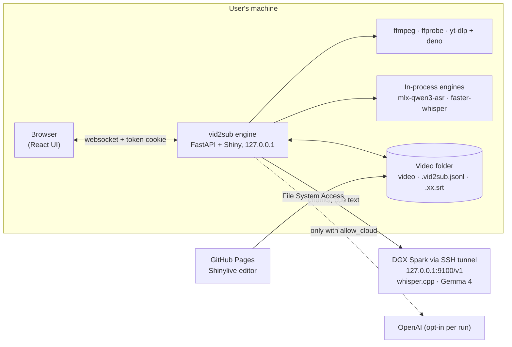

# vid2sub: design

Status: written 2026-10-14 from a brainstorming session with Dan and a five-reviewer design
council the same day (§27). Every decision is dated and attributed in the decision log (§28).
Things that could not be verified while designing are listed in §29; each one is checked in the
milestone that first depends on it.

vid2sub turns a video, a local file or a YouTube URL, into subtitle files: it extracts the
audio, transcribes it with timestamps in the video's language, optionally translates it, and
writes SRT (and optionally ASS) next to the video. A browser UI plays the video with the
subtitles and edits them. All the work runs on the user's own machine, or on models the user
runs themselves, such as Dan's DGX Spark; OpenAI is an opt-in fallback.

## Contents

1. Purpose and scope
2. Users, languages and platforms
3. Architecture
4. Repository layout and packaging
5. Configuration
6. Security model
7. Privacy
8. Media pipeline
9. Transcription engines
10. Detect, suggest, confirm
11. Model catalog
12. Building cues
13. Translation
14. The sidecar and data model
15. Subtitle files
16. Glossary
17. Jobs and the queue
18. CLI
19. The local web app
20. The editor
21. The Pages editor
22. Testing
23. CI, releases and distribution
24. Development conventions
25. Milestones
26. Items for other repos
27. Council review, 2026-10-14
28. Decision log
29. Verify during the build

---

## 1. Purpose and scope

**Goal (Dan, 2026-10-14).** Better closed captions, or a good starting point for them, for
YouTube videos and TV shows. Point the app at a video; the user's machine downloads it if
needed, extracts the audio, transcribes it into subtitles in the video's language
(auto-detected, overridable), optionally translates them, and writes SRT or ASS.

**Principles.**
- **The user's machine does the work.** There is no vid2sub server. The local app is a front end
  for commands run on the user's own computer, against models on that computer, on a machine
  they run (a DGX Spark reached through an SSH tunnel), or, only when they opt in for a run, a
  cloud API.
- **The app stores no state of its own.** Settings live in a file the user writes (§5); keys
  live in the user's environment; results live next to the video (§14, §15). Caches are
  disposable (§8.9).
- **Never overwrite an artifact.** The sidecar is append-only; subtitle files are projections of
  it and are only ever rewritten when vid2sub wrote them (§14, §15). This is the rule Dan's
  `audio-router` and `recordings` follow.
- **Cross-platform.** macOS, Windows and Linux, each with README setup that covers the
  modelling parts (§2.3, §23.5).

**In scope for v1.** Everything in §3–§24, delivered in the order of §25.

**Not in v1** (the Later list in §25 says when each might come): the Pages UI driving a local
engine ("B", §3.3); importing subtitle tracks embedded in MKV files; embedding YouTube's player;
speaker labels; a `vid2sub compare` model comparison; dedicated translation models
(TranslateGemma, HY-MT); `mlx-whisper`, Parakeet and local Qwen3-ASR on CUDA as in-process
engines; a version-history UI; sidecar compaction.

## 2. Users, languages and platforms

### 2.1 Users

Dan first, on a Mac with the DGX Spark at home. The app and README are written so another person
can install it on their own machine with their own models or an OpenAI key.

### 2.2 Languages (Dan, 2026-10-14)

- **Input:** Mandarin, Cantonese, Japanese, English.
- **Output:** mainly English. English in → English captions out is a real case too.
- **Not one model for everything.** Each source language gets the model that is best at it
  (§11), suggested after the audio is sampled and the user can override (§10).

### 2.3 Platforms

| Platform | Supported | Local transcription engine in v1 |
|---|---|---|
| macOS 14+ on Apple Silicon | yes | `mlx-qwen3-asr` in-process (§9.4) |
| Windows 10/11 x64 | yes | `faster-whisper` (CPU, or NVIDIA through the CUDA 12 cuBLAS runtime) |
| Linux x64 / aarch64 | yes | `faster-whisper` (CPU or NVIDIA) |
| Intel Macs | no | onnxruntime, needed by the VAD (§8.6), has no Intel macOS wheel |

Any platform can use an OpenAI-compatible endpoint instead (§9.3): the Spark, OpenAI, a local
whisper.cpp server, or `mlx-qwen3-asr serve`.

Python ≥3.12. The floor comes from the engines' wheels, not from Pyodide (`recordings` needs 3.14
and still ships Pyodide's 3.12); the pure core is tested on 3.12 and 3.14 (§22).

## 3. Architecture

### 3.1 Two ways to run it



- **The local app** (`vid2sub`): a Python engine on `127.0.0.1` serves the React UI, runs jobs
  and reads and writes files next to videos. Everything in v1 that generates subtitles runs here.
- **The Pages editor** (`chendaniely.github.io/vid2sub/`): the same UI and the same pure Python
  subtitle code running in the browser through Shinylive. It opens a folder on the user's disk,
  plays the video, edits and saves subtitles. It cannot generate subtitles (§21).

### 3.2 Core library with a CLI and the app on top (Dan, 2026-10-14)

All behaviour lives in `vid2sub`'s core: plain functions and small classes for probing,
extracting, chunking, transcribing, building cues, translating and writing. The CLI (§18) and the
web app (§19) call the same core. The subtitle model (`vid2sub.subs`) and the catalog
(`vid2sub.catalog`) are **pure**: standard library, pydantic, pysubs2, opencc-purepy and
charset-normalizer only, no I/O beyond what callers hand them, so they run unchanged in Pyodide.
An import-graph test enforces it (§22).

### 3.3 "B", later: the Pages UI driving the local engine

Dan wants B if it can be made to work (2026-10-14). It is not in v1, but v1 is shaped for it:
- The Shiny server talks to a **Backend** interface whose requests and responses are versioned,
  JSON-serialisable types keyed by item id. `LocalBackend` (the engine) and `BrowserBackend`
  (Pages) implement it. B adds a small versioned JSON API over `LocalBackend`; it never exposes
  the Shiny websocket cross-origin (§6.10).
- B's own security rules are decided now (§6.10).

## 4. Repository layout and packaging

### 4.1 Layout

```
pyproject.toml            one distributable package: vid2sub
src/vid2sub/
  subs/                   PURE — model.py (Word, Cue, Track…), build.py (cues from words, §12),
                          edit.py (split/merge/nudge/insert/delete), lint.py, text.py (EAW width,
                          kinsoku, canonical text), formats.py (SRT/ASS via pysubs2, §15),
                          sidecar.py (records, heads, merge, §14), naming.py (§15.1),
                          scripts.py (OpenCC Traditional/Simplified), translate_shape.py
                          (batch schemas + partition validator, §13)
  catalog.py              PURE — the model catalog (§11)
  parse/                  PURE — engine response parsers → normalised words (§9.2)
  media/                  probe.py, identity.py, decode.py, vad.py (Silero v6 ONNX), chunk.py,
                          preview.py, youtube.py, tools.py (resolving and running ffmpeg/yt-dlp)
  engines/                base.py (Engine protocol), endpoint.py, qwen_mlx.py,
                          faster_whisper.py, clients.py (the one client factory, §7.2)
  translate/              chatlas provider factory, batching, staleness
  pipeline.py             one job = ordered stages, progress events, cancellation
  jobs.py                 the in-memory queue (§17)
  config.py               vid2sub.toml loading and validation (§5)
  security.py             launch token, safe paths and writes, subprocess env (§6)
  cli.py                  `vid2sub …` (§18)
  web/
    app.py                FastAPI shell: /auth, /healthz, /media/{token}; Shiny mounted at /
    guards.py             HostGuard, WriteGuard (copied from recordings), TokenGuard, CSP
    server.py             the shinyreact server (ReactApp(server) is called in this file)
    backend.py            Backend protocol, LocalBackend, BrowserBackend
    www/                  ui.js + ui.css (build output), fonts
frontend/                 Vite + React 19 + TypeScript + Tailwind v4 + shadcn (radix-nova)
pages/                    the Shinylive entry (app.py, requirements.txt)
demo/                     a public-domain clip, its canned sidecar and subtitles, CREDITS.md
scripts/                  build_pages.py, brand_css.py, shinylive_local.py, rangeserver.py,
                          build_index.py (copied from recordings where noted, §4.4)
tests/  _brand.yml  Makefile  CLAUDE.md  README.md  vid2sub.example.toml
```

### 4.2 Dependencies

- **Core:** pydantic (≥2.10, the Pyodide floor is 2.10.5), pysubs2 (≥1.9), opencc-purepy
  (≥1.4, behind `subs/scripts.py` so it can be swapped), charset-normalizer, fastapi, uvicorn,
  shiny and shinyreact (pinned exactly, matching `recordings`), chatlas (≥0.23), openai,
  httpx, numpy, onnxruntime, `yt-dlp[default]` (lower bound only; a stale yt-dlp breaks on
  YouTube), platformdirs.
- **Extras:**
  - `[mac]`: `mlx-qwen3-asr[aligner]` (≥0.4.4; macOS 14+ on Apple Silicon).
  - `[whisper]`: `faster-whisper` (all platforms, CPU).
  - `[nvidia]`: `faster-whisper` plus the CUDA 12 cuBLAS runtime wheels (Windows and Linux).
- **Not an extra:** `qwen-asr`. It hard-pins transformers and accelerate, pulls in gradio and
  flask, is unsatisfiable together with `mlx-audio>=0.5`, and PyPI's torch is CPU-only on Windows
  (council, 2026-10-14). Qwen3-ASR runs on the Mac through `mlx-qwen3-asr` and on the Spark
  through a service local-ai builds (§26.1, item 7).
- `[tool.uv] conflicts` declares any extras that can't resolve together.
- **System tools,** checked by `vid2sub doctor` (§18): ffmpeg and ffprobe (≥6.0), deno (≥2.3;
  yt-dlp's only default JavaScript runtime for YouTube).

### 4.3 Versions and pins

Exact pins for shiny, shinyreact, shinylive and the npm `@posit-dev/shinyreact` types package,
upgraded together by the procedure in `recordings`' CLAUDE.md (§24). Lower bounds for engines
and yt-dlp. `uv.lock` committed; CI runs with `UV_FROZEN=1`.

### 4.4 Code copied from Dan's other repos

Copied files carry a header naming the source repo, path and commit, and are relicensed under
this repo's licence where Dan owns both. Planned copies:
- `recordings`: `hosts.py` (HostGuard, WriteGuard), the media route, `scripts/build_pages.py`,
  `brand_css.py`, `shinylive_local.py`, `rangeserver.py`, `_brand.yml`, the frontend's
  `Player.tsx`, `TranscriptTab.tsx` patterns, `lib/transcript.ts`, `lib/theme.ts`, `ThemeSwitch`,
  `sr.ts`, `vite.config.js`, and `media.py`'s decode (which already carries audio-router's
  provenance, so decode has one lineage).
- `audio-router`: `vocabulary_prompt` and `prompt_sha` (`stages/transcribe.py`), the
  version-string recipe (`worker.py`).
- `meanwhile`: `FolderPicker` and `media/folder.ts`, changed to `mode: 'readwrite'` (§21).
- `faster-whisper` (MIT, third party): `silero_vad_v6.onnx` and the torch-free
  `get_speech_timestamps`, with its licence (§8.6).

`vid2sub` does not import `recordings` or `audio-router`: `recordings` core needs Python 3.14 and
pins pydantic; `audio-router`'s engine set is closed. They share a data contract instead (§14.4).

## 5. Configuration

### 5.1 `vid2sub.toml` (Dan, 2026-10-14)

Settings live in one TOML file the user writes. **The app never writes it**, and **it refuses
key values**: only the *names* of environment variables that hold keys. Found at `--config PATH`,
else `VID2SUB_CONFIG`, else the platform config directory (`~/.config/vid2sub/vid2sub.toml` on
macOS and Linux, `%APPDATA%\vid2sub\vid2sub.toml` on Windows). `vid2sub config init` prints a
starter file to stdout. `vid2sub.example.toml` in the repo is the template (named `.toml`, not
`.env`, and never holding a secret).

```toml
[server]
port = 8765
open_browser = true

[privacy]
local_hosts = ["127.0.0.1", "localhost", "::1"]   # where a `local = true` model may live

[endpoints.spark]
base_url = "http://127.0.0.1:9100/v1"     # make tunnel (local-ai)
key_env = "SPARK_API_KEY"                 # VID2SUB_SPARK_API_KEY once local-ai Phase 3 issues one

[endpoints.openai]
base_url = "https://api.openai.com/v1"
key_env = "OPENAI_API_KEY"
allow_typed_key = true                    # a key may be typed into the UI for this endpoint (§5.3)

[models.spark-turbo]
catalog = "whisper-large-v3-turbo"        # catalog entry: descriptions, languages (§11)
endpoint = "spark"
model = "whisper-large-v3-turbo"          # the name the server knows
parser = "whisper.cpp"                    # response shape (§9.2)
local = true                              # valid only because spark's host is in local_hosts

[models.spark-gemma]
catalog = "gemma-4-26b-a4b"
endpoint = "spark"
model = "gemma-4-26b-a4b"
task = "translate"
local = true
concurrency = 1
request_extra = { chat_template_kwargs = { enable_thinking = false } }

[models.mac-qwen]
catalog = "qwen3-asr-1.7b"
engine = "mlx-qwen3-asr"                  # in-process; local by definition

[models.openai-whisper]
catalog = "openai-whisper-1"
endpoint = "openai"
model = "whisper-1"
parser = "openai"

[defaults]
targets = ["en"]
formats = ["srt"]
youtube_dir = "~/Movies/vid2sub"
cache_max_gb = 20
```

### 5.2 Validation

- Unknown keys anywhere are refused at load, naming the key and the line (an `audio-router`
  lesson).
- A key-looking value (`sk-…`, or any `*_key`/`*_token` field holding a value rather than an env
  var name) is refused, naming only the field.
- `local = true` is refused unless the model is in-process or its endpoint's host is in
  `privacy.local_hosts`.
- A key is sent over plain `http` only to a loopback address or a Tailscale address
  (`100.64.0.0/10`, `*.ts.net`); otherwise the endpoint must be `https`.
- Every config key has a test proving its value reaches the code that uses it (an
  `audio-router` lesson).

### 5.3 Keys

- **From the environment, by name, at call time.** On Dan's Mac `~/.secrets` exports them through
  `.zshrc`; on Windows, `setx` or a PowerShell profile. A long-running engine keeps the
  environment it started with, so the 401 hint says to restart vid2sub from a shell that exports
  the key.
- **Typed into the UI (Dan, 2026-10-14):** allowed only for an endpoint declared with
  `allow_typed_key = true`. The key is held in the engine's memory for that run, scoped to that
  endpoint's origin, never written, logged or sent back to the UI (which shows only "key entered
  for this session"), and dropped on exit.
- **A key goes only to the origin its endpoint declared** (§6.4).

### 5.4 Precedence

CLI flags (per run) > `vid2sub.toml` > built-in defaults. UI changes are per session and never
written; **Settings → Copy settings** gives the current session's settings as TOML to paste into
the file, never including a key. A model entry's `task` defaults to `transcribe`.

## 6. Security model

The engine is a local RPC server that lists directories, reads and writes files, runs
subprocesses and sends requests carrying API keys, and it runs on other people's machines. The
council's red team (§27) found three blockers in the first draft; the rules below fix them.

### 6.1 Binding and the launch token

- The engine binds `127.0.0.1` only.
- **Per-launch token, as Jupyter does.** On start the engine makes `secrets.token_urlsafe(32)`.
  It opens the browser through a redirect file (mode 0600, in a private temp directory) that
  sends the browser to `http://127.0.0.1:<port>/auth#t=<token>`; the token is in the fragment,
  so it never reaches the server's logs or the command line (`ps`). The `/auth` page's script
  (served as a file, no inline script) posts the token to `/auth` and receives an `HttpOnly`,
  `SameSite=Strict` cookie whose name includes the port (`vid2sub-8765`), then replaces the URL.
  The CLI also prints that URL for opening by hand.
- **Every route and the websocket handshake require the cookie**, except `/auth` and its script,
  and `/healthz`, which returns only `{"ok": true}`.

### 6.2 Origin and write guards

Copied from `recordings` (`hosts.py`), and kept because other localhost ports count as same-site:
- **HostGuard:** HTTP requests with a Host outside the allowlist get 400. A websocket is closed
  (1008) before accept unless the Host is allowed, the Origin is exactly `http://<Host>` with the
  port, and `Sec-Fetch-Site` is empty, `same-origin` or `none`.
- **WriteGuard:** every response gets `Cross-Origin-Resource-Policy: same-origin`,
  `Cross-Origin-Opener-Policy: same-origin`, `X-Frame-Options: DENY`,
  `Referrer-Policy: same-origin`. Any method other than GET/HEAD/OPTIONS needs a same-origin
  request with `Content-Type: application/json`.
- **No GET request writes anything or starts a process.** Shiny bookmarking stays off.

### 6.3 Content-Security-Policy and untrusted text

Any script on the app's origin controls everything, so nothing hostile may run there.
- **CSP on every page:** `default-src 'self'; script-src 'self'; connect-src 'self';
  object-src 'none'; base-uri 'none'; frame-ancestors 'none'; img-src 'self' data: blob:;
  media-src 'self' blob:`. Style rules are whatever Shiny and shinyreact need, verified in M2
  (§29); never `unsafe-eval`.
- **Untrusted text is rendered as plain text** in React: subtitle text (SRT `<font>` tags, ASS
  `{\…}` overrides), MKV tags, YouTube titles, file names, LLM output, error bodies, `/v1/models`
  lists. The caption overlay renders `<i>` only, through a whitelist; never
  `dangerouslySetInnerHTML`.
- **Fonts are served locally.** The app makes no third-party requests.
- `/media/` responses send `Content-Security-Policy: sandbox`, `X-Content-Type-Options: nosniff`
  and `Cache-Control: no-store`.
- Hostile sample files (§22.4) are part of the test suite.

### 6.4 Endpoints and keys

- **Endpoints, key env var names, `local` flags, the YouTube output folder and the list of
  models are fixed at launch** by `vid2sub.toml`. The UI only chooses among them. A URL can't be
  typed into the UI.
- **A key goes only to the origin it was declared with.** Every client gets `api_key` and
  `base_url` passed explicitly (never read from `OPENAI_API_KEY`/`OPENAI_BASE_URL` by the SDK),
  with redirects refused (`follow_redirects=False`), so a 307 can't re-send audio or a key
  elsewhere.
- **One client factory** (`engines/clients.py`) creates every openai, httpx and chatlas client.
  A test fails if any other module constructs one (§22.4).

### 6.5 Paths

- **Reads:** only files the user added this launch (typed, browsed to, or in a folder they added)
  and files vid2sub derives from them (sidecar, glossary, subtitles next to the video).
- **Writes:** only (a) the sidecar, subtitle projections and the glossary next to an added video,
  (b) the YouTube output folder from `vid2sub.toml`, (c) the cache (§8.9), (d) per-job scratch.
- **The in-app file browser** lists home and mounted volumes (`/Volumes`, drive letters,
  `/media`, `/mnt`), shows only folders, video and subtitle files, and hides dotfiles and
  credential folders (`.ssh`, `.aws`, `.gnupg`, `.config/gh`, …).
- **Accepted paths are fully qualified.** UNC paths only when the user typed or browsed to them,
  never when read from a file's contents (a UNC path leaks the NTLM hash).
- **`safe_component()`** builds every file name vid2sub writes: Unicode NFC, control and bidi
  characters stripped, `:` and other reserved characters replaced, Windows reserved names
  (`CON`, `NUL`, `COM1`… even with an extension) refused, trailing dots and spaces stripped,
  ≤255 bytes. YouTube titles go through it.
- **Media tokens:** `secrets.token_urlsafe(32)`, bound to the session, recording the file's
  (dev, inode) so a swapped file isn't served.

### 6.6 Writes

`safe_write()` is the only way vid2sub writes a file:
- write a temporary file in the target directory with `O_EXCL | O_NOFOLLOW` (on Windows, the
  equivalent create-new flags), fsync, then `os.replace`;
- refuse a target that exists and isn't a regular file (symlinks included);
- **never overwrite a file vid2sub didn't write** (one with no projection record in the sidecar,
  §15.3); the UI asks per file, the CLI needs `--overwrite-foreign`;
- each Save carries the sidecar hash it started from (compare-and-swap, §14.6), so two tabs or a
  tab and a job can't overwrite each other;
- on Windows, a replace that fails with a sharing violation is retried with backoff, then fails
  with "Plex or antivirus has the file open".

### 6.7 Subprocesses

`media/tools.py` runs every child process:
- **absolute executable paths**, resolved by `doctor`'s rules (`shutil.which`, then known install
  locations such as `/opt/homebrew/bin`), never the current directory;
- **argument lists, no shell; `cwd` = the job's scratch directory**, created by `mkdtemp`
  (mode 0700);
- **a minimal environment** from an allowlist (`PATH`, `HOME`/`USERPROFILE`, `TMP`/`TEMP`,
  `LANG`, `SYSTEMROOT`, …), so children never inherit keys;
- **timeouts** proportional to duration.

**ffmpeg/ffprobe:** `-nostdin -protocol_whitelist file -format_whitelist <the demuxers vid2sub
accepts>`, inputs as `file:` + absolute path. A playlist disguised as `.mp4` can then neither
fetch URLs nor read other files.

**yt-dlp:** run from the engine's own environment with `--ignore-config --no-plugin-dirs
--use-extractors youtube --no-playlist -f bestaudio/best -P <scratch> -o "%(id)s.%(ext)s" --
<url>`. The URL's host must be `youtube.com`, `www.youtube.com`, `m.youtube.com`,
`music.youtube.com` or `youtu.be`, and the video id is validated (ids can start with `-`, hence
the `--`). Never `--exec`, `--cookies-from-browser`, `-U` or unsafe-extension options. The
downloaded file is renamed to `safe_component("<title> [<id>]").<ext>` in the YouTube output
folder.

### 6.8 Logs and errors

- vid2sub's own logger records job ids, stage names, durations and error kinds, **never titles,
  paths, tokens or keys** (the `audio-router` `TITLE_KEYS` rule). Titles reach only an
  interactive terminal, never `--json` output or logs.
- The `openai`, `httpx` and `chatlas` loggers are fixed at WARNING; chatlas runs with
  `echo="none"`; uvicorn's access log is off; `OPENAI_LOG` and `CHATLAS_LOG` are ignored.
- `redact()` removes every configured key value and typed key from any exception text before it
  is shown or logged.

### 6.9 The Pages origin

The Pages editor shares `chendaniely.github.io` with `recordings` and `meanwhile`, and Pages can't
send `frame-ancestors`. So the editor refuses to run inside a frame (checked in JS), never
persists folder handles, and touches no network beyond its own files.

### 6.10 Rules for B, decided now

- B gets its own origin (a custom subdomain), not `chendaniely.github.io`.
- Pairing is approved on the local machine (the engine shows a code; the user confirms in the
  terminal or the local UI).
- The bearer token travels in a header, never a cookie.
- CORS allows exactly B's origin, never `*` or `null`.
- The engine answers the Private Network Access preflight
  (`Access-Control-Allow-Private-Network`), and the docs expect Chrome's Local Network Access
  prompt. Safari is expected not to work.
- B uses the versioned JSON API over the Backend interface (§3.3), never the Shiny websocket.

## 7. Privacy

### 7.1 What leaves the machine

| Route | Sends | Never sends |
|---|---|---|
| Spark / any `local = true` model | audio chunks as `chunk-0003.flac` with metadata stripped; cue text and glossary for translation | file names, titles, paths |
| Cloud model (opt-in per run) | the same | the same |
| YouTube | the video id | anything else |

### 7.2 Cloud is opt-in, per run

- A model is local only if its entry says `local = true` and its endpoint's host is in
  `privacy.local_hosts`, or it runs in-process (§5.2). llama-swap or Ollama can pass a request to
  a hosted model on `localhost`, which is why the flag is per model, as in `recordings`.
- Everything else is cloud. A run may use a cloud model only when **that run** sets
  `allow_cloud`: the `--allow-cloud` flag, or the checkbox on the Review screen, which starts
  unticked every time. **No config key or environment variable can preset it** (audio-router's
  rule: "no config key can make the exception a default").
- `clients.make_client(model, run)` raises `CloudNotAllowed` otherwise. It is the only factory
  (§6.4), so the check can't be skipped.
- Never fall back to another model or to the cloud when a model fails (§17.4).

### 7.3 Uploads

- Chunks are uploaded as `("chunk-0003.flac", bytes, "audio/flac")`, never as a path object (the
  SDK would send the real file name).
- Chunks are encoded with `-map_metadata -1 -fflags +bitexact`. ffmpeg otherwise copies an MKV's
  title into the FLAC, and the Spark's whisper-server (with `--convert`) logs ffmpeg's report,
  metadata tags included. A test checks the tags are empty (§22).

## 8. Media pipeline

### 8.1 Resolve

A local path (must exist and be a regular file), or a YouTube URL downloaded by yt-dlp (§6.7) into
the job's scratch directory and then moved, under a safe name, into the YouTube output folder:
audio only by default; the whole video when **keep video** is ticked (Dan, 2026-10-14). The
output folder is `defaults.youtube_dir`, or the platform's Videos folder + `vid2sub` when unset. A bot-check failure says to upgrade yt-dlp (`uv tool upgrade vid2sub
--upgrade-package yt-dlp`).

### 8.2 Probe

`ffprobe -show_format -show_streams -of json`: duration, `format.start_time`, video codec, every
audio stream (index, codec, channels, language tag, `disposition.default`, `start_time`).

**Browser playability** comes from the probe plus the browser's own `canPlayType`, reported by
the UI. Audio in AC-3, E-AC-3, DTS or TrueHD counts as unplayable even when the video codec plays
(silent playback is worse than none).

### 8.3 Video identity

Hashing a multi-GB file over SMB on every open is impractical. A video is identified by
`{size, quick_sha256, duration_ms}`, where `quick_sha256` hashes the size, the first MiB and the
last MiB. The full SHA-256 is computed by streaming during a job and appended to the sidecar as an
identity record (§14.2). On a mismatch the app warns with the difference rather than discarding
anything; it can re-link an orphaned sidecar after a rename by identity. Two videos with the same
stem in one folder are refused, because their sidecars and subtitles would collide.

### 8.4 Pick the audio track

The track whose language tag matches the chosen source language, else the file's default track,
else the first. The Review screen lists every track (language, codec, channels) for override
(Dan, 2026-10-14).

### 8.5 Decode and the timeline offset

Decode the chosen track to 16 kHz mono PCM WAV in scratch (`recordings`' `media.py` decode, §4.4).
Cue times are on the **player's timeline** (0 = start of playback). If the audio stream starts
later than the earliest stream (an MKV audio delay, an MPEG-TS `start_time`), the difference is
recorded as `timeline_offset_ms` and added to every word time. Tests use clips generated with an
audio delay (§22).

### 8.6 Voice-activity detection

Silero VAD v6 (ONNX) on onnxruntime with numpy, using the model file and the torch-free
`get_speech_timestamps` vendored from `faster-whisper` (MIT). ffmpeg's `silencedetect` is
energy-only and fails under music; the `silero-vad` PyPI package needs torch (council). Speech
regions are kept in the transcript's `meta` so the cue builder can drop words that fall in
non-speech (§12.5).

### 8.7 Chunking

- Each engine declares `max_chunk_s` (§9.1); for the endpoint engine it comes from the model's
  catalog entry, since one endpoint engine serves several model families. 300 s for
  Whisper-family models, 180 s for Qwen3-ASR (its aligner re-chunks above 180 s), whether
  in-process or behind `mlx-qwen3-asr serve`.
- Speech regions are grouped into chunks whose **core** is at most `max_chunk_s − 2 × pad`
  (pad 0.5 s), cut at the midpoint of a silence.
- Inside a chunk, non-speech spans longer than 2 s are replaced with silence, which cuts Whisper's
  invented lines over music.
- A chunk's offset is the time of the first sample sent, padding included. A word belongs to the
  chunk whose core contains its midpoint.
- **The language is fixed per job** (chosen at Review, §10) and passed with every chunk. Each
  chunk's detected language is recorded in `meta` only.
- **Prompt per chunk:** the glossary's terms (§16), then the previous chunk's last ~200
  characters, unless that chunk was flagged as hallucinated. Whisper prompts are truncated to fit
  its 224-token prompt window, glossary first.

### 8.8 Preview copy

For an unplayable video, the editor plays a playback audio file (AAC stereo `.m4a`, made on
demand) straight away, and offers **Make preview copy**: H.264 480p with AAC stereo in MP4, using a
hardware encoder when available (VideoToolbox, NVENC, QSV), else `libx264 -preset veryfast`
(Dan, 2026-10-14).

### 8.9 Cache and scratch

- **Scratch:** a `mkdtemp` directory (0700) per job, holding the WAV and chunks, deleted when the
  job ends. Chunk results are kept in memory for the engine's lifetime so a resumed job doesn't
  redo finished chunks.
- **Cache:** the platform cache directory (`~/Library/Caches/vid2sub`,
  `%LOCALAPPDATA%\vid2sub\Cache`, `~/.cache/vid2sub`), keyed by video identity, holding playback
  audio and preview copies. Disposable, capped by `defaults.cache_max_gb` with least-recently-used
  eviction, cleared by `vid2sub cache clear`.

### 8.10 Keeping the machine awake

While the queue runs: `caffeinate -i -w <pid>` on macOS, `SetThreadExecutionState` on Windows,
`systemd-inhibit` on Linux when available.

## 9. Transcription engines

### 9.1 The Engine protocol

```python
class Engine(Protocol):
    name: str            # "whisper.cpp" | "openai" | "qwen3-asr" | "faster-whisper"
    max_chunk_s: float
    supports_prompt: bool
    def transcribe(self, chunk: bytes, *, language: str, prompt: str) -> RawResult: ...
    def detect_language(self, sample: bytes) -> dict[str, float]: ...   # ISO code → probability
    def stamp(self) -> ModelStamp: ...    # model + revision ("unknown" when not knowable)
```

Engine names follow `audio-router` and `recordings`: `whisper.cpp`, `openai`, `qwen3-asr`,
`faster-whisper` (later `mlx-whisper`, `parakeet`). Heavy imports happen inside functions
(`audio-router`: mlx imports cost ~23 s), and in-process models are cached on the engine object
and released when the queue goes idle.

### 9.2 Normalised output and parsers

Every engine's response goes through a pure parser in `vid2sub.parse` into one shape:
- **Words follow Whisper's convention:** a leading space marks a word boundary, and
  `"".join(w.text for w in words) == segment.text`. CJK text has no spaces; Cantonese–English
  code-switching keeps the English words' leading spaces.
- **Times in integer milliseconds,** rounded once (chunk-offset sums otherwise produce values like
  `300.1000000000002`).
- **Untimed words** follow `recordings`' rule: start = end = the previous word's end, counted in
  `meta.untimed_words`. A segment whose words all lack times (Whisper's temperature fallback) is
  **unaligned** and keeps `words: []`.

Parsers, each with recorded fixtures (§22.3):
- `whisper.cpp` v1.9.4 `verbose_json`: `segments[].words` are BPE tokens, merged only to complete
  UTF-8 characters, so the parser merges them into words on the leading space. The top-level
  `language` is a full name ("japanese"); the ISO code comes from `language_probabilities`.
  `t_dtw` (when the server runs with DTW, §26.1) is in raw 10 ms units and is preferred over
  start/end when present. A token containing U+FFFD falls back to segment timing.
  Segments wrap at 60 characters unless `max_len` is set.
- OpenAI `whisper-1` `verbose_json` with `timestamp_granularities[]=word,segment`: words at the top
  level, assigned to segments by time.
- `mlx-qwen3-asr serve` `verbose_json`: top-level aligner words. The aligner's text has no
  punctuation (assumed until §29 confirms), so a pure `attach_punctuation(text, units)` maps the
  ASR text's punctuation onto aligned units.
- `faster-whisper` segments with `word_timestamps=True`.

### 9.3 The endpoint engine

One engine for every OpenAI-shaped `/v1/audio/transcriptions` server: the Spark's whisper.cpp
(through llama-swap), OpenAI, a local whisper.cpp server, or `mlx-qwen3-asr serve`. The `parser`
field (§5.1) picks the response parser. Requests send `language`, `prompt`,
`response_format=verbose_json` and, for OpenAI, `timestamp_granularities[]`. Responses' model
headers are recorded (§9.6).

### 9.4 `mlx-qwen3-asr` in-process (Mac)

Qwen3-ASR-1.7B with the Qwen3-ForcedAligner-0.6B on MLX, through `mlx-qwen3-asr` (≥0.4.4, native
MLX aligner, `--context` for vocabulary). `max_chunk_s = 180`. Qwen3-ASR **does** accept a
vocabulary context (council correction, 2026-10-14), so the glossary is passed as `context`.

### 9.5 `faster-whisper` in-process (Windows, Linux)

CTranslate2 conversions of Whisper large-v3 and large-v3-turbo, `word_timestamps=True`,
`vad_filter=False` (vid2sub's own VAD runs first). CUDA on Windows needs the cuBLAS 12 DLLs on
`PATH`; `doctor` checks and says how to fix it. CPU uses int8.

### 9.6 Version stamps

A transcript's `version` is `<model>@<rev12|unknown>+v<prompt_sha8>+p<pipeline8>`:
- `rev12`: the Hugging Face snapshot hash for in-process models (`audio-router`'s
  `model_revision`). For the Spark it is `unknown` today: llama-swap's `/v1/models` lists names
  only and whisper-server reports no model. When local-ai's Phase 3 sends `x-spark-model`, that
  header is recorded, and a header naming a different model from the one requested fails the job.
- `prompt_sha8`: `audio-router`'s `prompt_sha` of the glossary-derived prompt.
- `pipeline8`: a hash of the VAD model and settings, chunker version and prompt policy, so a
  pipeline change mints a new version.

## 10. Detect, suggest, confirm

Dan, 2026-10-14: the model picker comes after the audio is sampled and the language detected;
vid2sub suggests and the user overrides.

1. **Add.** Files or a folder (a season, sorted by `SxxEyy` when present) are probed in seconds.
2. **Sample.** For the first two files of each folder, in the background: decode, run VAD, take
   three ~20 s windows of speech at about 10%, 50% and 80% of the speech found (skipping theme
   songs and intros).
3. **Detect.** Each window is language-identified by the best available detector: Qwen3-ASR when
   it's available (97.9% average accuracy in Qwen's benchmark, against Whisper large-v3's 94.1%),
   otherwise Whisper through the endpoint (`language_probabilities`). The votes give a confidence
   and flag mixed-language content. **Whisper often labels Cantonese as `zh`,** so when Whisper
   says `zh` the row asks "Mandarin or Cantonese?".
4. **Suggest.** The catalog's routing (§11.2) picks a transcription model and a translation
   model. Models unavailable now are shown greyed with the reason ("Spark not reachable",
   "install `vid2sub[mac]`").
5. **Review.** One row per file; the rest of a folder inherits the sampled files' choices; the
   user overrides anything, with "apply to all".
6. **Start.** The queue runs unattended. Each job re-checks its first chunk's language and flags a
   disagreement in the editor rather than stopping.

## 11. Model catalog

### 11.1 Entries

`vid2sub.catalog` is data: one entry per model family with its languages, strengths, weak spots,
timestamp method, where it runs and how to install it. The UI's model pickers and Models page show
it; the README's model table is generated from it. `vid2sub.toml`'s `[models.*]` entries point at
catalog ids; catalog models with no configured entry are shown greyed with "add it to
vid2sub.toml".

| Catalog id | Good for | Weak spots | Runs on |
|---|---|---|---|
| `qwen3-asr-1.7b` (+ ForcedAligner-0.6B) | Mandarin, Cantonese (Qwen's numbers: WenetSpeech-Yue long 8.85 vs Whisper large-v3's 46.64; Cantonese dialogue 4.12 vs 31.04); strong English; Hong Kong and Guangdong accents; vocabulary context | Japanese supported, no published benchmark | Mac (`mlx-qwen3-asr`); the Spark once local-ai serves it (§26.1) |
| `qwen3-asr-0.6b` | the same, lighter | less accurate | Mac |
| `whisper-large-v3` | Japanese (until compared with Qwen3-ASR), 99 languages, vocabulary prompt | slower than turbo; poor on Cantonese | Windows/Linux (`faster-whisper`); the Spark if local-ai adds it |
| `whisper-large-v3-turbo` | English → English captions, quick drafts | weaker on Cantonese and tonal languages; no translate task | the Spark (resident); Windows/Linux |
| `openai-whisper-1` | cloud fallback, any language | 25 MB per request (chunks fit); cloud opt-in | OpenAI |
| `gemma-4-26b-a4b` (translation) | Japanese → English, general; always loaded on the Spark, two slots | | the Spark |
| `qwen3.8-27b` (translation) | Mandarin/Cantonese → English | Dan's coder: on demand, one slot, 41 GiB; not a default | the Spark |
| `openai-gpt` (translation) | cloud fallback | cloud opt-in | OpenAI |
| *later:* `parakeet-tdt-0.6b-v3`, `kotoba-whisper-v2`, `translategemma`, `hy-mt-1.5` | | | |

Excluded with reasons recorded: Ollama for transcription (no speech-to-text), SenseVoice (no
native timestamps).

### 11.2 Routing

An ordered preference per source language; the first model available now wins.

| Source | Transcription | Translation to English |
|---|---|---|
| Cantonese | `qwen3-asr-1.7b` (Spark, then Mac) → `whisper-large-v3` (warns: weak) | `gemma-4-26b-a4b` → configured local endpoint → OpenAI (opt-in) |
| Mandarin | `qwen3-asr-1.7b` → `whisper-large-v3` → turbo | the same |
| Japanese | `whisper-large-v3` → `qwen3-asr-1.7b` → turbo (order revisited after a comparison) | the same |
| English | `whisper-large-v3-turbo` (Spark) → `qwen3-asr-1.7b` (Mac) → `faster-whisper` turbo | none (English captions) |

The Spark default for translation is Gemma 4 for every language in v1 (council, 2026-10-14):
it's resident with two slots, while the only Qwen chat model on the Spark is the coder.

### 11.3 Chinese script

A per-track script setting, Traditional or Simplified, converted with OpenCC (`opencc-purepy`)
on cue text, never on words (conversion changes text length). The conversion is recorded as a
derived `cues` rendition with engine `opencc:<config>`. Defaults: Cantonese → Traditional (HK);
Mandarin → Simplified unless the user chooses Traditional (TW).

## 12. Building cues

Pure code in `vid2sub.subs.build`, from normalised words (§9.2), segments, VAD regions, the
language and the rules.

### 12.1 Invariants

Times are integer milliseconds; `0 ≤ start < end`; cues sorted; no overlaps; text uses `\n` for
line breaks and never contains a blank line.

### 12.2 Rules (defaults from Netflix's timed-text style guides, user-adjustable)

| | English | Japanese | Chinese (both) | Cantonese |
|---|---|---|---|---|
| Line width (EAW units: wide/fullwidth = 2, others = 1) | 42 | 26 (13 full-width) | 32 (16) | 32 (16) |
| Lines per cue | 2 | 2 | 2 | 2 |
| Reading speed for lint (chars/s) | 20 | 4 | 9 | 9 |

- Duration 833 ms to 7 s; minimum gap 2 frames (84 ms); a gap under 500 ms is closed by
  extending the earlier cue to the later start minus the minimum gap.
- **Reading speed never splits or merges cues.** It only extends a cue into a following gap and
  produces a lint warning. Verbatim Japanese can't meet 4 cps, so its warning is informational.

### 12.3 Breaking text

- Cues break at sentence punctuation and pauses, then at the width limit.
- Two lines are balanced. Space-delimited languages break at spaces; CJK breaks between characters
  following kinsoku rules (no line starts with closing punctuation such as `、。，．！？）」』…ー`;
  no line ends with opening brackets).
- Chinese lines don't end with `，` or `。`.

### 12.4 Unaligned and suspect text

- An unaligned segment's time is split across its cues in proportion to characters; the cues are
  flagged `est`.
- **Hallucinations are flagged, never deleted:** known phrases per language
  (ご視聴ありがとうございました, 字幕由Amara.org社区提供, "Thank you for watching", …), words
  inside VAD non-speech, and segments with high compression ratio or no-speech probability where
  the engine reports them. Flagged cues show in the editor (§20).

### 12.5 Flags

A cue's `flags` may hold `est`, `halluc`, `cps`, `width`, `duration`, `stale`, `untranslated`,
`edited`. Lint flags are recomputed, never stored as truth.

## 13. Translation

### 13.1 Providers (chatlas, Dan, 2026-10-14)

- `ChatOpenAI` for OpenAI itself (Responses API).
- `ChatOpenAICompletions` for every other OpenAI-compatible server: the Spark's llama-swap, LM
  Studio, vLLM and Ollama. (`ChatOllama` calls `/api/tags` when constructed and refuses anything
  that isn't Ollama.)
- **A fresh Chat per batch** (`chat_structured` adds turns to the Chat it's called on). At most
  `concurrency` batches in flight per model (default 1; 1 for the Spark).
- Thinking is switched off per request through the model entry's `request_extra`
  (`extra_body={"chat_template_kwargs": {"enable_thinking": false}}`), which llama.cpp honours.
- No tools are registered. Each item's length is capped. Output is treated as untrusted text
  (§6.3).

### 13.2 Batches

- About 40 source cues per batch, with up to 5 cues of context before and after, marked
  read-only.
- **A translation item covers one or more contiguous source cues:** `{"src": [ids…], "text": …}`.
  Japanese → English often reorders across cues, and strict one-to-one forces distortion.
- **The JSON schema is built per batch:** `src` items are `Literal[<this batch's ids>]`, so
  llama.cpp's grammar (which converts `response_format.json_schema.schema`) admits only real ids.
  A pure validator then checks the items partition the batch's ids in order.
- Each item gets `max_chars = min(2 × line width, reading speed × duration of its src cues)`,
  stated in the prompt so the model condenses.
- On a validation failure: retry once at half the batch size, then one cue at a time with
  context.

### 13.3 Prompt

A system prompt naming the source and target languages, the subtitle style (concise, natural,
no notes or explanations), the show's description and glossary entries with their preferred
translations (§16). No file names or titles.

### 13.4 Timing and pairing

- A translation cue's time is the span of its `src` cues, unless the user detaches it.
- Translation cues have their own ids. Each records `src` and `src_sha`, a hash of its source cues'
  text when translated.
- **Stale:** any `src` id is gone from the source head, or `src_sha` no longer matches, or the
  glossary hash or translation model changed. Stale cues are flagged; **Retranslate stale**
  re-runs them.
- **A translation the user edited is never replaced automatically** (`edited` flag, derived from
  the rendition lineage).

### 13.5 Edit effects on pairing

- **Split** a source cue: both halves get new ids with `from: [old]`; translations pointing at the
  old id re-point to both halves and are flagged.
- **Merge:** one new id; the translations of either part are concatenated and flagged.
- **Delete:** the id leaves every `src`; a translation left with an empty `src` is deleted.
- **Insert:** the new cue is `untranslated`.
- **Nudge:** translation times follow the source unless detached.

## 14. The sidecar and data model

### 14.1 File

`<video stem>.vid2sub.jsonl` next to the video (Dan, 2026-10-14). JSON Lines: a header, then one
immutable record per line. Records are never edited or removed; a merge of two writers is the
union of their records by id.

### 14.2 Records

```
L1  {"schema":"vid2sub/sidecar@1","video":{"name","size","quick_sha256","duration_ms"}}
Ln  {"type":"identity","sha256","at"}                       # full hash, appended when known
Ln  {"type":"rendition","id","parents":[ids],"track","body":{…}}
Ln  {"type":"head","track","rendition","by":"auto|editor|external|import|user","at"}
Ln  {"type":"projection","path":"<basename>","format":"srt|ass","track","rendition","sha256","at"}
```

- **`id`:** `r_` + the first 16 hex of the SHA-256 of the record's canonical JSON without `id`.
- **`track`:** a BCP-47 key (`ja`, `en`, `zh-Hans`, `zh-Hant`, `yue-Hant`) plus `sdh`/`forced`
  flags; `null` for transcripts. File names are derived from it (§15.1).
- **Paths are basenames only.** No absolute paths or host names are stored.
- The header holds only what can't change for this file. The audio track and timeline offset are
  per run, so they live in each transcript's `inputs`.

### 14.3 Rendition bodies

- **Transcripts use `recordings`' envelope exactly:** `schema: "recordings/rendition@1"`, `kind:
  "transcript"`, `engine`, `model`, `version` (§9.6), `created_at`, `inputs` (`dict[str, str]`:
  `audio_sha256` of the decoded 16 kHz mono WAV, `video_quick_sha256`, `audio_track` and
  `timeline_offset_ms` as strings), `meta` (word probabilities, avg_logprob, no_speech_prob,
  compression ratio, per-chunk language, VAD regions, untimed counts, pipeline details), and
  `payload` = `recordings`' `TranscriptPayload`: `{language, segments: [{start, end, speaker:
  null, speaker_name: null, embedding_key: null, text, words: [{word, start, end}]}]}`, times in
  seconds with millisecond precision. Every transcript body is
  validated in CI against a vendored copy of `recordings`' `rendition.schema.json`, recorded with
  its commit (§22.3). `recordings` could import these as they are.
- **Cue tracks use vid2sub's own body:** `schema: "vid2sub/cues@1"`, `kind: "cues"`, `engine`
  (`vid2sub` built from a transcript, `translate:<model>`, `editor`, `external`, `import`,
  `opencc:<config>`), `model`, `version`, `created_at`, `inputs`, `meta`, and
  `payload: {language, script, glossary_sha?, cues: [Cue]}`, where

  ```
  Cue = {"id": "c7Hq2", "start_ms": int, "end_ms": int, "text": "a\nb",
         "w": [i, j]?,          # word index range in the transcript (source tracks)
         "src": [ids]?, "src_sha"?,   # translation tracks
         "from": [ids]?,        # split/merge lineage
         "detached"?, "flags": [...]?}
  ```

  Cue ids are random, unique per track and never reused; SRT numbers are for display only.

### 14.4 Heads

- Each track has an explicit head: the rendition named by its latest `head` record.
- **A machine rendition (`auto`) never moves a head that an `editor`, `external`, `import` or
  `user` head set** without the user confirming.
- If two heads for a track name renditions where neither descends from the other (two writers
  diverged), the track is in **conflict**; the editor shows both and the user picks.

### 14.5 What a Save writes

One `cues` rendition per changed track (`engine: editor`, parent = the current head), a `head`
record for each, then for each projected file a `projection` record (with the hash of the bytes
about to be written), then the subtitle files (§15.2). Unsaved edits live in the tab, with a
`localStorage` draft for crash recovery (wrapped in try/catch) and a warning on close.

### 14.6 Write protocol

- Read the sidecar and its hash. Build the new content (existing lines + new records). Write it
  with `safe_write()` (§6.6). Just before replacing, re-read the hash; if it changed, merge (union
  by id, keeping existing order and appending new records) and retry.
- **A truncated last line** is ignored and reported. **Any other line that doesn't parse** stops
  the write: vid2sub never overwrites a sidecar it can't read, and tells the user.
- In the Pages editor, the same logic runs in Python on text React hands it; React re-reads the
  file before writing through the File System Access API (§21).

### 14.7 Size

About 400 KB of words for a 45-minute episode, plus about 50 KB per saved version. Compaction is
later.

## 15. Subtitle files

### 15.1 Naming (Dan, 2026-10-14: next to the video, Plex/Jellyfin style)

`<video stem>.<code>[.sdh][.forced].<srt|ass>`, with `<code>` mapped from the track's BCP-47 key:

| Track | File code | Why |
|---|---|---|
| `en` | `en` | |
| `ja` | `ja` | |
| `zh-Hans` (Mandarin, Simplified) | `zh-CN` | recognised by Jellyfin; Plex to verify (§29) |
| `zh-Hant` (Mandarin, Traditional) | `zh-TW` | the same |
| `yue-Hant` (Cantonese) | `zh-HK` | Jellyfin doesn't recognise `yue`; Plex documents ISO 639-1/2, which has no `yue` (council) |

`yue` stays in the sidecar. M1's exit test (§25) checks every code in Plex and Jellyfin.

### 15.2 Writing

- SRT is always written, ASS when ticked (Dan, 2026-10-14).
- vid2sub serialises with pysubs2's `to_string()`, normalises to LF and UTF-8 (BOM optional), and
  **writes those bytes itself** with `safe_write()`; the projection record's hash is of those
  bytes. (pysubs2's `save()` writes CRLF on Windows, which would make hashes differ by OS.)
- Canonical text: `\n` line breaks, no blank lines, `<i>` as the only markup carried through.
- **ASS:** a default style (an outlined sans with CJK fallbacks, bottom centre). When re-writing a
  vid2sub-written ASS that was styled elsewhere, the existing Script Info, Styles and any events
  vid2sub can't match are kept, and only matched Dialogue events are regenerated. A style-only
  edit isn't a cue edit.

### 15.3 External edits and other people's files

- **Only files with a projection record are vid2sub's.** On open, each is checked:
  - missing → re-projected on the next Save;
  - hash matches → nothing to do;
  - hash differs → parsed and compared with the projected rendition at the format's precision
    (ASS rounds to centiseconds). If the cues differ, an `external` rendition is appended (parent
    = the projected rendition, ids recovered by aligning time and text) and becomes the head;
    the editor says so.
- **A subtitle file with no projection record is someone else's** (Bazarr, a fansub, a download):
  never imported or overwritten automatically (§6.6). **Skip existing** applies per target
  language: a target whose file already exists is skipped (Dan, 2026-10-14).

### 15.4 Import an existing subtitle file (Dan, 2026-10-14)

**Import** loads an SRT or ASS as a track: read with `utf-8-sig`, falling back to
charset-normalizer (GBK, Big5 and Shift-JIS are common). The language comes from the file name's
code or the user's choice. It becomes an `import` rendition and, if it's the source language, the
source head. It has no word timings (no word highlighting); it can be edited and translated like
any track. Subtitle tracks embedded in MKV files are not in v1.

## 16. Glossary

Names get misheard and romanised inconsistently across a season (council, 2026-10-14). A glossary
file per show folder, `vid2sub.glossary.toml`, written by the user or from the editor's Save:

```toml
description = "Detective Conan, a Japanese anime about a teenage detective"
[terms]
"工藤新一" = "Shinichi Kudo"
"毛利蘭" = "Ran Mouri"
```

- **Transcription:** the source-side terms become Whisper's prompt (a comma-joined list, never
  instructions; `audio-router`'s lesson) or Qwen3-ASR's context.
- **Translation:** the description and term pairs go into the system prompt.
- Its hash goes into translation versions and staleness (§13.4).
- It is user content, so editor saves write it with `safe_write()` and only in a folder the user
  added.

## 17. Jobs and the queue

### 17.1 Model

- Jobs live in the engine's memory (Dan, 2026-10-14), owned by the engine, not the browser tab:
  closing a tab doesn't cancel a job; reopening shows progress. When the engine exits the list is
  gone; finished results are already on disk.
- One worker runs one job at a time (the Spark's whisper serves one request at a time anyway).
- Job states: `queued → running(stage, chunk i/n) → done | failed | cancelled`. Queue states:
  `running | paused(reason)`.

### 17.2 Stages

resolve → probe → hash (streaming, alongside) → decode → VAD → chunk → transcribe (per chunk) →
build cues → translate (per target) → write. A transcript rendition is appended only when every
chunk has finished.

### 17.3 Failures

- **Connection errors pause the whole queue** (refused, reset, tunnel down, the laptop slept)
  with a **Resume** button, instead of failing every remaining episode in turn (council). Resume
  restarts from the failed chunk.
- Other errors fail only that job, with a hint that names the fix:
  - connection refused → "is `make tunnel` running?" (linking local-ai's how-to);
  - 401 → "`SPARK_API_KEY` isn't exported in the shell vid2sub started from; restart it from one
    that is";
  - 413 → "chunk too large for this server";
  - timeouts and 5xx → two retries with backoff, then fail;
  - yt-dlp bot check → "upgrade yt-dlp".
- **Cancel** stops between chunks and kills child processes.

### 17.4 The Spark once local-ai's Phase 3 lands

- Accept a model's name or its role alias; record `x-spark-model` (§9.6).
- On an inline refusal's `error.code`: `loading` → wait `retry_after_s`; `no_fit`,
  `held_by_brake`, `gate_down` → pause the queue and show the refusal text.
- 429 from per-key concurrency → honour `Retry-After`.
- **Never fall back** to another model or to the cloud.
- Before Phase 3, a refused load is a plain error and its reason is in local-ai's `make status`;
  the hint says so.

## 18. CLI

- `vid2sub` / `vid2sub serve [--port N] [--no-browser] [--config PATH]`: start the engine and open
  the browser through the token redirect (§6.1). (`recordings` never opens a browser; vid2sub is a
  desktop tool.)
- `vid2sub run PATH|URL… [--from LANG] [--to LANG…] [--model ID] [--translate-model ID]
  [--format srt|ass]… [--keep-video] [--skip-existing] [--overwrite-foreign] [--allow-cloud]
  [--dry-run] [--json]`: the whole pipeline, folders expanded and sorted.
- `vid2sub translate VIDEO --to LANG [--stale-only] [--model ID] [--allow-cloud]`.
- `vid2sub import SUBFILE --video VIDEO [--lang LANG]` (§15.4).
- `vid2sub doctor [--json]`: tools and versions, extras, MLX/CUDA, endpoints reachable, keys
  present (presence only), cache size.
- `vid2sub config init`: prints a starter `vid2sub.toml`.
- `vid2sub cache clear`.

`--json` emits JSON Lines events with ids, stages and counts, never titles or paths. Exit codes
follow sysexits, as in `audio-router`: 0 ok, 1 failure, 64 usage, 69 unavailable (a tool or
endpoint), 75 temporary (paused, connection), 78 configuration. Writing is the point of `run`, so
it writes by default (unlike `audio-router`'s `--apply` verbs); `--dry-run` shows the plan, and
foreign files are protected (§6.6).

## 19. The local web app

### 19.1 Server

- **FastAPI shell** (`web/app.py`): `/auth`, `/healthz`, `/media/{token}` (FileResponse with Range,
  §6.3 headers), the Shiny app mounted at `/` last, wrapped as
  `HostGuard(WriteGuard(TokenGuard(api)))` (§6.1, §6.2).
- **shinyreact** (`web/server.py`): `ReactApp(server)` is called in that file (it finds `www/` from
  the calling frame). Outputs are `@reactive_output` JSON values from pure view functions;
  progress uses `send_message`. An unset input is a silent exception the client treats as
  pending; an explicit null clears a pane (`recordings`' pattern).
- **Backend** (`web/backend.py`, §3.3): the server calls `LocalBackend` or `BrowserBackend`; a
  `capabilities` output tells React which controls exist (path box or folder picker; Generate or
  not; Save to disk or Download).

### 19.2 Screens

- **Top bar:** whether this is the local engine or the browser editor (from `capabilities`, not a
  toggle), engine status (Spark reachable, keys present or missing, never values), theme switch.
- **Add** (local only): paste paths, **Browse** (the in-app file browser, §6.5), a YouTube URL with
  **keep video**. Folders add their videos sorted by `SxxEyy`.
- **Review** (§10): one row per file: name, duration, audio track, detected language and
  confidence ("Mandarin or Cantonese?" when needed), transcription model (catalog one-liner),
  targets (default `en`), formats, Chinese script; inherited rows marked; "apply to all";
  **Allow cloud models for this run** (unticked every time); Start.
- **Jobs:** per-stage and per-chunk progress ("transcribing 7/11"), cancel, the paused banner
  with Resume, errors with fix hints, **Open in editor**.
- **Editor** (§20).
- **Settings drawer:** the configured endpoints and models from `vid2sub.toml` (read-only), with
  **Test** (lists the server's `/v1/models`); a typed key for endpoints that allow one (§5.3);
  per-session defaults (targets, formats, cue rules); **Copy settings** (TOML).
- **Models:** the catalog, marked with what's usable on this machine now and why not otherwise.

### 19.3 Look and accessibility

- From `recordings`: `_brand.yml` → `scripts/brand_css.py` → shadcn tokens; shadcn `radix-nova`;
  Atkinson Hyperlegible and Mono served locally; light and dark themes. NYC blue `#236192` is the
  working colour (`#6CA6D9` in dark mode) and NYC orange `#F26522` the accent (Dan, 2026-10-14).
- Orange on white is 3.1:1, so orange marks bars and backgrounds (the current cue's left bar),
  never text.
- `aria-current` on the current cue; a polite live region for job progress; every action reachable
  by keyboard; visible focus.

## 20. The editor

- **Player** on the left: the video when the browser can play it, else the playback audio with
  **Make preview copy** (§8.8); a caption overlay redrawn live as cues change, showing source,
  translation or both.
- **Cue list** on the right, one row per source cue with its translation alongside (§13.5): number,
  time, source text, translation, flags as badges (reading speed, width, duration, `est`, `halluc`,
  `stale`, `untranslated`). The current cue is marked with the orange bar; the word being spoken is
  highlighted from the transcript's word times. Rows follow playback unless the user turns that off.
- **Editing:** edit text; set start or end to the playhead; nudge ±100 ms (±500 ms with Shift);
  split at the caret; merge with the next; insert; delete; undo and redo. Edits run through the
  pure `subs.edit` operations on the server (in Pages, in Pyodide), so edit rules exist once.
- **Retranslate:** the current cue, the selection, or everything stale (§13.4).
- **Find and replace** across tracks, with "add to glossary".
- **Practice aids:** loop the current cue; playback at 0.75×, 1× and 1.25×.
- **Keyboard model, safe with CJK input methods:**
  - *Navigate mode* (default): Space play/pause, J/K/L shuttle, ↑/↓ previous/next cue, `[` and `]`
    set start/end to the playhead, Alt+←/→ nudge, Enter to edit the selected cell.
  - *Edit mode:* typing goes to the text; only Ctrl/⌘ chords act (⌘↵ commit, ⌘⇧S split at caret,
    ⌘M merge with next); Esc returns to navigate mode.
  - Keydown events are ignored while `event.isComposing` (or keyCode 229), so committing an IME
    candidate with Enter never triggers an action.
- **Save** writes a version (§14.5). The version-history UI is later; the data is kept.

## 21. The Pages editor

Dan, 2026-10-14: the Pages site is a working subtitle editor with no install, plus a sample clip.

- **Build:** Shinylive 0.8.12 (assets 0.10.15, Pyodide 0.27.7, Python 3.12.7, pydantic 2.10.5),
  pinned through `scripts/shinylive_local.py` as in `recordings`. The app bundles
  `vid2sub.subs`, `vid2sub.catalog`, `vid2sub.parse`, `web/server.py` with `BrowserBackend`,
  shinyreact, and vendored wheels of pysubs2, opencc-purepy and charset-normalizer, so the site
  never fetches from PyPI. Pyodide loads packages only for imports in the app directory's top-level
  `.py` files, so `pages/app.py` imports them at the top and lists them in `requirements.txt`.
  There is no FastAPI (Shinylive's Starlette is 0.38).
- **Opening files:** `FolderPicker` from `meanwhile`, with `showDirectoryPicker({mode:
  'readwrite'})` in Chrome and Edge (a file handle has no parent, so the user picks **the
  folder**) and `<input webkitdirectory>` (read-only) in Safari and Firefox.
- **Python runs in a Web Worker,** so file handles stay in React. React reads the sidecar,
  subtitle and glossary files as text and hands them to Python; the video plays from a blob URL;
  video bytes never enter Python (wasm32 has a 4 GB address space). Identity uses a quick hash
  computed in JS (§8.3).
- **Saving:** in Chrome and Edge, Python returns the new file contents and React writes them next
  to the video, re-reading the sidecar first (§14.6). In Safari and Firefox, Save offers downloads
  of the subtitle files and of the whole sidecar.
- **Hidden in Pages:** Add, Review, Jobs, engine settings. A banner says "Generating subtitles
  needs the local app — Install →".
- **Demo:** a public-domain clip (non-English, so translation shows) with a canned sidecar and
  subtitles, credited in `demo/CREDITS.md`. Only `demo/` is exported.
- **Origin rules** in §6.9.

## 22. Testing

### 22.1 Conventions

pytest, with test names as sentences (`test_a_machine_rendition_never_moves_an_editor_head`).
Guard tests must fail without their fix (verified by reverting). `--import-mode=importlib`;
fixtures are synthetic or public-domain only. Vitest for pure frontend logic; Playwright for e2e,
with `data-testid` selectors.

### 22.2 The pure core

Heavily unit-tested:
- cue building for English, Japanese, Mandarin, Cantonese and Cantonese–English code-switching;
  unaligned segments; U+FFFD; hallucination flags; the §12.1 invariants (property-based tests);
- SRT/ASS round-trips, LF bytes and hashes on every OS, ASS centisecond comparison and style
  preservation;
- naming codes;
- sidecar append, merge, heads, conflicts, truncated last line, refusal of an unparseable line;
- external-edit detection and id recovery;
- import with GBK, Big5 and Shift-JIS fixtures;
- the translation partition validator and staleness rules;
- edit operations and their pairing effects (§13.5).

### 22.3 Contracts and parsers

- Every transcript body validates against the vendored `recordings` `rendition.schema.json`.
- Each parser has fixtures recorded from the real server or library (whisper.cpp v1.9.4 with and
  without DTW, OpenAI `whisper-1`, `mlx-qwen3-asr serve`, faster-whisper), on public-domain audio,
  committed with how they were recorded.

### 22.4 Engines, translation, security

- Fake servers on real sockets (as in `recordings`) for whisper.cpp and OpenAI shapes: 401,
  connection refused, redirect (must not be followed), 413, 429 with Retry-After, Phase 3 error
  codes. Assertions: the upload's file name is `chunk-NNNN.flac`; the chunk has no metadata tags;
  keys go only to the declared origin.
- A fake OpenAI-compatible server enforcing `json_schema` for translation, including partition
  failures and the retry path.
- `make_client` is the only constructor of openai/httpx/chatlas clients (an AST test);
  `allow_cloud` is enforced.
- HostGuard and WriteGuard tests copied from `recordings`; TokenGuard tests; CSP headers present;
  hostile SRT/ASS/titles render as text (Playwright); symlink and foreign-file refusals;
  `safe_component()` on Windows names on every OS; the subprocess environment allowlist.
- Demo isolation with an audit hook, as in `recordings`.

### 22.5 Media

Tiny clips generated in CI with ffmpeg `lavfi`: speech-like tone and silence, an MKV with an audio
delay, several audio tracks with language tags, a title in the metadata. Checks: track picking,
the timeline offset, chunk boundaries, stripped tags.

### 22.6 Platform and runtime jobs

- **Pyodide:** the `subs/` tests run inside the real Pyodide 0.27.7 through a Node harness (the
  council's verification took ~10 s).
- **Floor:** Python 3.12 with pydantic 2.10.5.
- **Purity:** an import-graph test for `subs/`, `catalog.py` and `parse/`.

### 22.7 End to end

- Playwright against `vid2sub serve --demo` (a canned engine over a copy of `demo/`) on a free
  port, polling `/healthz`, with the token flow scripted.
- The Pages site served under `/vid2sub/` by `rangeserver.py`, reached through the Shinylive
  iframe, failing on any console error or any request outside the prefix (`recordings`' `Watch`).

### 22.8 Live tests

Opt-in by environment variable (`VID2SUB_LIVE_SPARK=1`, `VID2SUB_LIVE_MLX=1`): a public-domain clip
through the real Spark or the Mac engine.

## 23. CI, releases and distribution

### 23.1 Hardening (as in `recordings`)

Every action pinned by SHA with a version comment; `persist-credentials: false`; per-job
`permissions` and `timeout-minutes`; `ubuntu-24.04`; uv pinned with `UV_FROZEN=1`; Node 22 from
`.nvmrc`; gitleaks pinned and checksum-verified, scanning the whole history; Dependabot on Fridays.

### 23.2 `ci.yml`

`python` (Ubuntu, macOS 14 and Windows × Python 3.12 and 3.14 for the core), `floor`, `pyodide`,
`frontend` (typecheck, Vitest, build), `e2e`, `leaks`.

### 23.3 `pages.yml`

The only workflow that deploys Pages. Triggers: push to `main`, `workflow_dispatch` (Dan,
2026-10-14), `release: published`; pull requests build and test only. Steps: build the frontend,
the Shinylive export (assets cached by version), the demo, the package index (§23.4), the Pages
Playwright test, then `upload-pages-artifact` (with `include-hidden-files: true` for `.nojekyll`)
and `deploy-pages`. No `gh-pages` branch.

### 23.4 Releases and the install index (Dan, 2026-10-14: no PyPI)

- `release.yml` on a `v*` tag: build the frontend, then the wheel and sdist with `www/` inside,
  publish a GitHub Release with build-provenance attestations. It doesn't deploy Pages.
- `pages.yml` generates a PEP 503 simple index at `/simple/vid2sub/` linking to every release
  wheel with `#sha256=` fragments. Install and upgrade:

  ```bash
  uv tool install 'vid2sub[mac]' --index https://chendaniely.github.io/vid2sub/simple/
  uv tool upgrade vid2sub          # the index and extras are kept in uv's tool receipt
  ```

  An index named with `--index` is checked before PyPI, so a later `vid2sub` on PyPI can't
  hijack installs (verified with uv 0.13.1 by the council).
- A post-deploy smoke job installs from the live index on all three operating systems.

### 23.5 README

- Install per OS: uv, ffmpeg ≥6, deno ≥2.3, the right extra; Windows NVIDIA notes (cuBLAS 12).
- Configure: `vid2sub config init`, keys in the environment.
- Endpoints: the Spark (linking local-ai's tunnel how-to rather than copying the ssh command, since
  llama-swap moves behind a Unix socket in local-ai's Phase 2), OpenAI, LM Studio or Ollama for
  translation.
- The model table, generated from the catalog.
- Upgrading yt-dlp.
- Building from scratch with Node: clone, `npm ci && npm run build` in `frontend/`, `uv sync`,
  `uv run vid2sub` (Dan, 2026-10-14). The Makefile is for development; the README gives plain uv
  and npm commands so Windows works without make.

## 24. Development conventions

- **Skills:** `make skills` installs shinyreact's skills (`uvx library-skills install --claude
  --yes --skill shinyreact-build-app --skill shinyreact-convert-app`, symlinked into
  `.claude/skills` so they follow the installed package) and the shadcn skill (`npx skills add
  shadcn/ui --skill shadcn --agent claude-code --yes`). The UI is scaffolded with
  `/shinyreact-build-app` (Dan, 2026-10-14).
- **CLAUDE.md** carries `recordings`' "Check the docs, never write from memory" table (shinyreact,
  shadcn, brand.yml, Tailwind v4, chatlas, pysubs2, yt-dlp, whisper.cpp server) and its rules:
  React stays external (`window.shinyreact.React`; two copies make every hook silently return
  nothing); `www/ui.js` is build output; `ReactApp(server)` lives in `web/server.py`. Commits and
  PRs say which docs or skills were checked.
- **Upgrading shinyreact:** `recordings`' procedure (both pins, `make skills`, `.nvmrc`, the
  example toolchain versions, the bundled React minor).
- **Makefile targets** follow `recordings`: `setup`, `skills`, `build`, `test`, `e2e`, `demo`,
  `pages`, `pages-serve`, `pages-test`, `brand`, `schemas`.
- **Commits:** conventional with scopes (`feat(subs):`, `fix(media):`, `docs(spec):`), subjects as
  plain behavioural sentences, bodies saying what was checked.
- **Comments and docstrings:** module docstrings start with one sentence of purpose, then why;
  decisions cite the spec section and who decided; British spelling, as in `recordings`.

## 25. Milestones (Dan, 2026-10-14: the council's re-phasing)

Each milestone ends with something Dan uses.

**M1: the CLI, end to end.**
- `subs/`, `parse/`, `catalog.py`, `media/` (probe, identity, decode, timeline offset, VAD,
  chunking, YouTube), the endpoint engine (Spark whisper.cpp, OpenAI, `mlx-qwen3-asr serve`), the
  in-process `mlx-qwen3-asr` engine, cue building, translation through chatlas (Spark Gemma 4),
  the sidecar and projections, naming, import, the glossary, `vid2sub.toml`, `doctor`, and the
  non-web security rules (§6.4–§6.8, §7).
- **Exit test:** one Cantonese episode and one Japanese episode each produce a `.en.srt` that is
  watchable in Plex; every naming code is checked in Plex and Jellyfin; an English YouTube video
  gets English captions.

**M2: the editor.**
- The FastAPI shell and every web security rule (§6.1–§6.3), the shinyreact app, the editor
  (§20), retranslate and staleness, external-edit handling, the settings drawer with typed keys, a
  minimal Jobs page (paths in a text box, progress, cancel).
- **Exit test:** open an M1 episode, fix lines, retranslate stale cues, save; edit the SRT in
  another editor and see it come back as an external version.

**M3: adding, reviewing, and every platform.**
- Add with the file browser and YouTube, detect → suggest → confirm, the Models page, the queue's
  pause and resume, sleep inhibition, the preview copy, `faster-whisper` on Windows and Linux.
- **Exit test:** add a season folder, review it, run it unattended; the Windows and Linux path
  passes CI and one manual run.

**M4: Pages and releases.**
- The Pages editor and demo, `release.yml`, the index, the README.
- **Exit test:** on Pages in Chrome, open a local folder, edit and save next to the video; in
  Safari, edit and download; install from the index on a clean machine.

**In parallel (local-ai, Dan's call):** the Qwen3-ASR service on the Spark (§26.1, item 7). Until
it exists, Mandarin and Cantonese use the Mac engine.

**Later:** B (§3.3, §6.10); `vid2sub compare`, scoring models against an episode corrected in the
editor; dedicated translation models (TranslateGemma, HY-MT; a per-cue path); `mlx-whisper`,
Parakeet and local Qwen3-ASR on CUDA; embedded MKV subtitle tracks; YouTube's player in the editor
(it would need a CSP exception); speaker labels; the version-history UI; sidecar compaction.

## 26. Items for other repos

### 26.1 For local-ai's plan (paste-ready; Dan decides)

*From vid2sub's design (2026-10-14), relevant to the Backlog's "subtitles and translation".*

1. **Batch whisper (Phase 3):** give it a role of its own (`stt-batch`), and have render pick
   Open WebUI's speech model by the `stt` role rather than "exactly one transcription model"
   (`render.py:324`). Not urgent for vid2sub: whisper-server serves one request at a time and
   vid2sub sends chunks of at most 5 minutes, so voice input waits for one chunk at most.
2. **Speech comparison:** add Mandarin, Cantonese and Japanese samples. Parakeet TDT v3 covers 25
   European languages only, so the batch path keeps a Whisper model for CJK.
3. **Endpoint reference:** note that turbo doesn't support Whisper's `translate` task.
4. **`spark keys create vid2sub`** in a batch access group (S08). LiteLLM's hook should cover
   multipart `/v1/audio/transcriptions` (inline refusals, `x-spark-model`, `wait_for_fit_s`).
5. **DTW on the batch instance:** `--dtw large.v3.turbo` **and** `--no-flash-attn`. v1.9.4 turns
   flash attention on by default and whisper.cpp then disables DTW (`src/whisper.cpp:3791`). Both
   are startup-only and not in render's ALLOWED list (`render.py:82`). Measure speed and
   re-measure the footprint.
6. *(Dropped: `--vad-model`. vid2sub runs Silero before uploading. If another client wants it,
   the VAD file is a pinned `source` field render passes, like `mmproj`, never an `args` path.)*
7. **Qwen3-ASR-1.7B + ForcedAligner-0.6B:** a new engine kind (the registry knows only llama.cpp
   and whisper.cpp, `registry.py:13`; render treats any other engine as llama.cpp,
   `render.py:117`). Built like the diarization wrapper: FastAPI, torch on aarch64/sm_121, sources
   of several files from two repos, its own ALLOWED list, returning `verbose_json` with top-level
   words (the shape `mlx-qwen3-asr serve` uses). About 8 GiB (estimate). With the coder loaded only
   9 GiB is free for a load (min(117−84−24, 102−84)), and render warns that everything loaded at
   once would leave 25 GiB, under the 28 GiB warn line. First check whether vLLM already serves
   its text (vLLM serves Qwen3-ASR but refuses `verbose_json` and returns no words for it).
8. **Whisper large-v3:** its own on-demand model (~4 GiB; one whisper-server serves one model),
   only if vid2sub's comparison shows it beating turbo on Japanese.
9. **Translation:** an on-demand translation model, so zh/yue → en doesn't queue on the coder's
   single slot. Compare TranslateGemma 12B and HY-MT1.5 / Hunyuan-MT-7B through `spark try`
   against Qwen and Gemma.

### 26.2 For recordings

- vid2sub's transcripts use `recordings/rendition@1` and `TranscriptPayload` exactly (§14.3);
  `recordings` can import them later.
- vid2sub writes the first real YouTube source and video → audio extraction. They're shaped for
  copying: the YouTube source as `Source.fetch(ref, workdir) → Fetched` with
  `time_source="published"`, the Spark client mirroring `Backend.transcribe(audio, *, vocabulary)`
  with the SDK in one module and the parser pure, engine names `whisper.cpp` etc.
- yt-dlp now needs deno (≥2.3) for YouTube; `recordings`' spec doesn't mention it.

## 27. Council review, 2026-10-14

Dan asked for a council before the spec. Five reviewers read the design draft and Dan's related
repos: **goal-fit and scope**, **technical feasibility** (each claim checked against current
sources; it ran the pure core inside Shinylive's Pyodide and tested uv against a redirecting
index), **security and privacy red team**, **data model and subtitle correctness**, and
**ecosystem and the Spark**. Six blockers, all fixed above:

| Blocker | Fix |
|---|---|
| M1–M2 gave no English for CJK | M1 is the CLI end to end (§25) |
| Choosing the newest version by clock lost edits | ids, parents and explicit heads (§14.4) |
| The sidecar had no safe write path | JSONL, compare-and-swap, union merge (§14.6) |
| A settings file that might hold a key, named to get past Dan's `.env` hooks | `vid2sub.toml` refusing keys (§5) |
| A UI-set URL plus a key env var name could send any secret anywhere | endpoints fixed at launch; keys only to their origin (§6.4) |
| No authentication, and hostile text rendered on the app's origin | launch token; CSP; plain text (§6.1, §6.3) |

Corrections to the draft: Qwen3-ASR takes a vocabulary context; its aligner works in 180 s
pieces; whisper.cpp's `verbose_json` words are tokens; DTW needs flash attention off; `yue` isn't
a Plex/Jellyfin code; `qwen-asr` can't be an extra; Spark revisions aren't reported yet; the
Spark's translation default is Gemma 4, not the coder.

## 28. Decision log

| Date | Decision | By |
|---|---|---|
| 2026-10-14 | A local app now; the Pages UI driving a local engine ("B") later, designed for now | Dan |
| 2026-10-14 | Pages: a working editor with no install, plus a demo clip | Dan |
| 2026-10-14 | Input by path (typed or browsed), never a browser upload | Dan |
| 2026-10-14 | YouTube: audio only by default, "keep video" option | Dan |
| 2026-10-14 | Subtitles next to the video, Plex/Jellyfin names | Dan |
| 2026-10-14 | chatlas for LLM calls; transcription through the openai SDK or in-process engines | Dan |
| 2026-10-14 | Transcription on the Spark or locally, with timestamps fit for subtitles | Dan |
| 2026-10-14 | Player, transcript and editing in the app, Pages and local | Dan |
| 2026-10-14 | Unplayable video: audio straight away, preview copy on demand | Dan |
| 2026-10-14 | A sidecar next to the video | Dan |
| 2026-10-14 | A queue, one job at a time, skip existing | Dan |
| 2026-10-14 | Audio track auto-picked by language, overridable | Dan |
| 2026-10-14 | SRT always, ASS optional | Dan |
| 2026-10-14 | Settings in a file, UI changes per session, Copy settings | Dan |
| 2026-10-14 | CI builds the frontend into wheels; no PyPI; README covers a from-scratch build | Dan |
| 2026-10-14 | Core library with a CLI and the app on top | Dan |
| 2026-10-14 | Languages: Mandarin, Cantonese, Japanese, English in; mainly English out; many models | Dan |
| 2026-10-14 | Detect the language from samples, suggest a model, user overrides | Dan |
| 2026-10-14 | NYC blue and orange, from `recordings`' brand | Dan |
| 2026-10-14 | Shinyreact's own skills for building the UI | Dan |
| 2026-10-14 | A council review before the spec | Dan |
| 2026-10-14 | `vid2sub.toml`, refusing key values; keys only from the environment | Dan, after the council |
| 2026-10-14 | A key may be typed in the UI, only for endpoints declared at launch | Dan, after the council |
| 2026-10-14 | Milestones re-phased so CJK → English works in M1 | Dan, after the council |
| 2026-10-14 | Importing an existing SRT/ASS as a track is in v1 | Dan, after the council |
| 2026-10-14 | v1 engines: endpoint, `mlx-qwen3-asr`, `faster-whisper`; `qwen-asr` not an extra | Claude (council); Dan didn't object |
| 2026-10-14 | Silero v6 ONNX for VAD | Claude (council); Dan didn't object |
| 2026-10-14 | Cantonese files named `.zh-HK`; `yue` only in the sidecar | Claude (council); Dan didn't object |
| 2026-10-14 | The install index is generated by `pages.yml` | Claude (council); Dan didn't object |
| 2026-10-14 | Gemma 4 as the Spark's translation default | Claude (council) |
| 2026-10-14 | No embedded YouTube player in v1 (CSP: no third-party requests); "keep video" instead | Claude (council); open for Dan |
| 2026-10-14 | Intel Macs unsupported (no onnxruntime wheel) | Claude (council); open for Dan |

## 29. Verify during the build

Each is checked in the milestone that first depends on it; the result goes into this spec.

- **M1:** Plex's handling of `zh-CN`, `zh-TW`, `zh-HK` (its support page couldn't be fetched);
  the Qwen3-ForcedAligner's output format (punctuation, units) and `mlx-qwen3-asr serve`'s
  stability; the real cue-timing quality of whisper.cpp tokens without DTW, against a
  hand-corrected episode; whether ffmpeg ≥6.0 is the right floor.
- **M2:** the CSP that Shiny and shinyreact need (inline styles, `eval`); the 2026 browser codec
  matrix (Chrome HEVC depends on hardware; Firefox MKV arrived in late 2025).
- **M3:** CUDA cuBLAS setup for faster-whisper on Windows.
- **M4:** Pyodide and Shinylive versions at build time; Safari's File System Access status.
- **local-ai:** Qwen3-ASR under vLLM or torch on the GB10 (aarch64, sm_121).
